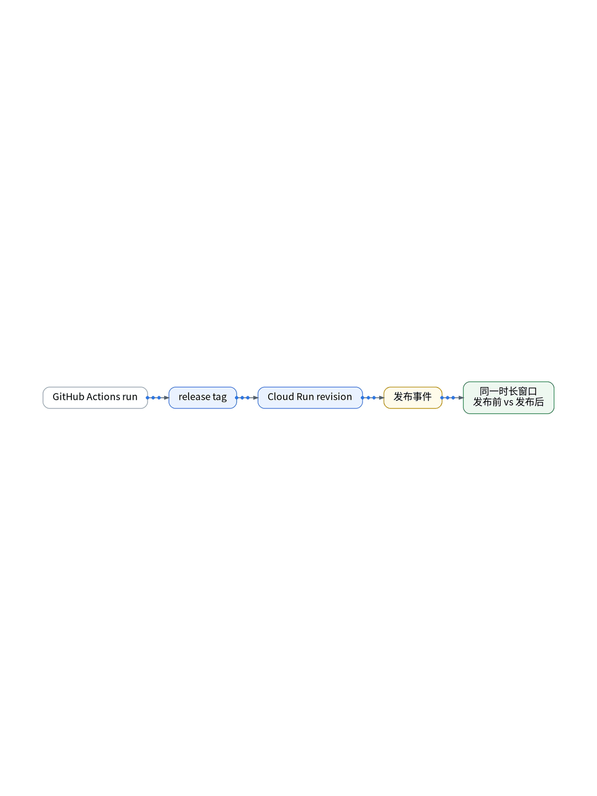

# AI写完了，怎么确认没变差？

> 状态：大纲（证据未就绪，暂不成稿）

AI 写完代码、CI 通过，就真的没变差吗？把 GitHub run、release tag、Cloud Run revision 串起来，发布前后各取同一时长窗口，对比错误率、延迟和用户体验。差了就回滚，好了才算交付。

【待实测截图】：发布事件写入接口文档（需核验），脱敏后放这里；没有真实截图就不发。

结论：发布前后同窗比，才知道这一版好不好。

上一篇：AI没崩，但一直在原地打转｜下一篇：没有值班团队，AI先查什么？

#独立开发 #可观测性 #观测云 #AI
