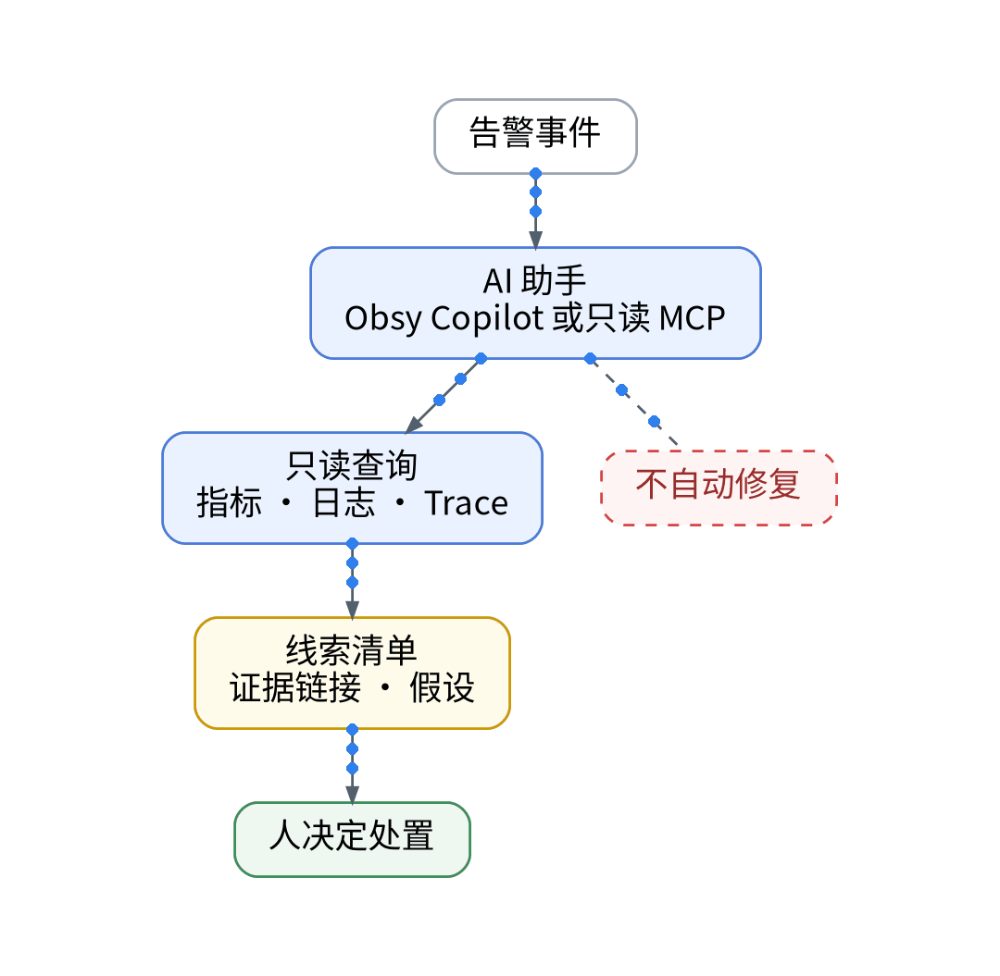
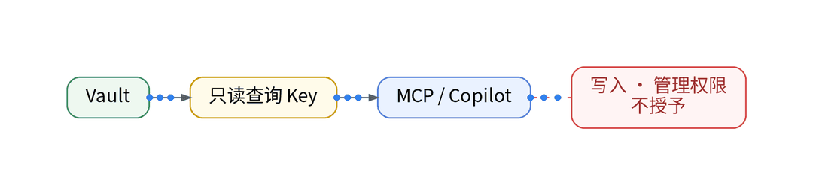

# 凌晨收到告警，让AI先帮我整理排障线索

> 状态：大纲（证据未就绪，暂不成稿）｜模板：问答拆解型

## 一、场景

凌晨收到告警，一个人既要判断真假，又要翻指标、日志、Trace；没有值班团队可以交接。

## 二、知识点

- Q：AI 能做什么？用只读权限查询指标、日志、Trace，输出线索清单与证据链接
- Q：用什么工具？Obsy Copilot（仪表板入门页已出现）或只读 MCP；Copilot、OWL/MCP 是独立权益，须单独核验
- Q：不能做什么？不自动修复，不授予写入与管理权限

## 三、最小实践（AI 辅助 IaC / GitOps / Playbook）

- 只读查询 Key 由 Vault 注入，与写入 Token、管理 Key 分开授权
- AI 输出线索清单：现象、相关信号、假设、证据链接
- 人决定处置

## 四、结果和局限

- 线索清单的准确度与节省时间：【待实测】
- Copilot / MCP 在当前空间的可用性：【待授权空间实测】

## 五、适合 / 不适合

适合：一个人值守、需要先缩小范围的个人 SaaS。不适合：希望 AI 自动修复线上问题的场景。

## 决策表（草案）

| 功能 | 特性 | 成本 | 客观事实依据 | 适用场景 |
| --- | --- | --- | --- | --- |
| Obsy Copilot | 自然语言分析 | 【待授权空间实测】 | 仪表板入门页 | 线索整理 |
| 只读 MCP | 最小权限 | 【待授权空间实测】 | OWL/MCP 为独立权益 | 自定义 Agent |
| 人工处置 | 不自动修复 | 0 元 | 系列硬规则 | 所有告警 |

## 成稿前须补的证据

- Obsy Copilot 与 MCP 权益文档（需核验）
- 一次告警的 AI 线索清单截图（脱敏）

上一篇：[《AI改完代码就发布？我用观测数据检查这一版》](../09-release-before-after/wechat.md)｜下一篇：[《自建监控自己挂了，谁来提醒我？》](../11-who-monitors-monitoring/wechat.md)
