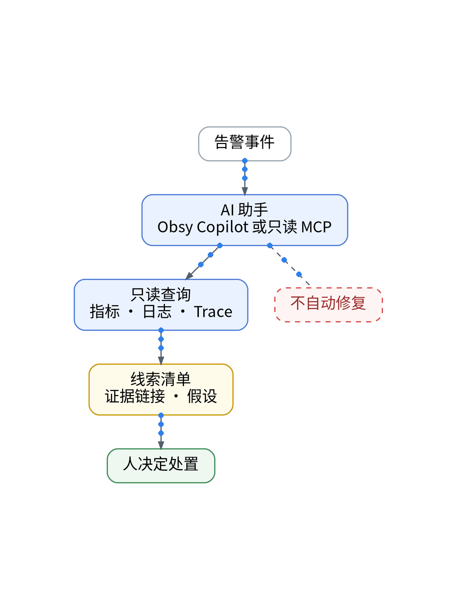

# 没有值班团队，AI先查什么？

> 状态：大纲（证据未就绪，暂不成稿）

没有值班团队，凌晨告警谁先查？让 AI 用只读权限先翻指标、日志、Trace，整理出线索清单和证据链接，人再拍板。AI 不自动修复，也拿不到写入和管理权限。

【待实测截图】：一次告警的 AI 线索清单截图（脱敏），脱敏后放这里；没有真实截图就不发。

结论：AI 负责找线索，人负责做决定。

上一篇：AI写完了，怎么确认没变差？｜下一篇：监控坏了，谁来监控监控？

#独立开发 #可观测性 #观测云 #AI
