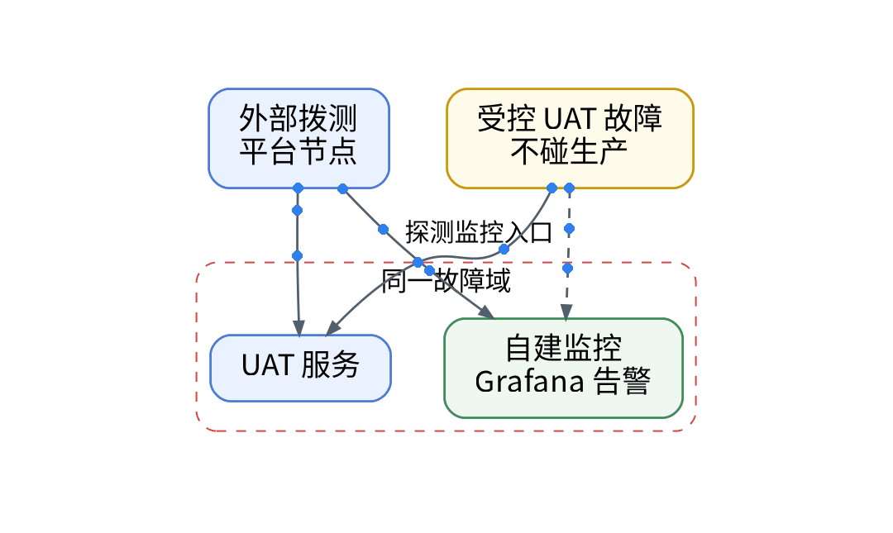
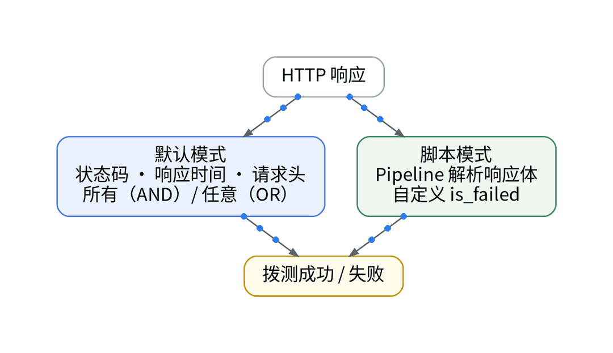

# 自建监控自己挂了，谁来提醒我？

## 一、场景：你以为告警会响，其实它也挂了

你以为自建 Grafana 的告警会在出事时提醒你，其实它和被监控的服务可能在同一个故障域：主机、网络或入口一断，服务和告警一起沉默。自建侧还有 Blackbox Exporter 做探测，但它同样跑在自己的环境里。

## 二、知识点：独立故障域与拨测的真实档位

外部拨测从平台节点发起，和自建环境不共享故障域。但要纠正三个误区：

- 误区一，拨测等于搬个地方跑 blackbox：HTTP 拨测 1 / 5 / 15 分钟三档仅限商业版及以上，其余为 30 分钟、1 / 6 / 12 / 24 小时和自定义 crontab；海外节点同样仅限商业版。免费档最快 30 分钟一次，发现延迟可能接近一个周期。
- 误区二，200 就算可用：默认模式按状态码、响应时间、请求头组合判断；业务错误码用脚本模式写 Pipeline 解析响应体，自定义 is_failed。
- 误区三，拨测不涉敏：任务可带请求头、Cookie 和认证，启用“不保存响应内容”可避免响应体进入结果。

SSL 拨测按证书剩余天数判断，官方建议频率 1 小时及以上。

## 三、最小实践：在 UAT 造一次受控故障

AI 起草拨测任务声明：探测 UAT 服务入口与自建监控入口各一个，附判断条件与频率；人审 PR 与 plan。Provider 是否覆盖拨测任务、免费空间能否 apply：【待授权空间实测】。然后在 UAT 用 Playbook 停掉一次服务，不碰生产，观察外部拨测与自建告警谁先发现。

## 四、结果和局限

拨测发现故障的延迟、自建告警是否沉默、两边结论差异：【待实测】。免费档频率与节点有限，它是兜底，不是分钟级监控；免费版 SSL 拨测实际可选频率：【待实测】。

## 五、适合 / 不适合

适合：只有一套自建监控、没有值班团队的个人 SaaS，用外部拨测补一个独立视角。不适合：需要分钟级外部探测或海外节点的服务，应评估商业版。

## 决策表

| 功能 | 特性 | 成本 | 客观事实依据 | 适用场景 |
| --- | --- | --- | --- | --- |
| Blackbox Exporter | 自定间隔 | 自建运维【待实测】 | 现有采集栈 | 内部探测 |
| 免费 HTTP 拨测 | 最快 30 分钟、中国节点 | 计入每天 20 万次 | HTTP 拨测文档 | 独立兜底 |
| 商业 HTTP 拨测 | 1 分钟起、海外节点 | 按量【待实测】 | HTTP 拨测文档 | 分钟级外部探测 |
| SSL 拨测 | 证书剩余天数 | 计入每天 20 万次 | SSL 拨测文档 | 证书到期 |
| 脚本模式 | Pipeline 断言 | 编写工时【待实测】 | HTTP 拨测文档 | 业务错误码 |

参考：观测云《HTTP 拨测》《SSL 拨测》《版本区分》。

上一篇：[《凌晨收到告警，让AI先帮我整理排障线索》](../10-ai-triage-clues/wechat.md)｜下一篇：[《和AI一起运营个人SaaS一季，我还会继续用观测SaaS吗？》](../12-season-review-exit/wechat.md)
