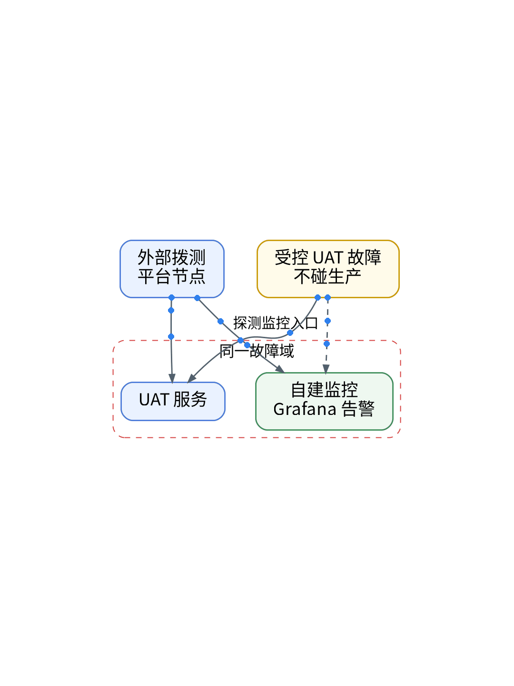

# 监控坏了，谁来监控监控？🤯

## P1 你以为…其实… 🙅
你以为自建 Grafana 告警会在出事时提醒你？其实它和服务可能在同一个故障域：主机、网络或入口一断，服务和告警一起沉默。

## P2 外部拨测补位 📡
观测云拨测从平台节点发起，不和你的环境共享故障域。但免费版要看清：HTTP 拨测 1/5/15 分钟仅商业版及以上，免费最快 30 分钟一次；海外节点也只给商业版。它是兜底，不是分钟级监控。

## P3 两个小坑 ⚠️
200 不等于可用：业务错误码用脚本模式写 Pipeline 断言。拨测能带 Header、Cookie，任务配置开“不保存响应内容”，敏感数据就不进结果。

## P4 怎么验证 🧪
AI 起草拨测任务声明，人审 PR 与 plan；能否 apply【待授权空间实测】。然后在 UAT 用 Playbook 停一次服务，绝不碰生产，看外部拨测和自建告警谁先发现【待实测】。

## P5 证书怎么测 🔐
SSL 拨测按证书剩余天数和响应时间判断，官方建议频率 1 小时及以上，不用高频。SSL 页列出了 1 分钟起的选项但没写版本限制，免费版实际能选哪些档位【待实测】。

## P6 适合谁 🙋
只有一套自建监控、没有值班团队的个人 SaaS。需要分钟级外部探测或海外节点的，评估商业版。

【待实测截图】：受控 UAT 故障时拨测结果的脱敏截图，放这里；没有真实截图就不发。

结论：监控监控的，必须站在另一个故障域里；免费拨测做兜底，分钟级探测留给自建。

上一篇：没有值班团队，AI先查什么？｜下一篇：AI、监控、账单：这一季到底值不值

#拨测 #可观测性 #观测云 #运维 #独立开发
