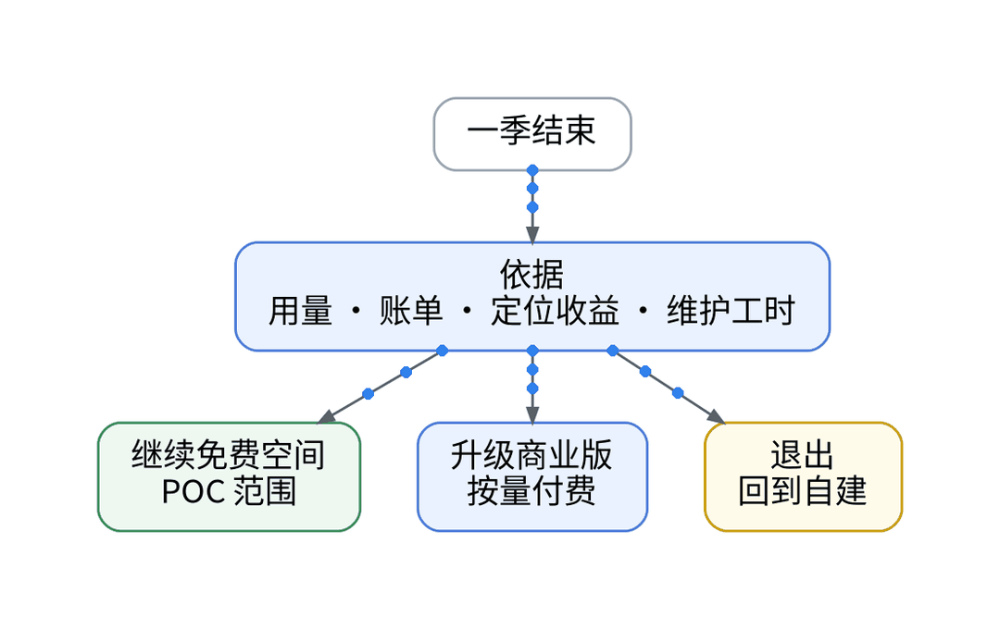
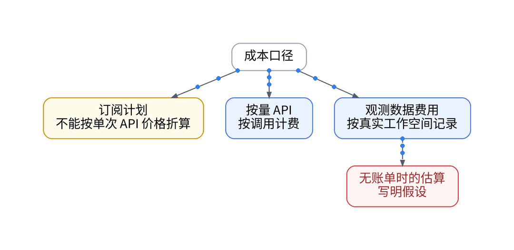
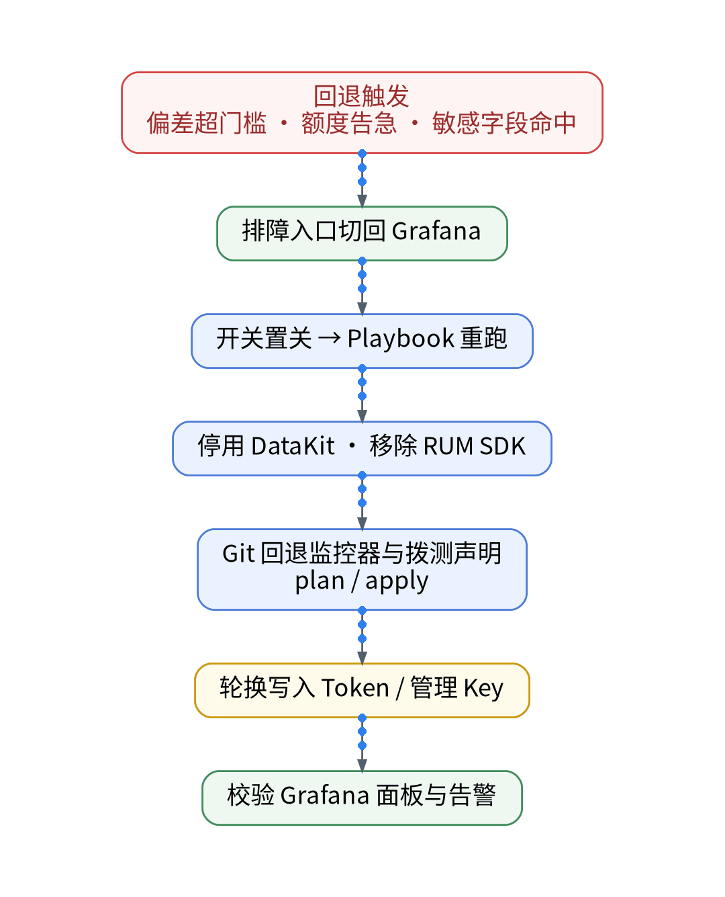
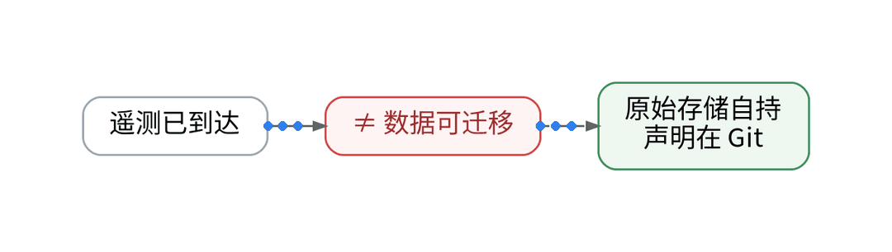

# 和AI一起运营个人SaaS一季，我还会继续用观测SaaS吗？

## 一、场景：一季过去，该对账了

这一季里，AI 起草了接入声明、面板映射、告警规则和排障线索，观测云免费空间承接了一条 UAT 链路。季末要回答的不是“好不好用”，而是三选一：继续免费、升级商业版，还是退出回到自建。

## 二、知识点：三条路怎么比

- 继续免费：0 元、不开票，但协议 10.4 写明不保证永久提供，可提前 15 天通知终止；额度超了不再上报。
- 升级商业版：按量付费、不限用户。成本必须按真实工作空间记录；没有账单时的任何估算都要写明假设（序列数、采集间隔、保留期）。
- 退出：遥测数据能到达，不等于数据能迁移。免费空间不可解散、数据 7 天循环，原始数据只在自建存储里，声明留在 Git。

## 三、最小实践：一季账本 + 一次退出演练

账本四栏：额度占比、账单或带假设的估算、定位收益（几次排障因跨信号关联而缩短）、维护工时，全部取自本季记录。退出演练走 IaC：开关置关 → Playbook 重跑恢复单 sink → 移除 RUM SDK → Git 回退监控器与拨测声明并 plan（免费空间 apply：【待授权空间实测】）→ 轮换写入 Token 与管理 Key → 校验 Grafana 面板与告警。

## 四、结果和局限

额度占比、估算、定位收益、维护工时与退出演练耗时：【待实测】。订阅制 AI 工具的花费不能按单次 API 价格折算，这一季的 AI 成本只按实际账单口径记录。

## 五、适合 / 不适合

适合：想用一季真实数据决定去留的独立开发者。不适合：没有记录用量与工时，只凭感觉做续费决定的人。

## 决策表

| 功能 | 特性 | 成本 | 客观事实依据 | 适用场景 |
| --- | --- | --- | --- | --- |
| 继续免费空间 | POC 范围 | 0 元，不开票 | 版本区分页；协议 3.1/3.3/10.4 | 单链路 UAT |
| 升级商业版 | 不限用户、按量 | 【待实测】 | 版本区分页 | 生产、团队 |
| 退出回自建 | 数据自持 | 自建运维【待实测】 | 免费空间不可解散、7 天循环 | 收益不足时 |
| 开关 + Git 回退 | 一键恢复单 sink | 0 元 | Playbook / GitOps 流程 | 退出演练 |
| 凭据轮换 | 退出即失效 | 0 元 | Vault 分开授权 | 完全退出 |

参考：观测云《版本区分》《注册免费版》《免费版订阅协议》。

上一篇：[《自建监控自己挂了，谁来提醒我？》](../11-who-monitors-monitoring/wechat.md)｜下一篇：[《Cloudflare + Cloud Run + Supabase 之后，我给个人 SaaS 补上了观测云免费专区》](../01-free-zone-onboarding/wechat.md)
