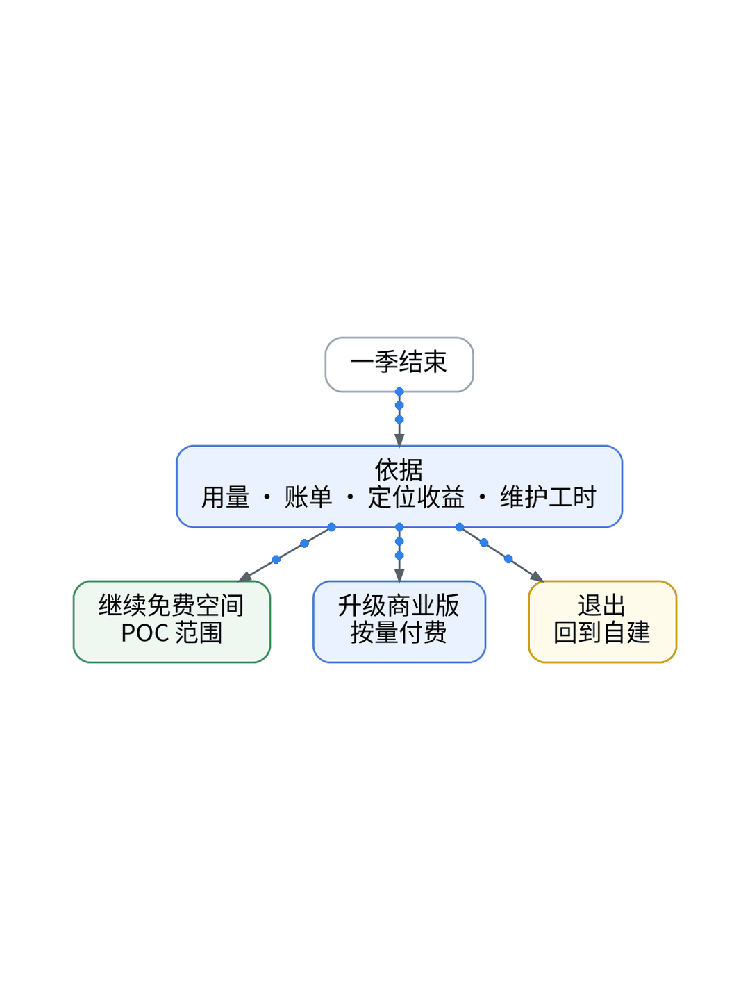

# AI、监控、账单：这一季到底值不值💰

## P1 季末三选一
这一季 AI 起草了接入声明、面板映射、告警规则和排障线索，观测云免费空间接了一条 UAT 链路。现在该决定：继续免费、升级商业版，还是退回自建。

## P2 三条路的账 📒
继续免费：0 元不开票，但协议写明不保证永久，可提前 15 天通知终止。
升级商业版：按量付费。成本按真实工作空间记录，没账单的估算必须写明假设。
退出：遥测能到达，不等于数据能迁移。免费空间不能解散，数据 7 天循环，原始数据只在自建存储。

## P3 账本四栏 🧮
额度占比、账单或带假设的估算、定位收益、维护工时，全部【待实测】。订阅制 AI 工具别按单次 API 价格去折算。

## P4 退出演练 🔁
开关置关 → Playbook 重跑恢复单 sink → 移除 RUM SDK → Git 回退监控器和拨测声明再 plan（免费空间 apply【待授权空间实测】）→ 轮换 Token 和 Key → 校验 Grafana。

## P5 适合谁 🙋
想用一季真实数据决定去留的独立开发者。没记用量、没记工时、只凭感觉续费的，先补账本再说。决定之前，先把退出演练跑一遍，确认 Grafana 面板和告警都能独立工作，再谈要不要继续付费。

【待实测截图】：一季账本与退出演练前后的脱敏截图，放这里；没有真实截图就不发。

结论：值不值，用一季的账说话，不用感觉说话；能随时退出、退出后自建照常工作，才敢继续用下去。

上一篇：监控坏了，谁来监控监控？｜下一篇：低成本 SaaS 拼好了，还差一双眼睛

#可观测性 #观测云 #AI #独立开发 #SaaS
