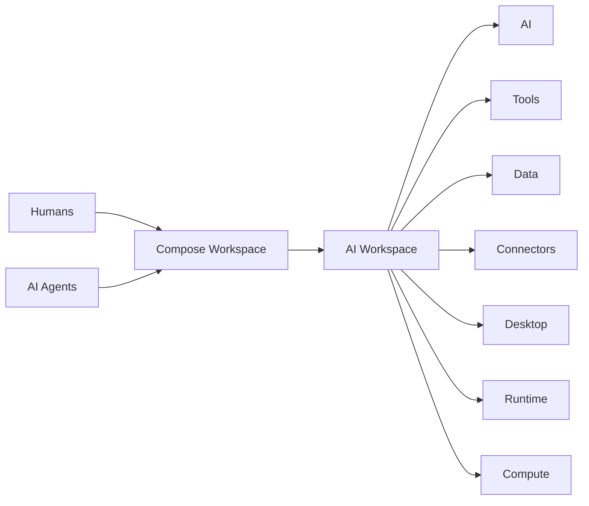
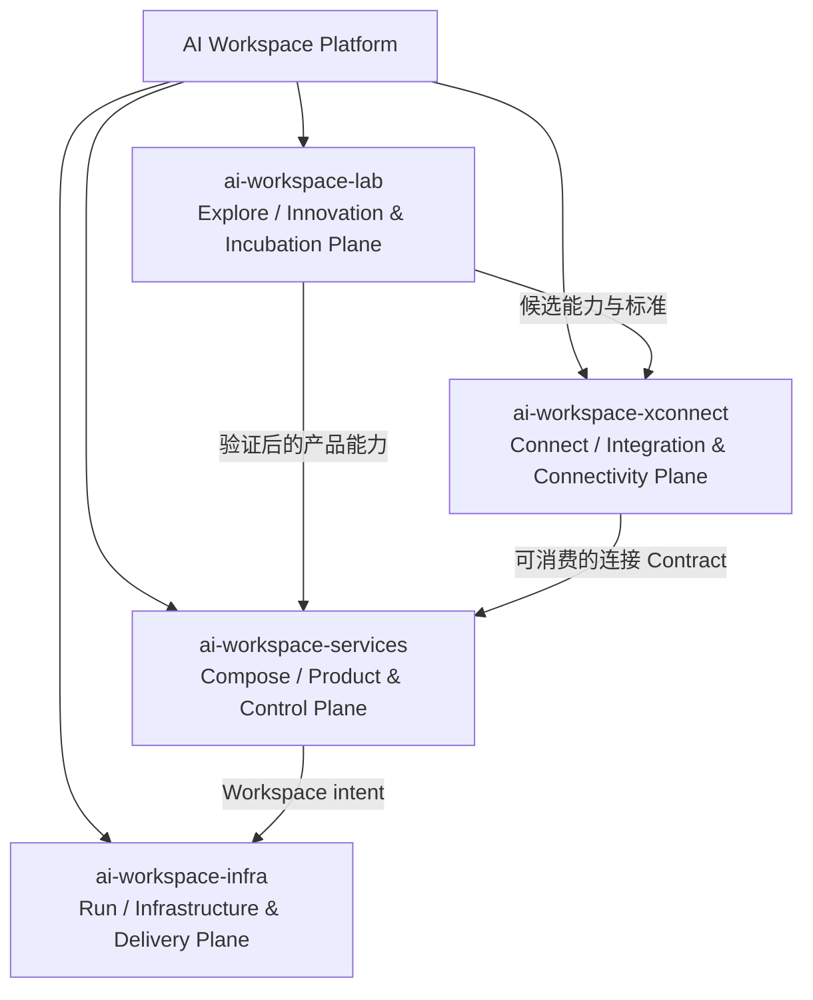
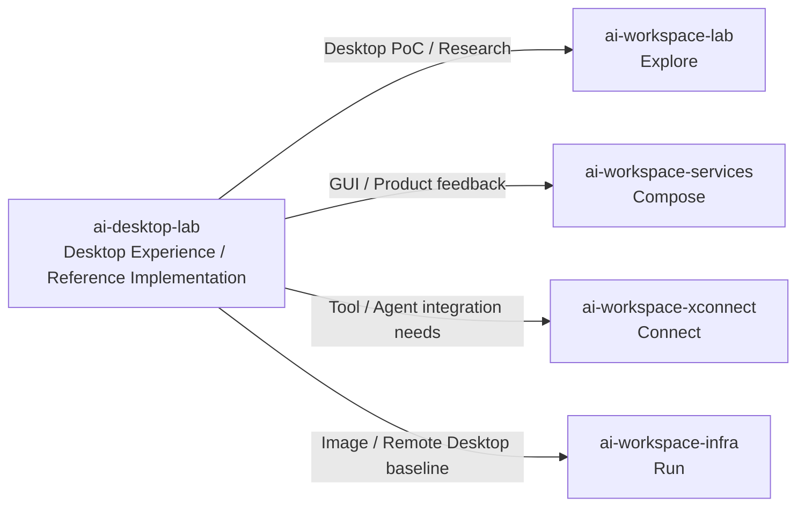

# 愿景与四个组织的长期边界

> 本文是《AI Workspace 顶层架构与远景项目设计》系列第 1 篇（共 5 篇），系列导读与目录见[这里](README.md)。

## 1. Vision

**AI Workspace** 是面向 **Humans & AI Agents** 的 **Composable AI Workspace Platform**：像 Lego 一样自由组合 **AI、Tools、Data、Connectors、Desktop、Runtime、Compute**，在合适的环境中形成个人、开发者或 Agent 可直接使用的工作空间。

### Mission

- 降低获得可靠 AI 工作环境的门槛。
- 用稳定的声明式 Contract 隔离产品、连接能力与基础设施的变化。
- 让同一份 Workspace 意图可以在 Cloud、Local、Edge 等环境中运行。
- 同时服务个人用户、开发者与 AI Agents，并逐步提高自动化程度。

### Design Principles

1. **Composable**：能力以可组合 Module 提供，而不是绑定为一个不可拆分产品。
2. **Declarative**：描述“需要什么”，而非规定“如何安装”。
3. **Portable**：Workspace 与运行位置解耦，支持 Run Anywhere。
4. **Contract-first**：先定义能力、协议、权限和生命周期，再选择实现。
5. **Human and Agent friendly**：GUI、CLI、API 是同等重要的消费入口。
6. **Secure by default**：身份、权限、凭据、审计和隔离是基础能力。
7. **Observable and reversible**：变更可追踪、可评估、可回滚。
8. **Small core, extensible edges**：核心保持稳定，创新和集成在边缘演进。

## 2. 四个组织的长期边界

| Organization | 动词 | 应该做 | 不应该做 |
|---|---|---|---|
| `ai-workspace-lab` | **Explore** | 技术雷达、研究、Fork、PoC、评估、标准化、孵化 | 不成为 production dependency，不承诺长期稳定运营 |
| `ai-workspace-services` | **Compose** | 用户产品、控制面、Workspace 管理、Auth、Billing、Onboarding、API、SEO | 不直接管理主机，不把某个 Connector 或云厂商写死在产品核心 |
| `ai-workspace-xconnect` | **Connect** | AI/Tool/Data/Service Connector、协议、Contract、Adapter、Gateway | 不承担完整产品体验，不拥有底层主机生命周期 |
| `ai-workspace-infra` | **Run** | Cloud/Local/Edge 运行、交付、网络、计算、存储、可观测性 | 不理解 Billing、用户增长或产品业务语义 |

核心分工可概括为：**Lab 发现积木 → XConnect 标准化连接积木 → Infra 运行积木 → Services 组合成产品**。

### 2.1 `ai-desktop-lab`：Desktop Experience / Reference Implementation

`ai-desktop-lab` 是与四个核心组织协作的 Desktop Experience 组织，定位是 **桌面交互、桌面组件和参考实现的实验与孵化空间**，而不是第五个 Control Plane。其公开项目包括：

- [XLaunch](https://github.com/ai-desktop-lab/XLaunch)：跨 macOS 与 Linux Desktop 的 AI Launcher / 应用启动体验。
- [XDock](https://github.com/ai-desktop-lab/XDock)：经典桌面 Dock 体验。
- [xworkmate-remote-desktop](https://github.com/ai-desktop-lab/xworkmate-remote-desktop)：Remote Desktop 客户端方向。
- [isobuilder](https://github.com/ai-desktop-lab/isobuilder)：桌面/系统镜像构建方向。

它与四组织的关系如下：

| 协作对象 | `ai-desktop-lab` 提供 | `ai-desktop-lab` 不负责 |
|---|---|---|
| `ai-workspace-lab` | Desktop PoC、交互实验、参考实现 | 不直接承诺生产稳定性 |
| `ai-workspace-services` | GUI 参考体验、桌面产品素材与能力反馈 | 不拥有 Auth、Billing 或 Workspace Control Plane |
| `ai-workspace-xconnect` | Desktop 侧 Connector / Agent / Tool 集成需求 | 不定义全平台连接协议或 Provider Adapter |
| `ai-workspace-infra` | Desktop Image、Remote Desktop、显示与节点基线需求 | 不管理 Cloud/Local/Edge 的完整交付平面 |

因此，`ai-desktop-lab` 的产物可以沿 **Discover → Research → PoC → Evaluate → Standardize → Promote** 生命周期进入四个核心组织：Desktop Module 进入 Profile，交互能力进入 Services，连接需求进入 XConnect，镜像与运行基线进入 Infra。它是 Desktop 领域的专门化孵化与参考实现组织，而不是对四组织职责的替代。

---

下一篇：[总体架构与 Workspace Specification 声明式契约](02-architecture-and-workspace-spec.zh.md) · [返回系列目录](README.md)
