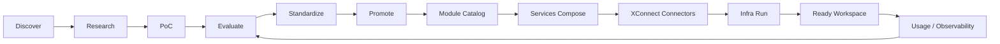

# 总体架构与 Workspace Specification 声明式契约

> 本文是《AI Workspace 顶层架构与远景项目设计》系列第 2 篇（共 5 篇），系列导读与目录见[这里](README.md)。

## 3. 总体架构：Explore → Compose → Connect → Run

这里的四个动词代表职责流，而不是强制的线性部署顺序。生产 Workspace 通常由 Services 编排 XConnect 的能力，并请求 Infra 在目标环境运行。



## 4. Workspace Specification：核心声明式 Contract

**Workspace Specification** 是描述一个 Workspace 目标状态的长期 Contract。它应表达身份、能力、约束、权限与运行偏好；不直接暴露安装脚本、云厂商 API 或具体命令。

```yaml
workspace:
  identity: ...
  profile: ...
  compute: ...
  runtime: ...
  ai: ...
  connectors: ...
  tools: ...
  desktop: ...
  storage: ...
  security: ...
  observability: ...
```

概念字段模型：

| Domain | 需要表达的意图 |
|---|---|
| Identity | owner、workspace identity、成员与主体关系 |
| Profile | 选择一组经过验证的默认组合 |
| Compute | CPU/GPU、内存、架构、弹性与预算约束 |
| Runtime | 容器、VM、Sandbox、Agent runtime 等运行语义 |
| AI | Provider、模型、能力、路由、Fallback、配额 |
| Connectors | 连接目标、认证方式、权限范围、健康状态 |
| Tools | CLI、SDK、Browser、MCP tools、内置工具 |
| Desktop | 无桌面、IceWM、XFCE 或未来桌面环境 |
| Storage | 临时/持久、对象/文件/数据库、备份与保留策略 |
| Security | Secret、网络、隔离、策略、审计与信任边界 |
| Observability | 日志、指标、Tracing、成本、事件与告警 |

Contract 的长期要求：版本化、可校验、可扩展、可解释、可审计，并支持从“期望状态”映射到不同 Provider/Runtime 的实际状态。

---

上一篇：[愿景与四个组织的长期边界](01-vision-and-org-boundaries.zh.md) · 下一篇：[两级 Lego 模型、三种消费方式与三阶段产品演进](03-lego-model-and-product-evolution.zh.md) · [返回系列目录](README.md)
