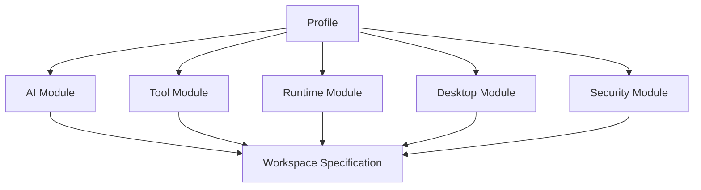
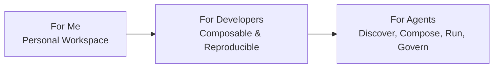

# 两级 Lego 模型、三种消费方式与三阶段产品演进

> 本文是《AI Workspace 顶层架构与远景项目设计》系列第 3 篇（共 5 篇），系列导读与目录见[这里](README.md)。

## 5. 两级 Lego 模型：Module 与 Profile

### Module

**Module** 是最小可复用能力单元，例如一个 AI Provider、MCP Connector、CLI 工具、桌面环境、Runtime、Storage 或 Security Policy。Module 应包含能力描述、版本、依赖、输入配置、权限需求、兼容性、健康检查和升级/回滚语义。

### Profile

**Profile** 是经过验证的 Module 组合，面向明确场景提供安全默认值。Profile 不是不可修改的套餐，用户仍可替换或扩展其中的 Module。

| Reference Profile | 适用场景 | 典型组成 |
|---|---|---|
| **CLI Only** | 自动化、低资源、远程开发 | CLI tools + Runtime + API/SSH + Storage |
| **Tiny Desktop** | 轻量交互、低配置设备 | IceWM + Terminal + Browser/CLI + Runtime |
| **Standard Desktop** | 日常开发与多工具协作 | XFCE + Terminal + Browser + Editors + Runtime |

`ai-desktop-lab` 可作为 Desktop Module 与 Profile 的参考实现来源：XLaunch/XDock 属于桌面交互 Module，Remote Desktop 属于 Desktop Access Module，isobuilder 属于 Image/Delivery Tooling Module。是否进入生产 Profile，仍需经过 Lab 评估、Services 体验验收和 Infra 兼容性验证。

## 6. 三种消费方式与用户主体

| Interface | 主要主体 | 核心价值 |
|---|---|---|
| **GUI** | Human | 浏览、选择、配置、观察和管理 Workspace |
| **CLI** | Developer / Power User | 快速创建、连接、诊断、脚本化与本地开发 |
| **API** | AI Agent / Automation / Developer | 声明目标、申请能力、执行变更、读取状态 |

三者应共享同一套 Domain Model 与 Contract，避免 GUI、CLI、API 形成三套不一致产品。

## 7. 三阶段产品演进

1. **AI Workspace for Me**：先解决个人的可靠环境、常用 AI、工具连接、成本与迁移问题。
2. **AI Workspace for Developers**：提供可复现 Profile、Workspace Specification、CLI/API、团队协作与扩展机制。
3. **AI Workspace for Agents**：让 Agent 能发现能力、规划组合、申请权限、创建 Workspace、运行任务并持续优化。

---

上一篇：[总体架构与 Workspace Specification 声明式契约](02-architecture-and-workspace-spec.zh.md) · 下一篇：[Services 层、Lab 生命周期、XConnect 与 Infra](04-services-lab-xconnect-infra.zh.md) · [返回系列目录](README.md)
