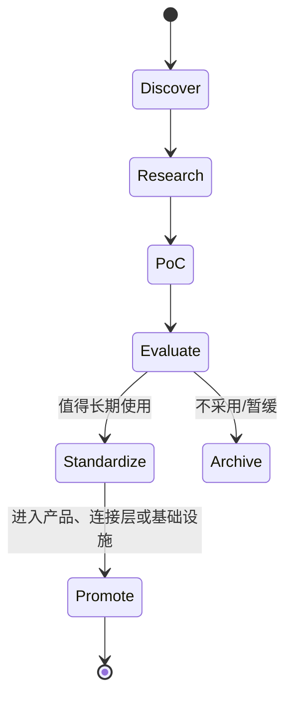

# Services 层、Lab 生命周期、XConnect 与 Infra

> 本文是《AI Workspace 顶层架构与远景项目设计》系列第 4 篇（共 5 篇），系列导读与目录见[这里](README.md)。

## 8. Services 层：SaaS Product Shell 的借鉴

StartFast 调研得到的启发仅用于定义 **Product Shell**：Services 需要具备清晰的 Auth、Billing、Onboarding、Workspace 管理、API 与 SEO 能力，使底层复杂性变成可理解的产品体验。该思路不绑定 Next.js、Better Auth、Stripe 或任何具体技术。

Billing 的长期抽象为：

**Plan → Entitlement → Usage → Credit → Cost**

- **Plan**：面向用户的产品计划。
- **Entitlement**：计划授予哪些能力与限制。
- **Usage**：能力实际使用量。
- **Credit**：可消耗的额度或预付余额。
- **Cost**：对用户、团队或内部资源的成本归因。

Services 只定义商业与控制面语义；具体 Provider 计费、计算成本和连接成本通过 Contract 汇入，不侵入 Infra 或 XConnect 的内部实现。

## 9. Lab 生命周期

每一阶段都应有明确的证据：问题定义、风险、性能/成本、可维护性、安全影响、兼容性与退出条件。Lab 的产物可以 Promote 到 Services、XConnect 或 Infra，也可以 Archive；生产系统不应依赖 Lab 中未经 Promote 的项目。

## 10. XConnect：连接分类与边界

| 分类 | 连接对象 | 例子 |
|---|---|---|
| **AI Connector** | Model Provider、Agent Provider、AI Gateway | OpenAI-compatible、Anthropic、Gemini 等 |
| **Tool Connector** | MCP、CLI、SDK、Browser、Remote Tool | Git、Shell、Search、编辑器等 |
| **Data Connector** | 文件、数据库、对象存储、知识库 | Local FS、S3-like、SQL、Vector Store |
| **Service Connector** | 外部 SaaS、协作、身份、支付、业务 API | GitHub、Slack、Calendar、Billing Provider |

三层边界：

- **Contract**：描述能力、输入输出、认证、权限、错误、健康与生命周期。
- **Protocol**：规定交互方式，如 HTTP、OpenAI-compatible API、MCP、SSH 等。
- **Adapter**：把具体 Provider 的差异映射到统一 Contract，处理鉴权、重试、限流、观测与版本兼容。

XConnect 负责“如何连接外部世界”，Services 负责“产品如何使用连接能力”，Infra 负责“连接运行所需的网络与环境”。

## 11. Infra：Run Anywhere

Infra 的愿景是让 Workspace 在不同计算边界中以一致 Contract 运行：

| Boundary | 关注点 |
|---|---|
| **Cloud** | 弹性、托管服务、GPU、全球网络、成本与多租户 |
| **Local** | 私有数据、开发体验、离线能力、设备资源 |
| **Edge** | 低延迟、受限网络、本地自治、区域数据边界 |

Infra 可以提供 VM、Container、Desktop、Network、Storage、Observability 等运行基座，但不应理解 Plan、Entitlement 或用户增长。Services 不直接 shell exec Ansible；它应提交声明式 intent，由 Infra 的交付边界解释并执行。Infra 也不应把某一个 Cloud Provider 视为架构前提。

---

上一篇：[两级 Lego 模型、三种消费方式与三阶段产品演进](03-lego-model-and-product-evolution.zh.md) · 下一篇：[架构治理、Roadmap 与 North Star（附术语速查）](05-governance-roadmap-north-star.zh.md) · [返回系列目录](README.md)
