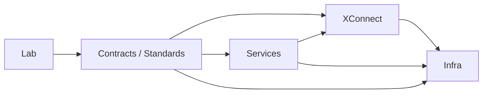

# 架构治理、Roadmap 与 North Star（附术语速查）

> 本文是《AI Workspace 顶层架构与远景项目设计》系列第 5 篇（共 5 篇），系列导读与目录见[这里](README.md)。

## 12. 架构治理

### 依赖方向

依赖应优先指向稳定的 Contract，而不是反向依赖具体仓库。跨组织变更需要版本、Owner、兼容窗口、迁移说明和回滚策略。

### 反模式

- Services 直接 shell exec Ansible、SSH 主机或拼装云厂商命令。
- Lab 中的 PoC 作为生产系统的隐式依赖。
- Infra 理解 Billing、营销、SEO 或产品套餐。
- XConnect 把某个 Provider 的私有字段泄漏为平台核心模型。
- GUI、CLI、API 各自维护一套 Workspace 状态。
- Profile 变成无法替换的“巨型发行版”。
- 为短期 Demo 牺牲身份、Secret、审计和隔离边界。

### 治理检查清单

- 是否能用一句话说明该能力属于 Explore、Compose、Connect 或 Run？
- 是否存在清晰的 Contract、Owner、版本和兼容性说明？
- 是否区分产品语义、连接语义和运行语义？
- 是否能在不更换用户意图的情况下替换 Provider 或运行环境？
- 是否具备最小权限、可观测性、成本归因和退出路径？

## 13. Roadmap

### 半年：AI Workspace for Me

- 固化四组织边界、术语表与顶层 Contract 草案。
- 建立 CLI Only、Tiny Desktop、Standard Desktop 三个 reference profiles。
- 梳理首批 AI、Tool、Data、Service connector 的能力矩阵。
- 建立个人 Workspace 的身份、配置、成本和观测心智模型。

### 1 年：AI Workspace for Developers

- Workspace Specification 进入可版本化、可验证、可迁移状态。
- GUI / CLI / API 共享统一的 Workspace domain model。
- 提供可复现 Workspace、Profile 扩展、团队协作与开发者文档。
- 建立 Lab Promote 流程，以及 XConnect/Infra 的兼容性与发布治理。

### 2–3 年：AI Workspace for Agents

- Agent 可发现 Module、理解 Entitlement、规划 Profile 并提交 Workspace intent。
- 建立审批、最小权限、Sandbox、审计、预算和自动回滚机制。
- 支持跨 Cloud/Local/Edge 的策略化调度与迁移。
- 形成开放生态：第三方可提供 Module、Connector、Profile 和验证报告。

## 14. North Star

> **用户只需表达“我想要什么样的 AI 工作空间”，AI Workspace 就能以安全、可解释、可迁移的方式，把合适的 AI、Tools、Data、Connectors、Desktop、Runtime 与 Compute 组合起来，并在合适的位置运行。**

长期衡量不应只看注册用户或部署数量，还应关注：从意图到 Ready Workspace 的时间、Profile/Module 复用率、跨环境迁移成功率、Connector 健康度、Agent 任务完成率、安全事件、成本透明度与用户持续使用率。

## 附录：术语速查

| Term | 含义 |
|---|---|
| Workspace | 面向一个主体、目标和运行环境的完整工作空间 |
| Module | 可复用的最小能力单元 |
| Profile | 经过验证的 Module 组合与默认策略 |
| Contract | 跨组织、跨实现的稳定能力约定 |
| Connector | 连接 AI、Tool、Data 或 Service 的能力 |
| Runtime | 承载工具、Agent 或桌面会话的执行语义 |
| Control Plane | 管理身份、配置、策略、状态和产品流程的平面 |
| Delivery Plane | 将声明式目标交付到实际基础设施的平面 |

---

上一篇：[Services 层、Lab 生命周期、XConnect 与 Infra](04-services-lab-xconnect-infra.zh.md) · [返回系列目录](README.md)
