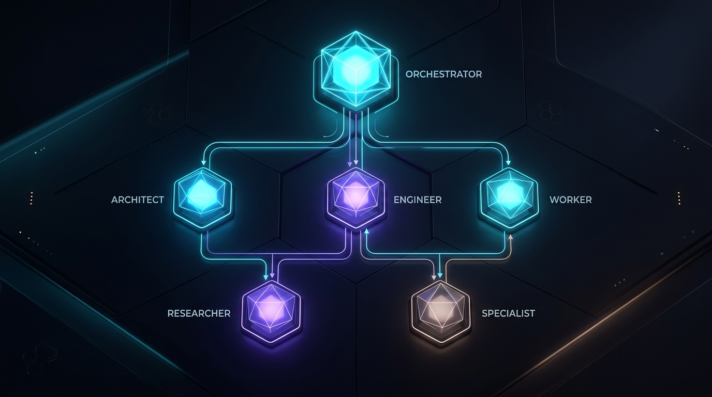
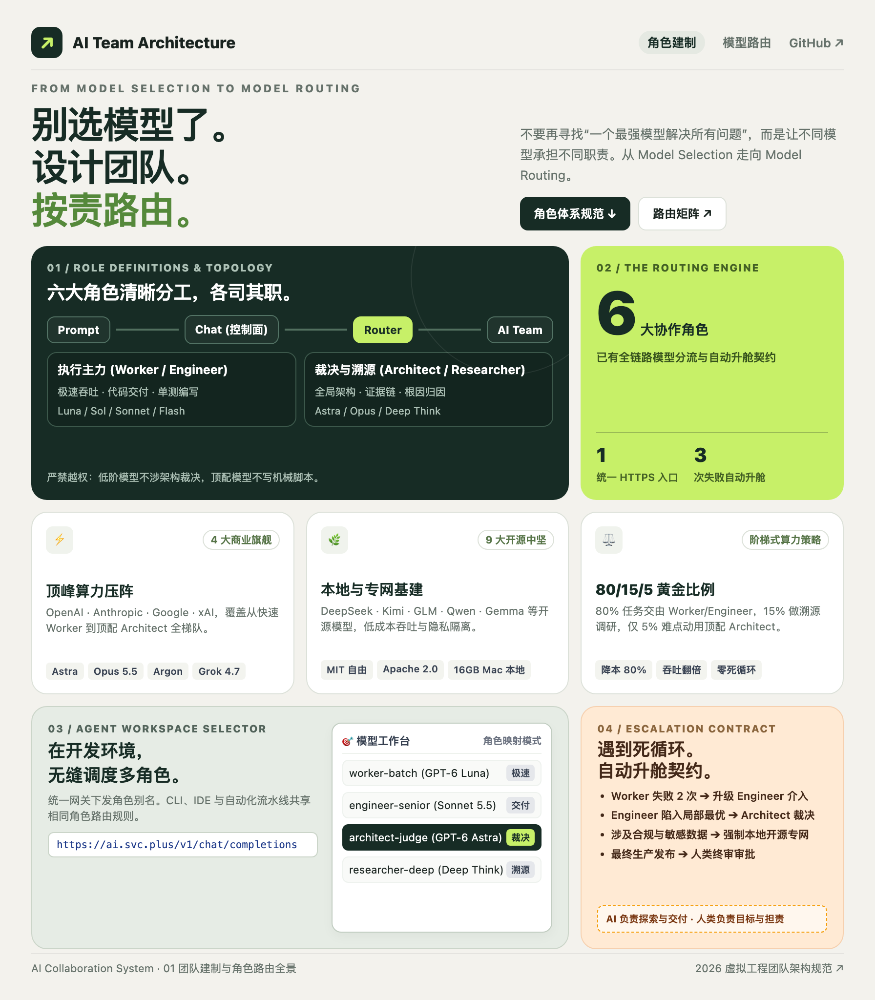
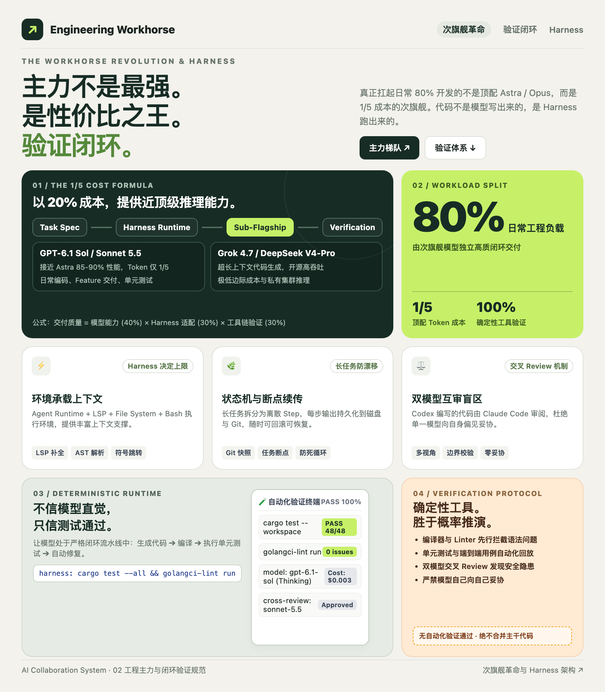
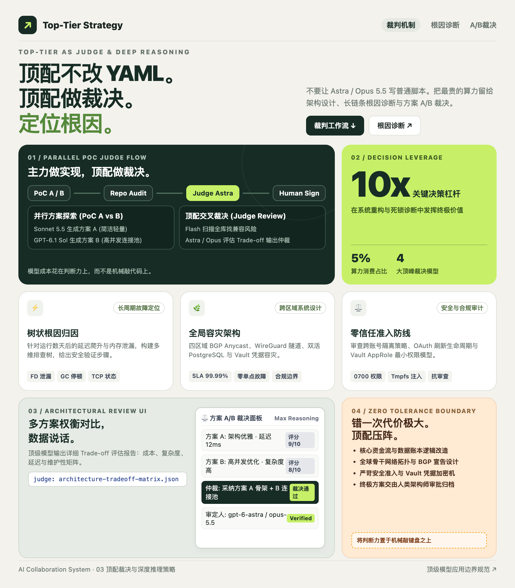
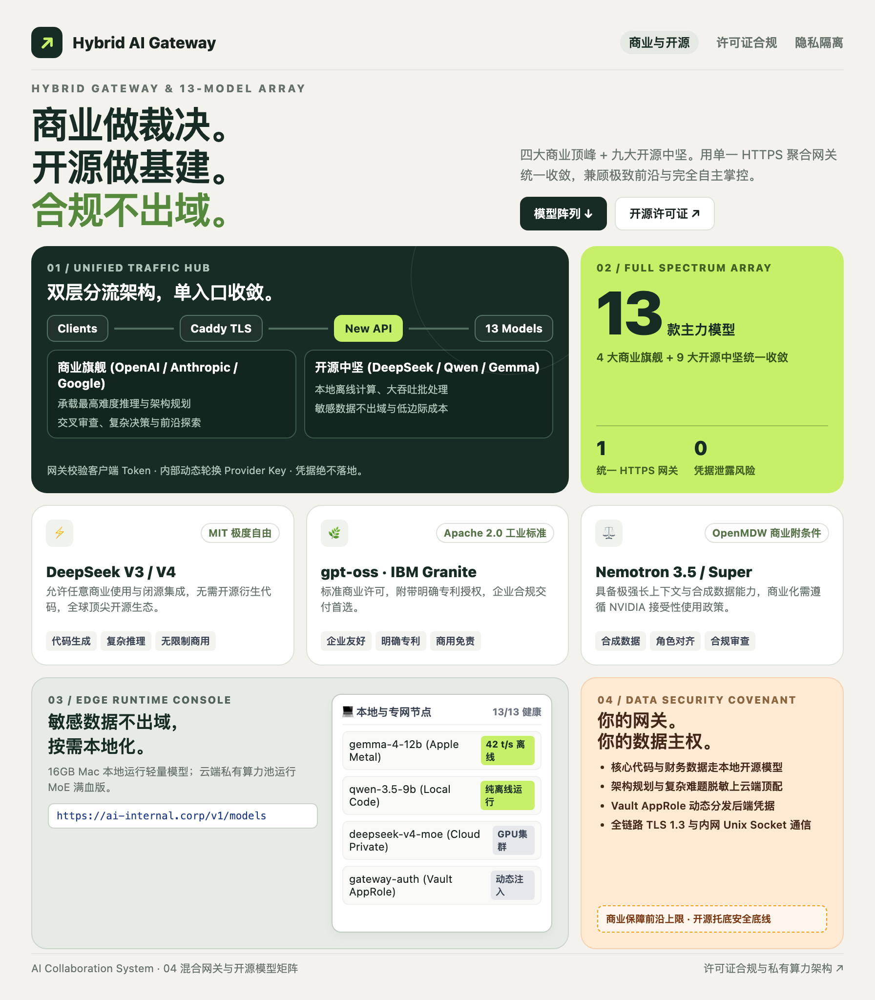
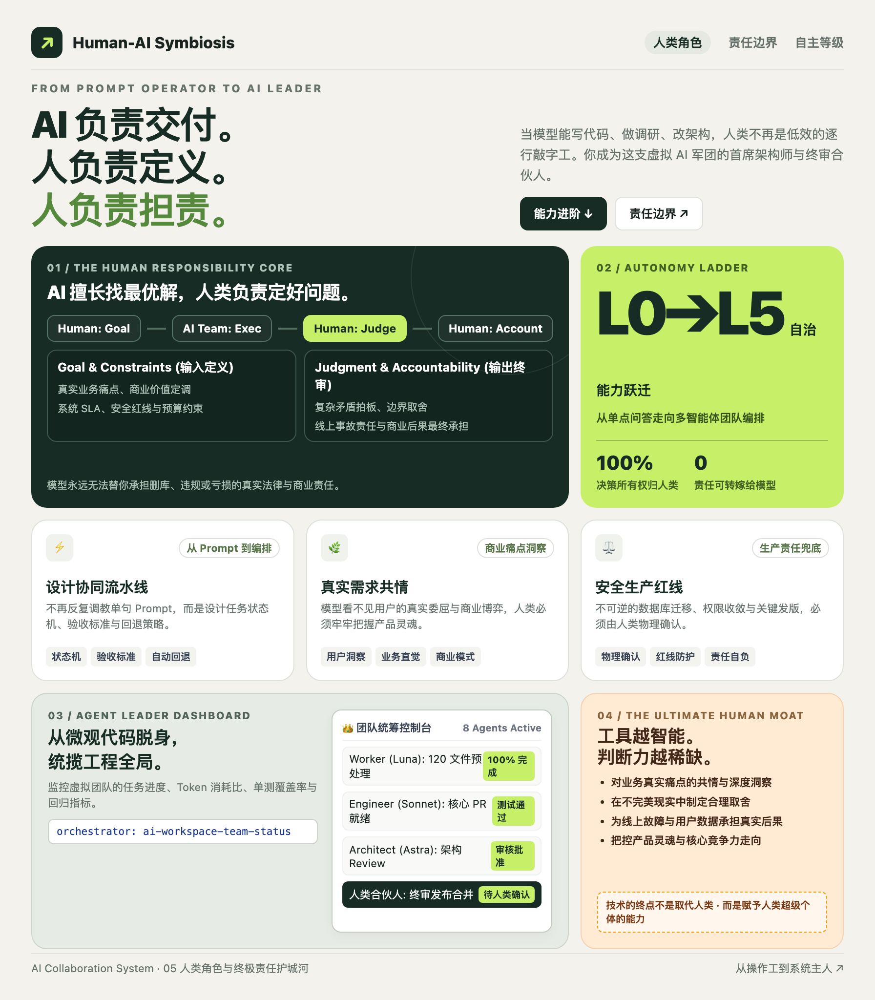

# AI Collaboration Reference Guide: Table of Contents & Series Index

> **Core Axiom**: Transition from **Model Selection** to **Model Routing**.  
> **Covered Ecosystems**: Commercial Giants (OpenAI, Anthropic, Google, xAI) + Open-Weight Foundations (DeepSeek, Kimi, GLM, Qwen, MiniMax, Nemotron, Mistral, Gemma, Llama, Granite).

## Series Structure & Overview

This series provides an enterprise-ready framework for software engineering teams in late 2026. The collection includes both the complete multi-channel publication pack and a structured 5-part serialized column:

### 📖 Complete Multi-Channel Edition
- [**AI Collaboration Reference Guide: Complete Multi-Channel Publishing Pack**](full-guide.md)  
  *Includes the flagship long-form essay, social media carousel blueprints, high-signal X thread, open-weight licensing matrix, and JSON-based Hybrid Model Routing policy specifications.*

---

### 📚 5-Part Serialized Column (~1,200 - 1,500 words each)

| Part | Decision Canvas / Poster | Article Link | Core Takeaway & Architecture |
| :--- | :--- | :--- | :--- |
| **Part 1** |  | [**Cognitive Shift**: Moving Beyond Benchmarks to a 6-Agent Virtual Team](01-cognitive-shift.md) | The obsolescence of prompt tricks; the 2026 dual-track landscape (Big Four commercial giants and nine open-weight ecosystems); shifting from Model Selection to Model Routing. |
| **Part 2** |  | [**Dual Execution Engines**: Chat Control Plane & Worker's 1,000x Rule](02-dual-execution-engines.md) | Upfront problem scoping via Chat; high-throughput bulk execution with Worker models (Cheap + Fast + Scalable); local edge deployments (Gemma 4 / Qwen 27B) for data privacy. |
| **Part 3** |  | [**The Engineering Backbone**: Why Sub-flagships Rule and Frontier Models Adjudicate](03-engineering-backbone-and-judge.md) | Model $\neq$ Agent; why GPT-6.1 Sol, Sonnet 5.5, Grok 4.7, and DeepSeek V4-Pro power day-to-day software delivery; four architect archetypes; frontier models as impartial Judges. |
| **Part 4** |  | [**Research Grounding & Domain Defense**: Researcher and Specialist Roles](04-research-grounding-and-specialist.md) | Decoupling reasoning from factual retrieval; Researcher evidence schemas (Kimi K3 / Deep Research / Grok+X); Specialist moats across gated cybersecurity, frontier science, and GUI. |
| **Part 5** |  | [**Closed-Loop Lifecycle & Hybrid Routing**: Human Role and Licensing Governance](05-closed-loop-and-model-routing.md) | The 6-tier on-demand escalation ladder; automated software lifecycle; open-weight licensing compliance matrix; promoting humans from Operator to Owner; AI Workspace hybrid routing. |

---

## Visual Assets Directory

### 1. Series Global Covers
- **Flagship / X Cover (16:9 Landscape Topology)**: `assets/images/ai-team-collaboration-wechat-x-cover.jpg`
- **Mobile Card Cover (3:4 Portrait Hexagonal Badge)**: `assets/images/ai-team-collaboration-xhs-cover.jpg`

### 2. 5-Part Bento Grid Decision Canvases & Posters (896 × 1024)
- **Part 1 Canvas**: `assets/images/ai-team-bento-01-routing.png` (*01 Team Topology: From Model Selection to Model Routing*)
- **Part 2 Canvas**: `assets/images/ai-team-bento-02-workhorse.png` (*02 Workhorse Revolution: Sub-flagships & Deterministic Verification*)
- **Part 3 Canvas**: `assets/images/ai-team-bento-03-judge.png` (*03 Top-Tier Strategy: Top Models as Impartial Judges*)
- **Part 4 Canvas**: `assets/images/ai-team-bento-04-hybrid-open.png` (*04 Hybrid AI Gateway: Commercial for Reasoning, Open for Infrastructure*)
- **Part 5 Canvas**: `assets/images/ai-team-bento-05-human-owner.png` (*05 Human-AI Symbiosis: AI Delivers, Humans Frame and Account*)
