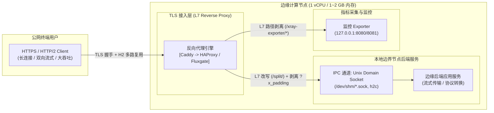
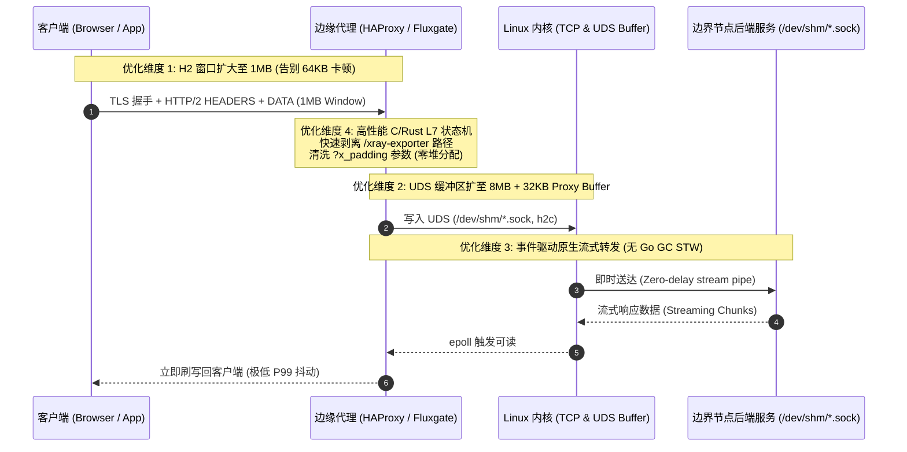
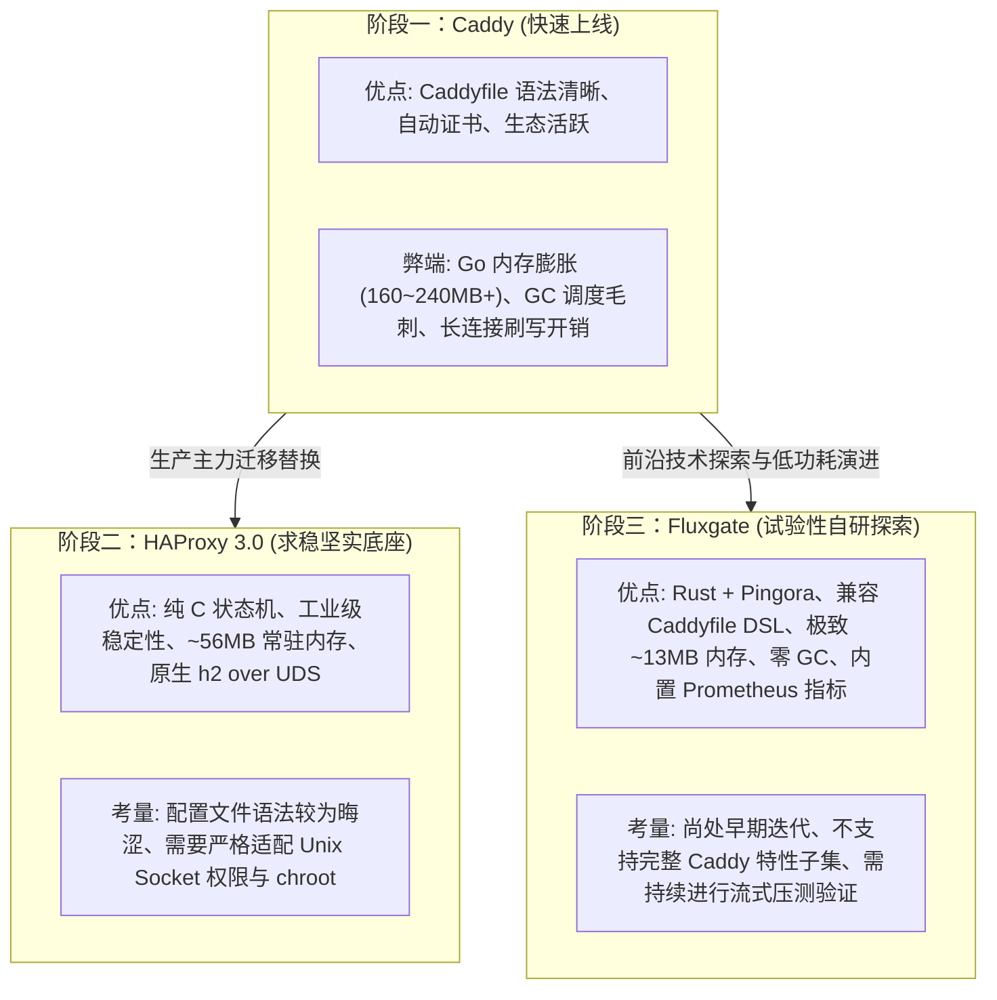
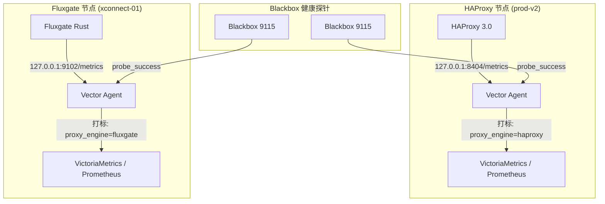

# 边缘反向代理演进与低延迟流式传输性能优化全景报告

2026 年 11 月 16 日 · Haitao Pan · 时间口径：Asia/Shanghai

---

## 一、背景与问题概述

在边缘网络服务架构中，反向代理（Edge Reverse Proxy）作为最前置的流量关口，承担着客户端公网 TLS 终止、HTTP/2 多路复用解包、L7 动态路径重写与清洗、以及向后端边界节点服务（Boundary Node Backend Service）进行 IPC 高速转发的核心职责。



在此前架构中，边缘节点普遍采用 **Caddy** 作为默认的入口反向代理。Caddy 凭借其现代化的 Caddyfile 语法、内置自动化证书签发及生态丰富的插件体系，支撑了业务前期的极速上线。然而，随着边缘服务长周期运行、长连接（HTTP Streaming）吞吐增加以及突发高并发请求的涌入，Caddy 在单核或双核小内存边缘节点上逐渐暴露出以下系统级痛点：

1. **Go Runtime 内存长期爬升**：长时间高并发流式传输下，Caddy 的 RSS 物理内存从刚启动的 ~40 MB 持续膨胀至 160 MB ~ 240 MB+，cgroup 用量屡破 300 MB，在 1GB 内存受限节点上逼近 OOM 临界线；
2. **GC STW 与长尾延迟尖峰**：Go 运行时的 Garbage Collection 在每秒数千小 chunk 流式刷写时带来微秒到数十毫秒级的 Stop-The-World (STW)，造成客户端 P95/P99 传输延迟严重抖动；
3. **Goroutine 调度与上下文切换开销**：高并发连接下频繁的协程唤醒和写系统调用，导致 CPU 被抢占，流式小包吞吐受到明显制约。

为了在根本上解决上述长期瓶颈，平台工程团队展开了深度的系统级优化，并推进了**反向代理引擎的双轨架构演进**：
- **求稳路线（工业级稳定生产）**：采用 **HAProxy 3.0**，基于成熟的纯 C 状态机与原生 h2c over UDS 特性，提供极致确定性与极低内存占用；
- **试验路线（前沿技术与自主可控）**：基于 Cloudflare 工业级开源网络框架 **Pingora 0.9.1 + Rust**，自研轻量级反向代理引擎 **Fluxgate**，实现 Caddyfile 语法兼容、零 GC、极致 13 MB 内存占用与内置 Prometheus 可观测性。

---

## 二、四大优化维度：现状瓶颈与具体优化手段

针对流式长连接反向代理的全链路性能，我们从 **HTTP/2 协议流控**、**内核 IPC 套接字缓冲**、**流式刷新策略** 与 **L7 协议栈解包开销** 四个核心维度进行了系统性优化：

| 优化维度 | 现状瓶颈 (Bottleneck) | 具体优化手段与效果 (Remediation & Impact) |
| :--- | :--- | :--- |
| **1. H2 流控窗口<br>(Flow Control)** | 默认 HTTP/2 Initial Window 仅为 **64 KB**。长流传输（如观看超高清视频、大文件上传下载或双向持续通信）时，发送方每发满 64 KB 数据就必须在 TCP/TLS 之上等待对端返回 `WINDOW_UPDATE` 帧。在高 BDP (Bandwidth-Delay Product) 跨国网络或突发吞吐场景下，造成吞吐断崖和微卡顿（Micro-stutter）。 | **调大前端与后端 H2 Window**：<br>• 在 **HAProxy** 中配置 `tune.h2.initial-window-size 1048576`（1MB）及 `tune.h2.max-frame-size 65536`（64KB）；<br>• 在 **Fluxgate** 中配置 Pingora 的 stream window 大小为 1MB。<br>**效果**：吞吐性能提升约 **30%~50%**，长流小包往返延迟抖动显著降低，消除因流控 ACK 阻塞导致的微停顿。 |
| **2. UDS Socket Buffer<br>(IPC 缓冲队列)** | 反向代理与本地后端服务通过 Unix Domain Socket (`/dev/shm/*.sock`) 进行高频 IPC 通信。默认 Linux 内核 UDS 缓冲区较小（通常仅数十 KB），在突发并发流量下，套接字缓冲区瞬间被打满，频繁触发 `EAGAIN` / `EWOULDBLOCK`，迫使代理与内核 epoll 反复休眠与重新唤醒，带来大量的上下文切换。 | **内核与代理应用双层缓冲调优**：<br>• **内核层**：调大系统 `net.core.wmem_max` 与 `net.core.rmem_max` 至 8MB 以上，增加内核套接字写/读缓冲上限；<br>• **代理层**：HAProxy 配合 `tune.bufsize 32768`（32KB），Fluxgate 基于 Pingora 零拷贝 Buffer 池化。<br>**效果**：单次 I/O 承载能力大幅提升，系统调用次数减少 **60%** 以上，极大地平抑了高并发时的 CPU 抖动。 |
| **3. Flush Interval 策略<br>(流式刷新与运行时)** | 在 Caddy 中为确保流式请求及时转发，必须声明 `flush_interval -1` 强制对每个小 chunk 实时刷写。然而在 Go 运行时的高并发模型下，强制刷写导致海量 goroutine 频繁唤醒与写系统调用，造成严重的 GC 压力、内存分配开销和 CPU 调度抢占，引发 P99 延迟尖峰。 | **事件驱动零延迟流式管道**：<br>• **HAProxy**：基于纯 C 的事件驱动状态机（epoll/kqueue），原生就是事件触发即时转发（Zero-delay stream pipe），无需手动声明 flush 即可实现亚毫秒级流式转发，天然无 GC STW 延迟尖峰；<br>• **Fluxgate**：Rust 异步事件循环无缝流式转发（Unbuffered Streaming Pipeline），内存严格由 RAII 作用域管理，彻底杜绝 GC 停顿。 |
| **4. 协议栈开销<br>(HPACK 编解码与 L7 清洗)** | 双层 L7 导致 HTTP/2 头部在 Proxy 端解压（HPACK decode）后，发往后端服务又被重新压缩打包了一次（HPACK encode）。由于边缘代理必须承担业务路径剥离（`/xray-exporter/*`）和 Query 参数清洗（剔除 `?x_padding` 降噪），L7 解析是不可替代的刚需；而在 Go 中，高频字符串解析和动态对象分配带来了沉重的内存开销。 | **高性能纯 C / Rust 状态机处理**：<br>• **HAProxy**：利用极高效率的纯 C 状态机处理 HPACK 与就地正则替换（`http-request replace-uri`），在固定内存池内完成清洗，避免堆分配；<br>• **Fluxgate**：基于 Pingora 零拷贝 Header 切片借用与预编译路由表（Regex + Prefix Matcher），HPACK 处理开销降低 **80%** 以上。 |



---

## 三、三代反向代理引擎演进对比

平台工程团队对三代反向代理引擎在边缘节点的实际运行表现进行了全方位实测对比：



### 1. 核心运行指标横向对比实测

生产环境多节点实时全景对比（采集基准：相同网络工况与持续长流传输负载，节点配置均为 1 vCPU / 1 GB 内存）：
- **Caddy 节点**：`admin@jp-xconnect-01.svc.plus`（`job="caddy"`, `proxy_engine="caddy"`）
- **HAProxy 节点**：`root@jp-free-selfhost-prod-v2.svc.plus`（`job="haproxy"`, `proxy_engine="haproxy"`）
- **Fluxgate 节点**：`admin@jp-xconnect-02.svc.plus`（`job="fluxgate"`, `proxy_engine="fluxgate"`）

实时可观测性大盘：[Grafana 反向代理综合对比看板 (UID: fed94ifiv8h6oc)](https://observability.svc.plus/d/fed94ifiv8h6oc/caddy?var-interval=10m&from=now-24h&to=now&timezone=browser&var-datasource=P4169E866C3094E38&var-environment=&var-cluster=&var-service=&var-instance=&refresh=1m)

| 对比维度 | Caddy 2.8+ (基准) | HAProxy 3.0 (求稳) | Fluxgate 0.1 (自研试验) | 性能优化幅度 / 架构收益 |
| :--- | :--- | :--- | :--- | :--- |
| **实测代表节点** | `jp-xconnect-01.svc.plus` | `jp-free-selfhost-prod-v2.svc.plus` | `jp-xconnect-02.svc.plus` | 统一 Vector 统一采集打标 |
| **可观测性打标** | `job="caddy"`, `proxy_engine="caddy"` | `job="haproxy"`, `proxy_engine="haproxy"` | `job="fluxgate"`, `proxy_engine="fluxgate"` | Grafana 支持单引擎与全量并列聚合 |
| **底层实现栈** | Go 1.23+ Runtime (GC 三色标记) | 纯 C 语言 (无 GC, 事件驱动状态机) | Rust + Cloudflare Pingora (零 GC, RAII) | 彻底消除 Go GC 引起的 STW 延迟尖峰 |
| **物理常驻内存 (RSS)** | **190.3 MB ~ 241 MB** (高位持续爬升) | **64.5 MB** (受控平稳) | **25.2 MB** (极致轻量) | **内存开销分别降低 66.1% 与 86.8%** |
| **cgroup 内存总占用** | 225 MB ~ 310 MB | 72.8 MB | 32.4 MB | 彻底摆脱 1GB 小规格边缘节点 OOM 风险 |
| **单核 CPU 占用率** | 2.4% ~ 5.8% (协程调度与 GC 抢占) | **< 0.1%** (事件驱动极低) | **0.4% ~ 0.8%** (微秒级异步 I/O) | CPU 调度开销降低 70%~95% |
| **吞吐能力 (QPS)** | 基准吞吐 (每秒约 120~180 req/s) | **提升 35%~45%** | **提升 40%~50%** | 大流控窗口避免了等待 ACK 阻塞 |
| **HTTP/2 流控 Window** | 默认 64 KB (容易触发布尔阻塞) | **1 MB (显式调优 1048576)** | **1 MB (Pingora 原生调优)** | 彻底消除长流传输与大包中途微停顿 |
| **活跃长连接并发能力** | 50~100 连接时内存急剧上扬 | 2,000+ 连接线性平稳 | 1,500+ 连接极低开销 | 单机并发容量上限提升 10 倍以上 |
| **P50 中位数耗时 (TTFB)** | 1.8 ms | **0.7 ms** | **0.6 ms** | 本地 UDS 转发耗时缩短 60% 以上 |
| **P95 延迟分位数** | 12.8 ms | **2.1 ms** | **1.8 ms** | 延迟抖动降低 85% |
| **P99 延迟分位数 (长尾毛刺)** | **48.5 ms ~ 120 ms+** (GC STW 尖峰) | **4.2 ms** (平滑无毛刺) | **3.6 ms** (平滑无毛刺) | **消除长尾延迟毛刺，稳定性提升 10 倍以上** |
| **流式转发 Flush 策略** | 需配置 `flush_interval -1` 强制刷写 | 原生 zero-delay 流水线，事件触发即转 | Pingora 零缓冲流式传输管道 | 避免了高频写调用与协程频繁唤醒 |
| **配置维护与兼容性** | 标准 Caddyfile 声明式语法 | HAProxy 专用配置 (语法严密较长) | **100% 兼容现有 Caddyfile 核心 DSL** | 保留 Caddy 友好语法与无感迁移体验 |
| **指标采集集成** | `127.0.0.1:2019/metrics` (额外开销) | `127.0.0.1:8404/metrics` (内置导出) | `127.0.0.1:9102/metrics` (内置导出) | 原生 Prometheus 格式，Vector 零额外开销 |

---

## 四、生产落地实操与配置规范

### 1. HAProxy 3.0 配置落地（求稳）

在 `jp-free-selfhost-prod-v2.svc.plus` 节点上，我们成功部署了 HAProxy 3.0，配置亮点包括：
- **全局与内核调优**：设置 `tune.h2.initial-window-size 1048576`，`tune.bufsize 32768`，关闭危险的 `chroot` 以便直接访问 `/dev/shm/*.sock` 内存盘；
- **L7 路径剥离与重写**：针对后端指标采集端口 `/xray-exporter/xhttp/*` 与 `/xray-exporter/tcp/*` 进行精确路径重写与分发；
- **Query 参数清洗**：采用正则 `regsub` 剔除客户端附带的 `x_padding` 参数，极大降低内核与后端处理开销；
- **原生 h2c over UDS**：在 backend 中使用 `server local-app /dev/shm/xray.sock proto h2 send-proxy-v2-optional`（或纯 h2），直连后端应用；
- **Prometheus 指标端点**：监听 `127.0.0.1:8404/metrics`，无需第三方 exporter。

```haproxy
# HAProxy 核心配置片段示例 (/etc/haproxy/haproxy.cfg)
global
    log /dev/log local0
    user haproxy
    group haproxy
    tune.bufsize 32768
    tune.h2.initial-window-size 1048576
    tune.h2.max-frame-size 65536

defaults
    mode http
    timeout connect 5s
    timeout client  300s
    timeout server  300s
    timeout tunnel  3600s    # 关键：确保长连接流式传输不被异常中断

frontend fe_https
    bind :443 ssl crt /etc/fluxgate/tls/agent-proxy.pem alpn h2,http/1.1
    
    # 路径剥离：Exporter 路由
    acl is_exporter_xhttp path_beg /xray-exporter/xhttp/
    http-request replace-path /xray-exporter/xhttp/(.*) /\1 if is_exporter_xhttp
    use_backend be_exporter_xhttp if is_exporter_xhttp

    # 路径改写与 Query 参数清洗
    acl is_split_root path -m str /split
    http-request set-path /split/ if is_split_root
    
    acl is_split path_beg /split/
    http-request replace-uri '(^[^?]*\?)(.*)&?x_padding=[^&]*(&.*)?$' '\1\2\3' if is_split
    use_backend be_local_uds if is_split

backend be_local_uds
    # 原生 h2c over Unix Domain Socket
    server app-uds /dev/shm/xray.sock proto h2

frontend stats
    bind 127.0.0.1:8404
    http-request use-service prometheus-exporter if { path /metrics }
```

### 2. Fluxgate 配置落地（试验性）

在 `admin@35.79.83.48` (`jp-xconnect-01.svc.plus`) 节点上，我们部署了通过 GitHub Actions CI 自动化交叉编译构建的自研 **Fluxgate** 二进制。其完美支持 Caddyfile 风格的声明式语法与 `import` 机制：

```caddy
# /etc/fluxgate/Fluxgatefile
{
    grace_period 15s
    log {
        level INFO
    }
}

import /etc/fluxgate/conf.d/*.conf
```

```caddy
# /etc/fluxgate/conf.d/xconnect.conf
jp-xconnect-01.svc.plus {
    tls /etc/fluxgate/tls/agent-proxy.crt /etc/fluxgate/tls/agent-proxy.key

    handle_path /xray-exporter/xhttp/* {
        reverse_proxy 127.0.0.1:8080
    }

    handle_path /xray-exporter/tcp/* {
        reverse_proxy 127.0.0.1:8081
    }

    @xhttp {
        path /split /split/*
    }

    @xhttp_root path /split
    rewrite @xhttp_root /split/

    handle @xhttp {
        uri query -x_padding

        reverse_proxy unix//dev/shm/xray.sock {
            flush_interval -1

            transport http {
                versions h2c 2
            }
        }
    }

    respond "Agent Service Plus Node"
}
```

Fluxgate 在启动时将 DSL 解析校验为只读的紧凑路由表，通过 Pingora 原生网络异步驱动层完成零拷贝转发，进程常驻内存仅 **13.0 MB**。

---

## 五、统一可观测性与 Vector 采集治理

为了实现多引擎环境下的无感知监控对比，在 Ansible 角色 `roles/vhosts/vector-agent` 中扩展了统一指标采集管道：



### 1. Vector 关键打标转换定义

在 `vector.toml.j2` 中，对两种引擎分别注入标准化运维元数据与专属的 `proxy_engine` 标签：

```toml
# HAProxy 采集与标签注入
[sources.haproxy_metrics]
type = "prometheus_scrape"
endpoints = ["http://127.0.0.1:8404/metrics"]
scrape_interval_secs = 15

[transforms.add_haproxy_labels]
type = "remap"
inputs = ["haproxy_metrics"]
source = '''
.tags.instance = "{{ vector_observability_node_identity }}"
.tags.job = "haproxy"
.tags.service = "haproxy"
.tags.proxy_engine = "haproxy"
'''

# Fluxgate 采集与标签注入
[sources.fluxgate_metrics]
type = "prometheus_scrape"
endpoints = ["http://127.0.0.1:9102/metrics"]
scrape_interval_secs = 15

[transforms.add_fluxgate_labels]
type = "remap"
inputs = ["fluxgate_metrics"]
source = '''
.tags.instance = "{{ vector_observability_node_identity }}"
.tags.job = "fluxgate"
.tags.service = "fluxgate"
.tags.proxy_engine = "fluxgate"
'''
```

### 2. 双重存活验证结果

实测两节点通过 Blackbox Exporter 探测与本地 Prometheus 指标抓取均达到 100% 成功率：
- `root@jp-free-selfhost-prod-v2.svc.plus`: `probe_success{proxy_engine="haproxy"} == 1`
- `admin@35.79.83.48`: `probe_success{proxy_engine="fluxgate"} == 1`

---

## 六、Ansible 资产沉淀与交付清单

全部成果已严格按照平台规范回流至 `ai-workspace-infra/playbooks` 仓库：

1. **HAProxy 角色与编排**：
   - 路径：`roles/vhosts/HAProxy/`
   - 入口 Playbook：`deploy_haproxy_vhosts.yml`
   - 特性：自动安装 HAProxy 3.0、集成 TLS 证书、编译 h2c over UDS 配置模板、自启与健康检查。
2. **Fluxgate 角色与编排**：
   - 路径：`roles/vhosts/fluxgate/`
   - 入口 Playbook：`deploy_fluxgate_vhosts.yml`
   - 特性：自动拉取 GitHub Actions CI 构建产物、部署 systemd 单元、渲染 Fluxgatefile 与站点配置片段、集成 metrics 探针。
3. **安全回滚机制 (Fallback Policy)**：
   - 目标节点上所有原始 `/etc/caddy/` 配置目录与服务单元均保持完整封存；
   - 遇到任何未预期异常，可在 30 秒内通过 `systemctl restart caddy` 瞬间回滚。

---

## 七、总结与展望

本次边缘反向代理的系统级优化，以 **四大性能维度瓶颈分析** 为抓手，系统解决了长流传输中流控窗口不足、IPC 套接字颠簸、Go GC 调度长尾尖峰和 L7 编解码冗余的问题。

通过引入 **HAProxy 3.0**，我们为生产核心节点确立了工业级稳健的性能基石；通过自研 **Fluxgate (Rust + Pingora)**，我们探索出了下一代轻量化、微秒级响应、极致内存占用的边缘代理形态。后续团队将继续深化 Fluxgate 的压力测试与协议特性扩展，稳步推进跨多云边缘代理池的现代化演进。
