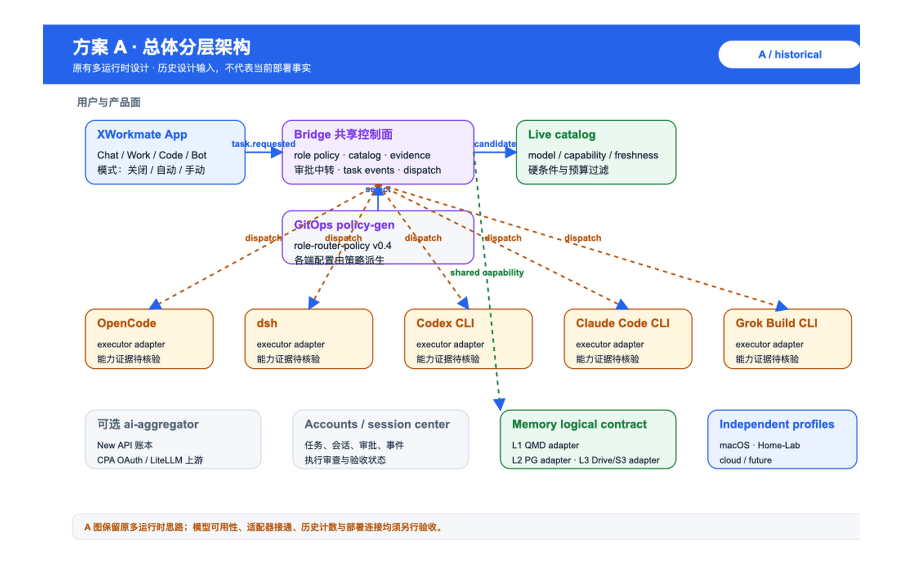
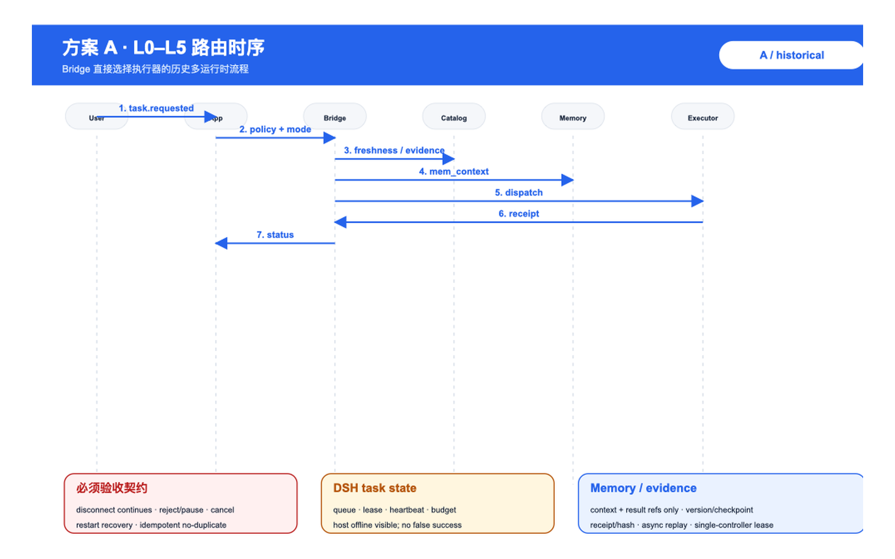
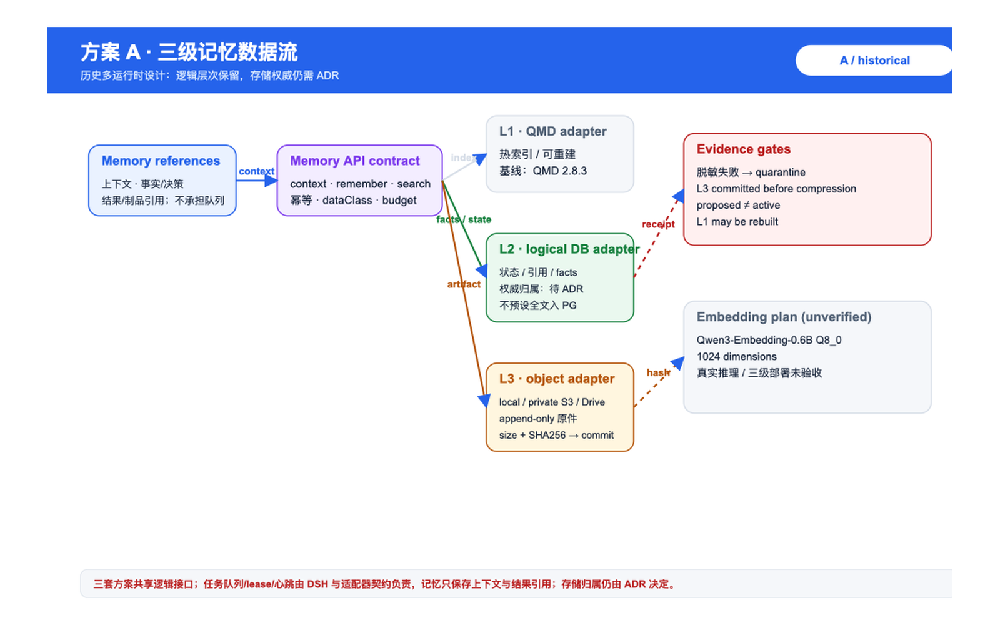
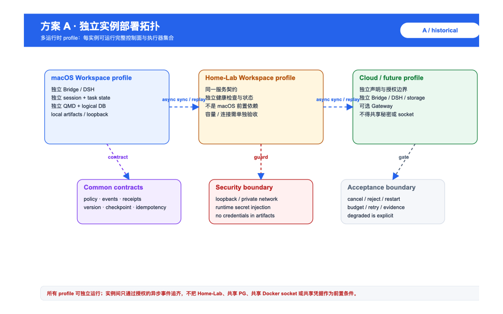
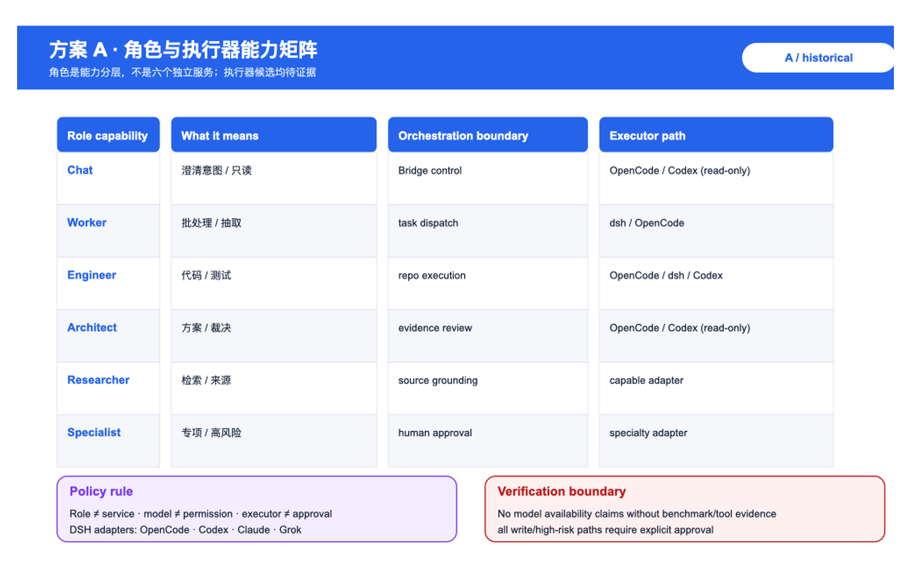
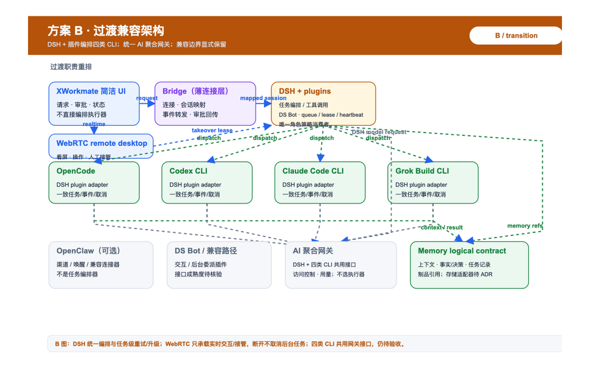
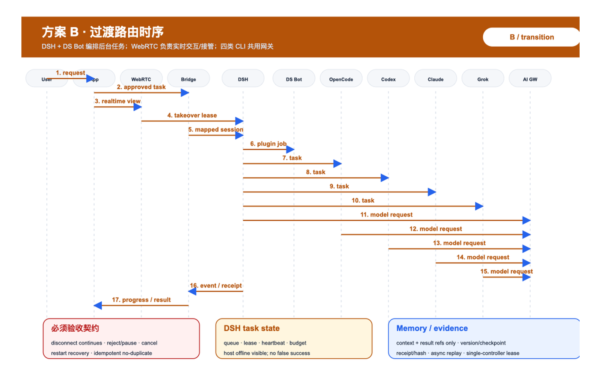
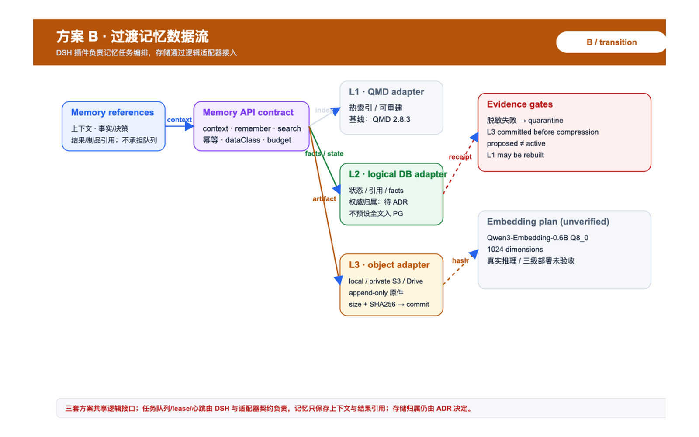
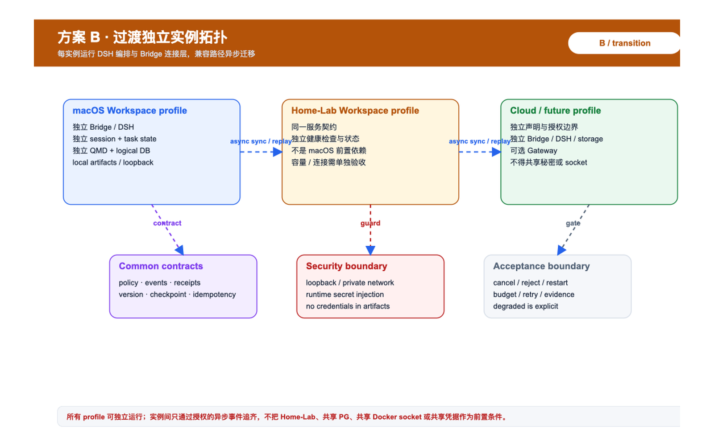
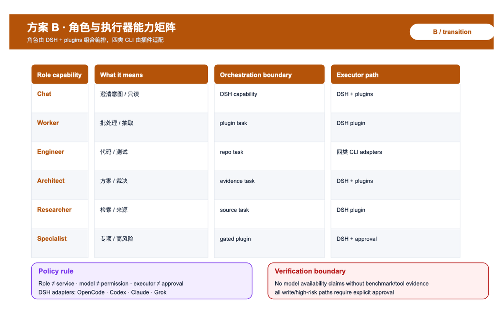

# AI Workspace 三套架构版本图与迁移验收索引

本文是 [AI Workspace、XWorkmate 多执行器与三级记忆技术白皮书规划](ai-workspace-agent-memory-whitepaper-plan.zh.md) 的版本图索引和迁移验收附录。三套图使用公开安全的逻辑名称，不含真实账号、内网地址、凭据或本机绝对路径。

## 1. 版本定位

| 版本 | 定位 | 入口与编排 | 编码执行器 | Bridge 职责 | 状态 |
| --- | --- | --- | --- | --- | --- |
| A | 原有多运行时设计重绘 | Bridge 直接选择/派发多个执行器 | OpenCode、dsh、Codex CLI、Claude Code、Grok CLI 候选 | 共享控制面、策略选择、事件、授权中转 | 历史设计，非当前部署事实 |
| B | DSH + 插件过渡兼容 | DSH + 插件负责任务编排、工具调用、任务级重试/升级 | DSH 插件派发 OpenCode、Codex CLI、Claude Code CLI、Grok Build CLI | 连接、会话映射、事件转发、审批回传 | 过渡设计，兼容路径待迁移 |
| C | DSH 精简目标 | DSH + 插件是唯一编排和角色策略入口 | DSH 按能力分别派发 OpenCode、Codex CLI、Claude Code CLI、Grok Build CLI | 薄连接、会话映射、事件转发、审批回传 | 已确认目标结构，仍待验收 |

共同约束：XWorkmate App 只做简洁入口、审批、进度和结果展示；DS Bot 是 DSH 下的交互/委派插件，具体接口和成熟度待核实；WebRTC 是看屏、远程操作和人工接管通道，不承担任务持久化或另起编排器。角色能力 Chat、Worker、Engineer、Architect、Researcher、Specialist 不等于六个独立服务。三级记忆是共享能力，AI 聚合网关负责模型连接、访问控制和用量/账本，不决定业务任务由谁执行。

## 2. 职责差异

| 组件/职责 | A（历史） | B（过渡） | C（目标） |
| --- | --- | --- | --- |
| App | Chat/Work/Code/Bot 与审批展示 | 简洁入口、审批、进度、结果 | 简洁入口、审批、进度、结果 |
| Bridge | 共享控制面，直接选择/派发执行器 | 只连接、映射会话、转发事件和审批结果 | 薄连接层；不规划、不重试、不升级 |
| DSH + plugins | 可作为执行器/候选路径 | 任务编排、工具调用、唯一策略消费 | 任务编排、工具调用、唯一策略消费 |
| DS Bot | 未纳入主链 | DSH 下交互/委派插件 | DSH 下交互/委派插件；接口成熟度待核实 |
| OpenCode | 多运行时执行器候选 | 编码执行器 | 跨厂商兼容候选；按能力按需派发 |
| Codex CLI | 保留候选，接入状态待证 | 编码执行器候选 | 与其他 CLI 一致接口的保留/可接入候选 |
| Claude Code CLI | 原厂 CLI 候选，能力待核验 | 编码执行器候选 | DSH 插件适配；优先匹配原厂模型是选型原则 |
| Grok Build CLI | 用户指定待验证适配器 | 编码执行器候选 | DSH 插件适配；不得虚构协议或版本 |
| OpenClaw | 未纳入主执行链 | 可选渠道、唤醒、兼容连接器 | 不承担全局路由、角色策略或任务重试 |
| WebRTC | 未纳入主链 | 看屏、远程操作、人工接管 | 媒体/控制通道；不承担持久化、队列或编排 |
| AI 聚合网关 | 可选模型连接器 | DSH 与四类 CLI 共用模型接口 | 模型连接、访问控制、用量；不决定业务执行者 |
| 角色策略 | GitOps 单一来源，历史由 Bridge 消费 | 单一来源，由 DSH 编排入口消费 | 单一来源，由 DSH 编排入口消费 |
| 任务重试/升级 | 历史流程待核验 | DSH 协调 | DSH 协调；适配器只做受限协议恢复 |

网关不得选择业务执行者。OpenCode 与 Codex CLI 的优劣不在本文预先裁定，需通过补丁质量、工具执行、审批隔离、会话恢复和成本测试选择；不得将任一项绘成已部署打通或已淘汰。

## 3. 图源与 PNG

每套包含五张：总体分层、角色路由时序、三级记忆数据流、独立实例部署拓扑、角色与执行器能力矩阵。`.svg` 是可编辑源，`.png` 是由本机 Quick Look 从 viewBox 渲染、裁去导出空白后的 1600×1000 宽屏预览。

### 3.1 方案 A：历史多运行时

#### A-01 总体分层



可编辑源：[A-01 SVG](assets/ai-workspace-agent-memory/variants/a-historical-multi-runtime/01-overall-layered-architecture.svg)；状态：历史设计重绘，非当前部署事实。

#### A-02 角色路由时序



可编辑源：[A-02 SVG](assets/ai-workspace-agent-memory/variants/a-historical-multi-runtime/02-routing-sequence.svg)；状态：历史流程输入，执行器与目录能力待核验。

#### A-03 三级记忆数据流



可编辑源：[A-03 SVG](assets/ai-workspace-agent-memory/variants/a-historical-multi-runtime/03-memory-data-flow.svg)；状态：逻辑适配器视图，存储权威仍由 ADR 决定。

#### A-04 独立实例部署拓扑



可编辑源：[A-04 SVG](assets/ai-workspace-agent-memory/variants/a-historical-multi-runtime/04-independent-instance-deployment.svg)；状态：拓扑设计输入，不代表已部署连接。

#### A-05 角色与执行器能力矩阵



可编辑源：[A-05 SVG](assets/ai-workspace-agent-memory/variants/a-historical-multi-runtime/05-role-executor-capability-matrix.svg)；状态：能力候选，需基准、工具调用和权限证据。

### 3.2 方案 B：过渡兼容

#### B-01 总体分层



可编辑源：[B-01 SVG](assets/ai-workspace-agent-memory/variants/b-transition-dsh-plugins/01-overall-layered-architecture.svg)；状态：DSH + 插件过渡设计，迁移路径待验收。

#### B-02 角色路由时序



可编辑源：[B-02 SVG](assets/ai-workspace-agent-memory/variants/b-transition-dsh-plugins/02-routing-sequence.svg)；状态：四类 CLI 与统一 Gateway 接口待实证。

#### B-03 三级记忆数据流



可编辑源：[B-03 SVG](assets/ai-workspace-agent-memory/variants/b-transition-dsh-plugins/03-memory-data-flow.svg)；状态：共享逻辑契约，L1/L2/L3 provider 待 ADR。

#### B-04 独立实例部署拓扑



可编辑源：[B-04 SVG](assets/ai-workspace-agent-memory/variants/b-transition-dsh-plugins/04-independent-instance-deployment.svg)；状态：独立 profile 目标，兼容边界待验收。

#### B-05 角色与执行器能力矩阵



可编辑源：[B-05 SVG](assets/ai-workspace-agent-memory/variants/b-transition-dsh-plugins/05-role-executor-capability-matrix.svg)；状态：角色能力不等于服务，CLI adapter 能力待核验。

### 3.3 方案 C：DSH 精简目标

#### C-01 总体分层 (目标态·v2.1)


*图 C-01：演进至 v2.1 的目标态全貌（涵盖 WebRTC 远程人工接管、DSH + DS Bot stdio 编排、多执行器协同及三级记忆体系）。历史可编辑源：[C-01 SVG](assets/ai-workspace-agent-memory/variants/c-target-dsh-minimal/01-overall-layered-architecture.svg) / [历史初版 PNG](assets/ai-workspace-agent-memory/variants/c-target-dsh-minimal/01-overall-layered-architecture.png)；状态：目标结构方向已确认。*

#### C-02 角色路由时序


可编辑源：[C-02 SVG](assets/ai-workspace-agent-memory/variants/c-target-dsh-minimal/02-routing-sequence.svg)；状态：DSH 唯一编排入口与 Gateway 共用接口待实证。

#### C-03 三级记忆数据流


可编辑源：[C-03 SVG](assets/ai-workspace-agent-memory/variants/c-target-dsh-minimal/03-memory-data-flow.svg)；状态：QMD/embedding 与 L2/L3 权威归属仍待验收/ADR。

#### C-04 独立实例部署拓扑


可编辑源：[C-04 SVG](assets/ai-workspace-agent-memory/variants/c-target-dsh-minimal/04-independent-instance-deployment.svg)；状态：Mac、Home-Lab、未来 profile 独立运行仍为目标约束。

#### C-05 角色与执行器能力矩阵


可编辑源：[C-05 SVG](assets/ai-workspace-agent-memory/variants/c-target-dsh-minimal/05-role-executor-capability-matrix.svg)；状态：四类 CLI adapter、权限与模型证据仍待核验。

## 4. 记忆与实例边界

三套设计都只承诺逻辑接口：上下文检索、事实与决策、任务记录、制品引用。L0–L5 是角色层级，L1–L3 是记忆层级，不能混写。

- 本机基线是 QMD 2.8.3。
- `Qwen3-Embedding-0.6B Q8_0`、1024 维是计划项，不是已完成真实推理或部署验收。
- 用户曾要求 QMD 保存会话、PG 保存状态元数据、大文件存本地或私有 S3；原图又出现 PG 权威 L2 与 Drive L3。会话正文权威、PG 内容范围、L3 provider 和迁移策略必须继续由 ADR 决定。
- Mac、Home-Lab 和未来实例都可独立运行；实例之间通过授权异步事件、版本、checkpoint 和 receipt/hash 追齐，不依赖 Home-Lab。

## 5. 迁移顺序与验收契约

```text
A 历史多运行时
    ↓ 保留旧执行路径、登记证据与兼容边界
B DSH + plugins 过渡
    ↓ Bridge 变薄；DSH 接管编排；OpenCode/Codex CLI 共用接口
C DSH 精简目标
    ↓ 薄 Bridge；单一策略入口；按需编码 runtime；显式移除需另行批准
```

每个阶段都必须验证并留下带版本/环境/目标的证据：

1. 取消传播、审批拒绝和高风险操作人工门；
2. 任务级重试、角色内升级、预算上限和无静默 provider fallback；
3. 适配器只做受限连接/协议恢复；有副作用动作禁止无幂等保护重放；
4. 重启恢复、乱序/重复事件、幂等重试和事件补偿；
5. DSH 通过 DS Bot/插件分别调度 OpenCode、Codex CLI、Claude Code CLI、Grok Build CLI，四者使用一致任务、事件、取消、审批、记忆和验收接口；
6. DSH 与四类 CLI 的模型请求都经过同一 AI 聚合网关接口；网关只连接、控权、计量；
7. App/WebRTC 断开后后台任务继续，重连可恢复进度；执行 Workspace 主机离线可见且不得假成功；
8. 跨实例授权、版本/checkpoint、离线排队、lease/心跳、重放、去重和 receipt/hash；人工接管使用单控制者租约；
9. L1/L2/L3 写入、L3 commit、脱敏 quarantine、重建和存储 ADR 负例。

这些是验收契约，不是对 DSH、网关、执行器或存储系统现有能力的自动假设。任何“已部署”“已接通”“已删除旧服务”的表述都必须绑定精确构件、运行回执和授权记录。

## 6. 仍待决策

- 网关具体协议兼容性，以及 DSH/OpenCode/Codex CLI 的统一 adapter contract；
- DSH 与 OpenCode、Codex CLI、Claude Code CLI、Grok Build CLI 的统一 adapter contract、认证、协议、工具调用、流式和会话恢复兼容性；
- DS Bot 接口/实现成熟度、WebRTC 远程控制与单控制者租约的实际能力；
- 四类 CLI 的补丁质量、工具执行、审批隔离、会话恢复和成本实测结论；
- 会话正文权威归属、PG 允许保存的摘要/受限文本范围；
- L3 使用本地、私有 S3 或 Drive 的 Provider、保留期、迁移和退出策略；
- A→B→C 旧路径的停用清单、兼容窗口、回滚点和批准人；
- 真实三级记忆部署、embedding 推理和跨实例端到端验收。

