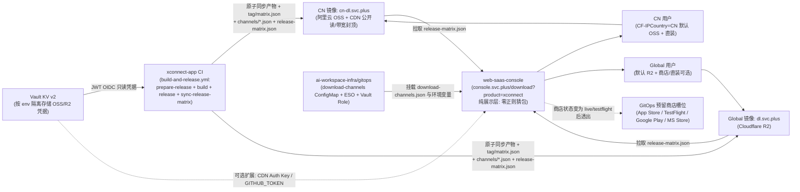

# XConnect 下载页微调、CI Release 版本矩阵同步与双镜像分发规划

> [!NOTE]
> 本文档为 **Phase 1–3 全链路实施规划（Planning / Target Architecture）**，基线核查时间为 `2026-11-23`。文档中引用的源码路径、CI 工作流脚本与线上 Release 产物均为核查当日的真实状态；目标配置模板、`release-matrix.json` 契约、前端纯展示改造与黑盒探针均为待落地规划，尚未在生产环境启用。

---

## 一、规划背景与现状基线核查（2026-11-23）

### 1.1 Portal 下载中心现状核查（`ai-workspace-services/portal`）

当前 `https://console.svc.plus/download?product=xconnect` 的服务端与客户端实现主要由以下文件构成：

| 文件路径 | 当前职责 | 核查发现 |
| :--- | :--- | :--- |
| `src/app/download/page.tsx` | SSR 页面入口（`dynamic = "force-dynamic"`，`revalidate = 3600`） | 聚合 GitHub Releases、artifact manifest 与 offline package 清单，再调用 `prioritizeDownloadProduct` 按 `?product=` 排序；**未读取用户地域请求头（如 `cf-ipcountry`）或渠道偏好** |
| `src/lib/download/catalog.ts` | 产品定义与资产映射核心逻辑 | 1. **在前端仓库重复维护平台/格式硬编码与正则猜包**：`PRODUCT_DEFINITIONS` 硬编码 5 端描述、格式与匹配正则，一旦 `xconnect-app` CI 新增架构或变更包名即产生漂移<br>2. **硬编码优先 GitHub Release**：`getLatestAsset` 优先返回 `source === "github-release"`，仅在缺失时回退至硬编码的 `https://dl.svc.plus`<br>3. **单平台仅保留 1 个文件**：每个平台只绑定单个 `asset`，丢弃同平台其余安装格式<br>4. **`.some()` OR 匹配缺陷**：`platformMatches.some(...)` 导致只要文件路径或文件名满足其一即命中，Windows 的 `/\.zip$/i` 存在误匹配其它平台 `.zip` 包的风险 |
| `src/lib/download/github-releases.ts` | GitHub Release API 实时拉取 | 请求 `api.github.com/repos/<owner>/<repo>/releases/latest`，每小时缓存；支持匿名回退 |
| `src/lib/download/dl-index-data-artifacts.ts` | 远程镜像清单读取 | 受 `ALLOW_REMOTE_DL_FETCH === "true"` 控制，仅硬编码访问 `https://dl.svc.plus/dl-index/artifacts-manifest.json`，未接入多区域镜像配置 |
| `src/components/download/DownloadCatalog.tsx` | 下载页交互组件 | 根据 `navigator.userAgent` 推荐主平台并展示 SHA-256 与其余平台列表，但**无地区/镜像切换、无版本通道（`stable` / `latest`）切换、无商店与直装分流、无多格式选择，也无针对 iOS `.ipa` / Android `.apk` 的安装引导** |

### 1.2 `xconnect-app` CI 流水线与发布产物核查（`ai-workspace-xstream/xconnect-app`）

核查 `.github/workflows/build-and-release.yml` 与 `scripts/ci/*` 现行实现：

| 文件 / Job | 现有实现机制 | 核查发现与收敛方向 |
| :--- | :--- | :--- |
| `.github/workflows/build-and-release.yml` | `prepare-release` → `build`（5 平台矩阵：`linux/x64`、`windows/x64`、`macos/arm64`、`ios/arm64`、`android/universal`）→ `release` → `update-readme` | 已具备完整 5 端构建矩阵与 GitHub Release 上传能力，但缺少向阿里云 OSS / Cloudflare R2 同步版本产物与 `release-matrix.json` 的阶段 |
| `scripts/ci/compute_release_metadata.sh` | 解析 `pubspec.yaml` 的 `app_version`、`build_number`、`msi_version`；按触发源分支/Tag 路由：<br>- `v*` Tag → `release_tag="$build_ref"`，`release_title="XConnect ${release_version}"`<br>- `release/v*` → `release_tag="release-${msi_version}-${build_id}-${short_sha}"`<br>- `main` → `release_tag="latest-${build_id}-${short_sha}"`，`release_title="latest"` | 已在 CI 侧掌握最准确的版本号、通道归属与 MSI 版本映射，但目前只输出 `release_tag` / `release_title` / `release_notes` 三个字段，未将 `app_version`、`build_number`、`msi_version`、`release_channel`、`commit_sha` 沉淀为机器可读矩阵 |
| `scripts/update_readme_downloads.py` & `scripts/ci/update_readme_from_release.sh` | 从刚创建的 GitHub Release 查询 `assets` 并改写仓库 `README.md` 支持矩阵 | 仅同步 GitHub README 且同样依赖脚本内文件名筛选，未与 Console 下载页共享同一份版本矩阵 |
| `scripts/ci/remote_release_sync.sh` | 遗留的 SSH + `rsync` 到单台 `VPS_HOST` `/data/update-server/` 脚本 | 未接入 `build-and-release.yml`，且依赖长期静态 SSH 私钥；应由 Vault OIDC + OSS/R2 双镜像矩阵同步替代并下线 |

核查最近一次线上 GitHub Release（`latest-43702841981-33947f3`，发布时间 `2026-11-15T10:29:28Z`），当前实际产出 **12 个资产文件**：

| 平台 | 文件名 | 大小 | CI 矩阵中的受众分类（`audience`）与展示定位 |
| :--- | :--- | ---: | :--- |
| macOS | `xconnect.dmg` | 36.8 MB | `end_user` · **主推直装包**（Apple Silicon DMG） |
| macOS | `xconnect-latest-33947f3.dmg` | 36.8 MB | `internal`（内容同 `xconnect.dmg` 的提交快照副本，CI 不写入终端推荐列表） |
| Windows | `xconnect-windows.msi` | 91.0 MB | `end_user` · **主推直装包**（标准 MSI 安装向导） |
| Windows | `xconnect-windows.zip` | 49.9 MB | `end_user` · **便携绿色包**（免安装，适合无管理员权限环境） |
| Linux | `xconnect-linux-amd64.deb` | 69.4 MB | `end_user` · **Debian / Ubuntu 安装包**（主推默认） |
| Linux | `xconnect-linux-x86_64.rpm` | 70.9 MB | `end_user` · **Fedora / RHEL / openSUSE 安装包** |
| Linux | `xconnect-linux.AppImage` | 46.0 MB | `end_user` · **通用便携 AppImage** |
| Linux | `xconnect-linux.zip` | 34.4 MB | `end_user` · **Linux 绿色压缩包** |
| Android | `app-release.apk` | 187.3 MB | `end_user` · **Android 直装主推（免 Google Play）** |
| Android | `app-release.aab` | 134.9 MB | `store_only`（Google Play App Bundle，**CI 直接标为非直装**，不向终端直装 UI 透出） |
| iOS | `xconnect.ipa` | 22.1 MB | `sideload`（高级侧载包，需配合 AltStore / Sideloadly / 企业签名工具） |
| iOS | `xconnect.app.zip` | 22.1 MB | `internal`（构建中间归档，**CI 不纳入终端分发矩阵**） |

### 1.3 待解决的核心痛点

1. **CN 用户“鸡生蛋”下载死锁**：未连接加速服务前，中国大陆用户往往无法稳定直连 `github.com` 下载安装包；当前 `catalog.ts` 优先给出 GitHub Release 直链，导致 CN 首装体验极易失败。
2. **前后职责耦合（前端在“猜”CI 产物）**：`portal` 通过正则与文件名后缀推测平台、格式与可用性，一旦 CI 修改构建架构或新增多架构包，前端即失真；必须收敛为 **CI 产出权威版本矩阵，前端 UI 纯展示**。
3. **缺少“可使用应用商店 / 不能使用应用商店”分流模型**：当前 iOS 直接将 `xconnect.ipa` 作为主按钮暴露，对绝大多数普通 iOS 用户属于死胡同；四端也缺少应用商店预留槽与清晰分流。
4. **域名与同步凭据尚未纳入 Vault KV + GitOps 治理**：镜像域名硬编码在前端仓，且 `xconnect-app` CI 尚未接入自动推送至阿里云 OSS 与 Cloudflare R2 的闭环。

---

## 二、已确认的核心架构决策（Locked Decisions）

| 序号 | 决策项 | 锁定内容 |
| :---: | :--- | :--- |
| **1** | **CN 阿里云 OSS 镜像域名（全产品矩阵）** | `https://cn-dl.svc.plus`（阿里云 OSS + 阿里云 CDN，**面向所有产品矩阵设计**，统一提供 `/releases/<product>/*` 与 `/offline-package/<product>/*` 的中国大陆下载入口） |
| **2** | **Global Cloudflare R2 镜像域名（全产品矩阵）** | `https://dl.svc.plus`（沿用现有 Cloudflare R2 自定义域，**面向所有产品矩阵设计**，与 `cn-dl.svc.plus` 保持同构布局，服务全球及海外用户） |
| **3** | **各平台应用商店状态** | iOS（App Store / TestFlight）、Android（Google Play）、Windows（Microsoft Store）、macOS（Mac App Store）当前统一标记为 **暂未上架 / 仅提供直装**，在 GitOps 配置与前端 UI 中**完整预留链接槽与状态切换能力** |
| **4** | **CN 阿里云 OSS 防盗链 / 防刷策略** | 首期采用 **公开读 + 阿里云 CDN 带宽封顶**，暂不启用 URL 动态签名；在 Vault KV 与 Portal 中预留后续接入阿里云 CDN Type-A 短期签名鉴权的扩展槽位 |
| **5** | **本次规划与实施范围** | 覆盖 **Phase 1（`portal` 前端与配置层）+ Phase 2（`gitops` 模板与 Vault KV 契约）+ Phase 3（`xconnect-app` CI 双镜像自动同步与观测探针）** |
| **6** | **CI 版本矩阵同步与前端纯展示边界** | **`xconnect-app` CI（`build-and-release.yml`）是 Release 版本、通道（`stable` / `latest`）、平台、架构、格式、SHA-256 与镜像可用性的唯一权威生产者；`portal` 前端仅作纯展示渲染（Pure Presentation），不再对 XConnect 进行文件名正则猜包或硬编码平台/格式映射** |

---

## 三、目标架构与端到端分发拓扑



---

## 四、下载页 UX 与前端纯展示层设计（Phase 1：`ai-workspace-services/portal`）

### 4.1 核心原则：前端 UI 纯展示（Pure Presentation）

对于已接入 CI 版本矩阵的产品（首期为 `xconnect`），`portal` **严格保持纯展示职责**：

- **零文件名正则匹配**：前端和 BFF 不再使用 `/\.zip$/i`、`/.dmg$/i` 等正则从混合文件列表里猜平台或架构，也不在前端做 `.aab` / `xconnect.app.zip` 的黑名单过滤。
- **零硬编码平台/格式表**：当前有哪些版本通道（`stable` / `latest` / 近期 `history`）、每个版本包含哪些平台、每个平台有哪些安装包格式、哪个为主推包、文件的字节大小与 SHA-256，**全部原样来自 `release-matrix.json`**。
- **配置驱动通道与商店状态**：镜像域名（`cn-dl.svc.plus` / `dl.svc.plus`）与四端商店预留槽状态（`coming_soon` / `testflight` / `live` / `unavailable_in_cn`）**全部来自 GitOps 挂载的 `download-channels.json`**。
- **渲染拼接规则极其纯粹**：针对 `release-matrix.json` 中的任意 `package.path`，前端仅按用户所选区域拼接 `selectedMirror.baseUrl + package.path`（当对应镜像未同步或降级时自动拼接备选镜像 Base URL 或回退 `package.githubUrl`）。

### 4.2 顶部控制栏：线路偏好 + 渠道偏好 + 版本通道切换

在产品卡片顶部提供三组紧凑、相互正交的控制项，状态同步到 URL Query（`?product=xconnect&region=cn|global&channel=store|direct&track=stable|latest`）与浏览器 `localStorage`：

1. **下载线路 / 所在地区（Region / Mirror）**
   - 选项：`中国大陆（阿里云 OSS · cn-dl.svc.plus）` ｜ `全球 / 海外（Cloudflare R2 · dl.svc.plus）`
   - **服务端智能默认**：`src/app/download/page.tsx` 通过 `next/headers` 读取 `cf-ipcountry`；值为 `CN` 时默认 `region = "cn"`，其余默认 `region = "global"`；本地开发或缺失请求头时回退参考 `accept-language`。用户手动点击或 URL 显式指定后立即切换所有包的下载基地址。
2. **安装方式偏好（Channel Preference）**
   - 选项：`可使用应用商店` ｜ `不能使用应用商店（直接下载安装包）`
   - **当前阶段行为**：四端商店在 GitOps ConfigMap 中均声明为 `coming_soon`（预留槽位）：
     - 选择 **“可使用应用商店”** 时，各支持商店的平台展示 GitOps 声明的预留商店卡（标明“暂未上架 · 敬请期待”与对应商店名），并给出直达下方镜像直装包的快捷按钮，杜绝死链。
     - 未来任一平台在 GitOps ConfigMap 中填入商店 URL 并将 `status` 改为 `live` 或 `testflight` 后，UI 自动渲染直跳商店的主 CTA，**无需改动前端代码**。
3. **版本通道切换（Release Track / Version，数据驱动）**
   - 由 `release-matrix.json` 的 `channels` 与 `history` 直接驱动渲染：
     - **稳定版（`stable`）**：来自 `v*` Tag 发布（若尚未打 `v*` Tag，则默认展示 `latest` 并标记通道徽标）。
     - **最新构建（`latest`）**：来自 `main` 分支 CI 矩阵的最新持续构建（如 `latest-43702841981-33947f3`）。
     - **历史版本选择器**：展开切换 `history` 列表中的近期可用版本（仅展示 `release-matrix.json` 已登记的不可变 `<tag>`），便于用户或排障场景回退安装特定历史版本。

### 4.3 五端“应用商店预留槽 vs CI 矩阵直装”渲染规则

以下所有直装包条目、架构标签与受众标记均直接由 `release-matrix.json` 驱动，前端仅负责按 `audience` 与 `primary` 属性做纯排版映射：

| 平台 | 应用商店预留槽（GitOps `stores.<platform>`） | CI 矩阵 `platforms[]` 输出的直装包（`end_user` / `sideload`） | 纯展示 UI 规则 |
| :--- | :--- | :--- | :--- |
| **iOS** | 主槽：`App Store`（`coming_soon`）<br>次槽：`TestFlight`（`coming_soon`） | `audience = "sideload"`：`xconnect.ipa`（CI 已过滤 `xconnect.app.zip`） | **重点保护**：无 `audience = "end_user"` 包时，主区域展示商店预留状态卡与引导文案（“App Store / TestFlight 准备中，iOS 浏览器无法直接安装 `.ipa`”），并将 `xconnect.ipa` 折叠于“高级侧载安装（AltStore / Sideloadly）”区域。 |
| **Android** | `Google Play`（`coming_soon`） | `audience = "end_user"`：`app-release.apk`（CI 已标 `app-release.aab` 为 `store_only`，不输出到直装列表） | 主推按钮直链 `<mirrorBaseUrl><path>`；展示文件大小、SHA-256 一键复制及“允许安装未知来源应用”一句话提示。 |
| **macOS** | `Mac App Store`（`coming_soon`） | `audience = "end_user"`：`xconnect.dmg`（CI 已排除 `xconnect-latest-*.dmg` 重复副本） | 展示版本号、架构（`arm64`）、文件大小与 SHA-256 一键复制。 |
| **Windows** | `Microsoft Store`（`coming_soon`） | `audience = "end_user"`：`xconnect-windows.msi`（`primary: true`）+ `xconnect-windows.zip`（`primary: false`） | 主按钮对应 `primary: true` 的 `.msi`，同卡片内渲染格式切换胶囊（`.msi` / `.zip`）。 |
| **Linux** | 无传统商店槽 | `audience = "end_user"`：`xconnect-linux-amd64.deb`（`primary: true`）+ `.AppImage` / `.rpm` / `.zip` | 行内直接遍历 `packages[]` 渲染格式切换胶囊（`.deb` / `.AppImage` / `.rpm` / `.zip`），主按钮跟随当前选中格式。 |

### 4.4 镜像容错与防死链降级策略

```text
首选区域镜像 release-matrix.json (CN -> cn-dl.svc.plus | Global -> dl.svc.plus)
   ├── 成功且版本通道有效 ──▶ 拼接首选镜像 Base URL（标注 "阿里云 OSS 镜像" / "Cloudflare R2 镜像"）
   └── 拉取超时 / 404 / mirrors[region].synced === false ──▶ 自动降级至对端镜像 release-matrix.json ──▶ 仍缺失则回退 package.githubUrl / GitHub Releases（标注 "当前由备用源提供"）
```

### 4.5 Portal 源码改造清单

| 模块文件 | 改造内容 |
| :--- | :--- |
| `src/lib/download/channels.ts`（新增） | 读取 `process.env.DOWNLOAD_CHANNELS_CONFIG_PATH` 指向的 GitOps JSON 文件（缺省时使用内置安全默认值：`cn-dl.svc.plus`、`dl.svc.plus`、4 个商店 `coming_soon` 预留槽）；定义 `DownloadChannelsConfig`、`MirrorRegion`、`StoreChannelInfo`；预留 `signMirrorUrl()` 扩展钩子。 |
| `src/lib/download/release-matrix.ts`（新增） | 拉取选定产品的 `release-matrix.json`（首选区域镜像优先，超时 `3000ms` 自动回退对端镜像，缓存 `revalidate = 300`），严格校验 `schemaVersion === 1`，直接转换为前端纯展示 ViewModel（结合 GitOps `stores` 预留槽），**不执行任何文件名正则匹配**。 |
| `src/lib/download/catalog.ts` | 对尚未接入 `release-matrix.json` 的既有产品（如 `xworkmate`、`ai-workspace-offline`、`open-platform-offline`）保持向后兼容（同时顺手修复其中 `.some()` 正则风险）；当产品已声明 `matrixPath` 并成功获取 `release-matrix.json` 时，**完全旁路正则匹配**。 |
| `src/app/download/page.tsx` | 读取请求头 `cf-ipcountry`、`accept-language` 与 `searchParams`（`product` / `region` / `channel` / `track`），加载渠道配置并对所有在 `products.<id>.matrixPath` 登记的产品并行拉取 `release-matrix.json`（失败时兜底 `getGithubReleaseListings`），将纯展示视图模型传入客户端组件。 |
| `src/components/download/DownloadCatalog.tsx` | 纯数据驱动渲染：顶部线路/商店/版本通道切换栏、多格式切换胶囊（遍历 `packages[]`）、商店预留槽状态卡、iOS `sideload` 折叠区、SHA-256 复制按钮（复用 `CopyButton`）与镜像降级提示徽标。 |
| `src/lib/download/release-matrix.test.ts` & `channels.test.ts` | 补充 `release-matrix.json` 解析、CN/Global 镜像切换与故障降级、`stable`/`latest`/`history` 通道切换、`sideload`/`store_only` 渲染边界、GitOps 商店槽状态映射的 Vitest 单元测试。 |

---

## 五、全产品矩阵统一对象存储布局与 `release-matrix.json` 契约（OSS & R2 同构）

`https://cn-dl.svc.plus`（阿里云 OSS）与 `https://dl.svc.plus`（Cloudflare R2）**面向所有产品矩阵统一设计**，而不只是单一产品专用域名。全站产品共享同一个双镜像域名根，按产品前缀与交付形态清晰分区，保证任意产品之间**可 100% 互相替代降级**并保持一致的三层对象 Key 结构与 HTTP 缓存策略。

### 5.1 全产品矩阵接入规划（Product Matrix Onboarding）

| 产品 ID | 镜像命名空间 | 接入阶段 | 说明 |
| :--- | :--- | :--- | :--- |
| `xconnect` | `/releases/xconnect/*` | **Phase 1–3 首批落地** | 本次完整打通 `portal` 纯展示、`gitops` 配置、Vault OIDC 与 `xconnect-app` CI 双镜像自动同步 |
| `xworkmate` | `/releases/xworkmate/*` | **后续增量接入** | 复用同一套 `cn-dl.svc.plus` / `dl.svc.plus` 根域与 `release-matrix.json` 契约，仅需在 GitOps `download-channels.json` 增加 `products.xworkmate` 槽位并在 `xworkmate-app` CI 接入同名同步脚本 |
| `ai-workspace-offline` / `open-platform-offline` | `/offline-package/*`（及可选 `/releases/<product>/*`） | **共享双镜像基座** | 离线安装包目录在 `cn-dl.svc.plus` 与 `dl.svc.plus` 保持路径同构，由 `dl-index/` 与后续矩阵索引统一暴露 |

### 5.2 三层同构对象路径与 Cache-Control 规范

```text
https://{cn-dl.svc.plus | dl.svc.plus}/
├── releases/<product>/
│   ├── release-matrix.json                 # 聚合权威矩阵（stable + latest + 近期 history[]）
│   │                                       # Cache-Control: public, max-age=60, must-revalidate
│   ├── channels/
│   │   ├── stable.json                     # 当前稳定版快照（Cache-Control: public, max-age=60, must-revalidate）
│   │   └── latest.json                     # 当前 main 最新构建快照（Cache-Control: public, max-age=60, must-revalidate）
│   └── <tag>/                              # 不可变版本目录（例如 v1.2.0 或 latest-43702841981-33947f3）
│       ├── matrix.json                     # 该版本单次构建的原始不可变版本矩阵
│       ├── SHA256SUMS.txt                  # 该版本全部安装包校验清单
│       └── <artifact-files...>             # Cache-Control: public, max-age=31536000, immutable
└── offline-package/<product>/...           # 离线安装包共享双镜像目录

# 以首批落地的 xconnect 为例：
/releases/xconnect/
  ├── release-matrix.json
  ├── channels/{stable.json, latest.json}
  └── <tag>/
      ├── matrix.json
      ├── SHA256SUMS.txt
      ├── xconnect.dmg
      ├── xconnect-windows.msi
      ├── xconnect-windows.zip
      ├── xconnect-linux-amd64.deb
      ├── xconnect-linux-x86_64.rpm
      ├── xconnect-linux.AppImage
      ├── xconnect-linux.zip
      ├── app-release.apk
      └── xconnect.ipa
```

> 说明：由于 `dl.svc.plus` 目前已托管 `dl-index/` 与 `offline-package/` 目录，桌面/移动客户端发布物统一置于 `/releases/<product>/...` 前缀下，**不干扰既有目录**；现有 `dl-index/artifacts-manifest.json` 继续服务离线包与其他历史资源。

### 5.3 `release-matrix.json` 权威数据契约

由 `xconnect-app` CI 生成并同步至双镜像，**前端只按此结构纯展示**：

```json
{
  "schemaVersion": 1,
  "product": "xconnect",
  "generatedAt": "2026-11-23T07:35:00Z",
  "defaultChannel": "latest",
  "channels": {
    "stable": null,
    "latest": {
      "tag": "latest-43702841981-33947f3",
      "version": "1.0.0",
      "buildNumber": "1",
      "msiVersion": "1.0.1",
      "channel": "latest",
      "commitSha": "33947f3",
      "publishedAt": "2026-11-15T10:29:28Z",
      "releaseUrl": "https://github.com/ai-workspace-xstream/xconnect-app/releases/tag/latest-43702841981-33947f3",
      "workflowRunUrl": "https://github.com/ai-workspace-xstream/xconnect-app/actions/runs/43702841981",
      "mirrors": {
        "cn": { "synced": true },
        "global": { "synced": true }
      },
      "platforms": [
        {
          "id": "macos",
          "label": "macOS",
          "labelZh": "macOS",
          "arch": "arm64",
          "supportStatus": "supported",
          "packages": [
            {
              "name": "xconnect.dmg",
              "format": "dmg",
              "arch": "arm64",
              "path": "/releases/xconnect/latest-43702841981-33947f3/xconnect.dmg",
              "size": 36801009,
              "sha256": "<sha256-hex>",
              "primary": true,
              "audience": "end_user",
              "githubUrl": "https://github.com/ai-workspace-xstream/xconnect-app/releases/download/latest-43702841981-33947f3/xconnect.dmg"
            }
          ]
        },
        {
          "id": "windows",
          "label": "Windows",
          "labelZh": "Windows",
          "arch": "x64",
          "supportStatus": "supported",
          "packages": [
            {
              "name": "xconnect-windows.msi",
              "format": "msi",
              "arch": "x64",
              "path": "/releases/xconnect/latest-43702841981-33947f3/xconnect-windows.msi",
              "size": 91004928,
              "sha256": "<sha256-hex>",
              "primary": true,
              "audience": "end_user",
              "githubUrl": "https://github.com/ai-workspace-xstream/xconnect-app/releases/download/latest-43702841981-33947f3/xconnect-windows.msi"
            },
            {
              "name": "xconnect-windows.zip",
              "format": "zip",
              "arch": "x64",
              "path": "/releases/xconnect/latest-43702841981-33947f3/xconnect-windows.zip",
              "size": 49922449,
              "sha256": "<sha256-hex>",
              "primary": false,
              "audience": "end_user",
              "githubUrl": "https://github.com/ai-workspace-xstream/xconnect-app/releases/download/latest-43702841981-33947f3/xconnect-windows.zip"
            }
          ]
        },
        {
          "id": "linux",
          "label": "Linux",
          "labelZh": "Linux",
          "arch": "x64",
          "supportStatus": "supported",
          "packages": [
            {
              "name": "xconnect-linux-amd64.deb",
              "format": "deb",
              "arch": "amd64",
              "path": "/releases/xconnect/latest-43702841981-33947f3/xconnect-linux-amd64.deb",
              "size": 69397458,
              "sha256": "<sha256-hex>",
              "primary": true,
              "audience": "end_user",
              "githubUrl": "https://github.com/ai-workspace-xstream/xconnect-app/releases/download/latest-43702841981-33947f3/xconnect-linux-amd64.deb"
            },
            {
              "name": "xconnect-linux.AppImage",
              "format": "appimage",
              "arch": "x64",
              "path": "/releases/xconnect/latest-43702841981-33947f3/xconnect-linux.AppImage",
              "size": 45980152,
              "sha256": "<sha256-hex>",
              "primary": false,
              "audience": "end_user",
              "githubUrl": "https://github.com/ai-workspace-xstream/xconnect-app/releases/download/latest-43702841981-33947f3/xconnect-linux.AppImage"
            },
            {
              "name": "xconnect-linux-x86_64.rpm",
              "format": "rpm",
              "arch": "x86_64",
              "path": "/releases/xconnect/latest-43702841981-33947f3/xconnect-linux-x86_64.rpm",
              "size": 70864800,
              "sha256": "<sha256-hex>",
              "primary": false,
              "audience": "end_user",
              "githubUrl": "https://github.com/ai-workspace-xstream/xconnect-app/releases/download/latest-43702841981-33947f3/xconnect-linux-x86_64.rpm"
            },
            {
              "name": "xconnect-linux.zip",
              "format": "zip",
              "arch": "x64",
              "path": "/releases/xconnect/latest-43702841981-33947f3/xconnect-linux.zip",
              "size": 34393031,
              "sha256": "<sha256-hex>",
              "primary": false,
              "audience": "end_user",
              "githubUrl": "https://github.com/ai-workspace-xstream/xconnect-app/releases/download/latest-43702841981-33947f3/xconnect-linux.zip"
            }
          ]
        },
        {
          "id": "android",
          "label": "Android",
          "labelZh": "Android",
          "arch": "universal",
          "supportStatus": "supported",
          "packages": [
            {
              "name": "app-release.apk",
              "format": "apk",
              "arch": "universal",
              "path": "/releases/xconnect/latest-43702841981-33947f3/app-release.apk",
              "size": 187318149,
              "sha256": "<sha256-hex>",
              "primary": true,
              "audience": "end_user",
              "githubUrl": "https://github.com/ai-workspace-xstream/xconnect-app/releases/download/latest-43702841981-33947f3/app-release.apk"
            }
          ]
        },
        {
          "id": "ios",
          "label": "iOS",
          "labelZh": "iOS",
          "arch": "arm64",
          "supportStatus": "supported",
          "packages": [
            {
              "name": "xconnect.ipa",
              "format": "ipa",
              "arch": "arm64",
              "path": "/releases/xconnect/latest-43702841981-33947f3/xconnect.ipa",
              "size": 22107195,
              "sha256": "<sha256-hex>",
              "primary": false,
              "audience": "sideload",
              "githubUrl": "https://github.com/ai-workspace-xstream/xconnect-app/releases/download/latest-43702841981-33947f3/xconnect.ipa"
            }
          ]
        }
      ]
    }
  },
  "history": [
    {
      "tag": "latest-43702841981-33947f3",
      "version": "1.0.0",
      "buildNumber": "1",
      "channel": "latest",
      "publishedAt": "2026-11-15T10:29:28Z",
      "matrixPath": "/releases/xconnect/latest-43702841981-33947f3/matrix.json"
    }
  ]
}
```

> 说明：当首个 `v*` Tag 发布后，CI 自动将 `channels.stable` 写入该稳定版对象并将 `defaultChannel` 切换为 `"stable"`；`main` 分支后续构建仅更新 `channels.latest` 与 `history` 队列（保留最近 10 个版本），不会覆盖稳定版指针。

### 5.4 原子发布与跨通道归并顺序（避免同步窗口期 404）

1. 将 `<tag>/*` 所有安装包、`<tag>/SHA256SUMS.txt` 与 `<tag>/matrix.json` 并行上传至阿里云 OSS 与 Cloudflare R2。
2. 对两端 `<tag>/*` 对象执行 `HEAD` 校验，确认 `Content-Length` 与期望字节数一致。
3. 从线上镜像读取现存 `release-matrix.json`（若首期尚不存在则初始化空模板），将本次 `<tag>` 更新到对应的 `channels.<channel>` 槽位（仅更新当前通道，保留另一通道原值），并将本次条目去重压入 `history`（最多保留最近 10 条）。
4. 最后覆盖写入 `channels/<channel>.json` 与聚合的 `release-matrix.json`（均设置 `Cache-Control: public, max-age=60, must-revalidate`）。
5. 触发阿里云 CDN 刷新 `/releases/xconnect/release-matrix.json` 与 `/releases/xconnect/channels/*`（Cloudflare R2 `max-age=60` 自动过期）。

---

## 六、Vault KV v2 与 GitOps 声明式对接契约（Phase 2：`ai-workspace-infra/gitops`）

严格遵循 `gitops/docs/vault-kv-paths.md` 的核心边界：**所有秘密凭据存放于按 `<env>` 隔离的 Vault KV v2 路径中，绝不进入 Git；所有非密域名、开关、矩阵路径与商店链接槽声明在 GitOps 仓库中**。

### 6.1 Vault KV v2 路径与最小权限设计

| Vault KV v2 路径（逻辑根 `kv/`） | 必填 Keys | 授权消费者 | 最小权限说明 |
| :--- | :--- | :--- | :--- |
| `kv/<env>/platform/storage/aliyun-oss` | `access_key_id`<br>`access_key_secret`<br>`region`<br>`bucket`<br>`endpoint`<br>`cdn_domain` | `github-actions-xconnect-app`（JWT OIDC） | 阿里云 RAM 专属子账号，权限仅限目标 Bucket（`PutObject` / `GetObject` / `HeadObject`）及 `cn-dl.svc.plus` 的 CDN `RefreshObjectCaches`，无 ECS/RDS/账号级权限 |
| `kv/<env>/platform/storage/cloudflare-r2` | `account_id`<br>`access_key_id`<br>`secret_access_key`<br>`bucket`<br>`endpoint` | `github-actions-xconnect-app`（JWT OIDC） | Cloudflare R2 Scoped API Token，权限仅限目标 Bucket 的 Object Read & Write |
| `kv/<env>/services/download-channels` *(预留扩展)* | `CN_OSS_CDN_AUTH_KEY` *(暂不启用)* | `web-saas-secrets-reader`（ESO -> `web-saas-prod`） | **首期不要求写入业务秘钥**；仅当未来从“公开读 + 带宽封顶”升级为阿里云 CDN Type-A 短期签名直链时启用 |

> 说明：在生产发布场景下，`<env>` 为 `prod`（即 `kv/data/prod/platform/storage/...`）；若 `sit` / `uat` 需独立测试桶，按 `kv/data/sit/...` 与 `kv/data/uat/...` 严格隔离，严禁跨环境回退。

### 6.2 CN 阿里云 OSS 安全基线（首期方案）

1. **Bucket 与 CDN 访问控制**：OSS Bucket 配置为 **公共读（配合 CDN 回源）** 或 **私有 Bucket + 阿里云 CDN 私有 Bucket 回源授权**（更推荐后者，可避免用户绕过 CDN 直接访问源站 `*.aliyuncs.com` 默认域名）。
2. **带宽封顶防刷**：在阿里云 CDN 为 `cn-dl.svc.plus` 开启 **带宽封顶（Bandwidth Cap）** 与用量告警阈值；触发封顶后 CDN 自动保护性回落，Portal 与用户端可无缝切至 `dl.svc.plus` 或 GitHub Release，防止产生不可控下行账单。
3. **域名与 HTTPS**：`cn-dl.svc.plus` 开启强制 HTTPS 与 HTTP/2，跨域头 `Access-Control-Allow-Origin` 仅允许 `https://console.svc.plus` 与 `https://xworktech.com` 读取矩阵 JSON。

### 6.3 GitOps 声明式配置模板（以 `services/prod-k3s-v6/web-saas-prod/` 为例）

#### (1) 新增 `download-channels-configmap.yaml`

```yaml
apiVersion: v1
kind: ConfigMap
metadata:
  name: web-saas-download-channels
  namespace: web-saas-prod
data:
  download-channels.json: |
    {
      "schemaVersion": 1,
      "mirrors": {
        "cn": {
          "id": "cn-oss",
          "provider": "aliyun-oss",
          "baseUrl": "https://cn-dl.svc.plus",
          "label": "China Mainland (Aliyun OSS)",
          "labelZh": "中国大陆镜像（阿里云 OSS）",
          "authMode": "public-cdn-capped",
          "enabled": true
        },
        "global": {
          "id": "global-r2",
          "provider": "cloudflare-r2",
          "baseUrl": "https://dl.svc.plus",
          "label": "Global (Cloudflare R2)",
          "labelZh": "全球镜像（Cloudflare R2）",
          "authMode": "public",
          "enabled": true
        }
      },
      "products": {
        "xconnect": {
          "matrixPath": "/releases/xconnect/release-matrix.json",
          "stores": {
            "ios": [
              {
                "id": "app-store",
                "name": "App Store",
                "nameZh": "App Store（海外区）",
                "status": "coming_soon",
                "url": "",
                "availableInCn": false,
                "note": "App Store submission in preparation.",
                "noteZh": "App Store 审核上架准备中，预留跳转入口。"
              },
              {
                "id": "testflight",
                "name": "TestFlight",
                "nameZh": "TestFlight 公测",
                "status": "coming_soon",
                "url": "",
                "availableInCn": true,
                "note": "TestFlight public link will appear here once published.",
                "noteZh": "TestFlight 内测链接即将开放，后续将优先服务 iOS 用户。"
              }
            ],
            "android": [
              {
                "id": "google-play",
                "name": "Google Play",
                "nameZh": "Google Play",
                "status": "coming_soon",
                "url": "",
                "availableInCn": false,
                "note": "Google Play listing in preparation; use direct APK meanwhile.",
                "noteZh": "Google Play 暂未上架，请使用下方官方 APK 直装包。"
              }
            ],
            "windows": [
              {
                "id": "microsoft-store",
                "name": "Microsoft Store",
                "nameZh": "Microsoft Store",
                "status": "coming_soon",
                "url": "",
                "availableInCn": true,
                "note": "Microsoft Store package in preparation; MSI/ZIP direct install is available.",
                "noteZh": "Microsoft Store 暂未上架，当前提供 MSI 与 ZIP 直装包。"
              }
            ],
            "macos": [
              {
                "id": "mac-app-store",
                "name": "Mac App Store",
                "nameZh": "Mac App Store",
                "status": "coming_soon",
                "url": "",
                "availableInCn": false,
                "note": "Mac App Store listing in preparation; use DMG direct install meanwhile.",
                "noteZh": "Mac App Store 暂未上架，当前提供 DMG 直装包。"
              }
            ]
          }
        }
      }
    }
```

#### (2) `helmrelease.yaml` 挂载与环境变量注入

参照现有 `web-saas-prod/helmrelease.yaml` 中 `console` 的挂载方式（`console.singleContainer.volumes` / `volumeMounts` 与 `postRenderers` 容器环境变量）：

```yaml
# 1. postRenderers -> web-saas-console -> containers[name=console].env 新增:
- name: DOWNLOAD_CHANNELS_CONFIG_PATH
  value: /etc/console/download-channels.json
- name: ALLOW_REMOTE_DL_FETCH
  value: "true"

# 2. values.console.singleContainer.volumes 新增:
- name: download-channels
  configMap:
    name: web-saas-download-channels

# 3. values.console.singleContainer.volumeMounts 新增:
- name: download-channels
  mountPath: /etc/console/download-channels.json
  subPath: download-channels.json
  readOnly: true
```

同步在 `services/prod-k3s-v6/web-saas-prod/kustomization.yaml` 的 `resources` 列表中登记 `- download-channels-configmap.yaml`，并为 `sit` / `uat` 环境对应补齐同类声明。

#### (3) Vault ACL Policy 与 JWT Role（`gitops/security/vault/`）

遵循现有 `security.gitops/v1alpha1` 资源格式（与 `xconnect-app/.github/workflows/build-and-release.yml` 已声明的 `role: github-actions-xconnect-app`、`jwtGithubAudience: vault` 对齐）：

- `security/vault/policies/github-actions-xconnect-app.yaml`（`kind: VaultACLPolicy`）：
  - 仅授予 `kv/data/prod/platform/storage/aliyun-oss`、`kv/data/prod/platform/storage/cloudflare-r2`（及 `xconnect-app` 构建已使用的 `kv/data/github-actions/xconnect-app`）的 `read` 权限，以及对应 `kv/metadata/...` 的 `list`/`read`。
- `security/vault/roles/github-actions-xconnect-app.yaml`（`kind: VaultJWTAuthRole`）：
  - `bound_audiences: ["vault"]`
  - `bound_claims`: 严格绑定 `repository: ai-workspace-xstream/xconnect-app`、受保护分支/Tag（`main`、`release/v*`、`refs/tags/v*`），Pull Request 不得获取发布存储凭据。

---

## 七、CI Release 版本矩阵同步与可观测性（Phase 3：`xconnect-app` + `observability`）

### 7.1 对齐 `xconnect-app/.github/workflows/build-and-release.yml` 的全链路编排

围绕现有工作流执行流进行增量扩展，保持 Pull Request 零存储密钥访问：

```text
prepare-release (计算 app_version / build_number / msi_version / release_channel / release_tag)
   └──▶ build (5 平台矩阵: linux/x64, windows/x64, macos/arm64, ios/arm64, android/universal)
           └──▶ release (上传 GitHub Release 产物)
                   ├──▶ sync-release-matrix (Vault OIDC -> 生成 matrix.json & release-matrix.json -> 原子同步 OSS & R2)
                   └──▶ update-readme (复用生成的 matrix.json 刷新 GitHub README 支持矩阵)
```

具体改造要点：

1. **扩展 `prepare-release`（`scripts/ci/compute_release_metadata.sh`）**
   - 在现有 `release_tag` / `release_title` / `release_notes` 基础上，额外向 `GITHUB_OUTPUT` 导出：
     - `app_version`（来自 `pubspec.yaml`）
     - `build_number`
     - `msi_version`
     - `release_channel`（`v*` Tag → `stable`；`release/v*` → `release-branch`；`main` → `latest`；其它手动触发 → `build`）
     - `commit_sha`（短 7 位 SHA）
2. **新增 `sync-release-matrix` Job（`needs: [prepare-release, build, release]`）**
   - 触发条件与 `release` 一致（`main`、`release/v*`、`refs/tags/v*`、`workflow_dispatch`），Pull Request 绝不触发。
   - 使用 `actions/download-artifact` 下载全部 5 平台产物到 `release-artifacts/`。
   - **Vault JWT OIDC 取密**：通过 `hashicorp/vault-action@v4`（`url: https://vault.svc.plus`、`method: jwt`、`role: github-actions-xconnect-app`、`jwtGithubAudience: vault`）读取 `kv/data/prod/platform/storage/aliyun-oss` 与 `kv/data/prod/platform/storage/cloudflare-r2`，绝不在日志输出任何密钥值。
3. **新增矩阵生成脚本 `scripts/ci/build_release_matrix.py`**
   - 扫描 `release-artifacts/` 中的全部文件，依据明确的 CI 规则分类打标（`platform` / `arch` / `format` / `primary` / `audience`）：
     - `app-release.aab` 标为 `store_only`；`xconnect.app.zip` 与 `xconnect-latest-*.dmg` 标为 `internal` 并从镜像终端列表剔除；
     - 其余 9 个面向用户的安装包计算 `sha256` 与字节数，产出 `<tag>/SHA256SUMS.txt` 与 `<tag>/matrix.json`。
   - **跨通道合并生成 `release-matrix.json`**：拉取镜像上现存的 `release-matrix.json`（若存在），仅刷新本次构建所属通道（`channels.stable` 或 `channels.latest`），保留另一通道指针；仅在本次为 `stable` 且无冲突时将 `defaultChannel` 设为 `"stable"`；将本次发布记录去重插入 `history[]`（保留最近 10 个版本）。
4. **并行原子同步与 `HEAD` 校验**
   - 先并行上传 `<tag>/*` 到阿里云 OSS（`ossutil`，`Cache-Control: public, max-age=31536000, immutable`）与 Cloudflare R2（`aws s3 cp --endpoint-url`）。
   - 验证两端 `<tag>/*` 均 `HEAD` 200 且 `Content-Length` 匹配后，最后覆盖写入 `channels/<channel>.json` 与 `release-matrix.json`（`Cache-Control: public, max-age=60, must-revalidate`），并调用阿里云 CDN Refresh API 刷新 `/releases/xconnect/release-matrix.json` 与 `/releases/xconnect/channels/*`。
   - 同步完成后再执行 `curl -fsSI` 探活校验 `cn-dl.svc.plus` 与 `dl.svc.plus` 的 `release-matrix.json` 与抽样安装包。
5. **统一 `update-readme` 并退役遗留脚本**
   - 让 `scripts/update_readme_downloads.py` 支持直接消费 `matrix.json`（保留 `--release-json` 兼容参数），确保 GitHub README 下载表格与 `console.svc.plus/download?product=xconnect` 完全一致。
   - 标记废弃并逐步下线遗留的 `scripts/ci/remote_release_sync.sh`。

### 7.2 可观测性与黑盒探活（`observability-prod`）

在 `gitops/services/prod-k3s-v6/observability-prod/agent-release.yaml` 的 `progressive-release-probes` 中新增 3 条 HTTP 200 黑盒探针：

- `https://cn-dl.svc.plus/releases/xconnect/release-matrix.json`（`service: xconnect-mirror-cn`、`expected_status: '200'`）
- `https://dl.svc.plus/releases/xconnect/release-matrix.json`（`service: xconnect-mirror-global`、`expected_status: '200'`）
- `https://console.svc.plus/download?product=xconnect`（`service: console`、`route: /download`、`expected_status: '200'`）

---

## 八、分阶段实施任务单与验收矩阵（Phase 1–3）

### 8.1 Phase 1：`ai-workspace-services/portal`（纯展示层与配置读取）

| 任务 ID | 目标仓库与文件 | 实施内容 | 可判定验收标准 |
| :--- | :--- | :--- | :--- |
| **P1-1** | `portal`：`src/lib/download/channels.ts` | 新增 GitOps `download-channels.json` 加载器、内置默认值、Region/Channel 解析与未来 CDN 签名预留钩子 | 单元测试验证：有挂载配置时优先读取挂载文件；无文件时安全回退默认 `cn-dl.svc.plus` / `dl.svc.plus` 与 `coming_soon` 商店槽 |
| **P1-2** | `portal`：`src/lib/download/release-matrix.ts`、`src/lib/download/catalog.ts` | 新增 `release-matrix.json` 拉取与容错降级；对已提供 `matrixPath` 的产品完全旁路正则猜包并直接输出纯展示 ViewModel；同时保留其它既有产品的兼容路径 | `vitest run src/lib/download` 全绿；验证无正则猜测即可完整呈现 `stable`/`latest`/`history`、`windows` 双格式、`linux` 4 格式，且不含 `.aab`/`xconnect.app.zip` |
| **P1-3** | `portal`：`src/app/download/page.tsx` | 读取 `cf-ipcountry` 与 `searchParams`（`product`/`region`/`channel`/`track`）传入 `DownloadCatalog`；默认 CN 流量选中 `cn` 镜像 | 构造 `cf-ipcountry: CN` 与 `US` 请求测试，确认初始推荐下载域名分别为 `cn-dl.svc.plus` 与 `dl.svc.plus` |
| **P1-4** | `portal`：`src/components/download/DownloadCatalog.tsx` | 纯数据驱动微调 UI：线路/商店/版本通道切换、商店预留槽展示、多格式胶囊、SHA-256 复制、iOS 侧载折叠提示与降级徽标 | `npm run build` / `tsc --noEmit` / Vitest 通过；桌面与移动端视口无溢出或按钮遮挡 |

### 8.2 Phase 2：`ai-workspace-infra/gitops`（Vault KV 契约与 K8s 挂载）

| 任务 ID | 目标仓库与文件 | 实施内容 | 可判定验收标准 |
| :--- | :--- | :--- | :--- |
| **P2-1** | `gitops`：`services/prod-k3s-v6/web-saas-prod/download-channels-configmap.yaml` & `kustomization.yaml` | 声明 `cn-dl.svc.plus`、`dl.svc.plus`、`matrixPath: /releases/xconnect/release-matrix.json` 与四端商店 `coming_soon` 预留槽 | `kubectl kustomize` 校验通过，JSON 语法合法 |
| **P2-2** | `gitops`：`services/prod-k3s-v6/web-saas-prod/helmrelease.yaml`（及 `sit/uat` 对应清单） | 注入 `DOWNLOAD_CHANNELS_CONFIG_PATH`、`ALLOW_REMOTE_DL_FETCH=true` 并挂载 `/etc/console/download-channels.json` | Pod 启动后 `/etc/console/download-channels.json` 可读，无 CrashLoopBackOff |
| **P2-3** | `gitops`：`security/vault/{policies,roles}/github-actions-xconnect-app.yaml` | 声明 `xconnect-app` CI OIDC Role 与只读 `kv/data/<env>/platform/storage/{aliyun-oss,cloudflare-r2}` Policy | `scripts/validate-vault-env-isolation.py`（及仓库校验脚本）全部通过 |
| **P2-4** | 运维手工前置（Vault + DNS/CDN） | 在 Vault 写入 `kv/prod/platform/storage/{aliyun-oss,cloudflare-r2}`；完成 `cn-dl.svc.plus`（OSS + 阿里云 CDN + 带宽封顶）与 `dl.svc.plus`（R2）DNS/HTTPS 配置 | 两者均返回有效 TLS 证书，阿里云 CDN 带宽封顶告警规则生效 |

### 8.3 Phase 3：`xconnect-app` & 可观测性（CI 版本矩阵同步与监控）

| 任务 ID | 目标仓库与文件 | 实施内容 | 可判定验收标准 |
| :--- | :--- | :--- | :--- |
| **P3-1** | `xconnect-app`：`scripts/ci/compute_release_metadata.sh` | 扩展输出 `app_version`、`build_number`、`msi_version`、`release_channel`、`commit_sha` | 本地单元/Shell 测试覆盖 `v*`、`release/v*`、`main` 三类分支与 Tag |
| **P3-2** | `xconnect-app`：`scripts/ci/build_release_matrix.py` | 扫描产物计算 `SHA256SUMS.txt` 与 `<tag>/matrix.json`，并按通道归并生成 `channels/<channel>.json` 与 `release-matrix.json` | 样本产物实测可生成完整矩阵：跨通道更新不覆盖另一通道，`history` 保留有序且无重复 |
| **P3-3** | `xconnect-app`：`.github/workflows/build-and-release.yml` & `scripts/update_readme_downloads.py` | 新增 `sync-release-matrix` Job（Vault OIDC + 并行原子上传 OSS/R2 + CDN 刷新 + `HEAD` 校验）；对齐 `update-readme` 数据源 | Release 工作流绿灯，`cn-dl.svc.plus` 与 `dl.svc.plus` 的 `release-matrix.json` 返回一致版本号、通道与 SHA-256 |
| **P3-4** | `gitops`：`services/prod-k3s-v6/observability-prod/agent-release.yaml` | 添加双镜像 `release-matrix.json` 与 `/download?product=xconnect` 黑盒探针 | VictoriaMetrics 可查询到 3 条探针 `probe_success == 1` |

### 8.4 上线前人工前置清单（`P2-4`）

1. **Vault KV 写入最小权限凭据（`https://vault.svc.plus`）**：
   - 先确认 `gitops` PR #964 中的 `VaultACLPolicy` 与 `VaultJWTAuthRole`（`github-actions-xconnect-app`）已同步生效；后续接入 `xworkmate` 等产品时，按同样模式为对应仓库创建只读这两个存储路径的 `github-actions-<repo>` 角色。
   - 在 Vault KV v2 `prod` 命名空间写入以下两条记录（以下为占位符示例，严禁将真实密钥写入 Git）：

   ```bash
   # 1) CN 阿里云 OSS 最小权限子账号（仅限目标 Bucket 读写 + cn-dl.svc.plus CDN 刷新）
   vault kv put -mount=kv prod/platform/storage/aliyun-oss \
     access_key_id="<ALIYUN_RAM_AK>" \
     access_key_secret="<ALIYUN_RAM_SK>" \
     bucket="<ALIYUN_OSS_BUCKET>" \
     endpoint="oss-cn-hangzhou.aliyuncs.com" \
     cdn_domain="cn-dl.svc.plus"

   # 2) Global Cloudflare R2 Scoped API Token（仅限目标 Bucket Object Read & Write）
   vault kv put -mount=kv prod/platform/storage/cloudflare-r2 \
     access_key_id="<CF_R2_ACCESS_KEY_ID>" \
     secret_access_key="<CF_R2_SECRET_ACCESS_KEY>" \
     bucket="<CF_R2_BUCKET>" \
     endpoint="https://<CF_ACCOUNT_ID>.r2.cloudflarestorage.com"
   ```

2. **存储与域名配置（面向全产品矩阵）**：
   - **CN 域名 `https://cn-dl.svc.plus`**：确认已绑定阿里云 OSS + 阿里云 CDN（开启公开读或私有 Bucket 回源 + **CDN 带宽封顶与用量告警** + 强制 HTTPS + `https://console.svc.plus` / `https://xworktech.com` CORS），作为全产品矩阵（`/releases/<product>/*`、`/offline-package/*`）中国大陆主镜像入口。
   - **Global 域名 `https://dl.svc.plus`**：确认 Cloudflare R2 自定义域可正常服务 `/releases/<product>/*`（含 `/releases/xconnect/*`），且不影响既有 `/dl-index/*` 与 `/offline-package/*`。
   - **上线可用性验证**：首次 CI 同步完成后，人工复核以下命令均返回 HTTP 200 且内容一致：

   ```bash
   curl -fsSI https://cn-dl.svc.plus/releases/xconnect/release-matrix.json
   curl -fsSI https://dl.svc.plus/releases/xconnect/release-matrix.json
   curl -fsSI "https://console.svc.plus/download?product=xconnect"
   ```

3. **关联 PR 合并顺序与开启强门禁（可选）**：
   - 关联 PR 列表：`knowledge#429`、`portal#541`、`gitops#964`、`xconnect-app#323`（建议先合并 `gitops#964` 与 `portal#541`，待 Vault KV 与域名配置就绪后再验证 `xconnect-app#323` 触发的首次矩阵同步）。
   - 上述凭据与域名验证通过、且合并全部 4 个 PR 后，可在 `ai-workspace-xstream/xconnect-app` 的 GitHub **Repository Variables** 中设置 `XCONNECT_REQUIRE_MIRROR_SYNC=true` 开启同步强门禁（未设置前凭据缺失仅输出 warning，不会阻塞 GitHub Release）。

### 8.5 回滚策略

- **Portal 回退**：保留 `github-releases.ts` 与既有 `dl-index-data-artifacts.ts` 兜底路径；若任一镜像出现异常，只需将 GitOps ConfigMap 中对应镜像的 `enabled` 设为 `false`，`console.svc.plus` 在下次缓存刷新内自动切换至健康镜像或 GitHub Release，无需回滚前端镜像。
- **CI 矩阵回退**：由于 `<tag>/*` 与 `<tag>/matrix.json` 按版本目录不可变存储，若新版本需要回退，只需将 `channels/<channel>.json` 与 `release-matrix.json` 指向 `history` 中前一稳定 `<tag>/matrix.json` 并刷新 CDN 即可秒级恢复。
