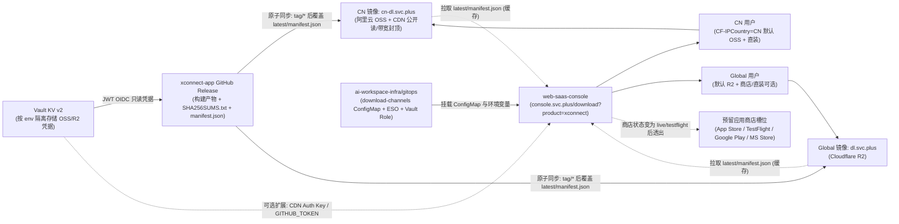

# XConnect 下载页微调、双镜像分发与 Vault/GitOps 对接规划

> [!NOTE]
> 本文档为 **Phase 1–3 全链路实施规划（Planning / Target Architecture）**，基线核查时间为 `2026-11-23`。文档中引用的源码路径、CI 工作流与线上 Release 产物均为核查当日的真实状态；目标配置模板、代码重构方案与运维探针均为待落地规划，尚未在生产环境启用。

---

## 一、规划背景与现状基线核查（2026-11-23）

### 1.1 Portal 下载中心现状核查（`ai-workspace-services/portal`）

当前 `https://console.svc.plus/download?product=xconnect` 的服务端与客户端实现主要由以下文件构成：

| 文件路径 | 当前职责 | 核查发现 |
| :--- | :--- | :--- |
| `src/app/download/page.tsx` | SSR 页面入口（`dynamic = "force-dynamic"`，`revalidate = 3600`） | 聚合 GitHub Releases、artifact manifest 与 offline package 清单，再调用 `prioritizeDownloadProduct` 按 `?product=` 排序；**未读取用户地域请求头（如 `CF-IPCountry`）或渠道偏好** |
| `src/lib/download/catalog.ts` | 产品定义与资产映射核心逻辑 | 1. **硬编码优先 GitHub Release**：`getLatestAsset` 优先返回 `source === "github-release"`，仅在缺失时回退至硬编码的 `https://dl.svc.plus`<br>2. **单平台仅保留 1 个文件**：每个平台只绑定单个 `asset`，丢弃同平台其余安装格式<br>3. **`.some()` OR 匹配缺陷**：`platformMatches.some(...)` 导致只要文件路径或文件名满足其一即命中，Windows 的 `/\.zip$/i` 存在误匹配其它平台 `.zip` 包的风险 |
| `src/lib/download/github-releases.ts` | GitHub Release API 实时拉取 | 请求 `api.github.com/repos/<owner>/<repo>/releases/latest`，每小时缓存；支持匿名回退 |
| `src/lib/download/dl-index-data-artifacts.ts` | 远程镜像清单读取 | 受 `ALLOW_REMOTE_DL_FETCH === "true"` 控制，仅硬编码访问 `https://dl.svc.plus/dl-index/artifacts-manifest.json`，未接入多区域镜像配置 |
| `src/components/download/DownloadCatalog.tsx` | 下载页交互组件 | 根据 `navigator.userAgent` 推荐主平台并展示 SHA-256 与其余平台列表，但**无地区/镜像切换、无商店与直装分流、无多格式选择、无针对 iOS `.ipa` / Android `.apk` 的安装引导** |

### 1.2 XConnect 实际发布产物核查（`ai-workspace-xstream/xconnect-app`）

核查 `ai-workspace-xstream/xconnect-app` 最近一次 GitHub Release（`latest-43702841981-33947f3`，发布时间 `2026-11-15T10:29:28Z`）与 `.github/workflows/build-and-release.yml`，当前产出 **12 个资产文件**：

| 平台 | 文件名 | 大小 | 产物定位与处理建议 |
| :--- | :--- | ---: | :--- |
| macOS | `xconnect.dmg` | 36.8 MB | **终端直装主推**（Apple Silicon DMG，保留稳定文件名，去除带 commit hash 副本的展示冗余） |
| macOS | `xconnect-latest-33947f3.dmg` | 36.8 MB | 带构建哈希的快照副本，与 `xconnect.dmg` 内容一致，清单中应去重或标记为次级归档 |
| Windows | `xconnect-windows.msi` | 91.0 MB | **终端直装主推**（标准 MSI 安装包） |
| Windows | `xconnect-windows.zip` | 49.9 MB | **终端便携包（次选）**（免安装绿色压缩包，适合无管理员权限场景） |
| Linux | `xconnect-linux-amd64.deb` | 69.4 MB | **Debian / Ubuntu 安装包** |
| Linux | `xconnect-linux-x86_64.rpm` | 70.9 MB | **Fedora / RHEL / openSUSE 安装包** |
| Linux | `xconnect-linux.AppImage` | 46.0 MB | **通用便携可执行镜像** |
| Linux | `xconnect-linux.zip` | 34.4 MB | **Linux 绿色压缩包** |
| Android | `app-release.apk` | 187.3 MB | **Android 直装主推（免 Google Play）** |
| Android | `app-release.aab` | 134.9 MB | **商店上传专用（Google Play App Bundle）**，**不得**作为终端下载展示 |
| iOS | `xconnect.ipa` | 22.1 MB | **高级侧载包**（普通用户在 Safari 点击无法直接安装，需折叠到高级侧载说明中） |
| iOS | `xconnect.app.zip` | 22.1 MB | **构建中间归档**，**不得**对终端用户展示 |

### 1.3 待解决的四大核心痛点

1. **CN 用户“鸡生蛋”下载死锁**：未连接加速服务前，中国大陆用户往往无法稳定直连 `github.com` 下载安装包；当前 `catalog.ts` 优先给出 GitHub Release 直链，导致 CN 首装体验极易失败。
2. **缺少“可使用应用商店 / 不能使用应用商店”分流模型**：当前 iOS 直接将 `xconnect.ipa` 作为主按钮暴露，对绝大多数普通 iOS 用户属于死胡同；Android / macOS / Windows 也缺少商店入口预留槽与清晰分流。
3. **资产匹配精度与多格式展示不足**：`.aab`、`xconnect.app.zip` 等内部/商店包未过滤，Windows `.msi`/`.zip` 与 Linux 四种格式无法同台按需切换，且 GitHub Release 原生资产缺少统一 `SHA256SUMS.txt` 校验值展示。
4. **域名与同步凭据尚未纳入 Vault KV + GitOps 治理**：镜像域名硬编码在前端仓，且 `xconnect-app` CI 尚未接入自动推送至阿里云 OSS 与 Cloudflare R2 的闭环。

---

## 二、已确认的核心架构决策（Locked Decisions）

| 序号 | 决策项 | 锁定内容 |
| :---: | :--- | :--- |
| **1** | **CN 阿里云 OSS 镜像域名** | `https://cn-dl.svc.plus`（阿里云 OSS + 阿里云 CDN，服务中国大陆用户） |
| **2** | **Global Cloudflare R2 镜像域名** | `https://dl.svc.plus`（沿用现有 Cloudflare R2 自定义域，服务全球及海外用户） |
| **3** | **各平台应用商店状态** | iOS（App Store / TestFlight）、Android（Google Play）、Windows（Microsoft Store）、macOS（Mac App Store）当前统一标记为 **暂未上架 / 仅提供直装**，在 GitOps 配置与前端 UI 中**完整预留链接槽与状态切换能力** |
| **4** | **CN 阿里云 OSS 防盗链 / 防刷策略** | 首期采用 **公开读 + 阿里云 CDN 带宽封顶**，暂不启用 URL 动态签名；在 Vault KV 与 Portal 中预留后续接入阿里云 CDN Type-A 短期签名鉴权的扩展槽位 |
| **5** | **本次规划与实施范围** | 覆盖 **Phase 1（`portal` 前端与配置层）+ Phase 2（`gitops` 模板与 Vault KV 契约）+ Phase 3（`xconnect-app` CI 双镜像自动同步与观测探针）** |

---

## 三、目标架构与端到端分发拓扑



---

## 四、下载页 UX 与前端数据层设计（Phase 1：`ai-workspace-services/portal`）

### 4.1 界面微调原则

保持现有 `DownloadCatalog` 的卡片结构、配色与排版语言，仅围绕 **“选地区线路 + 选是否可用商店 + 精准安装引导”** 做高信息密度、低操作成本的增量微调。

### 4.2 顶部“下载场景偏好栏”

在产品卡片上方（或推荐卡片头部）增加一组紧凑的切换器，状态同步到 URL Query（`?product=xconnect&region=cn|global&channel=store|direct`）与浏览器 `localStorage`：

1. **下载线路 / 所在地区（Region / Mirror）**
   - 选项：`中国大陆（阿里云 OSS · cn-dl.svc.plus）` ｜ `全球 / 海外（Cloudflare R2 · dl.svc.plus）`
   - **服务端智能默认**：`src/app/download/page.tsx` 通过 `next/headers` 读取 `cf-ipcountry`（Cloudflare 透传头）；当值为 `CN` 时默认 `region = "cn"`，其余默认 `region = "global"`；若无 `cf-ipcountry`（如本地预览或非 CF 入口），则回退参考 `accept-language`（含 `zh-CN`）与手动切换优先权。
   - **手动切换优先**：用户点击切换或 URL 显式携带 `?region=cn|global` 时，立即切换所有平台主下载链接的源站，不强制跳转域名。
2. **安装方式偏好（Channel Preference）**
   - 选项：`可使用应用商店` ｜ `不能使用应用商店（直接下载安装包）`
   - **当前阶段行为**：由于四端应用商店均处于 **暂未上架 / 预留槽位** 状态：
     - 当用户选择 **“可使用应用商店”** 时，各支持商店的平台展示预留商店卡片（标明“暂未上架 · 敬请期待”，并附对应商店渠道名如 App Store / TestFlight / Google Play / Microsoft Store），同时在旁侧提供 **“当前请使用下方镜像直装包”** 的一键直达按钮，避免空白或不可点击死链。
     - 当未来任一商店在 GitOps ConfigMap 中将状态改为 `live` 或 `testflight` 并填入链接后，界面自动升级为主按钮，**零前端代码修改即可上线商店渠道**。

### 4.3 五端“应用商店预留槽 vs 镜像直装”交互矩阵

| 平台 | 应用商店预留槽（GitOps `stores.<platform>`） | 直装镜像主推（CN 走 `cn-dl.svc.plus` / Global 走 `dl.svc.plus`） | 多格式 / 安装指引微调 |
| :--- | :--- | :--- | :--- |
| **iOS** | 主槽：`App Store`（`coming_soon`）<br>次槽：`TestFlight`（`coming_soon`，用于灰度内测与大陆区低门槛测试） | 仅保留高级侧载折叠区：`xconnect.ipa`（标明 `需配合 AltStore / Sideloadly / 企业签名工具`） | **重点修复**：绝不将裸 `.ipa` 直接作为主按钮给普通 Safari 用户点击；明确提示“App Store 与 TestFlight 上架准备中，iOS 暂不支持浏览器直接安装 `.ipa`”。 |
| **Android** | `Google Play`（`coming_soon`） | `app-release.apk`（Universal APK） | 过滤 `app-release.aab`；显示文件大小 + SHA-256 一键复制；附简短提示“安装时若系统拦截，请在系统设置中允许安装未知来源应用”。 |
| **macOS** | `Mac App Store`（`coming_soon`） | `xconnect.dmg`（Apple Silicon） | 去除 `xconnect-latest-*.dmg` 重复展示；展示版本号、大小与 SHA-256；附 1 句 macOS 首次打开提示。 |
| **Windows** | `Microsoft Store`（`coming_soon`） | 主推 `xconnect-windows.msi`（安装向导）<br>次选 `xconnect-windows.zip`（绿色便携包） | 在 Windows 卡片内提供 `.msi` / `.zip` 切换胶囊；`.zip` 标注“免安装，适合无管理员权限设备”。 |
| **Linux** | 无传统商店槽（后续可扩展 APT / RPM 源） | 默认按 `.deb` > `.AppImage` > `.rpm` > `.zip` 排序展示切换胶囊 | 在 Linux 行内支持一键切换 `.deb`（Debian/Ubuntu）、`.rpm`（Fedora/RHEL）、`.AppImage`（通用）、`.zip`。 |

### 4.4 镜像容错与防死链回退链路

服务端与目录解析遵循严格的三级回退链：

```text
首选区域镜像 manifest.json (CN -> cn-dl.svc.plus | Global -> dl.svc.plus)
   ├── 成功且包含目标资产 ──▶ 渲染该镜像直链 + 标注线路徽标（如 "阿里云 OSS 镜像" / "Cloudflare R2 镜像"）
   └── 缺失 / 拉取超时 / 404 ──▶ 自动降级到对端镜像 manifest.json ──▶ 仍缺失则兜底 GitHub Release 直链（并标注 "当前由备用源提供"）
```

### 4.5 Portal 源码改造清单

| 模块文件 | 改造内容 |
| :--- | :--- |
| `src/lib/download/channels.ts`（新增） | 读取 `process.env.DOWNLOAD_CHANNELS_CONFIG_PATH` 指向的 GitOps JSON 文件（未配置时使用内置安全默认值：`cn-dl.svc.plus`、`dl.svc.plus`、4 个商店 `coming_soon` 预留槽）；定义 `DownloadChannelsConfig`、`MirrorRegion`（`cn` / `global`）、`StoreChannelInfo` 类型；预留 `signMirrorUrl()` 钩子以便未来接入 CDN Type-A 签名。 |
| `src/lib/download/catalog.ts` | 1. 将 `PlatformDefinition` 从单 `asset` 升级为 `assets: DownloadAsset[]`（含 `format`、`arch`、`isPrimary`）+ `stores?: StoreChannelInfo[]`<br>2. 修复正则匹配缺陷：改为严格 `productMatcher` + 每项 asset 独立正则（`every`/显式匹配），严格排除 `.aab`、`xconnect.app.zip` 与带 commit hash 的重复 `xconnect-latest-*.dmg`<br>3. 重构优先级：在镜像可用时优先使用选定区域的镜像直链，而非强制返回 `github-release`。 |
| `src/lib/download/mirror-manifests.ts`（新增） | 并行拉取 `cn-dl.svc.plus/releases/<product>/latest/manifest.json` 与 `dl.svc.plus/releases/<product>/latest/manifest.json`（`next: { revalidate: 300 }` + 短超时保护 `3000ms`），转换为标准 `DirListing` 并保留各资产精确 `sha256` 与 `sourceMirror` 元数据。 |
| `src/app/download/page.tsx` | 读取请求头 `cf-ipcountry`、`accept-language` 与 `searchParams`（`product` / `region` / `channel`），加载渠道配置与双镜像清单，连同 GitHub Release 兜底数据传给 `DownloadCatalog`。 |
| `src/components/download/DownloadCatalog.tsx` | 微调 UI：新增顶部“下载线路 + 安装方式”偏好条、线路标签与降级提示、同平台多格式切换胶囊、商店预留槽状态展示与折衷直装按钮、iOS 侧载折叠提示、复用 `CopyButton` 实现 SHA-256 一键复制。 |
| `src/lib/download/catalog.test.ts` & `channels.test.ts` | 补充多格式匹配、`.aab`/`xconnect.app.zip` 过滤、CN/Global 镜像优先与回退、商店预留槽状态渲染的 Vitest 单元测试。 |

---

## 五、统一对象存储布局与 `manifest.json` 契约（OSS & R2 同构）

为保证 `cn-dl.svc.plus`（阿里云 OSS）与 `dl.svc.plus`（Cloudflare R2）之间**可 100% 互相替代降级**，两者必须保持**完全一致的对象 Key 结构与 HTTP 缓存策略**。

### 5.1 对象路径与 Cache-Control 规范

```text
/releases/xconnect/<tag>/
  ├── xconnect.dmg                    # Cache-Control: public, max-age=31536000, immutable
  ├── xconnect-windows.msi            # Cache-Control: public, max-age=31536000, immutable
  ├── xconnect-windows.zip            # Cache-Control: public, max-age=31536000, immutable
  ├── xconnect-linux-amd64.deb        # Cache-Control: public, max-age=31536000, immutable
  ├── xconnect-linux-x86_64.rpm       # Cache-Control: public, max-age=31536000, immutable
  ├── xconnect-linux.AppImage         # Cache-Control: public, max-age=31536000, immutable
  ├── xconnect-linux.zip              # Cache-Control: public, max-age=31536000, immutable
  ├── app-release.apk                 # Cache-Control: public, max-age=31536000, immutable
  ├── xconnect.ipa                    # Cache-Control: public, max-age=31536000, immutable
  └── SHA256SUMS.txt                  # Cache-Control: public, max-age=31536000, immutable

/releases/xconnect/latest/
  ├── manifest.json                   # Cache-Control: public, max-age=60, must-revalidate
  └── SHA256SUMS.txt                  # Cache-Control: public, max-age=60, must-revalidate
```

> 说明：由于 `dl.svc.plus` 目前已托管 `dl-index/` 与 `offline-package/` 目录，新产物统一置于 `/releases/xconnect/...` 前缀下，**不干扰既有目录**；现有 `dl-index/artifacts-manifest.json` 继续服务离线包与其他历史资源。

### 5.2 `manifest.json` 数据契约

```json
{
  "schemaVersion": 1,
  "product": "xconnect",
  "tag": "latest-43702841981-33947f3",
  "version": "1.0.0",
  "publishedAt": "2026-11-15T10:29:28Z",
  "releaseUrl": "https://github.com/ai-workspace-xstream/xconnect-app/releases/tag/latest-43702841981-33947f3",
  "assets": [
    {
      "name": "xconnect.dmg",
      "platform": "macos",
      "arch": "arm64",
      "format": "dmg",
      "path": "/releases/xconnect/latest-43702841981-33947f3/xconnect.dmg",
      "size": 36801009,
      "sha256": "<sha256-hex>",
      "primary": true,
      "audience": "end_user"
    },
    {
      "name": "xconnect-windows.msi",
      "platform": "windows",
      "arch": "x64",
      "format": "msi",
      "path": "/releases/xconnect/latest-43702841981-33947f3/xconnect-windows.msi",
      "size": 91004928,
      "sha256": "<sha256-hex>",
      "primary": true,
      "audience": "end_user"
    },
    {
      "name": "xconnect-windows.zip",
      "platform": "windows",
      "arch": "x64",
      "format": "zip",
      "path": "/releases/xconnect/latest-43702841981-33947f3/xconnect-windows.zip",
      "size": 49922449,
      "sha256": "<sha256-hex>",
      "primary": false,
      "audience": "end_user"
    },
    {
      "name": "app-release.apk",
      "platform": "android",
      "arch": "universal",
      "format": "apk",
      "path": "/releases/xconnect/latest-43702841981-33947f3/app-release.apk",
      "size": 187318149,
      "sha256": "<sha256-hex>",
      "primary": true,
      "audience": "end_user"
    },
    {
      "name": "xconnect.ipa",
      "platform": "ios",
      "arch": "arm64",
      "format": "ipa",
      "path": "/releases/xconnect/latest-43702841981-33947f3/xconnect.ipa",
      "size": 22107195,
      "sha256": "<sha256-hex>",
      "primary": false,
      "audience": "sideload"
    }
  ]
}
```

### 5.3 原子发布顺序（避免同步窗口期 404）

1. 将 `<tag>/*` 所有安装包与 `<tag>/SHA256SUMS.txt` 并行上传至阿里云 OSS 与 Cloudflare R2。
2. 对两端对象执行 `HEAD` 校验，确认 `Content-Length` 与期望字节数一致。
3. 最后覆盖写入 `/releases/xconnect/latest/SHA256SUMS.txt` 与 `/releases/xconnect/latest/manifest.json`。
4. 触发阿里云 CDN 刷新 `/releases/xconnect/latest/manifest.json` 与 `/releases/xconnect/latest/SHA256SUMS.txt`（Cloudflare R2 `max-age=60` 自动过期）。

---

## 六、Vault KV v2 与 GitOps 声明式对接契约（Phase 2：`ai-workspace-infra/gitops`）

严格遵循 `gitops/docs/vault-kv-paths.md` 的核心边界：**所有秘密凭据存放于按 `<env>` 隔离的 Vault KV v2 路径中，绝不进入 Git；所有非密域名、开关与商店链接槽声明在 GitOps 仓库中**。

### 6.1 Vault KV v2 路径与最小权限设计

| Vault KV v2 路径（逻辑根 `kv/`） | 必填 Keys | 授权消费者 | 最小权限说明 |
| :--- | :--- | :--- | :--- |
| `kv/<env>/platform/storage/aliyun-oss` | `access_key_id`<br>`access_key_secret`<br>`region`<br>`bucket`<br>`endpoint`<br>`cdn_domain` | `github-actions-xconnect-app`（JWT OIDC） | 阿里云 RAM 专属子账号，权限仅限目标 Bucket（`PutObject` / `GetObject` / `HeadObject`）及 `cn-dl.svc.plus` 的 CDN `RefreshObjectCaches`，无 ECS/RDS/账号级权限 |
| `kv/<env>/platform/storage/cloudflare-r2` | `account_id`<br>`access_key_id`<br>`secret_access_key`<br>`bucket`<br>`endpoint` | `github-actions-xconnect-app`（JWT OIDC） | Cloudflare R2 Scoped API Token，权限仅限目标 Bucket 的 Object Read & Write |
| `kv/<env>/services/download-channels` *(预留扩展)* | `CN_OSS_CDN_AUTH_KEY` *(暂不启用)* | `web-saas-secrets-reader`（ESO -> `web-saas-prod`） | **首期不要求写入业务秘钥**；仅当未来从“公开读 + 带宽封顶”升级为阿里云 CDN Type-A 短期签名直链时启用 |

> 说明：在生产发布场景下，`<env>` 为 `prod`（即 `kv/data/prod/platform/storage/...`）；若 `sit` / `uat` 需独立测试桶，按 `kv/data/sit/...` 与 `kv/data/uat/...` 严格隔离，严禁跨环境回退。

### 6.2 CN 阿里云 OSS 安全基线（首期方案）

1. **Bucket 与 CDN 访问控制**：OSS Bucket 配置为 **公共读（配合 CDN 回源）** 或 **私有 Bucket + 阿里云 CDN 私有 Bucket 回源授权**（更推荐后者，可避免用户绕过 CDN 直接访问源站 `*.aliyuncs.com` 默认域名）。
2. **带宽封顶防刷**：在阿里云 CDN 为 `cn-dl.svc.plus` 开启 **带宽封顶（Bandwidth Cap）** 与用量告警阈值；触发封顶后 CDN 自动保护性回落，Portal 与用户端可无缝切至 `dl.svc.plus` 或 GitHub Release，防止产生不可控下行账单。
3. **域名与 HTTPS**：`cn-dl.svc.plus` 开启强制 HTTPS 与 HTTP/2，跨域头 `Access-Control-Allow-Origin` 仅允许 `https://console.svc.plus` 与 `https://xworktech.com` 读取 `manifest.json`。

### 6.3 GitOps 声明式配置模板（以 `services/prod-k3s-v6/web-saas-prod/` 为例）

#### (1) 新增 `download-channels-configmap.yaml`

```yaml
apiVersion: v1
kind: ConfigMap
metadata:
  name: web-saas-download-channels
  namespace: web-saas-prod
data:
  download-channels.json: |
    {
      "schemaVersion": 1,
      "mirrors": {
        "cn": {
          "id": "cn-oss",
          "provider": "aliyun-oss",
          "baseUrl": "https://cn-dl.svc.plus",
          "label": "China Mainland (Aliyun OSS)",
          "labelZh": "中国大陆镜像（阿里云 OSS）",
          "authMode": "public-cdn-capped",
          "enabled": true
        },
        "global": {
          "id": "global-r2",
          "provider": "cloudflare-r2",
          "baseUrl": "https://dl.svc.plus",
          "label": "Global (Cloudflare R2)",
          "labelZh": "全球镜像（Cloudflare R2）",
          "authMode": "public",
          "enabled": true
        }
      },
      "products": {
        "xconnect": {
          "manifestPath": "/releases/xconnect/latest/manifest.json",
          "stores": {
            "ios": [
              {
                "id": "app-store",
                "name": "App Store",
                "nameZh": "App Store（海外区）",
                "status": "coming_soon",
                "url": "",
                "availableInCn": false,
                "note": "App Store submission in preparation.",
                "noteZh": "App Store 审核上架准备中，预留跳转入口。"
              },
              {
                "id": "testflight",
                "name": "TestFlight",
                "nameZh": "TestFlight 公测",
                "status": "coming_soon",
                "url": "",
                "availableInCn": true,
                "note": "TestFlight public link will appear here once published.",
                "noteZh": "TestFlight 内测链接即将开放，后续将优先服务 iOS 用户。"
              }
            ],
            "android": [
              {
                "id": "google-play",
                "name": "Google Play",
                "nameZh": "Google Play",
                "status": "coming_soon",
                "url": "",
                "availableInCn": false,
                "note": "Google Play listing in preparation; use direct APK meanwhile.",
                "noteZh": "Google Play 暂未上架，请使用下方官方 APK 直装包。"
              }
            ],
            "windows": [
              {
                "id": "microsoft-store",
                "name": "Microsoft Store",
                "nameZh": "Microsoft Store",
                "status": "coming_soon",
                "url": "",
                "availableInCn": true,
                "note": "Microsoft Store package in preparation; MSI/ZIP direct install is available.",
                "noteZh": "Microsoft Store 暂未上架，当前提供 MSI 与 ZIP 直装包。"
              }
            ],
            "macos": [
              {
                "id": "mac-app-store",
                "name": "Mac App Store",
                "nameZh": "Mac App Store",
                "status": "coming_soon",
                "url": "",
                "availableInCn": false,
                "note": "Mac App Store listing in preparation; use DMG direct install meanwhile.",
                "noteZh": "Mac App Store 暂未上架，当前提供 DMG 直装包。"
              }
            ]
          }
        }
      }
    }
```

#### (2) `helmrelease.yaml` 挂载与环境变量注入

参照现有 `web-saas-prod/helmrelease.yaml` 中 `console` 的挂载方式（`console.singleContainer.volumes` / `volumeMounts` 与 `postRenderers` 容器环境变量）：

```yaml
# 1. postRenderers -> web-saas-console -> containers[name=console].env 新增:
- name: DOWNLOAD_CHANNELS_CONFIG_PATH
  value: /etc/console/download-channels.json
- name: ALLOW_REMOTE_DL_FETCH
  value: "true"

# 2. values.console.singleContainer.volumes 新增:
- name: download-channels
  configMap:
    name: web-saas-download-channels

# 3. values.console.singleContainer.volumeMounts 新增:
- name: download-channels
  mountPath: /etc/console/download-channels.json
  subPath: download-channels.json
  readOnly: true
```

同步在 `services/prod-k3s-v6/web-saas-prod/kustomization.yaml` 的 `resources` 列表中登记 `- download-channels-configmap.yaml`，并为 `sit` / `uat` 环境对应补齐同类声明。

#### (3) Vault ACL Policy 与 JWT Role（`gitops/security/vault/`）

遵循现有 `security.gitops/v1alpha1` 资源格式（与 `xconnect-app/.github/workflows/build-and-release.yml` 已声明的 `role: github-actions-xconnect-app`、`jwtGithubAudience: vault` 对齐）：

- `security/vault/policies/github-actions-xconnect-app.yaml`（`kind: VaultACLPolicy`）：
  - 仅授予 `kv/data/prod/platform/storage/aliyun-oss`、`kv/data/prod/platform/storage/cloudflare-r2`（及 `xconnect-app` 构建已使用的 `kv/data/github-actions/xconnect-app`）的 `read` 权限，以及对应 `kv/metadata/...` 的 `list`/`read`。
- `security/vault/roles/github-actions-xconnect-app.yaml`（`kind: VaultJWTAuthRole`）：
  - `bound_audiences: ["vault"]`
  - `bound_claims`: 严格绑定 `repository: ai-workspace-xstream/xconnect-app`、受保护分支/Tag（`main`、`release/v*`、`refs/tags/v*`），Pull Request 不得获取发布存储凭据。

---

## 七、CI 双镜像自动同步与可观测性（Phase 3：`xconnect-app` + `observability`）

### 7.1 `xconnect-app/.github/workflows/build-and-release.yml` 扩展

在现有的 `prepare-release` → `build` → `release` 之后新增 `publish-mirrors` Job（仅在非 Pull Request 的正式分支/Tag/手动触发时执行）：

1. **安全门禁与拉取产物**：使用 `actions/download-artifact` 收集 `build` 矩阵产物，并过滤出面向终端用户的分发文件（排除 `app-release.aab`、`xconnect.app.zip` 等内部包）。
2. **Vault JWT OIDC 取密**：调用 `hashicorp/vault-action@v4`（`url: https://vault.svc.plus`、`method: jwt`、`role: github-actions-xconnect-app`、`jwtGithubAudience: vault`）读取：
   - `kv/data/prod/platform/storage/aliyun-oss`
   - `kv/data/prod/platform/storage/cloudflare-r2`
   所有凭据仅注入当前 Step 环境变量并标记 `add-mask`，绝不打印到日志或写入产物。
3. **生成清单**：新增 `scripts/ci/generate_download_manifest.py`（或 shell 脚本），计算所有分发包 `sha256sum` 与字节数，产出 `SHA256SUMS.txt` 与符合第五节契约的 `manifest.json`。
4. **并行原子同步**：
   - 使用官方 `ossutil` 将 `/releases/xconnect/<tag>/*` 写入阿里云 OSS（设置 `Cache-Control: public, max-age=31536000, immutable`），校验通过后写入 `latest/*`（`max-age=60`），并调用阿里云 CDN Refresh API 刷新 `https://cn-dl.svc.plus/releases/xconnect/latest/*`。
   - 使用 S3 兼容客户端（`aws s3 cp --endpoint-url`）按相同目录与 `Cache-Control` 写入 Cloudflare R2。
5. **端到端可用性校验**：发布完成前对以下 4 个地址执行 `curl -fsSI` 探活校验（其中安装包抽样验证字节数与 `Content-Type`）：
   - `https://cn-dl.svc.plus/releases/xconnect/latest/manifest.json`
   - `https://dl.svc.plus/releases/xconnect/latest/manifest.json`
   - `https://cn-dl.svc.plus/releases/xconnect/<tag>/xconnect-windows.msi`
   - `https://dl.svc.plus/releases/xconnect/<tag>/xconnect-windows.msi`

### 7.2 可观测性与黑盒探活（`observability-prod`）

在 `gitops/services/prod-k3s-v6/observability-prod/agent-release.yaml` 的 `progressive-release-probes` 中新增 3 条 HTTP 200 黑盒探针：

- `https://cn-dl.svc.plus/releases/xconnect/latest/manifest.json`（`service: xconnect-mirror-cn`、`expected_status: '200'`）
- `https://dl.svc.plus/releases/xconnect/latest/manifest.json`（`service: xconnect-mirror-global`、`expected_status: '200'`）
- `https://console.svc.plus/download?product=xconnect`（`service: console`、`route: /download`、`expected_status: '200'`）

---

## 八、分阶段实施任务单与验收矩阵（Phase 1–3）

### 8.1 Phase 1：`ai-workspace-services/portal`（下载页与配置读取）

| 任务 ID | 目标仓库与文件 | 实施内容 | 可判定验收标准 |
| :--- | :--- | :--- | :--- |
| **P1-1** | `portal`：`src/lib/download/channels.ts` | 新增 GitOps `download-channels.json` 加载器、内置默认值、Region/Channel 解析与未来 CDN 签名预留钩子 | 单元测试验证：有挂载配置时优先读取挂载文件；无文件时安全回退默认 `cn-dl.svc.plus` / `dl.svc.plus` 与 `coming_soon` 商店槽 |
| **P1-2** | `portal`：`src/lib/download/mirror-manifests.ts`、`src/lib/download/catalog.ts` | 新增双镜像 `manifest.json` 拉取（超时降级）；重写资产匹配规则（修复 `.zip` 误匹配，过滤 `.aab` / `xconnect.app.zip`）；支持单平台多格式 + 商店槽模型；镜像可用时优先返回选定区域镜像 | `vitest run src/lib/download` 全绿；针对真实 12 资产列表测试，`windows` 同时包含 `.msi` 与 `.zip`、`linux` 包含 4 格式、`android` 不出现 `.aab` |
| **P1-3** | `portal`：`src/app/download/page.tsx` | 读取 `cf-ipcountry` 与 `searchParams`（`product`/`region`/`channel`）传入 `DownloadCatalog`；默认 CN 流量选中 `cn` 镜像 | 构造 `cf-ipcountry: CN` 与 `US` 请求测试，确认初始推荐下载域名分别为 `cn-dl.svc.plus` 与 `dl.svc.plus` |
| **P1-4** | `portal`：`src/components/download/DownloadCatalog.tsx` | 增加线路/商店偏好切换、商店预留槽展示、多格式胶囊、SHA-256 复制、iOS 侧载折叠提示与降级徽标 | `npm run build` / `tsc --noEmit` / Vitest 通过；桌面与移动端视口无溢出或按钮遮挡 |

### 8.2 Phase 2：`ai-workspace-infra/gitops`（Vault KV 契约与 K8s 挂载）

| 任务 ID | 目标仓库与文件 | 实施内容 | 可判定验收标准 |
| :--- | :--- | :--- | :--- |
| **P2-1** | `gitops`：`services/prod-k3s-v6/web-saas-prod/download-channels-configmap.yaml` & `kustomization.yaml` | 声明 `cn-dl.svc.plus`、`dl.svc.plus` 与四端商店 `coming_soon` 预留槽 | `kubectl kustomize` 校验通过，JSON 语法合法 |
| **P2-2** | `gitops`：`services/prod-k3s-v6/web-saas-prod/helmrelease.yaml`（及 `sit/uat` 对应清单） | 注入 `DOWNLOAD_CHANNELS_CONFIG_PATH`、`ALLOW_REMOTE_DL_FETCH=true` 并挂载 `/etc/console/download-channels.json` | Pod 启动后 `/etc/console/download-channels.json` 可读，无 CrashLoopBackOff |
| **P2-3** | `gitops`：`security/vault/{policies,roles}/github-actions-xconnect-app.yaml` | 声明 `xconnect-app` CI OIDC Role 与只读 `kv/data/<env>/platform/storage/{aliyun-oss,cloudflare-r2}` Policy | `scripts/validate-vault-env-isolation.py`（及仓库校验脚本）全部通过 |
| **P2-4** | 运维手工前置（Vault + DNS/CDN） | 在 Vault 写入 `kv/prod/platform/storage/{aliyun-oss,cloudflare-r2}`；完成 `cn-dl.svc.plus`（OSS + 阿里云 CDN + 带宽封顶）与 `dl.svc.plus`（R2）DNS/HTTPS 配置 | 两者均返回有效 TLS 证书，阿里云 CDN 带宽封顶告警规则生效 |

### 8.3 Phase 3：`xconnect-app` & 可观测性（CI 自动双传与监控）

| 任务 ID | 目标仓库与文件 | 实施内容 | 可判定验收标准 |
| :--- | :--- | :--- | :--- |
| **P3-1** | `xconnect-app`：`scripts/ci/generate_download_manifest.py` | 根据构建产物生成 `SHA256SUMS.txt` 与标准 `manifest.json`，排除内部归档文件 | 本地/CI 样本测试生成的 `manifest.json` 可被 Portal `mirror-manifests.ts` 完整解析 |
| **P3-2** | `xconnect-app`：`.github/workflows/build-and-release.yml` | 新增 `publish-mirrors` Job，通过 Vault OIDC 拉取凭据并行原子上传至 OSS 与 R2 并触发 CDN 刷新 | Release 工作流绿灯，`cn-dl.svc.plus` 与 `dl.svc.plus` 的 `latest/manifest.json` 返回一致版本号与 SHA-256 |
| **P3-3** | `gitops`：`services/prod-k3s-v6/observability-prod/agent-release.yaml` | 添加双镜像 `manifest.json` 与 `/download?product=xconnect` 黑盒探针 | VictoriaMetrics 可查询到 3 条探针 `probe_success == 1` |

### 8.4 回滚策略

- **Portal 回退**：保留 `github-releases.ts` 与既有 `dl-index-data-artifacts.ts` 兜底路径；若任一镜像出现异常，只需将 GitOps ConfigMap 中对应镜像的 `enabled` 设为 `false`，`console.svc.plus` 在下次缓存刷新内自动切换至健康镜像或 GitHub Release，无需回滚前端镜像。
- **CI 发布回退**：由于 `<tag>/*` 按版本目录不可变存储，若新版本需要回退，只需将 `/releases/xconnect/latest/manifest.json` 指向前一稳定 `<tag>` 并刷新 CDN 即可秒级恢复。
