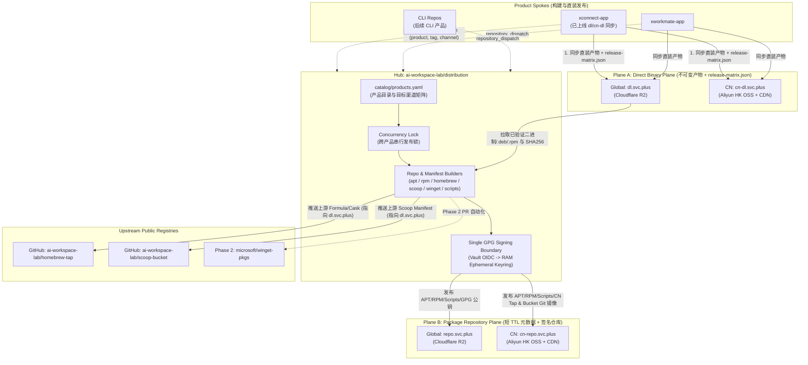

# 统一客户端分发与包仓库架构规划（Dual-Plane + Hub-and-Spoke）

> [!NOTE]
> **现状基线与规划定位（2026-11-24）**：  
> 1. **直装双镜像平面已上线**：面向 `xconnect` 的直装双镜像（`https://dl.svc.plus` Cloudflare R2 与 `https://cn-dl.svc.plus` 阿里云香港 OSS + CDN）以及 `https://console.svc.plus/download?product=xconnect` 下载页已在生产环境上线运行（详见 [01-xconnect-download-page-and-dual-mirror-plan.md](01-xconnect-download-page-and-dual-mirror-plan.md) 与 [02-client-mirrors-tldr-runbook.md](02-client-mirrors-tldr-runbook.md)）。  
> 2. **本文档定位**：在已有直装双镜像之上，新增**统一包仓库平面（`repo.svc.plus` / `cn-repo.svc.plus`）**与 **Hub-and-Spoke 发布编排中心（`ai-workspace-lab/distribution`）**，将 macOS（Homebrew）、Debian/Ubuntu（APT）、RHEL/Rocky/Fedora（YUM/DNF）、Windows（Scoop / Phase 2 WinGet）及跨平台一键脚本（`install.sh` / `install.ps1`）统一纳入多产品（`xconnect`、`xworkmate`、后续 CLI 工具）声明式分发体系。

---

## 一、背景与整合目标

直装双镜像解决了「浏览器/控制台下载页分流」与「中国大陆用户首装下载 GitHub 不可达」问题，但在开发者与运维高频场景下，仍存在包管理器生态割裂与多产品重复建设问题：

1. **包管理器通道缺失**：Linux 用户需手动下载 `.deb`/`.rpm` 并用 `dpkg`/`rpm` 安装，无法通过 `apt upgrade` / `dnf upgrade` 自动接收安全与版本更新；macOS 与 Windows 开发者期待标准 `brew install`、`scoop install`、`winget install` 与 `curl | sh` / `irm | iex` 一行命令体验。
2. **多产品重复维护签名与索引**：若 `xconnect-app`、`xworkmate-app` 及后续 CLI 各自维护 APT/RPM 仓库、Homebrew Tap 与 GPG 私钥，将导致私钥扩散、并发发布互相覆盖 `InRelease` / `repodata` 索引，以及镜像配置碎片化。
3. **CN/Global 双线一致性**：不仅二进制下载需要 `dl.svc.plus` / `cn-dl.svc.plus` 双镜像，包仓库索引、静态 Git Tap/Bucket 与一键脚本也必须同时提供 Global（Cloudflare R2）与 CN（阿里云香港 OSS + CDN）两套可配置端点。

为此，整体分发体系演进为 **「双平面存储隔离（Dual-Plane） + Hub-and-Spoke 编排 + 可配置基础设施栈复用」** 架构。

---

## 二、双平面架构（Dual-Plane Architecture）

系统在存储、缓存语义、域名与安全边界上严格拆分为 **Direct Binary Plane（直装二进制平面）** 与 **Package Repository Plane（包仓库平面）**：

| 维度 | Plane A：Direct Binary Plane（直装二进制平面，已上线） | Plane B：Package Repository Plane（包仓库平面，新增） |
| :--- | :--- | :--- |
| **Global 端点（Cloudflare R2）** | `https://dl.svc.plus`（Bucket：`svc-plus-releases-global`） | `https://repo.svc.plus`（Bucket：`svc-plus-repos-global`，可配置） |
| **CN 端点（Aliyun HK OSS + CDN）** | `https://cn-dl.svc.plus`（Bucket：`svc-plus-releases-cn-hk`） | `https://cn-repo.svc.plus`（Bucket：`svc-plus-repos-cn-hk`，可配置） |
| **承载内容** | - 不可变版本产物：`/releases/<product>/<tag>/*`（`.dmg`, `.msi`, `.zip`, `.deb`, `.rpm`, `.AppImage`, `.apk`, `.ipa`, tarballs）<br>- 离线包：`/offline-package/<product>/*`<br>- 版本矩阵：`<tag>/matrix.json`、`channels/*.json`、`release-matrix.json` | - 一键引导脚本：`/install.sh`、`/install.ps1`<br>- 公钥：`/gpg.asc`、`/RPM-GPG-KEY-svc-plus`<br>- APT 仓库：`/apt/dists/*`、`/apt/pool/*`<br>- YUM/DNF 仓库：`/rpm/repodata/*`、`/rpm/packages/*`<br>- 静态 Git 镜像：`/homebrew/tap.git/*`、`/scoop/bucket.git/*` |
| **对象可变性与缓存 TTL** | - `<tag>/*`：**完全不可变**，`Cache-Control: public, max-age=31536000, immutable`<br>- `release-matrix.json` / `channels/*.json`：短 TTL `max-age=60, must-revalidate` + CDN 刷新 | - 元数据/签名/脚本/Git refs（`InRelease`, `Packages*`, `repomd.xml*`, `install.sh`, `install.ps1`, `tap.git/info/refs`）：**短 TTL** `Cache-Control: public, max-age=60, must-revalidate` + CDN 刷新<br>- 仓库内版本化包体（`/apt/pool/*/*.deb`, `/rpm/packages/*/*.rpm`）：不可变 `max-age=31536000, immutable` |
| **完整度与校验机制** | `SHA256SUMS.txt` + `matrix.json` 内嵌 SHA-256 与字节数 | - APT：`InRelease` / `Release.gpg` GPG 签名校验 + `Packages` SHA-256<br>- RPM：`rpmsign` 包签名 + `repomd.xml.asc` 仓库元数据签名<br>- Homebrew/Scoop/WinGet/脚本：清单内嵌 SHA-256 校验，指向 `dl.svc.plus` / `cn-dl.svc.plus` 不可变产物 |
| **典型消费者** | `console.svc.plus/download`、桌面客户端内置自更新、`brew` / `scoop` / `winget` / `install.sh` 的二进制拉取 | `apt`、`dnf` / `yum`、`brew tap`（CN 镜像）、`scoop bucket`（CN 镜像）、终端一键安装命令 |

### 2.1 双平面协作与零冗余原则



- **Homebrew / Scoop / WinGet / `install.sh` / `install.ps1` 零二进制重复**：所有清单与引导脚本中的二进制下载 URL 统一指向 Plane A（Global 指向 `https://dl.svc.plus/releases/<product>/<tag>/...`；CN 镜像指向 `https://cn-dl.svc.plus/releases/<product>/<tag>/...`），Plane B 仅托管轻量清单、Git 索引与引导脚本。
- **APT / RPM 原生客户端兼容性设计**：由于 `apt`（`Filename:`）与 `dnf`/`yum`（`<location href=...>`）默认相对于仓库 `baseurl` 解析包路径，且跨域名 `xml:base` 在不同发行版与代理环境下兼容性不佳，Hub 会将各产品声明入库的 `.deb`（写入 `/apt/pool/main/<prefix>/<product>/`）与 `.rpm`（写入 `/rpm/packages/<product>/`）同步至 Plane B（R2 + OSS），确保原生 `apt` 与 `dnf` 开箱即用、零重定向陷阱。

---

## 三、Hub-and-Spoke 编排与安全边界

### 3.1 Hub 仓库设计：`ai-workspace-lab/distribution`

所有跨产品的仓库元数据聚合、签名与包管理器清单同步收敛到唯一中心仓库 **`ai-workspace-lab/distribution`**，推荐目录结构如下：

```text
ai-workspace-lab/distribution/
├── catalog/
│   └── products.yaml              # 权威产品注册表（Spoke 仓库、产物规则、目标包格式、渠道映射）
├── scripts/
│   ├── ingest-release.py          # 从 dl.svc.plus/<product>/<tag>/matrix.json 或 GitHub Release 拉取并校验 SHA-256
│   ├── build-apt-repo.sh          # 增量合并 pool/*.deb -> dpkg-scanpackages / apt-ftparchive -> GPG InRelease
│   ├── build-rpm-repo.sh          # rpmsign 签名 .rpm -> createrepo_c -> gpg detach-sign repomd.xml.asc
│   ├── sync-homebrew-tap.py       # 生成 Formula / Cask -> 推送 ai-workspace-lab/homebrew-tap 与 CN tap.git
│   ├── sync-scoop-bucket.py       # 生成 Scoop JSON -> 推送 ai-workspace-lab/scoop-bucket 与 CN bucket.git
│   ├── render-installers.py       # 渲染并校验 install.sh / install.ps1（注入产品矩阵与双端镜像路由）
│   └── sync-repo-mirrors.sh       # 原子同步 repo.svc.plus (R2) 与 cn-repo.svc.plus (OSS) + CDN 刷新 + 探活
├── templates/
│   ├── install.sh.tmpl
│   ├── install.ps1.tmpl
│   ├── homebrew/
│   └── scoop/
└── .github/workflows/
    ├── publish-distribution.yml   # 核心编排：repository_dispatch + workflow_dispatch + 串行锁
    └── winget-submit.yml          # Phase 2：wingetcreate 自动提交 PR 至 microsoft/winget-pkgs
```

#### `catalog/products.yaml` 契约示例

```yaml
apiVersion: distribution.svc.plus/v1alpha1
kind: DistributionCatalog
metadata:
  name: svc-plus-unified-catalog
spec:
  mirrors:
    direct:
      global: https://dl.svc.plus
      cn: https://cn-dl.svc.plus
    repo:
      global: https://repo.svc.plus
      cn: https://cn-repo.svc.plus
  products:
    - id: xconnect
      display_name: XConnect
      source_repo: ai-workspace-xstream/xconnect-app
      matrix_url: https://dl.svc.plus/releases/xconnect/release-matrix.json
      channels: ["stable"]
      targets:
        homebrew:
          type: cask
          token: xconnect
          artifacts:
            darwin_arm64: xconnect.dmg
        apt:
          package: xconnect
          arches: ["amd64"]
          artifact_pattern: "xconnect-linux-{arch}.deb"
        rpm:
          package: xconnect
          arches: ["x86_64"]
          artifact_pattern: "xconnect-linux-{arch}.rpm"
        scoop:
          manifest: xconnect
          artifacts:
            64bit: xconnect-windows.zip
        winget:
          package_identifier: AIWorkspaceLab.XConnect
          artifacts:
            x64_msi: xconnect-windows.msi

    - id: xworkmate
      display_name: XWorkmate
      source_repo: ai-workspace-services/xworkmate-app
      matrix_url: https://dl.svc.plus/releases/xworkmate/release-matrix.json
      channels: ["stable"]
      targets:
        homebrew:
          type: cask
          token: xworkmate
        apt:
          package: xworkmate
          arches: ["amd64", "arm64"]
        rpm:
          package: xworkmate
          arches: ["x86_64", "aarch64"]
        scoop:
          manifest: xworkmate
        winget:
          package_identifier: AIWorkspaceLab.XWorkmate
```

### 3.2 并发锁与幂等聚合机制

当 `xconnect-app`、`xworkmate-app` 与 CLI 仓库几乎同时发布新版本时，若并发写入同一个 `/apt/dists/stable/main/binary-*/Packages` 或 `/rpm/repodata/repomd.xml`，会产生竞态覆盖（lost update）。因此 Hub 工作流强制采用**双层保护**：

1. **GitHub Actions 全局发布串行锁**：
   ```yaml
   concurrency:
     group: distribution-repo-publish-prod
     cancel-in-progress: false
   ```
   所有 `repository_dispatch`（`release-published`）与 `workflow_dispatch` 均排队顺序执行，绝不取消正在进行的元数据重建与签名。
2. **State-First 增量重建**：
   - 每个产品版本在构建完成后先下载并核对当前线上 `repo.svc.plus` 既有的 `pool/`、`/rpm/packages/` 与产品目录状态，仅增量替换/保留多版本包体后全量重算 `Packages`、`InRelease` 与 `repodata/*`；
   - **原子发布顺序**：先上传新增 `.deb`/`.rpm` 到 `pool/` 与 `packages/`（并 `HEAD` 200 校验）→ 再上传 `Packages*` / `repodata/*` 与签名文件 `InRelease` / `Release.gpg` / `repomd.xml.asc` → 最后执行阿里云 CDN 目录/URL 刷新与端到端校验。

### 3.3 单一 GPG 签名边界与 Spoke 职责划分

| 角色 | 仓库实例 | 持有的最小权限 | 严格禁止事项 |
| :--- | :--- | :--- | :--- |
| **Product Spokes** | `xconnect-app`、`xworkmate-app`、CLI 仓库 | - 读取 `kv/data/prod/platform/storage/{cloudflare-r2,aliyun-oss}`（仅限写 `dl.svc.plus` / `cn-dl.svc.plus` 的 `/releases/<product>/*`）<br>- 向 `ai-workspace-lab/distribution` 发送 `repository_dispatch`（仅带 `product`、`tag`、`channel` 载荷） | - **严禁持有任何 GPG 私钥**<br>- **严禁拥有 `repo.svc.plus` / `cn-repo.svc.plus` 写凭据**<br>- **严禁直接提交 `homebrew-tap` / `scoop-bucket`** |
| **Distribution Hub** | `ai-workspace-lab/distribution` | - Vault OIDC Role 仅绑定 `repository: ai-workspace-lab/distribution` + `ref: refs/heads/main`（**PR 零权限**）<br>- 只读 `kv/data/prod/platform/signing/package-gpg`（GPG 签名主/子私钥与 passphrase）<br>- 读取 `kv/data/prod/platform/storage/repo-{cloudflare-r2,aliyun-oss}` 写入 Plane B<br>- 受限写 `ai-workspace-lab/{homebrew-tap,scoop-bucket}` 的 GitHub App Token | - 不直接编译应用源码（仅消费 Spoke 已通过 SHA-256 校验的发布产物）<br>- 签名密钥仅在 Runner 临时内存目录（`$RUNNER_TEMP/gnupg`, `chmod 700`）导入，Job 结束立即清理，绝不落盘或打印日志 |

---

## 四、多平台 / 多 OS 极速安装 UX 矩阵

### 4.1 全局客户端体验总览

| 平台 / 包管理器 | Global 用户命令（默认推荐） | CN 中国大陆极速镜像命令 | 底层来源与校验机制 |
| :--- | :--- | :--- | :--- |
| **macOS / Linux 一键脚本** | `curl -fsSL https://repo.svc.plus/install.sh \| sh -s -- --product xconnect` | `curl -fsSL https://cn-repo.svc.plus/install.sh \| sh -s -- --product xconnect --mirror cn` | 自动识别 OS/发行版/CPU 架构；优先配置官方源或下载不可变包并强制校验 `SHA256SUMS.txt` |
| **Windows 一键脚本** | `irm https://repo.svc.plus/install.ps1 \| iex`（支持参数化调用） | `iex "& { $(irm https://cn-repo.svc.plus/install.ps1) } -Product xconnect -Mirror cn"` | 自动选择 Scoop 或直装 MSI/ZIP，自动完成 SHA-256 校验与 PATH/桌面快捷方式配置 |
| **macOS Homebrew** | `brew tap ai-workspace-lab/tap && brew install --cask xconnect` | `brew tap ai-workspace-lab/tap https://cn-repo.svc.plus/homebrew/tap.git && brew install --cask xconnect` | 上游指向 `dl.svc.plus`；CN 静态 Git 镜像（`tap.git`）自动将 Cask/Bottle URL 重写为 `cn-dl.svc.plus` |
| **Debian / Ubuntu APT** | `deb [signed-by=/etc/apt/keyrings/svc-plus.asc] https://repo.svc.plus/apt stable main` | `deb [signed-by=/etc/apt/keyrings/svc-plus.asc] https://cn-repo.svc.plus/apt stable main` | `InRelease` + `Release.gpg` 签名校验，`apt update && apt install -y xconnect` |
| **RHEL / Rocky / Fedora DNF/YUM** | `baseurl=https://repo.svc.plus/rpm`（`gpgkey=https://repo.svc.plus/RPM-GPG-KEY-svc-plus`） | `baseurl=https://cn-repo.svc.plus/rpm`（`gpgkey=https://cn-repo.svc.plus/RPM-GPG-KEY-svc-plus`） | `createrepo_c` + `rpmsign` 包签名 + `repomd.xml.asc` 元数据签名（`gpgcheck=1`, `repo_gpgcheck=1`） |
| **Windows Scoop** | `scoop bucket add ai-workspace-lab https://github.com/ai-workspace-lab/scoop-bucket && scoop install xconnect` | `scoop bucket add ai-workspace-lab https://cn-repo.svc.plus/scoop/bucket.git && scoop install xconnect` | 上游指向 `dl.svc.plus`；CN 静态 Git 镜像（`bucket.git`）指向 `cn-dl.svc.plus` |
| **Windows WinGet（Phase 2）** | `winget install AIWorkspaceLab.XConnect` | Phase 2 评估国内 CDN 加速直链兼容后纳入或引导使用 CN Scoop / `install.ps1` | 通过 `microsoft/winget-pkgs` PR 自动化提审，InstallerUrl 指向 `dl.svc.plus` MSI |

### 4.2 一键安装脚本规范（`install.sh` / `install.ps1`）

1. **`install.sh` 行为契约**：
   - POSIX `sh` 兼容（不强依赖 `bash` 特性，支持 Alpine/Debian/Ubuntu/RHEL/Fedora/macOS）。
   - 支持标志：`--product <id>`、`--channel <stable|latest>`、`--mirror <auto|global|cn>`、`--method <auto|pkg|binary>`、`--yes`。
   - **自动地区判定**：若未显式传入 `--mirror`，根据脚本自身下载来源域名（若从 `cn-repo.svc.plus` 拉取则默认 `cn`）或可选探活延迟自动选路。
   - **Linux APT/DNF 自动接入**：当 `--method auto|pkg` 且具备 `root`/`sudo` 与 `apt-get` 或 `dnf`/`yum` 时，自动导入对应端点的 GPG 公钥（`/etc/apt/keyrings/svc-plus.asc` 或 `/etc/pki/rpm-gpg/RPM-GPG-KEY-svc-plus`），写入软件源并执行安装；无 `sudo` 权限时自动回退至用户目录便携解压/AppImage 并强制校验 SHA-256。
2. **`install.ps1` 行为契约**：
   - 兼容 Windows PowerShell 5.1 与 PowerShell 7+。
   - 支持参数：`-Product`、`-Channel`、`-Mirror`（`auto|global|cn`）、`-Method`（`auto|scoop|msi|zip`）。
   - 若本机已安装 Scoop 且 `-Method auto`，优先使用 Scoop（CN 线路自动添加 `cn-repo.svc.plus/scoop/bucket.git`）；否则从 `dl.svc.plus` / `cn-dl.svc.plus` 拉取 `.msi` 或 `.zip`，使用 `Get-FileHash -Algorithm SHA256` 校验后静默/引导安装。

### 4.3 静态 Git 镜像机制（CN Homebrew Tap & CN Scoop Bucket）

为了在**不部署动态 Git 服务器**的前提下为 CN 用户提供 `brew tap` 与 `scoop bucket add` 的极速克隆体验，Plane B 采用 **Git Dumb/Static HTTP 仓库托管方案**：

- Hub 在向 GitHub 推送 `ai-workspace-lab/homebrew-tap` 与 `ai-workspace-lab/scoop-bucket` 后，本地克隆并生成 CN 专用的 URL 替换分支（将清单中 `https://dl.svc.plus` 替换为 `https://cn-dl.svc.plus`）。
- 生成裸仓库（`git clone --bare`）并执行 `git update-server-info`（生成 `info/refs` 与 `objects/info/packs`），同步至：
  - `https://cn-repo.svc.plus/homebrew/tap.git/`
  - `https://cn-repo.svc.plus/scoop/bucket.git/`
- 同时同步至 `https://repo.svc.plus/homebrew/tap.git/` 与 `https://repo.svc.plus/scoop/bucket.git/` 作为 GitHub 访问受限环境下的备用镜像。
- 对 `info/refs`、`HEAD`、`packed-refs` 与 `objects/info/packs` 强制配置短 TTL（`max-age=60, must-revalidate`）并在每次发布后触发阿里云 CDN 刷新，确保用户执行 `brew update` 或 `scoop update` 时分钟级感知新版本。

### 4.4 APT 与 YUM/DNF 仓库元数据标准

- **APT（`/apt`）**：
  - 支持结构：`dists/stable/main/binary-amd64/`、`dists/stable/main/binary-arm64/`、`dists/stable/InRelease`、`dists/stable/Release`、`dists/stable/Release.gpg`。
  - 仅在签名验证完全通过（`gpg --verify InRelease` 成功）后才上传覆盖线上 `dists/stable/`。
  - 客户端配置示例（Global / CN 仅域名不同）：
    ```bash
    curl -fsSL https://repo.svc.plus/gpg.asc | sudo tee /etc/apt/keyrings/svc-plus.asc >/dev/null
    echo "deb [arch=$(dpkg --print-architecture) signed-by=/etc/apt/keyrings/svc-plus.asc] https://repo.svc.plus/apt stable main" | sudo tee /etc/apt/sources.list.d/svc-plus.list
    sudo apt-get update && sudo apt-get install -y xconnect
    ```
- **YUM / DNF（`/rpm`）**：
  - 使用 `rpmsign`（GPG v4 签名）为每个 `.rpm` 写入内嵌签名，再使用 `createrepo_c --database` 生成 `/rpm/repodata/`，并对 `repomd.xml` 生成 `repomd.xml.asc`。
  - 客户端 `.repo` 配置同时开启 `gpgcheck=1` 与 `repo_gpgcheck=1`，兼顾包体防篡改与仓库元数据防中间人回滚。

---

## 五、可配置基础设施复用（GitOps + Playbooks + IaC + Vault）

遵循既有 `mirrors` 栈的「GitOps 声明 → IaC 资源编排 / Playbooks SaaS Role 对账 → Vault KV 自动回写与探活」四层分离模式，对包仓库平面（`repos`）做参数化复用，**不复制脚本或 Role 逻辑**。

### 5.1 GitOps 资源声明：`gitops/resources/svc.plus/prod/client-mirrors/repos.yaml`

在已有 [mirrors.yaml](file:///Users/shenlan/workspaces/ai-workspace-infra/gitops/resources/svc.plus/prod/client-mirrors/mirrors.yaml) 同级目录新增 `repos.yaml`，采用相同的 `ClientMirrorStack`（或扩展 `stack: repos`）契约，支持按需调整域名、Bucket、CORS 与缓存策略：

```yaml
apiVersion: gitops.svc.plus/v1alpha1
kind: ClientMirrorStack
metadata:
  name: svc-plus-package-repos
  project: svc.plus
  environment: prod
spec:
  global:
    zone_name: svc.plus
    stack: repos
    managed_by: terraform-client-mirrors
    saas_role: playbooks/roles/saas/client_mirrors
    state:
      project: svc.plus
      environment: prod
      account: svc-plus-prod
      namespace: repos
  products:
    - slug: xconnect
      prefixes:
        - apt/
        - rpm/
        - homebrew/
        - scoop/
    - slug: xworkmate
      prefixes:
        - apt/
        - rpm/
        - homebrew/
        - scoop/
  admin_vault_sources:
    cloudflare: kv/prod/serverless/cloudflare
    alicloud: kv/prod/platform/alicloud
    iac_state: kv/CICD/prod/iac_state
  cloudflare_r2:
    id: global_repo_r2
    bucket_name: svc-plus-repos-global
    custom_domain: repo.svc.plus
    location: apac
    min_tls: "1.2"
    cors_allowed_origins:
      - https://console.svc.plus
      - https://xworktech.com
    cors_allowed_methods:
      - GET
      - HEAD
    cors_max_age_seconds: 3600
    token_name: svc-plus-client-repos-r2-rw
    vault_kv_path: prod/platform/storage/repo-cloudflare-r2
  aliyun_oss_cdn:
    id: cn_repo_oss_cdn
    bucket_name: svc-plus-repos-cn-hk
    oss_region: cn-hongkong
    oss_acl: public-read
    cdn_domain: cn-repo.svc.plus
    cdn_type: download
    cdn_scope: overseas
    cdn_rate_limit: 10m
    cdn_rate_limit_after: 1m
    cdn_bandwidth_alarm_bps: 500000000
    cdn_alarm_contact_group: ""
    cdn_cas_cert_id: ""
    cdn_tls_vault_path: kv/CICD/domains/svc.plus
    # 短 TTL 保护（确保 InRelease / repomd.xml / install.sh / tap.git refs 快速生效）
    cdn_cache_rules:
      - path_pattern: "^/(install\\.(sh|ps1)|gpg\\.asc|RPM-GPG-KEY-svc-plus|apt/dists/.*|rpm/repodata/.*|(homebrew|scoop)/.*\\.(git/HEAD|git/info/refs|git/packed-refs))$"
        ttl_seconds: 60
      - path_pattern: "^/(apt/pool/|rpm/packages/).*$"
        ttl_seconds: 31536000
    ram_user_name: ci-client-repos-oss-rw
    ram_policy_name: ci-client-repos-oss-rw-policy
    vault_kv_path: prod/platform/storage/repo-aliyun-oss
```

### 5.2 `playbooks` 参数化开关：`client_mirrors_stack=repos`

在 `ai-workspace-infra/playbooks/roles/saas/client_mirrors` 与 `configure_client_mirrors.yml` 中新增栈选择参数 `client_mirrors_stack`（枚举：`mirrors`、`repos`、`all`，默认 `mirrors` 以保持完全向后兼容）：

- 当 `client_mirrors_stack=mirrors`：读取 `gitops/resources/svc.plus/prod/client-mirrors/mirrors.yaml`，对账 `dl.svc.plus` / `cn-dl.svc.plus` 并探活 `/releases/_health/probe.json`。
- 当 `client_mirrors_stack=repos`：自动映射 `client_mirrors_manifest_path` 为 `gitops/resources/svc.plus/prod/client-mirrors/repos.yaml`，复用同一套 Cloudflare R2 API、Aliyun OSS/CDN/TXT 验证、RAM 最小权限子账号创建、Vault KV 回写（`prod/platform/storage/repo-*`）以及 HTTPS/CORS 探活逻辑（探测 `/_health/probe.json`、`/gpg.asc` 预留位与 `Cache-Control` 校验）。
- 当 `client_mirrors_stack=all`：依次完成 `mirrors` 与 `repos` 双栈对账与验收。

```bash
cd /Users/shenlan/workspaces/ai-workspace-infra/playbooks
export VAULT_ADDR="https://vault.svc.plus"
export VAULT_TOKEN="$(cat ~/.vault-token)"

# 预览 repo.svc.plus 与 cn-repo.svc.plus 变更
ansible-playbook -i 'localhost,' configure_client_mirrors.yml \
  -e client_mirrors_stack=repos -e client_mirrors_mode=plan

# 正式执行对账与 Vault 回写
ansible-playbook -i 'localhost,' configure_client_mirrors.yml \
  -e client_mirrors_stack=repos -e client_mirrors_mode=apply
```

### 5.3 `iac_modules` 参数化复用：`terraform-hcl-standard/client-mirrors`

在 `ai-workspace-infra/iac_modules/terraform-hcl-standard/client-mirrors/` 中通过变量 `stack_name`（`mirrors` / `repos`）与独立的远端 state namespace（`mirrors` vs `repos`，同存于 `kv/CICD/prod/iac_state` 下不同 key）驱动同一组 Terraform 模块创建：

- `cloudflare_r2_bucket`、`cloudflare_r2_custom_domain`、`cloudflare_record`（`repo.svc.plus`、`cn-repo.svc.plus` 非代理 CNAME、`verification.svc.plus` TXT）
- `alicloud_oss_bucket`、`alicloud_cdn_domain_new`（含短 TTL 缓存规则 `cache_expired`）、`alicloud_ram_user`、`alicloud_ram_policy`
- 保持 `dl.svc.plus` / `cn-dl.svc.plus` 既有 Terraform state 完全隔离，零误删或重建既有直装桶风险。

### 5.4 Vault OIDC 与 GPG 密钥边界矩阵

| Vault 路径 / 角色 | 用途与包含字段 | 允许读取的 OIDC 实体 | 隔离约束 |
| :--- | :--- | :--- | :--- |
| `kv/data/prod/platform/storage/cloudflare-r2`<br>`kv/data/prod/platform/storage/aliyun-oss` | Plane A（`dl.svc.plus` / `cn-dl.svc.plus`）最小权限写入凭据 | Product Spokes（如 `github-actions-xconnect-app`、`github-actions-xworkmate-app`） | 仅允许在 `main` / `release/v*` / `refs/tags/v*` 读取，PR 禁止访问 |
| `kv/data/prod/platform/storage/repo-cloudflare-r2`<br>`kv/data/prod/platform/storage/repo-aliyun-oss` | Plane B（`repo.svc.plus` / `cn-repo.svc.plus`）最小权限写入凭据 | **仅 Hub**（`github-actions-distribution`：`repository: ai-workspace-lab/distribution`） | Product Spokes **零读取权限**，杜绝跨产品覆盖公共索引 |
| `kv/data/prod/platform/signing/package-gpg` | 离线生成并托管的包签名 GPG 私钥（`gpg_private_key_armored`、`gpg_passphrase`、`gpg_fingerprint`、`gpg_public_key_armored`） | **仅 Hub**（`github-actions-distribution`，且限制 `ref: refs/heads/main`） | 建议主密钥（Certify-only）离线保存，Vault 仅托管带过期策略的 Signing Subkey（例如 2 年轮换） |
| `kv/data/prod/platform/github/distribution-bot` | Hub 推送 `homebrew-tap` / `scoop-bucket`（及 Phase 2 `winget-pkgs` PR）所需最小权限 GitHub App / Fine-grained PAT | **仅 Hub**（`github-actions-distribution`） | 最小权限仅授予指定目标仓库 `contents:write` / `pull_requests:write` |

---

## 六、分阶段实施规划与验收标准（Phase 0–4）

### Phase 0：双栈基础设施与密钥边界就绪

- **实施内容**：
  1. 在 `ai-workspace-infra/gitops` 新增 `resources/svc.plus/prod/client-mirrors/repos.yaml` 及 `security/vault/{policies,roles}/github-actions-distribution.yaml`。
  2. 扩展 `iac_modules/terraform-hcl-standard/client-mirrors/` 与 `playbooks/roles/saas/client_mirrors/` 支持 `client_mirrors_stack=repos`。
  3. 离线生成 GPG Signing Key（主钥离线、Signing Subkey 写入 `kv/prod/platform/signing/package-gpg`），并通过 `configure_client_mirrors.yml -e client_mirrors_stack=repos -e client_mirrors_mode=apply` 创建 `repo.svc.plus` 与 `cn-repo.svc.plus` 并将写凭据回写 Vault。
- **验收标准**：
  - `https://repo.svc.plus/_health/probe.json` 与 `https://cn-repo.svc.plus/_health/probe.json` 均返回 HTTP `200` 及有效 TLS 证书。
  - Vault 环境隔离校验脚本通过；验证非 `ai-workspace-lab/distribution` 仓库无法通过 JWT OIDC 换取 `package-gpg` 或 `repo-*` 存储凭据。

### Phase 1：Hub 骨架、目录契约与一键引导脚本上线

- **实施内容**：
  1. 初始化 `ai-workspace-lab/distribution` 仓库、`catalog/products.yaml`（纳入 `xconnect` 与 `xworkmate`）、全局 `concurrency` 串行锁与 Vault OIDC 取密流程。
  2. 实现 `render-installers.py` 与 GPG 公钥发布（`/gpg.asc`、`/RPM-GPG-KEY-svc-plus`、`/install.sh`、`/install.ps1`）。
  3. 确保 `install.sh` / `install.ps1` 在未接通 APT/RPM 仓库前也能安全回退至 `dl.svc.plus` / `cn-dl.svc.plus` 直装包并执行 SHA-256 校验。
- **验收标准**：
  - `curl -fsSI https://repo.svc.plus/gpg.asc` 与 `https://cn-repo.svc.plus/gpg.asc` 返回 `200` 且内容指纹与 Vault `gpg_fingerprint` 一致。
  - 在洁净 macOS / Linux / Windows 容器或测试机验证 `install.sh --product xconnect --dry-run` 与 `install.ps1 -Product xconnect -WhatIf` 解析路径与校验逻辑无误。

### Phase 2：Linux 包仓库（APT + YUM/DNF）全链路交付

- **实施内容**：
  1. 在 Hub 实现 `build-apt-repo.sh`（生成 `dists/stable/*` 与 `InRelease`/`Release.gpg`）与 `build-rpm-repo.sh`（`rpmsign` + `createrepo_c` + `repomd.xml.asc`）。
  2. 实现幂等并发安全的增量池合并与 CDN `60s` 短 TTL 刷新。
  3. 在 GitHub Actions 中使用官方容器镜像（`ubuntu:24.04`、`debian:12`、`rockylinux:9`、`fedora:41`）作为 CI Smoke Test 矩阵验证安装。
- **验收标准**：
  - `ubuntu:24.04` 与 `debian:12` 容器中分别指向 `repo.svc.plus/apt` 与 `cn-repo.svc.plus/apt` 执行 `apt-get update && apt-get install -y xconnect` 成功，无 GPG 警告或 Hash Sum mismatch。
  - `rockylinux:9` 与 `fedora:41` 容器中开启 `gpgcheck=1` 与 `repo_gpgcheck=1`，指向 `repo.svc.plus/rpm` 与 `cn-repo.svc.plus/rpm` 执行 `dnf install -y xconnect` 成功。

### Phase 3：macOS / Windows 包管理器与 Spoke 联动

- **实施内容**：
  1. 创建 `ai-workspace-lab/homebrew-tap` 与 `ai-workspace-lab/scoop-bucket`，Hub 自动更新 Formula/Cask 与 Scoop JSON，并同步生成静态 Git 镜像至 `cn-repo.svc.plus/homebrew/tap.git` 与 `cn-repo.svc.plus/scoop/bucket.git`。
  2. 为已上线的 `xconnect-app`（以及即将接入的 `xworkmate-app`）工作流末尾增加 `repository_dispatch` 触发器，在 `sync-release-matrix` 完成后通知 `ai-workspace-lab/distribution`（初期设 `continue-on-error: true` 保证不影响现有直装发布 SLA）。
  3. **Phase 3b（WinGet）**：接入 `microsoft/winget-pkgs` PR 自动提交工作流，覆盖 `stable` 通道 Windows MSI 发布。
- **验收标准**：
  - macOS 执行 `brew tap ai-workspace-lab/tap`（以及 CN 镜像 `brew tap ai-workspace-lab/tap https://cn-repo.svc.plus/homebrew/tap.git`）与 `brew install --cask xconnect` 安装成功且 SHA-256 校验通过。
  - Windows 执行 `scoop bucket add`（GitHub 上游与 `cn-repo.svc.plus/scoop/bucket.git` CN 镜像）并 `scoop install xconnect` 成功。
  - `xconnect-app` 发版后自动触发 `distribution` 流水线并完成多渠道刷新。

### Phase 4：Portal 下载页整合、黑盒可观测性与 GA 验收

- **实施内容**：
  1. 扩展 `ai-workspace-services/portal`（`console.svc.plus/download`），在保留现有已上线直装矩阵的基础上，根据用户所选区域（Global/CN）与 OS 卡片展示可一键复制的包管理器命令（Homebrew / APT / DNF / Scoop / WinGet / `install.sh` / `install.ps1`）。
  2. 在 `gitops/services/prod-k3s-v6/observability-prod/agent-release.yaml` 新增 `repo.svc.plus` 与 `cn-repo.svc.plus` 黑盒探针（`/gpg.asc`、`/install.sh`、`/apt/dists/stable/InRelease`、`/rpm/repodata/repomd.xml`）。
  3. 沉淀包仓库运维与 GPG 密钥轮换 Runbook，移除 Spoke `continue-on-error` 宽松模式并正式 GA。
- **验收标准**：
  - `console.svc.plus/download?product=xconnect` 切换 CN/Global 线路时，直装链接与包管理器命令同步切换至 `cn-dl`/`cn-repo` 或 `dl`/`repo`。
  - VictoriaMetrics 中所有 `repo.svc.plus` 与 `cn-repo.svc.plus` 黑盒探针持续 `probe_success == 1`。

---

## 七、回滚与应急策略

1. **包仓库降级不影响已上线直装**：由于 Plane A（`dl.svc.plus` / `cn-dl.svc.plus`）与 Plane B（`repo.svc.plus` / `cn-repo.svc.plus`）存储桶、凭据与流水线解耦，包仓库发布异常时，`console.svc.plus/download` 直装与客户端自更新不受任何影响。
2. **APT / RPM 索引秒级回滚**：Hub 每次发布前保留最近 `N` 个历史版本的 `.deb` / `.rpm` 在 `pool/` 与 `packages/` 目录中；如需回退，使用 `catalog/products.yaml` 指定上一稳定 `<tag>` 重新触发 `workflow_dispatch` 即可重建并覆盖签名索引，1 分钟内全网生效。
3. **GPG 子密钥轮换或吊销**：若怀疑签名子私钥泄露，立即在离线主密钥吊销旧 Subkey，生成新 Signing Subkey 写入 Vault `kv/prod/platform/signing/package-gpg`，更新 `/gpg.asc` 与 `/RPM-GPG-KEY-svc-plus` 并重新签发 `InRelease` 与 `repomd.xml.asc`。
