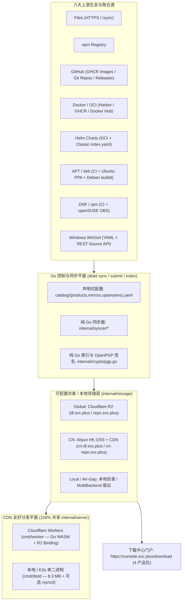

# 统一分发中心 V2（Go 单二进制 + Cloudflare Workers）架构与全链路交付记录

> 交付基线：`2026-11-24`  
> 核心仓库：`ai-workspace-lab/distribution`（`main` @ `901e55d`，PR `#1` 已合入）

---

## 一、总体架构与设计原则

统一分发中心 V2 将原有的脚本化包仓库演进为 **纯 Go 单一代码库** 的轻量级分发平台，同时满足 **聚合（Aggregate）+ 同步（Sync）+ 分发（Distribute）** 三大能力，并且严格分离 **无状态边缘读平面** 与 **重型聚合/构建同步平面**：



### 关键架构选型（已锁定并实现）

1. **Cloudflare Workers 纯 Go 统一路由（选项 A）**：
   - `cmd/worker` 基于 `github.com/syumai/workers-go` 编译为 `GOOS=js GOARCH=wasm`，通过 `internal/storage/r2_worker.go` 直接绑定 Cloudflare R2 Bucket（零出网费）。
   - 与本地单二进制 `cmd/distd` **100% 共享 `internal/server` HTTP 路由代码**。
2. **Docker / Helm 与 Harbor 双模兼容**：
   - **独立模式（Standalone）**：无 Harbor 时直接以 `oci/v2/<repo>/manifests/<ref>` 与内容寻址去重 `oci/blobs/sha256:<digest>` 托管在 R2 / Aliyun OSS / 本地目录。
   - **Harbor / GHCR 混合模式（Hybrid）**：支持通过纯 Go OCI v2 客户端将镜像与 Helm OCI Chart 同步入 Harbor，并在边缘分发层对大体积 Blob 返回 `302 Found` 跳转至 R2 / OSS CDN。
3. **Ubuntu PPA / Debian buildd / openSUSE OBS 双向支持**：
   - **下游聚合镜像**：自动拉取 Launchpad PPA、Debian Archive / `mini-buildd`、openSUSE OBS 产出的 `.deb` / `.rpm`，聚合进入统一的 `repo.svc.plus` / `cn-repo.svc.plus`。
   - **上游源码提交构建**：纯 Go OpenPGP 签名 `.changes` 并通过 `dput` 提交至 Launchpad PPA / Debian Mentors / buildd；纯 Go 原生调用 openSUSE OBS REST API（`PUT /source/...`、`POST /build/...cmd=rebuild`、`GET /build/.../_result`），免装 `osc` CLI。
4. **CDN 友好缓存策略**：
   - **不可变产物（`public, max-age=31536000, immutable`）**：`/v2/*/blobs/sha256:*`、`/v2/*/manifests/sha256:*`、`/apt/pool/*`、`/rpm/packages/*`、`/npm/*/-/*.tgz`、`/helm/charts/*.tgz`、版本化二进制包（`.deb`/`.rpm`/`.dmg`/`.msi`/`.exe`/`.tar.gz`/`.zip`/`.apk`/`.ipa`）及 Git packfile。
   - **可变索引（`public, max-age=60, stale-while-revalidate=300` + `ETag` / `304`）**：`repo-index.json`、`release-matrix.json`、`index.html`、`helm/index.yaml`、APT `InRelease`/`Release`/`Packages`、RPM `repomd.xml`、npm packument、OCI tag manifest、WinGet search 响应。

---

## 二、八大制品生态协议与代码模块映射

| 制品生态 | HTTP 分发端点（`internal/server`） | 聚合与同步实现（`internal/syncer`） | 特性说明 |
| :--- | :--- | :--- | :--- |
| **1. Files (`https` / `rsync`)** | `/files/*`、`/releases/*`（`server.go`） | `files_rsync.go` | HTTPS 增量校验下载、`rsync` 拉取与本地 compose `rsyncd` 只读侧车、`release-matrix.json` 生成 |
| **2. `npm`** | `/npm/<pkg>`、`/npm/<pkg>/-/<file>.tgz`（`npm.go`） | `npm_sync.go` | 自动重写 packument 中 `dist.tarball` 为当前镜像域名，支持 Pull-Through 按需缓存与预同步 |
| **3. GitHub (`ghcr.io` / 仓库 / Releases)** | `/v2/ghcr/*`、`/git/<org>/<repo>.git/*`、`/github/<org>/<repo>/releases/*`、`/raw/*`（`github.go` + `oci.go`） | `github_sync.go` + `oci_sync.go` | 支持 `git clone --bare` + `update-server-info` 静态镜像、Release 资产双写、GHCR 容器镜像聚合 |
| **4. Docker / OCI** | `/v2/`、`/v2/<name>/tags/list`、`/v2/<name>/manifests/<ref>`、`/v2/<name>/blobs/<digest>`（`oci.go`） | `oci_sync.go` | 零 Docker 守护进程纯 Go OCI v2 同步（含多架构 Index/Manifest List），支持独立 R2/OSS 托管与 Harbor 推送 |
| **5. Helm Charts** | `/helm/index.yaml`、`/helm/charts/*.tgz`（`helm.go`）+ `/v2/*` OCI 复用 | `helm_sync.go` | 同时支持 `helm repo add` 经典源合并与 `helm pull oci://` OCI Chart 分发 |
| **6. `apt / deb` (+ Ubuntu PPA / Debian buildd)** | `/apt/dists/<suite>/*`、`/apt/pool/*`、`/apt/svc-plus-archive-keyring.gpg`（`server.go`） | `apt_builder.go` + `ppa_debian.go` | 纯 Go 解析 `.deb`（`ar` + `control.tar.gz`），纯 Go OpenPGP 签发 `InRelease`/`Release.gpg`；支持 PPA/Debian 下游镜像与 `dput` 上游提交 |
| **7. `dnf / rpm` (+ openSUSE OBS)** | `/rpm/<channel>/<arch>/repodata/*`、`/rpm/packages/*`、`/rpm/RPM-GPG-KEY-svc-plus`（`server.go`） | `rpm_builder.go` + `obs_client.go` | 纯 Go 解析 `.rpm` 二进制 Header，纯 Go 生成 `repomd.xml` + `primary.xml.gz` + `repomd.xml.asc`；纯 Go 调用 OBS REST API 提交与下游镜像 |
| **8. Windows WinGet** | `/winget/api/{information,manifestSearch,packageManifests/{id}}` + `/winget/manifests/*`（`winget.go`） | `winget_sync.go` | 零数据库 WinGet REST Source API v1.4–v1.7（直接读 R2/OSS 中的 `winget/api/index.json`）+ 1.6+ YAML 静态清单生成 |

---

## 三、部署与操作手册（Runbook）

### 3.1 本地 / 内网单二进制运行（`distd`）

```sh
# 1. 构建 8.3 MB 单二进制
make build

# 2. 本地启动统一分发服务（默认监听 :8080，数据落盘 ./dist-data）
./bin/distd serve \
  --listen :8080 \
  --config catalog/products.yaml,catalog/mirrors.yaml,catalog/upstreams.yaml \
  --data-dir ./dist-data

# 3. 执行聚合同步（支持 --only all|files|npm|github|oci|helm|apt|rpm|winget）
./bin/distd sync --only all --storage local

# 4. 本地重建并签名 APT/RPM 索引（设置 GPG_PRIVATE_KEY 即启用纯 Go OpenPGP 签名）
./bin/distd index --data-dir ./dist-data --suite stable

# 5. 上游构建提交（支持 --dry-run 预演）
./bin/distd submit --target obs --project home:svc-plus:release --package xconnect --dir ./packaging/rpm --dry-run
./bin/distd submit --target ppa --project svc-plus/release --dir ./packaging/deb --dry-run
```

### 3.2 Docker Compose 部署（含可选 `rsync://` 镜像侧车）

```sh
# 仅启动统一 HTTP 分发网关
docker compose -f deploy/docker/docker-compose.yml up -d distd

# 同时启用 rsync:// (TCP 873) 只读镜像同步服务
docker compose -f deploy/docker/docker-compose.yml --profile rsync up -d
```

### 3.3 Cloudflare Workers（纯 Go WASM）部署

配置文件位于 `ai-workspace-lab/distribution/deploy/cloudflare/wrangler.toml`：

```sh
cd deploy/cloudflare
wrangler deploy
```

关键环境变量与绑定：
- `[[r2_buckets]]`：`binding = "REPO_BUCKET"`, `bucket_name = "svc-plus-repo-global"`
- `[vars]`：`MIRROR_NAME`、`PUBLIC_URL`、`DL_URL`、`R2_PUBLIC_BASE_URL`、`CDN_REDIRECT`、`NPM_UPSTREAM`、`HARBOR_URL`（可选）

### 3.4 关键 Vault 凭据路径

| 用途 | Vault KV v2 路径 | 说明 |
| :--- | :--- | :--- |
| Global 直接下载 R2 | `kv/data/prod/platform/storage/cloudflare-r2` | `dl.svc.plus` |
| CN 直接下载 OSS | `kv/data/prod/platform/storage/aliyun-oss` | `cn-dl.svc.plus` |
| Global 包仓库 R2 | `kv/data/prod/platform/storage/cloudflare-r2-repo` | `repo.svc.plus`（`svc-plus-repo-global`） |
| CN 包仓库 OSS | `kv/data/prod/platform/storage/aliyun-oss-repo` | `cn-repo.svc.plus`（`svc-plus-repo-cn-hk`） |
| Distribution 触发令牌 | `kv/data/prod/platform/distribution/dispatch-token` | 供 Wave 1 仓库发版后触发 `repository_dispatch` |
| 仓库 GPG 签名密钥（可选） | `kv/data/prod/platform/signing/svc-plus-repo-gpg` | 写入 `gpg_private_key` 后自动启用 APT `InRelease` / RPM `repomd.xml.asc` 签名 |

---

## 四、全链路交付与 PR 合并清单（`2026-11-24`）

### 4.1 基础设施、门户与分发中心

| 仓库 | PR / Commit | 变更内容 | 状态 |
| :--- | :--- | :--- | :--- |
| `ai-workspace-services/knowledge` | `#433`（`ddcb5db`） | 新增 `03-unified-package-repository-plan.md` 架构规范 | 已合入 `main` |
| `ai-workspace-infra/gitops` | `#972`（`7b765e1`） | 新增 `client-mirrors/repos.yaml`、`distribution` / `xworkmate-app` Vault 角色与双仓库探活 | 已合入 `main` |
| `ai-workspace-infra/gitops` | `#973`（`43518e0`） | 新增 Wave 1 共享只读策略 `github-actions-client-release-mirrors-prod` 与 5 仓库 JWT 角色（并已同步生效至 `https://vault.svc.plus`） | 已合入 `main` |
| `ai-workspace-infra/gitops` | `#974`（`eb51808`） | 晋级 `console` 镜像至 `sha-2b049ee50b845065c968ef8d1c21170a3923f195@sha256:1a070da9d84e5e9243e207aa71c3e86281f879394b8c3e5ddf0aeb0802f0755c` | 已合入 `main` |
| `ai-workspace-infra/playbooks` | `#1056`、`#1057` | 支持 `client_mirrors_stack=repos` 多栈编排、OSS 前缀策略、CNAME 轮询与证书域隔离 | 已合入 `main` |
| `ai-workspace-infra/iac_modules` | `#516` | `terraform-hcl-standard/client-mirrors` 支持多栈 `repos.yaml` | 已合入 `main` |
| `ai-workspace-services/portal` | `#543`（`2b049ee`） | `/download` 升级为 4 产品位（`XConnect-APP`、`XConnect-One`、`XWorkmate-APP`、`Open Platform -> https://console.svc.plus/docs/`）并集成双镜像 CLI 快速安装命令条 | 已合入 `main` 并上线 |
| `ai-workspace-lab/distribution` | `#1`（`901e55d`） | Go V2 轻量级统一分发中心（`distd` 单二进制 + Cloudflare Workers Go-WASM + 8 类制品同步器 + `Go Distribution V2 CI`） | 已合入 `main` |

### 4.2 Wave 1 产品矩阵（6 个仓库）

| 仓库 | 接入 PR | 接入内容与状态 |
| :--- | :--- | :--- |
| `ai-workspace-xstream/xconnect-app` | 已有 `sync-release-matrix`；CI 修复 PR `#329`（隔离 Tag 推送 `GITHUB_REF_TYPE=tag` 环境污染，15/15 检查通过，待 Reviewer Approve 合并） | `dl.svc.plus` / `cn-dl.svc.plus` 已在线服务 `release-matrix.json` 与全端安装包 |
| `ai-workspace-xstream/xconnect-one` | `#70`（已合入 `main`） | Vault OIDC + `build_release_matrix.py` + `sync_release_mirrors.sh` + `distribution` 触发 |
| `ai-workspace-xstream/xconnect-gateway` | `#31`（已合入 `main`） | Vault OIDC + 双镜像同步 + `distribution` 触发 |
| `ai-workspace-xstream/xconnect-edge-agent` | `#168`（已合入 `main`） | Vault OIDC + 双镜像同步 + `distribution` 触发 |
| `ai-workspace-xstream/fluxgate` | `#3`（已合入 `main`） | Vault OIDC + 双镜像同步 + `distribution` 触发 |
| `ai-desktop-lab/xworkmate-remote-desktop` | `#9`（已合入 `main`） | 新建跨平台 Go 发布工作流 `.github/workflows/build-and-release.yml` + Vault OIDC + 双镜像同步 |

---

## 五、线上可用性与测试验收证据

### 5.1 直接下载双镜像实测

- `GET https://dl.svc.plus/releases/xconnect/release-matrix.json` -> **HTTP 200**（`version=1.1.1`, `tag=latest-45164334862-49bfc5c`）
- `GET https://cn-dl.svc.plus/releases/xconnect/release-matrix.json` -> **HTTP 200**
- `HEAD https://dl.svc.plus/releases/xconnect/latest-45164334862-49bfc5c/xconnect.dmg` -> **HTTP 200**（`content-length: 36812664`）
- `HEAD https://cn-dl.svc.plus/releases/xconnect/latest-45164334862-49bfc5c/xconnect.dmg` -> **HTTP 200**（`content-length: 36812664`）

### 5.2 软件包仓库双镜像实测（`https://repo.svc.plus` & `https://cn-repo.svc.plus`）

双端全部 **20 个端点均返回 HTTP 200**：
- `/index.html`、`/repo-index.json`（收录 `xconnect: 1.1.1`、`xworkmate: 1.2.0-build.851`、`xconnect-one: 0.1.22`、`xconnect-gateway: 0.1.14`、`xconnect-edge-agent: 2026.11.22.1`、`fluxgate: 0.2.0`、`xworkmate-remote-desktop: null`）、`/repo/_health/probe.json`（`status=ok`, `productsCount=7`）
- `/install.sh`、`/install.ps1`（实测 `--dry-run` 跨平台 macOS Homebrew / Linux APT 镜像切换正常）
- `/apt/dists/stable/Release`、`/apt/svc-plus.list`、`/rpm/svc-plus.repo`
- `/homebrew/tap.git/info/refs?service=git-upload-pack`、`/scoop/bucket.git/info/refs?service=git-upload-pack`

### 5.3 下载门户与代码测试验收

- **下载门户实测**：浏览器访问 `https://console.svc.plus/download` 验证 4 个产品位、`开源解决方案文档`（`https://console.svc.plus/docs/`）链接及双镜像 CLI 安装命令条均已生效。
- **Go V2 单元测试与编译**：`go test -race -count=1 ./...` 全量通过（`internal/server`、`internal/storage`、`internal/syncer` 共 7 个测试集），`cmd/distd`（8.3 MB）与 `GOOS=js GOARCH=wasm ./cmd/worker`（11 MB raw）及既有 `tests/test_distribution_scripts.py`（7/7）全部通过，且 GitHub Actions `Go Distribution V2 CI` 通过。
