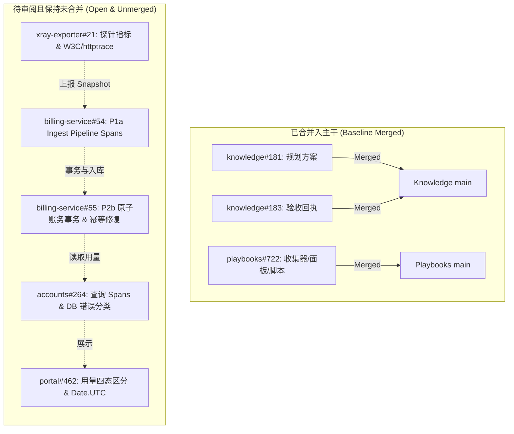
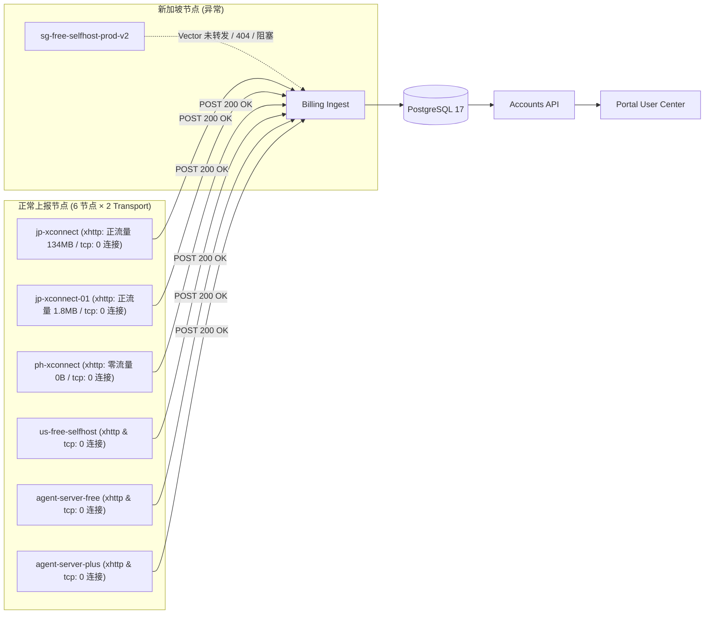
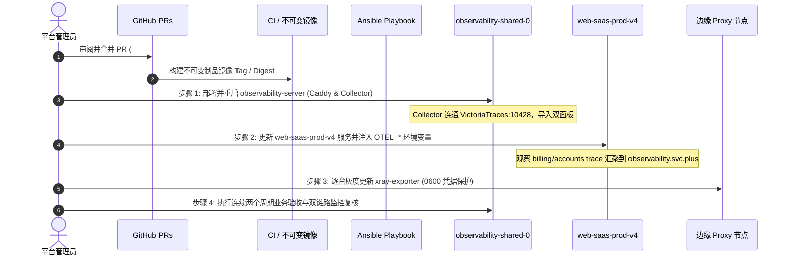

# 双链路可观测性实施与交付交接手册 (Handoff Handbook)

> **2026-10-23 r2 补充（优先于下文 r1 历史执行示例）**：网络链路止于代理节点出口，不含数据库；流量统计完整链路独立保留。五个 OPEN 应用 PR 继续不合并，#722/#183 已合并但部署未在本轮复核。r1 中固定端口/SSH 用户、容器 loopback、无条件重启和“零开销”表述不可直接执行，详见第 8 节。


**文档版本**：v2026.10.23-r2（保留 r1 历史回执）  
**编制时间**：2026-10-23T20:28:00+08:00  
**项目看板**：[GitHub Projects #4: 网络延迟与流量统计可观测性](https://github.com/orgs/ai-workspace-services/projects/4)  
**方案基准**：[network-and-traffic-otel-plan-20261021.zh.md](../../content/02-iac-devops/cloud-infrastructure-devsecops-baseline/records/prod-v3-v4-20261020/network-and-traffic-otel-plan-20261021.zh.md)

---

## 1. 方案概况与核心安全约束

本项目目标为并列建设与完善平台的**双链路可观测性**，同时严格保护现有核心业务、代理连通性及账务数据一致性：

1. **网络延迟链路**：分层度量与区分网络 RTT、DNS 解析、TCP 建连、TLS 握手、首响应（TTFB）、请求总耗时、应用服务处理、队列及数据库耗时。缺失数据严格标为 `unknown`/`not_observed`，严禁填 `0`。
2. **流量统计链路**：覆盖从 Vault → 配置校验 → 0600 凭据文件 → Exporter → 快照探针 → Vector → Billing → PostgreSQL → Accounts → Portal 的全链路观测、指标汇聚与端到端验收。

### 核心安全红线与约束遵循
- **单一后端汇聚**：所有 metrics、logs、traces **唯一**汇聚至现有 `observability.svc.plus`（`observability-shared-0` 节点），复用既有 Collector、VictoriaMetrics、VictoriaLogs、VictoriaTraces 和 Grafana；严禁新建第二套网关或双写外部平台。
- **业务归属不变**：遥测数据仅用于观测，绝不作为计费、去重或金融事实。业务用量、配额及账本仍由业务 PostgreSQL 承载。
- **路径唯一性**：保持 **Xray Exporter → Vector → Billing** 为唯一用量上报路径；严禁开启 Billing 主动拉取，严禁 Agent 绕过 Vector 直连 Billing。
- **故障隔离**：遥测失败、超时、队列溢出或 Collector 不可达时，采用有界队列（`2048`）与异步非阻塞批处理，绝不阻断业务连接、快照采集、账单结算或 API 响应。
- **凭据与隐私保护**：Token 唯一权威为 Vault `既有 Vault 运行时路径（由部署声明解析）` 的 `INTERNAL_SERVICE_TOKEN`。严禁在 metrics labels、logs、traces attributes、events 或 PR 中输出 Token、密码、邮箱、完整 UUID、SQL 参数、DSN 或请求正文。
- **当前执行状态**：所有代码修改与单元测试均在隔离工作树完成。**保持相关 PR 全部打开、严格不合并到 `main` 分支**；未执行任何生产部署、服务重启、生产流量制造或数据库迁移。

---

## 2. 现状进展与项目看板清单

GitHub Project 4（[网络延迟与流量统计可观测性](https://github.com/orgs/ai-workspace-services/projects/4)）关联的全部 PR 状态如下：



### PR 状态矩阵

| 仓库 | PR 编号 | 分支与最新 Commit SHA | 看板状态 | 当前合并状态 | 职责与变更范围 |
| --- | --- | --- | --- | --- | --- |
| `ai-workspace-services/billing-service` | [#54](https://github.com/ai-workspace-services/billing-service/pull/54) | `feat/billing-otel-pipeline-spans-20261021`<br>`4d7bc29f93160c0b294aa4000eb3f5362242a78f` | `In Progress` | **`OPEN`**<br>(保持不合并) | **Phase 1a 纯可观测性**：W3C `TraceContext` 传播器；8 个业务阶段 spans（`decode`、`validate`、`deduplicate`、`delta`、`bucket.write`、`ledger.write`、`quota.write`、`checkpoint.write`）；上游 `traceparent` Span Links；`otelsql` `DisableQuery: true`；2048 有界队列。 |
| `ai-workspace-services/billing-service` | [#55](https://github.com/ai-workspace-services/billing-service/pull/55) | `fix/billing-atomic-accounting-tx-20261021`<br>`a47fa5337c22b95830c73e0fa654d21b48d6d525` | `In Progress` | **`OPEN`**<br>(保持不合并) | **Phase 2b 独立账务事务 PR**：`WithinAccountSampleTx`（`BeginTx` + `FOR UPDATE` 行锁）；重复快照重放防归零；乱序旧快照防误 reset；同分钟多次递增快照累加，防止丢字节或漏扣配额。 |
| `ai-workspace-services/accounts` | [#264](https://github.com/ai-workspace-services/accounts/pull/264) | `feat/accounts-usage-otel-window-20261021`<br>`500f051f831d68094aaf7864050e0f3e95fe3f07` | `In Progress` | **`OPEN`**<br>(保持不合并) | **Phase 1a & 1c**：W3C 传播；`otelsql` SQL 脱敏；用量/账单/身份查询 spans；向后兼容字段 `freshnessState`；DB 故障返回 500 不静默伪装 0；服务慢 vs DB 慢 100% 独立分类。 |
| `ai-workspace-services/portal` | [#462](https://github.com/ai-workspace-services/portal/pull/462) | `feat/portal-usage-error-freshness-state-20261021`<br>`03465a30516ab89ab0b4e4c6668f7eae937cddaf` | `In Progress` | **`OPEN`**<br>(保持不合并) | **Phase 1c**：严格区分查询失败（`—`）、加载中（`—`）、真实零用量（`0 B`）及陈旧数据提示（`syncDelaySeconds > 300`）；`monthStart` 采用 `Date.UTC` 消除浏览器时区漂移。 |
| `ai-workspace-xstream/xray-exporter` | [#21](https://github.com/ai-workspace-xstream/xray-exporter/pull/21) | `feat/exporter-telemetry-envelope-probe-20261021`<br>`a5f57c7f56ea71db4e6a40be903b6ce233de289c` | `In Progress` | **`OPEN`**<br>(保持不合并) | **Phase 1 & 2a**：可选 `snapshot_ref` 与 W3C `traceparent`；`push_enabled` 区分禁推与活跃；`httptrace` 分阶段指标（DNS/TCP/TLS/TTFB/Total，复用连接不填 0）。 |
| `ai-workspace-infra/playbooks` | [#722](https://github.com/ai-workspace-infra/playbooks/pull/722) | `feat/dual-link-otel-observability-20261021`<br>`3b825079bedfeadc61538ef93b7eace8f66640df` | `In Progress` | `MERGED` | 中心 Collector `:10428` 端口与 Caddy `/otlp/*` 路由修正；PII 属性擦除；双链路互链 Grafana 面板；V4 容器 `OTEL_*` 注入；`v4_traffic_chain_acceptance.sh` 支持零流量。 |
| `ai-workspace-services/knowledge` | [#183](https://github.com/ai-workspace-services/knowledge/pull/183) | `docs/dual-link-otel-acceptance-receipts-20261021`<br>`ab0c391dac211849f9e68aaa824c69127058f434` | `In Progress` | `MERGED` | 知识库更新：记录线上双周期核验事实、7 节点双周期矩阵、全量测试回执与跨仓交付清单。 |
| `ai-workspace-services/knowledge` | [#181](https://github.com/ai-workspace-services/knowledge/pull/181) | `feature/traffic-otel-plan-20261021`<br>`ff51a4614e3bf0b07741f15b3bef14d902f5eba7` | `Done` | `MERGED` | 权威规划方案基础文档入库。 |

---

## 3. 线上实测核验事实与证据底账

在 `2026-10-21T09:38:00Z`–`09:50:00Z`（`17:38`–`17:50 +08:00`）执行了生产环境与可观测节点的只读核验：

### 3.1 集中式可观测中心 (`observability-shared-0`)
- **宿主机环境**：GCP 项目 `OBSERVABILITY_PROJECT`，区域 `asia-east1-a`，公网 IP `OBSERVABILITY_NODE_ADDRESS`。
- **运行组件核查**：
  - `xstream_otel_collector`（`otel/opentelemetry-collector-contrib:0.114.0`）
  - `xstream_victoriametrics`（`victoriametrics/victoria-metrics:v1.106.1`，监听 `:9090`）
  - `xstream_victorialogs`（`victoriametrics/victoria-logs:v1.4.0-victorialogs`，监听 `:9428`）
  - `xstream_victoriatraces`（`victoriametrics/victoria-traces:v0.1.0`，监听 `:10428`）
  - `xstream_grafana`（`grafana/grafana:11.3.1`，监听 `:3000`）
- **指标与 Traces 验证**：
  - VictoriaMetrics 活跃采集 Jobs：`["aws-costs","azure-costs","blackbox","gcp-costs","node-exporter","process-exporter","prometheus","vector","victoria-traces","web-saas-accounts","web-saas-billing","web-saas-console","xhttp-caddy","xray"]`。
  - `spanmetrics` 已在实时产生 `traces_span_metrics_calls_total` 与 `traces_span_metrics_duration_milliseconds_*`。
- **线上配置缺陷排查与修复**：
  1. `/opt/observability-server/otel/otel-collector.yml` 中 `otlphttp/victoria-traces` 原配置为 `endpoint: http://victoria-traces:4318`，因拒绝连接报错；已在 [#722](https://github.com/ai-workspace-infra/playbooks/pull/722) 修正为 `http://victoria-traces:10428/insert/opentelemetry`。
  2. `observability.caddy.j2` 中 `@otlp_*` matchers 曾遮蔽 `handle_path /otlp/*`（`127.0.0.1:4319`）；已在 [#722](https://github.com/ai-workspace-infra/playbooks/pull/722) 修正。

### 3.2 生产应用节点 (`web-saas-prod-v4`)
- **宿主机环境**：GCP 项目 `APPLICATION_PROJECT`，区域 `asia-east1-b`，公网 IP `APPLICATION_NODE_ADDRESS`。
- **运行组件**：
  - `billing-service:sha-77557d796a66dcd3373d7731125890bd91ebc5d3`
  - `accounts:v2026.10.21-r13`
  - `portal:v2026.10.21-r9`
  - `postgres:17-alpine`
- **接收心跳**：Billing 容器每分钟稳定收到 **12 次** `POST /v1/ingest/snapshots`（`0` 错误），对应已修复 7 节点中的 6 个节点 × 2 transport。

### 3.3 七节点 × 双 Transport 连续两周期只读验收矩阵



| 节点域名 | Transport | Billing 每分钟到达秒偏移 / 耗时 | 最近 5m 桶数 / 字节数 / Checkpoint 推进 | 验收判定 |
| --- | --- | --- | --- | --- |
| `jp-xconnect.svc.plus` | `xhttp` | `:42.815Z` / `~12.4ms` | 桶数 `10`，增量 `134,311,912 B`，Checkpoint 每 60s 推进（`age <= 45s`） | **`PASS`**（正流量链路健全） |
| `jp-xconnect.svc.plus` | `tcp` | `:42.928Z` / `~89µs` | 每 60s 200 OK，`Samples: []`（无活跃连接，不写 DB） | **`PASS`**（空样本投递健全） |
| `jp-xconnect-01.svc.plus` | `xhttp` | `:11.098Z` / `~7.1ms` | 桶数 `5`，增量 `1,859,259 B`，Checkpoint 每 60s 推进 | **`PASS`**（正流量链路健全） |
| `jp-xconnect-01.svc.plus` | `tcp` | `:11.087Z` / `~91µs` | 每 60s 200 OK，`Samples: []` | **`PASS`**（空样本投递健全） |
| `ph-xconnect.svc.plus` | `xhttp` | `:18.333Z` / `~11.2ms` | 桶数 `10`，增量 `0 B`，Checkpoint 每 60s 推进（`age=25s`） | **`PASS`**（真实零流量链路健全） |
| `ph-xconnect.svc.plus` | `tcp` | `:19.353Z` / `~80µs` | 每 60s 200 OK，`Samples: []` | **`PASS`**（空样本投递健全） |
| `us-free-selfhost-prod-v2.svc.plus` | `xhttp` & `tcp` | `:11.477Z` / `:11.590Z`（`~90µs`） | VictoriaMetrics 中 Vector 送出计数每分钟精确 `+2`，`buffer_events=0` | **`PASS`**（Vector 转发健全） |
| `agent-server-free-prod-v2` | `xhttp` & `tcp` | `:01.238Z` / `:01.239Z`（`~70µs`） | 每 60s 200 OK，`Samples: []` | **`PASS`**（空样本投递健全） |
| `agent-server-plus-prod-v2` | `xhttp` & `tcp` | `:07.823Z` / `:08.103Z`（`~110µs`） | 每 60s 200 OK，`Samples: []` | **`PASS`**（空样本投递健全） |
| `sg-free-selfhost-prod-v2.svc.plus` | `xhttp` & `tcp` | **无请求到达 Billing** | 本地快照探针虽通，但 VictoriaMetrics 缺失指标、Billing 未收到请求、DB checkpoint 停留在 10-18（`age=268,159s`） | **`FAIL` / `BLOCKED`**<br>(Vector 转发断链) |

> [!WARNING] 
> 新加坡节点 `sg-free-selfhost-prod-v2.svc.plus` 处于 **`FAIL / BLOCKED`** 状态，严禁在此状态下宣称全链路 100% 验收通过。详见第 5 节的排查指引。

---

## 4. 离线与隔离验证证据回执

所有功能验证均通过真实测试套件、一次性隔离容器（Docker PG17）或固定版本镜像实测完成：

### 4.1 核心测试用例执行总表

| Case ID | 执行目标与测试载体 | 验证内容与断言 | 执行结果 | Exit Code / Skips |
| --- | --- | --- | --- | --- |
| `CASE-P0-CRED` | Playbooks 本地 Python 3.14 + Ansible 14.3.1 | 缺/无效 Token fail-closed；`0600` 权限；重复运行 `changed=0`；不重启 Xray；输出绝不泄漏凭据。 | **`PASS`**（8/8 通过） | `0` / `0` |
| `CASE-P0-PROD-ID` | Playbooks `v4_duplicate_producer_identity_test.py` | 14 个活跃 Producer（7 节点 × 2 transport）唯一性，拦截同身份双源争抢。 | **`PASS`**（4/4 通过） | `0` / `0` |
| `CASE-P1B-COLL` | Playbooks `test_dual_link_observability_contract.py` | Collector 指向 `:10428`；敏感 PII 属性擦除；Caddy 路由不遮蔽；双面板 UID 唯一与互链；零流量模式。 | **`PASS`**（15/15 通过） | `0` / `0` |
| `CASE-P1A-BILL-SPANS` | Billing `feat/billing-otel-pipeline-spans-20261021` | W3C 传播；Span Links；8 阶段业务 spans；严禁进入 UUID、邮箱、Token、SQL 或 bodyPrefix。 | **`PASS`**（全包通过） | `0` / `0` |
| `CASE-P1A-BILL-LOAD` | Billing `TestOTelBeforeAfterLoadParityAndBoundedQueueUnderCollectorOutage` | Collector 不可达时连续 350 轮（`>2,800` spans，溢出 2048 队列），业务账务保持 100% 一致，堆内存增量 `<=32MiB`。 | **`PASS`**<br>(余额同为 `-26250`，堆增量 `2.30 MiB`) | `0` / `0` |
| `CASE-P2B-BILL-TX` | Billing `fix/billing-atomic-accounting-tx-20261021` + **一次性本地 Docker PG17** | `BeginTx` + `FOR UPDATE`；每写入点故障注入完整回滚且重试不双扣；重复快照防归零；乱序旧快照防误 reset；同分钟多次快照累加不丢字节；8 并发测试。 | **`PASS`**<br>(含 PG17 表写入与并发测试) | `0` / `0` |
| `CASE-P2A-VEC-0411` | 固定版本 `timberio/vector:0.41.1-debian@sha256:87ef5d...` | 实测 Vector 0.41.1：`503` 自动重试恢复；Billing 断连写盘（512MiB 磁盘缓冲）；Vector 容器重启后重放；完整保留 `snapshot_ref` 与 `traceparent`。 | **`PASS`**<br>(`retry_503_recovered=true`<br>`disk_restart_recovered=true`) | `0` / `0` |
| `CASE-P1A-ACC-LAT` | Accounts `feat/accounts-usage-otel-window-20261021` | W3C 传播；SQL 脱敏；DB 故障返 500 不伪装 0；`freshnessState`；服务慢 vs DB 慢各 20 次 100% 独立分类。 | **`PASS`**<br>(20/20 服务慢与 20/20 DB 慢分类完全准确) | `0` / `0` |
| `CASE-P1C-PORTAL-UI` | Portal `feat/portal-usage-error-freshness-state-20261021` | 查询失败（`—`）、加载中（`—`）、真实零用量（`0 B`）、陈旧数据提示四态区分；`currentUtcMonthStartIso` 严格使用 `Date.UTC`。 | **`PASS`**（28/28 测试通过，typecheck 0 错误） | `0` / `0` |
| `CASE-P1-EXP-HTTP` | Exporter `feat/exporter-telemetry-envelope-probe-20261021` | `snapshot_ref`/`traceparent` 注入；`push_enabled` 区分；`httptrace` 建连/复用（不记 0）/明文/TLS 不可信/Refused/Cancel 分类。 | **`PASS`**（12/12 测试通过） | `0` / `0` |

---

## 5. 后续生产发布指南与排障 Runbook

未来的生产发布与上线需在取得明确授权后，遵循不可变与渐进交付路径：

### 5.1 准入与发布操作顺序 (Runbook)



1. **步骤 1：审阅与合并 PR**
   - 建议合并顺序：`playbooks#722` → `xray-exporter#21` → `billing-service#54` → `accounts#264` → `portal#462` → `billing-service#55`。
2. **步骤 2：中心可观测配置生效**
   - 在 `observability-shared-0` 上应用已合并的 Playbooks 变更，重启 `xstream_otel_collector` 与 `xstream_caddy`。
   - 验证 VictoriaTraces 连通性：`curl -sI http://127.0.0.1:10428/health`，确保 Collector 无 `connection refused` 错误日志。
   - 在 Grafana 中确认 `dual-link-network-latency` 与 `dual-link-traffic-accounting` 两个互链看板已就绪。
3. **步骤 3：应用层 Web-SaaS V4 环境变量注入**
   - 重新渲染 `web-saas-prod-v4` 的 `services.env`，注入 `OTEL_EXPORTER_OTLP_ENDPOINT=http://127.0.0.1:4318`，重启容器。
   - 观察 `observability.svc.plus` Grafana 面板，确认 `web-saas-billing` 与 `web-saas-accounts` 的 SpanMetrics 正常递增。
4. **步骤 4：边缘节点 Exporter 制品更新**
   - 严格按 **resolver → 格式校验 → protect-existing-snapshots → 0600 写入 → 仅变更才重启 Exporter** 执行。
   - 严禁重启 Xray 代理进程本身，严禁影响活跃用户连接。

### 5.2 新加坡节点 (`sg-free-selfhost-prod-v2`) 定向排查指引
新加坡节点目前快照上报无法到达 Billing，排查步骤如下：
1. **检查节点 Vector 服务状态**：
   ```bash
   ssh -o StrictHostKeyChecking=yes admin@sg-free-selfhost-prod-v2.svc.plus "systemctl status vector --no-pager"
   ```
2. **核实 Vector 监听与接收**：
   ```bash
   ssh admin@sg-free-selfhost-prod-v2.svc.plus "netstat -tlpn | grep 8686"
   # 查看是否有写入错误或满盘阻塞
   ssh admin@sg-free-selfhost-prod-v2.svc.plus "journalctl -u vector -n 100 --no-pager"
   ```
3. **检查出口连通性与 DNS 解析**：
   ```bash
   # 测试从新加坡节点到 Billing 服务的 HTTP 连通性
   ssh admin@sg-free-selfhost-prod-v2.svc.plus "curl -v --connect-timeout 5 https://billing.svc.plus/healthz"
   ```
4. **核验鉴权 Token 是否同步**：
   检查 `/etc/xray-exporter/runtime.env` 与 `/etc/vector/vector.toml` 中的 `INTERNAL_SERVICE_TOKEN` 是否已通过 `#720` 的公共解析器与 Vault 对齐。

---

## 6. 回滚预案与应急控制 (Rollback Guide)

如在未来上线过程中出现异常，执行以下回滚流程：

### 6.1 应用层回退（`billing-service` / `accounts` / `portal`）
- **快速静默可观测性**：在 `services.env` 中将 `OTEL_EXPORTER_OTLP_ENDPOINT` 与 `OTEL_EXPORTER_OTLP_TRACES_ENDPOINT` 置空并 `docker compose up -d`，系统将自动退化为 noop tracer，完全消除遥测开销。
- **镜像版本回滚**：切回上一不可变镜像 Digest（`billing-service:sha-77557d7...`、`accounts:v2026.10.21-r13`、`portal:v2026.10.21-r9`）。由于本次 PR 无破坏性数据库迁移，回滚无需回退数据库表结构，绝不倒退账务事实。

### 6.2 边缘节点回退（`xray-exporter`）
- 所有新增字段（`snapshot_ref`、`traceparent`）均为 `omitempty`，回退镜像或配置至 `1094bd8e11af30eda62fdbb2ecf9d8560d493829` 即可。

### 6.3 中心可观测配置回退（`playbooks`）
- 通过 GitOps 恢复上一版本配置并执行 Ansible Playbook 重新渲染，回滚后仍能保留 VictoriaMetrics 和 VictoriaLogs 中已写入的遥测历史。

---

## 7. 附录与关键资源索引

- **项目管理**：
  - [ai-workspace-services Projects #4（看板）](https://github.com/orgs/ai-workspace-services/projects/4)
- **知识库方案文档**：
  - [network-and-traffic-otel-plan-20261021.zh.md](../../content/02-iac-devops/cloud-infrastructure-devsecops-baseline/records/prod-v3-v4-20261020/network-and-traffic-otel-plan-20261021.zh.md)
  - [prod-v4-runtime-and-snapshot-baseline-20261021.zh.md](../../content/02-iac-devops/cloud-infrastructure-devsecops-baseline/records/prod-v3-v4-20261020/prod-v4-runtime-and-snapshot-baseline-20261021.zh.md)
- **监控看板定义**：
  - [dual-link-network-latency-dashboard.json](https://github.com/ai-workspace-infra/playbooks/blob/3b825079bedfeadc61538ef93b7eace8f66640df/roles/docker/observability-server/files/dual-link-network-latency-dashboard.json)
  - [dual-link-traffic-accounting-dashboard.json](https://github.com/ai-workspace-infra/playbooks/blob/3b825079bedfeadc61538ef93b7eace8f66640df/roles/docker/observability-server/files/dual-link-traffic-accounting-dashboard.json)
- **本地验证脚本与资产**：
  - `v4_producer_inventory_20261021.json`（历史隔离验证资产；未随本文归档）
  - `test_vector_0411_envelope_retry_restart.py`（历史隔离验证资产；未随本文归档）


## 8. r2：客户端—代理出口采集与双链路实施规划

### 8.1 固定基准

- 网络延迟：客户端 → 本地 TUN/真实出站 → 公网路径 → 代理节点入站与出口。数据库不参与该链路性能归因。
- 流量统计：Vault → 配置校验 → 0600 凭据文件 → Exporter → 快照探针 → Vector → Billing → PostgreSQL → Accounts → Portal。

完整实施规划已写入知识库 `docs/reference/dual-link-client-edge-observability-implementation-plan.zh.md`；性能方法与 JP 双入口案例分别为 `network-full-path-performance-whitepaper.zh.md`、`network-performance-jp-comparison-20261023.zh.md`。本地可审阅副本一并交付。

### 8.2 工具与实现决定

客户端优先既有诊断模块和真实 core DNS/dial/TLS/会话钩子，建立 TUN 本地连接到真实出站映射；macOS/iOS 不使用 Linux eBPF Agent。Linux 节点先以 ss/TCP_INFO、既有 node 指标、Caddy 日志与 Xray 会话事件实现入站/出口摘要，再在隔离环境评估 eBPF/DeepFlow 增益。DeepFlow 完整平台不默认新增，不能假设其 Agent 可直接写入现有 Victoria 后端。

按 session、连接生命周期及明确 mapping 关联；HTTP/2 按 stream 区分；没有协议上下文时不伪造贯通 trace。客户端/服务端重传分别来自各自发送端 socket；Goodput、接口速率、账务分钟桶分别统计。已有 Exporter #21 的 httptrace 是快照上报请求，不能用于替代用户到代理节点的测量。

### 8.3 本轮在线 PR 校正与历史证据边界

Billing #54/#55、Portal #462 为 OPEN/mergeable=true/clean；Accounts #264 为 OPEN/mergeable=null/unknown；Exporter #21 为 OPEN/mergeable=true/unstable，原因尚未审计。#722/#183 已合并；五个 OPEN PR 均保持未合并。未读取 Project 卡片字段，原表 In Progress/Done 不作为本轮核验结果。

SG 断链来自 10-21 历史回执，当前未复核；404 根因、SSH 用户和 8686 是否为 snapshot source 未验证。配置含凭据不能直接 cat。Collector 的 127.0.0.1 必须按容器网络命名空间核实。Caddy 按管理路径 validate/reload，不默认重启。noop 行为逐服务验证，不承诺完全消除开销。fixture 的账务一致/内存通过不等于 p95 开销预算通过。

### 8.4 任务与门禁

| 阶段 | 任务 | 当前状态 | 验收重点 |
| --- | --- | --- | --- |
| 规划 | PLAN-00 两链基准与工具/字段契约 | 已本地写入 | 后续登记可追溯 Issue，未更新看板 |
| 客户端 | NET-01/02/03 能力盘点、阶段事件、真实出站 mapping | PLANNED | 复用/取消/切网、TUN 假快与 unknown 区分 |
| 节点 | NET-04/05 双端 TCP 与 Caddy/Xray/出口事件 | PLANNED | 重传方向、RTT/窗口、TLS/认证/出口分段 |
| 深度分析 | NET-06 受控吞吐/抓包；NET-07 可选 eBPF PoC | PLANNED | 有界负载、采集丢包/offload、后端兼容 |
| 汇聚 | OBS-01 既有后端与面板扩展 | #722 合并；新增扩展未实现 | 接收/存储/查询/面板分别验收 |
| 统计 | FLOW-01/02/03 待审 PR；FLOW-04 独立账务 | CODE_REVIEW | 禁推/空/零/旧、Span Links、同窗口 DB/API/UI |
| 验收 | QA-01 故障/开销；FLOW-05 SG 复核 | NOT_RUN/历史 BLOCKED | fixture 与现场证据分开，缺证据不 PASS |
| 发布 | REL-01 不可变构件与 UAT/生产门禁 | NOT_RUN | 本轮不合并/部署/重启 |

完整任务正文、依赖、指标定义与验收矩阵以知识库深化规划为准。本文补充未实施采集或重新运行历史测试。

## 相关文档

- [深化实施规划](dual-link-client-edge-observability-implementation-plan.zh.md)：工具选型、采集契约、任务拆解与验收条件。
- [全链路性能分析白皮书](network-full-path-performance-whitepaper.zh.md)：分层方法、TCP 重传、RTT、窗口、吞吐与 L4/L7 分析。
- [双入口实测记录](network-performance-jp-comparison-20261023.zh.md)：实际数据、根因排序与待补证据。
