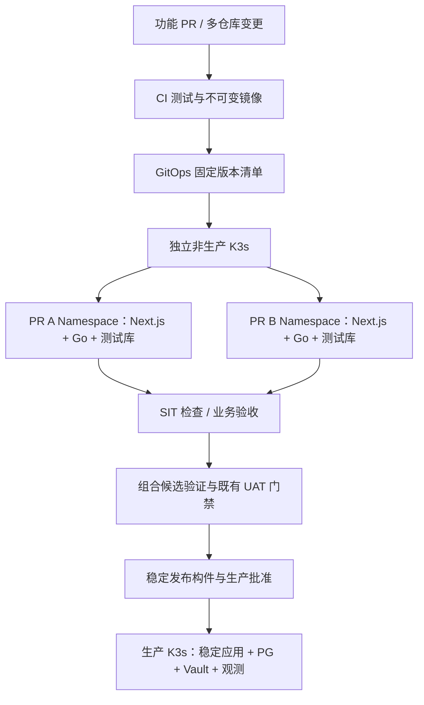

# 轻量全栈系统的特性环境、全链路泳道与渐进发布

> 技术调研与架构建议，整理于 2026-10-26（Asia/Shanghai）。覆盖本轮关于术语、K8s 实现、三者取舍、Selfhost 适配、染色成本、集群数量与技术选型的讨论。本文没有执行部署、修改环境路由或重新验收生产，不构成现行发布制度的替代文件。

## 1. 背景与建议

研究对象是 Next.js 前端、Go 服务与 PostgreSQL 组成的轻量系统。关联部署记录采用 V5 K3s All-in-One，将 Web-SaaS、数据库、Vault Server、Grafana/观测栈汇聚到一台 2C4G VPS，以降低常驻成本。该背景来自既有记录，不是本次实时巡检结论；原有未完成验收仍以各自回执为准。

建议先采用“生产稳定控制面＋独立非生产基础平台＋按需特性环境”，复用 Helm、Flux 和既有入口。先完成独立调用链与数据隔离，再根据实测收益考虑共享基线和全链路染色。

核心分工：**泳道负责并行开发验证，SIT/UAT 负责分层验收，滚动更新负责交付兼容的已验收版本。** 蓝绿、金丝雀按发布风险和资源预算选择；代际重建继续采用独立候选与数据交接流程。

## 2. 三个正交维度

| 维度 | 回答的问题 | 实现示例 |
| --- | --- | --- |
| 环境边界 | 数据、权限、资源和故障影响隔到哪里？ | 生产/非生产集群、网络、Vault 身份、数据库角色 |
| 版本组织 | 多个功能如何同时存在并被选中？ | PR Preview、Feature Environment、共享基线与功能泳道 |
| 发布策略 | 已选择的服务版本如何替换和放量？ | RollingUpdate、蓝绿、金丝雀 |

SIT 是服务集成验证，UAT 是业务验收。二者可以在指定泳道执行，也可保留独立固定环境；它们不是发布策略。滚动更新也不提供按功能身份选择版本的能力。

传统做法是多个功能合并后排队进入固定 SIT/UAT。特性环境把独立功能验证前移到合并前，但仍需验证多个功能组合后的候选，不能把“每条 PR 单独通过”当作组合通过。

**现行门禁与目标设计必须区分。** 既有协作规范约束 PR→SIT、合并→UAT、稳定发布标签→PROD，且 Vault/OIDC 绑定工作流、ref 与环境。本文建议可先把 PR 泳道放在现有 SIT 边界内，合并后仍走既有 UAT。将 UAT 前移为同一 PR 泳道上的业务验收，是待评审的目标设计，必须另行协调 CI、环境保护与身份策略，不能把 PR 身份直接放行到生产能力。

## 3. 术语与部署模式

- **Feature Environment**：按功能组织运行环境。
- **PR Preview / Review Apps**：按 PR 自动创建预览版本。
- **流量染色/泳道**：按受信任的请求标记选择服务版本。
- **全链路染色**：标记沿跨服务调用传播，在各跳选择相应版本；异步路径需要独立设计。
- **Feature Flag**：运行时控制功能可见性，可与上述机制组合；它本身不提供合并前部署或数据隔离。

| 模式 | 结构 | 优势 | 代价与适用范围 |
| --- | --- | --- | --- |
| 完整预览 | 每个功能部署整套应用与所需隔离依赖 | 路径明确，隔离容易验证 | 复制资源较多；适合少服务和大改动 |
| 共享基线＋增量泳道 | 只部署改动服务，其余复用非生产基线 | 减少应用复制 | 传播、路由、数据上下文复杂；适合多服务并行 |
| 混合 | 普通改动用增量，大改动用完整环境 | 按风险分配成本 | 需要明确选择标准和生命周期 |

Namespace 不是完整安全边界；需配合 RBAC、NetworkPolicy、资源配额和独立凭据。完整预览也不意味着每条泳道必须复制 Vault 或整套观测系统。

## 4. 推荐拓扑与集群数量



全链路染色在技术上可以在单集群内实现，不要求多集群；每条泳道也不需要一个集群。对本场景建议生产一个集群、非生产一个按需运行集群，主要隔离故障和权限。两个集群若仍在同一物理主机上，无法隔离主机故障和资源争用。

| 方案 | 成本特点 | 判断 |
| --- | --- | --- |
| 单集群多 Namespace | 少一套控制面，资源共享 | 可用于受控实验，生产与测试仍共享故障域 |
| 生产＋非生产两个集群 | 增加非生产节点、存储、维护 | 推荐目标；非生产可单节点并按需运行 |
| 每泳道一集群 | 重复控制面和管理成本 | 普通功能无需采用；集群级测试可专门使用 |
| 升级时临时候选集群 | 在演练窗口增加资源 | 适合代际、数据库与基础设施升级 |

不建议在当前 2C4G 生产 All-in-One 上长期叠加多套预览应用和网格。单节点成本低，但不是高可用；增加副本、PDB 或滚动策略不能消除整机故障。

## 5. Next.js＋Go＋PG 的第一阶段选型

| 层 | 初期选择 | 后续触发条件 |
| --- | --- | --- |
| 构件 | Next.js 与 Go 分别构建 OCI 镜像，固定 digest | 多仓库组成统一发布清单 |
| 部署 | 复用 Helm，按泳道提供 values | 限制可覆盖项，拒绝任意集群级资源 |
| GitOps | 复用 Flux 与既有声明入口 | 自动生成泳道声明，仍经身份与配置校验 |
| 入口 | 复用已安装控制器，预览专属域名 | 有明确需求再评估 Gateway API 实现 |
| 内部调用 | 配置明确的 Kubernetes Service 地址 | 调用链复杂时评估七层染色 |
| PG | 独立非生产 PG，每泳道 database＋角色 | PG 版本/扩展/恢复测试使用独立实例 |
| 密钥 | 独立测试身份，ESO/既有机制按需同步 | 无权读取生产秘密；共享 Vault 的故障影响需单独评估 |
| 测试 | Go 测试、API 契约/集成、Playwright | 复用已有验收 case，按变更范围选取 |
| 发布 | 原生 Deployment 滚动更新 | 需要精确放量时评估 Argo Rollouts 与网关集成 |

```text
pr-123.preview.example.com
  → Next.js-pr123
  → 同源 /api 或服务端代理
  → Go-pr123
  → PG database_pr123（独立角色）
```

Next.js 服务端读取运行配置；浏览器端尽量通过同源 API 访问。`NEXT_PUBLIC_*` 在构建时内联，不能假设部署时更改环境变量即可更换已构建的浏览器地址。服务端静态预渲染同样可能固化结果，需按实际渲染路径验证。多版本并存还需检查静态资源、Server Action 和会话兼容，不能只验证健康接口。参见 [Next.js 环境变量文档](https://nextjs.org/docs/app/guides/environment-variables)。

数据库/schema 命名不是完整授权：每泳道角色只访问其数据库，审查 PUBLIC、连接与对象权限。共享 PG 仍共享 CPU、IO、连接和实例故障范围。使用合成或脱敏数据；测试付款、退款、通知、Webhook、生产采集消费者等必须由 Sandbox/出口约束控制。

## 6. 全链路染色的实现要求

入口按认证后的测试身份或授权域名决定 `x-feature-lane`，清除或覆盖不可信外部同名 Header。染色标签不是授权凭证。

Gateway API 的 HTTPRoute 可按域名、Header、路径选择后端，但需实际控制器实现。仅安装 CRD 不会产生数据面。见 [HTTP 路由](https://gateway-api.sigs.k8s.io/guides/user-guides/http-routing/)。

内部采用 Istio 等七层代理或统一应用路由层时，Go/Next.js 发起后续 HTTP、gRPC 请求仍需传播允许的上下文；代理不会自动把入站 Header 复制到应用新建的出站请求。共享基线中间服务也必须继续传播。参见 [Istio 请求路由](https://istio.io/latest/docs/tasks/traffic-management/request-routing/)。

```text
非生产基线：Console-base → Accounts-base → Billing-base
billing 泳道：Console-base → Accounts-feature → Billing-feature
```

定义两类行为：未为该服务声明功能版本时按清单使用基线；已声明功能版本但故障时明确失败，避免静默回落基线制造假通过。

共享服务写入哪套数据库必须另有方案：固定连接池的基线服务不能仅凭 Header 自动连接各泳道库。初期优先复制有写入行为的服务与依赖闭包；后续若做多租户数据路由，需审查连接池、事务、租户授权和数据不变量。

异步消息携带泳道属性，使用隔离队列/topic 或受控分发；相同 consumer group 不代表隔离。定时任务按泳道显式启停。缓存、对象存储、幂等键和会话也需隔离。日志/Trace 记录 lane、版本、commit；指标避免无限 PR 标签造成高基数，并在回收时清理相关配置。

Istio 可选 Sidecar 或 Ambient。Ambient 的四层 ztunnel 不足以完成 HTTP Header 路由，七层能力还需要 waypoint。见 [Waypoint 官方说明](https://istio.io/latest/docs/ambient/usage/waypoint/)。

## 7. 成本模型与选择标准

全链路染色主要增加路由设施、应用传播、数据隔离和维护成本。它可能减少重复应用，但不自动减少数据库、恢复和外部副作用的隔离成本。

| 成本项 | 独立预览链路 | 共享基线＋全链路染色 |
| --- | --- | --- |
| 应用副本 | 每泳道复制必要调用链 | 复制改动服务及必要写入依赖 |
| 路由平台 | 入口和固定服务地址 | 增加网格/代理或应用路由层 |
| 工程改造 | 环境参数化、隔离数据、生命周期 | 再增加传播、异步分发、共享服务上下文 |
| 运维 | 配额、清理、依赖版本 | 再增加网格升级、规则冲突和逐跳排查 |
| 验证 | 功能与集成测试 | 再验证串道、标记丢失、故障回落等负向场景 |

测算口径：

```text
月增量成本 = 节点/存储/流量/备份费用 + 工程与运维工时成本
预览资源 = 基础平台 + 活跃泳道 × 每泳道应用/数据增量 + 发布余量
染色收益 = 减少的重复部署成本 − 新增代理、改造和维护成本
```

按需启停不保证停止全部计费：磁盘、快照、保留 IP、负载均衡等可能继续收费，具体以云厂商当前规则为准。本文未核价，不提供未经验证的月费或工期。

Istio 官方性能页保留的 1.24 测试样本，在 1,000 HTTP 请求/秒、1KB 载荷条件下，双线程 Sidecar 约 0.20 vCPU、60MB 内存；这是特定基准，不是本系统低流量占用或资源请求建议。参见 [官方性能说明](https://istio.io/latest/docs/ops/deployment/performance-and-scalability/)。仅作算术演示，10 个此类代理的内存约 600MB，还未包含控制面、入口与业务副本，不能直接据此给 2C4G 主机定容。

实施前测量无泳道基线、一个完整预览、两个并行预览和网格 PoC：记录峰值内存、CPU、PG 连接/IO、磁盘增长、延迟、创建/回收耗时及故障排查工时。只有节省的重复成本超过持续新增成本，才升级共享染色方案。

## 8. 滚动、蓝绿与金丝雀的放置

| 策略 | 优点 | 限制 | 本场景使用方式 |
| --- | --- | --- | --- |
| RollingUpdate | 增量替换，复用容量 | 新旧短期共存，不能精确指定用户版本 | 兼容的无状态服务默认选择 |
| 蓝绿 | 新环境准备好后切入口，可保留旧应用 | 两套应用并存占资源；数据库变更不随路由撤销 | 有容量和切换需求时采用 |
| 金丝雀 | 按用户/比例逐步放量，观察业务指标 | 依赖路由和有效样本，增加控制复杂度 | 明确需要精确放量后引入 |
| 独立代际候选 | 可验证初始化、迁移、恢复 | 临时额外资源与数据交接成本 | Vn→Vnext、PG 大版本与整机替换 |

K8s 滚动更新使用 `maxSurge`、`maxUnavailable` 控制替换，需配合 readiness、优雅退出和连接排空。2C4G 上应先验证额外 Pod 能调度；仅一个副本且没有余量时无法保证无停机。见 [Kubernetes 滚动更新](https://kubernetes.io/docs/tasks/run-application/update-deployment-rolling/)。

PG 结构采用 expand→应用兼容更新→数据转换→contract。迁移由受控独立 Job 执行，配置锁、重试与版本检查。Accounts/Billing 的消费者、定时任务和写入者单独控制。应用回滚不等于数据回滚；目标产生新数据后不能简单切 DNS 回旧库。

## 9. 与 V4→V5 和既有验收的关系

日常功能泳道、现有环境滚动更新、代际干净重建是三条不同风险路径。代际升级继续固定构件、验证新部署、迁移对账、隔离恢复、重复部署和稳定观察；写入权交接沿既有批准边界执行。

| 对象 | 复用检查内容 |
| --- | --- |
| Console 改动 | 页面、会话、API 和相关业务对账 |
| Accounts/Billing 改动 | 认证、配额、账单、采集→入库→API→页面及幂等 |
| 合并候选 | 多功能组合、协议/schema 兼容和固定版本回归 |
| 共享部署/恢复逻辑改动 | 全新部署、幂等、恢复及受影响依赖 |
| 代际候选 | 全部适用检查、单写入者交接与切换后验收 |

结果保持 PASS/FAIL/BLOCKED/NOT_RUN；不适用需说明。每次绑定 run_id、镜像 digest、脚本 SHA、schema、数据快照边界、退出码和脱敏证据。已有 23 组检查作为用例来源，不把部分选择执行描述为完整 23 组通过。

相关权威材料：

- [V5 K3s 环境快照与完成状态](../../content/02-iac-devops/cloud-infrastructure-devsecops-baseline/records/prod-v5-k3s-20261025/prod-v5-vps-to-k3s-runtime-and-acceptance-20261025.zh.md)
- [23 组部署迁移验收模板](../../content/02-iac-devops/cloud-infrastructure-devsecops-baseline/records/prod-v5-k3s-20261025/deployment-migration-acceptance-checklist.template.zh.md)
- [GitHub/Vault 身份策略矩阵](../../content/02-iac-devops/cloud-infrastructure-devsecops-baseline/records/prod-v5-k3s-20261025/github-vault-role-policy-matrix-20261025.zh.md)
- [跨代部署与回归证据索引](../../content/02-iac-devops/cloud-infrastructure-devsecops-baseline/records/generation-deployment-evidence-index-20261025.zh.md)

以上链接是既有记录入口；其历史验收状态不由本文更新。

## 10. 交付归属与声明契约

| 所有者 | 职责 |
| --- | --- |
| 应用仓库 / Artifacts | 业务代码、测试、不可变镜像和 Chart 构件 |
| GitOps | 泳道目标、版本、依赖与非敏感引用 |
| IaC | 云资源、DNS、CMDB 和 state 身份 |
| Playbooks | 主机/K3s 配置、数据库权限、备份与恢复执行 |
| Toolkit | 编排、授权、检查选择、回执和门禁 |

概念清单示意，**不是现有 schema 或可直接 apply 的资源**：

```yaml
lane: billing-pr-123
baselineRelease: accepted-release-id
artifacts:
  console: console-image-digest
  accounts: accounts-image-digest
  billing: billing-image-digest
dataProfile: isolated-test
externalEffects: sandbox
owner: feature-owner
expiresAt: approved-expiry
```

实际实现需补齐来源仓库/PR/SHA、配置版本、schema、资源预算、依赖闭包、数据种子、证据和清理策略。生命周期覆盖申请→授权→构建→部署→验证→固定候选→关闭→回收；PR 重开、更新并发与过期回收都需幂等。只删除本泳道拥有且获准清理的资源，保留所需证据和恢复点。

系统管理、业务运行、只读审计分别使用身份。应用进程非 root；业务账户不继承集群管理或 DB 超级权限；审计不能读取秘密、exec 或通过其他接口提权。业务容器非 root 与容器运行时 rootless 分别记录。

## 11. 演进路线与待验证项

| 阶段 | 交付目标 | 进入下一阶段的依据 |
| --- | --- | --- |
| A：单条完整预览 | 一个 Namespace、独立应用/测试库、预览域名、SIT 回执 | 创建和回收可重跑，资源与业务隔离通过 |
| B：多泳道自动化 | 跨仓库清单、配额、TTL、组合候选与既有 UAT | 并行需求持续存在，有成本样本 |
| C：共享增量泳道 | 网格/路由 PoC、传播、数据和异步隔离 | 节省资源超过新增维护成本，无串道 |
| D：生产渐进放量 | 金丝雀或蓝绿、业务指标门禁 | 有容量、有效观测与演练过的恢复路径 |

- [ ] 盘点现有 Chart、入口控制器、Flux、身份门禁与所有写入者。
- [ ] 测量生产基线和独立非生产预览的容量，确定并发上限。
- [ ] 验证 PG 跨泳道拒绝访问、秘密读取拒绝和网络策略。
- [ ] 验证认证回调、Cookie、Next.js 多版本资源和业务对账。
- [ ] 验证队列、任务、缓存、幂等键及外部副作用隔离。
- [ ] 验证 PR 并发更新、失败重试、过期与回收。
- [ ] 固定组合候选，验证合并后新构件，生产只提升合规稳定构件。
- [ ] 单独评审 SIT/UAT 物理环境解耦涉及的门禁变化。
- [ ] 若做染色 PoC，验证标签伪造、传播丢失、故障回落和跨泳道写入拒绝。

这些条目均为研究后续工作，不代表已实施。当前优先落地 A/B；C/D 根据需求和证据选择，代际升级始终保留独立验收路径。

## 12. 功能级独立部署：确认的目标流程

本轮确认采用以下目标设计：**一个非生产 K3s → 一个功能一个 Namespace → 多仓库 PR 固定清单 → 独立测试库 → SIT 后固定候选做 UAT → 组合验证通过后合并 main → 回收功能环境。** 这是功能泳道的设计决策，尚未实现工作流，也不自动修改既有 CI/Vault 门禁。

功能是生命周期管理单元。多个 PR 关联同一个 feature ID，共享该功能的 Namespace、预览域名与候选清单；不能因其中一个 PR 关闭就提前删除整条泳道。不同功能即使修改同一服务，也部署各自副本。

```text
功能 billing-refund
关联域名 billing-refund.preview.example.com
关联 Console / Accounts / Billing PR
                  │
          CI 构建固定镜像
                  │
       生成候选清单 revision-3
                  │
      非生产 K3s Namespace
       feature-billing-refund
                  │
       SIT：契约 / 集成 / 回归
                  │
       固定候选，进入 UAT
                  │
       UAT：登录 / 业务流程 / 对账
                  │
        检查组合候选与最新 main
                  │
           验收通过后合并 PR
                  │
       核对合并结果并保存验收证据
                  │
     回收功能域名路由与测试数据资源
                  │
          删除功能 Namespace
```

### 12.1 关联关系与状态

| 对象 | 示例 / 约束 |
| --- | --- |
| 功能身份 | `billing-refund`，跨仓库统一，经过名称校验 |
| Namespace | `feature-billing-refund`，所有业务资源标记功能 owner |
| 域名 | `billing-refund.preview.example.com`，仅示例；DNS/证书/路由记录归属 |
| PR 集合 | 明确仓库、PR、head SHA、是否为必需成员 |
| 候选 | `revision-3`，固定完整镜像 digest、Chart/配置版本与数据基线 |
| 数据库 | 独立测试 database 与独立角色，由授权流程创建和回收 |
| 验收 | SIT/UAT 结果绑定同一候选指纹，保留 run_id 和证据索引 |
| 生命周期 | 创建→SIT→候选冻结→UAT→组合验证→合并→归档→回收 |

SIT 通过后，进入 UAT 的是同一候选，不能按浮动分支重新构建替换。任何参与 PR 的提交、部署配置或测试数据基线发生变化，都产生新 revision，重新执行受影响验证；不能沿用旧回执宣称新候选已通过。

组合验证固定各 PR 与当时目标 main 的组合 SHA。目标分支继续变化、PR 分批合并或出现冲突时重新检查组合；多个仓库的合并不是原子操作，必须声明合并顺序与兼容窗口。合并结果如果产生不同构件，执行针对性回归后再回收。

### 12.2 渐进发布位于功能 Namespace 内

SIT 的日常迭代默认滚动更新。需要验证新旧应用并存或切换行为时，在同一功能 Namespace 部署 stable/candidate 两组工作负载，通过预览入口选择候选，验收后切换。初期采用专属候选域名或授权测试人群，不要求百分比自动放量或服务网格。

stable/candidate 使用同一个测试数据库时，先验证 schema 与协议兼容；独立数据库候选之间的切换则需显式处理测试数据差异。功能环境的切换和销毁不涉及生产路由、生产库或生产写入权。

### 12.3 回收契约

“合并后销毁 Namespace”应实现为功能级受控回收流程，而不是无条件响应任意单个 PR 的关闭事件：

1. 确认所有必需 PR 已合并，合并结果已核对且相关验证结束；取消的功能由单独取消状态处理。
2. 将固定清单、验收回执和必要恢复材料保存到 Namespace 外的受控持久位置，记录保留期限。
3. 先撤销或暂停该泳道的 GitOps 目标，避免 Flux 在删除后重建；明确 Helm/Flux 的卸载、prune 与资源保留策略。
4. 停止消费者和定时任务，排空受控测试工作，撤销外部入口与泳道凭据。
5. 按精确 owner 清理测试数据库/角色、对象前缀、队列和独占 DNS 记录；共享通配 DNS、共享 PG 实例、Vault 和观测平台不作为该功能资源删除。
6. 按保留策略处理 PVC/快照，再删除 Namespace。Namespace 删除不保证 PV、云磁盘或外部 database 已清理；核对存储回收策略和最终账单资源。
7. 生成回收回执；部分失败保留可重试状态，不标记完成，不强删 finalizer 绕过资源清理。

TTL 用于发现和回收过期环境。活跃 UAT 或被保留调查的泳道应受租约/保留状态保护；PR 重开需要新候选和明确的数据初始化，不能假设旧资源仍在。

### 12.4 第一版实施边界

第一版复用 K3s、Helm、Flux、既有入口和非生产 PG，仅增加功能清单、按功能参数化部署、SIT/UAT 候选状态与回收编排。GitOps 保存非敏感声明；Toolkit 校验 PR 集合、候选指纹与授权；数据库和基础资源操作仍交给既有执行 owner。PR 构建不获取生产凭据。

该模式提供完整独立调用链，先解决合并前验证。未来确有节省重复服务的需求，再评估共享基线的逐跳染色，不将网格列为第一版依赖。
