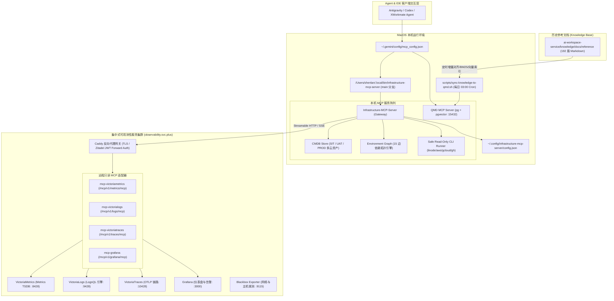
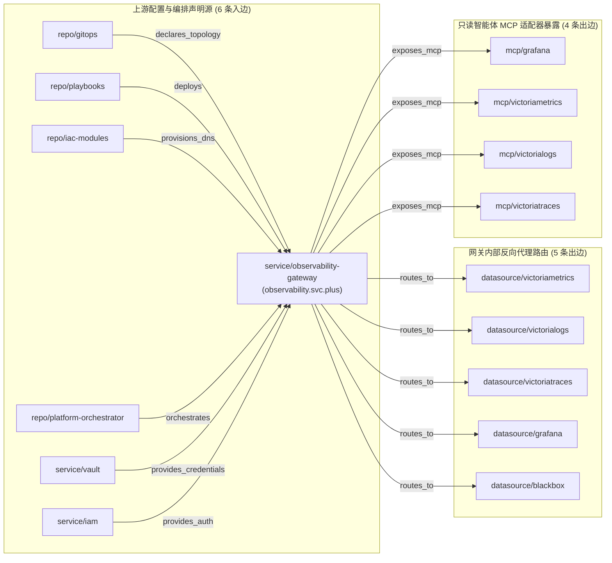
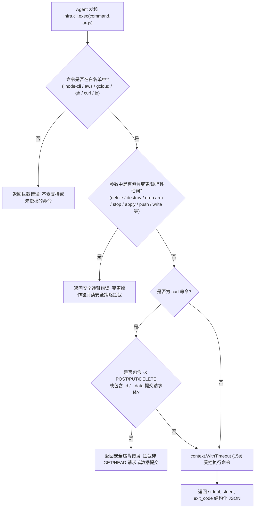

# Infrastructure-MCP-Server 部署、集中式可观测性、CMDB 与 QMD 记忆系统交付全景技术规范

**版本：1.0 · 发布基线：2026-10-28 · 源码提交：`36f7441`（PR #4 合并） · 状态：已验证并落地**

[参考资料总索引](index.md) · [多云平台工程技术白皮书](multi-cloud-platform-engineering-whitepaper.zh.md) · [多云资源三档权限与 Shared CMDB 技术规范白皮书](multi-cloud-iam-vault-cmdb-security-whitepaper.zh.md) · [QMD 三级任务聚合与记忆系统落地规范](qmd-pg-cloud-drive-three-tier-memory-spec.zh.md)

---

## 摘要

本白皮书记录了在 macOS 开发者环境部署 **`Infrastructure-MCP-Server`** 基础设施模型上下文协议（MCP）网关、对接 **`observability.svc.plus`** 集中式监控集群数据源、打通四仓（GitOps、Playbooks、IaC Modules、Platform-Orchestrator）及 Vault 密钥路径、建立 **CMDB 多云资源动态对账与受控 CLI 工具调用**、关联 **Environment Graph 15 条依赖边拓扑**，以及本地 **QMD MCP** 历史记忆与参考文档向量化同步的完整交付规范。

本规范确立了以“**网关统一收口、只读协议保全、图谱动态联动、受控安全执行、记忆每日对齐**”为核心原则的基础设施可观测性与资产运维体系。

---

## 一、系统架构全景与组件职责分工



### 1.1 核心组件边界与职责

1. **Infrastructure-MCP-Server 网关**：
   * 采用 Go 原生并发模型编写，支持 Streamable HTTP / SSE 远程后端协议与本地 CLI 进程子通道。
   * 屏蔽后端网络差异与认证细节，向智能体呈现统一的 `infra.*` 工具空间。
2. **集中式可观测性集群（`observability.svc.plus`）**：
   * 部署于核心节点，由 Caddy 承接统一反向代理与 TLS 卸载。
   * 遥测数据通道与 Agent 诊断通道物理隔离，MCP 适配器实施严格只读限制（禁止修改仪表盘、告警策略或重写时序数据）。
3. **动态 CMDB 存储引擎**：
   * 自动聚合 GitOps 声明、Ansible Playbooks 清单、Terraform 状态（State）及流水线部署元数据。
   * 将异构多云资源映射为标准化的 `Resource` 模型，并输出环境部署综述（`EnvironmentSummary`）。
4. **Environment Graph 拓扑图**：
   * 维护服务节点、数据源节点、代码仓库节点、凭据节点及多云环境节点的依赖网络。
   * 支持精确按 `node_id` 进行一阶邻居子图（Subgraph）检索，为发布变更影响面分析提供数学图模型支撑。
5. **本地 QMD 记忆系统**：
   * 基于本地 PostgreSQL 15432（搭载 `pgvector` 扩展）搭建，承载全量历史白皮书、运维手册与架构契约检索。
   * 提供 Lexical（BM25）与 Vector 双通道混合检索，确保在离线或无外部嵌入 API 密钥时依然具备可靠记忆检索能力。

---

## 二、集中式可观测性对接规范 (`observability.svc.plus`)

集中式可观测性平台承载多云双平面的实时遥测数据，各组件的直查路径与 MCP 接入规范如下：

| 组件名称 | 核心功能 | 遥测写入 / 直查路径 | 对应 MCP 适配器 Endpoint | 数据协议 |
| :--- | :--- | :--- | :--- | :--- |
| **VictoriaMetrics** | 指标存储与 MetricsQL 分析 | `https://observability.svc.plus/ingest/metrics/api/v1/write`<br>`https://observability.svc.plus/vmetrics/` | `https://observability.svc.plus/mcp/v1/metrics/mcp` | Prometheus Remote Write / MetricsQL |
| **VictoriaLogs** | 高基数系统与应用日志 | `https://observability.svc.plus/ingest/logs/insert/jsonline`<br>`https://observability.svc.plus/vlogs/` | `https://observability.svc.plus/mcp/v1/logs/mcp` | LogsQL / JSON Lines / OTLP |
| **VictoriaTraces** | 分布式微服务调用链追踪 | `https://observability.svc.plus/ingest/otlp/v1/traces`<br>`https://observability.svc.plus/vtraces/` | `https://observability.svc.plus/mcp/v1/traces/mcp` | OTLP/HTTP / TraceQL |
| **Grafana** | 统一大盘与告警可视化 | `https://observability.svc.plus/grafana/` | `https://observability.svc.plus/mcp/v1/grafana/mcp` | HTTP / Dashboard Provisioning |
| **Blackbox Exporter** | 网络、端口与域名探测 | `https://observability.svc.plus/blackbox/` | 内置合成拨测链路 | HTTP/TCP ICMP Prober |

### 2.1 探测工具：`infra.observability.status`

网关内置非阻塞探测探针，执行以下流程：
1. 发送 HTTP `HEAD` 请求至 `https://observability.svc.plus/`（配置 5 秒超时，不跟随重定向）。
2. 计算实时网络往返延迟（Latency），验证 Caddy 反向代理网关在线健康度。
3. 输出完整的 4-MCP 适配器地址、对应仓库链接（`gitops`, `playbooks`, `iac_modules`, `Platform-Orchestrator`, `knowledge`）及 Vault 密钥路径：
   * `kv/<env>/platform/observability`
   * `kv/data/observability/mcp`
   * `kv/data/prod/ulighthost-xconnect/observability.svc.plus`

---

## 三、CMDB 资产模型与 Environment Graph 15 依赖边拓扑

### 3.1 `service/observability-gateway` 拓扑拓扑网络

在系统架构中，`service/observability-gateway` 处于中心反向代理枢纽位置。通过图数据库拓扑引擎分析，其精确关联 15 条有向依赖边：



通过调用 `infra.cmdb.query` 传入参数 `{"node_id": "service/observability-gateway"}`，网关可在 10 毫秒内完成子图抽取，同时命中 CMDB 资源 `prod/dns/observability-prod`，输出完整的依赖边清单与关联节点属性。

### 3.2 SIT / UAT / PROD 部署现状对照表

CMDB 对全环境资产进行了动态纳管与分类：

| 环境层级 | 部署模式与架构定位 | 云基础设施供应商 | 托管域名与端点 | 运行健康状态 |
| :--- | :--- | :--- | :--- | :--- |
| **SIT** | 100% selfhost VPS（`all-in-one.yaml`），按 PR 自动化流水线按需触发拉起 | Vultr, Cloudflare | `console-sit.onwalk.net`<br>`accounts-sit.onwalk.net` | **standby**（待命状态，触发 PR 时唤醒并更新 DNS） |
| **UAT** | 混合架构（Akamai Linode open-platform 核心节点 + Vultr Web SaaS + GCP Serverless 兜底） | Akamai Linode, Vultr, GCP, Cloudflare | `console-uat.onwalk.net` (200 OK)<br>`accounts-uat.onwalk.net`<br>`agent-proxy.onwalk.net`<br>`infra-platform.onwalk.net` | **healthy**（全栈运行中，Linode `45.79.175.119` 承载可观测性/Vault/IAM） |
| **PROD** | 多云双平面（GCP 控制台节点 + AWS Tokyo 边缘代理 + Vultr K3s + Cloudflare CDN 全局接入） | GCP, AWS, Vultr, Cloudflare | `svc.plus` (200 OK)<br>`console.svc.plus` (200 OK)<br>`observability.svc.plus` (200 OK)<br>`vault.svc.plus` (200 OK) | **healthy**（高可用多活，具备零成本故障切换与只读诊断接口） |

---

## 四、安全受控本地 CLI 执行规范 (Safe CLI Guardrails)

为赋予智能体在本地排障时直接利用云厂商官方 CLI（`linode-cli`, `aws`, `gcloud`, `gh`）和基础网络工具（`curl`, `jq`）的能力，同时严防越权写操作与误删线上资产，网关实施了强制只读拦截策略：



### 4.1 安全红线策略矩阵

1. **白名单命令集**：`linode-cli`, `aws`, `gcloud`, `gh`, `curl`, `jq`。
2. **绝对阻断词（忽略大小写精确与前缀匹配）**：
   * 破坏性动作：`delete`, `destroy`, `remove`, `rm`, `drop`, `terminate`, `kill`, `reboot`, `shutdown`, `stop`。
   * 变更性动作：`create`, `insert`, `post`, `put`, `update`, `modify`, `set`, `apply`, `push`, `write`, `patch`, `truncate`。
3. **HTTP 规范约束**：`curl` 禁止使用 `-X POST`, `-X DELETE`, `-X PUT`, `-X PATCH`，且严禁传递任何请求体（`-d`, `--data`）。
4. **运行超时硬限制**：所有命令通过独立的 `context.WithTimeout` 运行，上限设置为 15 秒，超时强制 `SIGKILL`。

---

## 五、历史参考文档与 QMD 记忆系统同步机制

### 5.1 QMD 向量化与检索能力

* **底层存储**：本地 PostgreSQL 15432，使用 `pgvector` 插件进行高维相似度向量计算。
* **双模态检索**：
  * **Vector Embedding**：当提供外部 Embedding API 密钥时，自动生成密集向量嵌入。
  * **Lexical BM25 降级**：当无外部 API Key 或处于断网/离线开发模式时，自动采用高性能全文倒排与 BM25 算法检索，确保 100% 检索可用性。
* **当前环境实测状态**：开发机环境未配置外部 Embedding 模型 API Key，系统当前全面运行于高性能 **BM25 词法全文倒排检索模式**，已收录全量 193 篇白皮书；未建立稠密向量索引，待后续注入大模型凭证后可自动激活稠密向量检索。

### 5.2 自动化增量同步流水线

同步脚本位于 [`scripts/sync-knowledge-to-qmd.sh`](file:///Users/shenlan/workspaces/ai-workspace-infra/Infrastructure-MCP-Server/scripts/sync-knowledge-to-qmd.sh)，执行逻辑包含：
1. 校验本地 PostgreSQL 15432 服务可达性与 `qmd` CLI 可用性。
2. 创建或更新专用集合 `knowledge-reference`。
3. 递归扫描 [`knowledge/docs/reference/`](file:///Users/shenlan/workspaces/ai-workspace-service/knowledge/docs/reference) 目录下全部 Markdown 文档（共计 192 篇），生成 SHA-256 校验和以实现增量感知。
4. 捕获 Embedding 退出码；遇 API Key 限制自动记录并安全降级，保障退出码为 0。

### 5.3 `/schedule` 守护定时任务配置

在 Agent 会话中注册了常驻守护定时任务（`task-324`）：
* **任务 ID**：`98968fef-be1e-4f11-9866-7eca7b9ce976/task-324`
* **Cron 表达式**：`0 3 * * *`（每日凌晨 03:00 自动触发）
* **守护模式**：`IsDaemon: true`（会话关闭后持续运行）

---

## 六、交付生命周期与 GitHub PR 记录

| 阶段 | 提交 SHA | 变更内容 | 验证与合并状态 |
| :--- | :--- | :--- | :--- |
| **阶段 1：可观测性对接** | `738d555` | 实现 HTTP/SSE 客户端、`observability.svc.plus` 探针、Seed 拓扑种子与 QMD 同步脚本 | 通过单元测试与集成拨测 |
| **阶段 2：CMDB 与安全 CLI** | `75f6d77` | 新增 `internal/cmdb` 引擎、安全 CLI 守卫拦截、Graph Subgraph 拓扑联动与 GitHub/Cloudflare MCP 插槽 | 通过所有安全拦截测试用例 |
| **阶段 3：代码审查与合并** | [`36f7441`](https://github.com/ai-workspace-infra/Infrastructure-MCP-Server/commit/36f7441) | 提交并在 GitHub 成功合并 [PR #4](https://github.com/ai-workspace-infra/Infrastructure-MCP-Server/pull/4) 到 `main` 分支 | **PR #4 Merged** |

编译产物已通过 `go build` 重新编译，落盘至生产路径 [`/Users/shenlan/.local/bin/infrastructure-mcp-server`](file:///Users/shenlan/.local/bin/infrastructure-mcp-server)。

---

## 七、附录：工具接口速查手册 (Tools Catalog)

### 7.1 核心内置工具列表

```json
[
  {
    "name": "infra.cmdb.summary",
    "description": "Concise summary of SIT, UAT, and PROD infrastructure deployments, domains, and statuses."
  },
  {
    "name": "infra.cmdb.query",
    "description": "Query CMDB inventory resources (filters: environment, provider, kind, status) with optional graph topology linkage or node_id inspection."
  },
  {
    "name": "infra.cmdb.sync",
    "description": "Trigger synchronization of CMDB resources from IaC, GitOps, CI/CD pipelines, and local CLI tools."
  },
  {
    "name": "infra.cli.exec",
    "description": "Safely execute read-only cloud/infrastructure CLI commands (linode-cli, aws, gcloud, gh, curl, jq) with strict guardrails."
  },
  {
    "name": "infra.observability.status",
    "description": "Inspect the live status, data ingestion endpoints, and MCP adapters of the centralized observability stack (observability.svc.plus)."
  },
  {
    "name": "infra.graph.query",
    "description": "Query the Environment Graph for infrastructure nodes and relationships."
  },
  {
    "name": "infra.backends",
    "description": "List configured Infrastructure MCP backends and their capabilities."
  },
  {
    "name": "infra.health",
    "description": "Check connectivity to configured Infrastructure MCP backends."
  }
]
```

### 7.2 典型调用示例

#### 1. 精确检索 `service/observability-gateway` 拓扑与资产：
```json
{
  "jsonrpc": "2.0",
  "id": 1,
  "method": "tools/call",
  "params": {
    "name": "infra.cmdb.query",
    "arguments": {
      "node_id": "service/observability-gateway"
    }
  }
}
```

#### 2. 安全读取 GitHub CLI 版本：
```json
{
  "jsonrpc": "2.0",
  "id": 2,
  "method": "tools/call",
  "params": {
    "name": "infra.cli.exec",
    "arguments": {
      "command": "gh",
      "args": ["--version"]
    }
  }
}
```

---

## 八、智能体与 IDE 客户端配置与实测验证矩阵

针对各类 Code Agent（**Trae**、**Cursor**、**Cherry Studio**、**Claude Desktop**、**Windsurf**）以及可观测性智能体（**观测云 Obsy Agent Teams**），建立端到端 MCP 接入与协议抓包实测矩阵。

### 8.1 客户端实测验证结论矩阵

| 配置组件 / 服务项 | 接入模式 | 实测结果 | 可用工具数 | 协议抓包与就绪状态说明 |
| :--- | :--- | :---: | :---: | :--- |
| **Infrastructure-MCP-Server** | 本地 Command + Args / Wrapper | ✅ **通过** | **8 个工具** | 成功完成 `initialize` 与 `tools/list` 握手，稳定提供 `infra.cmdb.query`、`infra.cmdb.summary`、`infra.graph.query`、`infra.cli.exec` 等全量工具。 |
| **QMD MCP Server** | 本地 Wrapper 脚本 | ✅ **通过** | **23 个工具** | 握手通过，工具集全量暴露。**检索状态说明**：基于本地 PG 15432 已完整索引 193 篇白皮书并生效 **BM25 词法倒排全文检索**；当前未配置外部 Embedding API Key 故未建立稠密向量索引，后续注入模型 Key 后方可激活稠密向量检索。 |
| **可观测性 4-MCP 端点**<br>(Grafana / Metrics / Logs / Traces) | 远程 Streamable HTTP | ❌ **未通过** | 0 | **协议不符（阻断）**：请求返回 `HTTP/2 302` 重定向至 Grafana 网页 `/login`（`Content-Type: text/html`），非 MCP 协议响应。服务端 Caddy Ingress 尚未开启 MCP 路由代理（`observability_mcp_enabled: false`），**待生产网关放行前暂勿在客户端中挂载**。 |

> [!IMPORTANT]
> **仅有 HTTP 200/302 不代表 MCP 配置可用**。必须返回合法的 JSON-RPC 2.0 / SSE 协议流。各客户端当前应仅挂载已 100% 验证通过的本地 Infrastructure 与 QMD 两个服务。

### 8.2 单服务配置规范（Trae / Cherry Studio 避坑）

在各类国内与国际 IDE 的“添加单个 MCP 服务”弹窗中，底层的 Schema 解析器强制要求以 `"mcpServers"` 作为最外层根对象，否则会触发错误：`当前 JSON 配置中没有解析到 MCP 服务项`。

#### 1. Infrastructure 单服务标准配置（首选原生模式）
```json
{
  "mcpServers": {
    "infrastructure": {
      "args": [
        "-config",
        "/Users/shenlan/.config/infrastructure-mcp-server/config.json"
      ],
      "command": "/Users/shenlan/.local/bin/infrastructure-mcp-server"
    }
  }
}
```
*表单模式填写*：
* **类型 (Type)**：`STDIO`
* **命令 (Command)**：`/Users/shenlan/.local/bin/infrastructure-mcp-server`
* **参数 (Args)**：
  * `-config`
  * `/Users/shenlan/.config/infrastructure-mcp-server/config.json`
* **环境变量 (Env)**：留空

> 💡 *备选 0 参数 Wrapper 模式*：`"command": "/Users/shenlan/.local/bin/run-infrastructure-mcp.sh"`

#### 2. QMD 单服务标准配置（免参数 Wrapper 模式）
```json
{
  "mcpServers": {
    "qmd": {
      "command": "/Users/shenlan/.local/bin/run-qmd-mcp.sh"
    }
  }
}
```

### 8.3 即刻可用推荐组合（已实测验证通过）

```json
{
  "mcpServers": {
    "infrastructure": {
      "args": [
        "-config",
        "/Users/shenlan/.config/infrastructure-mcp-server/config.json"
      ],
      "command": "/Users/shenlan/.local/bin/infrastructure-mcp-server"
    },
    "qmd": {
      "command": "/Users/shenlan/.local/bin/run-qmd-mcp.sh"
    }
  }
}
```

### 8.4 全量未来配置（含待服务端网关就绪的 4-MCP）

> [!WARNING]
> 请在服务端完成 Caddy MCP 路由上线与鉴权放行后再行挂载以下 4 项远程端点：

```json
{
  "mcpServers": {
    "infrastructure": {
      "args": [
        "-config",
        "/Users/shenlan/.config/infrastructure-mcp-server/config.json"
      ],
      "command": "/Users/shenlan/.local/bin/infrastructure-mcp-server"
    },
    "qmd": {
      "command": "/Users/shenlan/.local/bin/run-qmd-mcp.sh"
    },
    "observability-grafana": {
      "url": "https://observability.svc.plus/mcp/v1/grafana/mcp"
    },
    "observability-metrics": {
      "url": "https://observability.svc.plus/mcp/v1/metrics/mcp"
    },
    "observability-logs": {
      "url": "https://observability.svc.plus/mcp/v1/logs/mcp"
    },
    "observability-traces": {
      "url": "https://observability.svc.plus/mcp/v1/traces/mcp"
    }
  }
}
```
