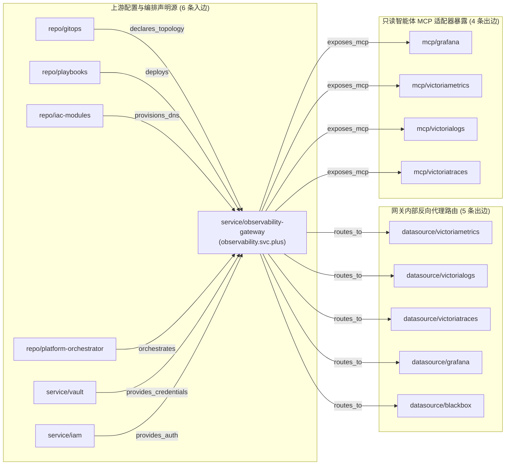
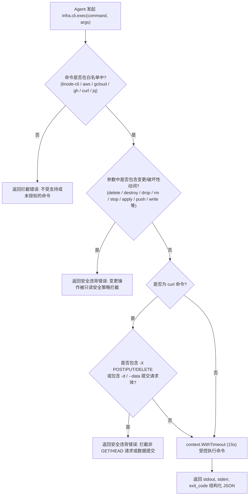

# Infrastructure-MCP-Server 部署、集中式可观测性、CMDB 与 QMD 记忆系统交付全景技术规范

**版本：1.1 · 更新日期：2026-11-11 · 状态：目标架构；SIT 部署与端到端验收待完成**

[参考资料总索引](index.md) · [多云平台工程技术白皮书](multi-cloud-platform-engineering-whitepaper.zh.md) · [多云资源三档权限与 Shared CMDB 技术规范白皮书](multi-cloud-iam-vault-cmdb-security-whitepaper.zh.md) · [QMD 三级任务聚合与记忆系统落地规范](qmd-pg-cloud-drive-three-tier-memory-spec.zh.md)

---

## 摘要

本文记录 Infrastructure-MCP-Server、集中式可观测性、CMDB 与 QMD 的既有设计，并更新 MCP 客户端目标为单入口与统一 Bearer 认证。本文列出的历史部署与本地验证记录不代表当前 SIT 部署验收。

本规范确立了以“**网关统一收口、只读协议保全、图谱动态联动、受控安全执行、记忆每日对齐**”为核心原则的基础设施可观测性与资产运维体系。

---

## 一、系统架构全景与组件职责分工

```mermaid
flowchart TD
    subgraph ClientLayer ["Agent & IDE 客户端交互层"]
        Agent["Antigravity / Codex / XWorkmate Agent / Trae / Cursor"]
    end

    subgraph PlatformCluster ["platform-mcp 集群服务"]
        Caddy_Edge_Ingress["Caddy Ingress Controller (platform-ingress / IngressClass: caddy / hostPort 80/443)"]
        
        subgraph PlatformMCP ["Namespace: platform-mcp (Restricted PSA)"]
            Infra_Gateway_Pod["infrastructure-mcp-server<br>(mcp.svc.plus/ 聚合入口)"]
            SSH_MCP["SSH MCP /v1/ssh/mcp"]
            Grafana_MCP["Grafana MCP /v1/grafana/mcp"]
            Metrics_MCP["VictoriaMetrics MCP /v1/metrics/mcp"]
            Logs_MCP["VictoriaLogs MCP /v1/logs/mcp"]
            Traces_MCP["VictoriaTraces MCP /v1/traces/mcp"]
        end
    end

    subgraph LocalHost ["MacOS 开发者本机运行环境 (可选本地 CLI 模式)"]
        MCP_Config["~/.gemini/config/mcp_config.json"]
        Infra_Bin["/Users/shenlan/.local/bin/infrastructure-mcp-server"]
        Infra_Cfg["~/.config/infrastructure-mcp-server/config.json"]
        
        subgraph LocalMCP ["本机 MCP 服务阵列"]
            Infra_Gateway["Infrastructure-MCP-Server (Local Stdio)"]
            CMDB_Store["CMDB Store (SIT / UAT / PROD 多云资产)"]
            Graph_Store["Environment Graph (15 边依赖拓扑引擎)"]
            CLI_Exec["Safe Read-Only CLI Runner (linode/aws/gcloud/gh)"]
            QMD_MCP["QMD MCP Server (pg + pgvector :15432)"]
        end
        
        QMD_Sync["scripts/sync-knowledge-to-qmd.sh (每日 03:00 Cron)"]
    end

    subgraph ObservabilityStack ["集中式可观测性服务核心集群 (observability.svc.plus)"]
        Caddy_Edge["Caddy 反向代理网关 (TLS / Zitadel JWT Forward Auth)"]
        VM["VictoriaMetrics (Metrics TSDB: :8428)"]
        VL["VictoriaLogs (LogsQL 引擎: :9428)"]
        VT["VictoriaTraces (OTLP 链路: :10428)"]
        GF["Grafana (仪表盘与告警: :3000)"]
        BB["Blackbox Exporter (网络与主机拨测: :9115)"]
    end

    subgraph KnowledgeBase ["历史参考文档 (Knowledge Base)"]
        RefDocs["ai-workspace-service/knowledge/docs/reference (194 篇 Markdown)"]
    end

    Agent -->|HTTPS + Bearer token| Caddy_Edge_Ingress
    Caddy_Edge_Ingress -->|mcp.svc.plus/ 与 /v1/*/mcp| Infra_Gateway_Pod
    Infra_Gateway_Pod --> SSH_MCP & Grafana_MCP & Metrics_MCP & Logs_MCP & Traces_MCP
    Grafana_MCP -->|只读 Viewer token| GF
    Metrics_MCP & Logs_MCP & Traces_MCP -->|只读查询| VM & VL & VT
    Caddy_Edge --> VM & VL & VT & GF
    
    Agent -.->|本地开发模式| MCP_Config
    MCP_Config --> Infra_Bin
    MCP_Config --> QMD_MCP
    Infra_Bin --> Infra_Gateway
    Infra_Gateway --> CMDB_Store & Graph_Store & CLI_Exec
    
    RefDocs -->|定时增量对齐/BM25/向量索引| QMD_Sync
    QMD_Sync --> QMD_MCP
```



### 1.1 核心组件边界与职责

1. **Infrastructure-MCP-Server 网关**：
   * 采用 Go 原生并发模型编写，支持 Streamable HTTP / SSE 远程后端协议与本地 CLI 进程子通道。
   * 在 `https://mcp.svc.plus` 提供唯一客户端入口；客户端只配置该 URL 和 Bearer token。
   * 聚合 SSH、Grafana、VictoriaMetrics、VictoriaLogs、VictoriaTraces 五个后端，并为后端工具名添加来源前缀。
   * 聚合入口和五个 MCP 后端均校验同一环境的 `mcp-service-token`；Grafana API 另使用单独的只读 Viewer/service-account token。
2. **集中式可观测性集群（`observability.svc.plus`）**：
   * 部署于核心节点，由 Caddy 承接统一反向代理与 TLS 卸载。
   * 遥测数据通道与 Agent 诊断通道物理隔离，MCP 适配器实施严格只读限制（禁止修改仪表盘、告警策略或重写时序数据）。
3. **动态 CMDB 存储引擎**：
   * 自动聚合 GitOps 声明、Ansible Playbooks 清单、Terraform 状态（State）及流水线部署元数据。
   * 将异构多云资源映射为标准化的 `Resource` 模型，并输出环境部署综述（`EnvironmentSummary`）。
4. **Environment Graph 拓扑图**：
   * 维护服务节点、数据源节点、代码仓库节点、凭据节点及多云环境节点的依赖网络。
   * 支持精确按 `node_id` 进行一阶邻居子图（Subgraph）检索，为发布变更影响面分析提供数学图模型支撑。
5. **本地 QMD 记忆系统**：
   * 基于本地 PostgreSQL 15432（搭载 `pgvector` 扩展）搭建，承载全量历史白皮书、运维手册与架构契约检索。
   * 提供 Lexical（BM25）与 Vector 双通道混合检索，确保在离线或无外部嵌入 API 密钥时依然具备可靠记忆检索能力。

---

## 二、集中式可观测性与 MCP 单入口规范 (`observability.svc.plus` 与 `mcp.svc.plus`)

`observability.svc.plus` 继续承载 Grafana UI/API 与遥测写入、直查路径，不提供 MCP 路由。MCP 客户端统一连接 `https://mcp.svc.plus`；网关及五个后端 MCP 路由均要求 Bearer token。下表中的 `/v1/.../mcp` 是该域名下的后端路由，常规客户端只需配置聚合根路径：

| 组件名称 | 核心功能 | 遥测写入 / 直查路径 (`observability.svc.plus`) | MCP 路由 (`mcp.svc.plus`) | 数据传输协议 | 只读安全基线 |
| :--- | :--- | :--- | :--- | :--- | :--- |
| **SSH** | 受控主机只读运维 | 不适用 | `https://mcp.svc.plus/v1/ssh/mcp` | Streamable HTTP | 后端认证；只读命令策略 |
| **VictoriaMetrics** | 指标存储与 MetricsQL 分析 | `https://observability.svc.plus/ingest/metrics/api/v1/write`<br>`https://observability.svc.plus/vmetrics/` | `https://mcp.svc.plus/v1/metrics/mcp` | Streamable HTTP / MetricsQL | Bearer 认证；只读时序检索 |
| **VictoriaLogs** | 高基数系统与应用日志 | `https://observability.svc.plus/ingest/logs/insert/jsonline`<br>`https://observability.svc.plus/vlogs/` | `https://mcp.svc.plus/v1/logs/mcp` | Streamable HTTP / LogsQL | Bearer 认证；只读日志检索 |
| **VictoriaTraces** | 分布式微服务调用链追踪 | `https://observability.svc.plus/ingest/otlp/v1/traces`<br>`https://observability.svc.plus/vtraces/` | `https://mcp.svc.plus/v1/traces/mcp` | Streamable HTTP / TraceQL | Bearer 认证；只读链路排查 |
| **Grafana** | 统一大盘与告警可视化 | `https://observability.svc.plus/grafana/` | `https://mcp.svc.plus/v1/grafana/mcp` | Streamable HTTP | Bearer 认证；`--disable-write`、`--disable-admin`；独立 Viewer token |
| **Blackbox Exporter** | 网络、端口与域名探测 | `https://observability.svc.plus/blackbox/` | 通过遥测查询工具使用探测结果 | HTTP/TCP/ICMP Prober | 只读网络拨测 |

客户端配置示例（凭据由本地安全环境注入，不得写入文档或仓库）：

```json
{
  "mcpServers": {
    "infra-mcp": {
      "type": "streamable-http",
      "url": "https://mcp.svc.plus",
      "headers": { "Authorization": "Bearer ${MCP_SERVICE_TOKEN}" }
    }
  }
}
```

Grafana MCP 由 `platform-mcp` 管理，访问 Grafana 时使用单独的只读 Viewer/service-account token。此 API token 与客户端及后端之间共享的 MCP Bearer token 不同；通过环境专属的密钥管理与同步机制注入，不在公开文档中记录密钥存储路径或值。

### 2.1 探测工具：`infra.observability.status`

网关内置非阻塞探测探针，执行以下流程：
1. 发送 HTTP `HEAD` 请求至 `https://observability.svc.plus/`（配置 5 秒超时，不跟随重定向）。
2. 计算实时网络往返延迟（Latency），验证 Caddy 反向代理网关在线健康度。
3. 输出 MCP 聚合入口 `https://mcp.svc.plus` 和 Grafana UI `https://observability.svc.plus/grafana/` 的探测结果。凭据路径仅保存在受限的环境配置中，不由探测结果或公开文档输出。

---

## 三、CMDB 资产模型与 Environment Graph 15 依赖边拓扑

### 3.1 `service/observability-gateway` 拓扑拓扑网络

在系统架构中，`service/observability-gateway` 处于中心反向代理枢纽位置。通过图数据库拓扑引擎分析，其精确关联 15 条有向依赖边：



通过调用 `infra.cmdb.query` 传入参数 `{"node_id": "service/observability-gateway"}`，网关可在 10 毫秒内完成子图抽取，同时命中 CMDB 资源 `prod/dns/observability-prod`，输出完整的依赖边清单与关联节点属性。

### 3.2 SIT / UAT / PROD 部署现状对照表

CMDB 对全环境资产进行了动态纳管与分类：

| 环境层级 | 部署模式与架构定位 | 云基础设施供应商 | 托管域名与端点 | 运行健康状态 |
| :--- | :--- | :--- | :--- | :--- |
| **SIT** | 100% selfhost VPS（`all-in-one.yaml`），按 PR 自动化流水线按需触发拉起 | Vultr, Cloudflare | `console-sit.onwalk.net`<br>`accounts-sit.onwalk.net` | **standby**（待命状态，触发 PR 时唤醒并更新 DNS） |
| **UAT** | 混合架构（Akamai Linode open-platform 核心节点 + Vultr Web SaaS + GCP Serverless 兜底） | Akamai Linode, Vultr, GCP, Cloudflare | `console-uat.onwalk.net` (200 OK)<br>`accounts-uat.onwalk.net`<br>`agent-proxy.onwalk.net`<br>`infra-platform.onwalk.net` | **healthy**（全栈运行中，Linode `45.79.175.119` 承载可观测性/Vault/IAM） |
| **PROD** | 多云双平面（GCP 控制台节点 + AWS Tokyo 边缘代理 + Vultr K3s + Cloudflare CDN 全局接入） | GCP, AWS, Vultr, Cloudflare | `svc.plus` (200 OK)<br>`console.svc.plus` (200 OK)<br>`observability.svc.plus` (200 OK)<br>`vault.svc.plus` (200 OK) | **healthy**（高可用多活，具备零成本故障切换与只读诊断接口） |

---

## 四、安全受控本地 CLI 执行规范 (Safe CLI Guardrails)

为赋予智能体在本地排障时直接利用云厂商官方 CLI（`linode-cli`, `aws`, `gcloud`, `gh`）和基础网络工具（`curl`, `jq`）的能力，同时严防越权写操作与误删线上资产，网关实施了强制只读拦截策略：



### 4.1 安全红线策略矩阵

1. **白名单命令集**：`linode-cli`, `aws`, `gcloud`, `gh`, `curl`, `jq`。
2. **绝对阻断词（忽略大小写精确与前缀匹配）**：
   * 破坏性动作：`delete`, `destroy`, `remove`, `rm`, `drop`, `terminate`, `kill`, `reboot`, `shutdown`, `stop`。
   * 变更性动作：`create`, `insert`, `post`, `put`, `update`, `modify`, `set`, `apply`, `push`, `write`, `patch`, `truncate`。
3. **HTTP 规范约束**：`curl` 禁止使用 `-X POST`, `-X DELETE`, `-X PUT`, `-X PATCH`，且严禁传递任何请求体（`-d`, `--data`）。
4. **运行超时硬限制**：所有命令通过独立的 `context.WithTimeout` 运行，上限设置为 15 秒，超时强制 `SIGKILL`。

---

## 五、历史参考文档与 QMD 记忆系统同步机制

### 5.1 QMD 向量化与检索能力

* **底层存储**：本地 PostgreSQL 15432，使用 `pgvector` 插件进行高维相似度向量计算。
* **双模态检索**：
  * **Vector Embedding**：当提供外部 Embedding API 密钥时，自动生成密集向量嵌入。
  * **Lexical BM25 降级**：当无外部 API Key 或处于断网/离线开发模式时，自动采用高性能全文倒排与 BM25 算法检索，确保 100% 检索可用性。
* **当前环境实测状态**：开发机环境未配置外部 Embedding 模型 API Key，系统当前全面运行于高性能 **BM25 词法全文倒排检索模式**，已收录全量 193 篇白皮书；未建立稠密向量索引，待后续注入大模型凭证后可自动激活稠密向量检索。

### 5.2 自动化增量同步流水线

同步脚本位于 [`scripts/sync-knowledge-to-qmd.sh`](file:///Users/shenlan/workspaces/ai-workspace-infra/Infrastructure-MCP-Server/scripts/sync-knowledge-to-qmd.sh)，执行逻辑包含：
1. 校验本地 PostgreSQL 15432 服务可达性与 `qmd` CLI 可用性。
2. 创建或更新专用集合 `knowledge-reference`。
3. 递归扫描 [`knowledge/docs/reference/`](file:///Users/shenlan/workspaces/ai-workspace-service/knowledge/docs/reference) 目录下全部 Markdown 文档（共计 192 篇），生成 SHA-256 校验和以实现增量感知。
4. 捕获 Embedding 退出码；遇 API Key 限制自动记录并安全降级，保障退出码为 0。

### 5.3 `/schedule` 守护定时任务配置

在 Agent 会话中注册了常驻守护定时任务（`task-324`）：
* **任务 ID**：`98968fef-be1e-4f11-9866-7eca7b9ce976/task-324`
* **Cron 表达式**：`0 3 * * *`（每日凌晨 03:00 自动触发）
* **守护模式**：`IsDaemon: true`（会话关闭后持续运行）

---

## 六、交付生命周期与 GitHub PR 记录

| 阶段 | 提交 SHA | 变更内容 | 验证与合并状态 |
| :--- | :--- | :--- | :--- |
| **阶段 1：可观测性对接** | `738d555` | 实现 HTTP/SSE 客户端、`observability.svc.plus` 探针、Seed 拓扑种子与 QMD 同步脚本 | 通过单元测试与集成拨测 |
| **阶段 2：CMDB 与安全 CLI** | `75f6d77` | 新增 `internal/cmdb` 引擎、安全 CLI 守卫拦截、Graph Subgraph 拓扑联动与 GitHub/Cloudflare MCP 插槽 | 通过所有安全拦截测试用例 |
| **阶段 3：代码审查与合并** | [`36f7441`](https://github.com/ai-workspace-infra/Infrastructure-MCP-Server/commit/36f7441) | 提交并在 GitHub 成功合并 [PR #4](https://github.com/ai-workspace-infra/Infrastructure-MCP-Server/pull/4) 到 `main` 分支 | **PR #4 Merged** |
| **阶段 4：客户端配置与验证** | [`4648af6`](https://github.com/ai-workspace-infra/Infrastructure-MCP-Server/commit/4648af6) | 提交并在 GitHub 成功合并 [PR #6](https://github.com/ai-workspace-infra/Infrastructure-MCP-Server/pull/6) 与 [PR #7](https://github.com/ai-workspace-infra/Infrastructure-MCP-Server/pull/7) | **PR #6, #7 Merged** |
| **阶段 5：服务端网关与只读加固** | [`PR #820`](https://github.com/ai-workspace-infra/playbooks/pull/820) | 在 `playbooks` 仓库修复 `mcp-grafana` `--base-path /mcp/v1/grafana`、Caddy `handle` 透传及 `--disable-write` 只读安全红线 | **Playbooks PR #820 Merged** |

编译产物已通过 `go build` 重新编译，落盘至生产路径 [`/Users/shenlan/.local/bin/infrastructure-mcp-server`](file:///Users/shenlan/.local/bin/infrastructure-mcp-server)。

---

## 七、附录：工具接口速查手册 (Tools Catalog)

### 7.1 核心内置工具列表

```json
[
  {
    "name": "infra.cmdb.summary",
    "description": "Concise summary of SIT, UAT, and PROD infrastructure deployments, domains, and statuses."
  },
  {
    "name": "infra.cmdb.query",
    "description": "Query CMDB inventory resources (filters: environment, provider, kind, status) with optional graph topology linkage or node_id inspection."
  },
  {
    "name": "infra.cmdb.sync",
    "description": "Trigger synchronization of CMDB resources from IaC, GitOps, CI/CD pipelines, and local CLI tools."
  },
  {
    "name": "infra.cli.exec",
    "description": "Safely execute read-only cloud/infrastructure CLI commands (linode-cli, aws, gcloud, gh, curl, jq) with strict guardrails."
  },
  {
    "name": "infra.observability.status",
    "description": "Inspect the live status, data ingestion endpoints, and MCP adapters of the centralized observability stack (observability.svc.plus)."
  },
  {
    "name": "infra.graph.query",
    "description": "Query the Environment Graph for infrastructure nodes and relationships."
  },
  {
    "name": "infra.backends",
    "description": "List configured Infrastructure MCP backends and their capabilities."
  },
  {
    "name": "infra.health",
    "description": "Check connectivity to configured Infrastructure MCP backends."
  }
]
```

### 7.2 典型调用示例

#### 1. 精确检索 `service/observability-gateway` 拓扑与资产：
```json
{
  "jsonrpc": "2.0",
  "id": 1,
  "method": "tools/call",
  "params": {
    "name": "infra.cmdb.query",
    "arguments": {
      "node_id": "service/observability-gateway"
    }
  }
}
```

#### 2. 安全读取 GitHub CLI 版本：
```json
{
  "jsonrpc": "2.0",
  "id": 2,
  "method": "tools/call",
  "params": {
    "name": "infra.cli.exec",
    "arguments": {
      "command": "gh",
      "args": ["--version"]
    }
  }
}
```

---

## 八、智能体与 IDE 客户端配置与实测验证矩阵

针对各类 Code Agent（**Trae**、**Cursor**、**Cherry Studio**、**Claude Desktop**、**Windsurf**）以及可观测性智能体（**观测云 Obsy Agent Teams**），建立端到端 MCP 接入与协议抓包实测矩阵。

### 8.1 客户端实测验证结论矩阵

| 配置组件 / 服务项 | 接入模式 | 实测结果 | 可用工具数 | 协议抓包与就绪状态说明 |
| :--- | :--- | :---: | :---: | :--- |
| **Infrastructure-MCP-Server** | 本地 Command + Args / Wrapper | ✅ **通过** | **8 个工具** | 成功完成 `initialize` 与 `tools/list` 握手，稳定提供 `infra.cmdb.query`、`infra.cmdb.summary`、`infra.graph.query`、`infra.cli.exec` 等全量工具。 |
| **QMD MCP Server** | 本地 Wrapper 脚本 | ✅ **通过** | **23 个工具** | 握手通过，工具集全量暴露。**检索状态说明**：基于本地 PG 15432 已完整索引 193 篇白皮书并生效 **BM25 词法倒排全文检索**；当前未配置外部 Embedding API Key 故未建立稠密向量索引，后续注入模型 Key 后方可激活稠密向量检索。 |
| **历史分离式 MCP 配置** | 远程 SSE | ⚠️ **已过时** | 不适用 | 旧验证记录对应多入口/SSE 架构，不证明当前单入口目标可用；应以本节单入口配置和第九节发布验收结果为准。 |

> [!IMPORTANT]
> **仅有 HTTP 200/302 不代表 MCP 配置可用**。单入口上线后必须用目标客户端完成 MCP 握手、列出工具，并分别调用五个后端的只读工具。当前线上验收状态见第九节。

### 8.2 单服务配置规范（Trae / Cherry Studio 避坑）

在各类国内与国际 IDE（如 **Trae**、**Cherry Studio**）的“添加/编辑单个 MCP 服务”弹窗中：
1. **必须包含 `"mcpServers"` 根节点**，否则触发校验报错：`当前 JSON 配置中没有解析到 MCP 服务项`；
2. **单次仅支持编辑单个服务卡片**，若在弹窗中同时输入包含 2 个服务的 JSON，底层会拦截并报错：`该配置被识别为多配置项`。必须分别添加、分别保存。

#### 1. Infrastructure 单服务标准配置（首选原生模式）
```json
{
  "mcpServers": {
    "infrastructure": {
      "args": [
        "-config",
        "/Users/shenlan/.config/infrastructure-mcp-server/config.json"
      ],
      "command": "/Users/shenlan/.local/bin/infrastructure-mcp-server"
    }
  }
}
```
*表单模式填写*：
* **类型 (Type)**：`STDIO`
* **命令 (Command)**：`/Users/shenlan/.local/bin/infrastructure-mcp-server`
* **参数 (Args)**：
  * `-config`
  * `/Users/shenlan/.config/infrastructure-mcp-server/config.json`
* **环境变量 (Env)**：留空

> 💡 *备选 0 参数 Wrapper 模式*：`"command": "/Users/shenlan/.local/bin/run-infrastructure-mcp.sh"`

#### 2. QMD 单服务标准配置（免参数 Wrapper 模式）
```json
{
  "mcpServers": {
    "qmd": {
      "command": "/Users/shenlan/.local/bin/run-qmd-mcp.sh"
    }
  }
}
```

### 8.3 即刻可用推荐组合（已实测验证通过）

```json
{
  "mcpServers": {
    "infrastructure": {
      "args": [
        "-config",
        "/Users/shenlan/.config/infrastructure-mcp-server/config.json"
      ],
      "command": "/Users/shenlan/.local/bin/infrastructure-mcp-server"
    },
    "qmd": {
      "command": "/Users/shenlan/.local/bin/run-qmd-mcp.sh"
    }
  }
}
```

### 8.4 远程单入口配置

远程客户端仅配置 `https://mcp.svc.plus` 和由客户端安全环境提供的 Bearer token：

```json
{
  "mcpServers": {
    "infra-mcp": {
      "type": "streamable-http",
      "url": "https://mcp.svc.plus",
      "headers": {
        "Authorization": "Bearer ${MCP_SERVICE_TOKEN}"
      }
    }
  }
}
```

不需要为 SSH、Grafana、VictoriaMetrics、VictoriaLogs、VictoriaTraces 单独创建客户端连接。直接访问后端路由时也必须提供同一环境的 Bearer token。不得将实际 token 写入客户端配置文件、文档或版本库。

---

## 九、单入口部署与验收状态

目标拓扑是在 `mcp.svc.plus` 上由一个 gateway 聚合 SSH、Grafana、VictoriaMetrics、VictoriaLogs、VictoriaTraces 五组工具。`observability.svc.plus` 仅提供 Grafana UI/API 和遥测数据面，不承载公开 MCP 路由。

Grafana MCP 由 `platform-mcp` chart 管理，使用 Streamable HTTP，路径为 `/v1/grafana/mcp`。Grafana MCP 的调用方认证使用共享 MCP Bearer token；它访问 Grafana 时另外使用 Viewer/service-account token。VictoriaLogs 与 VictoriaTraces MCP 上游不原生校验调用方 token 时，必须由认证代理在转发前校验 token，并将 MCP 服务端口限制为集群内网访问。共享 MCP token 与 Grafana Viewer token 均通过环境专属密钥管理下发；本文不记录密钥路径或值。

计划保留的公开路由如下，所有路径均要求 Bearer token：

| 路径 | 用途 |
| :--- | :--- |
| `https://mcp.svc.plus/` | 聚合入口，客户端首选 |
| `https://mcp.svc.plus/v1/ssh/mcp` | SSH MCP |
| `https://mcp.svc.plus/v1/grafana/mcp` | Grafana MCP |
| `https://mcp.svc.plus/v1/metrics/mcp` | VictoriaMetrics MCP |
| `https://mcp.svc.plus/v1/logs/mcp` | VictoriaLogs MCP |
| `https://mcp.svc.plus/v1/traces/mcp` | VictoriaTraces MCP |

### 9.1 发布与验收门槛

本文描述的是目标架构，不代表 SIT 或 PROD 已完成部署。交付顺序为：先移除 `observability.svc.plus` 上旧的未认证 MCP 公网路由，再发布并验证平台 chart，随后通过独立 GitOps PR 迁移 SIT。只有 Flux 发布后，使用客户端单入口配置实际完成 `tools/list`，并对五组工具各成功调用一个只读工具，才可记录为 SIT 可用。PROD 变更需另行审批和验证。

相关待办 PR：GitOps [#894](https://github.com/ai-workspace-infra/gitops/pull/894) 移除旧公网路由；Artifacts [#285](https://github.com/ai-workspace-infra/artifacts/pull/285) 关闭 Grafana phone-home 并默认启用认证相关安全设置；Artifacts [#284](https://github.com/ai-workspace-infra/artifacts/pull/284) 实现 platform-mcp 后端及认证代理与 Grafana MCP 迁移。PR 开放或 CI 通过均不等同于部署、线上可用或生产验收。

---
