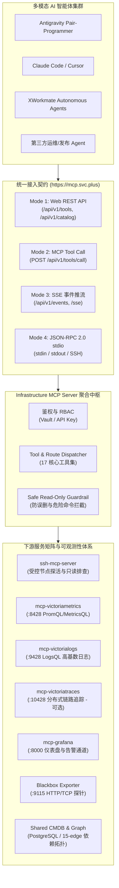

# Infrastructure-MCP-Server (mcp.svc.plus) 统一入口与多模态智能体接入实施方案

> **发布基线**：2026-11-10 · **源码状态**：PR #12（已合入 `main`）· **GitOps 提交**：PR #863（已合入）  
> **服务入口**：`https://mcp.svc.plus` · **聚合中枢**：Infrastructure MCP Server (含 ssh-mcp-server)

---

## 一、架构定位与设计目标

为了让多模态 AI 智能体（包括 Antigravity、Claude Code、Cursor、XWorkmate 及各类第三方自动化 Agent）能够安全、受控、统一地调用底层多云基础设施能力与全链路可观测性数据，本方案构建了以 **`Infrastructure-MCP-Server`** 为核心的统一智能体网关（Unified MCP Gateway）。



### 核心设计原则
1. **统一入口与域名安全绑定**：
   - 官方入口 FQDN：`https://mcp.svc.plus`（部署于 SIT-K3S-V6 宿主机 `172.237.9.58:443`）；
   - Traefik IngressRoute 绑定权威 Let's Encrypt 泛域名证书 `shared-observability-tls`（`*.svc.plus, svc.plus`），提供原生合法 HTTPS/H2 接入；
   - 兼容保留原测试域名：`mcp.sit.onwalk.net`、`mcp-sit.onwalk.net`、`mcp-sit.svc.plus`。
2. **多下游聚合与防重叠**：
   - 内部聚合 `ssh-mcp-server`、`mcp-grafana`、`mcp-victoriametrics`、`mcp-victorialogs` 以及可选的 `mcp-victoriatraces`；
   - 上游智能体只需连接一个入口，即可完成指标、日志、链路、拓扑和节点排查的全景调用。
3. **只读安全红线与受控调用**：
   - 默认强制执行只读或受限指令，拒绝破坏性操作（如 rm -rf, drop table 等）；
   - 凭据均由 Vault KV v2（`kv/data/CICD/observability`）动态注入，不落盘、不泄漏。

---

## 二、四种智能体接入模式规范

| 接入模式 | 通信协议 | 访问端点 | 适用场景与智能体 |
| :--- | :--- | :--- | :--- |
| **Mode 1: Web REST API** | HTTPS GET/POST | `/api/v1/tools`<br>`/api/v1/catalog`<br>`/api/v1/flagger`<br>`/api/v1/gateway`<br>`/api/v1/cmdb`<br>`/api/v1/telemetry/*` | 快速集成、监控大屏、轻量级脚本、无状态 HTTP 客户端 |
| **Mode 2: MCP Tool Call** | HTTPS POST (JSON-RPC) | `POST /api/v1/tools/call` | 标准 MCP 客户端、原生兼容 MCP 协议的 AI 编排平台 |
| **Mode 3: SSE 实时事件流** | Server-Sent Events | `/api/v1/events`<br>`/sse` | 渐进式发布监控、Canary 状态流式通知、告警推流 |
| **Mode 4: 标准 stdio 管道** | JSON-RPC 2.0 (stdin/stdout) | 本地二进制或 `ssh root@observability.svc.plus ...` | 本地 IDE 插件（Cursor、Antigravity、VSCode）及终端 CLI 直接挂载 |

---

## 三、17 个全维度核心工具清单与能力矩阵

`Infrastructure-MCP-Server` 提供涵盖网关、路由、发布门禁、CMDB、拓扑图谱及三大遥测支柱的 17 项原子工具：

| 工具名称 (Tool Name) | 核心功能与能力说明 | 典型返回参数 / 响应 |
| :--- | :--- | :--- |
| `infra.health` | 检查各后端（VM, VL, VT, Grafana, SSH）连通性与健康状态 | `{"status": "healthy", "backends": [...]}` |
| `infra.backends` | 枚举当前激活的底层可观测性适配器与连接信息 | 支持列表与驱动协议 |
| `infra.observability.status` | 检查集中式监控集群数据摄入端点与鉴权状态 | 写入状态、时序样本数、活跃抓取目标 |
| `infra.metrics.query` | 执行 PromQL / MetricsQL 查询时序样本指标 | 时序数值序列、聚合结果 |
| `infra.logs.query` | 执行 LogsQL 查询高基数结构化与非结构化日志 | 日志流、时间戳、字段过滤 |
| `infra.traces.query` | 检索分布式链路追踪 Span（对接 VictoriaTraces） | TraceID、Span 耗时与依赖链路 |
| `infra.cmdb.query` | 精确查询基础设施资产、计算节点与微服务库存 | 资产元数据、IP、规格、宿主集群 |
| `infra.cmdb.summary` | 获取跨云多环境资产宏观统计（SIT / UAT / PROD） | 节点数、服务数、容器数大盘汇总 |
| `infra.cmdb.sync` | 触发 CMDB 从 IaC、GitOps 与云平台拉取对账 | 同步日志与变更差异 |
| `infra.graph.query` | 查询 Environment Graph 15 依赖边拓扑子图 | 节点依赖、调用关系图 |
| `infra.topology.query` | 多集群（PROD-K3S-V6 / SIT-K3S-V6）服务拓扑拓扑查询 | 命名空间服务树 |
| `infra.gateway.query` | 查询网关（Traefik / Caddy）路由规则与证书映射 | 域名映射、路由权重、TLS 证书状态 |
| `infra.domains.query` | 全量域名映射、解析探针与活跃端口状态 | 外部域名矩阵、解析 IP |
| `infra.flagger.query` | 检索 Flagger Canary 灰度发布进度与指标门禁判定 | 流量切分权重、Canary 状态、Gate 评定 |
| `infra.catalog.query` | 统一三级微服务 API 目录检索与契约说明 | 服务名、路径、调用协议 |
| `infra.cli.exec` | 安全执行只读云平台与基础设施 CLI（受防误操作白名单约束） | stdout / stderr 安全执行回执 |
| `ssh.exec` (ssh-mcp-server) | 通过受控 SSH 对各 Agent 节点进行只读排障与状态检查 | 终端实时响应 |

---

## 四、验证验收与实测调用指引

### 1. 外部 HTTPS 访问与证书检验
```bash
curl -I https://mcp.svc.plus/healthz
# 预期返回: HTTP/2 200 OK，证书持有者 *.svc.plus，Let's Encrypt 权威签发
```

### 2. Mode 1 Web REST API 验证
```bash
# 查询可用工具列表
curl -s https://mcp.svc.plus/api/v1/tools | jq .

# 查询集中式监控集群状态
curl -s https://mcp.svc.plus/api/v1/telemetry/status | jq .
```

### 3. Mode 2 通用 MCP Tool Call 验证
```bash
curl -s -X POST https://mcp.svc.plus/api/v1/tools/call \
  -H "Content-Type: application/json" \
  -d '{
    "name": "infra.observability.status",
    "arguments": {}
  }' | jq .
```

### 4. Mode 3 SSE 实时推流监听
```bash
curl -N https://mcp.svc.plus/api/v1/events?env=sit
```

### 5. Mode 4 本地/远程 stdio 与 SSH 挂载
在 Antigravity 或 Claude Desktop 的配置文件中添加：
```json
{
  "mcpServers": {
    "infrastructure-gateway": {
      "command": "ssh",
      "args": [
        "root@observability.svc.plus",
        "kubectl -n platform-mcp-sit exec -i deploy/infrastructure-mcp-server -- /app/infrastructure-mcp-server --stdio"
      ]
    }
  }
}
```

---

## 五、日常维护与故障应急预案

1. **Pod 运行状态检查**：
   ```bash
   kubectl -n platform-mcp-sit get pods -l app=infrastructure-mcp-server
   kubectl -n platform-mcp-sit logs deploy/infrastructure-mcp-server --tail=100
   ```
2. **下游数据源异常排查**：
   若时序指标无返回，核验 VictoriaMetrics 端点 `http://victoria-metrics:8428` 连通性以及 Ingest Auth 密码；
3. **域名证书滚动刷新**：
   证书由 cert-manager 统一续订至 Secret `shared-observability-tls`，Traefik 自动热重载，无需重启服务。
