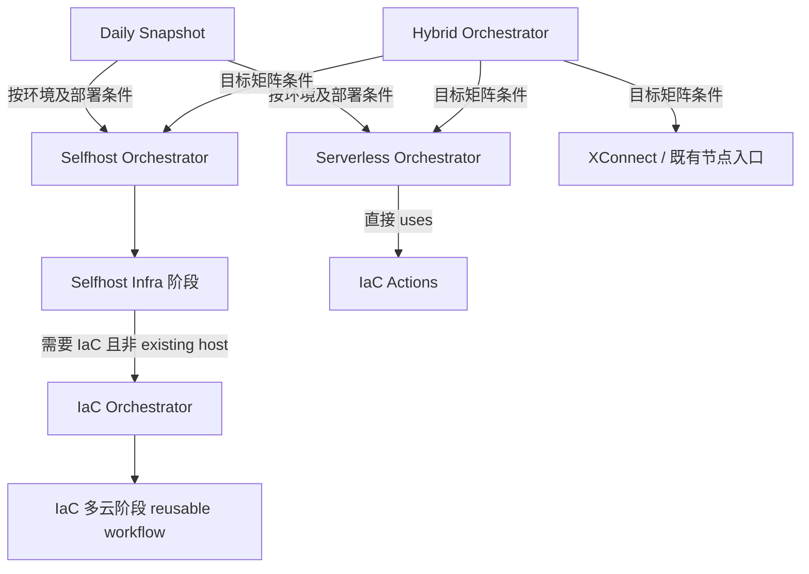

# GitHub Actions 流水线实施草案

状态：规划草案；未经代码实现、部署或生产验收。基线：2026-10-31 核对的 Platform-Orchestrator `main`；具体提交与运行证据以每次实施记录为准。

## 顶部概览：当前主要派发关系

当前经代码核实的主要派发关系：




该图反映已核实的调用方向；下文层级缩进用于职责分组，不表示现有串行父子关系。

## 1. 目标与范围

保留五个顶级父流水线的文件、入口、输入以及现有 job 和 `needs` 链，按单一职责彻底重构其子流水线及共享实现。允许调整父流水线各 job 内的 steps、action 引用和参数交接，以消除适合抽取的内嵌逻辑。子流水线负责授权、目标矩阵、调用 owner、等待回执及汇总；资源和服务执行属于对应 owner。部署以 GitOps 声明和 IaC CMDB 为依据；K3s 交接后由 Flux 调谐，通知由 Flux 自身处理。

父流水线的 job 标识、`needs` 关系及现有入口契约保持不变；在此边界内可以修改 job 内部。重复的输入校验、派发关联和回执验证等控制逻辑，优先复用受测试的共享 action；云资源、主机、服务及数据执行迁至对应 owner。父流水线保留必要的审批、授权、阶段选择和结果汇总。迁移前核对实际调用方、权限与输出契约，迁移后验证行为与失败传播，不为减少代码而弱化门禁或改变 operation 语义。

| 保留的父流水线 | 当前 job 数 | 静态最长链 | 职责 |
|---|---:|---:|---|
| `hybrid-orchestrator.yml` | 5 | 5 | 混合环境目标选择和跨入口调度 |
| `selfhost-orchestrator.yml` | 5 | 5 | Selfhost 全流程调度 |
| `iac-orchestrator.yml` | 8 | 5 | IaC 阶段、目标矩阵和回执汇总 |
| `serverless-orchestrator.yml` | 6 | 5 | Serverless 交付调度 |
| `daily-main-snapshot.yaml` | 5 | 5 | 快照构建和环境派发 |

job 数按静态定义统计，矩阵副本不另计；最长链按同一 workflow 的静态 `needs` 计算，不把跨 workflow 等待相加。运行时实际 job 数随条件和矩阵变化。

## 2. 职责与约束

| 仓库 | 职责 |
|---|---|
| Platform-Orchestrator | 输入、授权、DAG、目标矩阵、派发、等待、回执校验和汇总 |
| IaC | 云资源、DNS、State、云事实与权威 CMDB |
| GitOps | 环境、业务目标、资源、权限目标、版本引用和 Flux 声明；不存秘密值或执行器 |
| Artifacts | 构建、镜像、Chart、制品打包和发布 |
| Playbooks | 主机、服务、身份、数据库、备份恢复、迁移及健康检查 |

- 每个子 workflow 只聚焦一项核心能力；同类目标使用矩阵，环境、provider、账号和部署模式由声明及参数决定，不根据节点名或批次推断。
- 每个 workflow 静态 `needs` 最长链目标为 3 层，硬上限 5 层。矩阵副本算同一层；禁止通过删除权限、依赖或失败传播压缩图。
- YAML 负责声明调用、权限、参数与依赖，避免内嵌非平凡 shell/Python。优先复用现有可测试 action 或 owner 入口；简单任务优先 shell、YAML，复杂逻辑放在职责归属明确且有测试的实现中。不能把执行代码换名藏进 orchestration action。
- 基础仓库默认选择 `main`，每次运行解析并记录一次完整 SHA，下游消费同一结果；调用所需的受信任机制应遵循现有授权。业务镜像、Chart 独立固定不可变版本或 digest。
- 凭据经受控短期身份取得，不写入声明、日志或回执；保留 OS、Kubernetes 和数据库三类身份的独立边界。
- 有状态组件、SQL schema 变更和数据迁移遵循新集群、备份恢复与单独迁移评审；数据盘不因重构格式化、重建或覆盖。只读验证不得伪装成业务验收。

## 3. 通用子流水线能力

能力名称是规划，不意味着新增同名文件。实施前先盘点并复用现有入口和调用方。

| 能力 | 唯一核心功能 | 调用范围 | owner |
|---|---|---|---|
| 目标解析 | 校验输入，匹配唯一 GitOps 目标并固定本次版本 | Selfhost、Hybrid、Serverless、IaC | GitOps 提供声明；Orchestrator 校验 |
| 云资源交付 | 对选定目标执行 IaC，产出资源回执与 CMDB | Selfhost、Hybrid、IaC | IaC |
| 主机与 K3s 交接 | 完成节点基础初始化和 Flux 交接 | Selfhost、需要同类节点的入口 | Playbooks |
| 原生主机服务交付 | 按声明的目标和服务调用主机服务 owner | Selfhost、Hybrid | Playbooks |
| Agent Proxy 交付 | 使用统一目标接口交付 IaC 与已有节点 | Selfhost、Hybrid | Playbooks；IaC 提供云事实 |
| Serverless 资源交付 | 对声明目标交付云资源 | Serverless、Hybrid | IaC |
| Serverless 服务交付 | 使用固定制品交付服务 | Serverless、Hybrid | 对应服务执行 owner；Artifacts 提供制品 |
| 数据操作 | 按明确 operation 调用初始化或迁移执行 | Selfhost、Hybrid、Serverless | Playbooks |
| DNS 操作 | 按明确授权和目标变更 DNS | Selfhost、Hybrid、Serverless | IaC |
| 制品构建发布 | 构建与发布组件及不可变制品 | Daily Snapshot | Artifacts |
| 回执汇总 | 核验已完成的 owner 回执、覆盖及失败 | 各入口 | Orchestrator |

建议子 workflow 的一般结构：

```text
resolve / authorize → execute（目标矩阵，调用 owner）→ report（汇总回执）
```

特殊权限或审批需要独立 job 时可调整层数，不能超过 5。复用通过参数、规范化契约和声明完成，不以复制工作流或相同脚本改名实现。

## 4. Selfhost Deploy 目标

`selfhost-stage-deploy.yml` 当前基线为 15 个 job、最长 9 层；目标：

```text
provision：父运行与输入授权、CMDB 和 GitOps/owner SHA 校验、目标矩阵
  → deploy_base：逐目标调用 Playbooks owner，输出逐步骤回执
  → stage-output：核对覆盖、身份、版本及交接结果
```

Playbooks 负责 common（主机名、三账户/组、主机基线及独立数据盘）、K3s 控制面、三身份和 Flux 交接。 三身份目标顺序为：master 生成并验证三套独立证书和私有 kubeconfig → 向各 OS 账户交付并验证实际身份/RBAC → 使用受控身份归档 Vault KV → 汇总回执。Vault 归档失败时整体身份验收失败，不能产生成功回执；CA 私钥保留在 master。该顺序的实现目前仅在 Playbooks 分支 `fix/k3s-existing-flux-preflight` 的提交 `e61245df`、`8e9f64ae` 中，尚未进入 main，也尚未线上执行。顺序及依赖保留在 Playbooks；回执须能区分每项结果。交接完成表示身份及配置就绪、Flux 已配置消费指定声明；不表示业务调谐或验收完成。部署流水线不更新 GitOps 应用 tag，不等待业务调谐，不执行接口或数据库业务验收；Flux 通知由 Flux 自身负责。

从该子流水线移除 `capture_web_saas_baseline`、`update_gitops_tags`、`initialize_empty_web_saas`、`deploy_web_saas`、`accept_web_saas_upgrade`、`deploy_agent_proxy_non_iac`、`deploy_monitor_agent` 以及其专属依赖、输出和测试引用，不得改名隐藏。其他原生服务、Agent Proxy 和 XConnect 调用先核对目标及现有消费者，替代 owner 路径完成后再退出本流水线；共享实现仍有其他 caller 时只移除此调用。对无法承接的目标明确失败，不得静默跳过。

当前节点可能已有活跃 Flux 与持久卷。重试需先依据权威事实辨别首次交接与已有集群，核验节点、卷及 source/root 身份并提供安全幂等路径；不得暂停或重置活跃资源来绕过保护。

## 5. 消除不可复用与重叠

| 现状 | 目标 | 验证要求 |
|---|---|---|
| 环境与 provider 分支嵌入入口 | 根据 GitOps schema 匹配唯一目标、provider、账号、模式和 state 身份；无法选择或多重匹配即失败 | 跨 SIT/UAT/PROD、provider 和批次的正负用例；不弱化已有授权或资源保护 |
| IaC / 既有 Agent Proxy 分别组织 inventory、凭据和执行 | 共用一个 Playbooks owner；区别以声明中的目标来源和受控凭据表达 | 验证实际目标集合、SSH 身份、凭据及同一目标不重复执行 |
| 空库和 XConnect 固定目标、仓库、workflow 或域名 | 声明或明确参数提供目标与资源标识 | 缺参、冲突、错环境及超范围均失败；空库操作须验证目标为空 |
| owner 使用固定 SHA 与 `@main` 混杂 | 入口选择 ref、默认 main，运行解析 SHA 并贯通调用和回执 | 变更 ref 后的快照一致性、不能回退到浮动分支；核对 GitHub Actions 对动态 reusable workflow 的限制，采用可审查的 checkout/local action 或受控派发 |
| Orchestrator 内直接执行 Ansible、监控和服务 | 执行迁回 Playbooks，云资源/DNS 迁回 IaC，调用端只传参与验证回执 | owner → caller → 调用演练 → 删除旧副本；不把脚本原样复制认定为重构 |
| 监控和 Agent Proxy 多处部署 | 梳理实际目标集合及职责，确认是否同节点重复 | 先验证 IaC 与既有节点的集合和有效运行配置，再去重 |

## 6. Operation 契约

| operation | 原有语义 | 重构约束 |
|---|---|---|
| `plan` | 校验 | 不触发生产变更 |
| `infra` | 基础设施 | 只调用云资源 owner |
| `deploy` | 全新环境的基础设施创建 + 首次部署 | K3s 交接 Flux，原生服务调用对应 owner；失败重试须识别已创建资源并安全幂等，不自动重建或迁移数据 |
| `deploy+init` | 空库初始化 + 部署 | 显式空库检查和数据 owner 操作不得丢失 |
| `deploy+migrate` | 部署 + 迁移 | 显式迁移流程与授权不得丢失 |
| `upgrade` | 已部署业务或环境的受控升级 | UI 和向后兼容且不变更 SQL schema 的 API 可按声明原地滚动；数据库版本、SQL schema、Vault Raft、监控存储及其他持久卷工作负载须在独立新集群验证与转换；数据迁移和流量切换另行明确授权 |
| `migrate` | 仅迁移 | 不附带部署或 DNS |
| `destroy` | 销毁 | 保留独立保护、范围校验与授权 |

组合 operation 可由既有父入口按已授权的顺序组合多个单一能力；不得以拆分之名吞掉某一步，也不得把业务验收隐藏进 Flux 交接。`upgrade` 是新增的目标契约，当前工作流尚未实现该选项，不得将文档定义当作已经支持。首次 `deploy` 的重试不能通过覆盖已有 state、重建节点或格式化已有数据盘实现；发现已有资源与期望不一致时停止并核对。

## 7. 逐目标回执与失败传播

回执至少包含 schema 版本、环境、目标 ID、host/实例身份、来源 CMDB 摘要及关联 run、GitOps SHA、owner SHA、父子运行 ID 和 attempt、各步骤状态、Flux 交接结果及时间。状态至少区分 `success`、`failed`、`expected_skip`、`not_run`、`missing`；仅在已验证相应证据后记录成功，不记录秘密。Flux 调谐与业务验收单独记录，不由交接推断。

矩阵目标清单来自已核验的 IaC CMDB 与 GitOps 声明；空目标、重复目标、目标不一致或声明不唯一失败。每目标产生独立 artifact，不能依赖矩阵 job 单个 output 表示所有 host。汇总需核对预期目标集合、唯一性、版本和关联身份；必需项失败或回执缺失使阶段失败。执行被取消、runner 异常或未生成回执时，明确为未运行或缺失，不能伪造成功。

## 8. 测试与切换顺序

1. **盘点调用方**：固定 main 基线，记录每条 workflow、action、脚本、触发条件、调用者、输入输出、权限和目标；盘点直接及间接引用。
2. **owner 先行**：补齐参数化 owner 接口与回执，分别提交 owner PR；单独验证幂等、数据保护及授权，保留旧路径和回滚点。
3. **接通 caller**：基于合入的 owner 引用接通可复用子流水线；在隔离环境和无副作用演练验证目标、凭据范围、回执关联与失败传播。
   在保持五个父流水线 job 与 `needs` 不变的前提下，同步将父 job 中可复用的内嵌控制步骤替换为共享 action，将资源执行改为调用对应 owner；保留既有审批、条件和输出契约。
4. **删除旧路径**：验证调用链后删除被替代的本流水线 job、执行脚本及专属条件、输出和测试；共享实现有其他使用者则保留。
5. **收敛深度**：运行全 workflow 深度门禁。子流水线实测达到 5 层以内后，删除对应历史例外，不放宽门禁。

最少覆盖：空目标、重复目标、环境或目标不匹配、CMDB/声明/owner SHA 不一致、无权限、owner 失败、部分矩阵失败、预期跳过、未运行、缺回执、跨运行重放、业务制品不存在及幂等重试。数据盘使用隔离样本测试，不在验证中格式化已有盘。保留 operation 组合的调用语义测试，跨仓分别报告 CI 证据。

运行状态分开报告：**规划 → 代码与契约验证 → 已合并 → 授权后的实际交付 → 真实身份与业务验收**。CI 通过或 Flux 交接回执均不能替代线上验收。部署、迁移和 DNS 操作沿用各自授权；本草案不授权执行。

## 9. 关联文档

- [环境与业务发布解析：最小实施草案](环境与业务发布解析-最小实施草案.md)
- [Linux OS 三类操作身份：最小实施草案](Linux-OS三类操作身份-最小实施草案.md)
- [K3s role 职责与依赖清单](K3s-role职责与依赖清单.md)
- [PROD-K3S-V6 独立节点、集群冷启动规划与部署状态归档](PROD-K3S-V6-规划与部署状态归档.md)

## 10. 当前调用清单与统计基线

以下为 2026-10-31 对 Platform-Orchestrator `main` `68f00eb1997d982bbd4430627cdafefad4416046` 的静态盘点，用于迁移前追踪，不是实际运行成功的证据。统计范围为五个父入口、五个 Selfhost 阶段子 workflow 及 `iac-pipeline-multi-cloud-stages.yaml`，共 11 个文件。共 **286 处 `uses` 引用、50 个不同完整引用字符串**；同一 action 的不同版本分别计算，不包含脚本内部派发的 workflow，也不是全仓或所有递归子链的完整统计。

| 范围 | `uses` 引用次数 | 不同完整引用数 |
|---|---:|---:|
| `hybrid-orchestrator.yml` | 9 | 3 |
| `selfhost-orchestrator.yml` | 10 | 2 |
| `iac-orchestrator.yml` | 23 | 10 |
| `serverless-orchestrator.yml` | 24 | 12 |
| `daily-main-snapshot.yaml` | 25 | 6 |
| `selfhost-stage-resolve.yml` | 61 | 16 |
| `selfhost-stage-infra.yml` | 12 | 7 |
| `selfhost-stage-deploy.yml` | 59 | 19 |
| `selfhost-stage-migrate.yml` | 15 | 6 |
| `selfhost-stage-verify.yml` | 12 | 4 |
| `iac-pipeline-multi-cloud-stages.yaml` | 36 | 9 |

### 10.1 Actions 与 workflow 名称

| 类别 | 当前引用名称（省略版本；各文件实际版本应单独核验） |
|---|---|
| GitHub 官方 Actions | `actions/checkout`、`actions/upload-artifact`、`actions/download-artifact`、`actions/cache`、`actions/create-github-app-token`、`actions/setup-node` |
| 第三方 Actions | `hashicorp/vault-action`、`google-github-actions/auth`、`google-github-actions/setup-gcloud`、`docker/setup-buildx-action` |
| Orchestrator 本地 Actions | `gitops-yaml-json`、`dev-bootstrap-handoff`、`serverless-runtime`、`setup-yq`、`prod-selfhost-control`、`configure-gcp-oidc` |
| IaC Actions | `iac-legacy-inputs`、`iac-targets`、`iac-self-check`、`iac-summary`、`iac-receipt-verify`、`iac-caller-targets`、`iac-caller-inventory`、`iac-stage-context`、`iac-bootstrap`、`iac-account`、`iac-resources`、`iac-cleanup`、`iac-receipt`、`gitops-gcp-target`、`cloud-run-serving-facts`、`prod-selfhost-access`、`platform-resource-operations` |
| Playbooks Actions | `k3s-bootstrap`、`setup-deployment-runner`、`caddy-certificate-restore`、`non-iac-agent-proxy-inventory`、`prod-native-standby`、`prod-native-init`、`prod-native-billing-upgrade`、`prod-full-business`、`prod-availability`、`service-probes` |
| Playbooks reusable workflows | `web-saas-domain-cd.yaml`、`open-platform-domain-cd.yaml`、`ai-workspace-domain-cd.yaml` |

`k3s-handover-receipt` owner 已在 Playbooks 合入；Orchestrator 接入候选位于 [PR #1594](https://github.com/ai-workspace-infra/Platform-Orchestrator/pull/1594)，本统计基线尚未包含该调用。重构前应再次核对合入状态和引用版本。

### 10.2 Playbooks 入口及 role

| 层 | 名称 | 范围 |
|---|---|---|
| Selfhost 相关入口 | `k3s_platform_bootstrap.yml`、`bootstrap-node.sh`、`setup-agent-proxy-domain.yml`、`deploy_observability_agent.yml` | 直接引用或通过 K3s owner action 调用的已核对入口；不是全部间接 playbook 清单 |
| K3s 主线 roles | `vhosts/common`、`web_saas_data_volume`、`vhosts/k3s_platform_bootstrap`、`vhosts/k3s-cluster-server`、`vhosts/helm_cli`、`vhosts/flux_controllers`、`vhosts/flux_gitops`、`vhosts/k3s_identity` | 依据 K3s bootstrap 入口及 role 编排静态核对；运行是否执行取决于目标和条件 |

### 10.3 IaC 模块

Akamai 模块族包括 `compute`、`compute_protected`、`storage`、`storage_protected`、`vpc`。V6 的 Akamai 模板按节点声明生成 `compute_<host>` 和 `volume_<host>`，并在声明要求时生成防火墙等资源；普通或 protected 变体及实际实例以该次渲染结果和 IaC 回执核验，不能从模块目录存在推断全部执行。

后续实施须补全 Hybrid、Serverless、Daily Snapshot 脚本派发和各 owner 内部递归调用的清单，并记录引用版本、输入输出、调用条件及实际消费者。新的静态基线不能覆盖历史运行证据。

## 11. 五个顶级入口的层级与实际关联

下面按需求给出的顺序组织统计。这个树是**职责分组视图**，缩进本身不表示已存在父子派发；实际调用方向见后表。

```text
daily-main-snapshot.yaml           制品快照与选择环境派发
  iac-orchestrator.yml             云资源交付与 CMDB
    hybrid-orchestrator.yml        混合环境目标编排
      selfhost-orchestrator.yml     主机/K3s 交付编排
      serverless-orchestrator.yml   Serverless 交付编排
```

| 分组中的入口 | 静态 job / 最长链 | 本次审计范围内 `uses` 次数 / 不同引用 | 当前关联 |
|---|---:|---:|---|
| `daily-main-snapshot.yaml` | 5 / 5 | 25 / 6 | 选择部署时，SIT/UAT 可派发 Serverless、PROD 可派发 Selfhost；并不直接派发 IaC 或 Hybrid |
| `iac-orchestrator.yml` | 8 / 5 | 23 / 10 | 调用 IaC 多云 reusable workflow；可由 Selfhost Infra 子流水线派发 |
| `hybrid-orchestrator.yml` | 5 / 5 | 9 / 3 | 按声明目标派发 Selfhost、Serverless 等入口；未发现由 IaC 作为父入口派发 Hybrid |
| `selfhost-orchestrator.yml` | 5 / 5 | 10 / 2 | 派发五个 Selfhost 阶段；Infra 阶段按条件派发 IaC |
| `serverless-orchestrator.yml` | 6 / 5 | 24 / 12 | 消费 IaC Actions；数据阶段可派发数据操作 workflow；未据此认定调用 IaC Orchestrator |

统计为本节基线的静态文件引用；不同版本算不同完整引用，条件跳过和矩阵展开不影响上述静态数值。各子 workflow、action 内部的递归引用未全部计入。


因此，**现状不是 Daily → IaC → Hybrid → Selfhost/Serverless 的串行父子链**；特别是现有 Selfhost 的 Infra 阶段调用 IaC，方向与分组缩进相反。若未来要使 IaC 成为 Hybrid 的上层调用者，必须先单独设计无循环的职责和调用切换，不能在保持现有父流水线 job 与 `needs` 不变的前提下假定已实现。保持当前父入口的方案是将 IaC 作为可复用资源交付能力，由声明驱动的目标入口按需调用。
