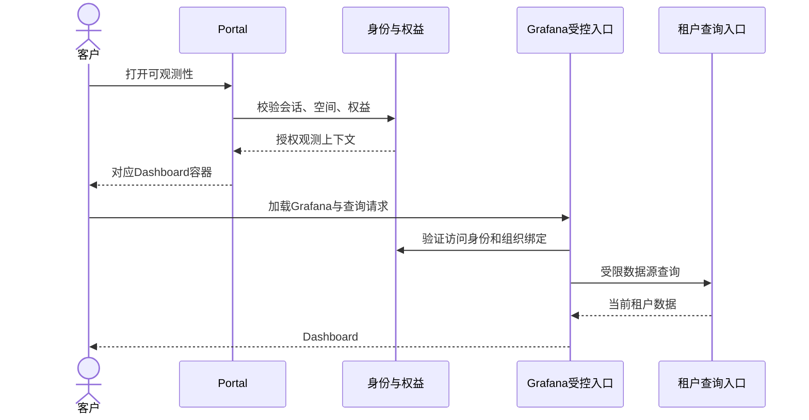

# Grafana 租户隔离与 Portal 嵌入规划

日期：2026-11-03。状态：待实现与隔离验证。需求：[Knowledge #351](https://github.com/ai-workspace-services/knowledge/issues/351)。[完整规划](Pro-Custom与Grafana升级完整规划.md) · [产品功能](Pro-Custom专属资源工作台规划.md) · [持久化](Grafana独立PostgreSQL与GitOps持久化规划.md) · [验收](Pro-Custom与Grafana分阶段交付验收规划.md)

## 1. 客户与组织模型

租户单位是客户空间：个人客户对应个人空间，团队客户的授权成员共用团队空间。空间成员关系及 Pro Custom 权益由账户/权益 owner 提供，节点归属由资源 owner 提供；Grafana Organization 是观测展示隔离实体，不能反向成为计费或资源归属权威。

建议服务端维护 `customer_space_id → grafana_org_id`，并保存逻辑 dashboard key、实际 UID、数据源绑定、配置包版本、同步状态和最后校验时间。该表与 Grafana 数据库边界清晰，Portal 不直接 SQL 修改 Grafana 内部表。

以稳定用户 ID 映射 Grafana 用户；邮箱变化不自动产生新客户空间。默认 Viewer；平台管理身份与客户身份分离，不发给客户 Grafana Server Admin。团队退出、空间切换和权益变化应更新访问映射并清除相关缓存/会话。

## 2. 三层隔离

| 层 | 负责什么 | 不足以单独证明什么 |
| --- | --- | --- |
| Portal/后端 | 登录、权益、成员及资源授权 | 隐藏菜单不能保护 Grafana API |
| Grafana Organization | Dashboard、Folder、Datasource 等资源隔离 | 共享无限制数据源不能隔离指标 |
| 查询/存储授权 | 按可信租户强制约束指标范围 | 客户提交的标签、变量和 URL 不能当授权 |

Grafana Viewer 可对组织内数据源自行查询，Dashboard 变量不是权限边界。[官方安全说明](https://grafana.com/docs/grafana/latest/setup-grafana/configure-security/#limit-viewer-query-permissions)

每个客户组织的数据源只连接受限查询身份。当前平台运维数据源不直接复制到客户组织。未标租户的旧数据默认不可对客户开放；补归属前先核对历史节点所有权，防止节点转让后泄露原客户数据。

## 3. 指标写入与查询

首期沿用现有采集器和 VictoriaMetrics，先盘点有效版本、标签和鉴权入口。若使用单节点 VM 的标签隔离加授权代理，必须在拟用版本验证强制过滤，不能把最新版文档支持直接当作现有版本能力。

可信入口根据登记身份确定客户和节点，覆盖或拒绝伪造 `tenant_id`、`node_id`；业务用户不持有跨租户写入凭据。标签不使用邮箱、Token 或其他敏感值。

查询授权服务按凭据绑定租户，限制 query、query_range、labels、label values、series、变量候选查询和适用元数据接口。读身份不开放写入、删除、管理、全量导出或跨租户接口；后端原始查询端口不可从客户侧直达。

清理/覆盖客户端可伪造的租户 header 与过滤参数，检查 GET、POST、重复参数和 URL/请求体优先级。VictoriaMetrics 对某些 `extra_filters` 组合有特殊语义，不能只追加一个过滤参数就宣称安全。若无法证明约束完整，客户入口保持未开放，选择经验证的独立租户后端方案。

参考：[单节点标签隔离](https://docs.victoriametrics.com/victoriametrics/#multitenancy)、[vmauth 授权和强制参数](https://docs.victoriametrics.com/victoriametrics/vmauth/)。

## 4. 同源嵌入与认证

`/panel/observability` 提供轻量外壳、加载/错误状态、Grafana iframe 和完整页面入口；不在 Portal 重写监控图表。采用同源受控代理或经验证的统一 SSO，嵌入路径是待定部署参数。

认证代理清除客户传入的身份 header，再按已验证会话设置；Grafana 只信任受控代理来源，禁止绕过代理直连。代理对 Grafana API、静态资源、跳转、适用流连接的覆盖范围须实测；不能只保护 iframe 首个 HTML。[Auth proxy 配置](https://grafana.com/docs/grafana/latest/setup-grafana/configure-access/configure-authentication/auth-proxy/)

不向浏览器暴露 Grafana 管理 Token，不把访问 Token 放进 iframe URL。组织 ID 和 Dashboard UID 由服务端映射与允许列表决定。多个标签页分别访问不同空间时，不依赖未经验证的全局 active-org 切换，验证组织上下文不会串用。

按实际部署验证 Grafana 子路径/root URL、Cookie 路径与退出、CSP `frame-ancestors`、embedding 配置、CSRF 和重定向。只允许可信 Portal 来源嵌入，不因 iframe 需要而开放匿名访问或宽泛通配符。

## 5. 组织配置同步

权益和成员事件触发幂等同步：确保组织 → 确保成员 → 配置受限数据源 → 安装标准面板包 → 校验 → 标记就绪。失败保留阶段及回执，可重试，不重复创建组织。

同步使用专用受控管理身份，客户访问使用独立 Viewer/查询身份。固定 `orgId: 1` 的旧 provider 不能作为租户实现；由 Chart 参数化或观测 owner 的组织同步能力支持，每种方式只保留一个配置 owner。

租户离开、套餐降级不自动删除组织与面板；先撤销适用访问，保留策略、备份和删除由产品及生命周期流程另行确定。成员撤销后已建立会话的失效时限必须声明并验收，不能只在首次开页检查权益。

## 6. 最小隔离验收

使用客户 A、B 与团队成员/只读成员的独立测试身份；两个客户各有可区分测试节点和指标。

- A 查询自己的节点成功，访问 B 的节点/任务/组织/Dashboard 返回拒绝或空授权范围，不返回 B 元数据。
- 修改 `orgId`、Dashboard UID、变量、数据源 UID、表达式、header、重复参数及 POST body 均不能越权。
- labels、series、变量下拉与缓存也无 B 的节点名或指标；不能仅检查图表最终数值。
- 数据源原始端口、代理旁路、导出/写入/管理接口不可绕过。
- 多标签页、空间切换、注销、权益撤销和成员退出不复用旧授权。
- 客户默认不能编辑标准面板/数据源、创建管理用户或读取凭据；平台运维组织不泄露给客户。
- 新节点采集归属正确，未知归属旧数据默认不可见；重试同步不产生重复组织或重复面板。

所有场景记录真实身份与脱敏结果；管理员视角或静态配置不代替客户身份的允许/拒绝证据。
