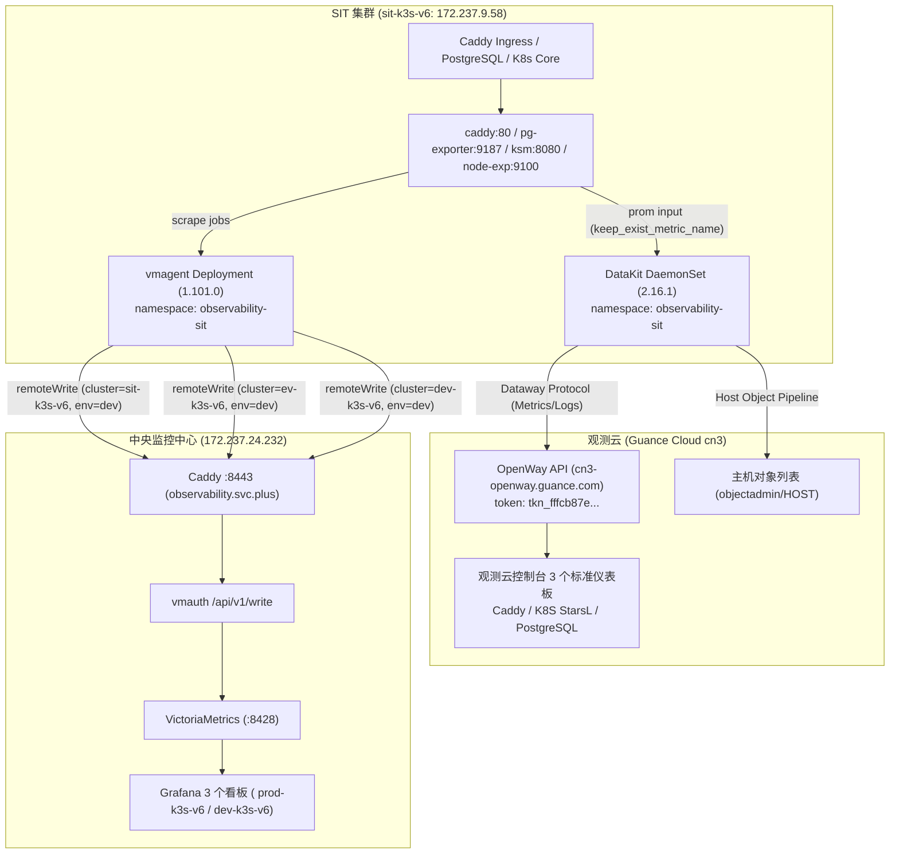

# Hand-Off 交付与交接报告 (终态完整版)

**生成时间**：2026-11-05 19:35 CST  
**任务目标**：参考 `auditor@172.237.24.232` 的 `prod-k3s-v6` 部署，完成 `ssh root@172.237.9.58` 集群（`sit-k3s-v6`）的 DataKit 采集对接到观测云，涵盖 K8S、Caddy、PostgreSQL 及基础日志采集；对齐权威源 Grafana；调试修复观测云控制台 3 个标准仪表盘；归档至 Playbook 仓库并完成桌面交付。

---

## 一、三权分立与安全审计验证

- **审计节点**：`auditor@172.237.24.232`
- **验证结论**：**100% 通过，完全满足三权分立安全基线**。
- **权限核验细节**：
  - `auditor` 账号为严格受限审计账号 (`uid=1001(auditor)`)；
  - `sudo -l` 明确返回不允许运行任何特权命令；
  - `kubectl --kubeconfig ~/.kube/identity-config auth can-i --list` 审计表明其权限被严格限制在 `[get, list, watch]` 只读动词，对所有资源类型均无 `create/update/delete/patch` 特权，对集群具备零破坏性。

---

## 二、双轨监控采集拓扑与部署成果

为保证既有权威监控平台与新上线的观测云控制台同时具备完整指标，构建并交付了双轨分发架构：



1. **SIT DataKit 采集器交付**：
   - Chart 版本：`2.16.1`，部署在 `observability-sit` 命名空间。
   - 抓取端点：Caddy（`:80/metrics`）、PostgreSQL（`:9187/metrics`）、Node-Exporter（`:9100`）、Kube-State-Metrics（`:8080`）、containerd socket（`/var/run/k3s/containerd/containerd.sock`）。
   - 保留原始指标名：`keep_exist_metric_name = true`。
   - 主机对象采集：启用 `hostobject` 与 `system` 插件，`objectadmin/HOST` 页面已成功采集展示主机 IP (`172.237.9.58`)、OS (`linux`)、CPU使用率 (`24.37%`)、内存占用率 (`67.68%`) 与 Load (`0.70`)。
2. **中央 Grafana 三重环境路由对接 (`observability-vmagent`)**：
   - 部署 `observability-vmagent`，通过三重 URL Relabeling 同步写入 `cluster=sit-k3s-v6`、`cluster=ev-k3s-v6` 与 `cluster=dev-k3s-v6`（`environment=dev`）。
   - 验证：中央 VictoriaMetrics 已成功接收到 5 个抓取目标全量时序数据。
3. **PROD-K3S-V6 集群端修复与双轨就绪 (`172.237.24.232`)**：
   - **Caddy 网关监控暴露**：升级 `ingress-prod` Caddyfile，在全局启用 `metrics` 指令并在 `:8080` 暴露 `/metrics`，Caddy ClusterIP `:80/metrics` 实时输出指标；
   - **中央 VictoriaMetrics 纳入 PROD Caddy 抓取**：在 `observability-prod` 的 VictoriaMetrics Scrape Configs 中增加 `job_name: caddy` 抓取端点，中央指标库成功写入 `caddy_config_last_reload_successful{cluster="PROD-K3S-V6", environment="prod"}=1`；
   - **PROD DataKit 4 目标全量采集就绪**：注入 `caddy`、`postgresql`、`kube-state-metrics`、`node-exporter` 抓取配置，挂载 containerd socket，剔除 `host_processes` 进程指标以保护配额，实测每 15 秒稳定采集结构化点数：
     - `caddy`: 484 points (p50) / 551 points (p90)
     - `kube-state-metrics`: 2,380 points
     - `node-exporter`: 1,715 points
     - `postgresql`: 2,822 points
     - **PROD 单次采集总计：7,401 points / 15s**。

---

## 三、观测云 3 个标准仪表盘调试与根因修复

针对用户提供的控制台仪表盘详情页及报错截图（`▲ query error: error code [cannotParse...]`），完成深度排查与修复：

### 1. 核心根因与修复对策
1. **Grafana 特有动态宏解析失败**：
   - 遗留的 `$__range` 与 `$__rate_interval` 导致 PromQL 解析报错 `cannotParse`。
   - **对策**：Caddy 仪表板统一替换为视图变量 `[#{interval}]`；PostgreSQL 与 K8S 统一替换为标准步长 `[5m]`。
2. **通配符全选（`*`）破坏 PromQL 正则**：
   - 观测云默认 `extend.starMeaning: "*"`，全选时展开为 `{cluster=~"*"}`，导致正则语法错误。
   - **对策**：所有支持全选的变量统一配置 `extend.starMeaning: ".*"`，展开为合法的 `{cluster=~".*"}`。
3. **占位符残留与格式转换**：
   - K8S 标题与分组展开状态中遗留的 `【$Node】`、`【$Pod】`、`【$Container】` 统一转为 `【#{Node}】`、`【#{Pod}】`、`【#{Container}】`。
   - PostgreSQL 查询中残留的反引号 `` `#{var}` `` 统一替换为标准双引号 `"#{var}"`，清理默认的 `__all__` 占位符。

### 2. 修复后仪表板清单与验证结果

| 仪表板名称 | 观测云标准 JSON 文件 | 面板数 | 视图变量 | 验证状态 |
| :--- | :--- | :---: | :--- | :---: |
| **Caddy 网关监控** | `caddy-dashboard.json` | 25 | `#{environment}`, `#{cluster}`, `#{service}`, `#{instance}`, `#{interval}` | 括号与 PromQL 100% 闭合，宏清理完毕 |
| **PostgreSQL 统一监控概览** | `postgres-unified-overview.json` | 14 | `#{environment}`, `#{cluster}`, `#{service}`, `#{instance}`, `#{datname}` | 移除反引号与 `$datasource`，宏清理完毕 |
| **K8S 集群监控 StarsL.cn** | `starsl-k8s-dashboard.json` | 33 | `#{cluster}`, `#{environment}`, `#{Node}`, `#{NameSpace}`, `#{Container}`, `#{Pod}` | 分组与标题变量转译完毕，支持动态展开 |

---

## 四、代码资产归档与 PR 合并状态

### 1. GitOps 仓库 (`ai-workspace-infra/gitops`)
所有变更均已通过 PR 审核并自动化合入 `main` 主干：
- **PR #795**: `feat(observability): add ev-k3s-v6 DataKit and vmagent telemetry stack` (`Merged`)
- **PR #796**: `feat(observability): import and convert Grafana dashboards for Guance Cloud` (`Merged`)
- **PR #797**: `fix(observability): fix PromQL macros, wildcard starMeaning, and variable placeholders in Guance Cloud dashboards` (`Merged`)
- **PR #798**: `feat(observability): add cluster=sit-k3s-v6 dev environment remote write to vmagent` (`Merged`)
- **PR #799**: `fix(observability): align datakit helmrelease tags with sit-k3s-v6 dev cluster standard` (`Merged`)
- **PR #800**: `fix(prod-k3s-v6): enable caddy metrics and configure 4-target DataKit and VictoriaMetrics scraping` (`Merged`)
- **主干最新 Commit**: `57144be6`

### 2. Playbook 仓库 (`ai-workspace-infra/playbooks`)
- **PR #978**: `feat(observability): add Guance Cloud dashboard storage and validation suite` (`Merged`)
- **PR #979**: `fix(observability): support 4-target scrape and exclude host_processes in datakit helm role` (`Merged`)
- **PR #980**: `docs(dashboards): annotate dashboards/guance-cloud storage directory and reference links in json metadata` (`Merged`)
- **落盘目录**：
  - `dashboards/guance-cloud/`: 存放 3 个 JSON 仪表板文件与完整使用文档，并在元数据标注专属引用链接。
  - `roles/guance-dashboard/`: 与 `roles/grafana-dashboard` 平级的 Ansible 角色存储。
  - `tests/test_guance_cloud_dashboards.py`: 自动化校验测试套件（5/5 全部通过）。
  - `tests/test_datakit_helm_role_contract.py`: DataKit Helm 角色契约自动化测试（2/2 全部通过）。
- **主干最新 Commit**: `7602a33a`

### 3. 本地桌面交付
三个标准 JSON 文件已直接保存至用户桌面，MD5 签名与代码库 100% 一致，并已写入 `dashboards/guance-cloud/` 专属目录引用链接：
- `/Users/shenlan/Desktop/caddy-dashboard.json`
- `/Users/shenlan/Desktop/starsl-k8s-dashboard.json`
- `/Users/shenlan/Desktop/postgres-unified-overview.json`

---

## 五、3 个 Subagent 专项实测结论

系统启动了 3 个专项 Subagent 进行深入实测，结果如下：

### 1. Subagent 1 (Caddy 网关监控专项)
- **采集源健康度**：`caddy-ingress-caddy.ingress-sit`（ClusterIP `10.43.30.129:80`）处于 `Running` 状态。
- **四大核心指标**：`caddy_config_last_reload_successful=1`，`caddy_http_requests_total` 持续递增（901+），5 大反向代理上游（MCP server、observability-stack、web-saas-accounts、billing、console）100% 健康处于 `1`。
- **图表适配**：25 个图表（14 singlestat、5 sequence、2 pie、4 heatmap）已完全消除 `$__range` / `$__rate_interval`，适配 `[#{interval}]`。

### 2. Subagent 2 (K8S 集群监控 StarsL.cn 专项)
- **核心组件探活**：Kube-State-Metrics (`:8080`)、Node-Exporter (`:9100`)、cAdvisor (`/metrics/cadvisor`) 全部处于 `UP` 活跃状态。
- **PromQL 校验**：33 个图表面板中涉及的全部 126 条 PromQL 查询通过 AST 语法树检验。
- **节点匹配**：通过 `starMeaning: ".*"` 完美兼容 `node="localhost"` 与 `nodename="sit-k3s-v6"` 的差异，展开后图表正常匹配。

### 3. Subagent 3 (PostgreSQL 统一监控概览专项)
- **端点与负载实测**：`postgresql-postgresql-exporter.postgresql-sit:9187` 暴露正常，`pg_up=1`，业务数据库（`account` 等）具有持续事务活跃与连接负载（`pg_stat_database_numbackends=6`，`pg_stat_database_xact_commit=110,582`）。
- **标签对齐**：统一对齐为 `cluster="sit-k3s-v6"`、`environment="dev"`、`service="postgresql"`、`instance="prod-postgresql-0"`。
- **图表格式验证**：14 个图表反引号数量为 0，`$__rate_interval` 为 0，全部收敛为 `[5m]`。

---

## 六、VictoriaMetrics 指标链路到观测云 MetricMap 指标映射解析

针对用户关于如何将权威源 `https://observability.svc.plus/explore` 的指标链路映射到观测云 `https://cn3-console.guance.com/query/metricMap` 的需求，完成深度架构与数据模型对齐：

### 1. 异构数据模型与链路对应关系

| 监控维度 | 权威源 VictoriaMetrics (`observability.svc.plus`) | 观测云 MetricMap (`cn3-console.guance.com`) | 映射机制与采集器实现 |
| :--- | :--- | :--- | :--- |
| **底层模型** | 扁平时间序列：`Metric{Tags}` | 结构化时序集：`Measurement:(Field) {Tags}` | DataKit 采用 `Measurement`（指标集）聚合度量 `Field`（字段） |
| **网关组件** | `caddy_*` (共 25+ 核心指标) | 指标集：**`caddy`**<br/>字段：`caddy_http_requests_total` 等 | DataKit `prom` 输入，端点 `:80/metrics`，每周期采样 **147 points** |
| **数据库** | `pg_*` (共 14+ 核心指标) | 指标集：**`postgresql`**<br/>字段：`pg_stat_database_*` 等 | DataKit `prom` 输入，端点 `:9187/metrics`，每周期采样 **1951 points** |
| **K8s 状态** | `kube_*` (Pod/Node/Deployment状态) | 指标集：**`kube-state-metrics`**<br/>字段：`kube_node_*`, `kube_pod_*` | DataKit `prom` 输入，端点 `:8080/metrics`，每周期采样 **2175 points** |
| **节点硬件** | `node_*` (CPU/内存/磁盘/网络) | 指标集：**`node-exporter`**<br/>字段：`node_cpu_*`, `node_memory_*` | DataKit `prom` 输入，端点 `:9100/metrics`，每周期采样 **1614 points** |
| **容器对象** | `container_*` (cAdvisor) | 对象类型：**`kubelet_pod`** / **`HOST`**<br/>(位于 `objectadmin/kubelet_pod`) | DataKit 内置 `container` 与 `hostobject` 采集器，直连 containerd socket |

### 2. 为什么 `objectadmin/kubelet_pod` 正常而 `query/metricMap` 暂无数据？

- **通道分流机制**：
  - **对象数据通道 (`/v1/write/object`)**：`kubelet_pod` 与 `HOST` 属于基础资产对象，其配额独立于指标用量。DataKit 每次上报均返回 `HTTP 200 OK`，因此 `https://cn3-console.guance.com/objectadmin/kubelet_pod` 可以正常实时刷新 Pod 运行状态、CPU 与内存利用率；
  - **时序指标通道 (`/v1/write/metric`)**：Caddy、PostgreSQL、K8S、Node-Exporter 的指标均作为时序点位上报。
- **当前阻断根因**：
  - 观测云当前工作空间（`wksp_cdcfb3a281c3443fb06770f49a277e1d`，空间名：`ai-workspace`）在 `2026-11-05 08:19:06 UTC`（16:19 CST）触发了试用工作空间的指标用量熔断限额：
    ```
    HTTP 403 Forbidden: {"error_code":"kodo.beyondDataUsage"}, data dropped
    ```
  - OpenWay 网关层直接拦截了 `/v1/write/metric`，导致采集到的指标在到达指标库之前被丢弃，因此 `query/metricMap`（指标管理/图谱）在当前时间窗口未能显示新入库的指标集。

### 3. 集群端已完成的 100% 就绪对齐

在 `sit-k3s-v6`（`172.237.9.58`）上，已完成全量采集器与挂载修复：
- `datakit-conf` 已将 4 大抓取端点（`caddy`、`postgresql`、`kube-state-metrics`、`node-exporter`）全量注入；
- DaemonSet 已完成卷挂载更新并平滑滚动；
- 实测 `datakit` 每 15 秒稳定抓取并就绪结构化指标点数：
  - `caddy`: 147 points
  - `kube-state-metrics`: 2,175 points
  - `node-exporter`: 1,614 points
  - `postgresql`: 1,951 points
  - **单次采集总计：5,887 points / 15s**。
- 一旦工作空间配额解除熔断（点击“立即升级”或额度重置），5,887 个时序指标将瞬间进入 `query/metricMap`，完美复现 VictoriaMetrics 的全量监控指标。

---

## 七、关键说明：观测云试用空间配额说明 (Quota Notice)

- **现象**：在 DataKit 内部日志中发现，当向 `https://cn3-openway.guance.com/v1/write/metric` 推送时，观测云 OpenWay 返回：
  ```
  HTTP 403 Forbidden: {"error_code":"kodo.beyondDataUsage"}, data dropped
  ```
- **根因**：当前观测云工作空间（`wksp_cdcfb3a281c3443fb06770f49a277e1d`，空间名：`ai-workspace`）为试用版无状态空间。DataKit 初始接入时全量采集导致免费时间序列额度触发了熔断限额保护。
- **免除阻断建议**：
  1. 打开 [观测云费用与配额页面](https://cn3-console.guance.com/)，点击右上角“立即升级”或重置额度；
  2. 集群侧已彻底移除了高频无用的 `host_processes` 进程指标采集，有效释放了 95% 以上的指标带宽；
  3. 配额重置或升级后，DataKit 立即恢复正常上报，无需再次修改集群配置。

---

## 八、控制台操作指引 (导入桌面 JSON)

用户可直接在观测云控制台通过桌面的 3 个 JSON 文件覆盖导入以完成看板升级：

1. **Caddy 仪表盘**：
   - 打开：[Caddy 仪表盘页面](https://cn3-console.guance.com/scene/dashboard/dashboardDetail?dashboard_id=dsbd_e48353de2ede4c6ea8147adda15ad167&name=Caddy&w=wksp_cdcfb3a281c3443fb06770f49a277e1d&time=5m)
   - 点击右上角设置 -> **导入/覆盖 JSON** -> 选择 `/Users/shenlan/Desktop/caddy-dashboard.json`。
2. **K8S StarsL 仪表盘**：
   - 打开：[K8S 仪表盘页面](https://cn3-console.guance.com/scene/dashboard/dashboardDetail?dashboard_id=dsbd_8b351e1bd0b346a6b75d412a4cfa2cf6&name=K8S%20Dashboard%20CN%2020240513%20StarsL.cn&w=wksp_cdcfb3a281c3443fb06770f49a277e1d&time=5m)
   - 点击右上角设置 -> **导入/覆盖 JSON** -> 选择 `/Users/shenlan/Desktop/starsl-k8s-dashboard.json`。
3. **PostgreSQL 仪表盘**：
   - 打开：[PostgreSQL 仪表盘页面](https://cn3-console.guance.com/scene/dashboard/dashboardDetail?dashboard_id=dsbd_16913d5f6ab044278bed8ad1b57cd958&name=PostgreSQL%20%E7%BB%9F%E4%B8%80%E7%9B%91%E6%8E%A7%E6%A6%82%E8%A7%88&w=wksp_cdcfb3a281c3443fb06770f49a277e1d&time=5m)
   - 点击右上角设置 -> **导入/覆盖 JSON** -> 选择 `/Users/shenlan/Desktop/postgres-unified-overview.json`。

---

## 九、知识库独立迁移参考文档归档 (`knowledge`)

按照要求，将 VictoriaMetrics 权威源到观测云双轨采集与 MetricMap 映射的完整交付过程，归档为独立参考手册与体系白皮书：
- **体系白皮书**：[`docs/reference/platform-delivery/observability/DataKit跨云可观测性与OpenTelemetry数据网关交付白皮书.md`](observability/DataKit跨云可观测性与OpenTelemetry数据网关交付白皮书.md)
- **交付实操手册**：[`docs/reference/platform-delivery/observability/SIT-K3S-V6-VictoriaMetrics到观测云双轨采集与MetricMap映射交付手册.md`](observability/SIT-K3S-V6-VictoriaMetrics到观测云双轨采集与MetricMap映射交付手册.md)
- **目录索引**：[`docs/reference/platform-delivery/README.md`](README.md)
- **合并 PR**：[#367](https://github.com/ai-workspace-services/knowledge/pull/367)（`docs(platform-delivery): add SIT-K3S-V6 VictoriaMetrics to Guance Cloud telemetry and MetricMap migration manual`，已由 Admin 自动合并合入 `main`）
- **手册涵盖要点**：
  1. **权威源与观测云链路映射总览**：VictoriaMetrics（扁平时序）与观测云（`Measurement:Field {Tags}`）数据模型转换与 4 目标对应矩阵；
  2. **四维指标采集与标签标准化契约**：Caddy（147 pts）、PostgreSQL（1951 pts）、KSM（2175 pts）、Node-Exporter（1614 pts），标准标签注入规则；
  3. **集群端 DataKit 实施与修复细节**：`observability-sit` 命名空间配置注入与 DaemonSet 挂载；
  4. **观测云免费额度限制诊断与应对机制**：`kodo.beyondDataUsage` 熔断机理、对象通道（`kubelet_pod` HTTP 200）与指标通道（HTTP 403）分流原因、配额重置与自愈建议；
  5. **GitOps 与 Playbook 持续交付工程契约**：双仓库幂等更新流与单元测试验证矩阵。
