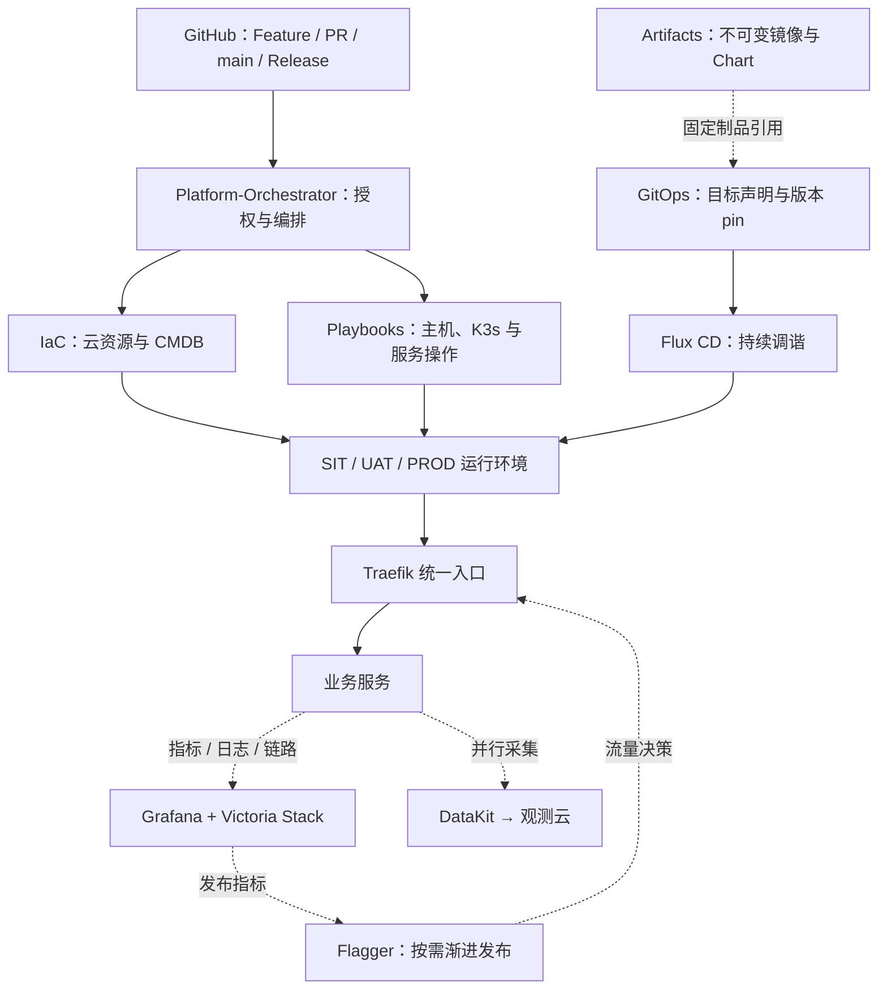
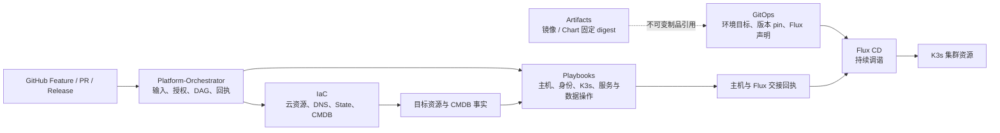
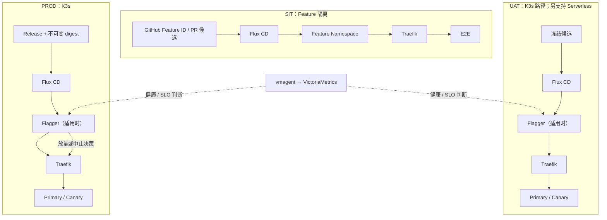
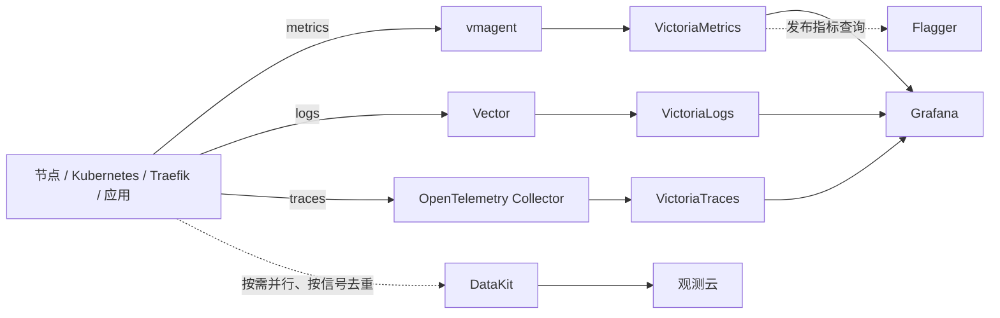

# OpenplatForm Delivery Architecture

> **用途：** Open Platform 基础运行环境、多环境交付、流量治理与可观测性的总体架构。本文定义跨仓库、跨环境的协作边界；专项实现和时点状态以文末五篇参考文档为准。
>
> **状态边界：** 本文是目标架构与发布契约，不代表所有组件已部署、调谐或验收。GitOps 数量是规划基线，V6 运行事实以其状态归档顶部最新记录为准。本文变更仅为文档。

## 1. 设计目标与原则

平台使用同一套声明式交付模型连接基础设施、节点初始化、集群配置、业务发布与运行观测，同时保持环境和服务单元隔离。

- **声明驱动：** GitOps 提供环境、目标、依赖和非敏感版本引用；IaC 管云资源、DNS、state 和权威 CMDB；Playbooks 执行主机、集群身份、服务及数据操作；Platform-Orchestrator 管输入、授权、派发、等待与回执；Artifacts 构建和发布不可变制品。
- **职责分离：** 不在多个仓库重复实现同一资源或服务的 owner；Flux 接管 K3s 中声明的资源。Orchestrator 的交接成功不等于 Flux 调谐或业务验收成功。
- **独立晋级：** SIT、UAT、PROD 分别使用隔离的目标、凭据、数据基线和准入门禁。一个环境通过不自动放行另一个环境。
- **固定版本：** 每次运行解析并记录各基础仓库的完整 commit SHA；应用镜像和 Chart 使用经过核对的不可变 digest/版本。独立 GitRepository source pin 不因某服务更新而推进其他单元。
- **渐进变更：** 先验证，再按服务单元切换；保留原服务、数据写者和回退路径，直到对应切换另行验收。

## 2. 基础运行环境

### 2.1 环境矩阵 V1.1

下表给出三环境的 Selfhost/K3s 目标基线。UAT 也允许选择 Serverless 承载；该路径按其云服务与服务 owner 交付，不要求安装 K3s、Traefik 或 Flagger。实际组件和运行状态须由固定配置与回执证明。

| 层次 | SIT | UAT（K3s） | PROD（K3s） |
| --- | --- | --- | --- |
| Kubernetes | K3s | K3s | K3s |
| GitOps | Flux CD | Flux CD | Flux CD |
| 入口网关 | Traefik | Traefik | Traefik |
| 特性泳道 | Namespace-per-Feature | 不启用 | 不启用 |
| 发布控制 | Flux + CI | Flux + Flagger | Flux + Flagger |
| 发布模式 | Feature SIT / Blue-Green | Blue-Green / Canary | Blue-Green / Canary |
| 指标 | vmagent → VictoriaMetrics | 同左 | 同左 |
| 日志 | Vector → VictoriaLogs | 同左 | 同左 |
| 链路追踪 | OTel → VictoriaTraces | 同左 | 同左 |
| 可视化 | Grafana | Grafana | Grafana |
| 外部观测 | DataKit | DataKit | DataKit |

主观测后端统一采用 Victoria Stack（VictoriaMetrics、VictoriaLogs、VictoriaTraces）与 Grafana。DataKit 作为观测云的独立并行采集与输出链路；按采集目标和信号去重，不重复部署第二套完整监控存储。Flagger 按服务适配情况启用，并以已验证的路由集成和新鲜指标作决策。

| 层 | 目标组件 | 职责边界 |
| --- | --- | --- |
| Infrastructure | Multi-cloud IaC、CMDB、DNS、独立 state 与存储 | 云资源、网络、节点和权威资源事实 |
| OS / Runtime | Linux、containerd、K3s | Playbooks 初始化主机和集群；系统管理、业务运行与审计身份分开 |
| GitOps control plane | Flux CD、Kustomize、HelmRelease | 持续调谐已声明的集群资源与版本 |
| Ingress | Traefik Proxy | SIT / UAT / PROD 的统一 HTTP(S) 入口；路由到集群 Service |
| Progressive delivery | Flagger（按需） | UAT/PROD 受控 Canary/Blue-Green 决策，不代理用户请求 |
| Identity / secrets | Vault、External Secrets Operator、Kubernetes RBAC、TLS | 短期身份、最小权限和受控 Secret 同步；GitOps 只引用非敏感信息 |
| Database | PostgreSQL | 服务独立凭据与数据边界；管理、业务读写和只读审计权限分别控制 |
| Main observability | Grafana、VictoriaMetrics、VictoriaLogs、VictoriaTraces | 主指标、日志、链路存储与查询展示 |
| Collection | vmagent、Vector、OpenTelemetry Collector、观测云 DataKit | 按信号与目标分工采集；避免同一信号无意重复采集 |
| Delivery | GitHub Actions、Platform-Orchestrator、Artifacts | 校验和编排交付、产生固定制品、汇总可追溯回执 |

目标部署应分别声明 Traefik、Flagger、Grafana、Victoria Stack、vmagent、Vector 与 DataKit 等 HelmRelease，复用既有服务单元和 Flux 层级，不建立平行控制面。组件是否实际存在、Chart 能力和有效配置须以固定 GitOps commit 与运行证据核验。

### 2.2 GitOps 规划基线

现有 PROD-K3S-V6 规划为 **6 个 GitRepository、9 个 Flux Kustomization、8 个 HelmRelease**。这是目标图数量，不是一次运行的已就绪数量。历史初次引导回执为 6/6/7；V6 归档记录的新增 ESO/TLS 前置图尚不能与历史回执混作同一验收。

六个 source 共享 GitOps 仓库 URL，但各自独立 pin 配置版本；根 Kustomization 使用稳定根名 `prod-k3s`，仅管理根图并设 `wait: false`。子单元在各自 namespace 独立调谐和报告健康。HelmRelease 属于服务单元，不要求与顶层 Kustomization 一一对应。

| 服务单元 | 目标职责 |
| --- | --- |
| `config-prod` | 稳定管理根、ESO 与集群前置配置 |
| `vault-prod-config` | Vault、TLS 身份与同步 |
| `postgresql-prod-config` | PostgreSQL |
| `observability-prod-config` | Grafana、Victoria Stack 与采集器 |
| `web-saas-prod-config` | Web SaaS 业务服务 |
| `ingress-prod-config` | Traefik 与 Flagger |

当前 V6 归档仍记录 Vault 未就绪、PostgreSQL 镜像授权及 SecretStore 依赖失败、Observability 凭据/资源问题、Ingress 和业务未调谐等阻塞。以上基线只指导目标规划；发布状态须引用新的调谐与运行回执。

## 3. 统一平台架构

### 总体

总体图展示五仓协作、运行环境、入口、渐进发布与观测之间的关系。实线表示交付/调谐方向，虚线表示制品引用、观测数据或控制决策。局部图展开关键链路；业务 HTTP 流量经过 Traefik 到 Service，Flux 是配置调谐器，Flagger 是发布控制器，不是请求代理。

### 局部 1：五仓职责与交付控制链

IaC 是云资源和 CMDB 的 owner，Playbooks 是主机、身份、服务及数据操作的 owner，GitOps 声明集群期望状态，Flux 执行持续调谐。Orchestrator 负责授权、派发和验证各 owner 回执，不在编排层复制执行逻辑。CI 或交接成功不能替代 Flux/业务运行验收。

### 局部 2：SIT、UAT、PROD 发布与流量链

SIT 按 Feature ID 部署隔离 Namespace 并通过 Traefik 运行 E2E。UAT 可采用 Serverless 或 K3s；图中展开 K3s 路径。UAT/PROD 的 Flagger 根据已验证且新鲜的指标控制渐进放量，实际流量仍通过 Traefik；服务不适配时不启用 Flagger。

### 局部 3：主观测与并行采集链

Victoria Stack 是主观测存储，Grafana 提供统一查询与可视化。DataKit 独立向观测云采集/输出，不经 Grafana 转发，也不重复部署另一套主存储。重复采集前先限定目标、信号、标签、过滤和采样。

## 4. 环境与发布模型

### 4.1 SIT：按 Feature 隔离

SIT 固定链路：

`GitHub Feature ID → Flux CD → Feature Namespace → Traefik → E2E`

Feature ID 关联 Issue/task、PR head 和基线 commit、制品 tag 与 digest、Chart/配置版本及数据基线。编排器核对候选与 SIT 目标后，由 Flux 部署到独立 Feature Namespace，Traefik 提供隔离路由，E2E 对该候选执行验证。Feature ref 或 CI 成功本身不构成部署授权或验收。SIT 凭据与 UAT/PROD 隔离；Feature 生命周期清理按资源清单和既定保留策略执行。

### 4.2 UAT：两种承载模式

UAT 可选择：

1. **Serverless：** 使用 UAT 专属身份、网络、密钥和数据基线，通过相应服务 owner 发布固定制品并验收。
2. **K3s：** 使用统一 Traefik 入口、Flux CD 声明发布和 Flagger 渐进交付。Flagger 仅在所选服务、指标和流量模型适配时启用。

同一候选和配置固定后执行验收。UAT 成功不代表生产资源、身份或数据状态相同；晋级前核对目标差异、发布记录和生产准入。

#### UAT Serverless 凭据路径

下表记录现有 Serverless 交付文档中的 Vault KV 逻辑路径。路径和字段存在性、实际消费者以及当前身份的读取授权尚需在 Vault 中单独核验；表中不包含凭据值。

| 服务 | Vault KV 逻辑路径 | 记录中的用途 |
| --- | --- | --- |
| Cloudflare | `kv/uat/serverless/cloudflare` | Cloudflare account 和 API token，用于边缘服务交付 |
| GCP Cloud Run | `kv/uat/serverless/gcp` | GCP Workload Identity Provider 和部署 Service Account |
| Supabase | `kv/uat/serverless/supabase` | Supabase 项目标识和数据库连接合同 |

KV v2 API 路径在挂载点后增加 `data/`，例如 `kv/data/uat/serverless/supabase`；它与表中的逻辑路径引用同一记录。服务 owner 按用途申请最小权限，不将秘密值写入 GitOps、日志或交付回执。路径记录不代表该环境已经部署或验收。

### 4.3 PROD：受控渐进发布

PROD 采用 `GitHub Release → Flux CD → Flagger（适用时）→ Traefik → Primary / Canary`。Traefik 提供稳定入口，Flagger 按已验证的成功率、延迟和 SLO 指标逐步推进权重；Blue/Green 或 Canary 按服务风险、路由能力及回退特性选择。若指标不可用、陈旧或查询语义未经验证，不允许自动放量。

发布记录绑定业务范围、不可变制品 digest、Chart/config 版本、源 commit、目标环境和候选指纹。生产工作流身份必须符合 Vault OIDC 环境授权；应用 tag 不改变工作流 OIDC ref。稳定版本只增不改。

回退按变更类型处理：无状态且向后兼容的应用可回到已保留制品；数据库 schema、数据、Vault Raft 和其他持久卷变更必须使用兼容策略与独立恢复方案。代码回退不等于数据回滚。

## 5. Traefik、Flagger 与服务边界

- Traefik 是 SIT、UAT K3s 与 PROD 的统一集群入口，负责 TLS 终止（按已声明证书方案）、Host/path 路由和 Service 负载均衡；不管理云 DNS、证书秘密源或应用发布版本。
- Flagger 控制支持服务的渐进发布，通过已声明的路由集成调整 Canary 流量并查询指标；它不接管所有服务，也不取代 Flux 的期望状态管理。
- Traefik 与 Flagger 控制器由 Ingress 服务单元管理；业务单元拥有各自 Canary/发布声明。Ingress 基础设施升级与业务发布版本独立 pin。
- 蓝绿切换需要保留旧版可用并验证路由回切；Canary 中止应将流量留在稳定版本并保留失败证据。单节点资源与容量可能导致重启窗口，不能预先承诺零停机。

## 6. 可观测性与采集去重

主观测由 Grafana 配合 VictoriaMetrics、VictoriaLogs、VictoriaTraces 提供；Grafana 查询主存储，不作为采集器。发布决策所需指标由 vmagent 进入 VictoriaMetrics，Flagger 查询兼容接口并在放量前验证数据新鲜度、标签和指标语义。

| 信号 | 主采集路径 | 主后端 | DataKit 并行路径 |
| --- | --- | --- | --- |
| 节点、Pod、Traefik、应用指标 | vmagent / 目标 exporter | VictoriaMetrics | 仅在目标和指标范围明确时启用 |
| Kubernetes 与应用日志 | Vector | VictoriaLogs | 按需选择采集源，避免重复全量上报 |
| 应用链路 | OpenTelemetry Collector | VictoriaTraces | 仅在协议、属性和采样策略核实后接入 |

DataKit 对接观测云作为独立的并行观测通道，不由 Grafana 转发，也不要求部署第二套主存储。对同一目标或信号启用第二采集路径前，明确 owner、标签、过滤、采样、保留期和上报成本，避免重复采集及高基数膨胀。组件协议、Chart 功能和容量须按固定版本验证。

## 7. 身份、密钥、网络与数据保护

| 控制域 | 责任边界 | 最低验收要点 |
| --- | --- | --- |
| Linux / 主机身份 | 系统管理、日常操作、审计身份分开；业务进程使用独立非 root 服务账户 | 实际身份登录与权限验证；审计身份读授权状态、拒绝写入/提权/读取管理秘密 |
| Vault / ESO | Vault 管理短期身份与策略；ESO 按环境和服务同步所需 Secret；GitOps 只保存非敏感引用 | 核对 repo/workflow/ref、role、路径和 ServiceAccount；授权路径允许、相邻路径拒绝；不在日志与回执输出秘密 |
| Kubernetes / Flux | Flux 依据 GitOps 声明调谐；集群 operator 与 auditor 使用独立 RBAC | 以真实身份检查允许/拒绝；审计身份无写、exec、Secret 读取或提权能力；记录 source 与运行版本 |
| PostgreSQL | 管理/DDL、各服务业务 DML、只读审计分离 | 业务凭据只获必需 schema/对象权限；审计使用授权视图并验证写入拒绝；迁移单独核对备份恢复 |
| 网络 / TLS | IaC 管云网络和 DNS；Traefik 管明确批准的业务入口；证书由受控身份与同步链路交付 | 检查入口 Host/path、TLS/SNI、证书链和回退路由；集群 API、数据库与管理面不公开暴露 |
| state / 持久数据 | IaC state、数据盘、PVC 和数据库数据按目标独立管理；变更 owner 保留恢复路径 | 核对资源/卷身份、活动写者、备份及恢复；未验证前不格式化、覆盖、重建或切换写入权 |

表格列出跨层控制摘要；具体身份配置、K3s role 与 V6 运行证据见下方五篇专项参考文档。

- **三权分立：** 系统管理身份负责必要管理和恢复，不作为日常业务进程；每个业务使用独立的最小权限身份并渐进 rootless；审计身份由系统权限强制只读，不能依赖脚本约定或管理员 impersonation 证明。
- **Secrets：** Vault 与 ESO 通过短期、受限身份交付 Secret。GitOps 保存非敏感引用；工作流、日志、制品与回执不包含秘密值。SIT/UAT/PROD 的 Vault role、路径、Kubernetes service account 与证书按环境隔离。
- **集群访问：** Kubernetes root/operator/auditor 与 Linux OS 用户是不同的授权面。RBAC 按具体资源和动作验证允许及拒绝；审计角色不得 exec、写资源、读取 Secret 或提权。
- **数据库：** PostgreSQL 管理/DDL、业务 DML 和审计读取身份分开；业务身份只访问必需 schema 与对象，审计优先读授权视图。应用连接不得使用数据库超级权限。
- **网络：** 集群 API、数据库和 Vault 管理面走受控管理/集群网络；不因验收方便公开管理端口或数据库。Traefik 只暴露明确批准的业务入口。
- **状态数据：** 独立 IaC state、节点数据盘与 PVC 保留边界。变更或迁移前核对实际写者、备份恢复、卷身份和回退范围；不得通过重建、格式化或覆盖未确认的持久数据解决调谐失败。

## 8. 资源容量与单节点边界

V6 归档中的 2 vCPU / 4 GB 是选定的候选规格，**全业务栈容量验收尚未完成**。Pod requests/limits、K3s 控制面预留、镜像拉取与滚动升级峰值、PostgreSQL 连接和内存、监控保留、日志增长、磁盘空间/inode、备份与恢复余量均须汇总评估。容量不足时在对应门禁停止并提交单独规格评审；本文不自动授权扩容。

单节点故障会影响该集群，独立数据盘或单副本 Vault 不构成高可用。发布方式和恢复目标应反映该限制。

## 9. 验收、回滚与晋级门禁

| 阶段 | 放行证据 | 失败处理 |
| --- | --- | --- |
| 候选冻结 | Feature/release 关联、完整源 SHA、制品/Chart digest、配置 pin、数据基线和环境目标 | 候选变化时重算指纹并按影响重验 |
| 基础设施与交接 | IaC/CMDB 目标唯一、state 身份核对、主机与集群身份回执、Flux 接管回执 | 停在失败 owner；不得据交接推断工作负载就绪 |
| GitOps 调谐 | 指定 source、Kustomization、HelmRelease 的条件和实际版本 | 修复对应服务单元；保留其他单元 source pin |
| 发布健康 | Traefik 路由/TLS、服务健康、指标新鲜度、日志与链路路径、Flagger 判断 | 中止灰度、维持稳定版本，检查观测缺口 |
| 业务验收 | E2E/API/业务流程、权限允许/拒绝、回归和恢复证据 | 记录未运行/失败，不把 CI 或只读检查记为通过 |
| 环境晋级 | UAT 固定候选验收、PROD 身份/发布记录/回退准备和明确批准 | 不自动推进下一个环境 |

回执区分 `success`、`failed`、`expected_skip`、`not_run` 与 `missing`，并关联环境、目标、固定 SHA、制品 digest、工作流 ref、owner 和运行 ID。不得记录秘密。运行证据必须注明核对时间；合并、CI 绿灯、GitOps 更新和控制器 Ready 分别不能替代端到端业务验收。

## 10. V6 到目标架构的增量迁移

V6 现况以 [PROD-K3S-V6 状态归档](PROD-K3S-V6-规划与部署状态归档.md) 最新条目为准。迁移按服务 owner 和单元推进，不重建整个集群，不同时切换所有写者。

1. **建立固定基线：** 固定 GitOps SHA、六个 source 的当前 pin、服务对象、PVC/数据盘身份、IaC state 和活动写者；收集只读现况及恢复证据。
2. **修复阻塞单元：** 依据 Vault、PostgreSQL、Observability、Ingress 和业务 owner 的实际错误逐项处理；同单元完成一项验证后再继续下一项。保持已有 K3s/Flux 与 Bound PVC，不因部署失败清理或重建。
3. **观测先行：** 在不重复安装的前提下核对现有 Observability Release。逐个验证 Grafana/Victoria 组件、vmagent/Vector/DataKit 输入输出、资源预算和持久化，再调整独立 HelmRelease。
4. **Ingress 迁移：** V6 当前路由为 Caddy 目标，未来迁往 Traefik 必须先核对 TLS Secret、Host/path、跨 namespace 后端、健康检查和回退路由。先以 V6 专属域名/隔离入口验证 Traefik，后逐服务切换；SNI、证书链、API/E2E 和可恢复路径通过后才扩大。
5. **Flagger 验证：** 仅为适配的无状态服务启用；先验证指标与路由权重行为、自动中止及稳定版本回切。持久服务单独评审。
6. **晋级与切换：** 保持原服务和 writer 可用。每服务独立完成发布候选、业务回归、数据一致性和恢复验收；DNS、流量及写入权切换各自遵循其 owner 与独立授权。
7. **结束条件：** 目标版本在固定观察窗口内稳定，回执关联到确切版本和身份；未完成项目明确标为未验收。旧服务或写者只有在用户明确确认最终切换并完成恢复证据后再退役。

本迁移路线是文档计划，不触发任何集群、DNS、数据库或生产变更。

## 11. 专项参考文档

以下五篇是本目录现有实施细节和时点证据的权威来源。本总体文档仅引用其边界和结论，不复制流水线、身份、K3s role、发布解析或节点部署细节。

1. [环境与业务发布解析：最小实施草案](环境与业务发布解析-最小实施草案.md) — 五仓职责、候选/tag 与环境、Vault OIDC、目标/state 解析和发布验收缺口。
2. [GitHub Actions 流水线实施草案](GitHub-Actions流水线实施草案.md) — 编排职责、workflow DAG、owner 调用迁移、逐目标回执和 CI 边界。
3. [Linux OS 三类操作身份：最小实施草案](Linux-OS三类操作身份-最小实施草案.md) — Linux 管理、运行操作、审计身份和 OS 验收约束。
4. [K3s role 职责与依赖清单](K3s-role职责与依赖清单.md) — K3s bootstrap、Flux 交接、RBAC、role owner 与当前验收缺口。
5. [PROD-K3S-V6 独立节点、集群冷启动规划与部署状态归档](PROD-K3S-V6-规划与部署状态归档.md) — V6 节点、容量、GitOps 目标图及最新部署实况。
