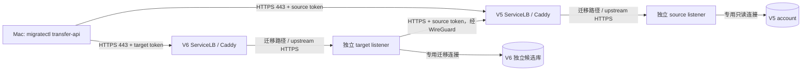

# V5 → V6 Accounts 独立迁移 API 与快照对齐规划

更新时间：2026-11-02（北京时间）。状态：现网只读盘点及代码/发布构件核对完成；迁移 API 尚未部署，快照、预览和业务写入均未执行。采用手动操作 / Ansible Playbooks + GitOps + Flux、Caddy + K3s ServiceLB。

## 实施进度与今晚切换要求（2026-11-02）

### V5 Accounts 发布状态（2026-11-02，最新）

Accounts [PR #292](https://github.com/ai-workspace-services/accounts/pull/292) 已合并到
`release/v2026.11.02-registration`，合并提交为 `aec6c28bee4a8820da1a88c6cec81648a7ca50e0`。
该版本只回补管理员迁移认证 endpoint、对应测试及路由；不改 SQL/runtime/catalog/业务配置。
发布构建成功，GHCR 固定引用为
`ghcr.io/ai-workspace-services/accounts:sha-aec6c28bee4a8820da1a88c6cec81648a7ca50e0@sha256:a316e9d08e89462935b8cb795d6a9b89991df341b61fd1dd3865489c2af7b4df`。

V5 当前运行 PR #294 合入 `release/v2026.11.02-email-union-v5` 的镜像
`sha-d906d85d133a35ae0b9e1e1d82e201927791501b`，副本 `1/1`；公网 `/api/ping` 返回
`HTTP 200`、TLS 校验通过并报告该版本。该提交是 Accounts #292 目标分支的兄弟提交；#292 的直接产物
若用于 V5 会遗漏当前 email-union 功能，因此其镜像不能直接部署。

已关闭错误指向该兄弟分支构件的 [GitOps PR #749](https://github.com/ai-workspace-infra/gitops/pull/749)。
现将 #292 的最小认证改动回补到 V5 实际发布线，提交
[Accounts PR #296](https://github.com/ai-workspace-services/accounts/pull/296)，目标为
`release/v2026.11.02-email-union-v5`，基于现网 `d906d85`。定向 `go test ./api -run
'TestMigrationAccounts|TestAdmin|TestLogin|TestToken' -count=1` 与 `git diff --check` 通过，PR 的 gitleaks
检查通过；PR 尚未合并，固定构件尚未生成。V5 HelmRelease 由 Flux 管理，待 #296 合并并核验该确切
合并 SHA 的镜像后，再更新 GitOps 的 Accounts `workload.image` 与运行时 `IMAGE` 两处为同一摘要。

本轮尚未更新 V5 Deployment；未操作 V6；未暂停服务、执行数据迁移/预览/业务写入、切换 DNS，
也未派发部署工作流。后续依次完成 Accounts 发布线回补、镜像固定摘要核验、GitOps 声明合并，再由
V5 节点 SSH 触发 Flux 调谐；运行验收需核对 Pod 固定摘要、`/api/ping` 的 image/tag/commit、readiness，
以及迁移认证 endpoint 的未认证拒绝行为。镜像拉取成功或 PR 合并均不等于运行验收完成。

### 较早的主干构件核验记录

Accounts #291 主干合并提交 `ba673c014c9e630c3cae815040035ac4d852828f` 的固定镜像为
`ghcr.io/ai-workspace-services/accounts:sha-ba673c014c9e630c3cae815040035ac4d852828f@sha256:52110a5d5a3c23d0a468eea583e608133d39e1d6e6a89940ca81e1ecaad54cf6`。
该构件用于独立迁移 listener 的后续部署评估，不替代 V5 现有 release 分支应用镜像。
Accounts #289 的早期源端兼容构件 `677fb48ef92be426904864f8f849a1e9ac044bab` 与其镜像仅作历史记录，
不作为本次 V5 普通 Accounts 发布目标。

### 当前部署门禁

V5 数据库仍使用既有 `2026102002` 运行契约。此次 #292 回补未改数据库或普通 Accounts 的版本检查，
因此部署只能使用发布线固定镜像；不能将主干完整 native runtime 镜像直接替换到 V5。GitOps PR #749
合并前不进行在线镜像补丁，以免 Flux 回写造成漂移。

### 迁移验证现场核对（2026-11-02）

通过 HTTPS（TLS 校验通过）检查 V5 `accounts.svc.plus` 与 V6
`accounts-selfhost-prod-v6.svc.plus`：`POST /api/admin/migration/authorize` 和
`GET /api/migrations/v1/plans/<测试UUID>` 均返回 `404`。V5 Accounts 仍运行 `d906d85`；
V6 Accounts Pod `1/1 Running`，镜像为
`sha-1b1fadf707958e59ff97701b1b86549e44446c53@sha256:d453e66232653a388c10ba8f8d0909ea997bfc7e47cf632bf5374a08425633d4`。
两端迁移 API 目前均未就绪，未发起快照或预览，也未执行 apply、数据库写入、停服或 DNS 切换。

V6 节点 `/root/migrate.sh` 初始为 `0644`，含内联 Accounts token，且目标 URL 行缺少 shell 续行符；
脚本未执行。已移除脚本内 token 值，改为从调用 shell 环境读取两端 token、修正续行并设为 `0700`，
`bash -n` 通过；V6 节点尚未安装 `migratectl`。由于旧文件曾允许其他本机用户读取，相关 Accounts token
应按可能暴露处理并轮换。当前脚本仅用于默认快照与预览，明确不含 `--apply`；须待 API 路由部署并使用
受控客户端后再执行验证。

用户要求GitOps只保存声明，PR检查只做声明格式及敏感信息检测。已关闭被主线业务namespace互通策略覆盖的 [GitOps #728](https://github.com/ai-workspace-infra/gitops/pull/728)；[GitOps #747](https://github.com/ai-workspace-infra/gitops/pull/747) 将自动检查从11项收敛为YAML声明校验和gitleaks两项，移除IaC/IAM及业务/运行态自动PR检查。两个保留检查已本地验证，PR提交范围gitleaks无泄露，#747已合并且两项检查均通过；未修改生产声明或分支保护，main原本没有required status contexts/额外rulesets。


用户已明确允许 V5 Accounts 直接更新满足迁移要求的固定版本，不再要求 cherry-pick；V6 同步使用最新且已验收的固定构件。目标是今晚完成 V5 → V6 数据迁移及业务切换。本次只读线上盘点之后尚未部署或改写现网。

Accounts [PR #289](https://github.com/ai-workspace-services/accounts/pull/289)，代码提交 `03fcac83`，实现 API **源端限定**接受审核过的 `2026102002`，目标版本守卫保持严格。该变更不会升级 V5 数据库或修改普通 Accounts runtime 检查点契约。main 合并及不可变构件发布前，不能把本地修复视为线上已运行版本。

验证结果：

- `go test ./cmd/migratectl ./internal/migrate -count=1` 通过。
- 本机独立 Docker PG17 的 `TestMigrationAPIPostgres17` 通过，包括未知字段/dirty/未审核版本拒绝、旧目标检查点拒绝、冲突回滚、重启恢复及超过32MiB分片。
- 使用 V5 固定提交的原生SQL并校验 `f45db242…0498b1`，`TestMigrationAPIPredecessorArtifact` 通过：合成用户、订阅、配额从旧结构快照到当前目标预览及事务插入，原UUID/密码散列及 `9007199254740993` 配额精确保留。未使用生产用户数据或生产连接。
- 测试专用容器已移除；未停止或升级两端生产服务。

| 阶段 | 可执行动作与切换门槛 | 当前状态 |
|---|---|---|
| 修复构件 | 合并Accounts #289，发布并固定双端可用镜像/CLI；验证V5普通Accounts启动兼容，不将源API兼容等同普通应用启动兼容 | PR已提交；尚未发布/部署 |
| 迁移基础 | K3s listener/ESO/路由、源真实reader、目标完整候选库、短期token、备份隔离恢复 | 未交付 |
| 在线演练 | V5持续服务，采集快照，运行transfer-api预览，在隔离候选apply并验证完整范围 | 未执行 |
| 最终追齐 | 停止/隔离V5实际写者、排空在途请求；保留演练库，在新建最终候选库加载最后一次一致性快照 | 未执行 |
| 业务切换 | 验证最终快照/目标完整范围指纹、回收后台双执行风险，Accounts/Billing指向同一V6库，启动目标并验收，再交付对应业务入口切换 | 未执行 |
| 观察回退 | 保留V5、旧V6库、候选及备份；V6产生新写入后回退先核对新事实，不能直接回旧库启写 | 未执行 |

现有API不能覆盖旧候选库中已经变化的余额/配额/订阅。因此最终切换不用“覆盖冲突”方式追齐，而是在源写者隔离后对**新的独立最终候选库**执行最终快照迁移、恢复验证及业务验收。更换目标库会改变物理库identity和baseline，需新的计划/备份恢复回执；不复用演练回执。42表范围外的业务数据需要另列逐项迁移与验收，否则不得宣称全库完成。

## 1. 简化后的操作契约

Mac 只通过 HTTPS 调用 `migratectl transfer-api`，使用两端现有 Accounts 管理员 token；不管理专用迁移JWT，不读取两端 DATABASE_URL，不直接连接 PostgreSQL。监听器在各自集群内使用专用数据库身份，执行源一致性只读快照、结构验证、分片传输、目标预览和受保护的事务写入。

源快照、传输和预览无需暂停 V5/V6 服务。目标预览会创建事务内临时表并回滚，不修改持久业务表；临时数据、排序/临时磁盘、锁等待和容量仍需核算。目标业务写入会使计划基线过期，apply 此时应拒绝并重新预览。第一轮迁移优先使用独立候选库及独立迁移 Pod，保持 V6 现有应用在线，又避免后台任务改变候选基线。

现有 API 是“相同记录不重复插入、缺失记录插入、同键不同内容冲突即停”。它不更新已有用户/余额/配额/订阅状态、不做 UUID/email 重映射、不清理目标独有数据。反复请求同一 snapshot_id 是恢复同一份不可变快照，不是采集新变化。新快照可以带来新行，但不能自动覆盖已变化记录。最终切换仍需独立的写者交接与最终追齐；持续 CDC/自动覆盖可变账务状态不属于现有能力。

## 2. 实际环境基线

| 项目 | V5 源 | V6 目标 |
|---|---|---|
| SSH / clusterId | `root@104.105.141.213` / `prod-k3s-v5` | `root@172.237.24.232` / `prod-k3s-v6` |
| Accounts namespace | `web-saas-k3s-v5` | `web-saas-prod` |
| Accounts 镜像源提交 | `b1ea07695b448c6527eb612d0cd7e0dba41c0e03` | `3ef09c82f46152096bfc16edc9ba767f128a197f` |
| PostgreSQL Service | `web-saas-postgresql.web-saas-k3s-v5.svc.cluster.local:5432` | `postgresql-postgresql.postgresql-prod.svc.cluster.local:5432` |
| 数据库实测 | PG17.11，`account`，76 张 public 基础表；`schema_migrations=2026102002,false` | PG17.11，`account`，51 张 public 基础表；`schema_migrations` 不存在 |
| 源只读角色 | `readonly_release` 存在、非超级用户、NOINHERIT、可登录、无成员关系；`pg_control_system()` EXECUTE 为 true | `readonly_release` 不存在；不是目标端必须创建的角色 |
| 应用 Vault 来源 | 集群内 `https://vault-raft.platform-vault.svc.cluster.local:8200`，KV v2 `kv/prod/services/web-saas-k3s-v5/database`，字段 `database_url`，应用角色 `app` | `https://vault.svc.plus`，KV v2 `kv/prod/Accounts-service`，字段 `DATABASE_URL`，应用角色 `postgres` |
| WireGuard | `v5v6=10.254.250.1/30`，远端 Pod 路由 `10.52.0.0/16` | `v5v6=10.254.250.2/30`，远端 Pod 路由 `10.42.0.0/16` |
| 独立迁移工作负载 / 路由 | 所查 Deployment/StatefulSet/DaemonSet 未发现；ConfigMap 未发现 `/api/migrations/v1` | 同左 |
| 现有 HTTPS 路径探测 | 强制 SNI/地址 `accounts.svc.plus:443 → 104.105.141.213`，GET 迁移 plan 路径返回 404、TLS=0 | 强制连接 V6 的 canonical 及 `accounts-selfhost-prod-v6.svc.plus`，同路径 404、TLS=0 |

角色存在和上述管理员只读盘点不等于专用身份验收；尚未使用真实 readonly_release 凭据证明完整表可见性、RLS 及全部拒绝权限。表总数不等于迁移范围一致性，现有应用 DSN 不得直接充当迁移认证。

## 3. 固定代码与构件

- 本地 Accounts 工作树位于 `/Users/shenlan/workspaces/ai-workspace-service/accounts`，落后且有其他未提交修改，未改动它。检查使用 `origin/main@2c929048186cac559f5b2f1f6ab5f707d29a7969`。
- 已核对 release `daily-build-2026.11.01-r1`：manifest 源提交 `4a9c811dd76aa31a46c250f5a1ca0830e10d5832`；本机 `migratectl-darwin-arm64` SHA-256 为 `f8fd6bfbe475d16b0840a5bfc4c3b1545710f271ce1b326d27242284702ebc0c`；Linux amd64 为 `2c66fb220f897fe3c9286658d84011d0e19e7f2342cd0790e3a9757ba76a202d`。Mac 校验摘要并运行了 serve / transfer-api help。该 release 仅为能力核对基线，尚未通过两端实际数据库兼容验证，不能直接视为迁移可部署构件。
- 同一发布版本按平台选择各自摘要，不要求 Darwin 与 Linux 字节相同。两端 listener 固定同一个 Linux 构件/镜像源版本，客户端固定同源发布；不在节点编译，不用浮动 latest。
- `cmd/migratectl/api.go`：serve、migration-token、transfer-api 参数及内存 Vault `token` 读取。
- `internal/migrate/api_data.go`：范围、源只读身份、实际 schema 指纹、物理数据库身份。
- `api_transport.go`：服务端pair/job与actor绑定、TLS、CIDR、HTTP和计划处理；新模式委托Accounts认证，原HS256迁移JWT仅保留为互斥的旧模式。
- `api_chunks.go` / `api_chunk_apply.go`：加密分片、断点恢复、临时表比较和事务插入。
- `api_backup.go`：目标备份恢复证明校验。

发布基线与所查 main 的 `FullBusinessVersion` 均为 `2026102801`；`verifyCatalogCheckpoint` 另接受带对应审核历史的 `2026101901/2026101902`。V5 实际 `2026102002` 不在该守卫接受列表；V6 缺少检查点。必须先在隔离恢复数据上核对并补充真实版本/schema 兼容资格，或使用审核过的迁移升级候选库。禁止伪造 schema_migrations、强制版本、删守卫，或为部署监听器直接升级线上 V5 数据库。

## 4. 数据范围与冲突边界

范围名称 `identity-billing-v1`，当前固定列表 42 张表：

```text
users identities mfa_recovery_codes account_lifecycle_events
subscriptions subscription_records subscription_lifecycle_states billing_plans
account_billing_profiles account_quota_states account_policy_snapshots billing_ledger
billing_source_sync_state traffic_minute_buckets traffic_stat_checkpoints stripe_webhook_events
finance_invoices finance_payments finance_refunds finance_operations finance_operation_events
referral_verified_invoices referral_campaign_revisions referral_reward_campaign_snapshots
referral_codes referrals referral_rewards referral_reward_events referral_payment_risks
referral_settlements referral_settlement_items subscription_extension_ledger
network_teams network_team_members team_agent_enrollments
audit_logs tenants tenant_domains tenant_memberships rbac_roles rbac_permissions rbac_role_permissions
```

不涵盖整个数据库。sessions、OAuth exchange codes、recovery challenges 不传输；节点运行状态、服务配置、Billing `cloud_vendor_costs` 等不在这份 API 列表中。需要范围外记录时先由业务 owner 明确新增数据契约和验证，不以 42 表成功宣称全库复制完成。

已有 V6 bootstrap 用户、租户、套餐可能造成唯一键或完整行冲突，即使 email 相同也不重映射 UUID。优先独立候选库、禁止自动 seed/后台写者；若初始化必须包含静态目录，先确认与源的一致性。保留现有 V6 数据，不通过清库或删除冲突行让计划变绿。

## 5. K3s、Caddy 与 WireGuard 交付方案



- 第一轮复用已存在的 HTTPS origin：source 为 `https://accounts.svc.plus`，target 为 `https://accounts-selfhost-prod-v6.svc.plus`。仅新增 `/api/migrations/v1` 和 `/api/migrations/v1/*` 的精确 Caddy 路由，放在普通 Accounts upstream 之前；canonical DNS 保留 V5。客户端参数传 origin，不追加 API 前缀，CLI 自行追加。
- 两端各建独立迁移 Pod + ClusterIP Service，名称 `accounts-migration-source` / `accounts-migration-target`，分别在现有 Accounts namespace；不向应用 Pod 注入迁移身份，不替换普通 Accounts 镜像，不使用业务 sidecar 共享业务凭据。
- 单副本、Recreate，单个 persistent staging PVC；禁止多副本共享运行状态。非 root 服务 UID、只读根文件系统、drop capabilities、禁止提权，staging 目录 0700、文件 0600；具体资源与 PVC 大小根据源字节量、索引/临时空间和 V6 2C4G 容量测量决定。
- Pod 监听 `0.0.0.0:9097` 时使用 CLI `--tls-cert/--tls-key`，不能将 loopback HTTP 选项用于跨 Pod 明文。Caddy upstream TLS 核对受信证书/SNI；证书用已有 Vault/ESO 机制按该 namespace 精确交付，不共享 signing/staging 密钥给 Caddy。
- 公网入口保持外部 443 → ServiceLB → Service 443 → Caddy 8443；9097 不建 NodePort/LoadBalancer，不开放公网 PostgreSQL。用 Caddy 客户 CIDR 白名单和 Pod NetworkPolicy 限制迁移入口；现有业务 namespace 广泛互通策略是加法授权，新增窄策略不会撤销已允许的流量，不能虚称仅靠新策略完成隔离。
- 计划让 V6 target listener 对 source origin 做仅该 Pod 生效的解析覆盖：`accounts.svc.plus → 10.254.250.1`，`--allowed-source-url https://accounts.svc.plus`，`--allowed-peer-cidr 10.254.250.1/32`，使分片经 WireGuard；Mac 仍通过既有公网 HTTPS origin。上线前实际验证 V6 Pod → V5 WireGuard 地址 443 的可达性、SNI 和 V5 所见源地址；仅路由存在不等于此路径已通过。失败时修复明确的路由/防火墙/监听，不默默切公网或扩大 CIDR。
- Caddy 只信任已配置的代理，CIDR 检查不能信任任意客户端 X-Forwarded-For；关闭/脱敏迁移请求 body、Authorization 和快照响应 body 日志。
- Job UUID 必须绑定这次两端。服务名和实现不带代际；`clusterId` 与 audience 是参数，例如 `accounts-migration-prod-k3s-v5`、`accounts-migration-prod-k3s-v6`，下一代只换声明。

## 6. 认证：直接复用现有 Accounts 管理员 token

实现已提交 [Accounts PR #291](https://github.com/ai-workspace-services/accounts/pull/291)，代码 `dca13426`。单元/API管理员回归、Accounts授权器race检测及完整隔离PG17迁移API套件通过；覆盖普通Accounts token快照预览、无备份拒绝apply、显式测试门禁后的apply/幂等重试、另一有效管理员读取计划拒绝、账号停用及session撤销。测试用容器已移除。当前为代码PR已交付、未部署，不是线上迁移完成。


本轮改为复用V5/V6各自现有Accounts认证，取消客户端专用迁移JWT、日期JOB token KV路径和数据库DSN要求。源/目标token的格式、有效期、刷新及撤销由各自Accounts服务决定，迁移工具不额外限制15分钟，不签发或刷新token。普通用户、operator、只读/demo账户和INTERNAL_SERVICE_TOKEN不能替代管理员登录。

| 客户端输入 | 应提供内容 |
|---|---|
| source-url | `https://accounts.svc.plus` |
| target-url | `https://accounts-selfhost-prod-v6.svc.plus` |
| SOURCE_ACCOUNTS_TOKEN | V5现有有效root/admin Accounts token，运行时注入 |
| TARGET_ACCOUNTS_TOKEN | V6现有有效root/admin Accounts token，运行时注入 |

CLI使用token-env引用，避免token值进入进程参数/命令历史；原有auth-kv选项保留为可选秘密存储适配器，但不再强制创建迁移专用KV记录或专用JWT。不得向聊天、文档或公开回执提交token。

服务端新增 `POST /api/admin/migration/authorize`：复用Accounts现有JWT/session校验，按当前用户状态重新确认active root/admin，返回脱敏本地actor及获准操作。独立listener使用 `--accounts-auth-url <本端Accounts HTTPS origin>`，每个请求实时委托认证，不缓存授权、不跟随重定向、不读取环境代理；与旧 `--auth-key-env` 模式互斥，不在认证失败后回退旧JWT。

源快照保留源管理员归属，目标计划/加密stage/回执由目标管理员持有；两端管理员可不同，无需同邮箱/同用户UUID。源目标pair/job仍为服务端运行绑定，不作为客户端JWT配置要求；日期 `2026-11-02` 只用于迁移记录标签。不同目标管理员不能凭plan ID读取其他管理员的计划。

数据库身份、只读源连接、完整schema校验、分片加密和备份恢复门禁仍在服务端。删除客户端DSN要求不等于服务端不需要访问数据库；监听器数据库与staging材料由部署owner交付，Mac不持有这些材料。此次变更不允许管理员token绕过冲突、物理库身份、备份或事务校验。

## 7. 简化后的快照预览命令

以下模板待两端包含新认证代码的Accounts/迁移listener及路由实际部署后使用。SOURCE_ACCOUNTS_TOKEN/TARGET_ACCOUNTS_TOKEN已由现有Accounts登录流程或受控凭据通道注入环境；不在命令中粘贴真实值。

```bash
(
  set -euo pipefail
  set +x
  : "${MIGRATECTL_BIN:?已校验的固定二进制}"
  : "${SOURCE_ACCOUNTS_TOKEN:?V5现有Accounts管理员token}"
  : "${TARGET_ACCOUNTS_TOKEN:?V6现有Accounts管理员token}"
  export SOURCE_ACCOUNTS_TOKEN TARGET_ACCOUNTS_TOKEN
  "$MIGRATECTL_BIN" transfer-api \
    --source-url https://accounts.svc.plus \
    --target-url https://accounts-selfhost-prod-v6.svc.plus \
    --source-token-env SOURCE_ACCOUNTS_TOKEN \
    --target-token-env TARGET_ACCOUNTS_TOKEN
)
```

不需要VAULT_ADDR、JOB_ID、DSN、schema hash或writers-paused。默认只生成一致性快照、传输并预览；schema校验由服务端继续执行。认证token的生命周期与snapshot/plan TTL独立，快照/计划过期仍需重新预览。

记录生成的snapshot ID、plan ID及SHA；中断后通过原ID恢复，token失效时由Accounts现有流程取得新token，同一目标管理员可继续读取其计划。状态查询只需目标token：

```bash
"$MIGRATECTL_BIN" transfer-api --status \
  --target-url https://accounts-selfhost-prod-v6.svc.plus \
  --target-token-env TARGET_ACCOUNTS_TOKEN --plan-id "$PLAN_ID"
```

本次迁移记录标签为 `2026-11-02`。此前两条日期KV token路径实测not_found，这些是旧方案记录，新模式不再要求创建。两端迁移路径最近实测仍为404、TLS=0，状态PRECHECK_BLOCKED；新增认证代码的测试属于隔离验证，不是线上预览通过。后续记录两端部署构件、日期、源/目标脱敏操作者、授权结果、snapshot/plan ID与SHA、实际快照边界、schema/identity/baseline指纹、退出码和验收状态；不记录凭据或用户数据。

## 8. 事务写入与在线条件

不暂停线上 V5/V6 应用的第一轮 apply 指向隔离候选库，普通应用及财务后台不会连接该库。目标 API 自行锁定范围内表、验证计划基线、插入缺失行并在同一事务提交回执；不能承诺零锁等待。若以后选择在线 V6 活跃库，必须先证明该范围无竞争后台/财务写者、计划可稳定，并在超时/漂移时安全停止，不能把“命令没有暂停参数”作为可以无条件在线 apply 的证据。

顺序：保存预览 → owner 对目标做加密备份并在隔离库恢复 → 验证 baseline/schema/identity 一致 → 产生保护的 backup receipt → 在迁移开启配置中初始化私有 receipts schema → 重新预览并确认 plan 与 receipt 仍匹配 → 单独启用目标写入门禁。`--initialize-receipts` 自身会增加独立 schema，schema 指纹若因此变化必须重出预览/回执；部署 owner 需核实真实稳定性，不能伪造恢复证明。

目标启动默认 preview/status；启用 apply 需要只读挂载 owner 发行的 `--backup-receipt-file`。回执绑定 backup SHA、目标物理 identity/schema/baseline、真实隔离恢复摘要、验证时间与不超过24小时的有效期，0600 且父目录符合所有权限制。首次 receipts 初始化需显式 `--initialize-receipts --receipt-owner-role accounts_migration_executor`，该名称是规划身份，尚未创建；执行所需受限 CREATE 权限由 DB owner 审核，不能常驻授予应用。

```bash
# 仅在无冲突计划、真实恢复证明和目标隔离条件全部通过后运行。
"$MIGRATECTL_BIN" transfer-api --apply \
  --target-url https://accounts-selfhost-prod-v6.svc.plus \
  --target-token-env TARGET_ACCOUNTS_TOKEN \
  --plan-id "$PLAN_ID" --plan-sha256 "$REVIEWED_PLAN_SHA256"
```

响应丢失先 `--status` 查询原计划，不能重新生成 ID 盲目导入；已提交回执可恢复查询。401/403 检查认证，404/405/501 表示不支持且不回退 SSH/DSN；409/计划 conflict/过期/目标基线变化均停止并调查。token/快照过期和实际记录冲突分开处理，不能通过删除 staging 或目标数据重试。

## 9. 实施顺序与文件归属

| 顺序 | 交付与验收 | 唯一修改归属 / 接手入口 |
|---|---|---|
| A | 固定代码/构件；隔离恢复 V5 `2026102002`，验证 API 读取能力，逐项证明接受该版本的兼容性；准备完整 V6 候选 schema | Accounts：`cmd/migratectl/api.go`、`internal/migrate/{api_data.go,api_chunks.go,api_chunk_apply.go,native_runtime.go}`；Billing 仅负责其数据契约，不借用用户命令 |
| B | 源真实 reader 允许/拒绝验证，目标迁移身份、备份/恢复、staging权限和容量 | Playbooks 参数化 role；现有 `selfhost_migration_listener` 是 target-only Docker/Doco-CD 实现，不能直接用于两个 K3s，需增加 K3s 适配而非复制旧代际实现 |
| C | 两端独立 listener、Service、ESO、PVC、网络约束和 Caddy 路由；默认 apply 禁用 | GitOps：V5 服务根下 `accounts-migration/`（先从实际 Flux source path 定位）；V6 `services/prod-k3s-v6/web-saas-prod/accounts-migration/`；V6 Caddy 仅由 `services/prod-k3s-v6/ingress-prod/helmrelease.yaml` 归口修改；V5 Caddy 文件从其 source path 追溯，禁止猜路径 |
| D | 在受限迁移窗口手动 Playbook 解析材料/校验回执，Flux 调谐部署，端到端未认证401、错误scope/peer拒绝、快照/预览、重启恢复 | 集成执行 owner；不建设流水线；普通业务 HelmRelease 不应依赖可选迁移组件 Ready |
| E | 候选库无冲突 apply、同计划重试、逐表完整指纹、备份含数据候选并隔离恢复 | Accounts 事务 + Playbooks 恢复 owner；Knowledge只记录脱敏证据 |
| F | 最终增量/可变记录差异方案、单写者及业务切换窗口 | 独立业务切换决策；API snapshot/apply 不自动授权该阶段 |

GitOps 保存参数/引用/镜像digest及启停声明；Playbooks执行权限、备份恢复、回执和节点私密材料；Accounts拥有迁移语义；Knowledge记录状态。共享文件只由对应owner修改，接手提供固定 main SHA、PR、构件摘要、未通过项目和脱敏回执路径，不使用额外交接系统。

验收至少覆盖：专用 reader 的表可见及写/提权拒绝、TLS与两端401能力探针、错 audience/job/subject拒绝、源快照边界、schema缺失/未知字段拒绝、目标唯一键冲突回滚、目标基线漂移拒绝、备份回执失效拒绝、加密stage重启/断点恢复、单次apply/丢响应查询/重复apply不重复写、范围内完整行摘要以及候选实际业务验证。生产真实支付/邮件/任务不得因验证迁移自动触发。

## 10. 当前未完成项

1. 发布基线不接受现场 V5 `2026102002`；V6 未完整初始化；API 不能靠部署即变为可运行。
2. 两端 listener / Caddy 迁移路由 / K3s owner 适配 / 专用 Vault记录与迁移凭据尚未交付。
3. V5 reader 的实际登录、完整RLS权限、目标执行身份和备份恢复仍待验收。
4. WireGuard 路由存在，但 target Pod 经 WG 到 source HTTPS 的实际 TLS/源IP未验证。
5. 42表迁移范围不等于全库；已有业务可变记录不能无冲突持续覆盖。

## 参考

- [Accounts Migration API v1](https://github.com/ai-workspace-services/accounts/blob/2c929048186cac559f5b2f1f6ab5f707d29a7969/docs/migrations/api-v1.md)
- [CLI 实现](https://github.com/ai-workspace-services/accounts/blob/2c929048186cac559f5b2f1f6ab5f707d29a7969/cmd/migratectl/api.go)
- [现有 Playbooks listener owner](https://github.com/ai-workspace-infra/playbooks/blob/main/roles/selfhost_migration_listener/README.md)
- [V6 状态归档](PROD-K3S-V6-规划与部署状态归档.md)
