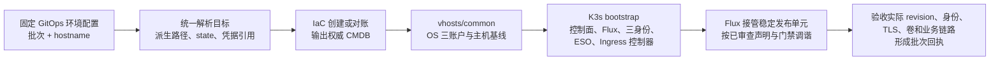

# PROD-K3S-V6 独立节点、集群冷启动规划与部署状态归档

## Accounts 迁移 API 单向快照规划（2026-11-02）

SSH发布准备最新记录：Accounts认证实现#291已合并为 `ba673c014c9e630c3cae815040035ac4d852828f`，固定镜像digest `sha256:52110a5d5a3c23d0a468eea583e608133d39e1d6e6a89940ca81e1ecaad54cf6` 已在两个节点通过SSH预拉取。V5实际发布线为 `release/v2026.11.02-registration`，为保持现有数据库契约，最小认证endpoint回补另见 [Accounts #292](https://github.com/ai-workspace-services/accounts/pull/292)，不是直接给V5普通应用部署main。当前业务Pod未替换、迁移未执行；具体版本与验证边界见规划的最新发布准备章节。


代码实施：复用Accounts管理员认证的服务端修改已提交 [Accounts #291](https://github.com/ai-workspace-services/accounts/pull/291)（`dca13426`），完整隔离PG17迁移API套件及管理员/auth回归通过；尚未更新两端服务，当前镜像677fb48e不包含此新认证模式。

认证契约更新：客户端直接使用V5/V6现有Accounts root/admin token，不再要求日期JOB token KV路径、专用迁移JWT或数据库DSN；有效期与撤销由Accounts决定。服务端新增管理员授权接口并逐请求委托校验，schema、快照、冲突和备份门禁保留。日期2026-11-02用于回执标签。旧方案两条KV路径not_found和两端迁移路径404仅是历史预检事实；新认证代码尚未部署，不能声称线上迁移成功。


构件及仓库治理最新记录：Accounts #289 已合并为 `677fb48ef92be426904864f8f849a1e9ac044bab`，GHCR固定镜像digest核实为 `sha256:be8e7ebb8017e453006a042e83a97c8e7f4ddb60503fe38837bd515dd44621e6`（linux/amd64）。未派发部署流水线或更新节点；V5普通Accounts managed runtime检查点兼容仍须先验证，不能把API读取兼容当作普通服务可升级证明。GitOps旧PR #728已关闭；PR #747仅精简PR检查为声明格式与敏感信息扫描，未改变应用声明。详见下链规划的最新进度。


实施进度：用户确认今晚准备V5→V6迁移/切换，V5 Accounts允许直接更新固定版本。源检查点兼容修复已提交 [Accounts #289](https://github.com/ai-workspace-services/accounts/pull/289)（`03fcac83`），单元测试、隔离PG17 API回归及V5原生SQL合成数据迁移通过。生产部署、token、监听器、备份恢复与迁移尚未执行；后续发布构件和逐阶段回执不能由测试结果替代。最终可变状态追齐拟使用源停写后的新快照及独立最终候选库，避免覆盖演练库冲突。

本轮选择 [Accounts 独立迁移 API + migratectl transfer-api](PROD-K3S-V6-Accounts迁移API单向同步规划.md)：Mac 从 Vault 读取专用短期 token，经 HTTPS 获取 V5 一致性快照并在 V6 候选库预览；快照/预览无需暂停服务。源/目标 listener 使用各自集群内的独立数据库身份，不把应用 DATABASE_URL 交给 Mac。当前API固定42表，缺失记录插入、同键内容变化冲突即停，不等于持续覆盖或全库复制。

只读现场盘点：V5 PostgreSQL17.11、76张public表、干净checkpoint `2026102002`，存在无成员关系的 `readonly_release`；V6 PostgreSQL17.11、51张public表、缺少schema_migrations。两端未发现迁移工作负载和Caddy迁移路由，指定SNI的迁移路径探测404、TLS=0。固定发布及所查main的API版本守卫尚不接受V5检查点，V6需独立完整候选schema；以上为规划与阻断记录，未部署listener、未采集快照或复制数据。

应用KV来源已确认：V5 `kv/prod/services/web-saas-k3s-v5/database` 小写字段 `database_url`；V6 `kv/prod/Accounts-service` 大写字段 `DATABASE_URL`。这些是现有应用凭据，不作为API客户端认证；新迁移token/KV路径仍待交付。具体版本、认证、网络、命令、文件owner和验收顺序见规划文档。本节仅更新迁移事项，不改变后续历史部署记录。

## V6 三个业务批次域名 DNS 交付（2026-11-02 14:51，北京时间）

用户反馈 `console-selfhost-prod-v6.svc.plus` 浏览器报 `ERR_NAME_NOT_RESOLVED`。只读核对确认权威 DNS 为 NXDOMAIN，而 `curl --noproxy '*' --resolve` 访问 V6 节点 443 的首页为 HTTP 200、TLS 校验结果 0。此前的强制解析验收不能替代真实 DNS 交付。

本次通过受限目标的单次 Ansible 操作，只新增以下原本不存在的记录，没有删除或覆盖记录：

| 类型 | 域名 | 目标 | TTL | Cloudflare 代理 |
| --- | --- | --- | --- | --- |
| A | `console-selfhost-prod-v6.svc.plus` | `172.237.24.232` | 300 | DNS-only |
| A | `accounts-selfhost-prod-v6.svc.plus` | `172.237.24.232` | 300 | DNS-only |
| A | `billing-selfhost-prod-v6.svc.plus` | `172.237.24.232` | 300 | DNS-only |

Ansible 退出码为 0，Cloudflare API 回读确认三条记录的类型、地址、TTL 和代理状态正确。Google 与 Cloudflare 的 DNS-over-HTTPS 查询均返回 `172.237.24.232`；V6 节点不带 `--resolve` 访问 Console 首页得到 HTTP 200、TLS=0。控制端使用 `curl --doh-url https://cloudflare-dns.com/dns-query --noproxy '*'`，不带 `--resolve` 或 `-k` 访问 Console 首页和 Accounts/Billing `/readyz`，三者均 HTTP 200、TLS=0、远端 IP 为 `172.237.24.232`。控制端系统解析路径尚未刷新，普通 curl 在本次采样仍报解析失败，可能涉及此前 NXDOMAIN 负缓存或所用解析器未更新；浏览器需等待缓存到期或由本机管理员清理缓存后重验。当前控制端非交互 sudo 要求密码，未自动清理系统 DNS 缓存；不能据公共 DNS 已生效宣称每个客户端缓存已刷新。

操作前后通过 API 对比 `vault.svc.plus`、`xworktech.com`、`console.svc.plus`、`accounts.svc.plus`、`billing.svc.plus`、`postgresql.svc.plus`、`observability.svc.plus` 的记录，结果完全一致，canonical DNS/CNAME 仍保留 V5 路由。其他 V6 管理/数据库域名未在此次创建；PostgreSQL 仍为受控 TLS 隧道预留用途，不因创建 A 记录就具备公网 HTTPS 数据库入口。

执行材料保存在控制端 `ai-workspace-infra/handoffs/v6-dns-20261102/`：`publish-v6-dns.yml`、`run_publish.py`、脱敏 Ansible 回执及 canonical 前后快照。创建入口为 `python3 run_publish.py`，脚本从已认证的 Vault 会话在内存读取 `kv/CICD` 的 `CLOUDFLARE_DNS_API_TOKEN`，以环境变量交给全部 `no_log` 的 Ansible 任务；文件及回执均不包含凭据值。脚本发现任一目标名称已有记录即停止，不应盲目重跑。若回退，仅按本次创建回执核对这三条记录并独立授权处理，不动 canonical 记录。

## ServiceLB、Datakit 修复与 Canonical/V6 标准 HTTPS 入口链路验收（2026-11-02 14:22，北京时间）

本节记录 `prod-k3s-v6`（`172.237.24.232`）在保持公共 canonical DNS/CNAME 不切换（仍指向 V5 `104.105.141.213`）前提下，完成 **K3s ServiceLB + Caddy 443 入口修复**、**Datakit 资源对齐与 59+ 分钟无 OOM 观察**、**Vault `prod-k3s-v6-ingress-tls-reader` 策略扩权**以及 **6 个 canonical 域名 + V6 批次域名的 GitOps/Flux 候选路由与端到端 HTTPS 链路验收**。

> **结论边界声明**：本节关于 `vault.svc.plus`、`xworktech.com`（及 `console.svc.plus`）、`accounts.svc.plus`、`billing.svc.plus`、`observability.svc.plus`、`postgresql.svc.plus` 的 PASS/NOT_APPLICABLE 结果，均为 **“canonical 域名在强制连接 V6（`curl --noproxy '*' --resolve <host>:443:172.237.24.232`）时的候选配置验收结果”**，不代表公共 DNS 已切换或正常域名访问已切流至 V6；V6 专用批次域名（`*-selfhost-prod-v6.svc.plus`）因公共权威 DNS 尚未创建 A/CNAME 记录（`NXDOMAIN`），正常公网域名访问仍处于 `BLOCKED（待 DNS 交付）` 状态。以下最新记录优先于本文后续历史时点章节。

### 1. 本批合并 PR、GitOps SHA 与 Flux / Helm 调谐基线

- **合并 PR 与提交 SHA**：
  - **ServiceLB 启用声明**：[ai-workspace-infra/gitops#744](https://github.com/ai-workspace-infra/gitops/pull/744)（merge commit `37c73b90e15006de23f1718db40f0e4c660da485`，head `7a8dc68719fb34b5638dfa3622b90bc671cde08d`）——在 `resources/svc.plus/prod/akamai/prod-k3s-v6.yaml` 显式声明 `k3s_platform_disable_components: [traefik]`，解除 role 默认禁用 `servicelb` 的限制。
  - **Playbooks K3s 配置变更重启调谐**：[ai-workspace-infra/playbooks#958](https://github.com/ai-workspace-infra/playbooks/pull/958)（merge commit `7d7a945ea207a15596cfce3ba41b84482d838268`，head `a38f8c26f0b14c938a4081e280d3ded03ebacdf4`）——更新 `roles/vhosts/k3s-cluster-server/tasks/bootstrap.yml` 与单测，使已安装节点在 `/etc/rancher/k3s/config.yaml` 发生变更时重启 `k3s` 并等待 `/readyz`。
  - **Datakit 资源配额对齐 V5**：[ai-workspace-infra/gitops#743](https://github.com/ai-workspace-infra/gitops/pull/743)（merge commit `9300aab047273ab0188f9e036d8a144cda997502`，head `dad1ef179d3e280cf9f87545c42ef5e478bbf76a`）——将 `services/prod-k3s-v6/observability-prod/datakit-helmrelease.yaml` 资源调整为 `requests: {cpu: 100m, memory: 128Mi}`、`limits: {cpu: 500m, memory: 512Mi}`。
  - **Ingress TLS Vault 策略与身份声明**：[ai-workspace-infra/gitops#746](https://github.com/ai-workspace-infra/gitops/pull/746)（merge commit `4ebea19e28303075da0fc5e1838f55ff1c1b784c`，head `abd84108374f5b7581d993f1c07bbf6edeee1308`）——新增 `security/vault/policies/prod-k3s-v6-ingress-tls-reader.yaml` 与 `security/vault/workload-identities/prod-k3s-v6-ingress-tls-reader.yaml`，最小化授权读取 `kv/data/CICD/domains/svc.plus` 与 `kv/data/CICD/domains/xworktech.com`。
  - **V6 Ingress Canonical 与批次域名路由/TLS 补全**：[ai-workspace-infra/gitops#745](https://github.com/ai-workspace-infra/gitops/pull/745)（merge commit `319cfb084594af6d9a1a2db68ea6034814c3c3e9`，head `5b67701`）——在 `services/prod-k3s-v6/ingress-prod/vault-tls.yaml` 新增 `ExternalSecret/brand-console-tls`（同步 `CICD/domains/xworktech.com`），在 `services/prod-k3s-v6/ingress-prod/helmrelease.yaml` 声明 `consoleAliases`、`accountsAliases`、`billingAliases`、`additionalHosts`（`brand-console`、`vault`、`observability`）及 `postRenderers`（为 `vault` upstream 注入 `transport http { tls_server_name vault.svc.plus }` 与 `checksum/caddyfile-postrender`），并在 `resources/svc.plus/prod/akamai/prod-k3s-v6.yaml` 登记 `service_domains` 与 `reserved_dns_aliases`（`public_dns_cutover: false`）。
- **Flux 调谐修订（`2026-11-02T06:16:33Z`）**：
  - `GitRepository`：`ingress-prod-config`、`observability-prod-config`、`postgresql-prod-config`、`vault-prod-config`、`web-saas-prod-config` 均 `Ready=True`，revision 为 `main@sha1:319cfb084594af6d9a1a2db68ea6034814c3c3e9`（`flux-system` 管理根 pin 在 `3d8f3cbc072ac7641ffbcfffb1906e7b5ffe5edd`）。
  - `Kustomization`（10/10 `Ready=True`）：`ingress-prod`、`observability-prod`、`postgresql-prod`、`vault-prod`、`web-saas-prod` 均已应用 `main@sha1:319cfb084594af6d9a1a2db68ea6034814c3c3e9`。
  - `HelmRelease`（8/8 `Ready=True`）：
    - `external-secrets/external-secrets`：`external-secrets@2.14.0`。
    - `ingress-prod/caddy-ingress`：`distributed-web-saas-fullstack@0.2.13+5ca7c0415e3a`（`caddy-ingress.v4`，镜像 `ghcr.io/ai-workspace-infra/caddy-cloudflare:959d6c8@sha256:9895385033fea2bdb445841b45f37e6cd58b9e071a16e4c147e483abb74a0acf`）。
    - `observability-prod/datakit`：`datakit@2.16.1`（`datakit.v2`，镜像 `pubrepo.guance.com/datakit/datakit:2.16.1@sha256:1cd545f7f14dc08935ec6557936b1e6422a3d7d9728b57d6e1d6b57ea1703fc6`）。
    - `observability-prod/observability`：`observability-stack@1.1.7+63dc89ea20ff`。
    - `observability-prod/observability-agent`：`observability-agent@1.1.1+4095ed924194`。
    - `postgresql-prod/postgresql`：`distributed-web-saas-fullstack@0.2.13+5ca7c0415e3a`。
    - `vault-prod/vault`：`vault@0.32.0`。
    - `web-saas-prod/web-saas-prod`：`distributed-web-saas-fullstack@0.2.13+5ca7c0415e3a`。

### 2. ServiceLB + Caddy 与 Datakit 修复结果

- **K3s ServiceLB + Caddy 443 链路**：
  - 节点 `/etc/rancher/k3s/config.yaml` 更新为 `disable: ["traefik"]`，保留 `cluster-cidr: 10.52.0.0/16`、`service-cidr: 10.53.0.0/16`、`cluster-dns: 10.53.0.10`、`default-local-storage-path: /data/k3s/storage`。
  - `kube-system/svclb-caddy-ingress-caddy-ingress-1fa02b3e` DaemonSet（Pod `svclb-caddy-ingress-caddy-ingress-1fa02b3e-fsbzw`，`10.52.0.62`，镜像 `rancher/klipper-lb:v0.4.17`）`1/1 Running`（`RESTARTS=0`），`hostPort: 443` 经内核 `KUBE-HOSTPORTS` NAT 转发至 `DEST_IPS=10.53.220.215:443`。
  - `ingress-prod/caddy-ingress-caddy-ingress` LoadBalancer Service（`ClusterIP=10.53.220.215`）已分配 `EXTERNAL-IP=172.237.24.232`，端口映射 `443:22299/TCP -> targetPort=8443`，`EndpointSlice/caddy-ingress-caddy-ingress-s9tp2` 指向 Ready Pod `caddy-ingress-caddy-745cd48f9b-56szg`（`10.52.0.63:8443`）。
- **Datakit 稳定性与遥测接收（59+ 分钟连续观察）**：
  - 新 Pod `observability-prod/datakit-6k2mr`（`startedAt=2026-11-02T05:23:51Z`）连续运行 **59+ 分钟**，`1/1 Running`，`restartCount=0`，`lastState={}`（0 OOM）；CPU `4m~34m`，内存 `145Mi~193Mi`（远低于 `512Mi` limit）；节点 `prod-k3s-v6` 总负载 `CPU 196m (9%)`、`MEMORY 2674Mi (68%)`，`free -m` `available: 1048 MiB`。
  - 此前容器内 `curl -s http://127.0.0.1:9529/metrics` 的 `datakit_http_api_total` 对 `/v1/write/metric`、`/v1/write/logging`、`/v1/write/object` 记录 200，只能证明本地接收 API 的对应请求成功；不能替代 DataWay 远端或观测云空间的新鲜数据接收证据，远端接收仍待独立核验。
- **Vault TLS 授权与拒绝验证**：
  - 使用 `ingress-prod/ingress-tls-reader` 真实签发 JWT（audience `vault-prod-k3s-v6-ingress-tls-reader`）向 `https://vault.svc.plus` 登录 `auth/jwt-prod-k3s-prod-k3s-v6/login` 成功（`policies=["prod-k3s-v6-ingress-tls-reader"]`，`ttl=10m`）。
  - 允许路径：`GET /v1/kv/data/CICD/domains/svc.plus` -> `200`，`GET /v1/kv/data/CICD/domains/xworktech.com` -> `200`。
  - 拒绝路径：相邻路径 `GET /v1/kv/data/CICD/domains/v6-authorization-denied-probe` -> `403`，跨业务路径 `GET /v1/kv/data/prod/accounts/runtime` -> `403`，错误 audience（`vault-wrong-audience`）-> `400`，错误 ServiceAccount（`ingress-prod/default`）-> `400`。
  - `ingress-prod` 下 `console-tls`、`accounts-tls`、`billing-tls`、`brand-console-tls` 4 个 `ExternalSecret` 全部 `SecretSynced=True`。

### 3. 标准 HTTPS 入口九项逐跳验收与按域名矩阵

#### 3.1 外部 443 → ServiceLB → Service 443 → Caddy 8443 → V6 后端九项验收表

| 验收项 | 证据 | 结论 |
| --- | --- | --- |
| 1. DNS 解析与权威记录保持不变 | 权威 NS（`ns3/ns4.dnsv2.com`、`ns1/ns2.dns.com`）与公共解析查询确认：`vault.svc.plus`、`xworktech.com`、`console.svc.plus`、`accounts.svc.plus`、`billing.svc.plus`、`observability.svc.plus`、`postgresql.svc.plus` 的 A 记录在变更前后完全一致，均保持指向 V5 `104.105.141.213`（`AAAA`/`CNAME` 为空）；`console-selfhost-prod-v6.svc.plus`、`accounts-selfhost-prod-v6.svc.plus`、`billing-selfhost-prod-v6.svc.plus`、`postgresql-selfhost-prod-v6.svc.plus`、`vault-selfhost-prod-v6.svc.plus`、`observability-selfhost-prod-v6.svc.plus`、`observability-k3s-v6.svc.plus` 均返回 `NXDOMAIN`（正常公网域名直连返回 `curl: (6) Could not resolve host`）。 | **Canonical DNS 保持不变：PASS / V6 批次域名公网 DNS：BLOCKED（待 DNS 交付）** |
| 2. ServiceLB DaemonSet / Pod | `kube-system/svclb-caddy-ingress-caddy-ingress-1fa02b3e` `1/1 Ready`（Pod `svclb-caddy-ingress-caddy-ingress-1fa02b3e-fsbzw`，`10.52.0.62`，`RESTARTS=0`），容器 `lb-tcp-443` 挂载 `hostPort: 443/TCP`，`iptables -t nat -S KUBE-HOSTPORTS` 匹配 `tcp dpt:443 -> 10.52.0.62:443 -> 10.53.220.215:443`。 | **PASS** |
| 3. LoadBalancer Service 443 → 8443 | `ingress-prod/caddy-ingress-caddy-ingress` 类型为 `LoadBalancer`，`CLUSTER-IP=10.53.220.215`，`EXTERNAL-IP=172.237.24.232`，端口 `443:22299/TCP -> targetPort=8443`；外部验证全程使用标准 `:443`（未使用 `:8443` 或 `:22299`）。 | **PASS** |
| 4. Caddy Pod 与 EndpointSlice | `caddy-ingress-caddy-745cd48f9b-56szg`（`10.52.0.63`）`1/1 Running`（`RESTARTS=0`），`EndpointSlice/caddy-ingress-caddy-ingress-s9tp2` 唯一指向 `10.52.0.63:8443`（`ready: true, serving: true`），Pod 内 `caddy validate --config /etc/caddy/Caddyfile --adapter caddyfile` 返回 `Valid configuration`。 | **PASS** |
| 5. TLS / SNI 与公信证书链 | 在 `172.237.24.232:443` 不带 `-k` 实测：`xworktech.com` 返回 `CN=xworktech.com`（SAN `*.xworktech.com, xworktech.com`，Let's Encrypt `CN=YE2`，有效期 `2026-10-07 ~ 2027-01-05`）；其余所有 `*.svc.plus` 域名返回 `CN=svc.plus`（SAN `*.svc.plus, svc.plus`，Let's Encrypt `CN=YE2`，有效期 `2026-10-07 ~ 2027-01-05`），`curl` `ssl_verify_result=0`。 | **PASS** |
| 6. Console 路由与静态/SSR/API 分流 | `console-selfhost-prod-v6.svc.plus`、`console.svc.plus`、`xworktech.com` 经 `--resolve <host>:443:172.237.24.232` 访问：`/` 返回 `200 OK`（`71,236 bytes`，HTML `<title>Cloud-Neutral Toolkit</title>`）；`/blogs` 返回 `200 OK`（`30,520 bytes`）；`/docs` 返回 `200 OK`（`36,382 bytes`）；`/api/ping` 返回 `200 OK`（Console Node JSON）；`xworktech.com/api/auth/login`（空 POST）由 Caddy `@api path /api/*`（排除 `/api/ping`、`/api/docs*`、`/api/blogs*`）分流至 `web-saas-accounts:80` 并返回 `400 {"error":"invalid_request","message":"email and password are required"}`。 | **PASS** |
| 7. Accounts API 路由与认证边界 | `accounts-selfhost-prod-v6.svc.plus` 与 `accounts.svc.plus` 经 `--resolve` 访问：`/healthz` -> `200 {"status":"ok"}`，`/readyz` -> `200 {"checks":{"database":"ok"},"status":"ready"}`，`/api/ping` -> `200 {"service":"accounts",...}`；未认证 `GET /api/users` -> `404`（未匿名暴露），空凭证 `POST /api/auth/login` -> `400 invalid_request`。 | **PASS** |
| 8. Billing API 路由与认证边界 | `billing-selfhost-prod-v6.svc.plus` 与 `billing.svc.plus` 经 `--resolve` 访问：`/readyz` -> `200 {"database":"ok","status":"ready"}`，`/api/ping` -> `200 {"service":"billing-service",...}`，`/healthz` -> `503 {"message":"","status":"degraded"}`（`push` 模式尚未收到采集推送快照前的预期业务信号，Pod 保持 `1/1 Ready`、`RESTARTS=0`）；未认证 `GET /api/v1/billing/summary` -> `404`（未匿名暴露）。 | **PASS** |
| 9. 跨服务回归与 PVC/PV 稳态 | `web-saas-prod` 4 个工作负载、`postgresql-0`、`vault-0`、`observability-prod` 全栈 Pod 均 `Ready` 且无新增重启；`data-postgresql-0`、`data-vault-0`、`vmstorage-db-vmstorage-victoria-metrics-k8s-stack-0` 3 个 PVC 保持 `Bound`，节点负载平稳。 | **PASS** |

#### 3.2 Canonical 域名与 V6 批次域名候选配置验收表

> **说明**：下表所有 HTTP/协议实测均在不修改公共 DNS 的前提下，通过外部客户端 `curl --noproxy '*' --resolve <域名>:443:172.237.24.232 https://<域名>...`（不带 `-k`）强制连接 V6 节点 `172.237.24.232:443` 完成，代表 **“canonical 域名在强制连接 V6 时的候选配置验收结果”** 与 **“V6 批次域名绕过 DNS 的 HTTPS 链路验收结果”**。

| 域名 | 协议/用途 | DNS保持原样 | V6 Host配置 | 证书/SNI | V6实际后端 | HTTP/协议结果 | 响应内容 | 认证边界 | PASS/FAIL/BLOCKED/NOT_APPLICABLE |
| --- | --- | --- | --- | --- | --- | --- | --- | --- | --- |
| `vault.svc.plus` | HTTPS 443 / Vault UI & API | `A=104.105.141.213`（未改动） | `services/prod-k3s-v6/ingress-prod/helmrelease.yaml` `additionalHosts.vault` + `postRenderers`（`tls_server_name vault.svc.plus`） | `CN=svc.plus`，SAN `*.svc.plus, svc.plus`（Let's Encrypt `YE2`，`TLS=0`） | `https://vault.vault-prod.svc.cluster.local:8200`（V6 `vault-0`） | `/v1/sys/health` -> `200`；`/ui/` -> `200` | `"cluster_name":"vault-cluster-1f8025e0"`（区别于 V5 的 `vault-cluster-bea6f9be`）；Vault UI HTML `5,253 bytes` | 未认证 `GET /v1/kv/data/prod/accounts/runtime` 返回 `403 {"errors":["permission denied"]}` | **PASS（强制连接 V6 候选配置）** |
| `xworktech.com` | HTTPS 443 / 品牌首页、文档与 `/api/*` 分流 | `A=104.105.141.213`（未改动） | `additionalHosts.brand-console`（`@api` 分流至 Accounts，其余至 Console） | `CN=xworktech.com`，SAN `*.xworktech.com, xworktech.com`（Let's Encrypt `YE2`，`TLS=0`） | `web-saas-console.web-saas-prod.svc.cluster.local:80` + `web-saas-accounts.web-saas-prod.svc.cluster.local:80` | `/` -> `200`；`/blogs` -> `200`；`/docs` -> `200`；`/api/ping` -> `200`；`POST /api/auth/login` -> `400` | 首页 HTML `71,236 bytes`（`<title>Cloud-Neutral Toolkit</title>`）；`/api/auth/login` 返回 Accounts JSON `{"error":"invalid_request","message":"email and password are required"}` | `/api/*` 认证请求由 V6 Accounts 校验并拒绝空/无效凭证 | **PASS（强制连接 V6 候选配置）** |
| `console.svc.plus` | HTTPS 443 / Web Console（Canonical 别名） | `A=104.105.141.213`（未改动） | `consoleAliases: [console.svc.plus]` | `CN=svc.plus`，SAN `*.svc.plus, svc.plus`（`TLS=0`） | `web-saas-console.web-saas-prod.svc.cluster.local:80` | `/` -> `200`；`/api/ping` -> `200` | HTML `71,236 bytes`；`/api/ping` 返回 Console revision `691b7dcc...` | 静态/SSR 页面公开，管理操作受会话/API 保护 | **PASS（强制连接 V6 候选配置）** |
| `accounts.svc.plus` | HTTPS 443 / Accounts API Server | `A=104.105.141.213`（未改动） | `accountsAliases: [accounts.svc.plus]` | `CN=svc.plus`，SAN `*.svc.plus, svc.plus`（`TLS=0`） | `web-saas-accounts.web-saas-prod.svc.cluster.local:80` | `/healthz` -> `200`；`/readyz` -> `200`；`/api/ping` -> `200` | `{"status":"ok"}`；`{"checks":{"database":"ok"},"status":"ready"}`；`{"service":"accounts",...}` | 未认证 `GET /api/users` -> `404`；空 `POST /api/auth/login` -> `400` | **PASS（强制连接 V6 候选配置）** |
| `billing.svc.plus` | HTTPS 443 / Billing API Server | `A=104.105.141.213`（未改动） | `billingAliases: [billing.svc.plus]` | `CN=svc.plus`，SAN `*.svc.plus, svc.plus`（`TLS=0`） | `web-saas-billing.web-saas-prod.svc.cluster.local:80` | `/readyz` -> `200`；`/api/ping` -> `200`；`/healthz` -> `503`（预期） | `{"database":"ok","status":"ready"}`；`{"service":"billing-service",...}`；`{"message":"","status":"degraded"}` | 未认证 `GET /api/v1/billing/summary` -> `404` | **PASS（强制连接 V6 候选配置）** |
| `observability.svc.plus` | HTTPS 443 / Grafana UI | `A=104.105.141.213`（未改动） | `additionalHosts.observability` | `CN=svc.plus`，SAN `*.svc.plus, svc.plus`（`TLS=0`） | `http://victoria-metrics-k8s-stack-grafana.observability-prod.svc.cluster.local:80` | `/` -> `302`（`Location: /login`）；`/login` -> `200`；`/api/health` -> `200` | `/login` HTML `34,637 bytes`；`{"database":"ok","version":"12.2.1"}` | `/` 强制跳转 `/login`；未认证 `GET /api/datasources` 返回 `401 {"message":"Unauthorized"}`；未匿名暴露 VictoriaMetrics/VictoriaLogs 内部端口 | **PASS（强制连接 V6 候选配置）** |
| `postgresql.svc.plus` | TLS 隧道预留域名（非直连接，非 HTTP 站点） | `A=104.105.141.213`（未改动） | `prod-k3s-v6.yaml` `reserved_dns_aliases`（`stunnelServer.enabled: false`，不在 Caddy HTTP 站点暴露） | TLS 握手匹配通配证书 `*.svc.plus`，无 Caddy HTTP Host 路由 | 集群内 `postgresql-postgresql.postgresql-prod.svc.cluster.local:5432`（`ClusterIP`） | 外部 `172.237.24.232:5432` 探测为 `CLOSED/FILTERED`；HTTPS `:443` 返回空 `200`（`0 bytes`） | 无 HTTP 后端响应体 | 原生 5432 不对公网开放，TLS 隧道按预留状态关闭 | **NOT_APPLICABLE（TLS 隧道预留域名，非 HTTP 443 代理）** |
| `console-selfhost-prod-v6.svc.plus` | HTTPS 443 / Web Console（V6 批次域名） | `NXDOMAIN`（未创建公网 DNS） | `consoleHost: console-selfhost-prod-v6.svc.plus` | `CN=svc.plus`，SAN `*.svc.plus, svc.plus`（`TLS=0`） | `web-saas-console.web-saas-prod.svc.cluster.local:80` | `--resolve`：`/` -> `200`；`/api/ping` -> `200`；正常 DNS：`curl (6)` | HTML `71,236 bytes`；Console JSON `212 bytes` | 同 `console.svc.plus` | **绕过 DNS 链路：PASS / 正常公网 DNS：BLOCKED** |
| `accounts-selfhost-prod-v6.svc.plus` | HTTPS 443 / API Server（V6 批次域名） | `NXDOMAIN`（未创建公网 DNS） | `accountsHost: accounts-selfhost-prod-v6.svc.plus` | `CN=svc.plus`，SAN `*.svc.plus, svc.plus`（`TLS=0`） | `web-saas-accounts.web-saas-prod.svc.cluster.local:80` | `--resolve`：`/healthz`、`/readyz`、`/api/ping` -> `200`；正常 DNS：`curl (6)` | Accounts JSON 响应正常 | 未认证 `/api/users` -> `404` | **绕过 DNS 链路：PASS / 正常公网 DNS：BLOCKED** |
| `billing-selfhost-prod-v6.svc.plus` | HTTPS 443 / API Server（V6 批次域名） | `NXDOMAIN`（未创建公网 DNS） | `billingHost: billing-selfhost-prod-v6.svc.plus` | `CN=svc.plus`，SAN `*.svc.plus, svc.plus`（`TLS=0`） | `web-saas-billing.web-saas-prod.svc.cluster.local:80` | `--resolve`：`/readyz`、`/api/ping` -> `200`，`/healthz` -> `503`；正常 DNS：`curl (6)` | Billing JSON 响应正常 | 未认证 `/api/v1/billing/summary` -> `404` | **绕过 DNS 链路：PASS / 正常公网 DNS：BLOCKED** |
| `postgresql-selfhost-prod-v6.svc.plus` | TLS 隧道预留域名（非直连接） | `NXDOMAIN`（未创建公网 DNS） | `prod-k3s-v6.yaml` `service_domains.postgresql`（`tls-tunnel-reserved`，不在 Caddy 暴露） | 匹配通配证书 `*.svc.plus`，无 HTTP Host 块 | 集群内 `postgresql-postgresql.postgresql-prod.svc.cluster.local:5432`（`ClusterIP`） | 外部 `5432` 为 `CLOSED/FILTERED`；HTTPS `:443` 返回 `0 bytes` | 无 HTTP 后端响应体 | 不对外暴露数据库或 HTTP 路由 | **NOT_APPLICABLE（TLS 隧道预留域名，非 HTTP 443 代理）** |
| `vault-selfhost-prod-v6.svc.plus` | HTTPS 443 / Vault UI & API（V6 批次域名） | `NXDOMAIN`（未创建公网 DNS） | `additionalHosts.vault` | `CN=svc.plus`，SAN `*.svc.plus, svc.plus`（`TLS=0`） | `https://vault.vault-prod.svc.cluster.local:8200`（V6 `vault-0`） | `--resolve`：`/v1/sys/health` -> `200`，`/ui/` -> `200` | `"cluster_name":"vault-cluster-1f8025e0"` | 未认证 KV 读取 -> `403` | **绕过 DNS 链路：PASS / 正常公网 DNS：BLOCKED** |
| `observability-selfhost-prod-v6.svc.plus` / `observability-k3s-v6.svc.plus` | HTTPS 443 / Grafana UI（V6 批次域名） | `NXDOMAIN`（未创建公网 DNS） | `additionalHosts.observability` | `CN=svc.plus`，SAN `*.svc.plus, svc.plus`（`TLS=0`） | `http://victoria-metrics-k8s-stack-grafana.observability-prod.svc.cluster.local:80` | `--resolve`：`/` -> `302 /login`，`/api/health` -> `200` | `{"database":"ok","version":"12.2.1"}` | 未认证 `/api/datasources` -> `401` | **绕过 DNS 链路：PASS / 正常公网 DNS：BLOCKED** |

### 4. 回退方法与剩余未闭环边界

- **回退方法**：
  - **Caddy Canonical/V6 路由与 `brand-console-tls`**：revert [GitOps PR #745](https://github.com/ai-workspace-infra/gitops/pull/745)（`319cfb0`）与 [PR #746](https://github.com/ai-workspace-infra/gitops/pull/746)（`4ebea19`），对公共 Vault `prod-k3s-v6-ingress-tls-reader` policy 移除 `kv/data/CICD/domains/xworktech.com` 路径，并执行 `flux reconcile kustomization ingress-prod --with-source`。
  - **Datakit 资源调整**：revert [GitOps PR #743](https://github.com/ai-workspace-infra/gitops/pull/743)（`9300aab`）并调谐 `observability-prod`。
  - **ServiceLB 启用**：revert [GitOps PR #744](https://github.com/ai-workspace-infra/gitops/pull/744)（`37c73b9`）与 [Playbooks PR #958](https://github.com/ai-workspace-infra/playbooks/pull/958)（`7d7a945e`），在节点恢复 `/etc/rancher/k3s/config.yaml` 的 `servicelb` 禁用项并重启 `k3s`。
- **当前仍保留为独立任务的边界**：
  - **DNS 交付与切流**：V6 批次域名（`*-selfhost-prod-v6.svc.plus`）的权威 DNS 记录创建，以及未来正式窗口内 canonical 域名的 DNS/CNAME 切流。
  - **审计 RBAC 最小收敛**：`cluster-identities/auditor-rbac.yaml`（移除 `k3s-auditor-read-only` 对 `secrets` 的 `get/list/watch`）未包含在本批变更，仍待单独交付。
  - **数据库身份、剩余 23 张原生表与 SMTP**：应用使用独立 DML 数据库身份（退出临时 `postgres`/`root` 管理连接）、补齐剩余 23 张 Accounts 原生扩展表与 V5→V6 数据迁移、以及 `kv/prod/platform/smtp/google` 注册邮件收发验证仍按既有计划独立推进。

## Web SaaS 运行状态与配置修复交付（2026-11-02，北京时间）

本节记录 `prod-k3s-v6`（`web-saas-prod` / `postgresql-prod`）在 [GitOps PR #730](https://github.com/ai-workspace-infra/gitops/pull/730)（`200d8b7`）、[PR #732](https://github.com/ai-workspace-infra/gitops/pull/732)（`d0651b0`）、[PR #738](https://github.com/ai-workspace-infra/gitops/pull/738)（`ba748b0`）、[PR #739](https://github.com/ai-workspace-infra/gitops/pull/739)（`88adbe5`）、[PR #740](https://github.com/ai-workspace-infra/gitops/pull/740)（`8d8d245`）以及本轮 [GitOps PR #741](https://github.com/ai-workspace-infra/gitops/pull/741)（合并提交 `4405e986703fab53421e6460603b61676d5f843c`）和 [Playbooks PR #957](https://github.com/ai-workspace-infra/playbooks/pull/957)（合并提交 `5fb10d8063703ecfa71a0eb836f33a65e0812f5c`）合并并调谐后的线上验收结果。

**本轮范围：只解决当前环境问题。** 沿用手动操作 / Ansible Playbooks + GitOps + Flux、Caddy + K3s ServiceLB；Traefik/Flagger 迁移、流水线建设、全面 rootless 和数据库身份体系重做不属于本轮改造。以下最新复核优先于本文后续各时点的历史状态，不因旧条目写有“未就绪”而重复处理已经修复的问题。

### 1. 集群 Source、Chart 与固定镜像版本

- **Flux GitRepository 与 Kustomization 调谐状态**：
  - `GitRepository/web-saas-prod-config`：`Ready=True`，`stored artifact for revision 'main@sha1:4405e986703fab53421e6460603b61676d5f843c'`。
  - `Kustomization/web-saas-prod`：`Ready=True`，`Applied revision: main@sha1:4405e986703fab53421e6460603b61676d5f843c`。
  - `HelmRelease/web-saas-prod`：`Ready=True`，`Helm upgrade succeeded for release web-saas-prod/web-saas.v8 with chart distributed-web-saas-fullstack@0.2.13+5ca7c0415e3a`。
- **Helm Chart 固定制品**：`oci://ghcr.io/ai-workspace-infra/distributed-web-saas-fullstack`，运行版本 `0.2.13+5ca7c0415e3a`，digest `sha256:5ca7c0415e3a0739cc9f014f0a495f89d35bfe47eb5b2057a7a07c030c85e76f`。
- **应用固定镜像与源码修订**：
  - **Accounts**：`ghcr.io/ai-workspace-services/accounts:sha-3ef09c82f46152096bfc16edc9ba767f128a197f@sha256:b5bf111a64ca2f2ed5e74d2ab1f87e0e164d09869a32832368fb43e577fdf37b`（源码 commit `3ef09c82f46152096bfc16edc9ba767f128a197f`）。
  - **Billing**：`ghcr.io/ai-workspace-services/billing-service@sha256:14bbaee5ba37d85ddf243272ee2c3bed25603ee26ffd5c0b8d685cfe0e7a85a0`（OCI revision `77557d796a66dcd3373d7731125890bd91ebc5d3`，`daily-build-2026.10.23-r101`）。
  - **Console**：`ghcr.io/ai-workspace-services/console@sha256:06775cfa5582fb83bae336c4c4befe1fbd4f7747d526653b80736e3e4862e666`（对应 Portal commit `691b7dcc9870d4ba14b10f4b8dadc4e6d873ca0e`，`daily-build-2026.10.24-r106`）。
  - **Content**：`ghcr.io/ai-workspace-services/docs@sha256:e6e791437bd3b57a4dec0bc9dc2527b681dd52960b6f692be6ff16322018788e`。

### 2. Secret 同步与四个工作负载调谐后状态

- **ESO 状态**：`web-saas-prod` 中 `SecretStore/app-database-reader` 与 `SecretStore/web-saas-secrets-reader` 均 `Valid=True`；`accounts-bootstrap`、`accounts-db-runtime`、`billing-db-runtime`、`web-saas-secrets` 四个 `ExternalSecret` 全部 `SecretSynced=True`。
- **工作负载与探针实测结果**：

| 工作负载 | 当前状态 | 根因与修复内容 | 线上实测证据 |
| --- | --- | --- | --- |
| `web-saas-accounts` | `1/1 Running`（`restartCount=0`） | 保持原运行配置不变；通过 [Playbooks PR #957](https://github.com/ai-workspace-infra/playbooks/pull/957) 增量补齐 `subscriptions`、`subscription_records` 等表。 | Pod `web-saas-accounts-657c66cbff-fj7s8`（`10.52.0.59:8080`），`/healthz`、`/readyz`、`/api/ping` 均返回 `200 OK`；后台 `subscription-access` 对账器输出 `subscription access reconciliation processed accounts (accounts=3)`，缺表告警已消除。 |
| `web-saas-content` | `1/1 Running`（`restartCount=0`） | 保持原运行配置不变。 | Pod `web-saas-content-d8b7f786b-v6hbg`（`10.52.0.58:8080`），`/healthz` 返回 `200 OK`。 |
| `web-saas-billing` | `1/1 Running`（`restartCount=0`） | [GitOps PR #741](https://github.com/ai-workspace-infra/gitops/pull/741) 声明 `startupProbe`/`livenessProbe` 使用 `/api/ping`、`readinessProbe` 使用 `/readyz`，显式设置 `BILLING_INGEST_MODE=push`、`DEFAULT_REGION=jp`、`IMAGE`（未收到推送快照前 `/healthz` 的 `503 degraded` 保留为业务监控信号，不触发 kubelet 重启）。 | Pod `web-saas-billing-c9b854fc-j2gfq`（`10.52.0.60:8080`），旧 ReplicaSet 已自动缩容为 0；`/readyz` 返回 `200 {"database":"ok","status":"ready"}`，`/api/ping` 返回 `200 {"image":"ghcr.io/ai-workspace-services/billing-service@sha256:14bbaee5..."}`。 |
| `web-saas-console` | `1/1 Running`（`restartCount=0`） | [GitOps PR #741](https://github.com/ai-workspace-infra/gitops/pull/741) 挂载 `ConfigMap/web-saas-console-nginx` 与 `/tmp` `emptyDir`（日志输出至 `stderr`/`/dev/stdout`，移除 `sites-enabled/default` 80 端口，`/healthz` 代理至 `127.0.0.1:3000/api/ping`），并在 `postRenderer` 将容器 `PORT` 设为 `3000`（不添加 `DAC_OVERRIDE` 或 `privileged`）。 | Pod `web-saas-console-568c4f7946-mxvtb`（`10.52.0.61:8080`），旧 ReplicaSet 已自动缩容为 0；Pod 内 `nginx -t` 成功，`/healthz` 与 `/api/ping` 返回 Node 生成的 `200 OK` JSON，`/` 返回 `200 OK`（71,236 bytes），日志正常进入容器 `stdout`/`stderr`。 |

### 3. Accounts / Billing 数据库 Schema 已完成与未完成边界

- **已完成对象与自举数据**：
  - 原启动链路创建 47 张表后，已通过 [Playbooks PR #957](https://github.com/ai-workspace-infra/playbooks/pull/957)（`initialize-web-saas-schemas.yml`，commit `5fb10d80`）在单事务（`lock_timeout=15s`、`statement_timeout=5min`、`pg_advisory_xact_lock(2026092801)`）中非破坏性地补齐了 `pgcrypto` 扩展、`users` 12 个生命周期/订阅列，以及 `subscriptions`、`subscription_records`、`subscription_lifecycle_states`、`account_lifecycle_events` 4 张表，并灌入付费套餐目录种子。
  - 当前 `account` 库 `public` 下共 **51 张表**；已有数据完整保留：`users` **3 行**（1 `root` + 2 `readonly`）、`tenants` **1 行**（`svc-plus-xworkmate`）、`tenant_domains` **1 行**（`svc.plus`）、`rbac_roles` **4 行**、`rbac_permissions` **12 行**、`rbac_role_permissions` **12 行**、`billing_plans` **19 行**（含 `PRO-MONTHLY`）。
- **未完成对象（待后续 V5→V6 数据迁移维护窗口闭环）**：
  - 对照固定镜像内置 `migratectl native-schema`（`accounts-native-pg17-v1`，`migration_version: 2026102002`，`schema_sha256: f45db2423f11d9dcc7f3cc58c72b52228a27d7b6ccfc717faf2bbb56fa0498b1`）的 74 张 Accounts 原生表 + `schema_migrations` + Billing `cloud_vendor_costs`，仍剩余 **23 张未由运行态自举创建的扩展业务表**（`identities`、`nodes`、`overlay_config_acks`、`overlay_nodes`、`bridge_credentials`、`referral_*` 7 张、`finance_*` 5 张、`password_recovery_challenges`、`mfa_recovery_codes`、`network_teams`、`network_team_members`、`team_agent_enrollments`、`subscription_extension_ledger`）、`schema_migrations`、`cloud_vendor_costs`，以及 `users`/`sessions`/`email_blacklist`/`overlay_devices` 的 `attnum` 列序与附加触发器/RLS 策略对齐。在执行 V5→V6 `migratectl` 全量业务数据迁移前，须在受控维护窗口完成完整 `accounts-native.sql` 对齐。
- **独立待验收项与回退范围**：
  - 入口 443、批次域名 DNS/TLS、SMTP 注册验证邮件（`kv/prod/platform/smtp/google` 尚未配置 ESO 同步与应用挂载）及 V5→V6 业务数据迁移属于独立验收项，不因上述 4 个工作负载 `1/1 Ready` 视为全部生产验收通过。
  - **回退范围**：GitOps 配置可通过 revert [PR #741](https://github.com/ai-workspace-infra/gitops/pull/741)（`4405e98`）并重新调谐 `web-saas-prod` 无状态回退；数据库增量补齐的 4 张表与 `billing_plans` 种子不修改原有 6 张自举表数据。

### 4. 独立现场复核与集群整体验收边界（2026-11-02 12:16，北京时间）

通过 SSH 对 `172.237.24.232` 只读复核，并查询 GitHub 实际合并记录。GitOps #741、Playbooks #957、Knowledge #286 均已合并，SHA 与上述交付记录一致；Web SaaS 的 Flux revision 为 `4405e986703fab53421e6460603b61676d5f843c`，HelmRelease 与 Kustomization 均 Ready。

- 四个应用 Deployment 的 generation 与 observedGeneration 一致，均为 `1/1`；旧 ReplicaSet 均已缩容为 0。Accounts/Content Pod 已运行约 66/75 分钟，Billing/Console 约 21 分钟，累计重启均为 0；实际 imageID 与固定 digest 一致。
- 从 Console 容器经集群 Service 读取 Accounts `/healthz`、`/readyz`、`/api/ping`，Billing `/readyz`、`/api/ping`，Console `/healthz`、`/api/ping`、`/`，Content `/healthz`，全部返回 200；四个 Service 均有 EndpointSlice，`nginx -t` 成功。近 15 分钟 Accounts/Billing 日志均未检出缺表错误，Accounts 有 15 次订阅访问对账成功记录。
- 数据库只读查询确认 public 有 51 张表，四张修复表和 `pgcrypto` 已存在；`users`/`tenants`/`tenant_domains`/`billing_plans` 当前行数为 3/1/1/19。对照固定 Accounts commit 的原生 schema 74 张表，仍缺 23 张原生表；`schema_migrations`、`cloud_vendor_costs` 也不存在。因此仅通过本轮应用启动与增量修复验收，完整 schema/业务数据迁移验收仍未完成。

| 集群剩余项 | 当前现场证据 | 验收结论 |
| --- | --- | --- |
| Observability / Datakit | Datakit Pod 当前 `1/1`，但 HelmRelease 和 `observability-prod` Kustomization 为 False；累计重启 9 次，最近一次终止为 `OOMKilled`（退出码 137），内存 request/limit 为 `64Mi`/`128Mi` | 尚未通过，需处理资源与调谐失败状态 |
| Caddy 公网 HTTPS | LoadBalancer Service external IP 为 pending，Service `443` 对应 NodePort `22299`；使用 V6 域名 SNI 直连节点 `443` 未建立 HTTPS 连接，节点 DNS 查询未返回该域名地址 | 尚未通过，仍需完成 ServiceLB、DNS 和 TLS 入口验收；本次直连探测跳过证书校验，不构成证书有效性证明 |
| 数据库运行身份 | 当前管理连接 `postgres` 的 `rolsuper=true`；应用使用该临时管理连接的例外仍未退出 | 最小权限身份验收未完成 |
| SMTP / 注册验证 | 仍按前节列为独立交付与收发验证任务 | 本轮未验收 |

本轮仅做合并记录核查、状态读取、健康 HTTP 请求和数据库只读查询；没有重放 Playbooks、修改数据库对象或触发新一轮部署。四个业务应用就绪不代表 V6 全部集群服务或生产切换验收通过。

### 5. 对照平台交付文档的当前偏差（2026-11-02 12:20—12:24，北京时间）

**当前待解决的具体环境问题：**

| 项目 | 现场事实 | 处理边界与完成条件 |
| --- | --- | --- |
| Caddy / V6 域名与入口 | Caddy 已声明 Console、Accounts、Billing 三个 V6 Host 路由，但 LoadBalancer 地址仍 pending，未见 ServiceLB Pod，节点 443 无法建立连接；Console、Accounts、Billing、Vault、Observability 五个规划域名在节点 DNS 查询均未解析 | 完成现有 Caddy + ServiceLB 节点 443 及三个业务域名，再核对 TLS/SNI、证书链和后端路由；Vault/Observability 仍按受限管理通道处理，不新增其公网 Caddy 路由。不切换 V5/canonical DNS，不更换网关 |
| Datakit 资源和调谐 | 最近终止原因 OOMKilled，累计重启 9 次；request/limit 为 64Mi/128Mi，抽样使用约 127Mi；HelmRelease 和 Observability Kustomization 均 False | 按当前采集配置核对资源需求，修复后重试调谐并观察无新增 OOM，确认遥测接收；不能只重置失败状态后判通过 |
| 审计用户读取秘密的错误授权 | 使用 `/home/auditor/.kube/config` 的真实身份 `auditor`（`system:authenticated`）执行权限自检：`get secrets -n vault-prod` 返回 yes；`k3s-auditor-read-only` ClusterRole 明确包含 Secret 的 get/list/watch。工作负载读取允许，exec/Deployment patch 拒绝。未读取任何 Secret 内容 | 与审计身份禁止读取管理秘密的既定要求不符，属于当前 RBAC 配置问题；最小收敛现有规则后，用同一真实身份重新验证状态读取允许、Secret/写入/exec 拒绝 |
| SMTP / 注册邮件 | `kv/prod/platform/smtp/google` 的字段已记录，但本轮没有完成 ESO/应用配置交付与邮件收发证明 | 按现有 Accounts 配置接入并使用受控测试邮箱验收，不把 Pod Ready 当作注册验证完成 |

**已确认的现状与后续验收边界，不据此扩大为本轮改造：**

- **配置 pin：** 管理 source 固定在 `3d8f3cbc…`，五个服务 source 当前跟踪 `branch: main`，周期为 1 分钟；这是本轮调试现状，与长期“每单元独立固定配置版本”的目标有差距。镜像/chart digest 已固定。记录此差距，不在本轮扩展版本发布机制。
- **身份例外：** Accounts 主进程与 Console Node/master 仍为 UID 0，Console worker 为 UID 33；Billing 为 UID 100，Content 为 UID 10001。应用使用临时 PostgreSQL `postgres` 超级用户连接的既有例外仍未退出。全面 rootless 和业务 DML 角色交付保留为独立任务，当前不宣称三权分立全部通过。
- **当前网络选择：** 五个业务 namespace 的所有端口入站互通是用户已确认的配置，WireGuard 的 `v5v6` 接口及对端 Pod 网段路由仍存在。本轮不重构网络策略，不因应用就绪就移除迁移隧道；断开条件仍按原记录单独验收。
- **存储与恢复：** 独立 ext4 数据盘已挂载 `/data`，现有三项 Bound PV 的实际目录均在 `/data/k3s/storage`，回收策略为 Delete；另有旧 Vault Released/Retain PV。此状态不等于备份恢复已通过，不自动删除旧卷或更改回收策略；业务数据迁移前仍需证明恢复路径。
- **容量：** 2C4G 节点抽样内存使用约 71%；Pod CPU requests 为 81%、memory requests 为 65%，limits 分别合计约 329%/199%。超额 limits 不是单独的故障证明，但结合 Datakit OOM，完整滚动峰值与恢复余量尚未验收；本轮不自动扩容。
- **数据：** 51 张表满足当前已验证启动路径；完整原生 schema 仍缺 23 张表及迁移元数据、其他对象，V5→V6 业务迁移、含业务数据的备份恢复与写者切换仍未完成，继续保留原服务。
- **已通过的主机事实：** root SSH 密码认证禁用，auditor 无 sudo；operator/auditor kubeconfig 的符号链接目标均为对应用户所有的 0600 文件，父目录为 0700。符号链接显示的 0777 不代表凭据文件本身可被其他用户读取。云防火墙来源限制与完整拒绝测试仍需其 owner 证据，不能仅凭监听地址推断公网开放。

本节是偏差记录与当前处理范围确认，没有执行 RBAC、网关、DNS、资源、存储或身份变更。

## Accounts 应用根账号 bootstrap 字段（2026-11-01，北京时间）

用户已在 `kv/prod/Accounts-service` 添加 `ROOT_BOOTSTRAP_EMAIL` 和 `ROOT_BOOTSTRAP_PASSWORD`。只读检查确认两字段非空，bootstrap 密码与 PostgreSQL admin 密码不同，未记录字段值。[GitOps PR #732](https://github.com/ai-workspace-infra/gitops/pull/732) 已转为可审查状态，将字段交付到 `web-saas-prod/accounts-bootstrap`，仅供 Accounts 使用；复用只允许读取该 KV 记录的现有 JWT 身份。合并、SecretSynced、根账号初始化和 Accounts 业务就绪尚待验证；bootstrap 字段不是数据库用户凭据。

## Accounts 共享租户域名（2026-11-02，北京时间）

V6 的 Accounts 使用可配置的明文环境变量 `XWORKMATE_SHARED_TENANT_DOMAIN=svc.plus`，由 GitOps 的 `web-saas-prod` HelmRelease 声明。该值用于初始化 XWorkmate 共享租户域名，也是生成随机租户域名的后缀；V5 使用相同值。GitOps 合并、Flux 调谐、Accounts 启动及租户解析尚待验证。该声明不创建 DNS 记录，也不切换流量；生成的租户子域名仍需单独验证 DNS、TLS 和入口。

身份声明检查发现 `web-saas-secrets-reader` 的操作声明仍引用旧 mount，而实际 SecretStore 已使用 `jwt-prod-k3s-prod-k3s-v6`。[GitOps PR #740](https://github.com/ai-workspace-infra/gitops/pull/740) 对齐操作声明，并声明新 mount 的精确 role 管理权限；尚未合并或向 Vault 写入。旧权限暂时保留，清理前需核对消费者。

## 注册验证 SMTP 凭据来源（2026-11-02，北京时间）

SMTP 凭据由公共 Vault KV v2 记录提供，供后续配置和验证注册邮件发送流程使用。本文只记录逻辑路径、API/ACL 路径和字段名，不记录凭据值。

| 用途 | Vault CLI 路径 | Vault KV v2 API / ACL 路径 | 字段 | 当前状态 |
| --- | --- | --- | --- | --- |
| Google SMTP 注册验证邮件 | `kv/prod/platform/smtp/google` | `kv/data/prod/platform/smtp/google` | `username`、`password` | 路径和字段由用户确认；GitOps/ESO 投递、SMTP 连接与注册验证邮件收发尚待配置和验证 |

验证时应确认实际 SMTP 主机、端口、TLS/认证方式与应用配置匹配，再使用受控测试邮箱完成注册验证邮件发送及验证链接流程；仅有 KV 记录或 Secret 同步成功不能视为邮件链路验收通过。

## 业务 namespace 网络互通决定（2026-11-01，北京时间）

用户确认允许 `web-saas-prod`、`postgresql-prod`、`ingress-prod`、`observability-prod`、`vault-prod` 五个业务 namespace 的 Pod 相互入站访问。[GitOps PR #729](https://github.com/ai-workspace-infra/gitops/pull/729) 在各 Flux 服务单元中增加 `business-namespaces-ingress` NetworkPolicy，目标为本 namespace 全部 Pod，来源使用五个 namespace 的名称选择器，放行所有端口和协议。

这是明确扩大业务组件横向访问范围的部署选择；新增规则不包含任意公网来源，不改变 egress 策略，原规则继续合并生效。hostNetwork 流量的识别依赖 CNI，须单独验证。该策略与 #728 数据库专项策略重叠但不冲突；未来收敛前需盘点真实调用关系。回退通过 GitOps revert 新增策略及各目录引用，恢复原入站范围。

五个 Kustomize 单元已渲染通过。实际调谐、应用到 PostgreSQL 连接、非业务 namespace 的访问边界及应用就绪尚待验证；不得把 PR 提交视为策略已经生效。

## V6 HTTPS 入口修正（2026-11-01，北京时间）

用户确认沿用 V5 的 K3s ServiceLB：节点 TCP `443` → ServiceLB Pod → `ingress-prod/caddy-ingress-caddy-ingress` LoadBalancer Service `443` → Caddy Pod `8443`。V5 现场使用此方式；V6 原入口为 ClusterIP，虽然 Caddy Pod 和 TLS Secret 就绪，节点 HTTPS 访问仍失败。

[GitOps PR #725](https://github.com/ai-workspace-infra/gitops/pull/725) 将入口 Service 改为 LoadBalancer，并移除未生效的 Deployment hostPort 补丁；固定 chart 渲染已确认 `443 → 8443`。实际调谐、ServiceLB Pod 就绪、批次域名 DNS、TLS/SNI 和业务后端验收尚待完成；该修正不代表业务应用已就绪。
## 最新应用数据库 KV 与交付状态（2026-11-01，北京时间）

**网络修复交付：** [GitOps PR #728](https://github.com/ai-workspace-infra/gitops/pull/728) 新增独立 NetworkPolicy，使用同一 peer 中的 namespaceSelector 与 podSelector，仅允许 `web-saas-prod` 内 `web-saas` release 的 Accounts、Billing Pod 访问 PostgreSQL TCP `5432`。原 chart 策略保留；渲染检查通过，实际数据库连接、schema 与应用就绪待合并调谐后验证。

### PostgreSQL NetworkPolicy 变更与验收

原策略在 `postgresql-prod` 中仅使用 podSelector，要求调用方具有 `app.kubernetes.io/instance: postgresql` 等标签；这不会选中另一 namespace 的 Accounts、Billing。该策略不匹配已核实，但不能仅凭策略内容排除其他连接故障，须在调谐后验证实际访问。

| 项目 | 本次声明 |
| --- | --- |
| 新增策略 | `postgresql-prod/postgresql-web-saas-access` |
| 目标 Pod | `app.kubernetes.io/instance: postgresql` 且 `app.kubernetes.io/component: postgresql` |
| 来源 namespace | `kubernetes.io/metadata.name: web-saas-prod` |
| 来源 Pod | `app.kubernetes.io/instance: web-saas` 且 component 为 `accounts` 或 `billing` |
| 网络范围 | 仅入站 TCP `5432`；namespace 与 Pod 条件在同一 peer 中相与 |
| GitOps 文件 | `services/prod-k3s-v6/postgresql-prod/application-networkpolicy.yaml`；由该目录 Kustomization 引用 |
| 现有权限 | 保留原 chart 策略；多条入站策略的允许范围合并生效 |
| 回退 | 通过 GitOps revert 本次新增策略及引用，再调谐；会重新阻断本次跨 namespace 访问 |

合并后先确认 `postgresql-prod-config` 获取合并 SHA、`postgresql-prod` 调谐应用策略，再从真实 Accounts/Billing Pod 验证连接和数据库认证；同时检查业务表、应用健康和重启次数。使用受控样本验证非允许来源不能访问，禁止为排查直接关闭所有 NetworkPolicy。配置检查或 Pod `Running` 均不能替代连接和应用就绪验收；目前这些运行验证仍待完成。

本节更新此前的业务数据库凭据规划。用户明确授权 V6 冷启动阶段暂用 PostgreSQL admin 身份；Accounts 和 Billing 的连接配置集中在同一 KV 记录。以下仅记录路径、字段及验证结果，不包含密码或连接串原文。

| 用途 | Vault KV 逻辑路径 | 字段 | Kubernetes Secret / 字段 | 当前状态 |
| --- | --- | --- | --- | --- |
| PostgreSQL 管理凭据原始来源 | `kv/prod/database/postgresql/admin` | `password` | `postgresql-prod/postgresql-admin` / `password` | 已同步；管理用户为 `root` |
| Accounts 数据库连接 | `kv/prod/Accounts-service` | `DATABASE_URL`、`POSTGRES_PASSWORD` | `web-saas-prod/accounts-db-runtime` / 同名字段 | `SecretSynced` |
| Billing 数据库连接 | `kv/prod/Accounts-service` | `DATABASE_URL` | `web-saas-prod/billing-db-runtime` / `DATABASE_URL` | `SecretSynced` |

Vault KV v2 API 路径为 `kv/data/prod/Accounts-service`；`vault kv` CLI 和 ESO remoteRef 使用逻辑路径，remoteRef 不包含 mount 名 `kv/` 或 API 段 `data/`。`kv/prod/billing-service` 的 Stripe 字段保留，数据库连接已统一从 Accounts-service 读取。

- [GitOps PR #726](https://github.com/ai-workspace-infra/gitops/pull/726) 曾临时从 PostgreSQL admin KV 生成应用连接串；已由合并的 [PR #727](https://github.com/ai-workspace-infra/gitops/pull/727) 改为直接读取 Accounts-service 的 `DATABASE_URL`，不再在 ESO 中拼接。此次 Flux 已获取 `main@sha1:34d257f6a5c84c268a167bf94d03d2588200965a`。
- 专用 `app-database-reader` ServiceAccount/SecretStore 使用 mount `jwt-prod-k3s-prod-k3s-v6`，role/policy `prod-k3s-v6-app-database-reader`，audience `vault-prod-k3s-v6-app-database-reader`；仅允许读取 `kv/data/prod/Accounts-service` 及查询自身 token。旧临时 admin-bootstrap 读取授权仍需在确认无消费者后清理。
- 已通过不输出凭据的核验：连接用户为 `root`，目标为 `postgresql-postgresql.postgresql-prod.svc.cluster.local:5432/account`，连接串密码与 `POSTGRES_PASSWORD` 及 admin KV 的 `password` 一致。业务进程使用 admin 属于临时例外；恢复独立业务身份并验证权限后，应更新此 KV 的两字段并撤销临时管理凭据交付。
- Accounts 固定源码支持 `DATABASE_URL` 覆盖旧配置文件的本地隧道 DSN；`127.0.0.1:15432` 用于本地 stunnel TLS 隧道，V6 集群内直连使用 PostgreSQL Service `5432`。
- 已重启 Accounts、Billing 加载新 Secret。Accounts 日志确认读取正确目标，但连接仍失败；PostgreSQL NetworkPolicy 当前仅允许同 namespace 且带 PostgreSQL release 标签的调用方，跨 namespace 的应用不匹配，需要显式授权并复验。`account` 数据库业务表数量仍为 0，schema 初始化、数据库业务连接及应用就绪尚未通过。

历史段落中的 `accounts_runtime` 为待恢复的业务身份目标，不代表本次已创建或已授权。一次 Pod `Running` 或 Secret 同步成功不构成数据库连接验收。

## Web SaaS 修复进展（2026-11-01，北京时间）

- Web SaaS SecretStore `Valid`、ExternalSecret `SecretSynced`；Accounts、Billing 仍分别缺少 `accounts-db-runtime`、`billing-db-runtime`，数据库业务身份与凭据交付尚待核验。

数据库 Secret 的规划来源与当次只读核查如下；V6 当前尚无这两个 Secret 的同步声明，表中不包含凭据值：

**最新决定：** 用户确认将两个应用的数据库凭据集中在 `kv/prod/Accounts-service`，使用 `accounts_runtime` 身份；Accounts 读取 `POSTGRES_PASSWORD`，Billing 读取 `DATABASE_URL`。这替代下表中 Billing 的原路径规划。[GitOps PR #724](https://github.com/ai-workspace-infra/gitops/pull/724) 为草稿；Vault 记录和字段、两字段一致性、专用 JWT 授权及 PostgreSQL 角色权限尚待核验。共用数据库身份意味着两个应用不具备数据库角色级隔离。

### PostgreSQL 与业务凭据路径汇总

| 用途 | Vault KV 路径 | 字段 | 身份及消费方 | 状态 |
| --- | --- | --- | --- | --- |
| 数据库管理 | `kv/prod/database/postgresql/admin` | `password` | `root`，初始化、DDL、恢复和必要管理 | 字段存在；不注入业务应用 |
| 数据库运维 | `kv/prod/database/postgresql/operator` | `password` | `operator`，限定范围的数据库维护 | 字段存在；不作为业务账号 |
| 数据库审计 | `kv/prod/database/postgresql/auditor` | `password` | `auditor`，独立只读审计 | 字段存在；不作为业务账号 |
| Accounts 数据库连接 | `kv/prod/Accounts-service` | `POSTGRES_PASSWORD` | `accounts_runtime` 的独立业务密码，交付给 `accounts-db-runtime` | 记录和字段尚未核实 |
| Billing 数据库连接 | `kv/prod/Accounts-service` | `DATABASE_URL` | 同一 `accounts_runtime` 身份的完整连接串，交付给 `billing-db-runtime` | 记录和字段尚未核实 |

业务连接目标为 `postgresql-postgresql.postgresql-prod.svc.cluster.local:5432/account`。`DATABASE_URL` 的账号和密码必须与 `POSTGRES_PASSWORD` 对应；密码中的 URL 特殊字符需编码，TLS 参数须符合数据库实际配置。不得把三权管理、运维或审计密码复制为业务密码。`accounts_runtime` 的存在、密码一致性、权限和两应用实际连接仍待验证；共用账号不提供应用间数据库角色隔离。

| Kubernetes Secret | GitOps 规划的 Vault 路径 | 当前核查 |
| --- | --- | --- |
| `web-saas-prod/accounts-db-runtime` | `kv/prod/Accounts-service` | 当前 Vault 会话未能读取该记录，尚不能区分记录不存在还是权限不足。 |
| `web-saas-prod/billing-db-runtime` | `kv/prod/billing-service` | 记录可读取，当次列出的字段均为 Stripe 配置，未发现数据库凭据字段。 |

V5 两个应用共用 `web-saas-secrets`，数据库字段来自 V5 集群内 Vault 的 `kv/prod/services/web-saas-k3s-v5/database`，未发现上述两个独立 Secret。V6 的数据库位于 `postgresql-prod`；须核实独立业务账号、凭据来源和权限后再声明同步，不能据此直接复用或覆盖 V5 凭据。
- Console 容器报 Nginx 无法修改 `/var/lib/nginx/body` 所有权，需核对镜像与非 root 运行配置；Content 报缺少 `KNOWLEDGE_REPO_PATH`。[GitOps PR #723](https://github.com/ai-workspace-infra/gitops/pull/723) 参照现有生产配置声明知识库路径和 URL，尚待合并及运行验证。
- Grafana 修复已调谐，监控栈 Pod 一次观察为 `5/5 Running`，仍需持续观察。

## 最新 V5 Vault 网络策略变更（2026-11-01，北京时间）

为 V6 加入 V5 Vault Raft 做准备，在 V5 `platform-vault` 新增临时 NetworkPolicy `vault-raft-v6-migration`，选择 `app.kubernetes.io/name=vault-raft`。该策略保留原 `vault-raft-quarantine`，额外允许 TCP 8200/8201：入站来源限于当时 V6 Vault Pod `10.52.0.14/32` 及其可能经 Flannel SNAT 后使用的 WireGuard 地址 `10.254.250.2/32`；出站目标限于 `10.52.0.14/32`。变更通过现场 `kubectl apply` 执行，非 Flux 声明，清单由操作方保管；Pod IP 变化会使 `/32` 失效，须先核对后按受控方式更新。此策略不是对整个 V6 Pod CIDR 的放行。

验证：V6 Vault Pod 到 V5 Vault Pod `10.42.0.135` 的 TCP 8200、8201 可连接；V5 Vault Pod 到 V6 Pod TCP 8200 可连接，8201 当时未连通，V6 Vault 仍处于 sealed 状态，不能将其归因确定为网络策略或报告 Raft 通信通过。V5 已公布的 Raft 地址仍为 V5 内部 Service DNS，V6 无法直接使用；TLS、稳定地址、Raft join、解封和 leader 迁移均未完成。原策略及现有业务访问保留；移除此临时策略前须确认 Vault 不再依赖该路径。

## 最新 WireGuard Pod 路由记录（2026-11-01，北京时间）

V5 与 V6 的 `v5v6` WireGuard 接口已启用，隧道地址分别为 `10.254.250.1/30` 和 `10.254.250.2/30`。V5 peer 的 `AllowedIPs` 添加 `10.52.0.0/16`，V6 peer 添加 `10.42.0.0/16`；两端保留对端隧道 `/32`，并分别执行 `ip route replace <对端Pod CIDR> dev v5v6`。配置写入两端 wg-quick 文件；变更前配置在各节点 `/etc/wireguard/v5v6.conf.pre-pod-routes`，含私钥，不得提交或输出。此为现场操作，尚未固化 GitOps/Playbooks。

运行验证：V5 Vault Pod `10.42.0.135` → V6 Vault Pod `10.52.0.14` 的 ICMP 2/2 成功；反向 ICMP 2/2 成功。地址为当时的 Pod IP。TCP/TLS、网络策略、重启恢复、Vault Raft 和其他 Pod 尚未验证；ICMP 成功不代表业务或迁移完成。此前云防火墙 UDP 51820 对所有 IPv4/IPv6 来源开放，须收敛为对端 `/32` 并重新核验。

本次实际步骤（peer 公钥为非敏感标识）：

1. 两端检查 `net.ipv4.ip_forward=1`、当前 `wg show v5v6 allowed-ips` 与路由；将 `/etc/wireguard/v5v6.conf` 复制为同目录 `.pre-pod-routes`，以原权限保管。
2. V5 将配置中的 AllowedIPs 设为 `10.254.250.2/32, 10.52.0.0/16`，执行 `wg set v5v6 peer 1D5N/pSpwqYKR3o/2UzIHsM0PJ0NxJiKLknDwHoao0I= allowed-ips 10.254.250.2/32,10.52.0.0/16`，再执行 `ip route replace 10.52.0.0/16 dev v5v6`。
3. V6 将配置中的 AllowedIPs 设为 `10.254.250.1/32, 10.42.0.0/16`，执行 `wg set v5v6 peer k9qMFWg8XC/zbEKmQ27Q1h1URtGttqDN/qiYU6CTOHs= allowed-ips 10.254.250.1/32,10.42.0.0/16`，再执行 `ip route replace 10.42.0.0/16 dev v5v6`。
4. 分别通过 `wg show v5v6 allowed-ips` 和 `ip route get` 核对运行态，从两侧 Vault Pod 执行 ICMP 探测。配置文件包含本节点私钥，编辑和检查时不得输出其内容；以上命令不包含私钥或 token。

回退时先核对 Raft 和业务是否依赖隧道，再分别移除对端 Pod 网段的路由与 peer AllowedIPs，恢复对应持久配置并保留隧道 `/32`；不要直接断开正在承载写入的 Raft 连接。
## 近期运行修复记录（2026-11-01，北京时间）

以下状态以当次观察为准，后续调谐和健康检查需重新核验；历史章节中的状态不代表当前结果。

- PostgreSQL 镜像包已公开，V6 成功拉取固定 digest；Pod `1/1 Running`，HelmRelease 在重试后 `Ready=True`。
- Grafana SecretStore `Valid`、ExternalSecret `SecretSynced`。随后 Grafana 因 liveness 探针连接拒绝反复重启，监控栈 `4/5`；Grafana CPU 上限为 `40m`，启动探针尚未配置，资源与启动时限调整尚待实施。
- [GitOps PR #720](https://github.com/ai-workspace-infra/gitops/pull/720) 已合并，DataKit 专用 SecretStore `Valid`、ExternalSecret `SecretSynced`，Pod `1/1 Running`；遥测接收仍待验证。
- [GitOps PR #719](https://github.com/ai-workspace-infra/gitops/pull/719) 已合并。新建 Vault role/policy `prod-k3s-v6-ingress-tls-reader`，仅允许读取 `kv/data/CICD/domains/svc.plus` 和查询自身 token；绑定 `system:serviceaccount:ingress-prod:ingress-tls-reader`、audience `vault-prod-k3s-v6-ingress-tls-reader`。三个 TLS ExternalSecret 均 `SecretSynced`，Caddy Pod `1/1 Running`；身份拒绝测试与服务入口验收待完成。
- Web SaaS 的旧 mount 引用通过 [GitOps PR #721](https://github.com/ai-workspace-infra/gitops/pull/721) 修复，PR 尚未合并。公共 Vault 新建 role/policy `prod-k3s-v6-web-saas-secrets-reader`，绑定 `system:serviceaccount:web-saas-prod:web-saas-secrets-reader` 和 audience `vault-prod-k3s-v6-web-saas-secrets-reader`，仅允许读取 `kv/data/prod/accounts/runtime` 和查询自身 token；该记录包含 `INTERNAL_SERVICE_TOKEN` 字段。真实身份允许/拒绝测试、Secret 同步及应用就绪待验证。

上述两个 role 均使用 `jwt-prod-k3s-prod-k3s-v6` mount，role 类型为 JWT，`user_claim=sub`，batch token 有效期及上限为 10 分钟，禁止附加 default policy；命令和记录均不包含 token 或凭据值。

## 监控组件 Vault KV 路径（2026-11-01，北京时间）

以下为 V6 当前确认的监控凭据来源，公共 Vault 地址为 `https://vault.svc.plus`。表中为 KV 逻辑路径；KV v2 policy 中对应的 API 路径在 `kv/` 后加 `data/`。Secret 值不写入 Git 或本文档。

| 组件及用途 | Vault KV 路径 | Vault 字段 | Kubernetes Secret / 字段 | 交付状态 |
| --- | --- | --- | --- | --- |
| Grafana 管理凭据 | `kv/CICD/observability/grafana-admin` | `grafana_password` | `observability-prod/grafana-admin` / `password` | ESO 已同步；Grafana 当前重启中 |
| DataKit DataWay | `kv/datakit/shared/dataway` | `DATAWAY_URL` | `observability-prod/datakit-dataway-secret` / `ENV_DATAWAY` | 已同步，Pod Running；遥测接收待验收 |

两项分别使用专用 ServiceAccount、JWT role 和精确路径 policy；共享路径及非环境前缀路径是本次用户明确选择的生产例外。

### Grafana 管理凭据来源

V6 Grafana 管理凭据由公共 Vault 通过 ESO 同步。已只读核实目标 KV 记录存在且包含 `grafana_password` 字段；未记录凭据值。

| 项目 | 声明 |
| --- | --- |
| Vault 地址与 KV 路径 | `https://vault.svc.plus`，`kv/CICD/observability/grafana-admin` |
| Vault 字段 | `grafana_password` |
| Kubernetes Secret | `observability-prod/grafana-admin`，字段 `password` |
| 消费方 | `observability-prod` 的 Grafana，`existingSecret: grafana-admin` |
| 交付 | GitOps [PR #718](https://github.com/ai-workspace-infra/gitops/pull/718) 已合并并调谐；Grafana 专用 JWT 角色及 policy 已建立 |

该路径按用户指定作为本次生产环境的明确例外；读取授权仅限该 KV 记录。实际 ServiceAccount 登录后目标读取成功，相邻 TLS 路径、错误 audience、错误 ServiceAccount 被拒绝；SecretStore `Valid`，ExternalSecret `SecretSynced`，Grafana 所在 Pod `5/5 Running`。保留 V5 原凭据及其消费者，待分别确认后再考虑退役。

Grafana 身份创建时使用已认证的 Vault 管理会话，执行以下脱敏命令，不包含 token 或凭据值：

```sh
export VAULT_ADDR=https://vault.svc.plus
vault policy write prod-k3s-v6-grafana-admin-reader - <<'EOF'
path "kv/data/CICD/observability/grafana-admin" { capabilities = ["read"] }
path "auth/token/lookup-self" { capabilities = ["read"] }
EOF
vault write auth/jwt-prod-k3s-prod-k3s-v6/role/prod-k3s-v6-grafana-admin-reader \
  role_type=jwt user_claim=sub \
  bound_subject=system:serviceaccount:observability-prod:grafana-admin-reader \
  bound_audiences=vault-prod-k3s-v6-grafana-admin-reader \
  token_policies=prod-k3s-v6-grafana-admin-reader token_no_default_policy=true \
  token_type=batch token_ttl=10m token_max_ttl=10m token_explicit_max_ttl=10m
```

### DataKit 共享 DataWay 来源（2026-11-01，北京时间）

用户确认 V6 DataKit 使用公共 Vault 中已有的共享 DataWay 入口，启用后会向该入口发送 V6 遥测。凭据值不写入 Git 或本文档。

| 项目 | 声明与状态 |
| --- | --- |
| Vault KV 路径与字段 | `kv/datakit/shared/dataway`，`DATAWAY_URL` |
| Kubernetes Secret | `observability-prod/datakit-dataway-secret`，字段 `ENV_DATAWAY` |
| 工作负载身份 | ServiceAccount `observability-prod/datakit-dataway-reader`；JWT role 与 policy `prod-k3s-v6-datakit-dataway-reader`；audience `vault-prod-k3s-v6-datakit-dataway-reader` |
| 授权边界 | policy 仅允许读取 `kv/data/datakit/shared/dataway`，另允许 `auth/token/lookup-self`；该共享路径按用户明确选择作为生产环境例外 |
| 交付与验收 | [GitOps PR #720](https://github.com/ai-workspace-infra/gitops/pull/720) 已提交；role 和 policy 已创建，真实身份允许/拒绝测试、ESO 同步、DataKit 就绪和遥测接收尚待验证 |

使用已认证的 Vault 管理会话创建身份的脱敏命令：

```sh
export VAULT_ADDR=https://vault.svc.plus
vault policy write prod-k3s-v6-datakit-dataway-reader - <<'EOF'
path "kv/data/datakit/shared/dataway" { capabilities = ["read"] }
path "auth/token/lookup-self" { capabilities = ["read"] }
EOF
vault write auth/jwt-prod-k3s-prod-k3s-v6/role/prod-k3s-v6-datakit-dataway-reader \
  role_type=jwt user_claim=sub \
  bound_subject=system:serviceaccount:observability-prod:datakit-dataway-reader \
  bound_audiences=vault-prod-k3s-v6-datakit-dataway-reader \
  token_policies=prod-k3s-v6-datakit-dataway-reader token_no_default_policy=true \
  token_type=batch token_ttl=10m token_max_ttl=10m token_explicit_max_ttl=10m
```

## 最新网络规划与实施记录（2026-11-01，北京时间）

**状态：V6 控制面已按新网段重建，WireGuard 尚未配置。** V6 是新集群，用户确认没有生产数据；V5 继续提供服务，`vault.svc.plus` 的 DNS/CNAME 暂不切换。以下为 2026-11-01 的现场观察，不代表所有服务恢复或业务验收完成。

| 项目 | V6 目标 | 当前观察或交付状态 |
| --- | --- | --- |
| Pod CIDR | `10.52.0.0/16` | V6 节点实际 Pod CIDR 为 `10.52.0.0/24`；GitOps [PR #713](https://github.com/ai-workspace-infra/gitops/pull/713) 已合并 |
| Service CIDR | `10.53.0.0/16` | Kubernetes Service IP 为 `10.53.0.1` |
| CoreDNS | `10.53.0.10` | kube-dns Service IP 为 `10.53.0.10`，CoreDNS Pod Running；实际域名解析尚未验证 |
| 点对点 WireGuard | 打通 V5 ↔ V6 Pod 网络 | 两端此前均使用 `10.42.0.0/24`，不能直接路由重叠地址。V6 改为非重叠网段后实施；V6 当前未观察到 WireGuard 接口，握手与跨集群通信未验证 |

实施顺序：先核实固定 GitOps 和 Playbooks 候选、CMDB、节点身份、数据卷及回退点；在 V6 新集群网络中配置三个目标地址并恢复 Flux、ESO 与 Vault 身份；确认 Pod 和 Service 的实际地址、CoreDNS 及服务健康。随后由 GitOps 声明双端 WireGuard 网络及非敏感引用，Playbooks 执行节点配置，IaC 负责云防火墙；隧道密钥留在受控凭据系统，不写入 Git。确认路由不与现有网络冲突、两端防火墙和转发范围符合声明后，验证握手、双向 Pod 流量及重启恢复，再核验 Vault API 与 Raft 所需路径和 TLS。

本次通过直接主机操作保留旧 etcd 目录、更新 K3s 配置并启动新的控制面，随后使用 Flux CLI 恢复控制器与管理根；没有通过 Playbook 执行重建。Flux 四个控制器 Running，`prod-k3s` 已应用 `main@sha1:ed338494fe46b1df6ad7e5b957f188d05bceae18`。新集群 UID 已变化；ESO HelmRelease 正在安装，SecretStore、ExternalSecret 和 Vault 尚未完成恢复验证。重建前的 `Valid` / `SecretSynced` 不能视为新集群的验证结果。

重建前 Vault PVC 的 PV 回收策略为 `Delete`；原数据目录未删除，新集群的 PVC 交接尚未验证。旧 etcd 目录保留在 `/opt/rancher/k3s/server/db-pre-cidr-rebuild`，其中 `pre-network-change-prod-k3s-v6-1793534773` 是本机快照，尚未证明可恢复，也不包含 PVC 数据。新集群 UID 已变化，须重新核对公共 Vault JWT 信任，不能因沿用 `prod-k3s-v6` 名称就复用旧集群身份。WireGuard 就绪不代表 Vault 已加入 Raft、V6 已成为 leader 或业务/DNS 已切换。

### 数据方向与断开 WireGuard 的条件

**以下为规划，尚未执行数据补齐、写入方切换或隧道断开。** WireGuard 用于迁移期间的跨集群连接；V6 正式运行时，应用、Vault、数据库、DNS 和后台任务不得依赖 V5 的隧道地址。

1. 迁移前 V5 继续作为业务写入方。通过 WireGuard 向 V6 复制数据，记录每次同步的边界和结果；隧道中断期间 V5 可以继续产生新数据，不能把旧同步结果当作当前一致。
2. 恢复连接后，以最近成功边界为起点重新核对和补传；结合业务唯一标识、版本及内容校验检查遗漏、重复和冲突，不能仅凭时间戳证明一致。
3. 在另行授权的切换窗口，暂停或隔离 V5 的所有写入入口、排空在途请求，完成最终补齐和一致性检查，再开放 V6 正式写入。`vault.svc.plus` CNAME 暂不切换。
4. 断开隧道前，确认 V6 应用连接及依赖已指向 V6 或其他独立服务并完成观察；断开后验证业务读写、服务重启和恢复。若切换后发现 V5 新写入，以切换基线识别遗漏、预览冲突并幂等补入经确认数据，不以旧库覆盖 V6。
5. Vault Raft 单独验证：两节点均为 voter 时，断开隧道可能丢失 quorum。先确认 V6 已追平并实际成为 leader，按受控流程移除 V5 peer，验证 V6 单节点持续可读写后才能断开；单节点不构成高可用。Raft 加入、领导权变更和 peer 移除均须以实际回执为准。

## 历史现场记录：公共 Vault 身份清理（2026-11-01，北京时间）

本节为对 `172.237.24.232` 的最新只读核查及公共 Vault 操作记录，优先于下方历史部署状态；下方所列其他节点地址、PVC、服务和验收仅代表当时证据，不能作为当前集群状态。

- 目标节点 `prod-k3s-v6` Ready；云平台只读查询显示实例 `109819324`、`jp-tyo-3`、地址 `172.237.24.232`。尚未完成 CMDB 和经认证的 SSH host key 交接核验。Flux 管理根运行，ESO HelmRelease Ready。现场 SecretStore `vault-prod/shared-vault-tls-bootstrap` 为 `InvalidProviderConfig`，ExternalSecret `vault-prod/vault-server-tls` 为 `SecretSyncedError`；Vault Kustomization 仍被 TLS 引导依赖阻塞。其余目标 HelmRelease 尚未在当前集群创建，不能报告全栈就绪。
- 清理前公共 Vault mount `jwt-prod-k3s-v6` 列出 TLS reader role `prod-k3s-v6-vault-tls-reader`；ESO 原报 JWT 签名验证失败。用户明确要求清理后，已停用该 mount，role 随之删除、该 mount 签发的 token 撤销；复查 mount 已不存在。全局 reader policy 保留，证书 KV 未删除。执行前保存了不含 token 和 TLS 私钥的配置快照与脱敏操作记录。
- 当前 SecretStore 仍引用旧 mount。符合[通用 Vault 工作负载身份契约](通用-Vault-工作负载身份契约.md)的新集群独立 mount、role 和 GitOps 引用尚未创建或切换；需要先核验集群与 CMDB 身份、配置最小授权并完成允许/拒绝验证，再逐项恢复调谐。不能将历史 TLS、Vault 或业务验收视为当前通过。
- V5 源服务和写入方保持不变；本次未执行 DNS、数据迁移、流量切换或旧 policy 删除。


## 历史部署状态（2026-11-01，北京时间；以下内容不代表当前节点状态）

以下为本次独立节点的实际证据，不代表业务验收或流量切换完成。

| 项目 | 状态 | 证据与缺口 |
| --- | --- | --- |
| 节点和独立盘 | ✅ 已验证 | Akamai `manbuzhe2026`、`jp-tyo-3`，实例 `109798839`、`172.237.5.48`；100 GB 盘 `18844637` 为 ext4，挂载 `/data`。[部署运行 #41251575217](https://github.com/ai-workspace-infra/Platform-Orchestrator/actions/runs/41251575217) 的 IaC 成功、部署失败。 |
| OS 身份和安全基线 | ⚠️ 部分验证 | `root`、`operator`、`auditor` 用户与同名组存在，`auditor` SSH 可登录且无 sudo。`fail2ban`、`auditd`、UFW 未运行，容器集群按节点安全方案选择是否启用；必需的 SSH、主机和云防火墙基线仍需按声明核验。 |
| K3s、Flux 与身份 | ⚠️ 部分验证 | K3s 节点 Ready（v1.37.1+k3s1），Flux 管理根与单元 source 已就绪；单元 source 固定到 GitOps main SHA `c19f35185aa9004c0a973e49327d54889aa3a575`。三套 X.509 kubeconfig 均可认证：`root` 当前 RBAC 不能读取 Pod/PVC 状态；`operator` 仅有 `web-saas-prod` 内 Service/Deployment/HelmRelease 查看及 Deployment scale 权限；`auditor` 可读 nodes、namespaces，但不能列出工作负载、事件、Service、PVC 或 HelmRelease。三身份读取 Secrets、创建 Deployment、exec 和修改 RBAC 均被拒绝。扩展 root/auditor 状态读取、node-exporter 资源修复的 GitOps PR #689 待合并，尚未调谐。 |
| K3s 身份 Vault 归档 | ❌ 未完成 | 当前归档目标存在与本集群 UID 不匹配的旧记录，安全检查拒绝覆盖；在受控轮换/归档路径完成前，不得报告三身份 Vault 归档完成。 |
| 公共 Vault TLS reader | ✅ 已验证 | 专用 JWT 公钥与当前集群匹配；单条 TLS 记录允许读取，相邻路径、错误 audience 和错误 ServiceAccount 拒绝。reader policy 包含 `auth/token/lookup-self`，不扩大 KV 读取范围。 |
| ESO 与证书 | ✅ 已验证 | SecretStore `Valid`，ExternalSecret `SecretSynced`，`vault-prod/vault-server-tls` 已生成。证书有效至 2027-01-05，SAN 包含 `*.svc.plus`、`svc.plus`；完整链、证书与私钥公钥匹配、集群内 TLS/SNI `vault-selfhost-prod-v6.svc.plus` 均已验证。DNS 未启用；TLS 验证通过指定 SNI 直连集群 Service。 |
| Vault | ❌ 未完成 | Pod Running 但 `0/1` Ready；只读 status 为 `initialized=false`、`sealed=true`。TLS 已启用，集群内受信任链与 `vault-selfhost-prod-v6.svc.plus` SNI 验证通过。Vault HelmRelease upgrade 因 StatefulSet readiness 等待超时而失败，PVC `data-vault-0` 仍 Bound（10 GiB）。按约定由 Vault owner 手动初始化与解封；未删除或重建 PVC。 |
| PostgreSQL | ❌ 未完成 | HelmRelease 安装失败，Pod `ImagePullBackOff`；拉取固定 GHCR digest 返回未授权，Pod 未配置 `imagePullSecrets`。三条 PostgreSQL SecretStore 均为 `InvalidProviderConfig: unable to create client`，ESO 日志明确返回对应 Vault JWT role `prod-k3s-v6-postgresql-{admin,operator,auditor}-reader` 不存在；GitOps 中已有操作声明，但 Vault 运行态角色尚未创建，对应 ExternalSecret 为 `SecretSyncedError`，DB Secret 未交付。PVC 20 GiB Bound。需由 Vault/Playbooks owner 经受控配置执行创建精确角色，再提供最小权限 GHCR pull 凭据；数据库初始化、三身份权限、备份恢复均未验收。 |
| Observability | ❌ 未完成 | DataKit 为 `CreateContainerConfigError`（缺 `datakit-dataway-secret`）；Grafana 缺 `grafana-admin`，namespace 尚无 SecretStore/ExternalSecret。监控栈 Pod `4/5`，PVC 20 GiB Bound；node-exporter liveness 超时后拒绝连接并持续重启。GitOps PR #689 提高其资源预算，待合并与 Flux 调谐后复验。 |
| Web SaaS、Ingress 与 DNS | ❌ 未验收 | Web SaaS 与 Ingress namespace 当前无资源；其 GitOps Kustomization 因 `vault-prod` 未就绪而阻塞，业务依赖尚未部署验收。全程 `dns_mode=none`，未请求迁移或 DNS 变更；V5/canonical DNS 未触碰。 |
| 活跃集群续跑 | ✅ 已观察 | 活跃 K3s/Flux 管理根和已绑定 PVC 均保留；最新部署运行已完成 IaC，但部署阶段失败。当前无需重建节点或存储；后续只针对未就绪的 Flux 单元修复并核验回执。 |

**身份交付顺序：** master 生成并验证独立证书和私有 kubeconfig → 各用户交付默认配置并以真实身份验收 RBAC → 通过受控 writer 归档 Vault KV → 校验回读后形成成功回执。Vault 归档失败不能产生完整成功回执；不得覆盖冲突记录或从管理员配置复制凭据。

## 1. 状态标记与目标

| 标记 | 含义 |
| --- | --- |
| ✅ 完成 | 已有明确证据支持该项完成；如果只验证了历史引导，在说明中限定其时间和范围 |
| ❌ 未完成 | 尚未执行、缺少验收证据、存在阻断或当前状态待核实；不等于已证明资源不存在 |

**V6 的目标**：在独立节点、独立集群和独立存储上完成全部服务冷启动与验收，形成可供后续数据迁移和切换评审的候选环境。

- V5/canonical DNS 保持不变；V6 专属域名在新节点地址确认后新增解析，不指向 V5 节点。`dns_mode=none` 禁止 canonical 默认更新，V6 专属记录由受控 DNS owner 单独处理。
- 保留 V5 集群、数据库及原业务写入方。
- 新节点创建、全量服务部署、业务验收和流量/写入权切换分别判定，不相互替代。
- 当前工作为规划和状态整理；数据迁移、切换及旧环境退役另按具体任务授权执行。

## 2. 规划基线与工作树

当前批次采用独立节点、集群、数据盘和 IaC state；本次运行的云端资源与状态见顶部。各仓库默认 `main`，每次运行解析并记录 commit SHA。工作树状态只对核对时有效，不作为部署验收证据。

### 2.1 V6 批次域名分配

| 服务 | V6 批次域名 | 访问/路由边界 | DNS/TLS/验收状态 |
| --- | --- | --- | --- |
| Console UI | `console-selfhost-prod-v6.svc.plus` | Caddy → `web-saas-console.web-saas-prod.svc.cluster.local:80`；TLS Secret `ingress-prod/console-tls` | DNS 当前未核验；HTTPS/SNI、登录和 runtime `NOT_RUN` |
| Accounts API/UI | `accounts-selfhost-prod-v6.svc.plus` | Caddy → `web-saas-accounts.web-saas-prod.svc.cluster.local:80`；TLS Secret `ingress-prod/accounts-tls` | DNS 当前未核验；HTTPS/SNI、API 回归、错误率和 runtime `NOT_RUN` |
| Billing API/UI | `billing-selfhost-prod-v6.svc.plus` | Caddy → `web-saas-billing.web-saas-prod.svc.cluster.local:80`；TLS Secret `ingress-prod/billing-tls` | DNS 当前未核验；TLS、webhook 和 runtime `NOT_RUN`；真实扣款/退款未授权 |
| PostgreSQL | `postgresql-selfhost-prod-v6.svc.plus` | DNS 解析到 V6 新节点；应用使用集群内 Service DNS，迁移经受控 `migratectl` 连接；不开放公网 DB 端口 | DNS 当前未核验；Service、PVC、备份恢复及迁移连接均待部署验收 |
| Vault | `vault-selfhost-prod-v6.svc.plus` | V6 专属服务/TLS 名称；不通过 Caddy 对公网暴露管理/API。初始 TLS 材料仍从公共 `https://vault.svc.plus` 只读获取 | DNS 当前未核验；须确认受控证书 SAN、Vault `tlsServerName` 和集群内服务解析后才可放行 |
| Observability | `observability-k3s-v6.svc.plus` | 保留已声明的 Grafana `rootUrl` 候选；只按 VPN/受限运维通道设计，未配置公开 Caddy 路由 | DNS 当前未核验；入口认证、TLS 和监控 runtime 均待验收 |
| Content | 暂不分配独立公网域名 | 作为内部服务候选；业务 owner 未确认外部域名/独立 Caddy 路由 | 旧声明 `content-k3s-v6.svc.plus` 不作为本轮分配结果；待确认用途后再决定 |

V6 域名需重新核验 A/AAAA/CNAME、权威 DNS、解析目标和冲突。V6 TLS 证书需独立验证 SAN、有效期、信任链及证书/私钥匹配；GitOps Secret 引用不等于 Secret 已同步。


## 3. 独立节点与集群目标规格

本节是目标设计。已创建及已验收的范围见顶部最新状态，不将规格表本身视为运行证据。

| 项目 | 规划要求 |
| --- | --- |
| 云账户、地域 | Akamai `manbuzhe2026`、`jp-tyo-3`；执行前核实实际账户身份和地域能力 |
| 计算 | 1 台 `g6-standard-2`，2 个共享 vCPU / 4 GB |
| 系统 | 当前声明为 Debian 13；核实镜像和制品架构兼容性 |
| 集群展示名 | `PROD-K3S-V6` |
| 节点标识 | hostname、inventory 主键、K3s node name 统一为 `prod-k3s-v6`；下一批次从同一个 `node_hostname` 输入派生 |
| 稳定管理标识 | 根 Flux Kustomization 使用 `prod-k3s`，不随批次改名；批次目录、state、卷及凭据仍独立，见第 13 节 |
| 独立身份 | SSH host key、machine ID、集群 CA/UID、节点 UID 独立生成并留证 |
| Terraform | 独立 workspace、backend/state key；不接管 V5 state |
| 数据盘 | 独立 100 GB ext4 卷，挂载 `/data`，持久卷路径 `/data/k3s/storage` |
| 数据保护 | 实例和卷防误删；PVC/PV 保留行为、备份和恢复分别验收 |
| SSH | 当前声明临时使用 `0.0.0.0/0`；正式运行前落实操作员白名单 |
| Kubernetes API | 使用受控管理路径；不为公共 Vault 身份验证开放公网 API |
| DNS | V6 专属记录在新节点地址确定后新增；V5/canonical DNS 不修改，见第 14 节 |

### 3.1 容量与可用性边界

❌ **全业务栈容量验收未完成。** 2 vCPU / 4 GB 是用户选定的候选规格，不直接等于满足整个业务栈。

放行业务前应汇总固定 chart 渲染后的：

- requests/limits 与控制面预留；
- 镜像拉取、容器运行及滚动发布峰值；
- PostgreSQL 连接数和内存预算；
- 监控保留量、日志增长、磁盘空间与 inode；
- 数据备份、隔离恢复所需空间及 I/O。

容量不足时停在对应阶段，另行评审规格，不自动扩容。

单节点故障会影响整个 V6；独立数据盘和单副本 Vault Raft 不构成高可用。单节点入口及应用发布可能存在重启窗口，不能预先承诺零停机。

## 4. GitOps 层级与五个独立服务单元

✅ **层级规划已形成。** ❌ **完整目标图及各服务的运行验收尚未完成。**

所有 GitRepository 和 Flux Kustomization 位于 `flux-system`；HelmRelease 位于各服务 namespace。

六个 GitRepository 共用一个仓库 URL：[`https://github.com/ai-workspace-infra/gitops.git`](https://github.com/ai-workspace-infra/gitops)。每个 source 的配置 ref 独立固定。

下表按最新规划使用稳定根名 `prod-k3s`；旧回执中的 `prod-k3s-v6` 根对象名称保留为历史事实。本轮未修改 Flux YAML，也未对已有集群执行对象改名。

| 环境 | 集群 | 层/单元 | 工作负载 namespace | Flux Kustomization | HelmRelease | GitRepository | source path |
| --- | --- | --- | --- | --- | --- | --- | --- |
| PROD | PROD-K3S-V6 | 管理根 | `flux-system` | `prod-k3s` | — | `config-prod` | `environments/clusters/prod-k3s-v6` |
| PROD | PROD-K3S-V6 | ESO 前置 | `external-secrets` | `external-secrets` | `external-secrets` | `config-prod` | `services/prod-k3s-v6/cluster-prerequisites/external-secrets` |
| PROD | PROD-K3S-V6 | TLS 身份 | `vault-prod` | `vault-tls-identity` | — | `vault-prod-config` | `services/prod-k3s-v6/vault-prod/tls-identity` |
| PROD | PROD-K3S-V6 | TLS 同步 | `vault-prod` | `vault-tls-bootstrap` | — | `vault-prod-config` | `services/prod-k3s-v6/vault-prod/tls-bootstrap` |
| PROD | PROD-K3S-V6 | Vault | `vault-prod` | `vault-prod` | `vault` | `vault-prod-config` | `services/prod-k3s-v6/vault-prod` |
| PROD | PROD-K3S-V6 | PostgreSQL | `postgresql-prod` | `postgresql-prod` | `postgresql` | `postgresql-prod-config` | `services/prod-k3s-v6/postgresql-prod` |
| PROD | PROD-K3S-V6 | Observability | `observability-prod` | `observability-prod` | `observability`、`observability-agent`、`datakit` | `observability-prod-config` | `services/prod-k3s-v6/observability-prod` |
| PROD | PROD-K3S-V6 | Web SaaS | `web-saas-prod` | `web-saas-prod` | `web-saas-prod` | `web-saas-prod-config` | `services/prod-k3s-v6/web-saas-prod` |
| PROD | PROD-K3S-V6 | Ingress | `ingress-prod` | `ingress-prod` | `caddy-ingress` | `ingress-prod-config` | `services/prod-k3s-v6/ingress-prod` |

目标图共 **6 个 GitRepository、9 个 Flux Kustomization、8 个 HelmRelease**。包含五个服务 namespace，以及 ESO 和 Flux 控制 namespace。

> 历史初次引导回执只有 6 个 GitRepository、6 个 Kustomization、7 个 HelmRelease；当时尚未加载新增 ESO/TLS 前置图。目标图数量与历史回执数量不同，不能把两者混作同一次验收。

### 4.1 共用 chart 包与独立版本

PostgreSQL、Caddy、Web SaaS 共用 `distributed-web-saas-fullstack` chart 包，通过独立 values 选择组件、分别固定版本。

| HelmRelease | 启用范围 | 必须关闭的重复组件 |
| --- | --- | --- |
| `postgresql` | PostgreSQL、Service、PVC 和数据库运行配置 | Caddy、UI/API 及其他无关组件 |
| `caddy-ingress` | Caddy、TLS 引用和显式跨 namespace 后端 | PostgreSQL、UI/API 及其他无关组件 |
| `web-saas-prod` | UI/API Deployment、Service 和应用配置 | 内嵌 PostgreSQL、Caddy 及其他无关组件 |

独立发布约定：

1. 根更新只推进选中单元的 source pin，其他单元保留原版本。
2. 配置 Git ref、chart digest、应用镜像版本分别记录。
3. 子 Kustomization 和 HelmRelease 的放行状态配套声明，避免相互等待。
4. 根只应用管理图，`wait: false`；各子单元独立报告健康。
5. Web SaaS 当前仍为一个 HelmRelease，不宣称 UI/API 已各有独立 HelmRelease。
6. 独立选择版本和调谐范围，不取消依赖、数据保护或有状态升级限制。

## 5. 冷启动顺序与放行条件

本表的状态指“阶段完整放行条件是否已有证据”。历史子项通过不自动使整个阶段通过。

| 阶段 | 状态 | 工作内容 | 放行条件与当前缺口 |
| --- | --- | --- | --- |
| 0 Plan 证据、制品与容量准备 | ❌ 未完成 | 记录本次运行解析的基础仓库 SHA；业务制品固定不可变版本 | 完整制品核验和 2C4G 全栈容量评审仍无充分证据 |
| 1 IaC | ✅ 已创建 | 独立节点与数据盘 | 实例 `109798839`，盘 `18844637` 已绑定；运行 #41251575217 的 IaC 通过 |
| 2 common | ⚠️ 部分完成 | hostname、三账户和声明要求的主机基线 | 身份和 auditor 登录已验证；fail2ban、auditd、UFW 未运行，是否启用按节点安全方案选择，其他必需基线待核验 |
| 3 存储与控制面 | ⚠️ 部分完成 | 独立盘、K3s 和 Flux | 100 GB ext4 挂载 `/data`，K3s 运行；安全幂等续跑未验收 |
| 4 管理根 | ✅ 已观察 | 管理 source/root | `prod-k3s` Ready，GitOps commit `e5bc36a5…`；业务就绪另验 |
| 4.5 主机安全基线 | ❌ 必需基线未完成验收 | SSH、账户授权、主机及云防火墙 | `fail2ban`、`auditd`、UFW 未运行，属于按节点安全方案选择的可选项；必需控制及拒绝证据待核验，详见 5.5 节 |
| 5 ESO 与 TLS 身份 | ✅ 已验证 | ESO、专用身份和权限 | 指定 TLS KV 允许，邻接路径、错误 audience 和 ServiceAccount 被拒绝；SecretStore Valid |
| 6 TLS 同步 | ✅ 已验证 | `vault-prod/vault-server-tls` SecretSynced；证书有效期/SAN、完整链、证书密钥匹配及集群内 SNI/TLS 均已验证。 |
| 7 Vault | ❌ 未完成 | Raft 初始化、unseal、内部认证与健康 | Pod 运行但未 Ready，`initialized=false`、`sealed=true`；TLS 已验证，HelmRelease 因 StatefulSet readiness 超时失败。需按约定人工初始化/unseal。 |
| 8 PostgreSQL | ❌ 未完成 | 新 PVC、空目标库、审查后的 SQL schema 和分权角色 | HelmRelease 失败；GHCR digest 拉取未授权；三个 ESO SecretStore 均 `InvalidProviderConfig`，DB identities 未交付；PVC Bound。需修复受控 Vault 身份和镜像授权；schema、权限及恢复待验收 |
| 9 Observability | ❌ 未完成 | 监控存储、采集、查询、Dashboard、告警 | DataKit/Grafana Secret 缺失且无 SecretStore/ExternalSecret；栈 Pod 4/5，node-exporter 持续探针失败。PR #689 的资源调整待合并调谐，完整链路未验收 |
| 10 Web SaaS | ❌ 未验收 | 应用、数据库连接和隔离验证模式 | 等待 PostgreSQL；业务身份及内部链路未验收 |
| 11 Ingress | ❌ 未验收 | 最后部署 Caddy、TLS 和跨 namespace 路由 | 等待依赖；Host/SNI、域名解析尚待单独核验 |
| 12 整体验收 | ❌ 未完成 | 迁移评审、业务恢复、回归、重跑与观察 | 尚未形成完整证据及待切换报告 |

**Vault 初始化顺序**：安装后先确认 Pod、卷和 TLS 挂载具备初始化条件，再由 Vault owner 初始化/unseal，最后等 Vault Ready。不能先要求未初始化的 Vault Ready，才允许初始化。

首次部署顺序明确为：

```text
独立 IaC → common → 存储/K3s/Flux → 管理根
→ ESO → TLS 身份及允许/拒绝验收 → TLS Secret 同步
→ Vault 初始化与内部认证 → PostgreSQL → Observability
→ Web SaaS → Ingress → 整体验收 → 待切换评审
```

部署编排顺序不全部转换成永久硬依赖：Web SaaS 不依赖独立监控的发布健康；监控维护不应阻断业务发布。数据、证书、身份等实际硬前置仍须保留。

### 5.5 主机安全基线

**当前状态：❌ 必需基线尚未完成验收。** 在 `prod-k3s-v6` 的只读检查中，`fail2ban`、`auditd` 和 UFW 均未运行。三者在容器集群中属于可选能力，是否启用由节点安全方案和实际职责决定；未运行本身不构成必需项失败。

| 安全项 | 当前证据 | 待确认 |
| --- | --- | --- |
| `fail2ban` | 未运行 | 确认 SSH 防护是否由云防火墙、访问白名单或其他机制承担，按方案决定是否启用 |
| `auditd` | 未运行 | 确认安全审计和日志留存由哪一机制承担，按方案决定是否启用 |
| UFW | 未运行 | 核对云防火墙和主机网络策略，避免与 K3s 网络规则冲突后再决定是否启用 |
| OS 三账户 | `root`、`operator`、`auditor` 存在；`auditor` 可 SSH 登录且无 sudo | 按声明核验 SSH 密钥和账户授权边界 |
| SSH 与节点访问 | 尚无完整基线验收证据 | 核对 SSH 配置、云防火墙、允许来源和实际拒绝结果 |

完成基线验收时，记录选用或不选用可选组件的理由，以及必需控制的实际验证证据；不要仅依据三个服务运行状态判定安全基线是否通过。

## 6. 密钥、网络与三权分立

### 6.1 初始 TLS 信任引导

```text
公共 https://vault.svc.plus
→ V6 专用 JWT 身份
→ 仅读取 kv/data/CICD/domains/svc.plus
→ ESO
→ vault-prod/vault-server-tls
```

| 项目 | 状态 | 约定或证据 |
| --- | --- | --- |
| V6 公共 Vault 专用身份 | ✅ 已配置与验收 | 指定记录允许，相邻路径、错误 audience、错误 SA 拒绝 |
| 初始 TLS 来源 | ✅ 已明确规划 | 使用公共 Vault 已有证书记录，不在本机签发 |
| ESO 到目标 Secret 同步 | ✅ 已验证 | `vault-prod/vault-server-tls`，类型 `kubernetes.io/tls`，SecretSynced |
| 证书验证 | ✅ 已验证 | 完整信任链、有效期、证书/私钥匹配、SAN `*.svc.plus`；实际 SNI `vault-selfhost-prod-v6.svc.plus` 握手通过 |
| 内部 TLS 连接契约 | ✅ 已验证 | 通过集群内 Service 地址并使用 `vault-selfhost-prod-v6.svc.plus` SNI 完成受信任 TLS 握手；未依赖公网 DNS |
| V6 Vault 内部运行凭据/ESO 路径 | ❌ 未验收 | V6 Vault 就绪后独立建立，不能依赖未启动的 V6 Vault 提供初始证书 |

公共 Vault JWT 身份与 V6 Vault 内部认证分开管理；不使用静态 Vault token 兜底，不输出证书私钥、token 或 DSN。

### 6.2 服务 KV 路径

服务 KV 路径按 V6 所需收敛，不包含部署批次标识。路径是规划声明，不代表 Vault 记录、字段或 ESO 同步已实时验收。

| 服务范围 | V6 KV 逻辑路径 | 使用边界 |
| --- | --- | --- |
| Accounts、Billing、Content 运行时及 OAuth 配置 | `kv/prod/accounts/runtime` | 三个服务按需从此路径映射运行时及 OAuth 配置；共享 token 也在此路径。目标 Kubernetes Secret 为 `web-saas-secrets`。OAuth 与其他敏感字段只交付给获准的消费者；若三者都挂载同一 Secret，则三者都能读取其中全部字段。 |
| PostgreSQL DB | `kv/prod/database/postgresql` | PostgreSQL 初始化与运行所需身份凭据归入此路径范围；数据库侧仍按 admin、operator、auditor 三类身份分别授权。Vault KV 路径级策略不能隔离同一记录内的字段，ESO 读取身份和 Secret 投递范围需据此审查。 |
| 域名 TLS | 公共 Vault `kv/CICD/domains/svc.plus`、`kv/CICD/domains/xworktech.com` | V6 按域名读取现有公共证书来源；不复制或迁移 V5 私有证书内容。具体证书字段与同步目标须在部署验收时核对。 |

V6 验收仍需确认上述路径的 Vault 实存与字段合同、ESO 映射和目标 Secret 内容，以及 PostgreSQL 三身份权限边界；在完成核验前均标记为未验收。Vault 首次初始化和 unseal 材料由外部安全托管；新集群迁移时须人工初始化与解封，不将这些材料写入上述常规 KV 运行时路径。旧记录的复制、迁移或退役不属于本节声明。

### 6.3 跨 namespace 访问契约

| 链路 | 规划要求 | 运行验收状态 |
| --- | --- | --- |
| Caddy → UI/API | 明确 Service FQDN 和端口，核对固定 chart 实际渲染名称 | ❌ 未验收 |
| UI/API → PostgreSQL | 集群内 Service；数据库不经 Caddy、不对公网开放 | ❌ 未验收 |
| Caddy → Vault/Observability | 独立路由及认证，启用后端 TLS 校验 | ❌ 未验收 |
| Caddy 读取 TLS | Secret 位于 `ingress-prod`，由该 namespace 受控同步路径生成 | ❌ 未验收 |
| NetworkPolicy | 只开放必要链路，并实际验证 CNI 执行隔离 | ❌ 未验收 |
| V6 DNS 与无 DNS 路由验收 | 先以受控解析覆盖验证 Host/SNI 和 TLS，再按第 14 节添加 V6 专属 DNS；V5 DNS 不变 | ❌ 未验收 |
| 外部 OAuth/Webhook | 无真实外部回调证据时不能标通过 | ❌ 未验收 |

### 6.4 三权分立

| 身份 | 职责与权限边界 | 已有状态 |
| --- | --- | --- |
| 系统管理 | 主机、控制面、初始化及恢复；不作为日常业务进程或应用数据库连接身份 | ⚠️ root kubeconfig 可认证，但其 ClusterRole 当前缺 Pod/PVC 状态读取；PR #689 待审以补齐平台运维所需只读诊断能力 |
| 独立业务账户 | 服务独立 SA/Vault role/DB DML 角色；业务进程非 root；只授予必需对象权限 | ❌ 待逐服务部署与验收 |
| 强制只读审计 | 独立系统身份与 RBAC；允许必要状态读取，拒绝配置写入、Secret、exec、提权和业务数据写入 | ⚠️ Secret/写入/exec/RBAC/impersonation 均拒绝；工作负载状态读取不足，PR #689 待审 |

当前真实审计身份为 X.509 用户 `auditor`（Groups: `system:authenticated`），不是 `cluster-audit` ServiceAccount。可读 nodes、namespaces；当前无权列举 pods、events、services、PVC、HelmRelease。Secret 读取、资源写入、`pods/exec`、RBAC 修改、impersonation 均拒绝；auditor 无 passwordless sudo。`operator` 认证身份为 X.509 用户 `operator`，当前仅能在 `web-saas-prod` 查看 Service/Deployment/HelmRelease 并缩放 Deployment。GitOps PR #689 补充 root/auditor 状态读取权限，尚未合并/调谐。

该回执不证明已有通用 SSH 审计登录或 Flux/PVC/业务数据的完整只读盘点权限，也不等于所有业务服务已经落实分权。

## 7. 已有 V6 的续建策略与当前阻断

当前运行阻断：Vault 未人工初始化/unseal（这是已约定的人工门禁）；PostgreSQL 的三个专用 Vault JWT reader role 在运行态不存在（ESO 日志明确报 role not found），DB 凭据未交付且 GHCR 镜像拉取未授权；Observability 缺少 DataKit/Grafana Secret，node-exporter 探针持续超时/重启；root/auditor 状态读取权限修复 PR #689 待审。Flux 的 Vault/PostgreSQL/Observability/Web SaaS/Ingress 单元未全部 Ready。PostgreSQL role 需要 Vault/Playbooks owner 经受控操作创建，不能由 Flux 读取 GitOps 声明自动替代 Vault 写入；之后再逐项由 Flux 调谐验证。不暂停 Flux、不重建集群或 PVC、不迁移数据、不修改 DNS，也不自动化 Vault 手动门禁。

## 8. 数据、整体验收与未来升级

### 8.1 三类完成条件

| 结果 | 状态 | 判定条件 |
| --- | --- | --- |
| 冷启动通过 | ❌ 未完成 | 五个单元已安装，身份、TLS、存储和内部链路通过 |
| 数据与业务验收通过 | ❌ 未完成 | 审查后的 `migratectl` 迁移、数据比对、含业务数据的隔离恢复、真实回归及观察通过 |
| 可切换 | ❌ 尚未达到 | 在前两项通过后，另行评审最终追平、源写者隔离、流量切换及恢复方案 |

### 8.2 数据迁移与恢复要求

### 8.2.1 V5 → V6 业务库直接迁移预检（2026-11-03）

**在线账单只读对比（2026-11-03 01:34–01:35 北京时间）**：V5 使用 `readonly_release`、`REPEATABLE READ READ ONLY`；V6 业务库使用只读事务。两库分别取快照，时间点不完全相同；下表是数量汇总，不证明逐行或金额一致。

| 对象 | V5 在线 | V6 业务库 |
| --- | ---: | ---: |
| users | 37 | 3 |
| subscriptions | 7 | 0 |
| subscription_records | 13 | 0 |
| billing_plans | 20 | 19 |
| billing_ledger | 92143 | 0 |
| account_quota_states | 37 | 0 |
| traffic_minute_buckets | 92141 | 0 |
| finance_invoices / finance_payments / finance_refunds | 5 / 5 / 2 | 相关表不存在 |

V5 财务汇总均为 CNY，发票 `19000`、付款 `19000`、退款 `4000`，单位为 `amount_minor`（分）。V6 财务表不存在，不能把缺表解释为零金额。以上汇总为迁移前差异，业务库目标 preview、逐行冲突、数据补齐和导入后校验仍未完成。

**候选库预览与重试记录（2026-11-03 北京时间）**：Accounts [#301](https://github.com/ai-workspace-services/accounts/pull/301) 合并提交 `cacfef07365983f5f32163c72290c84dda1cbadb`，由该提交手动构建 V6 Linux `migratectl`，二进制 SHA-256 `816005306b85b7e65606119d969558438e7a8558d61623d271d0ef3748b40c8d`；旧二进制保留回退副本。V6 本机使用 `127.0.0.1:18443` port-forward 和 `MIGRATION_TARGET_LOCAL_PORT=18443`，目标证书校验通过，跨节点仍用公共 HTTPS；`/root/migrate.sh` 未修改。

新 snapshot `c79af158-d045-47cc-b2ac-5f1f2c6cc2f3`、plan `3b81ddc7-f0e7-4a5a-8d07-35183602e908` 对 **候选库** 预览成功，42 张表、待插入 184538 行、匹配 0、冲突 0，plan SHA-256 `8cca866b2cc54c6069164827848318926645129c56917f94fb051a4cc45f556a`。以相同 snapshot/plan ID 再次调用返回同一 hash 和计数；回执有到期时间，不可视为永久可重用。此记录不表示业务库已预览、数据已导入或跨快照追齐已验证。指定 ID 的 `migrate.sh` 环境变量支持另见 [Accounts #302](https://github.com/ai-workspace-services/accounts/pull/302)，合并前不可视为已交付。

本节为最新现场记录。常规迁移保留独立 `accounts-migration-listener`，目标为 `postgresql-prod` 中现有业务库；可选候选 PostgreSQL 用于 schema 差异较大时的隔离验证。业务 Accounts 与迁移 listener 分开。GitOps [#760](https://github.com/ai-workspace-infra/gitops/pull/760) 已拆分 listener 与候选库声明，当前 Flux 仍运行候选模式，未切换连接。

| 检查 | 结果 |
| --- | --- |
| V6 业务 PostgreSQL | 17.11；业务 `account` 库存在数据 |
| 迁移范围表 | 42 张中缺少 21 张：`finance_invoices`、`finance_operation_events`、`finance_operations`、`finance_payments`、`finance_refunds`、`identities`、`mfa_recovery_codes`、`network_team_members`、`network_teams`、`referral_campaign_revisions`、`referral_codes`、`referral_payment_risks`、`referral_reward_campaign_snapshots`、`referral_reward_events`、`referral_rewards`、`referral_settlement_items`、`referral_settlements`、`referral_verified_invoices`、`referrals`、`subscription_extension_ledger`、`team_agent_enrollments` |
| 业务库检查点 | `public.schema_migrations` 和 `public.accounts_controlled_migration_history` 不存在；前者为当前迁移 API 所需的干净 schema 检查点 |
| 候选库与业务库列对比 | 483 个同名字段中 1 个定义不同：`users.email` 业务库 `NOT NULL`、候选库允许 `NULL`；候选库多 247 列。此检查不覆盖约束、索引、函数、触发器和权限 |
| 当前写入状态 | 尚未完成业务库预览、账单对账、导入或可重复追齐；不能使用候选库 preview 回执授权业务库导入 |

现有 `migratectl init` 只接受空库，bounded `migrate` 依赖既有干净版本检查点；不能给已有业务对象的库直接补造检查点，也不能使用空表占位。先固定源码和 schema 版本，比较表、列、约束、索引、RLS 及数据，准备可回滚的增量兼容方案，并通过有数据的隔离备份恢复验证。再以最小权限迁移身份连接业务库，重新生成绑定业务库身份和基线的预览，核对账单与冲突；源库始终只读。

**业务库 schema 追加核对（2026-11-03 02:33 北京时间）**：对 V6 `account` 做仅 schema 的只读导出（SHA-256 `a7e57da55253c6876b15c7f01df1381de2e7efc8a743f1a0ce485fafdd0b8de7`），在本机隔离 PostgreSQL 17 与 [Accounts #300](https://github.com/ai-workspace-services/accounts/pull/300) 头部 `0fdb9b46` 的 `accounts-native.sql`（SHA-256 `80ca865a9b93f1e63ca4c4c76e7a08e69458245ec63f1bba5667e28c4409a619`）对照。现场再次确认 42 张迁移表缺 21 张，且缺少 `schema_migrations`。

以全部 51 张共同的 public 表为范围，按列名、类型、可空、默认值及 identity 属性比较，共有 5 个原生列缺失：`email_blacklist.uuid` 和 `sessions` 的 `uuid`、`updated_at`、`version`、`origin_node`；另有 2 个同名列定义差异：`admin_settings.uuid` 的原生默认值为 `gen_random_uuid()`，以及业务库 `users.email` 不允许 NULL。这个范围比上表的候选库 483 个同名字段比较更广，口径不同。

共同表中按约束定义比较，原生独有 12 项、业务库独有 5 项；其中 `email_blacklist` 和 `sessions` 的主键不同，`overlay_devices` 的复合主键列顺序不同，多个外键与 `users` 检查约束也有差异。此结果不证明约束语义必然冲突，仍需结合索引、数据和调用方逐项审查，不能直接替换主键或补造迁移检查点。

隔离实例未安装 `pgmq`，仅为结构比较从导入副本移除了该扩展的创建和注释语句；没有导出或恢复业务行，不能作为有数据的备份恢复证明。本次未更改 V5/V6 数据、业务 schema、listener 连接或 `migrate.sh`；真实目标预览和迁移仍待完成。

**增量结构演练（2026-11-03 北京时间）**：在上述仅结构的本机副本上，直接导入 27 张缺失原生表的结构时，事务因缺少财务触发器函数失败并回滚；补入 5 个缺失函数后，27 张表及其随表结构成功建立。再仅在隔离副本调整 `users.email` 可空性、增加 `subscription_lifecycle_states`、`tenant_domains`、`tenant_memberships` 的 3 条外键，42 张迁移表通过列属性和主外键校验。现场只读检查中，用户有效期和生命周期状态无违规，`sessions`、`email_blacklist` 均为 0 行，抽查的设备和租户外键无孤儿；这些数量不能证明所有行和约束均兼容。

业务库 `users` 的物理列顺序不同；[Accounts #300](https://github.com/ai-workspace-services/accounts/pull/300) 的 `135d4929` 改为按列名核验，并继续拒绝缺列、额外列及类型、可空或生成属性不兼容；隔离 PostgreSQL 回归通过。该 PR 仍为 Draft，未发布到 listener。本次 42 表检查使用管理员和无数据副本，仅说明结构校验结果：不证明专用迁移角色权限、版本检查点、触发器完整语义、业务数据兼容或备份恢复，也不是可直接运行的生产升级脚本。V6 业务库、V5 和 listener 未修改。

**有数据结构演练（2026-11-03 02:41 北京时间）**：将 V6 `account` 以 PostgreSQL 自带 logical dump 流式恢复到同一实例内新建的独立数据库 `accounts_migration_restore_review_20261103`，该库在开放连接前撤销 PUBLIC 权限。恢复后分别以只读一致性事务计算全部 51 张原有 public 表的行数和排序后行摘要，两个时点结果一致；随后仅对该演练库以单事务应用上述缺失结构原型和三个外键、调整 `users.email` 可空性，再次比较原有 51 表结果一致，演练库现有 78 张 public 表、3 条用户记录且未补造 `schema_migrations`。

上述是同一 PostgreSQL 实例上的恢复与保留数据演练，不能抵御主机或卷故障；当时未保留独立加密备份，后续补充见下文。摘要比较的两个事务不是同一时间点的跨库原子快照。生产增量 SQL、检查点和专用角色仍需独立审查，真实业务库未应用这些 DDL，listener 仍未连接业务库。

**独立加密备份与恢复检查（2026-11-03 北京时间）**：随后将 V6 业务 `account` 的 PostgreSQL custom-format 逻辑导出经 SSH 流式传至操作端，以 OpenSSL CMS AES-256 加密保存；私钥以单次创建的 Vault KV 保存，未写入仓库。加密文件 SHA-256 为 `7856f65adaeedb38f1b7be9d60abdc79de7b76352cc87c1db70343558c926e93`，本机受限目录另存脱敏操作回执、证书及加密文件。使用 Vault 中的密钥解密并流式恢复至同实例的 `accounts_migration_encrypted_restore_20261103`，该库禁止 PUBLIC 连接；恢复库与当时在线业务库的 51 张 public 表行数及排序行摘要一致。

加密副本位于操作端的独立位置，但恢复目标仍在 V6 的同一 PostgreSQL 实例；比较事务分别取快照，结果不证明跨库原子同步。此导出不含集群角色和 ACL，未完成异机完整恢复，也尚未绑定真实业务库迁移预览的 identity、schema 与 baseline，不能作为 `migratectl` 写入门禁已通过的回执。真实业务库未执行 DDL 或迁移写入。

**追齐 API 隔离回归（2026-11-03 北京时间）**：[Accounts #300](https://github.com/ai-workspace-services/accounts/pull/300) Draft 在隔离 PostgreSQL 17 中接入精确报告摘要、`target.apply` 授权、目标身份/schema/基线备份门禁和同事务回执；已覆盖缺少门禁、权限不足、错误摘要、不同操作者、目标漂移的拒绝，以及相同请求的提交回执重试。测试回执是合成数据，不是生产恢复证明；该代码尚未部署。

**尚待解决的触发器行为**：原生 `users` 更新触发器会重新设置 `updated_at` 和 `version`。在隔离数据库中使用合成用户、在同一事务回滚的测试确认，显式提供这两个字段后实际值仍被触发器改写；因此按源快照整行追齐后不能假定行摘要一致。`referral_rewards` 的派生记录触发器也需验证导入顺序和重复副作用。套餐表的成功测试不能证明用户或全部 42 表可安全追齐；须完成目标侧权限受控的处理方案及逐表测试后，再考虑发布和生产 apply。

补充：Accounts #300 的 `e9efbe6d` 已在隔离测试中覆盖新增推荐奖励及其触发器生成的快照：已生成的快照仅在与来源完整一致时接受，不覆盖冲突行，事务结束后再次核对摘要。该 PR 的 `6c195fdd` 还通过了含 92143 条合成账本及同量级流量记录的本机规模测试，耗时约 241 秒；推荐快照后续修复仅完成常规规模回归。两项均不代表生产环境资源或用户更新触发器已验收，PR 仍为 Draft。


- 迁移前 V6 业务写者、后台任务、真实支付和通知受控。
- 迁移源连接只读；V5 原业务写入方保留。
- 固定工具版本、源快照边界、目标身份、SQL schema 和迁移范围。
- 新集群使用空目标库和审查后的 schema；先验证备份恢复，再应用审查后的迁移计划。
- 记录数据比对、权限、应用实际连接、业务不变量和失败恢复证据。
- 对已导入业务数据的候选进行隔离备份恢复；空库恢复不能替代业务数据恢复。
- 源继续写入时，初次复制不等于零延迟追平；写者交接和流量切换单独评审。

❌ 本轮数据迁移、业务恢复、真实回归、重复运行、中断恢复和观察预算均未完成。

### 8.3 后续版本发布规则

| 类别 | 原地滚动发布规则 | 验收与恢复边界 |
| --- | --- | --- |
| 前端 UI | 纯展示、无状态变化可在所属单元发布 | 保留旧制品；验证页面、关键流程和错误率 |
| API | 小型、向后兼容且不改 SQL schema/持久格式的修复可原地发布 | 验证接口、回归、错误率；代码回退不等于数据回滚 |
| 独立监控服务 | 仅非业务、非账单且不涉及有状态存储版本/格式转换的明确例外可原地维护 | 固定单元版本，验收采集/查询，保留必要备份恢复证据 |
| DB 与有状态组件 | PostgreSQL、Vault Raft、监控存储、其他持久卷的版本或状态转换，以及 SQL schema 版本变化，必须在下一代独立集群和存储验证 | 保留源集群和原写入方；按审查后的路径迁移/恢复，不以镜像回退代替数据回滚 |

未来代际使用独立 IaC state、集群身份、存储、Flux 配置引用和证据。V6 冷启动通过不代表下一版本升级已经通过。

## 13. 泛化命名与幂等执行修订（2026-10-30，目标设计）

✅ 本节规则已记录。❌ 通用声明渲染、流水线、Vault 授权与运行验收尚未按本节全部改造；本轮只调整文档。

### 13.1 稳定对象名与批次隔离

明确区分两层：**GitOps 环境入口**供 Flux CD 选择 SIT/UAT/PROD 声明，根 Kustomization 分别使用稳定名 `sit-k3s`、`uat-k3s`、`prod-k3s`；**批次环境实例**如 `prod-k3s-v6`，才对应本次独立节点、集群及目录、state、存储和凭据隔离。稳定根名不标识某台节点或某一批次。

| GitOps 环境选择 | Flux 根 Kustomization（namespace 为 flux-system） | 批次环境实例示例 | 根 source path 示例 |
| --- | --- | --- | --- |
| SIT | `sit-k3s` | `sit-k3s-v6` | `environments/clusters/sit-k3s-v6` |
| UAT | `uat-k3s` | `uat-k3s-v6` | `environments/clusters/uat-k3s-v6` |
| PROD | `prod-k3s` | `prod-k3s-v6` | `environments/clusters/prod-k3s-v6` |

本表是命名对照，不代表三个示例批次均已创建。根名由所选 GitOps 环境派生；实际目标仍由批次声明、CMDB 和经过验证的集群连接共同确定，不能仅凭根对象名称选择或证明目标。

同类环境在基础规格与组件候选不变时，先选择 `gitops_environment`，每次新建批次只填写 `deployment_batch` 和 `node_hostname`。其他目标路径和资源名统一派生，不逐个文件手改 `v6`。以下是设计接口示例，尚非现有执行器已支持的 schema：

```yaml
gitops_environment: prod
deployment_batch: v6
node_hostname: prod-k3s-v6
```

统一派生 `flux_root_name = <gitops_environment>-k3s`，再派生 `environment_instance = <flux_root_name>-<deployment_batch>`；本例分别为 `prod-k3s` 和 `prod-k3s-v6`。批次目录通过共享 base/默认配置和本批次 overlay 生成可审查声明；不人工复制一套执行 role、工作流或版本判断分支。批次与 hostname 是两个独立输入，不靠反解析 hostname 猜批次。

| 配置项 | 稳定部分 | V6 解析结果 / 下一批次行为 |
| --- | --- | --- |
| GitOps 环境入口 | `sit-k3s` / `uat-k3s` / `prod-k3s` | 从 SIT/UAT/PROD 环境选择派生；跨环境另选配置，不隐式回退到 prod |
| 批次环境实例 | 派生公式不变 | `prod-k3s-v6`；下一批次如 `v7` 则为 `prod-k3s-v7` |
| 节点 hostname / inventory / K3s node name | 使用同一个输入 | `node_hostname`；不与根 Kustomization 名绑定 |
| 根 Flux Kustomization | `flux-system/prod-k3s` | 每个独立集群内同名；根不再叫 `prod-k3s-v6` |
| 根配置源 | `flux-system/config-prod` | 同一仓库 URL，固定该批次审查后的 tag/commit |
| 根调谐路径 | `environments/clusters/<environment_instance>` | `environments/clusters/prod-k3s-v6` |
| 子调谐路径 | `services/<environment_instance>/<unit>` | `services/prod-k3s-v6/vault-prod` 等；由相同批次环境实例派生 |
| 子 Kustomization / namespace / HelmRelease | 现有 `vault-prod`、`postgresql-prod`、`observability-prod`、`web-saas-prod`、`ingress-prod` 及其 release 名 | 各独立集群内复用名称，不添加批次后缀；ESO/TLS 前置也保持稳定名 |
| IaC target / state / 云卷归属 | 派生规则与 provider/account 配置 | target、state namespace 和卷标签包含 `environment_instance`，不复用旧批次 state 或数据盘 |
| K3s 三身份 Vault KV | `kv/<environment>/<cluster>/<role>` 契约 | `<environment>` 取已选 GitOps 环境，`<cluster>` 取独立的 `environment_instance`，如 `kv/prod/prod-k3s-v6/auditor`；不能改为所有批次共用一条稳定根名对应的凭据记录 |
| OS SSH 公钥 | `kv/<environment>/security/<role>` | 环境级公钥保持现有约定；不混入集群客户端私钥 |
| 执行与验收回执 | 固定字段与校验规则 | 记录批次、hostname、实际实例 ID、节点 UID、集群标记、卷 UUID、声明 SHA 与 run ID；每个新目标重新取证 |

这里的 source path 准确对应 **`Kustomization.spec.path`**；`GitRepository.spec.ref` 是独立的配置版本引用。根对象使用稳定名称，但其 path 随批次改变，例如：

```yaml
metadata:
  name: prod-k3s
  namespace: flux-system
spec:
  path: ./environments/clusters/prod-k3s-v6
  sourceRef:
    kind: GitRepository
    name: config-prod
```

该片段仅说明命名，不是完整可部署对象。V7 在新集群仍创建 `prod-k3s`，path 指向 `prod-k3s-v7`；**不能把旧集群的 path 改成新批次目录来代替创建新集群**。同名根安全复用的前提是 Kubernetes 集群本身独立。

“每次只变批次与 hostname”指目标配置输入。IaC、GitOps、Playbooks、Orchestrator 默认从 `main` 执行，必要选择由 `workflow_dispatch` 参数控制；运行回执记录实际解析到的 SHA 用于审计，不把基础仓库 tag 作为每轮发布前置。业务 chart、镜像及 SQL schema 候选按各自不可变制品/版本规则管理；批次名不充当工作流代码版本或应用制品版本。

### 13.2 一份目标声明驱动所有阶段



- 控制面、IaC、Playbooks、Flux 与验收器消费同一份解析结果，不分别维护 `prod-v6` 白名单、固定 hostname、根名等第二套目标矩阵。通用 root 名、node 名、批次路径必须分别传递和校验；不能继续要求 `root_name == node_hostname`。
- 目标配置放在 GitOps；执行器保留通用接口。组件清单按选定候选声明核验，避免以永久写死的对象数量替代所有权、路径、版本及健康检查；缺失必需对象仍须拒绝放行。
- Vault writer 和公共 Vault TLS reader 的批次授权由受控身份配置流程消费同一目标声明，派生本批次精确路径、签名公钥和角色绑定。可以自动生成目标专用 role/policy，但不要求每次手写一套代码；不能用跨批次通配读写授权代替自动化。该授权自动化尚未实现。
- 初始化回执通过后，服务资源由 Flux 调谐，流水线只负责已声明门禁、状态观察与证据汇总。ESO 与 Ingress 控制器属于初始化；Vault → PostgreSQL → Observability → Web SaaS 的首次部署按阶段验收，正式 Ingress 路由最后验证，再按第 2.1 节核验并由 DNS owner 处理 V6 批次域名解析；V5 DNS 始终不切换。
- 放行状态必须进入固定 GitOps 声明；后续发布不靠重复 SSH apply/resume。监控验收顺序不成为业务发布的永久依赖，真实存储、身份和证书依赖仍保留。

### 13.3 幂等与恢复契约

| 场景 | 预期行为与证据 |
| --- | --- |
| 同一批次、同一 hostname、同一 dispatch 输入及相同解析 SHA 的幂等重试 | 核对实际实例/节点/集群/卷身份后继续；不重复创建资源、不格式化已验收数据盘、不重签 CA，不无条件重启。记录变更量及健康结果。若 `main` 已前进，则作为新的代码候选重新验证并记录 SHA，不把旧 SHA/tag 当成基础仓库默认版本 |
| 同一 state 输入变为另一 hostname、provider、账户或批次 | 拒绝隐式替换；新批次使用独立 state 和存储，不能以“幂等”名义销毁旧资源 |
| 同一目标已完成部分阶段 | 验证对应回执仍匹配目标与候选，跳过已完成部分，从首个未通过门禁继续；不把 active Flux 图重新变成全部暂停，不退回旧声明覆盖现场 |
| 三身份初始化及 Vault 归档重跑 | 同一实际集群下复用一致且有效的节点私有凭据，验证信任链与 Vault 回读；首次归档 CAS 防覆盖。过期、不同记录或部分签发失败进入受控修复/轮换，不无限自动重签 |
| 节点删除后同名重建 | hostname 相同不等于原集群。实例 ID、集群标记或卷归属变化使旧证据失效；不得自动复用旧 CA、凭据或有业务数据的卷。目标身份冲突时改用新批次，或执行另行审查的恢复流程 |
| Flux 日常独立发布 | 稳定 KS/HR 名称不变，只推进被选中单元的不可变配置/制品引用；其他单元保持原候选。数据/SQL schema 状态转换仍使用下一批次新集群 |
| 失败、并发与复验 | 同一目标加锁，禁止两个运行同时初始化；保留已创建资源、受保护签发状态和脱敏失败回执，重试前对账。候选或实际目标改变时，重验受影响阶段，不能沿用旧 PASS |

凭据例行轮换属于独立生命周期任务，不通过重跑冷启动来实现；需要精确的更新授权、消费者切换及旧凭据退出证据。上述幂等规则是目标契约，现有“仅接受全图暂停”的 bootstrap 还不能直接用于任意阶段恢复。

### 13.4 当前实施差异

`prod-k3s` 管理根及 Flux 控制器已在当前节点观察到，root/operator/auditor X.509 kubeconfig 均可认证；root/auditor 状态 RBAC 尚待 PR #689，PostgreSQL Vault 身份交付和应用服务验收仍未完成，以顶部最新状态为准.

## 14. PROD-K3S-V6 批次域名规划与验证边界（2026-10-30）

本节域名方案按用户给出的 V5 现状命名，并把 PROD-K3S-V6 的批次名称与 DNS 开通、服务上线分别管理。**域名分配不代表 DNS 已创建，不代表 TLS 已就绪，也不代表服务已验收。** 用户已要求 V6 专属域名最终解析生效；新增记录须使用新 V6 节点地址，V5 canonical 域名不改，V6 名称不指向 V5。`dns_mode=none` 继续保护 canonical 名称；六个 V6 专属记录另经受控 DNS owner 更新。

### 14.3 声明与放行状态

- Console、Accounts、Billing 的 Caddy 路由与节点 `service_domains` 采用本节确认名称；Observability 保留 `observability-k3s-v6.svc.plus`。六个指定域名都需要 DNS 解析到 V6 新节点；PostgreSQL 端口仍关闭，Vault/API 和 Observability 访问仍受入口及认证策略限制；Content 不再以旧名称作为已分配域名。
- GitOps 声明与本节方案已提交 [GitOps PR #672](https://github.com/ai-workspace-infra/gitops/pull/672)，归档提交在 [Docs PR #1](https://github.com/ai-workspace-infra/docs/pull/1)；均待审查。当前没有合并或发布的 V6 域名版本。域名方案进入 PR 不等于 DNS 变更或运行验收。
- 新增 DNS 前先对 V6 节点 IP 使用 `curl --resolve <host>:443:<V6-IP>` 验证适用的 Host/SNI 和证书；不得跳过证书校验。PostgreSQL 域名解析不代表开放 Caddy 路由或 5432 端口。
- 新增 V6 专属 DNS 记录是用户已明确提出的目标，但实际改 DNS 尚未执行；`dns_mode=none` 只禁止默认更新 canonical 域名。应由受控 DNS owner 对六个确切 V6 批次名称新增解析，目标取本次 IaC/CMDB 核实的 V6 节点地址；记录只负责名称解析，不自动授权开放 PostgreSQL 端口或 Vault 管理/API。六个不更新的 canonical 名称为 `vault.svc.plus`、`observability.svc.plus`、`console.svc.plus`、`accounts.svc.plus`、`billing.svc.plus` 和 `postgresql.svc.plus`。
- 证书签发/更新、V5 canonical 切换、外部 webhook/业务流量、数据库公网接入都需要各自独立的审查与授权；不得由冷启动或 `service_domains` 清单隐式触发。V5 canonical 切换不属于本次 DNS 目标。

## 16. 服务凭据路径与 Vault 初始化方案确认（2026-10-30）

本节记录用户最新确认，替代此前建议的 `kv/prod/services/prod-k3s-v6/...` 业务凭据前缀及“初始化托管方案待确认”的状态。**✅ 路径与托管规则已确认；❌ 记录存在性、字段适配、最小权限及运行验收尚未完成。** 文档更新不代表已读取、创建、复制或修改任何 Vault 记录。

### 16.1 不带部署批次版本的服务 KV 路径

当前路径与使用边界见第 6.2 节，不重复维护另一份清单。

### 16.2 公共 Vault 域名 TLS 来源

| TLS 证书所属域 | 公共 Vault KV 逻辑路径 | 实施要求 |
| --- | --- | --- |
| `svc.plus` 及实际 SAN 覆盖的域名 | `kv/CICD/domains/svc.plus` | 路径不变；V6 的 `vault-server-tls` 和对应 Ingress TLS Secret 按实际域名映射 |
| `xworktech.com` 及实际 SAN 覆盖的品牌域名 | `kv/CICD/domains/xworktech.com` | 保留独立来源；按实际路由域名选择证书，不能用 `svc.plus` 证书替代 |

现有消费者使用 `tls_fullchain_pem_b64` 与 `tls_key_pem_b64`，实际字段存在性仍需验收。公共 Vault 地址仍为 `https://vault.svc.plus`，只读身份按所需精确路径授权；不因加入第二条来源就扩大为 `kv/CICD/domains/*`。

TLS 同步必须验证证书有效期、完整链、证书与私钥匹配及实际 SNI/SAN。公共域名证书不自动覆盖 `*.svc.cluster.local`，集群内 Vault TLS 仍须使用有效验证名称或受控内部 SAN 证书，不能关闭校验。加入证书来源不增加 DNS 或公网路由授权；第 14 节 V6 专属域名及 canonical 禁止变更边界继续生效。

### 16.3 Vault 初始化/unseal：外部安全托管与手动操作

- ✅ 初始化及 unseal 材料采用外部安全托管；不在本节服务 KV 中新增 root token/unseal shares 记录。
- ✅ 迁移过程中通过受控管理通道手动初始化新 Vault，并手动完成所需 unseal。本轮不引入自动初始化或 Transit/KMS auto-unseal。
- 执行前核对实际新集群/实例及 Vault 的 `initialized`、`sealed` 状态；仅对未初始化的新目标执行 init。已初始化的实例不得重复初始化。
- 新目标使用自己的初始化材料。旧 Raft 快照恢复、加入已有 Raft 集群及其材料使用采用对应恢复流程，不能将旧 unseal shares 当作新初始化材料。
- root token、unseal shares 不交给 IaC/GitHub Actions，不写入 Git、workflow inputs、artifact、日志或聊天。流水线只观察 `initialized=true`、`sealed=false` 和服务健康，不输出材料。
- ❌ 外部托管完成、手动初始化/unseal 及新 Vault 健康证据尚未验收。门禁未通过时停止后续服务验收，不能把安装成功记成 Vault 可用；完成后按同一候选继续，无需重新创建节点或存储。

### 16.4 来源核对与当前实施状态

V5 K3s 的业务 SecretStore 声明指向 `https://vault-raft.platform-vault.svc.cluster.local:8200`，其业务来源包括 `kv/prod/services/web-saas-k3s-v5/database`、`.../jwt`、`.../tls` 和 `.../brand-tls`。这些是旧集群内 Vault 的声明引用，不能据此认定公共 Vault 已有相同记录。旧 Selfhost/Compose 另有 `kv/prod/databases`、`kv/WEB_SAAS` 等入口，不作为 V6 的默认 fallback。

来源文件：GitOps `services/distributed-web-saas-fullstack/prod/{external-secret,secret-store}.yaml`；Playbooks `roles/vhosts/vault_operator_material/README.md`；白皮书配套 `knowledge/docs/reference/platform-ops-toolkit/04-security-vault-and-iam/{kv_tier_model,manual-unseal}.md`。这里只核对路径、字段与规则，没有读取秘密值。

GitOps [草稿 PR #673](https://github.com/ai-workspace-infra/gitops/pull/673) 正在清理 V6 混合暂停状态和已删除节点的旧回执引用。完整冷启动 DAG、三身份交付、ESO 字段映射及服务验收仍在配套实现，不能将本节确认写成部署完成。
