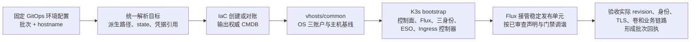

# PROD-K3S-V6 独立节点、集群冷启动规划与部署状态归档


## 最新部署状态（2026-11-01，北京时间）

以下为本次独立节点的实际证据，不代表业务验收或流量切换完成。

| 项目 | 状态 | 证据与缺口 |
| --- | --- | --- |
| 节点和独立盘 | ✅ 已验证 | Akamai `manbuzhe2026`、`jp-tyo-3`，实例 `109798839`、`172.237.5.48`；100 GB 盘 `18844637` 为 ext4，挂载 `/data`。[部署运行 #41251575217](https://github.com/ai-workspace-infra/Platform-Orchestrator/actions/runs/41251575217) 的 IaC 成功、部署失败。 |
| OS 身份和安全基线 | ⚠️ 部分验证 | `root`、`operator`、`auditor` 用户与同名组存在，`auditor` SSH 可登录且无 sudo。`fail2ban`、`auditd`、UFW 未运行，容器集群按节点安全方案选择是否启用；必需的 SSH、主机和云防火墙基线仍需按声明核验。 |
| K3s、Flux 与身份 | ⚠️ 部分验证 | K3s 运行，Flux `prod-k3s` 和 ESO 已就绪，GitOps revision `e5bc36a5fd9fb36d1f5a61324c06a426f075caee`。三账户已交付独立 kubeconfig；真实 `auditor` 可读取节点，Secret 读取、Deployment 创建、Pod exec 和 sudo 被拒绝；完整授权和独立回执仍待核对。 |
| K3s 身份 Vault 归档 | ❌ 未完成 | 目标 KV 的旧记录关联不同集群 UID，归档脚本拒绝覆盖，运行在归档阶段退出 23；需受控凭据轮换和活跃集群安全续跑。 |
| 公共 Vault TLS reader | ✅ 已验证 | 专用 JWT 公钥与当前集群匹配；单条 TLS 记录允许读取，相邻路径、错误 audience 和错误 ServiceAccount 拒绝。reader policy 包含 `auth/token/lookup-self`，不扩大 KV 读取范围。 |
| ESO 与证书 | ⚠️ 部分验证 | SecretStore `Valid`，ExternalSecret `SecretSynced`；`vault-prod/vault-server-tls` 已生成且有 `tls.crt`、`tls.key`。证书有效至 2027-01-05，SAN 为 `*.svc.plus`、`svc.plus`；证书链、密钥匹配和集群内 SNI 仍待验证。 |
| Vault | ❌ 未完成 | 容器 Running，`initialized=false`、`sealed=true`；初始化和解封由人工受控执行。当前 Vault 监听器日志显示 TLS disabled，必须修复并验证集群内 TLS，不能用 Flux Ready 替代服务验收。 |
| PostgreSQL | ❌ 未完成 | PVC 已绑定；镜像拉取 `401 Unauthorized`，Pod 未配置 imagePullSecrets；数据库初始化、角色和备份恢复均待验收。 |
| Observability | ❌ 未完成 | `datakit-dataway-secret` 与 `grafana-admin` 缺失，node-exporter 探针失败；监控链路未验收。 |
| Web SaaS、Ingress 与 DNS | ❌ 未验收 | Web SaaS 等待 PostgreSQL；Ingress 等待依赖。运行使用 `dns_mode=none`，未请求迁移或 DNS 变更；V5/canonical DNS 继续保持不变。 |
| 活跃集群续跑 | ❌ 未完成 | 现有 common 防护拒绝将活跃 Flux 图作为新节点重复 bootstrap；需绑定节点、PV、source/root 与 GitOps revision 后提供安全续跑入口。 |

**身份交付顺序：** master 生成并验证独立证书和私有 kubeconfig → 各用户交付默认配置并以真实身份验收 RBAC → 通过受控 writer 归档 Vault KV → 校验回读后形成成功回执。Vault 归档失败不能产生完整成功回执；不得覆盖冲突记录或从管理员配置复制凭据。

## 1. 状态标记与目标

| 标记 | 含义 |
| --- | --- |
| ✅ 完成 | 已有明确证据支持该项完成；如果只验证了历史引导，在说明中限定其时间和范围 |
| ❌ 未完成 | 尚未执行、缺少验收证据、存在阻断或当前状态待核实；不等于已证明资源不存在 |

**V6 的目标**：在独立节点、独立集群和独立存储上完成全部服务冷启动与验收，形成可供后续数据迁移和切换评审的候选环境。

- V5/canonical DNS 保持不变；V6 专属域名在新节点地址确认后新增解析，不指向 V5 节点。`dns_mode=none` 禁止 canonical 默认更新，V6 专属记录由受控 DNS owner 单独处理。
- 保留 V5 集群、数据库及原业务写入方。
- 新节点创建、全量服务部署、业务验收和流量/写入权切换分别判定，不相互替代。
- 当前工作为规划和状态整理；数据迁移、切换及旧环境退役另按具体任务授权执行。

## 2. 规划基线与工作树

当前批次采用独立节点、集群、数据盘和 IaC state；本次运行的云端资源与状态见顶部。各仓库默认 `main`，每次运行解析并记录 commit SHA。工作树状态只对核对时有效，不作为部署验收证据。

### 2.1 V6 批次域名分配

| 服务 | V6 批次域名 | 访问/路由边界 | DNS/TLS/验收状态 |
| --- | --- | --- | --- |
| Console UI | `console-selfhost-prod-v6.svc.plus` | Caddy → `web-saas-console.web-saas-prod.svc.cluster.local:80`；TLS Secret `ingress-prod/console-tls` | DNS 当前未核验；HTTPS/SNI、登录和 runtime `NOT_RUN` |
| Accounts API/UI | `accounts-selfhost-prod-v6.svc.plus` | Caddy → `web-saas-accounts.web-saas-prod.svc.cluster.local:80`；TLS Secret `ingress-prod/accounts-tls` | DNS 当前未核验；HTTPS/SNI、API 回归、错误率和 runtime `NOT_RUN` |
| Billing API/UI | `billing-selfhost-prod-v6.svc.plus` | Caddy → `web-saas-billing.web-saas-prod.svc.cluster.local:80`；TLS Secret `ingress-prod/billing-tls` | DNS 当前未核验；TLS、webhook 和 runtime `NOT_RUN`；真实扣款/退款未授权 |
| PostgreSQL | `postgresql-selfhost-prod-v6.svc.plus` | DNS 解析到 V6 新节点；应用使用集群内 Service DNS，迁移经受控 `migratectl` 连接；不开放公网 DB 端口 | DNS 当前未核验；Service、PVC、备份恢复及迁移连接均待部署验收 |
| Vault | `vault-selfhost-prod-v6.svc.plus` | V6 专属服务/TLS 名称；不通过 Caddy 对公网暴露管理/API。初始 TLS 材料仍从公共 `https://vault.svc.plus` 只读获取 | DNS 当前未核验；须确认受控证书 SAN、Vault `tlsServerName` 和集群内服务解析后才可放行 |
| Observability | `observability-k3s-v6.svc.plus` | 保留已声明的 Grafana `rootUrl` 候选；只按 VPN/受限运维通道设计，未配置公开 Caddy 路由 | DNS 当前未核验；入口认证、TLS 和监控 runtime 均待验收 |
| Content | 暂不分配独立公网域名 | 作为内部服务候选；业务 owner 未确认外部域名/独立 Caddy 路由 | 旧声明 `content-k3s-v6.svc.plus` 不作为本轮分配结果；待确认用途后再决定 |

V6 域名需重新核验 A/AAAA/CNAME、权威 DNS、解析目标和冲突。V6 TLS 证书需独立验证 SAN、有效期、信任链及证书/私钥匹配；GitOps Secret 引用不等于 Secret 已同步。


## 3. 独立节点与集群目标规格

本节是目标设计。已创建及已验收的范围见顶部最新状态，不将规格表本身视为运行证据。

| 项目 | 规划要求 |
| --- | --- |
| 云账户、地域 | Akamai `manbuzhe2026`、`jp-tyo-3`；执行前核实实际账户身份和地域能力 |
| 计算 | 1 台 `g6-standard-2`，2 个共享 vCPU / 4 GB |
| 系统 | 当前声明为 Debian 13；核实镜像和制品架构兼容性 |
| 集群展示名 | `PROD-K3S-V6` |
| 节点标识 | hostname、inventory 主键、K3s node name 统一为 `prod-k3s-v6`；下一批次从同一个 `node_hostname` 输入派生 |
| 稳定管理标识 | 根 Flux Kustomization 使用 `prod-k3s`，不随批次改名；批次目录、state、卷及凭据仍独立，见第 13 节 |
| 独立身份 | SSH host key、machine ID、集群 CA/UID、节点 UID 独立生成并留证 |
| Terraform | 独立 workspace、backend/state key；不接管 V5 state |
| 数据盘 | 独立 100 GB ext4 卷，挂载 `/data`，持久卷路径 `/data/k3s/storage` |
| 数据保护 | 实例和卷防误删；PVC/PV 保留行为、备份和恢复分别验收 |
| SSH | 当前声明临时使用 `0.0.0.0/0`；正式运行前落实操作员白名单 |
| Kubernetes API | 使用受控管理路径；不为公共 Vault 身份验证开放公网 API |
| DNS | V6 专属记录在新节点地址确定后新增；V5/canonical DNS 不修改，见第 14 节 |

### 3.1 容量与可用性边界

❌ **全业务栈容量验收未完成。** 2 vCPU / 4 GB 是用户选定的候选规格，不直接等于满足整个业务栈。

放行业务前应汇总固定 chart 渲染后的：

- requests/limits 与控制面预留；
- 镜像拉取、容器运行及滚动发布峰值；
- PostgreSQL 连接数和内存预算；
- 监控保留量、日志增长、磁盘空间与 inode；
- 数据备份、隔离恢复所需空间及 I/O。

容量不足时停在对应阶段，另行评审规格，不自动扩容。

单节点故障会影响整个 V6；独立数据盘和单副本 Vault Raft 不构成高可用。单节点入口及应用发布可能存在重启窗口，不能预先承诺零停机。

## 4. GitOps 层级与五个独立服务单元

✅ **层级规划已形成。** ❌ **完整目标图及各服务的运行验收尚未完成。**

所有 GitRepository 和 Flux Kustomization 位于 `flux-system`；HelmRelease 位于各服务 namespace。

六个 GitRepository 共用一个仓库 URL：[`https://github.com/ai-workspace-infra/gitops.git`](https://github.com/ai-workspace-infra/gitops)。每个 source 的配置 ref 独立固定。

下表按最新规划使用稳定根名 `prod-k3s`；旧回执中的 `prod-k3s-v6` 根对象名称保留为历史事实。本轮未修改 Flux YAML，也未对已有集群执行对象改名。

| 环境 | 集群 | 层/单元 | 工作负载 namespace | Flux Kustomization | HelmRelease | GitRepository | source path |
| --- | --- | --- | --- | --- | --- | --- | --- |
| PROD | PROD-K3S-V6 | 管理根 | `flux-system` | `prod-k3s` | — | `config-prod` | `environments/clusters/prod-k3s-v6` |
| PROD | PROD-K3S-V6 | ESO 前置 | `external-secrets` | `external-secrets` | `external-secrets` | `config-prod` | `services/prod-k3s-v6/cluster-prerequisites/external-secrets` |
| PROD | PROD-K3S-V6 | TLS 身份 | `vault-prod` | `vault-tls-identity` | — | `vault-prod-config` | `services/prod-k3s-v6/vault-prod/tls-identity` |
| PROD | PROD-K3S-V6 | TLS 同步 | `vault-prod` | `vault-tls-bootstrap` | — | `vault-prod-config` | `services/prod-k3s-v6/vault-prod/tls-bootstrap` |
| PROD | PROD-K3S-V6 | Vault | `vault-prod` | `vault-prod` | `vault` | `vault-prod-config` | `services/prod-k3s-v6/vault-prod` |
| PROD | PROD-K3S-V6 | PostgreSQL | `postgresql-prod` | `postgresql-prod` | `postgresql` | `postgresql-prod-config` | `services/prod-k3s-v6/postgresql-prod` |
| PROD | PROD-K3S-V6 | Observability | `observability-prod` | `observability-prod` | `observability`、`observability-agent`、`datakit` | `observability-prod-config` | `services/prod-k3s-v6/observability-prod` |
| PROD | PROD-K3S-V6 | Web SaaS | `web-saas-prod` | `web-saas-prod` | `web-saas-prod` | `web-saas-prod-config` | `services/prod-k3s-v6/web-saas-prod` |
| PROD | PROD-K3S-V6 | Ingress | `ingress-prod` | `ingress-prod` | `caddy-ingress` | `ingress-prod-config` | `services/prod-k3s-v6/ingress-prod` |

目标图共 **6 个 GitRepository、9 个 Flux Kustomization、8 个 HelmRelease**。包含五个服务 namespace，以及 ESO 和 Flux 控制 namespace。

> 历史初次引导回执只有 6 个 GitRepository、6 个 Kustomization、7 个 HelmRelease；当时尚未加载新增 ESO/TLS 前置图。目标图数量与历史回执数量不同，不能把两者混作同一次验收。

### 4.1 共用 chart 包与独立版本

PostgreSQL、Caddy、Web SaaS 共用 `distributed-web-saas-fullstack` chart 包，通过独立 values 选择组件、分别固定版本。

| HelmRelease | 启用范围 | 必须关闭的重复组件 |
| --- | --- | --- |
| `postgresql` | PostgreSQL、Service、PVC 和数据库运行配置 | Caddy、UI/API 及其他无关组件 |
| `caddy-ingress` | Caddy、TLS 引用和显式跨 namespace 后端 | PostgreSQL、UI/API 及其他无关组件 |
| `web-saas-prod` | UI/API Deployment、Service 和应用配置 | 内嵌 PostgreSQL、Caddy 及其他无关组件 |

独立发布约定：

1. 根更新只推进选中单元的 source pin，其他单元保留原版本。
2. 配置 Git ref、chart digest、应用镜像版本分别记录。
3. 子 Kustomization 和 HelmRelease 的放行状态配套声明，避免相互等待。
4. 根只应用管理图，`wait: false`；各子单元独立报告健康。
5. Web SaaS 当前仍为一个 HelmRelease，不宣称 UI/API 已各有独立 HelmRelease。
6. 独立选择版本和调谐范围，不取消依赖、数据保护或有状态升级限制。

## 5. 冷启动顺序与放行条件

本表的状态指“阶段完整放行条件是否已有证据”。历史子项通过不自动使整个阶段通过。

| 阶段 | 状态 | 工作内容 | 放行条件与当前缺口 |
| --- | --- | --- | --- |
| 0 Plan 证据、制品与容量准备 | ❌ 未完成 | 记录本次运行解析的基础仓库 SHA；业务制品固定不可变版本 | 完整制品核验和 2C4G 全栈容量评审仍无充分证据 |
| 1 IaC | ✅ 已创建 | 独立节点与数据盘 | 实例 `109798839`，盘 `18844637` 已绑定；运行 #41251575217 的 IaC 通过 |
| 2 common | ⚠️ 部分完成 | hostname、三账户和声明要求的主机基线 | 身份和 auditor 登录已验证；fail2ban、auditd、UFW 未运行，是否启用按节点安全方案选择，其他必需基线待核验 |
| 3 存储与控制面 | ⚠️ 部分完成 | 独立盘、K3s 和 Flux | 100 GB ext4 挂载 `/data`，K3s 运行；安全幂等续跑未验收 |
| 4 管理根 | ✅ 已观察 | 管理 source/root | `prod-k3s` Ready，GitOps commit `e5bc36a5…`；业务就绪另验 |
| 5 ESO 与 TLS 身份 | ✅ 已验证 | ESO、专用身份和权限 | 指定 TLS KV 允许，邻接路径、错误 audience 和 ServiceAccount 被拒绝；SecretStore Valid |
| 6 TLS 同步 | ⚠️ 部分完成 | 生成 `vault-prod/vault-server-tls` | SecretSynced，证书有效期和 SAN 已核对；链、密钥匹配及实际集群内 TLS 待验证 |
| 7 Vault | ❌ 未完成 | 新 Raft 存储、初始化、unseal、内部认证 | 容器运行但未初始化、未解封；监听器 TLS disabled，须修复 |
| 8 PostgreSQL | ❌ 未完成 | 新 PVC、空目标库、审查后的 SQL schema 和分权角色 | PVC 已绑定；GHCR 镜像匿名拉取 401，凭据、schema、权限及恢复待验收 |
| 9 Observability | ❌ 未完成 | 新监控存储、采集、查询、Dashboard、告警 | 缺少 DataKit/Grafana Secret，node-exporter 探针失败；完整链路未验收 |
| 10 Web SaaS | ❌ 未验收 | 应用、数据库连接和隔离验证模式 | 等待 PostgreSQL；业务身份及内部链路未验收 |
| 11 Ingress | ❌ 未验收 | 最后部署 Caddy、TLS 和跨 namespace 路由 | 等待依赖；Host/SNI、域名解析尚待单独核验 |
| 12 整体验收 | ❌ 未完成 | 迁移评审、业务恢复、回归、重跑与观察 | 尚未形成完整证据及待切换报告 |

**Vault 初始化顺序**：安装后先确认 Pod、卷和 TLS 挂载具备初始化条件，再由 Vault owner 初始化/unseal，最后等 Vault Ready。不能先要求未初始化的 Vault Ready，才允许初始化。

首次部署顺序明确为：

```text
独立 IaC → common → 存储/K3s/Flux → 管理根
→ ESO → TLS 身份及允许/拒绝验收 → TLS Secret 同步
→ Vault 初始化与内部认证 → PostgreSQL → Observability
→ Web SaaS → Ingress → 整体验收 → 待切换评审
```

部署编排顺序不全部转换成永久硬依赖：Web SaaS 不依赖独立监控的发布健康；监控维护不应阻断业务发布。数据、证书、身份等实际硬前置仍须保留。

## 6. 密钥、网络与三权分立

### 6.1 初始 TLS 信任引导

```text
公共 https://vault.svc.plus
→ V6 专用 JWT 身份
→ 仅读取 kv/data/CICD/domains/svc.plus
→ ESO
→ vault-prod/vault-server-tls
```

| 项目 | 状态 | 约定或证据 |
| --- | --- | --- |
| V6 公共 Vault 专用身份 | ✅ 已配置与验收 | 指定记录允许，相邻路径、错误 audience、错误 SA 拒绝 |
| 初始 TLS 来源 | ✅ 已明确规划 | 使用公共 Vault 已有证书记录，不在本机签发 |
| ESO 到目标 Secret 同步 | ❌ 未验收 | 目标为 `vault-prod/vault-server-tls`，类型 `kubernetes.io/tls` |
| 证书验证 | ❌ 未验收 | 信任链、有效期、证书/私钥匹配、SAN `vault-k3s-v6.svc.plus` |
| 内部 TLS 连接契约 | ❌ 待核实 | Service FQDN 的 SAN 或受支持的 TLS server-name 配置须与实际调用一致 |
| V6 Vault 内部运行凭据/ESO 路径 | ❌ 未验收 | V6 Vault 就绪后独立建立，不能依赖未启动的 V6 Vault 提供初始证书 |

公共 Vault JWT 身份与 V6 Vault 内部认证分开管理；不使用静态 Vault token 兜底，不输出证书私钥、token 或 DSN。

### 6.2 服务 KV 路径

服务 KV 路径按 V6 所需收敛，不包含部署批次标识。路径是规划声明，不代表 Vault 记录、字段或 ESO 同步已实时验收。

| 服务范围 | V6 KV 逻辑路径 | 使用边界 |
| --- | --- | --- |
| Accounts、Billing、Content 运行时及 OAuth 配置 | `kv/prod/accounts/runtime` | 三个服务按需从此路径映射运行时及 OAuth 配置；共享 token 也在此路径。目标 Kubernetes Secret 为 `web-saas-secrets`。OAuth 与其他敏感字段只交付给获准的消费者；若三者都挂载同一 Secret，则三者都能读取其中全部字段。 |
| PostgreSQL DB | `kv/prod/database/postgresql` | PostgreSQL 初始化与运行所需身份凭据归入此路径范围；数据库侧仍按 admin、operator、auditor 三类身份分别授权。Vault KV 路径级策略不能隔离同一记录内的字段，ESO 读取身份和 Secret 投递范围需据此审查。 |
| 域名 TLS | 公共 Vault `kv/CICD/domains/svc.plus`、`kv/CICD/domains/xworktech.com` | V6 按域名读取现有公共证书来源；不复制或迁移 V5 私有证书内容。具体证书字段与同步目标须在部署验收时核对。 |

V6 验收仍需确认上述路径的 Vault 实存与字段合同、ESO 映射和目标 Secret 内容，以及 PostgreSQL 三身份权限边界；在完成核验前均标记为未验收。Vault 首次初始化和 unseal 材料由外部安全托管；新集群迁移时须人工初始化与解封，不将这些材料写入上述常规 KV 运行时路径。旧记录的复制、迁移或退役不属于本节声明。

### 6.3 跨 namespace 访问契约

| 链路 | 规划要求 | 运行验收状态 |
| --- | --- | --- |
| Caddy → UI/API | 明确 Service FQDN 和端口，核对固定 chart 实际渲染名称 | ❌ 未验收 |
| UI/API → PostgreSQL | 集群内 Service；数据库不经 Caddy、不对公网开放 | ❌ 未验收 |
| Caddy → Vault/Observability | 独立路由及认证，启用后端 TLS 校验 | ❌ 未验收 |
| Caddy 读取 TLS | Secret 位于 `ingress-prod`，由该 namespace 受控同步路径生成 | ❌ 未验收 |
| NetworkPolicy | 只开放必要链路，并实际验证 CNI 执行隔离 | ❌ 未验收 |
| V6 DNS 与无 DNS 路由验收 | 先以受控解析覆盖验证 Host/SNI 和 TLS，再按第 14 节添加 V6 专属 DNS；V5 DNS 不变 | ❌ 未验收 |
| 外部 OAuth/Webhook | 无真实外部回调证据时不能标通过 | ❌ 未验收 |

### 6.4 三权分立

| 身份 | 职责与权限边界 | 已有状态 |
| --- | --- | --- |
| 系统管理 | 主机、控制面、初始化及恢复；不作为日常业务进程或应用数据库连接身份 | ✅ common 有历史验收；❌ 各服务完整运行边界仍需验证 |
| 独立业务账户 | 服务独立 SA/Vault role/DB DML 角色；业务进程非 root；只授予必需对象权限 | ❌ 待逐服务部署与验收 |
| 强制只读审计 | 独立系统身份与 RBAC；允许必要状态读取，拒绝配置写入、Secret、exec、提权和业务数据写入 | ✅ 已有有限范围允许/拒绝验收；❌ 完整审计覆盖待核实 |

已验收审计身份为 `cluster-audit`，Kubernetes 身份为 `system:serviceaccount:flux-system:cluster-audit`。历史回执允许 `system-status`、`nodes`、`namespaces`；拒绝 `admin-kubeconfig`、`system-write`、`data-write`、`secrets`、`node-proxy`、`namespace-write-dry-run`。

该回执不证明已有通用 SSH 审计登录或 Flux/PVC/业务数据的完整只读盘点权限，也不等于所有业务服务已经落实分权。

## 7. 已有 V6 的续建策略与当前阻断

当前阻断为身份凭据生成或 Vault 归档失败，以及 common 对活跃 Flux 图拒绝续跑。先核对节点、PV、Flux source/root 和固定 GitOps 声明的一致性，修复安全幂等续跑；再分类诊断身份失败、交付三个账户的独立 kubeconfig，并以真实身份验证 RBAC。不得暂停 Flux、重置集群、格式化已有盘或覆盖 Vault 凭据来绕过保护。

## 8. 数据、整体验收与未来升级

### 8.1 三类完成条件

| 结果 | 状态 | 判定条件 |
| --- | --- | --- |
| 冷启动通过 | ❌ 未完成 | 五个单元已安装，身份、TLS、存储和内部链路通过 |
| 数据与业务验收通过 | ❌ 未完成 | 审查后的 `migratectl` 迁移、数据比对、含业务数据的隔离恢复、真实回归及观察通过 |
| 可切换 | ❌ 尚未达到 | 在前两项通过后，另行评审最终追平、源写者隔离、流量切换及恢复方案 |

### 8.2 数据迁移与恢复要求

- 迁移前 V6 业务写者、后台任务、真实支付和通知受控。
- 迁移源连接只读；V5 原业务写入方保留。
- 固定工具版本、源快照边界、目标身份、SQL schema 和迁移范围。
- 新集群使用空目标库和审查后的 schema；先验证备份恢复，再应用审查后的迁移计划。
- 记录数据比对、权限、应用实际连接、业务不变量和失败恢复证据。
- 对已导入业务数据的候选进行隔离备份恢复；空库恢复不能替代业务数据恢复。
- 源继续写入时，初次复制不等于零延迟追平；写者交接和流量切换单独评审。

❌ 本轮数据迁移、业务恢复、真实回归、重复运行、中断恢复和观察预算均未完成。

### 8.3 后续版本发布规则

| 类别 | 原地滚动发布规则 | 验收与恢复边界 |
| --- | --- | --- |
| 前端 UI | 纯展示、无状态变化可在所属单元发布 | 保留旧制品；验证页面、关键流程和错误率 |
| API | 小型、向后兼容且不改 SQL schema/持久格式的修复可原地发布 | 验证接口、回归、错误率；代码回退不等于数据回滚 |
| 独立监控服务 | 仅非业务、非账单且不涉及有状态存储版本/格式转换的明确例外可原地维护 | 固定单元版本，验收采集/查询，保留必要备份恢复证据 |
| DB 与有状态组件 | PostgreSQL、Vault Raft、监控存储、其他持久卷的版本或状态转换，以及 SQL schema 版本变化，必须在下一代独立集群和存储验证 | 保留源集群和原写入方；按审查后的路径迁移/恢复，不以镜像回退代替数据回滚 |

未来代际使用独立 IaC state、集群身份、存储、Flux 配置引用和证据。V6 冷启动通过不代表下一版本升级已经通过。

## 13. 泛化命名与幂等执行修订（2026-10-30，目标设计）

✅ 本节规则已记录。❌ 通用声明渲染、流水线、Vault 授权与运行验收尚未按本节全部改造；本轮只调整文档。

### 13.1 稳定对象名与批次隔离

明确区分两层：**GitOps 环境入口**供 Flux CD 选择 SIT/UAT/PROD 声明，根 Kustomization 分别使用稳定名 `sit-k3s`、`uat-k3s`、`prod-k3s`；**批次环境实例**如 `prod-k3s-v6`，才对应本次独立节点、集群及目录、state、存储和凭据隔离。稳定根名不标识某台节点或某一批次。

| GitOps 环境选择 | Flux 根 Kustomization（namespace 为 flux-system） | 批次环境实例示例 | 根 source path 示例 |
| --- | --- | --- | --- |
| SIT | `sit-k3s` | `sit-k3s-v6` | `environments/clusters/sit-k3s-v6` |
| UAT | `uat-k3s` | `uat-k3s-v6` | `environments/clusters/uat-k3s-v6` |
| PROD | `prod-k3s` | `prod-k3s-v6` | `environments/clusters/prod-k3s-v6` |

本表是命名对照，不代表三个示例批次均已创建。根名由所选 GitOps 环境派生；实际目标仍由批次声明、CMDB 和经过验证的集群连接共同确定，不能仅凭根对象名称选择或证明目标。

同类环境在基础规格与组件候选不变时，先选择 `gitops_environment`，每次新建批次只填写 `deployment_batch` 和 `node_hostname`。其他目标路径和资源名统一派生，不逐个文件手改 `v6`。以下是设计接口示例，尚非现有执行器已支持的 schema：

```yaml
gitops_environment: prod
deployment_batch: v6
node_hostname: prod-k3s-v6
```

统一派生 `flux_root_name = <gitops_environment>-k3s`，再派生 `environment_instance = <flux_root_name>-<deployment_batch>`；本例分别为 `prod-k3s` 和 `prod-k3s-v6`。批次目录通过共享 base/默认配置和本批次 overlay 生成可审查声明；不人工复制一套执行 role、工作流或版本判断分支。批次与 hostname 是两个独立输入，不靠反解析 hostname 猜批次。

| 配置项 | 稳定部分 | V6 解析结果 / 下一批次行为 |
| --- | --- | --- |
| GitOps 环境入口 | `sit-k3s` / `uat-k3s` / `prod-k3s` | 从 SIT/UAT/PROD 环境选择派生；跨环境另选配置，不隐式回退到 prod |
| 批次环境实例 | 派生公式不变 | `prod-k3s-v6`；下一批次如 `v7` 则为 `prod-k3s-v7` |
| 节点 hostname / inventory / K3s node name | 使用同一个输入 | `node_hostname`；不与根 Kustomization 名绑定 |
| 根 Flux Kustomization | `flux-system/prod-k3s` | 每个独立集群内同名；根不再叫 `prod-k3s-v6` |
| 根配置源 | `flux-system/config-prod` | 同一仓库 URL，固定该批次审查后的 tag/commit |
| 根调谐路径 | `environments/clusters/<environment_instance>` | `environments/clusters/prod-k3s-v6` |
| 子调谐路径 | `services/<environment_instance>/<unit>` | `services/prod-k3s-v6/vault-prod` 等；由相同批次环境实例派生 |
| 子 Kustomization / namespace / HelmRelease | 现有 `vault-prod`、`postgresql-prod`、`observability-prod`、`web-saas-prod`、`ingress-prod` 及其 release 名 | 各独立集群内复用名称，不添加批次后缀；ESO/TLS 前置也保持稳定名 |
| IaC target / state / 云卷归属 | 派生规则与 provider/account 配置 | target、state namespace 和卷标签包含 `environment_instance`，不复用旧批次 state 或数据盘 |
| K3s 三身份 Vault KV | `kv/<environment>/<cluster>/<role>` 契约 | `<environment>` 取已选 GitOps 环境，`<cluster>` 取独立的 `environment_instance`，如 `kv/prod/prod-k3s-v6/auditor`；不能改为所有批次共用一条稳定根名对应的凭据记录 |
| OS SSH 公钥 | `kv/<environment>/security/<role>` | 环境级公钥保持现有约定；不混入集群客户端私钥 |
| 执行与验收回执 | 固定字段与校验规则 | 记录批次、hostname、实际实例 ID、节点 UID、集群标记、卷 UUID、声明 SHA 与 run ID；每个新目标重新取证 |

这里的 source path 准确对应 **`Kustomization.spec.path`**；`GitRepository.spec.ref` 是独立的配置版本引用。根对象使用稳定名称，但其 path 随批次改变，例如：

```yaml
metadata:
  name: prod-k3s
  namespace: flux-system
spec:
  path: ./environments/clusters/prod-k3s-v6
  sourceRef:
    kind: GitRepository
    name: config-prod
```

该片段仅说明命名，不是完整可部署对象。V7 在新集群仍创建 `prod-k3s`，path 指向 `prod-k3s-v7`；**不能把旧集群的 path 改成新批次目录来代替创建新集群**。同名根安全复用的前提是 Kubernetes 集群本身独立。

“每次只变批次与 hostname”指目标配置输入。IaC、GitOps、Playbooks、Orchestrator 默认从 `main` 执行，必要选择由 `workflow_dispatch` 参数控制；运行回执记录实际解析到的 SHA 用于审计，不把基础仓库 tag 作为每轮发布前置。业务 chart、镜像及 SQL schema 候选按各自不可变制品/版本规则管理；批次名不充当工作流代码版本或应用制品版本。

### 13.2 一份目标声明驱动所有阶段



- 控制面、IaC、Playbooks、Flux 与验收器消费同一份解析结果，不分别维护 `prod-v6` 白名单、固定 hostname、根名等第二套目标矩阵。通用 root 名、node 名、批次路径必须分别传递和校验；不能继续要求 `root_name == node_hostname`。
- 目标配置放在 GitOps；执行器保留通用接口。组件清单按选定候选声明核验，避免以永久写死的对象数量替代所有权、路径、版本及健康检查；缺失必需对象仍须拒绝放行。
- Vault writer 和公共 Vault TLS reader 的批次授权由受控身份配置流程消费同一目标声明，派生本批次精确路径、签名公钥和角色绑定。可以自动生成目标专用 role/policy，但不要求每次手写一套代码；不能用跨批次通配读写授权代替自动化。该授权自动化尚未实现。
- 初始化回执通过后，服务资源由 Flux 调谐，流水线只负责已声明门禁、状态观察与证据汇总。ESO 与 Ingress 控制器属于初始化；Vault → PostgreSQL → Observability → Web SaaS 的首次部署按阶段验收，正式 Ingress 路由最后验证，再按第 2.1 节核验并由 DNS owner 处理 V6 批次域名解析；V5 DNS 始终不切换。
- 放行状态必须进入固定 GitOps 声明；后续发布不靠重复 SSH apply/resume。监控验收顺序不成为业务发布的永久依赖，真实存储、身份和证书依赖仍保留。

### 13.3 幂等与恢复契约

| 场景 | 预期行为与证据 |
| --- | --- |
| 同一批次、同一 hostname、同一 dispatch 输入及相同解析 SHA 的幂等重试 | 核对实际实例/节点/集群/卷身份后继续；不重复创建资源、不格式化已验收数据盘、不重签 CA，不无条件重启。记录变更量及健康结果。若 `main` 已前进，则作为新的代码候选重新验证并记录 SHA，不把旧 SHA/tag 当成基础仓库默认版本 |
| 同一 state 输入变为另一 hostname、provider、账户或批次 | 拒绝隐式替换；新批次使用独立 state 和存储，不能以“幂等”名义销毁旧资源 |
| 同一目标已完成部分阶段 | 验证对应回执仍匹配目标与候选，跳过已完成部分，从首个未通过门禁继续；不把 active Flux 图重新变成全部暂停，不退回旧声明覆盖现场 |
| 三身份初始化及 Vault 归档重跑 | 同一实际集群下复用一致且有效的节点私有凭据，验证信任链与 Vault 回读；首次归档 CAS 防覆盖。过期、不同记录或部分签发失败进入受控修复/轮换，不无限自动重签 |
| 节点删除后同名重建 | hostname 相同不等于原集群。实例 ID、集群标记或卷归属变化使旧证据失效；不得自动复用旧 CA、凭据或有业务数据的卷。目标身份冲突时改用新批次，或执行另行审查的恢复流程 |
| Flux 日常独立发布 | 稳定 KS/HR 名称不变，只推进被选中单元的不可变配置/制品引用；其他单元保持原候选。数据/SQL schema 状态转换仍使用下一批次新集群 |
| 失败、并发与复验 | 同一目标加锁，禁止两个运行同时初始化；保留已创建资源、受保护签发状态和脱敏失败回执，重试前对账。候选或实际目标改变时，重验受影响阶段，不能沿用旧 PASS |

凭据例行轮换属于独立生命周期任务，不通过重跑冷启动来实现；需要精确的更新授权、消费者切换及旧凭据退出证据。上述幂等规则是目标契约，现有“仅接受全图暂停”的 bootstrap 还不能直接用于任意阶段恢复。

### 13.4 当前实施差异

`prod-k3s` 管理根及 Flux 控制器已在当前节点观察到；独立身份交付、活跃 Flux 安全重试及服务验收仍未完成，以顶部状态为准。

## 14. PROD-K3S-V6 批次域名规划与验证边界（2026-10-30）

本节域名方案按用户给出的 V5 现状命名，并把 PROD-K3S-V6 的批次名称与 DNS 开通、服务上线分别管理。**域名分配不代表 DNS 已创建，不代表 TLS 已就绪，也不代表服务已验收。** 用户已要求 V6 专属域名最终解析生效；新增记录须使用新 V6 节点地址，V5 canonical 域名不改，V6 名称不指向 V5。`dns_mode=none` 继续保护 canonical 名称；六个 V6 专属记录另经受控 DNS owner 更新。

### 14.3 声明与放行状态

- Console、Accounts、Billing 的 Caddy 路由与节点 `service_domains` 采用本节确认名称；Observability 保留 `observability-k3s-v6.svc.plus`。六个指定域名都需要 DNS 解析到 V6 新节点；PostgreSQL 端口仍关闭，Vault/API 和 Observability 访问仍受入口及认证策略限制；Content 不再以旧名称作为已分配域名。
- GitOps 声明与本节方案已提交 [GitOps PR #672](https://github.com/ai-workspace-infra/gitops/pull/672)，归档提交在 [Docs PR #1](https://github.com/ai-workspace-infra/docs/pull/1)；均待审查。当前没有合并或发布的 V6 域名版本。域名方案进入 PR 不等于 DNS 变更或运行验收。
- 新增 DNS 前先对 V6 节点 IP 使用 `curl --resolve <host>:443:<V6-IP>` 验证适用的 Host/SNI 和证书；不得跳过证书校验。PostgreSQL 域名解析不代表开放 Caddy 路由或 5432 端口。
- 新增 V6 专属 DNS 记录是用户已明确提出的目标，但实际改 DNS 尚未执行；`dns_mode=none` 只禁止默认更新 canonical 域名。应由受控 DNS owner 对六个确切 V6 批次名称新增解析，目标取本次 IaC/CMDB 核实的 V6 节点地址；记录只负责名称解析，不自动授权开放 PostgreSQL 端口或 Vault 管理/API。六个不更新的 canonical 名称为 `vault.svc.plus`、`observability.svc.plus`、`console.svc.plus`、`accounts.svc.plus`、`billing.svc.plus` 和 `postgresql.svc.plus`。
- 证书签发/更新、V5 canonical 切换、外部 webhook/业务流量、数据库公网接入都需要各自独立的审查与授权；不得由冷启动或 `service_domains` 清单隐式触发。V5 canonical 切换不属于本次 DNS 目标。

## 16. 服务凭据路径与 Vault 初始化方案确认（2026-10-30）

本节记录用户最新确认，替代此前建议的 `kv/prod/services/prod-k3s-v6/...` 业务凭据前缀及“初始化托管方案待确认”的状态。**✅ 路径与托管规则已确认；❌ 记录存在性、字段适配、最小权限及运行验收尚未完成。** 文档更新不代表已读取、创建、复制或修改任何 Vault 记录。

### 16.1 不带部署批次版本的服务 KV 路径

当前路径与使用边界见第 6.2 节，不重复维护另一份清单。

### 16.2 公共 Vault 域名 TLS 来源

| TLS 证书所属域 | 公共 Vault KV 逻辑路径 | 实施要求 |
| --- | --- | --- |
| `svc.plus` 及实际 SAN 覆盖的域名 | `kv/CICD/domains/svc.plus` | 路径不变；V6 的 `vault-server-tls` 和对应 Ingress TLS Secret 按实际域名映射 |
| `xworktech.com` 及实际 SAN 覆盖的品牌域名 | `kv/CICD/domains/xworktech.com` | 保留独立来源；按实际路由域名选择证书，不能用 `svc.plus` 证书替代 |

现有消费者使用 `tls_fullchain_pem_b64` 与 `tls_key_pem_b64`，实际字段存在性仍需验收。公共 Vault 地址仍为 `https://vault.svc.plus`，只读身份按所需精确路径授权；不因加入第二条来源就扩大为 `kv/CICD/domains/*`。

TLS 同步必须验证证书有效期、完整链、证书与私钥匹配及实际 SNI/SAN。公共域名证书不自动覆盖 `*.svc.cluster.local`，集群内 Vault TLS 仍须使用有效验证名称或受控内部 SAN 证书，不能关闭校验。加入证书来源不增加 DNS 或公网路由授权；第 14 节 V6 专属域名及 canonical 禁止变更边界继续生效。

### 16.3 Vault 初始化/unseal：外部安全托管与手动操作

- ✅ 初始化及 unseal 材料采用外部安全托管；不在本节服务 KV 中新增 root token/unseal shares 记录。
- ✅ 迁移过程中通过受控管理通道手动初始化新 Vault，并手动完成所需 unseal。本轮不引入自动初始化或 Transit/KMS auto-unseal。
- 执行前核对实际新集群/实例及 Vault 的 `initialized`、`sealed` 状态；仅对未初始化的新目标执行 init。已初始化的实例不得重复初始化。
- 新目标使用自己的初始化材料。旧 Raft 快照恢复、加入已有 Raft 集群及其材料使用采用对应恢复流程，不能将旧 unseal shares 当作新初始化材料。
- root token、unseal shares 不交给 IaC/GitHub Actions，不写入 Git、workflow inputs、artifact、日志或聊天。流水线只观察 `initialized=true`、`sealed=false` 和服务健康，不输出材料。
- ❌ 外部托管完成、手动初始化/unseal 及新 Vault 健康证据尚未验收。门禁未通过时停止后续服务验收，不能把安装成功记成 Vault 可用；完成后按同一候选继续，无需重新创建节点或存储。

### 16.4 来源核对与当前实施状态

V5 K3s 的业务 SecretStore 声明指向 `https://vault-raft.platform-vault.svc.cluster.local:8200`，其业务来源包括 `kv/prod/services/web-saas-k3s-v5/database`、`.../jwt`、`.../tls` 和 `.../brand-tls`。这些是旧集群内 Vault 的声明引用，不能据此认定公共 Vault 已有相同记录。旧 Selfhost/Compose 另有 `kv/prod/databases`、`kv/WEB_SAAS` 等入口，不作为 V6 的默认 fallback。

来源文件：GitOps `services/distributed-web-saas-fullstack/prod/{external-secret,secret-store}.yaml`；Playbooks `roles/vhosts/vault_operator_material/README.md`；白皮书配套 `knowledge/docs/reference/platform-ops-toolkit/04-security-vault-and-iam/{kv_tier_model,manual-unseal}.md`。这里只核对路径、字段与规则，没有读取秘密值。

GitOps [草稿 PR #673](https://github.com/ai-workspace-infra/gitops/pull/673) 正在清理 V6 混合暂停状态和已删除节点的旧回执引用。完整冷启动 DAG、三身份交付、ESO 字段映射及服务验收仍在配套实现，不能将本节确认写成部署完成。
