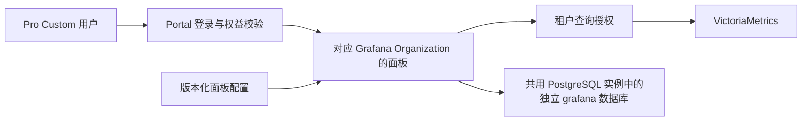

# Pro Custom 专属资源工作台与 Grafana 升级完整规划

日期：2026-11-03（Asia/Shanghai）。状态：用户确认的规划记录，尚未实施或运行验收。需求：[Knowledge #351](https://github.com/ai-workspace-services/knowledge/issues/351)。

本文完整记录本次讨论的决策、证据边界及验收要求。五份专题分别展开[产品功能](Pro-Custom专属资源工作台规划.md)、[持久化与备份](Grafana独立PostgreSQL与GitOps持久化规划.md)、[面板恢复](Grafana面板丢失排查与恢复规划.md)、[租户隔离与嵌入](Grafana租户隔离与Portal嵌入规划.md)、[交付与验收](Pro-Custom与Grafana分阶段交付验收规划.md)。

## 1. 总体决策

建议 Grafana 改用 PostgreSQL 中独立的 `grafana` 数据库保存自身状态，同时把标准面板、数据源和插件依赖纳入完整的 GitOps 交付。用户已澄清：可以与业务共用同一套 PostgreSQL 实例，独立的是数据库与服务账户，不要求单独实例或主机。该方案面向 Pro Custom 用户专属节点监控。

这次面板全部消失，已找到比数据库是否外置更直接的配置缺口：V6 观测部署没有接上旧版面板导入包。换数据库本身不会修复这个遗漏，也不会自动恢复旧面板。

升级分为恢复现有面板、建立持久化保障、接入用户专属监控三个阶段；实施时再拆分身份隔离、Portal 接入和升级演练等可独立验收的步骤。

## 2. 面板消失的证据与待核实事项

本轮核对的是 GitOps 主干固定提交 `16b4bc8f419debfd70fbcd2c7920825cadcc543e`，不代表此提交一定是线上正在消费的版本。

| 检查项 | V5 声明 | V6 声明 |
| --- | --- | --- |
| 持久化 | 已启用 PVC | 也已启用 PVC |
| 部署身份 | release 为 `platform-observability`，namespace 为 `platform-observability` | release 为 `observability`，namespace 为 `observability-prod` |
| 面板配置 | 引用 `source-grafana-values` 和面板 ConfigMap | 没有对应引用 |
| 自动导入 | 配置 dashboard providers | 未配置 |
| 外部数据库 | 本轮未确认运行时配置 | 声明中没有外部数据库配置 |

证据：[旧版发布声明](https://github.com/ai-workspace-infra/gitops/blob/16b4bc8f419debfd70fbcd2c7920825cadcc543e/services/platform-observability/prod/release.yaml#L25)、[旧版面板包](https://github.com/ai-workspace-infra/gitops/blob/16b4bc8f419debfd70fbcd2c7920825cadcc543e/services/platform-observability/prod/imported-grafana/source-grafana-values.yaml#L8)、[V6 发布声明](https://github.com/ai-workspace-infra/gitops/blob/16b4bc8f419debfd70fbcd2c7920825cadcc543e/services/prod-k3s-v6/observability-prod/helmrelease.yaml#L69)。上述对象名仅用于解释已发布源码，不作为本次操作目标。

优先核实的假设是：升级建立了新的 Grafana 实例和存储，但没有迁入原有配置，也没有重新加载 Git 中的面板。这会表现为 Grafana 能打开而面板全部消失。

最初只读核对仅确认声明缺口，未检查实际 PVC 与数据库。此前公开健康接口返回版本 `13.2.4`、数据库连接正常，仅证明进程和数据库可用，不能证明面板完整，也不是持续有效的健康承诺。

2026-11-03 14:36–14:37（Asia/Shanghai）追加现场只读对比：V5 新版资源存储保留 21 个 Dashboard、3 个 Folder，V6 均为 0；V6 无面板导入文件挂载，三个数据源 UID 也与 V5 不同。现有迁移手册未列 Grafana 专项导出、导入与逐 UID 验收。由此确认迁移交付遗漏；并非源端面板已经全部丢失。详见[现场证据与漏项清单](Grafana面板丢失排查与恢复规划.md#7-2026-11-03-v5v6-现场只读对比补充)。本轮没有执行恢复，也未验证浏览器渲染或历史遥测迁移。

旧版 Node exporter、Process exporter、Xray 等面板定义及清单仍在仓库，是明确的部分恢复来源；UI 临时修改、自定义面板、用户和权限是否可恢复，仍需检查源数据库与备份。

## 3. 外部 PostgreSQL 的职责

| 数据 | 保存位置 | 作用 |
| --- | --- | --- |
| Grafana 用户、组织、权限、面板运行状态等 | PostgreSQL 实例内独立 `grafana` 数据库 | Grafana 重建后继续使用 |
| 标准面板、数据源定义、插件版本、告警定义 | Git 声明和版本化发布包 | 审查、重放与恢复 |
| CPU、内存、Caddy、Xray 指标 | VictoriaMetrics | 保存监控历史 |
| 日志和链路 | VictoriaLogs、VictoriaTraces | 保存对应观测数据 |
| 数据源凭据和 Grafana 加密密钥 | Vault 等受控秘密存储 | 恢复后解密和连接 |

外置 PostgreSQL 配置的是 Grafana 自身的 `[database]`，不是在 Grafana 页面新增 PostgreSQL 数据源。[官方配置说明](https://grafana.com/docs/grafana/latest/setup-grafana/configure-grafana/#database)

- 使用独立 `grafana` 数据库和服务账户。
- 数据库生命周期独立于 Grafana Pod、Helm release 和 V5/V6 应用升级。
- 可复用业务 PostgreSQL 实例，创建独立 `grafana` 数据库；不与 Accounts 共用同一个数据库或仅靠 schema 分隔，也不随 Grafana 工作负载重建。
- 初期 Grafana 保持单实例，先解决持久化和恢复，再考虑多副本。
- 数据库不可用时明确报错，禁止通过重新初始化空库来掩盖故障。

外置数据库改善实例替换、存储变化和后续扩容，但仍需要备份，也不能阻止错误配置发布删除面板。

## 4. 升级后面板完整性的保障

标准 Node、Process、Caddy、Xray 面板拥有唯一发布来源，通过现有 GitOps 路径交付，各环境引用同一版本面板包。包内包含 Dashboard UID、Folder UID、Datasource UID、面板定义及校验值、Grafana/插件版本要求、指标标签与变量契约、预期面板清单。

逐个验证预期 UID、关键面板内容、数据源和变量；仅验证面板数量可能放过同名错误面板。标准面板设置 `allowUiUpdates: false`，禁止直接在 UI 保存修改，调整应导出、审查后回到发布来源。未来客户自定义面板位于独立目录，由 PostgreSQL 和备份保护，不与标准面板覆盖同一对象。

现有 Chart 的文件导入 provider 使用 `disableDeletion: false`。移除 provisioning 来源可能删除数据库对应面板；允许 UI 修改时，后续文件更新仍会覆盖数据库版本。[官方 provisioning 行为](https://grafana.com/docs/grafana/latest/administration/provisioning/#make-changes-to-a-provisioned-dashboard)

标准面板启用防意外删除策略，退役通过显式清单处理；发布前检查面板包缺失和异常缩减，防止空包进入生产。该策略不能代替数据库备份或阻止所有删除方式。

备份作为发布契约：定期 PostgreSQL 备份，按恢复窗口配置连续归档；每次升级前保存一致性备份；保留匹配配置、插件清单和密钥恢复路径；定期恢复到隔离环境检查面板、数据源和权限。只恢复数据库而缺失匹配密钥，可能造成面板存在但数据源无法连接。[加密说明](https://grafana.com/docs/grafana/latest/setup-grafana/configure-security/configure-database-encryption/)

暂定标准面板可从固定版本完整重建，运行状态 RPO ≤ 1 小时、RTO ≤ 1 小时。它们是设计目标，须经演练才能形成服务承诺。

## 5. Portal 展示与租户隔离

`/panel/observability` 直接展示 Grafana。Portal 负责用户入口，Grafana 负责图表与查询。

以客户空间为单位创建 Grafana Organization：个人客户一个空间，团队授权成员共用一个空间；账户空间与 Organization 由服务端绑定，默认 Viewer 身份。[Organization 隔离范围](https://grafana.com/docs/grafana/latest/administration/organization-management/)

仅映射 Organization 或传入用户筛选条件不够。Viewer 可以向所在组织数据源自行发起查询，无限制数据源加 `$user`、`$node` 变量不能防止跨用户访问。[Viewer 查询权限](https://grafana.com/docs/grafana/latest/setup-grafana/configure-security/#limit-viewer-query-permissions)

- 每个客户 Organization 使用受限数据源凭据，查询入口按可信身份强制限定租户。
- 写入时由受控采集入口确认 `tenant_id`、`node_id` 归属。
- 即时/范围查询、变量候选值、labels、series 接口执行一致隔离。
- 修改 URL、表达式、请求体不能扩大范围；未确认归属的旧数据留在平台运维范围。
- 初期评估现有 VictoriaMetrics 加授权代理，核对版本并验证参数与请求体无法绕过限制，不要求立即重建监控集群。[官方隔离方式](https://docs.victoriametrics.com/victoriametrics/#multitenancy)

采用同源受控代理嵌入 Grafana，复用当前登录身份，组织绑定由服务端确定。默认使用已验证的认证代理或 SSO，不把通用“短期签名 URL”当成现成能力。

现有 Chart dashboard provider 将 `orgId` 固定为 `1`，需要参数化或组织级配置同步，才能可靠交付客户面板。

## 6. 四个入口与监控内容

| 页面 | 目标 | 完成标准 |
| --- | --- | --- |
| 部署管理 | Pro Custom 自助创建专属节点 | 真实任务、进度、失败原因，完成后关联资源 |
| 资源列表 | 查看客户自己的专属节点 | 后端验证归属，提供状态、规格及监控入口 |
| 可观测性 | 直接展示对应 Grafana 面板 | 自动进入所属组织，默认展示全部专属节点 |
| 接口密钥 | 保留“开发中” | 说明未来接入 AI 网关，暂不开放密钥操作 |

部署流程为选择区域/规格 → 展示费用与配额 → 确认创建 → 跟踪任务。区域、规格和数量由后端产品目录及权益提供。

资源状态区分创建中、运行中、异常、已停止，显示同步时间。创建成功与监控接入成功分开，不以创建完成推断监控正常。

Grafana 以专属节点总览为入口，提供四组详情：

| 监控组 | 内容 |
| --- | --- |
| Node exporter | 在线、CPU、内存、磁盘、负载、网络 |
| Process exporter | 关键进程存活、CPU、内存、文件描述符等 |
| Caddy | 请求量、错误率、延迟、配置加载、上游健康 |
| Xray | 进程/API 健康、流量、同步状态及实际可采集的连接指标 |

无数据、采集异常和服务异常分开表达，不能统一填零。Caddy 无请求仍可发现节点，覆盖双抓取重复计数回归。

新能力仅面向 Pro Custom；其他模块、用户原有行为、接口集成页面保持原范围。占位组件按路由拆分，避免影响共用的 `/panel/settings`。

## 7. 实施顺序和验收

| 阶段 | 工作 | 放行依据 |
| --- | --- | --- |
| 先恢复 | 核对运行版本、数据库、PVC、Organization，接入旧面板包 | 原关键 UID、数据源及变量可用 |
| 再持久化 | 共用实例内独立 grafana 数据库、备份、配置发布契约 | 隔离恢复成功，重建后状态完整 |
| 再隔离 | 客户组织、身份映射、受限数据源 | 两客户无法互查节点或指标 |
| 再接 Portal | 四个页面与异步资源任务 | 创建、归属、Grafana 展示形成完整流程 |
| 验证升级 | 重启、重建、升级、再次调谐 | 面板、组织、权限、数据源无遗漏或漂移 |

SQLite → PostgreSQL 是独立迁移，修改连接地址不会搬迁旧数据。标准面板从声明重建；用户、组织、权限、自定义面板、告警与加密配置逐类选择迁移方式。保留旧数据库和卷，目标验证后再安排写入交接。目标有新写入后不能仅切回旧库宣称完成数据回退。

Portal 管页面和身份入口；Accounts/权益服务管客户与资源归属；Artifacts 管 Chart；GitOps 管环境声明和版本引用；Playbooks 管备份迁移和验证；控制面管派发及回执。

升级前后配置完整性对比与实际恢复演练是验收条件。Grafana 登录成功、Pod Running、Flux Ready 均不足以证明面板升级成功。

本文仅记录只读核对与规划，未执行面板恢复、数据库迁移或生产变更。既有 V6 切换完成记录与本专项的面板完整性验收属于不同证据范围。追加现场证据与数据库边界澄清由 [Knowledge #353](https://github.com/ai-workspace-services/knowledge/issues/353) 跟踪。

后续执行更新：用户另行要求立即修复后，[GitOps #775](https://github.com/ai-workspace-infra/gitops/pull/775) 已恢复 21 个面板 UID、3 个目录及稳定数据源 UID，公网登录态 API 已核对。部分代表指标查询仍为空；数据库迁移、身份联查、客户隔离和全部浏览器图表验收未执行。详见[修复回执](Grafana面板丢失排查与恢复规划.md#75-随后执行的最小恢复与结果)。上述“未执行”描述对应最初规划时点。
