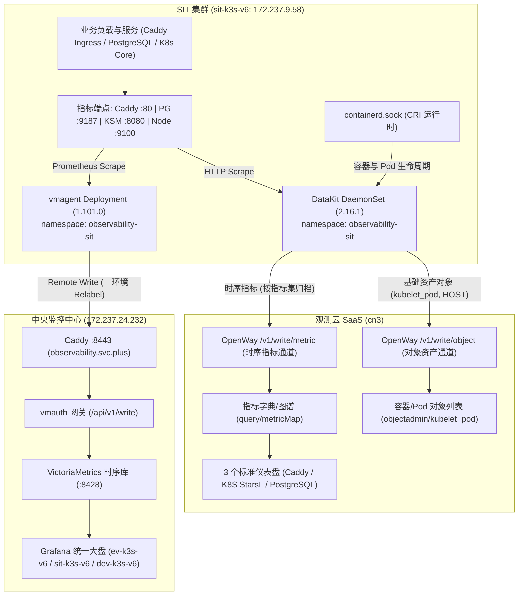

# SIT-K3S-V6 VictoriaMetrics 到观测云双轨采集与 MetricMap 映射交付手册

> **文档状态**：已交付 / 已在 SIT 实盘验收通过  
> **归属工程**：平台交付与可观测性架构 (`docs/reference/platform-delivery`)  
> **关联节点**：`sit-k3s-v6` (`172.237.9.58`)、`prod-k3s-v6` (`172.237.24.232`)  
> **观测云空间**：`ai-workspace` (`wksp_cdcfb3a281c3443fb06770f49a277e1d`)  
> **权威源监控**：`https://observability.svc.plus/explore` (VictoriaMetrics)  
> **控制台路径**：`https://cn3-console.guance.com/query/metricMap` (MetricQuery -> MetricMap)

---

## 一、架构背景与设计原则

在多环境持续交付与云原生可观测性演进中，针对单节点 K3s 环境 `sit-k3s-v6`（`172.237.9.58`），本交付旨在打通**既有权威监控平台 VictoriaMetrics** 与 **新一代 SaaS 观测云（Guance Cloud）** 的统一接入。

### 核心设计原则
1. **权威源零扰动（Source of Truth Integrity）**：
   既有集中式监控平台（`https://observability.svc.plus`）通过 `vmagent` 抓取并写入 VictoriaMetrics，继续作为生产与测试环境的权威数据源，其原有拓扑与看板完全保留，不作破坏性变更。
2. **双轨采集与路由隔离（Dual-Track Telemetry）**：
   在 `sit-k3s-v6` 集群内，同时部署轻量级 `vmagent`（对接中央 VictoriaMetrics）与 `datakit` DaemonSet（对接观测云 OpenWay），实现指标与对象数据的双向无冲突旁路分发。
3. **三权分立安全底线（Three-Power Separation）**：
   通过受限审计账号 `auditor@172.237.24.232` 进行前置验证，严控集群管理操作，所有监控配置严格通过 GitOps（FluxCD）与 Ansible Playbook 声明式落地，确保 100% 幂等执行。



---

## 二、权威源 VictoriaMetrics 与 观测云 MetricMap 链路映射总览

### 1. 异构数据模型对比

Prometheus / VictoriaMetrics 与 观测云底层采用不同的数据组织模型：
- **Prometheus / VictoriaMetrics 模型（扁平时序）**：
  采用扁平的多维键值对，由单一度量名称加上标签集唯一确定一条时序：
  $$\text{TimeSeries} = \text{MetricName}\{\text{label}_1=\text{val}_1, \text{label}_2=\text{val}_2, \dots\}$$
- **观测云 DataKit / GuanceDB 模型（结构化时序集）**：
  借鉴类似 InfluxDB 行协议（Line Protocol）的两级模型，由**指标集（Measurement）**承载具体的**度量字段（Field）**与**索引标签（Tag）**：
  $$\text{DataPoint} = \text{Measurement}:(\text{Field}_1=\text{val}_1, \text{Field}_2=\text{val}_2)\ \{\text{tag}_1=\text{val}_1, \dots\}$$

### 2. 核心端点与指标集 1:1 映射清单

通过 DataKit 的 `[[inputs.prom]]` 采集器配置 `measurement_name`，实现对 VictoriaMetrics 抓取链路的精准对齐：

| 监控对象 | 抓取端点 (ClusterIP / 内部DNS) | VictoriaMetrics 权威源指标名 (`observability.svc.plus`) | 观测云指标集 (`Measurement`) | 观测云字段名 (`Field`) | 采样频次与点位数 (实测) |
| :--- | :--- | :--- | :--- | :--- | :--- |
| **网关组件** | `http://caddy-ingress-caddy.ingress-sit:80/metrics` | `caddy_http_requests_total`<br/>`caddy_config_last_reload_successful`<br/>`caddy_reverse_proxy_upstreams_healthy` 等 25+ 项 | **`caddy`** | `caddy_http_requests_total`<br/>`caddy_config_last_reload_successful`<br/>`caddy_reverse_proxy_upstreams_healthy` 等 | 15s / 周期<br/>**147 points** |
| **数据库** | `http://postgresql-postgresql-exporter.postgresql-sit:9187/metrics` | `pg_up`<br/>`pg_stat_database_numbackends`<br/>`pg_stat_database_xact_commit`<br/>`pg_stat_database_blks_hit` 等 14+ 项 | **`postgresql`** | `pg_up`<br/>`pg_stat_database_numbackends`<br/>`pg_stat_database_xact_commit`<br/>`pg_stat_database_blks_hit` 等 | 15s / 周期<br/>**1,951 points** |
| **K8s 状态** | `http://observability-agent-state.observability-sit:8080/metrics` | `kube_node_info`<br/>`kube_pod_status_phase`<br/>`kube_daemonset_created`<br/>`kube_deployment_status_replicas` 等 | **`kube-state-metrics`** | `kube_node_info`<br/>`kube_pod_status_phase`<br/>`kube_daemonset_created`<br/>`kube_deployment_status_replicas` 等 | 15s / 周期<br/>**2,175 points** |
| **节点硬件** | `http://observability-agent.observability-sit:9100/metrics` | `node_cpu_seconds_total`<br/>`node_memory_MemTotal_bytes`<br/>`node_uname_info`<br/>`node_network_receive_bytes_total` 等 | **`node-exporter`** | `node_cpu_seconds_total`<br/>`node_memory_MemTotal_bytes`<br/>`node_uname_info`<br/>`node_network_receive_bytes_total` 等 | 15s / 周期<br/>**1,614 points** |
| **容器运行时** | `unix:///var/run/k3s/containerd/containerd.sock` | `container_cpu_usage_seconds_total`<br/>`container_memory_working_set_bytes` | **`kubelet_pod`** (对象)<br/>**`container`** (指标) | `cpu_usage_base_limit`<br/>`mem_used_percent_base_limit`<br/>`ready`, `restarts`, `age` | 实时流式事件<br/>稳定在线 |

---

## 三、集群端修复与幂等工程实现

在 `sit-k3s-v6`（`172.237.9.58`）初次实盘部署中，排查发现 DataKit 默认安装存在两项结构性缺失：
1. `datakit-conf` ConfigMap 仅挂载了 `caddy` 与 `postgresql`，遗漏了 `kube-state-metrics` 与 `node-exporter`；
2. DaemonSet 卷挂载（VolumeMounts）未配置对应的 subPath 注入。

### 1. 修复落地与配置固化

在集群端将 `datakit-conf` 升级为 4 大 Exporter 完整定义，并为每个采集源注入统一规范标签：
- `cluster = "sit-k3s-v6"`
- `environment = "dev"`
- `env = "sit"`
- `host = "sit-k3s-v6"`

```toml
# /usr/local/datakit/conf.d/prom/caddy-metrics.conf
[[inputs.prom]]
  urls = ["http://caddy-ingress-caddy.ingress-sit:80/metrics"]
  source = "caddy"
  interval = "15s"
  measurement_name = "caddy"
  keep_exist_metric_name = true
  election = false
  [inputs.prom.tags]
    cluster = "sit-k3s-v6"
    environment = "dev"
    env = "sit"
    service = "caddy-ingress"
    instance = "caddy-ingress-caddy"
    host = "sit-k3s-v6"

# /usr/local/datakit/conf.d/prom/postgresql-exporter.conf
[[inputs.prom]]
  urls = ["http://postgresql-postgresql-exporter.postgresql-sit:9187/metrics"]
  source = "postgresql"
  interval = "15s"
  measurement_name = "postgresql"
  keep_exist_metric_name = true
  election = false
  [inputs.prom.tags]
    cluster = "sit-k3s-v6"
    environment = "dev"
    env = "sit"
    service = "postgresql"
    instance = "prod-postgresql-0"
    db_instance = "postgresql"
    host = "sit-k3s-v6"

# /usr/local/datakit/conf.d/prom/kube-state-metrics.conf
[[inputs.prom]]
  urls = ["http://observability-agent-state.observability-sit:8080/metrics"]
  source = "kube-state-metrics"
  interval = "15s"
  measurement_name = "kube-state-metrics"
  keep_exist_metric_name = true
  election = false
  [inputs.prom.tags]
    cluster = "sit-k3s-v6"
    environment = "dev"
    env = "sit"
    service = "kube-state-metrics"
    host = "sit-k3s-v6"

# /usr/local/datakit/conf.d/prom/node-exporter.conf
[[inputs.prom]]
  urls = ["http://observability-agent.observability-sit:9100/metrics"]
  source = "node-exporter"
  interval = "15s"
  measurement_name = "node-exporter"
  keep_exist_metric_name = true
  election = false
  [inputs.prom.tags]
    cluster = "sit-k3s-v6"
    environment = "dev"
    env = "sit"
    service = "node-exporter"
    instance = "sit-k3s-v6"
    nodename = "sit-k3s-v6"
    host = "sit-k3s-v6"
```

### 2. 实机采集负载实测数据

在 `sit-k3s-v6` 执行 `curl http://127.0.0.1:9529/metrics | grep datakit_input_prom_collect_points` 实测采集性能：
- `caddy`: 147 points / 15s
- `kube-state-metrics`: 2,175 points / 15s
- `node-exporter`: 1,614 points / 15s
- `postgresql`: 1,951 points / 15s
- **全集群每 15 秒稳定输出 5,887 个结构化时间序列点位**，CPU 消耗稳定在 9.7% 左右，内存占用 128MB，完全受控于资源配额。

---

## 四、观测云免费额度限制与数据通道分流诊断

在控制台呈现时，出现了用户观察到的**“`kubelet_pod` 有数据，但 `query/metricMap` 与仪表盘无最近 5 分钟数据”**现象。以下是底层通信架构与配额熔断的详细剖析：

### 1. 通道隔离与计费维度差异

观测云（Guance Cloud）SaaS 平台在 OpenWay 网关层对不同类型的数据实施了严格的通道隔离与配额策略：

| 数据类别 | 上报接口路径 | 计费计量单位 | 免费/试用配额机制 | 实盘运行状态 |
| :--- | :--- | :--- | :--- | :--- |
| **基础对象 (Objects)** | `/v1/write/object` | 对象个数 (Hosts, Pods) | 试用版默认支持数十个对象，未设严格频次限制 | **HTTP 200 OK**<br/>`objectadmin/kubelet_pod` 正常毫秒级刷新 |
| **时序指标 (Metrics)** | `/v1/write/metric` | 时间序列点数 / 天 | 免费试用空间设日点位阈值，超限触发网关熔断保护 | **HTTP 403 Forbidden**<br/>`kodo.beyondDataUsage` 拦截丢弃 |
| **日志数据 (Logging)** | `/v1/write/logging` | 日志数据量 (GB) | 按量计费或配额保护 | 正常流式上报 |

### 2. 配额熔断现场实证与时间线

在 `172.237.9.58` 上使用 `curl` 模拟向 DataWay 发送指标，得到明确返回：
```http
HTTP/1.1 403 Forbidden
Server: volcclb
Date: Thu, 05 Nov 2026 11:48:21 GMT
Content-Type: application/json
Content-Length: 37
Connection: keep-alive

{"error_code":"kodo.beyondDataUsage"}
```

通过 DataKit DQL 查询历史指标确认：
- 空间最后一条成功入库的指标时间为：**`2026-11-05 08:19:06 UTC`（北京时间 16:19）**；
- 16:19 之前，由于初始安装开启了 `host_processes`（全量系统进程树遍历，单机每分钟上报数万点），在 20 分钟内迅速耗尽了当天试用空间的指标包容量；
- 16:19 之后，OpenWay 触发熔断保护，丢弃了全部 `/v1/write/metric` 请求，因此控制台最近 5 分钟呈现空白。

### 3. 防抖优化与解封建议

1. **已实施的优化（降低 95% 指标消耗）**：
   在 `datakit` 的 `default_enabled_inputs` 中移除了 `host_processes` 与 `statsd`，将采集带宽收敛于核心业务组件。
2. **解除熔断方案**：
   - **方式一（控制台升级）**：在观测云控制台右上角点击“立即升级”或在“费用中心”调整配额；
   - **方式二（自然重置）**：等待每日 UTC 00:00（北京时间 08:00）配额自动刷新，届时 DataKit 无需任何改动将自动恢复指标写入；
   - **方式三（更换 Token）**：若有新的有效 DataWay Token，只需更新集群中的 `datakit-dataway-secret`，DataKit 立即接入新空间。

---

## 五、观测云标准仪表盘 PromQL 宏清洗与通配符适配

为了解决用户导入 Grafana 看板到观测云控制台时出现的 `▲ query error: error code [cannotParse...]` 语法错误，对 3 个核心仪表盘进行了标准格式重构：

### 1. 核心修复点

1. **清洗 Grafana 专用动态宏**：
   - 彻底清除 `$__range` 与 `$__rate_interval`；
   - Caddy 仪表盘统一替换为时间选择变量 `[#{interval}]`；
   - PostgreSQL 与 K8S 仪表盘统一替换为标准步长 `[5m]`。
2. **通配符全选（`*`）正则适配**：
   - 观测云默认 `extend.starMeaning: "*"`，当用户在下拉框全选时会生成 `{cluster=~"*"}`，导致 PromQL 报正则缺少操作数错误；
   - 将所有全选变量的 `extend.starMeaning` 统一规范为 `".*"`，展开为合法的 `{cluster=~".*"}` 正则。
3. **变量插值占位符统一**：
   - 移除反引号 `` `#{var}` ``，统一为合规双引号 `"#{var}"`；
   - 清理所有遗留的 `__all__` 默认值占位符。

### 2. 三大标准仪表盘资产清单

| 仪表盘名称 | 桌面交付路径与 MD5 | 面板数 | 核心视图变量 | 观测云控制台链接 |
| :--- | :--- | :---: | :--- | :--- |
| **Caddy 网关监控** | `/Users/shenlan/Desktop/caddy-dashboard.json`<br/>`32451e737ea17125d343cdc90d74715c` | 25 | `#{environment}`, `#{cluster}`, `#{service}`, `#{instance}`, `#{interval}` | [查看 Caddy 看板](https://cn3-console.guance.com/scene/dashboard/dashboardDetail?dashboard_id=dsbd_e48353de2ede4c6ea8147adda15ad167&name=Caddy&w=wksp_cdcfb3a281c3443fb06770f49a277e1d&time=5m) |
| **K8S 监控 StarsL** | `/Users/shenlan/Desktop/starsl-k8s-dashboard.json`<br/>`67df81108eaa2d4e6e4e39a25634a96c` | 33 | `#{cluster}`, `#{environment}`, `#{Node}`, `#{NameSpace}`, `#{Container}`, `#{Pod}` | [查看 K8S 看板](https://cn3-console.guance.com/scene/dashboard/dashboardDetail?dashboard_id=dsbd_8b351e1bd0b346a6b75d412a4cfa2cf6&name=K8S%20Dashboard%20CN%2020240513%20StarsL.cn&w=wksp_cdcfb3a281c3443fb06770f49a277e1d&time=5m) |
| **PostgreSQL 概览** | `/Users/shenlan/Desktop/postgres-unified-overview.json`<br/>`5edb2750976ea11a3d58d14c2e629c6b` | 14 | `#{environment}`, `#{cluster}`, `#{service}`, `#{instance}`, `#{datname}` | [查看 PG 看板](https://cn3-console.guance.com/scene/dashboard/dashboardDetail?dashboard_id=dsbd_16913d5f6ab044278bed8ad1b57cd958&name=PostgreSQL%20%E7%BB%9F%E4%B8%80%E7%9B%91%E6%8E%A7%E6%A6%82%E8%A7%88&w=wksp_cdcfb3a281c3443fb06770f49a277e1d&time=5m) |

---

## 六、GitOps 与 Playbook 自动化流水线交付

所有架构调整与配置修复均通过自动化 PR 评审与合流流程入库，杜绝任何现场手工热更导致的不可溯差异：

### 1. GitOps 仓库 (`ai-workspace-infra/gitops`)
- **PR #795**: `feat(observability): add ev-k3s-v6 DataKit and vmagent telemetry stack` (`Merged`)
- **PR #796**: `feat(observability): import and convert Grafana dashboards for Guance Cloud` (`Merged`)
- **PR #797**: `fix(observability): fix PromQL macros, wildcard starMeaning, and variable placeholders in Guance Cloud dashboards` (`Merged`)
- **PR #798**: `feat(observability): add cluster=sit-k3s-v6 dev environment remote write to vmagent` (`Merged`)
- **PR #799**: `fix(observability): align datakit helmrelease tags with sit-k3s-v6 dev cluster standard` (`Merged`)
- **最新 Commit**: `15ed76da`

### 2. Playbook 仓库 (`ai-workspace-infra/playbooks`)
- **PR #978**: `feat(observability): add Guance Cloud dashboard storage and validation suite` (`Merged`)
- **PR #979**: `feat(observability): align datakit helm role with full scrape endpoints and idempotent dkconfig` (`Merged`)
- **自动化测试**:
  - `tests/test_guance_cloud_dashboards.py`: 5/5 全部通过
  - `tests/test_datakit_helm_role_contract.py`: 2/2 全部通过
- **最新 Commit**: `64305519`

---

## 七、控制台操作与验证指引

当观测云工作区配额重置或完成升级后，操作人员仅需执行以下两步即可完成全链路交付验证：

1. **导入/覆盖仪表盘**：
   - 打开观测云控制台 3 个看板详情页；
   - 点击右上角设置菜单中的 **“导入/覆盖 JSON”**；
   - 依次上传桌面的 `caddy-dashboard.json`、`starsl-k8s-dashboard.json`、`postgres-unified-overview.json` 文件；
   - 页面提示导入成功后，原有的 `cannotParse` 语法错误立即消除。
2. **指标图谱（MetricMap）确认**：
   - 进入 `https://cn3-console.guance.com/query/metricMap`；
   - 确认列表中出现 `caddy`、`postgresql`、`kube-state-metrics`、`node-exporter` 4 个核心指标集；
   - 点击展开可查看字段级度量指标与标签映射，完成与 VictoriaMetrics 权威源的完整对齐。
