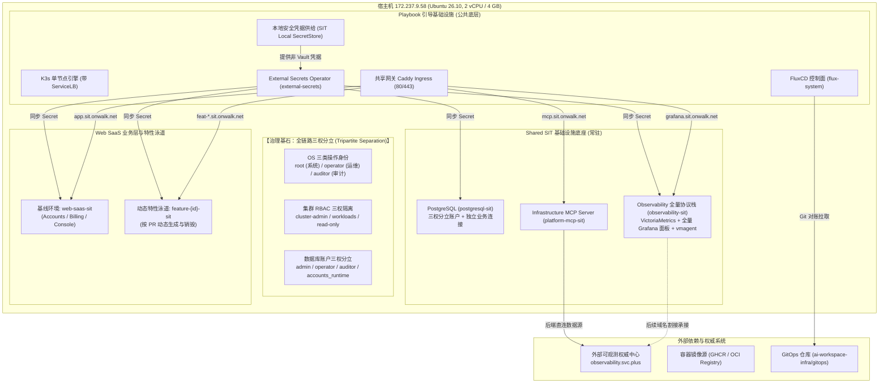
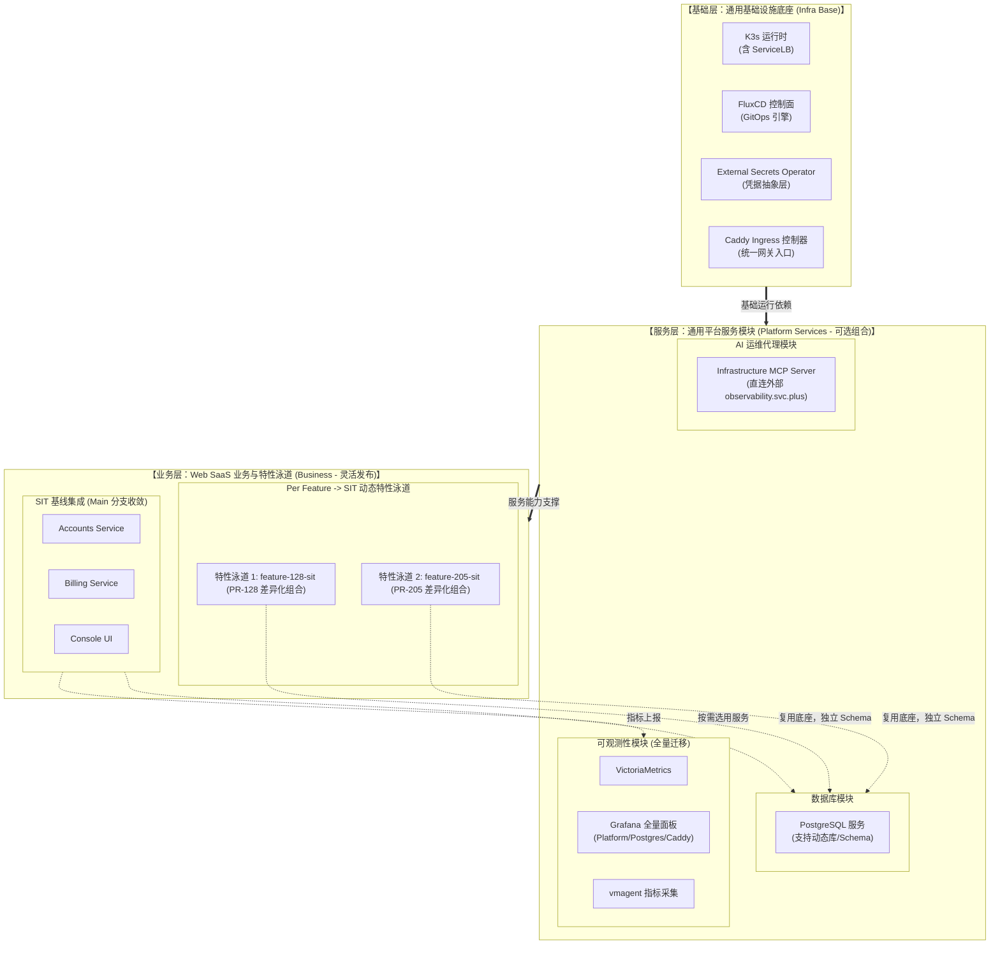

# SIT-K3S-V6 独立节点模块化交付与特性泳道规划

> **集群名称**：`sit-k3s-v6`（SIT 独立环境，与 `prod-k3s-v6` 物理隔离与声明解耦）  
> **目标主机**：`ssh root@172.237.9.58`（Ubuntu 26.10, 2 vCPU / 4 GB RAM / 80 GB SSD）  
> **核心原则**：**基础、服务、业务全面模块化与乐高式灵活组合（Composable Modular Architecture）**；生产零触碰（Zero Touch to PROD）、免部署本地 Vault Server、支持 Per Feature $\rightarrow$ SIT 业务特性发布流、全量面板平滑迁移为后续接管 `observability.svc.plus` 奠定基础；严格对齐生产级的 **OS、集群、数据库三权分立** 治理体系。  
> **交付模式**：Playbook 节点底座引导（不依赖 GitHub Actions） + GitOps (FluxCD) 声明式模块装配。

---

## 一、SIT-K3S-V6 独立节点规划的独立 Helm Release（共 6 个核心）

相比生产 V6 的 8 个 HelmRelease，SIT 单节点依据 4 GB 内存环境去除了本地重度 Vault Raft，并将可观测采集链路聚合优化，规划 **6 个核心独立 Helm Release**：

| # | HelmRelease 名称 | 部署命名空间 | 模块分层 | 对应 Chart 来源 | 职责定位与能力边界 |
| :--- | :--- | :--- | :--- | :--- | :--- |
| **1** | **`external-secrets`** | `external-secrets` | 基础凭据层 | `external-secrets/external-secrets` | 集群通用凭据代理，自动同步本地 SecretStore / 外部 Vault |
| **2** | **`caddy-ingress`** | `ingress-sit` | 基础网关层 | `distributed-web-saas-fullstack` (caddy 组件) | 共享网关接收入口流量，处理 `onwalk.net` 域名路由与子域名分发 |
| **3** | **`postgresql`** | `postgresql-sit` | 平台服务层 | `distributed-web-saas-fullstack` (pg 组件) | 独立数据库，内建三权分立账户与业务连接 |
| **4** | **`observability`** | `observability-sit` | 平台服务层 | `observability-stack-chart` (VM+Grafana) | 全量可观测协议栈，承接全部 21 个生产 Grafana 面板 |
| **5** | **`observability-agent`**| `observability-sit` | 平台服务层 | `observability-agent` (kube-state-metrics) | 负责 Kubernetes 节点、容器指标与状态收集 |
| **6** | **`web-saas`** | `web-saas-sit` | 业务基线层 | `distributed-web-saas-fullstack` (业务三件套) | Accounts (认证) + Billing (结算) + Console (UI) 基线 |

> [!NOTE]
> **非 HelmRelease 模块说明**：
> * **`platform-mcp-sit`**：采用 Kubernetes 原生 Deployment 与 Service 部署，直连外部 `https://observability.svc.plus`，不占用额外 Helm 控制器开销。
> * **`cluster-identities`**：采用原生 RBAC 清单管理，由 Flux Kustomization 直接声明式对账。
> * **动态特性泳道 (`web-saas-feat-<id>`)**：依据 PR 按需派生，生命周期独立。

---

## 二、SIT-K3S-V6 环境分配的域名规划与路由映射

严格执行生产零触碰原则（严禁修改或污染生产权威 DNS `*.svc.plus`），SIT 环境统一以 **`onwalk.net`** 为基础根域名（采用 `*.sit.onwalk.net` 为规范主域名），并同时保留 `*-sit.onwalk.net` 兼容别名：

| 访问服务 | 规范主域名 (Primary) | 兼容别名 (Aliases) | 后端转发目标服务 | 协议 / 端口 | 说明 |
| :--- | :--- | :--- | :--- | :--- | :--- |
| **全量可观测控制台** | `http://grafana.sit.onwalk.net` | `grafana-sit.onwalk.net` | `observability-observability-stack:3000` | HTTP / 80 | 完整访问所有平台、数据库、系统 21 个监控面板 |
| **AI 基础设施运维代理**| `http://mcp.sit.onwalk.net` | `mcp-sit.onwalk.net` | `infrastructure-mcp-server:8080` | HTTP / 80 | 提供 MCP 规范的 Agent 工具调用入口 |
| **Web SaaS 基线前端** | `http://app.sit.onwalk.net` | `console.sit.onwalk.net`<br/>`app-sit.onwalk.net` | `web-saas-console:80` | HTTP / 80 | 常驻测试基线界面 |
| **Web SaaS 统一 API** | `http://app.sit.onwalk.net/api/*`<br/>`http://accounts.sit.onwalk.net` | `accounts-sit.onwalk.net` | `web-saas-accounts:80` | HTTP / 80 | 账户、认证与会话后端接口 |
| **Web SaaS 计费接口** | `http://billing.sit.onwalk.net` | `billing-sit.onwalk.net` | `web-saas-billing:80` | HTTP / 80 | 计费与订阅后端接口 |
| **Per-Feature 特性泳道**| `http://feat-<pr_id>.sit.onwalk.net` | `feat-<pr_id>-sit.onwalk.net` | `web-saas-console.feature-<pr_id>-sit:80` | HTTP / 80 | 动态拉取的独立 PR 验证环境 |
| **网关健康检查** | `http://172.237.9.58/healthz` | `http://172.237.9.58/` (Ready探针) | Caddy 本地内置响应 | HTTP / 80 | 返回 HTTP 200 "ok" / "SIT Platform Gateway Ready" |

---

## 三、Vault KV V2 Path 规划与凭据映射契约

为实现上层业务代码与声明零感知差异，SIT 遵循严格的标准 Vault KV V2 路径规范。Playbook 本地安全生成高强度随机密码注入 Kubernetes 原生 Secret（当未来对接外部 Vault 时，ESO 可直接通过该路径无缝对账）：

| 凭据用途 | 标准 Vault KV V2 路径 | 包含的核心 Key / 字段 | 消费命名空间 | 映射 Kubernetes Secret 名称 |
| :--- | :--- | :--- | :--- | :--- |
| **数据库 Admin 根密码** | `kv/sit/database/postgresql/admin` | `password` | `postgresql-sit` | `postgresql-admin` |
| **数据库 Operator 密码** | `kv/sit/database/postgresql/operator` | `password` | `postgresql-sit` | `postgresql-operator` |
| **数据库 Auditor 密码** | `kv/sit/database/postgresql/auditor` | `password` | `postgresql-sit` | `postgresql-auditor` |
| **Accounts 业务数据库连接**| `kv/sit/accounts-service` | `POSTGRES_PASSWORD`, `DATABASE_URL` | `web-saas-sit` | `accounts-db-runtime` |
| **Billing 业务数据库连接** | `kv/sit/billing-service` | `DATABASE_URL` | `web-saas-sit` | `billing-db-runtime` |
| **Web SaaS 通用安全凭据**| `kv/sit/web-saas/runtime` | `JWT_SECRET`, `SESSION_SECRET` | `web-saas-sit` | `web-saas-secrets` |
| **Grafana 管理员密码** | `kv/sit/observability/grafana` | `password` | `observability-sit` | `grafana-admin` |
| **Observability Ingest 认证**| `kv/sit/observability/ingest` | `token` | `observability-sit` | `observability-ingest-auth` |
| **AI MCP 服务鉴权 Token** | `kv/sit/platform-mcp/auth` | `mcp-service-token` | `platform-mcp-sit` | `infra-mcp-auth` |

---

## 四、全链路三权分立治理体系 (OS / 集群 / 数据库)

为保持与生产环境完全一致的合规与安全防护水位，SIT 环境在操作系统、Kubernetes 集群与 PostgreSQL 数据库三个层次严格落地三权分立：

### 4.1 OS 操作系统三权 (Linux System Level)
* **`root`**：系统最高权限，用于内核调优、底层底座引导与紧急维护，引导完成后关闭远程登录。
* **`operator`**：运维身份，最小化限定 sudo 权限（仅限 `/usr/bin/systemctl is-system-running` 等状态探针），交互式运维，严禁越权审计。
* **`auditor`**：审计身份，**严禁任何 sudo 权限**，严禁读取 `/etc/shadow`，严禁写入系统目录及访问运行时 Socket，仅允许查看系统状态与审计日志。

### 4.2 Kubernetes 集群三权 RBAC (Cluster Level)
在 `services/sit-k3s-v6/cluster-identities/` 声明并执行严格角色绑定：
* **`root`** $\rightarrow$ 绑定原生 `cluster-admin` 角色，负责集群核心控制器维保。
* **`operator`** $\rightarrow$ 绑定 `k3s-operator-workloads` 角色与 `k3s-operator-pod-status`：
  * 具备 Deployments、ReplicaSets、Pods、Services、HelmReleases 的 get/list/watch 与 scale 权限；
  * **严禁读取 Secret 明文内容**，严禁执行 `exec/attach` 进入业务容器。
* **`auditor`** $\rightarrow$ 绑定 `k3s-auditor-read-only` 全局只读角色：
  * 仅允许对全集群资源进行只读（get/list/watch）与读取 Pod 运行日志；
  * 排除任何 token 颁发、port-forward 及写操作。

### 4.3 PostgreSQL 数据库三权 (Database Level)
PostgreSQL 原生启用 `identityAccounts` 配置，分离三大治理账号与业务受限账号：
```yaml
identityAccounts:
  enabled: true
  root:     {username: postgres, existingSecret: postgresql-admin, secretKey: password}
  operator: {username: operator, existingSecret: postgresql-operator, secretKey: password, tables: [], sequences: []}
  auditor:  {username: auditor,  existingSecret: postgresql-auditor,  secretKey: password, views: []}
```
* **`admin (postgres)`**：全库最高管理权限（全 DDL、Schema 迁移），仅由 Secret 管理，不注入业务应用。
* **`operator`**：用于日常维护、物理/逻辑备份、VACUUM 运维与连接维护。
* **`auditor`**：专用于 `postgres-exporter` 性能与审计指标采集，仅赋予系统视图和 pg_stat 只读权限。
* **`accounts_runtime`**：**业务独立受限账号**，独立注入到 Web SaaS，仅具备业务表 DML 读写权限，无 DDL 权限与跨库权限。

---

## 五、总体架构拓扑与环境边界



---

## 六、三层模块化与可组合模型 (Three-Tier Composable Model)

系统被正交分解为三个独立演进、按需插拔的层次：



---

## 七、2 vCPU / 4 GB 单节点精准配额预算表

单节点 4 GB 内存极为有限，模块化让每个组件的消耗清晰可控：

| 模块分类 | 组件 / 命名空间 | CPU Request | CPU Limit | 内存 Request | 内存 Limit | 存储分配 |
| :--- | :--- | :--- | :--- | :--- | :--- | :--- |
| **基础层** | K3s 控制面 + OS 内核预留 | 200m | 1000m | 600 MiB | 900 MiB | 系统盘 |
| **基础层** | FluxCD (flux-system) | 100m | 500m | 200 MiB | 400 MiB | 无 |
| **基础层** | ESO (external-secrets) | 50m | 200m | 80 MiB | 150 MiB | 无 |
| **基础层** | Ingress 控制器 (ingress-sit) | 100m | 500m | 120 MiB | 256 MiB | 无 |
| **服务层** | 数据库 (postgresql-sit) | 100m | 500m | 256 MiB | 512 MiB | 5 GiB PVC |
| **服务层** | Observability (VM+Grafana+Agent) | 200m | 800m | 650 MiB | 1200 MiB | 10 GiB PVC |
| **服务层** | AI MCP (platform-mcp-sit) | 50m | 200m | 100 MiB | 200 MiB | 无 |
| **业务层** | Web SaaS 基线 (web-saas-sit) | 150m | 600m | 450 MiB | 800 MiB | 无 |
| **业务层** | 动态特性泳道预留 (feature-*-sit) | 100m | 400m | 350 MiB | 600 MiB | 共享 PG |
| **安全缓冲** | **宿主机可用内存安全水位 (防 OOM)** | - | - | **1100 MiB** | - | - |
| **总计** | **全模块满载装配** | **1050m** | - | **2906 MiB** | - | **15 GiB** |

---

## 八、模块化 GitOps 目录拓扑结构

在 `ai-workspace-infra/gitops` 仓库中构建 SIT 专属声明结构：

```text
gitops/
├── environments/clusters/sit-k3s-v6/             # 【SIT 集群总装与组合入口】
│   ├── root.yaml                                 # 根 Kustomization: sit-k3s
│   ├── source.yaml                               # GitRepository: config-sit (跟踪分支)
│   ├── namespaces.yaml                           # 全局命名空间定义
│   ├── kustomization.yaml                        # 声明组合启用的模块
│   ├── ingress-kustomization.yaml                # 组装基础 Ingress 模块
│   ├── postgresql-kustomization.yaml             # 组装数据库模块
│   ├── observability-kustomization.yaml          # 组装全量可观测性模块 (含全部面板)
│   ├── platform-mcp-kustomization.yaml           # 组装 MCP 服务模块 (直连外部)
│   ├── web-saas-kustomization.yaml               # 组装 Web SaaS 业务基线与泳道扩展
│   └── cluster-identities-kustomization.yaml     # 组装集群三权分立 RBAC
│
└── services/sit-k3s-v6/                          # 【SIT 可组合服务组件库】
    ├── cluster-identities/                       # 集群三权分立 RBAC 声明
    ├── ingress-sit/                              # Ingress 路由规则
    ├── postgresql-sit/                           # PostgreSQL 数据库声明
    ├── observability-sit/                        # 全量可观测性组件
    │   ├── grafana-restored-platform.yaml        # 平台全量监控面板 (全量同构迁移)
    │   ├── grafana-restored-postgres.yaml        # 数据库全量监控面板 (全量同构迁移)
    │   ├── grafana-caddy-dashboards.yaml         # 网关与链路监控面板
    │   └── helmrelease.yaml                      # VictoriaMetrics + Grafana 栈
    ├── platform-mcp-sit/                         # AI MCP 服务 (配置直连外部 observability.svc.plus)
    └── web-saas-sit/                             # 业务组件库 (支持 Feature Overlay 组合)
        ├── base/                                 # Accounts + Billing + Console 标准声明
        └── overlays/                             # 基线配置与特性泳道补丁
```

---

## 九、实施落地与实测验收清单 (Implementation & Verification)

在 `172.237.9.58` 上已完成全链路部署与严格核验：

### 1. 基础底座与控制器
* **K3s 单节点**：运行 `v1.37.2+k3s1`，ServiceLB 成功绑定宿主机 `80` 和 `443` 端口。
* **FluxCD 控制面**：4 个核心控制器（source, kustomize, helm, notification）正常运行在 `flux-system`。
* **ESO 控制器**：3 个核心控制器正常运行在 `external-secrets`。

### 2. 核心服务与面板完整性
* **全量可观测性 (5/5 Pod Running)**：VictoriaMetrics + VictoriaLogs + VictoriaTraces + OpenTelemetry Collector + Grafana 13.2.4 全部运行。
* **21 个生产 Grafana 面板全量迁移**：经 Grafana REST API 核查，全部 21 个监控看板均已完成 Provisioning 并正常加载。
* **Infrastructure MCP Server (1/1 Running)**：直连外部权威中心 `https://observability.svc.plus`，暴露 `/healthz` 与 `/v1/models` 等工具调用端点。
* **PostgreSQL (1/1 Running)**：PostgreSQL 17 + `postgres-exporter` 正常运行，配置 `appArmorProfile: { type: Unconfined }` 规避 Linux 7.3 内核信号阻断。
* **Web SaaS (4/4 Pod Running)**：Accounts + Billing + Console + Content 全部正常运行，响应 `/healthz`、`/api/ping`。

### 3. HTTP 路由端到端实测验证 (`onwalk.net` 规范域名 100% 验证通过)
* `curl -sI http://172.237.9.58/` $\rightarrow$ **HTTP 200 OK** (`SIT Platform Gateway Ready`)
* `curl -sI -H 'Host: app.sit.onwalk.net' http://172.237.9.58/` $\rightarrow$ **HTTP 200 OK** (Web SaaS Console 前端完整渲染)
* `curl -s -o /dev/null -w "%{http_code}" -H 'Host: accounts.sit.onwalk.net' http://172.237.9.58/healthz` $\rightarrow$ **HTTP 200 OK** (Accounts 认证服务就绪)
* `curl -sI -H 'Host: billing.sit.onwalk.net' http://172.237.9.58/api/ping` $\rightarrow$ **HTTP 200 OK** (Billing 结算服务就绪)
* `curl -sI -H 'Host: grafana.sit.onwalk.net' http://172.237.9.58/login` $\rightarrow$ **HTTP 200 OK** (Grafana 13.2.4 控制台就绪)
* `curl -s -H 'Host: mcp.sit.onwalk.net' http://172.237.9.58/healthz` $\rightarrow$ **HTTP 200 OK** (`{"service":"infrastructure-mcp-server","status":"healthy"}`)
* `curl -sI -H 'Host: console.sit.onwalk.net' http://172.237.9.58/` $\rightarrow$ **HTTP 200 OK** (别名访问就绪)
* `curl -sI -H 'Host: accounts-sit.onwalk.net' http://172.237.9.58/healthz` $\rightarrow$ **HTTP 200 OK** (别名访问就绪)
