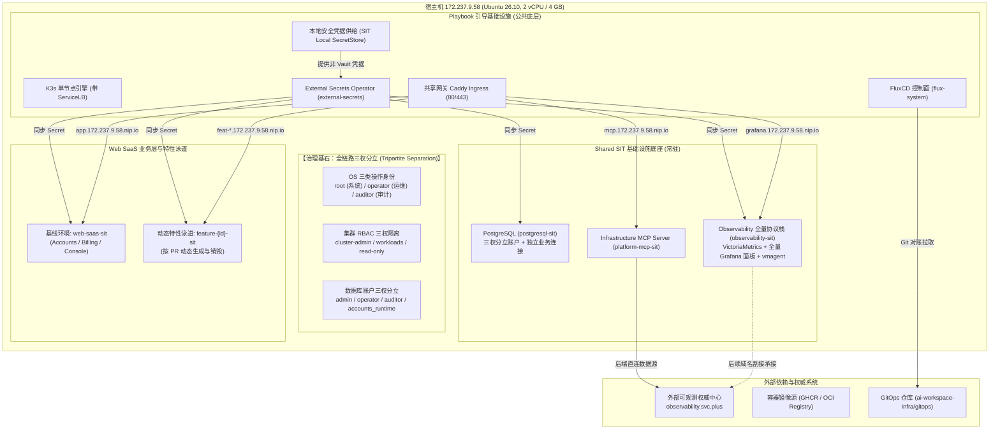
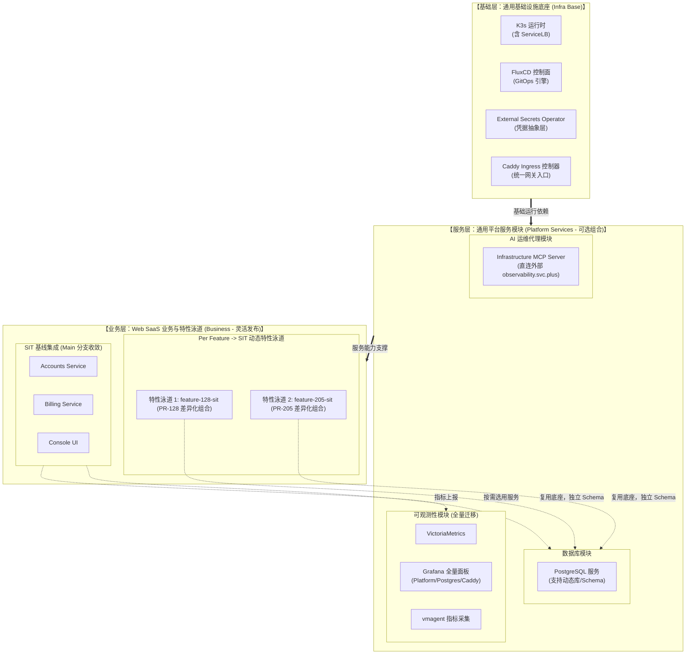

# SIT-K3S-V6 独立节点模块化交付与特性泳道规划

> **集群名称**：`sit-k3s-v6`（SIT 独立环境，与 `prod-k3s-v6` 物理隔离与声明解耦）  
> **目标主机**：`ssh root@172.237.9.58`（Ubuntu 26.10, 2 vCPU / 4 GB RAM / 80 GB SSD）  
> **核心原则**：**基础、服务、业务全面模块化与乐高式灵活组合（Composable Modular Architecture）**；生产零触碰（Zero Touch to PROD）、免部署本地 Vault Server、支持 Per Feature $\rightarrow$ SIT 业务特性发布流、全量面板平滑迁移为后续接管 `observability.svc.plus` 奠定基础；严格对齐生产级的 **OS、集群、数据库三权分立** 治理体系。  
> **交付模式**：Playbook 节点底座引导（不依赖 GitHub Actions） + GitOps (FluxCD) 声明式模块装配。

---

## 1. 总体架构拓扑与环境边界



---

## 2. 三权分立治理体系规范 (OS / 集群 / 数据库)

为保持与生产环境完全一致的合规与安全防护水位，SIT 环境在操作系统、Kubernetes 集群与 PostgreSQL 数据库三个层次严格落地**三权分立**：

### 2.1 OS 操作系统三类身份 (Linux System Level)
| 操作身份 | Linux 用户 | Sudo 与权限范围 | 限制与防护红线 |
| :--- | :--- | :--- | :--- |
| **系统管理员 (Root)** | `root` | 完全管理权限，用于内核调优、K3s 底座引导 | 日常业务发布与运维禁止使用；禁止外部直连 |
| **运维身份 (Operator)** | `operator` | 最小化限定 Sudo：`/usr/bin/systemctl is-system-running` 等状态检查 | 交互式运维，严禁越权审计与随意修改系统核心配置 |
| **审计身份 (Auditor)** | `auditor` | **严禁任何 Sudo 权限**；禁止访问 `/etc/shadow` | 只读查看主机状态与审计日志；禁止写入系统目录及访问运行时 Socket |

### 2.2 Kubernetes 集群三权 RBAC (Cluster Level)
在 `services/sit-k3s-v6/cluster-identities/` 声明并执行严格角色绑定：
* **`root`** $\rightarrow$ 绑定原生 `cluster-admin` 角色，负责集群核心控制器维保。
* **`operator`** $\rightarrow$ 绑定 `k3s-operator-workloads` 角色与 `k3s-operator-pod-status`：
  * 具备 Deployments、ReplicaSets、Pods、Services、HelmReleases 的 get/list/watch 与 scale 权限；
  * **严禁读取 Secret 明文内容**，严禁执行 `exec/attach` 进入业务容器。
* **`auditor`** $\rightarrow$ 绑定 `k3s-auditor-read-only` 全局只读角色：
  * 仅允许对全集群资源进行只读（get/list/watch）与读取 Pod 运行日志；
  * 排除任何 token 颁发、port-forward 及写操作。

### 2.3 PostgreSQL 数据库三权分立 (Database Level)
PostgreSQL 原生启用 `identityAccounts` 配置，实现四重账号职责分离：
```yaml
identityAccounts:
  enabled: true
  root:     {username: postgres, existingSecret: postgresql-admin, secretKey: password}
  operator: {username: operator, existingSecret: postgresql-operator, secretKey: password, tables: [], sequences: []}
  auditor:  {username: auditor,  existingSecret: postgresql-auditor,  secretKey: password, views: []}
```
* **`admin (postgres)`**：具有全库 DDL、Schema 迁移与最高管理权限，不注入业务应用。
* **`operator`**：用于数据库常规物理/逻辑备份、VACUUM 运维与连接维护。
* **`auditor`**：专用于 `postgres-exporter` 性能与审计指标采集，仅赋予系统视图和 pg_stat 只读权限。
* **`accounts_runtime`**：**业务专用运行时账号**，独立注入到 Web SaaS，仅具备业务表 DML 读写权限，无 DDL 权限与跨库权限。

---

## 3. SIT 独立节点 Helm Release 规划矩阵 (6 个核心)

相比生产环境 V6 规划的 8 个 HelmRelease，SIT 节点根据单节点 4 GB 内存特性，去除了高开销的本地 Vault Server，并将采集链路聚合优化，规划 **6 个核心独立 Helm Release**：

| # | HelmRelease 名称 | 部署命名空间 | 模块分层 | 对应 Chart 来源 | 职责与能力边界 |
| :--- | :--- | :--- | :--- | :--- | :--- |
| **1** | **`external-secrets`** | `external-secrets` | 基础凭据层 | `external-secrets/external-secrets` | 集群通用凭据代理，对接本地 SecretStore / 外部 Vault |
| **2** | **`caddy-ingress`** | `ingress-sit` | 基础网关层 | `distributed-web-saas-fullstack` (caddy 组件) | 统一接收入口流量，处理 nip.io 泛解析与子域名分发 |
| **3** | **`postgresql`** | `postgresql-sit` | 平台服务层 | `distributed-web-saas-fullstack` (pg 组件) | 独立数据库服务，内建三权分立账户与业务连接 |
| **4** | **`observability`** | `observability-sit` | 平台服务层 | `observability-stack-chart` (VM + Grafana) | 全量可观测协议栈，承接全部 21 个生产 Grafana 面板 |
| **5** | **`observability-agent`**| `observability-sit` | 平台服务层 | `observability-agent` (kube-state-metrics) | 负责 Kubernetes 节点、容器指标与状态收集 |
| **6** | **`web-saas`** | `web-saas-sit` | 业务基线层 | `distributed-web-saas-fullstack` (业务三件套) | Accounts (认证) + Billing (结算) + Console (UI) |

> [!NOTE]
> **非 HelmRelease 服务说明**：
> * **`platform-mcp-sit`**：采用 Kubernetes 原生 Deployment 与 Service 部署，直连外部 `https://observability.svc.plus`，不占用额外 Helm 控制器开销。
> * **`cluster-identities`**：采用原生 RBAC 清单管理，由 Flux Kustomization 直接声明式对账。
> * **动态特性泳道 (`web-saas-feat-<id>`)**：依据 PR 按需派生，生命周期独立。

---

## 4. SIT 环境域名分配与路由映射规范

根据生产零触碰原则，SIT 环境严禁修改或污染生产公网 DNS（如 `svc.plus` 权威记录）。统一采用轻量开箱即用的通配解析域名 `*.172.237.9.58.nip.io`：

| 访问服务 | 分配域名 | 后端转发目标服务 | 协议与暴露端口 | 说明 |
| :--- | :--- | :--- | :--- | :--- |
| **全量可观测控制台** | `http://grafana.172.237.9.58.nip.io` | `observability-observability-stack:3000` | HTTP / 80 | 完整访问所有平台、数据库、系统看板 |
| **AI 基础设施运维代理**| `http://mcp.172.237.9.58.nip.io` | `infrastructure-mcp-server:8080` | HTTP / 80 | 提供 MCP 规范的 Agent 工具调用入口 |
| **Web SaaS 基线前端** | `http://app.172.237.9.58.nip.io` | `web-saas-console:80` | HTTP / 80 | 常驻测试基线界面 |
| **Web SaaS 统一 API** | `http://app.172.237.9.58.nip.io/api/*`| `web-saas-accounts:80` | HTTP / 80 | 账户、认证与会话后端接口 |
| **Per-Feature 特性泳道**| `http://feat-<pr_id>.172.237.9.58.nip.io` | `web-saas-console.feature-<pr_id>-sit:80` | HTTP / 80 | 动态拉起的独立 PR 验证环境 |
| **健康检查就绪探针** | `http://172.237.9.58/healthz` | Caddy 本地内置响应 | HTTP / 80 | 返回 HTTP 200 "ok" |

---

## 5. Vault KV V2 路径规范与凭据映射契约

为了实现**上层代码与配置零感知差异**，SIT 环境即使不运行本地 Vault Server，也遵循严格的标准 Vault KV V2 路径命名契约。Playbook 在目标节点本地安全生成高强度凭据，并将其映射为原生 Kubernetes Secret（当接入外部 Vault 时，ESO 可直接通过该路径无缝对账）：

| 凭据分类 / 用途 | 标准 Vault KV V2 路径 | 包含的 Key / 字段 | 消费命名空间 | 映射 Kubernetes Secret 名称 |
| :--- | :--- | :--- | :--- | :--- |
| **数据库 Admin 根密码** | `kv/sit/database/postgresql/admin` | `password` | `postgresql-sit` | `postgresql-admin` |
| **数据库 Operator 密码** | `kv/sit/database/postgresql/operator` | `password` | `postgresql-sit` | `postgresql-operator` |
| **数据库 Auditor 密码** | `kv/sit/database/postgresql/auditor` | `password` | `postgresql-sit` | `postgresql-auditor` |
| **Accounts 数据库运行时**| `kv/sit/accounts-service` | `POSTGRES_PASSWORD`, `DATABASE_URL` | `web-saas-sit` | `accounts-db-runtime` |
| **Billing 数据库运行时** | `kv/sit/billing-service` | `DATABASE_URL` | `web-saas-sit` | `billing-db-runtime` |
| **Web SaaS 通用安全凭据**| `kv/sit/web-saas/runtime` | `JWT_SECRET`, `SESSION_SECRET` | `web-saas-sit` | `web-saas-secrets` |
| **Grafana 管理员密码** | `kv/sit/observability/grafana` | `password` | `observability-sit` | `grafana-admin` |
| **Observability Ingest 认证**| `kv/sit/observability/ingest` | `token` | `observability-sit` | `observability-ingest-auth` |
| **AI MCP 服务鉴权 Token** | `kv/sit/platform-mcp/auth` | `mcp-service-token` | `platform-mcp-sit` | `infra-mcp-auth` |

---

## 6. 三层模块化与可组合模型 (Three-Tier Composable Model)

系统被正交分解为三个独立演进、按需插拔的层次：



---

## 7. 2 vCPU / 4 GB 单节点精准配额预算表

单节点 4 GB 内存极为有限，模块化让每个组件的消耗清晰可控：

| 模块分类 | 组件 / 命名空间 | CPU Request | CPU Limit | 内存 Request | 内存 Limit | 存储分配 |
| :--- | :--- | :--- | :--- | :--- | :--- | :--- |
| **基础层** | K3s 控制面 + OS 内核预留 | 200m | 1000m | 600 MiB | 900 MiB | 系统盘 |
| **基础层** | FluxCD (flux-system) | 100m | 500m | 200 MiB | 400 MiB | 无 |
| **基础层** | ESO (external-secrets) | 50m | 200m | 80 MiB | 150 MiB | 无 |
| **基础层** | Ingress 控制器 (ingress-sit) | 100m | 500m | 120 MiB | 256 MiB | 无 |
| **服务层** | 数据库 (postgresql-sit) | 100m | 500m | 256 MiB | 512 MiB | 5 GiB PVC |
| **服务层** | Observability (VM+Grafana+Agent) | 200m | 800m | 650 MiB | 1200 MiB | 10 GiB PVC |
| **服务层** | AI MCP (platform-mcp-sit) | 50m | 200m | 100 MiB | 200 MiB | 无 |
| **业务层** | Web SaaS 基线 (web-saas-sit) | 150m | 600m | 450 MiB | 800 MiB | 无 |
| **业务层** | 动态特性泳道预留 (feature-*-sit) | 100m | 400m | 350 MiB | 600 MiB | 共享 PG |
| **安全缓冲** | **宿主机可用内存安全水位 (防 OOM)** | - | - | **1100 MiB** | - | - |
| **总计** | **全模块满载装配** | **1050m** | - | **2906 MiB** | - | **15 GiB** |

---

## 8. 模块化 GitOps 目录拓扑结构

在 `ai-workspace-infra/gitops` 仓库中构建 SIT 专属声明结构：

```text
gitops/
├── environments/clusters/sit-k3s-v6/             # 【SIT 集群总装与组合入口】
│   ├── root.yaml                                 # 根 Kustomization: sit-k3s
│   ├── source.yaml                               # GitRepository: config-sit (跟踪分支)
│   ├── namespaces.yaml                           # 全局命名空间定义
│   ├── kustomization.yaml                        # 声明组合启用的模块
│   ├── ingress-kustomization.yaml                # 组装基础 Ingress 模块
│   ├── postgresql-kustomization.yaml             # 组装数据库模块
│   ├── observability-kustomization.yaml          # 组装全量可观测性模块 (含全部面板)
│   ├── platform-mcp-kustomization.yaml           # 组装 MCP 服务模块 (直连外部)
│   ├── web-saas-kustomization.yaml               # 组装 Web SaaS 业务基线与泳道扩展
│   └── cluster-identities-kustomization.yaml     # 组装集群三权分立 RBAC
│
└── services/sit-k3s-v6/                          # 【SIT 可组合服务组件库】
    ├── cluster-identities/                       # 集群三权分立 RBAC 声明
    ├── ingress-sit/                              # Ingress 路由规则
    ├── postgresql-sit/                           # PostgreSQL 数据库声明
    ├── observability-sit/                        # 全量可观测性组件
    │   ├── grafana-restored-platform.yaml        # 平台全量监控面板 (全量同构迁移)
    │   ├── grafana-restored-postgres.yaml        # 数据库全量监控面板 (全量同构迁移)
    │   ├── grafana-caddy-dashboards.yaml         # 网关与链路监控面板
    │   └── helmrelease.yaml                      # VictoriaMetrics + Grafana 栈
    ├── platform-mcp-sit/                         # AI MCP 服务 (配置直连外部 observability.svc.plus)
    └── web-saas-sit/                             # 业务组件库 (支持 Feature Overlay 组合)
        ├── base/                                 # Accounts + Billing + Console 标准声明
        └── overlays/                             # 基线配置与特性泳道补丁
```

---

## 9. 实施全链路落地执行步骤 (Execution Roadmap)

### 阶段一：模块化 GitOps 清单就绪
- 在 `gitops-dev-k3s-v6` 工作区完成上述目录结构。
- 完整迁移生产 V6 的所有 Grafana 面板 ConfigMap（保证一个不漏）。
- 将 MCP Server 的后端配置为外部权威 `https://observability.svc.plus`。
- 本地执行 `kubectl kustomize` 验证所有清单语法与结构。

### 阶段二：Playbook 基础引导 (无 GitHub Actions)
- 在 `playbooks-dev-k3s-v6` 工作区编写 `sit_k3s_v6_bootstrap.yml`。
- 对 `172.237.9.58` 执行自动化安装：
  1. 操作系统调优与安全加固，建立 OS 三权身份（root, operator, auditor）。
  2. K3s 单节点安装（启用 ServiceLB，禁用 Traefik）。
  3. FluxCD 控制面安装。
  4. ESO 控制器安装与本地安全凭据供给初始化。
  5. Caddy Ingress 控制器初始化。

### 阶段三：GitOps 声明式对账接管
- 在目标节点应用 `sit-k3s-v6` 根图。
- 监控 Flux 按依赖关系依次拉起：`cluster-identities-sit` $\rightarrow$ `postgresql-sit` $\rightarrow$ `observability-sit` $\rightarrow$ `platform-mcp-sit` $\rightarrow$ `web-saas-sit` $\rightarrow$ `ingress-sit`。

### 阶段四：全链路功能与面板核验
1. **基础底座验证**：`kubectl get nodes,pods -A`，所有控制器均为 Running。
2. **面板迁移核查**：访问 `http://grafana.172.237.9.58.nip.io`，校验所有 Restored 面板全部渲染且有指标。
3. **MCP 连通性核查**：访问 MCP Server，确认成功连通外部 `observability.svc.plus` 权威数据源。
4. **Web SaaS 与泳道验证**：访问 `http://app.172.237.9.58.nip.io`，验证功能完好；模拟验证一条特性泳道部署。
