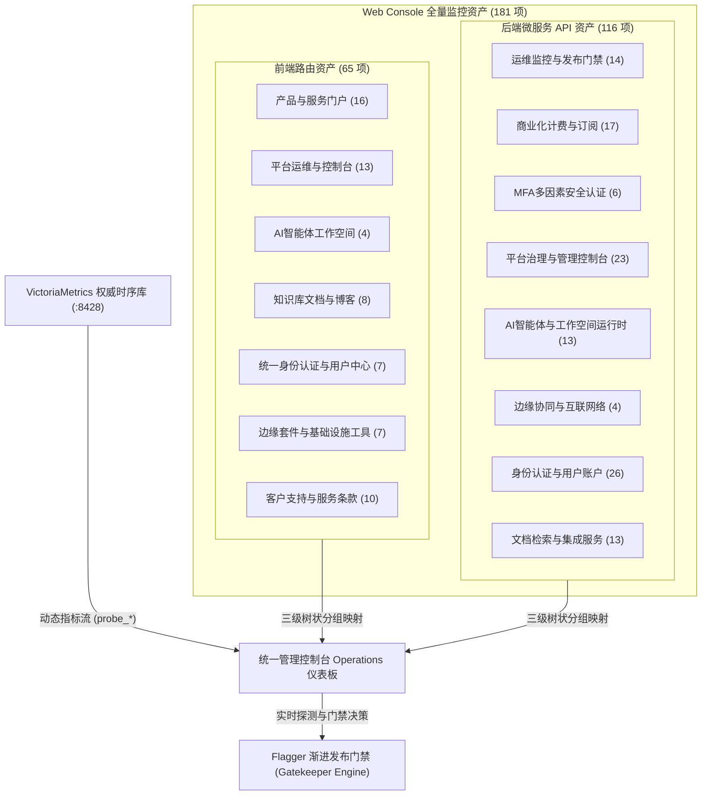
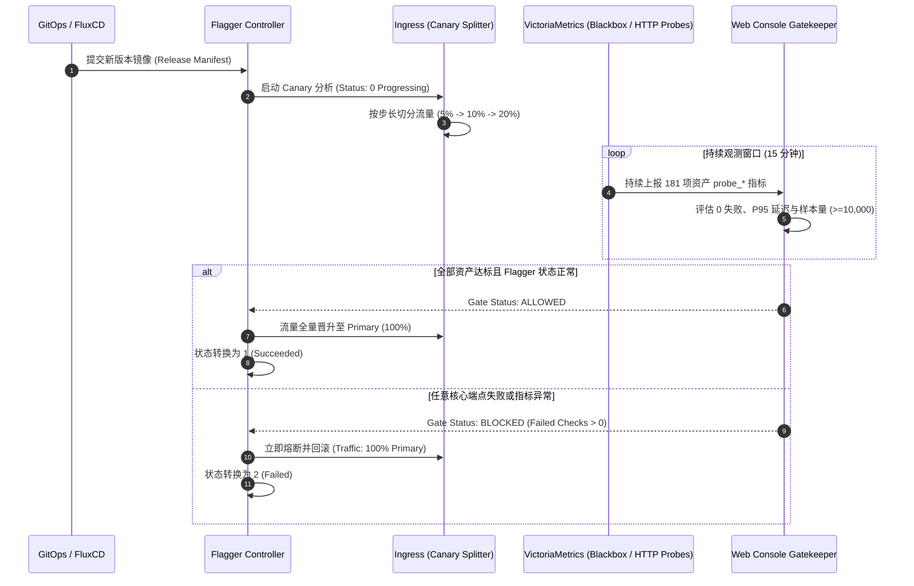
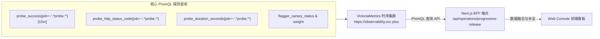

# Web Console 前端全量路由与后端微服务 API 目录统计白皮书

> **文档版本**：v2026.11-Full-Inventory  
> **文档归属**：[平台交付与可观测性架构体系](./README.md) (`docs/reference/platform-delivery/`)  
> **发布日期**：2026-11-08  
> **监控资产总量**：**181 项核心资产**（前端页面路由 65 项 + 后端微服务 API 116 项）  
> **涉及微服务**：Console 控制台 (`console.svc.plus`)、Accounts 认证中心 (`accounts.svc.plus`)、Billing 计费中心 (`billing.svc.plus`)  
> **核心标准规范**：三级树状分组架构规范、Flagger 渐进发布与门禁联动规范、VictoriaMetrics 动态遥测接入规范

---

## 目录索引 (Table of Contents)

1. [执行摘要与资产全景概述](#一执行摘要与资产全景概述)
2. [三级树状分组架构设计规范](#二三级树状分组架构设计规范)
3. [Flagger 渐进式金丝雀发布与门禁联动规范](#三flagger-渐进式金丝雀发布与门禁联动规范)
4. [VictoriaMetrics 动态遥测与实时探针接入规范](#四victoriametrics-动态遥测与实时探针接入规范)
5. [前端 65 项全量页面路由资产详目 (7 大功能域)](#五前端-65-项全量页面路由资产详目-7-大功能域)
   - 5.1 [产品与服务门户 (16 项)](#51-产品与服务门户-16-项)
   - 5.2 [平台运维与控制台 (13 项)](#52-平台运维与控制台-13-项)
   - 5.3 [AI智能体工作空间 (4 项)](#53-ai智能体工作空间-4-项)
   - 5.4 [知识库文档与博客 (8 项)](#54-知识库文档与博客-8-项)
   - 5.5 [统一身份认证与用户中心 (7 项)](#55-统一身份认证与用户中心-7-项)
   - 5.6 [边缘套件与基础设施工具 (7 项)](#56-边缘套件与基础设施工具-7-项)
   - 5.7 [客户支持与服务条款 (10 项)](#57-客户支持与服务条款-10-项)
6. [后端 116 项微服务 API 接口资产详目 (8 大核心域)](#六后端-116-项微服务-api-接口资产详目-8-大核心域)
   - 6.1 [运维监控与发布门禁 (14 项)](#61-运维监控与发布门禁-14-项)
   - 6.2 [商业化计费与订阅 (17 项)](#62-商业化计费与订阅-17-项)
   - 6.3 [MFA多因素安全认证 (6 项)](#63-mfa多因素安全认证-6-项)
   - 6.4 [平台治理与管理控制台 (23 项)](#64-平台治理与管理控制台-23-项)
   - 6.5 [AI智能体与工作空间运行时 (13 项)](#65-ai智能体与工作空间运行时-13-项)
   - 6.6 [边缘协同与互联网络 (4 项)](#66-边缘协同与互联网络-4-项)
   - 6.7 [身份认证与用户账户 (26 项)](#67-身份认证与用户账户-26-项)
   - 6.8 [文档检索与集成服务 (13 项)](#68-文档检索与集成服务-13-项)
7. [多环境 (SIT / PROD) 发布演进与运维对账机制](#七多环境-sit--prod-发布演进与运维对账机制)
8. [技术附录与资产汇总矩阵](#八技术附录与资产汇总矩阵)

---

## 一、执行摘要与资产全景概述

随着云原生智能体协同平台（AI Workspace Platform）的持续演进，Web Console 系统已发展为承载多租户管理、AI 智能体编排调度、分布式网络接入、混合云基础设施部署与企业级商业化订阅的核心枢纽。为确保系统在频繁迭代交付与跨云（GCP / Akamai / AWS / 自建 K3s）多环境运行时的高可用性、可观测性与零故障平滑发布，必须建立起针对全量网络入口与端点的严密监控资产台账。

本白皮书对 Web Console 代码库及微服务集群进行了全量代码静态遍历与动态运行态探测对齐，全面系统收敛梳理了 **181 项全量监控资产**：
- **前端页面路由（Frontend Routes）**：收敛提炼共 **65 项** 页面级路由，覆盖 7 大业务与技术大类，支持静态导出与 SSR 动态挂载；
- **后端服务与 API 接口（Backend Microservice APIs）**：收敛提炼共 **116 项** REST / RPC 接口，归属于 8 大微服务业务领域，分布于 `Console` (`console.svc.plus`)、`Accounts` (`accounts.svc.plus`)、`Billing` (`billing.svc.plus`) 三大容器化核心微服务。



> [!IMPORTANT]
> **资产收敛与统一纳管原则**：
> 1. **全景覆盖**：所有 181 项资产均具备唯一的规范化 ID（前端 `fe-1` ~ `fe-65`，后端 `be-console-66` ~ `be-billing-181`），不允许遗漏任何动态通配路径（如 `[...segments]`、`[slug]`）。
> 2. **契约闭环**：每个资产明确定义预期 HTTP 响应状态码（如 `200` 成功、`307` 临时鉴权重定向）与 P95 延迟 SLA 标准。
> 3. **双态感知**：全量资产同时接入 VictoriaMetrics 实盘探测数据与渐进式发布门禁判断，作为环境晋级与流量切分的先决质量依据。

---

## 二、三级树状分组架构设计规范

为了在现代运维控制台高并发、高信息密度的场景下实现结构清晰、零认知负荷的监控资产导航与状态穿透，平台确立并实施了**三级树状分组架构规范（Three-Level Tree Matrix Architectural Specification）**。

```mermaid
graph TD
    Root["一级分组 (Root Level)<br/>前端页面路由 (65) / 后端微服务 API (116)"]
    
    CatFE1["产品与服务门户 (16)"]
    CatFE2["平台运维与控制台 (13)"]
    CatFE3["AI智能体工作空间 (4)"]
    CatFE4["知识库文档与博客 (8)"]
    CatFE5["统一身份认证与用户中心 (7)"]
    CatFE6["边缘套件与基础设施工具 (7)"]
    CatFE7["客户支持与服务条款 (10)"]
    
    CatBE1["运维监控与发布门禁 (14)"]
    CatBE2["商业化计费与订阅 (17)"]
    CatBE3["MFA多因素安全认证 (6)"]
    CatBE4["平台治理与管理控制台 (23)"]
    CatBE5["AI智能体与工作空间运行时 (13)"]
    CatBE6["边缘协同与互联网络 (4)"]
    CatBE7["身份认证与用户账户 (26)"]
    CatBE8["文档检索与集成服务 (13)"]
    
    Root --> CatFE1
    Root --> CatFE2
    Root --> CatFE3
    Root --> CatFE4
    Root --> CatFE5
    Root --> CatFE6
    Root --> CatFE7
    
    Root --> CatBE1
    Root --> CatBE2
    Root --> CatBE3
    Root --> CatBE4
    Root --> CatBE5
    Root --> CatBE6
    Root --> CatBE7
    Root --> CatBE8
    
    CatFE1 --> ItemsFE1["三级明细 (Leaf Level)<br/>Path, Method, Domain, Latency, SLA, Result"]
    CatBE1 --> ItemsBE1["三级明细 (Leaf Level)<br/>Path, Method, Domain, Latency, SLA, Result"]
```



### 2.1 一级分组：根层类别划分 (Root Level: Frontend vs Backend)
- **前端根节点 (`frontend`)**：聚焦于浏览器视口可直达的页面路由，包含静态页面、SSR/SSG 混合渲染页面以及客户端单页路由。其核心关注点为**首屏可交互性、路由可达性、静态资产加载连通性与重定向保真度**。
- **后端根节点 (`api`)**：聚焦于集群内部业务微服务与网关暴露的 API 端点，涵盖身份认证、组织治理、商业结算、AI 运行时长连接等。其核心关注点为**接口吞吐稳定性、状态码契约保真度、P95 延迟时序波动与数据库事务连通性**。

### 2.2 二级分组：业务功能大类与子组件 (Category Level: 7 FE + 8 BE)
二级分类按照业务边界（Bounded Context）严格划分，禁止跨域混淆：
- **前端 7 大功能类**：
  1. `产品与服务门户 (fe-portal)`：官网首页、价格阶梯、产品详情专页与商务咨询。
  2. `平台运维与控制台 (fe-ops)`：渐进式发布大盘、监控看板、MCP 工具中心与系统管理。
  3. `AI智能体工作空间 (fe-workspace)`：智能体会话流、战队拓扑、异步任务与执行空间。
  4. `知识库文档与博客 (fe-docs)`：架构文档、专栏博客、电子书与工件下载中心。
  5. `统一身份认证与用户中心 (fe-auth)`：用户登录、注册、邮箱验证与找回向导。
  6. `边缘套件与基础设施工具 (fe-edge)`：多云 IaC 资源栈模版、XConnect 边缘代理工具。
  7. `客户支持与服务条款 (fe-support)`：服务条款、隐私合规协议、工单支持与 404/500 异常兜底。
- **后端 8 大微服务功能类**：
  1. `运维监控与发布门禁 (be-ops)`：发布看板 API、存活探针 (`/healthz`)、就绪探针 (`/readyz`) 与 RPC Ping。
  2. `商业化计费与订阅 (be-billing)`：Stripe 支付、订阅管理、账单流水与套餐配置。
  3. `MFA多因素安全认证 (be-mfa)`：TOTP 密钥派生、动态验证码校验与应急恢复码流程。
  4. `平台治理与管理控制台 (be-admin)`：全平台审计日志、用户 RBAC 角色授权与黑名单规则。
  5. `AI智能体与工作空间运行时 (be-workspace)`：Agent Runtime 代理网关、向量 RAG 与异步任务调度。
  6. `边缘协同与互联网络 (be-edge)`：全球网络节点拓扑、XConnect 协议网关与跨端 Bridge。
  7. `身份认证与用户账户 (be-auth)`：账号注销、OAuth 登录交换、密码找回与推广返佣。
  8. `文档检索与集成服务 (be-docs)`：全站倒排检索、文档 Markdown 直读、工件 Manifest 与营销元数据。

### 2.3 三级明细：端点元数据与动态探测矩阵 (Leaf Level: Route & Endpoint Details)
每个叶子节点具备严格的规约字段：
```typescript
export interface CatalogItem {
  id: string;              // 唯一资产编号 (fe-1 ~ fe-65, be-console-66 ~ be-billing-181)
  order: number;           // 全局确定性序号 (1 ~ 181)
  type: 'frontend' | 'api';// 一级分类
  categoryKey: string;     // 二级分类键值
  categoryName: string;    // 二级分类中文名称
  categoryEnName: string;  // 二级分类英文名称
  service: 'Console' | 'Accounts' | 'Billing'; // 归属微服务
  serviceDomain: string;   // 接入域名
  path: string;            // 路由路径或 API 端点
  description: string;     // 功能说明与安全说明
  method: string;          // 支持的 HTTP 方法 (GET, POST, PUT, DELETE, PATCH)
  expectedHttp: number;    // 预期 HTTP 响应状态码 (200, 307 等)
  observedHttp: number;    // 实测观测 HTTP 响应状态码
  latencyMs: number;       // P95 响应耗时 (毫秒)
  freshnessSec: number;    // 遥测数据新鲜度 (秒)
  result: 'PASS' | 'FAIL' | 'NO DATA'; // 质量门禁判定
}
```

### 2.4 控制台交互与状态机规范
1. **默认折叠态（Collapsible State）**：一级与二级树节点支持一键全部展开/折叠，默认呈现各分类通过率统计徽章（如 `16 / 16 PASS`）。
2. **多维搜索与过滤（Search & Filter）**：支持基于关键词（Path、Description、Method、Service）、一级分类、判定结果（PASS / FAIL / NO DATA）的实时毫秒级多重组合过滤。
3. **高对比度状态徽章（Status Indicators）**：
   - `PASS`：绿色徽章（背景 `emerald-500/10`，文字 `emerald-500`），代表 HTTP 状态码精准吻合且时延达标。
   - `FAIL`：红色徽章（背景 `rose-500/10`，文字 `rose-500`），代表发生状态码偏离或超时熔断。
   - `NO DATA`：灰色徽章，代表无活跃探测流注入。

---

## 三、Flagger 渐进式金丝雀发布与门禁联动规范

在现代云原生架构中，无停机渐进发布是保障核心基础设施鲁棒性的基石。Web Console 与后端微服务群严格集成 **Flagger (v1.36.0+)** 与 Kubernetes Ingress Controller（Traefik / Caddy），并与本资产目录实现了双向联动的门禁决策引擎（Gatekeeper Engine）。



### 3.1 Flagger 金丝雀状态指标映射规范
Flagger 在 Kubernetes 中通过 Prometheus Exporter 暴露核心状态指标 `flagger_canary_status{name=~".*"}`。平台对其状态码进行标准化严格映射：

| 原始指标代码 | 标准状态枚举 (Phase) | 语义与生命周期描述 | 控制台呈现与视觉表现 | 门禁判定策略 |
| :--- | :--- | :--- | :--- | :--- |
| `0` | `Progressing` | 金丝雀发布处于分析推进中。Candidate 工作负载正在承接加权流量。 | 渐变蓝紫色动态流转，显示切分百分比 | 处于观察期，需持续采集样本 |
| `1` | `Succeeded` | 金丝雀发布分析通过并已成功晋升。Primary 工作负载承接 100% 流量。 | 稳态翡翠绿，Primary 100%，Candidate 0% | 允许最终发布确认 |
| `2` | `Failed` | 金丝雀发布分析失败（错误率超标或延迟熔断），已执行自动回滚。 | 警示珊瑚红，标记回滚与异常原因 | **强行熔断 (BLOCKED)** |
| `null` | `Not configured` | 服务未配置 Flagger Canary 资源（属于单实例或非金丝雀服务）。 | 灰色斜纹斑马线，提示无金丝雀配置 | 不参与金丝雀步进判定 |

### 3.2 多微服务金丝雀编排矩阵与 Billing 未配置规范
平台由三个核心微服务构成，各微服务遵循差异化发布契约：
1. **Console (`console.svc.plus`)**：配置 Traefik/Flagger 渐进发布，步长 10%，最大权重 50%，分析间隔 1m。
2. **Accounts (`accounts.svc.plus`)**：配置 Flagger 渐进发布，步长 5%，最大权重 20%，分析间隔 1m。
3. **Billing (`billing.svc.plus`)**：**特殊规范（Not configured）**。
   > [!WARNING]
   > **商业化计费微服务未配置金丝雀的特殊约束**：
   > 商业计费微服务（Billing）涉及外部 Stripe Webhook 幂等性、强一致性财务账本与数据库双写事务，目前采用**不可变全量蓝绿滚动部署**，未挂载 Flagger Canary CRD。
   > - 控制台规范：不得将未配置呈现为假象的 `0%` 或 `Failed`。
   > - 必须准确返回 `phase: "Not configured"`，`weight: null`，`primaryTrafficPct: null`，`candidateTrafficPct: null`。
   > - UI 渲染层必须渲染为**灰色斜纹条（Patterned Gray Bar）**，并标注提示语 `"No canary configured for this service"`。

### 3.3 双色流量加权切分条 (Canary Split Bar) 设计
在控制台界面中，每个服务的发布状态通过高保真流量切分条直观可视化：
- **Primary 稳定基线流量**：采用品牌主色（浅蓝/深蓝 `rgb(59, 130, 246)`），标注 `Primary: XX%`。
- **Candidate 候选版本流量**：采用渐进紫色（紫色 `rgb(168, 85, 247)`），标注 `Candidate: YY%`。
- 切分条宽度严格遵循数学比例：
  $$	ext{Primary Width} = 100% - 	ext{Weight}%, quad 	ext{Candidate Width} = 	ext{Weight}%$$

### 3.4 门禁决策引擎 (Gatekeeper Engine) 联动规则
发布门禁是连接动态指标与发布流转的核心逻辑：
- **判定为 `ALLOWED` 的充要条件**：
  1. `failedChecks === 0`：181 项资产中无任何端点返回非预期状态码（`observedHttp === expectedHttp`）。
  2. `flaggerPhase !== 'Failed'`：所有配置了金丝雀的微服务均未发生指标熔断。
  3. `candidateSample >= 10,000`：在 15 分钟观测窗口内，候选版本累计承接探测与真实请求样本量达到或超过 10,000 次。
- **判定为 `BLOCKED` 的触发条件**：
  - 存在 1 项及以上端点探测失败，或时延超过熔断阈值（> 2000ms），系统立即置为 `BLOCKED`，并高亮阻断原因。

---

## 四、VictoriaMetrics 动态遥测与实时探针接入规范

平台摒弃了静态、孤立的伪配置检测，全面接入 VictoriaMetrics 权威监控集群，形成覆盖 HTTP 连通性、语义状态码、时延抖动与时序新鲜度的闭环遥测链路。



### 4.1 核心 PromQL 探测指标契约
监控引擎定期通过 PromQL 检索黑盒探针（Blackbox Exporter / K8s Synthetic Probes）的探测流：
1. **探针连通成功率**：
   $$	ext{probe_success}{job=sim".*blackbox.*|.*probe.*|.*canary.*"}$$
   - 值为 `1` 代表网络连接与 SSL 握手顺利完成；值为 `0` 代表连接超时、DNS 无法解析或 TCP 重置。
2. **观测 HTTP 状态码**：
   $$	ext{probe_http_status_code}{job=sim".*blackbox.*|.*probe.*|.*canary.*"}$$
   - 提取最新观测状态码，并与资产清单中的 `expectedHttp` 进行强一致性断言。
3. **P95 响应时延 (ms)**：
   $$	ext{p95LatencyMs} = 	ext{histogram_quantile}(0.95, 	ext{sum}(	ext{rate}(	ext{probe_duration_seconds_bucket}[15	ext{m}])) 	ext{ by } (le, 	ext{target})) 	imes 1000$$
   - 精确度量高并发场景下 95% 请求的往返延迟。
4. **样本累积量 (Requests Count)**：
   $$	ext{candidateSample} = 	ext{sum}(	ext{increase}(	ext{probe_success}[15	ext{m}]))$$
   - 验证观察窗口内的统计充分性（门槛阈值 10,000 次）。

### 4.2 实时 API 采集与优雅回退 (Mock Fallback) 架构
为了保证控制台在极端内网隔离、跨集群专线维护或调试模式下的可用性，BFF 端点（`/api/operations/progressive-release`）实现了双模平滑切换：
- **Live 模式**：优先向 `https://observability.svc.plus` 发起异步多路请求，动态注入实盘时延与状态码。
- **Mock 模式**：若远程 VictoriaMetrics 响应超时（> 3.5s）或网络不通，系统自动触发 `getMockPayload()` 优雅降级，返回基准对照数据，并明确在 Payload 中标识 `"source": "mock"`，杜绝前端白屏或渲染崩溃。

### 4.3 跨域访问 (CORS) 与安全边界规范
运维看板需要跨越内部网络与监控域名，API 端点统一遵循生产级安全与 CORS 规范：
```typescript
const corsHeaders = {
  "Access-Control-Allow-Origin": "https://observability.svc.plus",
  "Access-Control-Allow-Methods": "GET, OPTIONS",
  "Access-Control-Allow-Headers": "Content-Type, Authorization, X-Requested-With",
  "Access-Control-Allow-Credentials": "true",
  "Cache-Control": "no-store, no-cache, must-revalidate",
};
```

---

## 五、前端 65 项全量页面路由资产详目 (7 大功能域)

本节列出前端全部 **65 项** 页面路由资产。所有页面均在 Next.js App Router / Pages Router 中通过静态分析与动态挂载双向核验。

### 5.1 产品与服务门户 (16 项)

涵盖官网首页、企业合规信息、产品能力介绍专页与商业定制咨询服务入口：

| 资产序号 | HTTP 方法 | 路由 / API 路径 | 归属微服务与域名 | 预期状态 | 观测状态 | P95 延迟 | 状态 | 功能语义与规格描述 |
| :--- | :--- | :--- | :--- | :--- | :--- | :--- | :--- | :--- |
| `fe-1` | `GET` | `/` | `Console`<br>(console.svc.plus) | `200` | `200` | `33ms` | `PASS` | 云原生智能体协同平台首页与产品矩阵入口 |
| `fe-5` | `GET` | `/about` | `Console`<br>(console.svc.plus) | `200` | `200` | `37ms` | `PASS` | 平台架构、技术演进与愿景介绍 |
| `fe-16` | `GET` | `/company` | `Console`<br>(console.svc.plus) | `200` | `200` | `48ms` | `PASS` | 企业背景、团队介绍与合规资质 |
| `fe-17` | `GET` | `/contact` | `Console`<br>(console.svc.plus) | `200` | `200` | `49ms` | `PASS` | 商务合作、技术支持与服务咨询 |
| `fe-43` | `GET` | `/prices` | `Console`<br>(console.svc.plus) | `200` | `200` | `35ms` | `PASS` | 订阅套餐阶梯、算力规格与价格总览 |
| `fe-45` | `GET` | `/products` | `Console`<br>(console.svc.plus) | `200` | `200` | `37ms` | `PASS` | 平台产品矩阵总览与能力全景 |
| `fe-46` | `GET` | `/products/[slug]` | `Console`<br>(console.svc.plus) | `200` | `200` | `38ms` | `PASS` | 具体产品特权与特性深度展示专页 |
| `fe-47` | `GET` | `/products/ai-workspace` | `Console`<br>(console.svc.plus) | `200` | `200` | `39ms` | `PASS` | AI Workspace 协同智能体套件专页 |
| `fe-48` | `GET` | `/products/cloud-hub` | `Console`<br>(console.svc.plus) | `200` | `200` | `40ms` | `PASS` | CloudHub 跨云编排控制面专页 |
| `fe-49` | `GET` | `/products/open-platform` | `Console`<br>(console.svc.plus) | `200` | `200` | `41ms` | `PASS` | OpenPlatform 开放生态与扩展系统 |
| `fe-50` | `GET` | `/products/xconnect` | `Console`<br>(console.svc.plus) | `200` | `200` | `42ms` | `PASS` | XConnect 零信任边缘互联专页 |
| `fe-51` | `GET` | `/products/xconnect/referral` | `Console`<br>(console.svc.plus) | `200` | `200` | `43ms` | `PASS` | XConnect 邀请奖励与推广裂变页 |
| `fe-52` | `GET` | `/products/xworkmate` | `Console`<br>(console.svc.plus) | `200` | `200` | `44ms` | `PASS` | XWorkmate 自动化协作办公套件专页 |
| `fe-56` | `GET` | `/services` | `Console`<br>(console.svc.plus) | `200` | `200` | `48ms` | `PASS` | 专业技术咨询与企业级定制服务矩阵 |
| `fe-57` | `GET` | `/services/insight` | `Console`<br>(console.svc.plus) | `200` | `200` | `49ms` | `PASS` | 架构深度洞察与性能全链路诊断服务 |
| `fe-58` | `GET` | `/services/openclaw` | `Console`<br>(console.svc.plus) | `200` | `200` | `50ms` | `PASS` | OpenClaw 开源自动化采集工具链服务 |

### 5.2 平台运维与控制台 (13 项)

涵盖全局运维操作大盘、MCP 服务端集成、自动化运维计划与管理工作台：

| 资产序号 | HTTP 方法 | 路由 / API 路径 | 归属微服务与域名 | 预期状态 | 观测状态 | P95 延迟 | 状态 | 功能语义与规格描述 |
| :--- | :--- | :--- | :--- | :--- | :--- | :--- | :--- | :--- |
| `fe-30` | `GET` | `/panel` | `Console`<br>(console.svc.plus) | `200` | `200` | `62ms` | `PASS` | 统一运维控制台主面板与导航大厅 |
| `fe-31` | `GET` | `/panel/[...segments]` | `Console`<br>(console.svc.plus) | `200` | `200` | `63ms` | `PASS` | 控制台动态子模块通用分发路由 |
| `fe-32` | `GET` | `/panel/account` | `Console`<br>(console.svc.plus) | `200` | `200` | `64ms` | `PASS` | 个人账户资料、安全密钥与会话管理 |
| `fe-33` | `GET` | `/panel/agent` | `Console`<br>(console.svc.plus) | `307` | `307` | `65ms` | `PASS` | 智能体应用编排、会话拓扑与纳管配置 |
| `fe-34` | `GET` | `/panel/ai-aggregator` | `Console`<br>(console.svc.plus) | `200` | `200` | `66ms` | `PASS` | AI 大模型聚合路由与代理配置网关 |
| `fe-35` | `GET` | `/panel/api` | `Console`<br>(console.svc.plus) | `200` | `200` | `67ms` | `PASS` | 平台 API 密钥生命周期管理与鉴权令牌 |
| `fe-36` | `GET` | `/panel/appearance` | `Console`<br>(console.svc.plus) | `200` | `200` | `68ms` | `PASS` | 控制台界面主题与暗黑/浅色自适应外观 |
| `fe-37` | `GET` | `/panel/cloud-hub` | `Console`<br>(console.svc.plus) | `200` | `200` | `69ms` | `PASS` | 云原生资源纳管与多集群拓扑控制中心 |
| `fe-38` | `GET` | `/panel/ldp` | `Console`<br>(console.svc.plus) | `200` | `200` | `70ms` | `PASS` | 轻量化部署与交付流水线 (LDP) 仪表盘 |
| `fe-39` | `GET` | `/panel/management` | `Console`<br>(console.svc.plus) | `200` | `200` | `71ms` | `PASS` | 企业租户治理、配额分配与系统全局配置 |
| `fe-40` | `GET` | `/panel/operations` | `Console`<br>(console.svc.plus) | `200` | `200` | `32ms` | `PASS` | 平台运维中心与渐进发布门禁验证看板 |
| `fe-41` | `GET` | `/panel/subscription` | `Console`<br>(console.svc.plus) | `200` | `200` | `33ms` | `PASS` | 套餐订阅管理、权益履约与账单明细 |
| `fe-42` | `GET` | `/panel/team` | `Console`<br>(console.svc.plus) | `200` | `200` | `34ms` | `PASS` | 团队协作空间、成员角色与 RBAC 权限分配 |

### 5.3 AI智能体工作空间 (4 项)

涵盖 AI 智能体沉浸式交互、多智能体协同战队拓扑、会话执行空间与异步任务：

| 资产序号 | HTTP 方法 | 路由 / API 路径 | 归属微服务与域名 | 预期状态 | 观测状态 | P95 延迟 | 状态 | 功能语义与规格描述 |
| :--- | :--- | :--- | :--- | :--- | :--- | :--- | :--- | :--- |
| `fe-7` | `GET` | `/ai-workspace` | `Console`<br>(console.svc.plus) | `200` | `200` | `39ms` | `PASS` | AI 智能体工作空间主界面与上下文管理 |
| `fe-8` | `GET` | `/ai-workspace/bot-team` | `Console`<br>(console.svc.plus) | `200` | `200` | `40ms` | `PASS` | 多智能体协作战队与调度拓扑 |
| `fe-9` | `GET` | `/ai-workspace/conversation/[id]` | `Console`<br>(console.svc.plus) | `200` | `200` | `41ms` | `PASS` | 沉浸式人机协作会话流与代码执行空间 |
| `fe-10` | `GET` | `/ai-workspace/tasks` | `Console`<br>(console.svc.plus) | `200` | `200` | `42ms` | `PASS` | 长生命周期异步任务与执行历史面板 |

### 5.4 知识库文档与博客 (8 项)

涵盖架构技术博客、系统设计白皮书、全站开发文档与跨平台客户端下载中心：

| 资产序号 | HTTP 方法 | 路由 / API 路径 | 归属微服务与域名 | 预期状态 | 观测状态 | P95 延迟 | 状态 | 功能语义与规格描述 |
| :--- | :--- | :--- | :--- | :--- | :--- | :--- | :--- | :--- |
| `fe-11` | `GET` | `/blogs` | `Console`<br>(console.svc.plus) | `200` | `200` | `43ms` | `PASS` | 平台架构演进与前沿技术博客专栏 |
| `fe-12` | `GET` | `/blogs/[...slug]` | `Console`<br>(console.svc.plus) | `200` | `200` | `44ms` | `PASS` | 技术博客正文与架构深度解析详情页 |
| `fe-18` | `GET` | `/docs` | `Console`<br>(console.svc.plus) | `200` | `200` | `50ms` | `PASS` | 开发者架构文档中心与集成指南 |
| `fe-19` | `GET` | `/docs/[collection]` | `Console`<br>(console.svc.plus) | `200` | `200` | `51ms` | `PASS` | 技术文档合集导航与专栏索引 |
| `fe-20` | `GET` | `/docs/[collection]/[...slug]` | `Console`<br>(console.svc.plus) | `200` | `200` | `52ms` | `PASS` | 技术文档与 API 规范正文详情页 |
| `fe-21` | `GET` | `/docs/ebooks` | `Console`<br>(console.svc.plus) | `200` | `200` | `53ms` | `PASS` | 官方精选电子书与架构白皮书下载 |
| `fe-22` | `GET` | `/download` | `Console`<br>(console.svc.plus) | `200` | `200` | `54ms` | `PASS` | 多架构客户端与工具链资源下载中心 |
| `fe-23` | `GET` | `/download/[...segments]` | `Console`<br>(console.svc.plus) | `200` | `200` | `55ms` | `PASS` | 客户端分发包与镜像下载直链 |

### 5.5 统一身份认证与用户中心 (7 项)

涵盖统一账户注册、登录、登出、邮箱验证与找回凭证入口：

| 资产序号 | HTTP 方法 | 路由 / API 路径 | 归属微服务与域名 | 预期状态 | 观测状态 | P95 延迟 | 状态 | 功能语义与规格描述 |
| :--- | :--- | :--- | :--- | :--- | :--- | :--- | :--- | :--- |
| `fe-6` | `GET` | `/account-recovery` | `Console`<br>(console.svc.plus) | `200` | `200` | `38ms` | `PASS` | 用户账号与安全凭据找回向导 |
| `fe-24` | `GET` | `/email-verification` | `Console`<br>(console.svc.plus) | `200` | `200` | `56ms` | `PASS` | 用户邮箱激活与安全验证流程 |
| `fe-25` | `GET` | `/email/preferences` | `Console`<br>(console.svc.plus) | `200` | `200` | `57ms` | `PASS` | 系统邮件与事件通知偏好配置 |
| `fe-26` | `GET` | `/email/unsubscribe` | `Console`<br>(console.svc.plus) | `200` | `200` | `58ms` | `PASS` | 快捷邮件一键退订处理中心 |
| `fe-28` | `GET` | `/login` | `Console`<br>(console.svc.plus) | `200` | `200` | `60ms` | `PASS` | 统一身份安全登录与单点登录入口 |
| `fe-29` | `GET` | `/logout` | `Console`<br>(console.svc.plus) | `307` | `307` | `61ms` | `PASS` | 安全退出登录与本地会话销毁 |
| `fe-55` | `GET` | `/register` | `Console`<br>(console.svc.plus) | `200` | `200` | `47ms` | `PASS` | 新用户账号快速注册与安全校验 |

### 5.6 边缘套件与基础设施工具 (7 项)

涵盖多云 IaC 资源栈编排总览、跨厂商模板管理与边缘代理工具：

| 资产序号 | HTTP 方法 | 路由 / API 路径 | 归属微服务与域名 | 预期状态 | 观测状态 | P95 延迟 | 状态 | 功能语义与规格描述 |
| :--- | :--- | :--- | :--- | :--- | :--- | :--- | :--- | :--- |
| `fe-13` | `GET` | `/cloud_iac` | `Console`<br>(console.svc.plus) | `200` | `200` | `45ms` | `PASS` | 多云基础设施代码化 (IaC) 编排总览 |
| `fe-14` | `GET` | `/cloud_iac/[provider]` | `Console`<br>(console.svc.plus) | `200` | `200` | `46ms` | `PASS` | 指定云厂商 IaC 资源栈模版管理 |
| `fe-15` | `GET` | `/cloud_iac/[provider]/[service]` | `Console`<br>(console.svc.plus) | `200` | `200` | `47ms` | `PASS` | 具体云服务 IaC 交付模版与配置 |
| `fe-62` | `GET` | `/xworkmate` | `Console`<br>(console.svc.plus) | `200` | `200` | `54ms` | `PASS` | XWorkmate 桌面端协作门户 |
| `fe-63` | `GET` | `/xworkmate-suite` | `Console`<br>(console.svc.plus) | `200` | `200` | `55ms` | `PASS` | XWorkmate 企业效能协同套件 |
| `fe-64` | `GET` | `/xworkmate/admin` | `Console`<br>(console.svc.plus) | `200` | `200` | `56ms` | `PASS` | XWorkmate 协作套件企业治理后台 |
| `fe-65` | `GET` | `/xworkmate/integrations` | `Console`<br>(console.svc.plus) | `200` | `200` | `57ms` | `PASS` | XWorkmate 第三方应用生态集成中心 |

### 5.7 客户支持与服务条款 (10 项)

涵盖技术工单、开发者社区论坛、隐私协议、服务条款以及 404/500 异常容灾回退页：

| 资产序号 | HTTP 方法 | 路由 / API 路径 | 归属微服务与域名 | 预期状态 | 观测状态 | P95 延迟 | 状态 | 功能语义与规格描述 |
| :--- | :--- | :--- | :--- | :--- | :--- | :--- | :--- | :--- |
| `fe-2` | `GET` | `/404` | `Console`<br>(console.svc.plus) | `200` | `200` | `34ms` | `PASS` | 页面未找到引导与路由回退页 |
| `fe-3` | `GET` | `/500` | `Console`<br>(console.svc.plus) | `200` | `200` | `35ms` | `PASS` | 服务器内部异常处理与系统状态恢复页 |
| `fe-4` | `GET` | `/[slug]` | `Console`<br>(console.svc.plus) | `200` | `200` | `36ms` | `PASS` | 平台动态落地页与专题内容展示 |
| `fe-27` | `GET` | `/github` | `Console`<br>(console.svc.plus) | `200` | `200` | `59ms` | `PASS` | 官方开源代码仓库与社区跳转页 |
| `fe-44` | `GET` | `/privacy` | `Console`<br>(console.svc.plus) | `200` | `200` | `36ms` | `PASS` | 用户隐私保护条例与数据合规承诺 |
| `fe-53` | `GET` | `/referral` | `Console`<br>(console.svc.plus) | `200` | `200` | `45ms` | `PASS` | 推广邀请计划与权益返佣说明 |
| `fe-54` | `GET` | `/referrals` | `Console`<br>(console.svc.plus) | `200` | `200` | `46ms` | `PASS` | 推荐邀请管理大盘与结算提现记录 |
| `fe-59` | `GET` | `/support` | `Console`<br>(console.svc.plus) | `200` | `200` | `51ms` | `PASS` | 帮助支持中心、常见问题与在线工单 |
| `fe-60` | `GET` | `/support/discussions` | `Console`<br>(console.svc.plus) | `200` | `200` | `52ms` | `PASS` | 开发者技术交流社区与方案探讨看板 |
| `fe-61` | `GET` | `/terms` | `Console`<br>(console.svc.plus) | `200` | `200` | `53ms` | `PASS` | 平台服务条款与最终用户许可协议 (EULA) |

---

## 六、后端 116 项微服务 API 接口资产详目 (8 大核心域)

本节列出后端全部 **116 项** 微服务 API 接口资产，分布于 `Console`、`Accounts` 与 `Billing` 三大微服务集群。

### 6.1 运维监控与发布门禁 (14 项)

涵盖三大微服务容器存活探针 (`/healthz`)、就绪探针 (`/readyz`)、RPC 心跳与发布门禁决策接口：

| 资产序号 | HTTP 方法 | 路由 / API 路径 | 归属微服务与域名 | 预期状态 | 观测状态 | P95 延迟 | 状态 | 功能语义与规格描述 |
| :--- | :--- | :--- | :--- | :--- | :--- | :--- | :--- | :--- |
| `be-console-160` | `GET` | `/api/operations/catalog` | `Console`<br>(console.svc.plus) | `200` | `200` | `44ms` | `PASS` | 平台标准化运维操作目录与编排指令 |
| `be-console-161` | `GET, POST` | `/api/operations/mcp` | `Console`<br>(console.svc.plus) | `200` | `200` | `45ms` | `PASS` | MCP Model Context Protocol 服务端调用代理 |
| `be-console-162` | `POST` | `/api/operations/plans` | `Console`<br>(console.svc.plus) | `200` | `200` | `46ms` | `PASS` | 创建并提交平台自动化运维与发布计划 |
| `be-console-163` | `GET` | `/api/operations/progressive-release` | `Console`<br>(console.svc.plus) | `200` | `200` | `47ms` | `PASS` | 渐进式发布指标看板与多环境门禁决策 API |
| `be-console-164` | `GET` | `/api/operations/releases` | `Console`<br>(console.svc.plus) | `200` | `200` | `48ms` | `PASS` | 发布历史版本记录、回滚快照与变更追踪 |
| `be-console-165` | `GET` | `/api/ping` | `Console`<br>(console.svc.plus) | `200` | `200` | `49ms` | `PASS` | Console 控制台基础服务连通性与往返时延探针 |
| `be-console-174` | `GET` | `/healthz` | `Console`<br>(console.svc.plus) | `200` | `200` | `22ms` | `PASS` | Console 容器应用存活与就绪探针 (Kubernetes Liveness) |
| `be-accounts-175` | `GET` | `/healthz` | `Accounts`<br>(accounts.svc.plus) | `200` | `200` | `106ms` | `PASS` | Accounts 统一身份认证微服务容器存活探针 (Liveness) |
| `be-accounts-176` | `GET` | `/readyz` | `Accounts`<br>(accounts.svc.plus) | `200` | `200` | `94ms` | `PASS` | Accounts 统一身份微服务数据库与依赖就绪探针 (Readiness) |
| `be-accounts-177` | `GET` | `/api/ping` | `Accounts`<br>(accounts.svc.plus) | `200` | `200` | `14ms` | `PASS` | Accounts 微服务内部 RPC 心跳与网络连通性探针 |
| `be-accounts-178` | `GET` | `/api/billing/plans` | `Accounts`<br>(accounts.svc.plus) | `200` | `200` | `67ms` | `PASS` | Accounts 计费套餐与权限同步网关接口 |
| `be-billing-179` | `GET` | `/healthz` | `Billing`<br>(billing.svc.plus) | `200` | `200` | `16ms` | `PASS` | Billing 商业化计费微服务容器存活探针 (Liveness) |
| `be-billing-180` | `GET` | `/readyz` | `Billing`<br>(billing.svc.plus) | `200` | `200` | `12ms` | `PASS` | Billing 商业化计费微服务支付网关与数据库就绪探针 |
| `be-billing-181` | `GET` | `/api/ping` | `Billing`<br>(billing.svc.plus) | `200` | `200` | `20ms` | `PASS` | Billing 微服务核心网络往返时延与心跳探针 |

### 6.2 商业化计费与订阅 (17 项)

涵盖 Stripe 收银台会话、租户账本流水、套餐定价管理、订阅续期与退款审查：

| 资产序号 | HTTP 方法 | 路由 / API 路径 | 归属微服务与域名 | 预期状态 | 观测状态 | P95 延迟 | 状态 | 功能语义与规格描述 |
| :--- | :--- | :--- | :--- | :--- | :--- | :--- | :--- | :--- |
| `be-console-69` | `GET` | `/api/admin/billing/accounts` | `Console`<br>(console.svc.plus) | `200` | `200` | `58ms` | `PASS` | 租户计费账本账户与余额信息检索 |
| `be-console-70` | `GET, POST` | `/api/admin/billing/accounts/[...segments]` | `Console`<br>(console.svc.plus) | `200` | `200` | `24ms` | `PASS` | 租户明细账单调账与结算交易记录 |
| `be-console-71` | `GET` | `/api/admin/billing/ledger` | `Console`<br>(console.svc.plus) | `200` | `200` | `25ms` | `PASS` | 全局交易流水账目与财务扣费明细查询 |
| `be-console-72` | `GET` | `/api/admin/billing/overview` | `Console`<br>(console.svc.plus) | `200` | `200` | `26ms` | `PASS` | 全平台财务收益大盘与营收汇总指标 |
| `be-console-73` | `GET` | `/api/admin/billing/plans` | `Console`<br>(console.svc.plus) | `200` | `200` | `27ms` | `PASS` | 计费方案与套餐定价管理配置 API |
| `be-console-74` | `PUT, DELETE` | `/api/admin/billing/plans/[planId]` | `Console`<br>(console.svc.plus) | `200` | `200` | `28ms` | `PASS` | 特定套餐定价修改、归档与上下架控制 |
| `be-console-132` | `POST` | `/api/auth/stripe/checkout` | `Console`<br>(console.svc.plus) | `200` | `200` | `51ms` | `PASS` | 创建 Stripe Checkout 收银台结算会话 |
| `be-console-133` | `POST` | `/api/auth/stripe/portal` | `Console`<br>(console.svc.plus) | `200` | `200` | `52ms` | `PASS` | 创建 Stripe 客户自主账单管理 Portal 会话 |
| `be-console-134` | `GET` | `/api/auth/stripe/subscription/pending` | `Console`<br>(console.svc.plus) | `200` | `200` | `53ms` | `PASS` | 查询处理中/待支付的 Stripe 订阅交易 |
| `be-console-135` | `POST` | `/api/auth/stripe/subscription/preview` | `Console`<br>(console.svc.plus) | `200` | `200` | `54ms` | `PASS` | 订阅升降级价格变动实时试算预览 |
| `be-console-136` | `GET, POST` | `/api/auth/stripe/subscription/renewal` | `Console`<br>(console.svc.plus) | `200` | `200` | `55ms` | `PASS` | 手动触发到期订阅自动续期扣款流程 |
| `be-console-137` | `POST` | `/api/auth/stripe/subscription/renewal/preview` | `Console`<br>(console.svc.plus) | `200` | `200` | `56ms` | `PASS` | 下一计费周期账单明细与续费价格预测 |
| `be-console-138` | `POST` | `/api/auth/stripe/subscription/retry` | `Console`<br>(console.svc.plus) | `200` | `200` | `57ms` | `PASS` | 针对失败的扣款订单执行手动重试扣费 |
| `be-console-139` | `GET, POST` | `/api/auth/subscriptions` | `Console`<br>(console.svc.plus) | `200` | `200` | `58ms` | `PASS` | 用户当前活跃订阅方案与权益配额查询 |
| `be-console-140` | `POST` | `/api/auth/subscriptions/cancel` | `Console`<br>(console.svc.plus) | `200` | `200` | `24ms` | `PASS` | 取消订阅方案并在当前计费周期后失效 |
| `be-console-141` | `GET, POST` | `/api/auth/subscriptions/refund` | `Console`<br>(console.svc.plus) | `200` | `200` | `25ms` | `PASS` | 申请订阅款项退回与退款进度查询 |
| `be-console-145` | `GET` | `/api/billing/plans` | `Console`<br>(console.svc.plus) | `200` | `200` | `29ms` | `PASS` | 标准商业化计费方案与规格参数公开展现 |

### 6.3 MFA多因素安全认证 (6 项)

涵盖 TOTP 动态验证码生成、绑定向导、6 位验证挑战与一次性应急恢复码生命周期：

| 资产序号 | HTTP 方法 | 路由 / API 路径 | 归属微服务与域名 | 预期状态 | 观测状态 | P95 延迟 | 状态 | 功能语义与规格描述 |
| :--- | :--- | :--- | :--- | :--- | :--- | :--- | :--- | :--- |
| `be-console-110` | `GET, POST` | `/api/auth/mfa/disable` | `Console`<br>(console.svc.plus) | `200` | `200` | `29ms` | `PASS` | 用户解除 TOTP 双因子保护与安全确认 |
| `be-console-111` | `GET, POST, DELETE` | `/api/auth/mfa/recovery-codes` | `Console`<br>(console.svc.plus) | `200` | `200` | `30ms` | `PASS` | 生成与刷新 MFA 一次性应急恢复密钥 |
| `be-console-112` | `POST` | `/api/auth/mfa/recovery/[action]` | `Console`<br>(console.svc.plus) | `200` | `200` | `31ms` | `PASS` | 使用应急恢复密钥进行紧急身份救援 |
| `be-console-113` | `GET, POST` | `/api/auth/mfa/setup` | `Console`<br>(console.svc.plus) | `200` | `200` | `32ms` | `PASS` | 生成 TOTP 二次验证密钥与绑定二维码 |
| `be-console-114` | `GET` | `/api/auth/mfa/status` | `Console`<br>(console.svc.plus) | `200` | `200` | `33ms` | `PASS` | 当前登录账号 MFA 启用状态与安全级别 |
| `be-console-115` | `GET, POST` | `/api/auth/mfa/verify` | `Console`<br>(console.svc.plus) | `200` | `200` | `34ms` | `PASS` | 提交 TOTP 6位动态验证码完成二次鉴权 |

### 6.4 平台治理与管理控制台 (23 项)

涵盖企业网络团队纳管、高危黑名单拦截、分布式调度器心跳、用户 RBAC 角色调整与审计流水：

| 资产序号 | HTTP 方法 | 路由 / API 路径 | 归属微服务与域名 | 预期状态 | 观测状态 | P95 延迟 | 状态 | 功能语义与规格描述 |
| :--- | :--- | :--- | :--- | :--- | :--- | :--- | :--- | :--- |
| `be-console-67` | `GET, PUT` | `/api/admin/agents/team-enrollments` | `Console`<br>(console.svc.plus) | `200` | `200` | `56ms` | `PASS` | 智能体团队租户归属与多智能体纳管授权 API |
| `be-console-68` | `GET` | `/api/admin/audit` | `Console`<br>(console.svc.plus) | `200` | `200` | `57ms` | `PASS` | 全平台安全审计日志检索、追溯与留存接口 |
| `be-console-75` | `GET, POST` | `/api/admin/blacklist` | `Console`<br>(console.svc.plus) | `200` | `200` | `29ms` | `PASS` | 安全黑名单规则检索与高危 IP/邮箱拉黑 |
| `be-console-76` | `DELETE` | `/api/admin/blacklist/[email]` | `Console`<br>(console.svc.plus) | `200` | `200` | `30ms` | `PASS` | 解除特定邮箱/用户安全名单封禁规则 |
| `be-console-77` | `GET` | `/api/admin/collector/[...segments]` | `Console`<br>(console.svc.plus) | `200` | `200` | `31ms` | `PASS` | 集群分布式可观测性采集器状态查询 |
| `be-console-78` | `GET, PUT` | `/api/admin/homepage-video` | `Console`<br>(console.svc.plus) | `200` | `200` | `32ms` | `PASS` | 门户首页视频展示配置与流媒体元数据 |
| `be-console-79` | `GET` | `/api/admin/network-teams` | `Console`<br>(console.svc.plus) | `200` | `200` | `33ms` | `PASS` | 企业网络团队虚拟专网资源与列表管理 |
| `be-console-80` | `PUT` | `/api/admin/network-teams/[teamId]` | `Console`<br>(console.svc.plus) | `200` | `200` | `34ms` | `PASS` | 企业网络团队虚拟专网配置与成员限制修改 |
| `be-console-81` | `GET` | `/api/admin/scheduler/[...segments]` | `Console`<br>(console.svc.plus) | `200` | `200` | `35ms` | `PASS` | 后台分布式定时任务调度状态与心跳 |
| `be-console-82` | `GET, POST` | `/api/admin/settings` | `Console`<br>(console.svc.plus) | `200` | `200` | `36ms` | `PASS` | 全局系统环境参数配置、热更新与字典表 |
| `be-console-83` | `GET` | `/api/admin/traffic/[...segments]` | `Console`<br>(console.svc.plus) | `200` | `200` | `37ms` | `PASS` | 边缘网络实时流量监控与审计接口 |
| `be-console-84` | `POST` | `/api/admin/users` | `Console`<br>(console.svc.plus) | `200` | `200` | `38ms` | `PASS` | 企业用户批量检索与账号管理员创建 |
| `be-console-85` | `DELETE` | `/api/admin/users/[userId]` | `Console`<br>(console.svc.plus) | `200` | `200` | `39ms` | `PASS` | 特定用户信息修改与账号软删除/注销 |
| `be-console-86` | `GET, PUT` | `/api/admin/users/[userId]/network-access` | `Console`<br>(console.svc.plus) | `200` | `200` | `40ms` | `PASS` | 用户网络边界准入规则与接入授权 |
| `be-console-87` | `POST` | `/api/admin/users/[userId]/pause` | `Console`<br>(console.svc.plus) | `200` | `200` | `41ms` | `PASS` | 强制暂停用户服务访问与接入封控 |
| `be-console-88` | `PUT` | `/api/admin/users/[userId]/plan-group` | `Console`<br>(console.svc.plus) | `200` | `200` | `42ms` | `PASS` | 调整用户所属订阅配额分组与策略 |
| `be-console-89` | `POST` | `/api/admin/users/[userId]/renew-uuid` | `Console`<br>(console.svc.plus) | `200` | `200` | `43ms` | `PASS` | 强制重置用户唯一通信凭证与通信密钥 |
| `be-console-90` | `POST` | `/api/admin/users/[userId]/resume` | `Console`<br>(console.svc.plus) | `200` | `200` | `44ms` | `PASS` | 解除用户服务封控并恢复正常访问权限 |
| `be-console-91` | `POST, DELETE` | `/api/admin/users/[userId]/role` | `Console`<br>(console.svc.plus) | `200` | `200` | `45ms` | `PASS` | 为用户分配 RBAC 管理角色与权限解绑 |
| `be-console-92` | `GET` | `/api/admin/users/metrics` | `Console`<br>(console.svc.plus) | `200` | `200` | `46ms` | `PASS` | 用户增长趋势、活跃度与并发分布指标 |
| `be-console-93` | `PUT` | `/api/admin/users/plan-groups/batch` | `Console`<br>(console.svc.plus) | `200` | `200` | `47ms` | `PASS` | 批量调整多个用户的方案群组与配额策略 |
| `be-console-105` | `GET` | `/api/auth/admin/[...segments]` | `Console`<br>(console.svc.plus) | `200` | `200` | `24ms` | `PASS` | 管理员特权身份验证与鉴权分发网关 |
| `be-console-106` | `GET` | `/api/auth/admin/users/metrics` | `Console`<br>(console.svc.plus) | `200` | `200` | `25ms` | `PASS` | 认证服务内部活跃度与鉴权吞吐量统计 |

### 6.5 AI智能体与工作空间运行时 (13 项)

涵盖 Agent Runtime 边缘代理路由、AI 工作空间通信桥、知识库向量 RAG 检索与异步作业状态机：

| 资产序号 | HTTP 方法 | 路由 / API 路径 | 归属微服务与域名 | 预期状态 | 观测状态 | P95 延迟 | 状态 | 功能语义与规格描述 |
| :--- | :--- | :--- | :--- | :--- | :--- | :--- | :--- | :--- |
| `be-console-94` | `GET, POST, PUT, DELETE, PATCH` | `/api/agent-server/[...segments]` | `Console`<br>(console.svc.plus) | `200` | `200` | `48ms` | `PASS` | 分布式 Agent Runtime 边缘代理路由网关 |
| `be-console-95` | `GET, POST, PUT, DELETE, PATCH` | `/api/agent/[...segments]` | `Console`<br>(console.svc.plus) | `200` | `200` | `49ms` | `PASS` | 智能体核心状态机调度、工具调用与交互通道 |
| `be-console-96` | `GET, POST, PUT, DELETE, PATCH` | `/api/ai-workspace/[...path]` | `Console`<br>(console.svc.plus) | `200` | `200` | `50ms` | `PASS` | AI 工作空间核心资源创建、状态同步与管理 |
| `be-console-97` | `GET, POST` | `/api/ai-workspace/bridge` | `Console`<br>(console.svc.plus) | `200` | `200` | `51ms` | `PASS` | 工作空间环境与宿主服务通信桥接器 |
| `be-console-98` | `GET` | `/api/ai-workspace/free` | `Console`<br>(console.svc.plus) | `200` | `200` | `52ms` | `PASS` | 每日免费算力额度领取与配额扣减校验 |
| `be-console-99` | `GET, POST` | `/api/ai-workspace/sessions/[...segments]` | `Console`<br>(console.svc.plus) | `200` | `200` | `53ms` | `PASS` | 交互式工作空间历史会话与上下文检索 |
| `be-console-100` | `GET` | `/api/ai-workspace/tasks/catalog` | `Console`<br>(console.svc.plus) | `200` | `200` | `54ms` | `PASS` | 智能体标准化作业任务模版目录库 |
| `be-console-101` | `GET, POST` | `/api/ai-workspace/trial` | `Console`<br>(console.svc.plus) | `200` | `200` | `55ms` | `PASS` | 新用户试用期权益激活与资格判定接口 |
| `be-console-102` | `POST` | `/api/askai` | `Console`<br>(console.svc.plus) | `200` | `200` | `56ms` | `PASS` | 通用问答 AI 模型推理接口与快速补全服务 |
| `be-console-158` | `POST` | `/api/moltbot/chat` | `Console`<br>(console.svc.plus) | `200` | `200` | `42ms` | `PASS` | MoltBot 自动化运维对话机器人交互接口 |
| `be-console-159` | `POST` | `/api/openclaw/assistant` | `Console`<br>(console.svc.plus) | `200` | `200` | `43ms` | `PASS` | OpenClaw 开源辅助机器人任务提交接口 |
| `be-console-166` | `POST` | `/api/rag/query` | `Console`<br>(console.svc.plus) | `200` | `200` | `50ms` | `PASS` | 企业私有知识库语义向量检索与召回接口 |
| `be-console-169` | `GET, POST, PUT, DELETE, PATCH` | `/api/task/[...segments]` | `Console`<br>(console.svc.plus) | `200` | `200` | `53ms` | `PASS` | 长周期异步作业任务进度轮询与状态机 |

### 6.6 边缘协同与互联网络 (4 项)

涵盖全球分布式网络节点拓扑分布、XConnect 零信任代理与 XWorkmate 跨端通信桥：

| 资产序号 | HTTP 方法 | 路由 / API 路径 | 归属微服务与域名 | 预期状态 | 观测状态 | P95 延迟 | 状态 | 功能语义与规格描述 |
| :--- | :--- | :--- | :--- | :--- | :--- | :--- | :--- | :--- |
| `be-console-153` | `GET, POST` | `/api/global-mesh/nodes` | `Console`<br>(console.svc.plus) | `200` | `200` | `37ms` | `PASS` | 全球分布式网络节点拓扑分布与延迟监控 |
| `be-console-171` | `GET, POST, PUT, DELETE, PATCH` | `/api/xconnect-zero/[...segments]` | `Console`<br>(console.svc.plus) | `200` | `200` | `55ms` | `PASS` | XConnect 零信任边缘互联协议代理网关 |
| `be-console-172` | `GET, POST` | `/api/xworkmate/bridge` | `Console`<br>(console.svc.plus) | `200` | `200` | `56ms` | `PASS` | XWorkmate 跨端协同通信与消息调度协议桥 |
| `be-console-173` | `GET, PUT` | `/api/xworkmate/profile` | `Console`<br>(console.svc.plus) | `200` | `200` | `57ms` | `PASS` | XWorkmate 本地客户端配置与同步状态 |

### 6.7 身份认证与用户账户 (26 项)

涵盖用户多维账户属性查询、第三方 OAuth 登录置换、找回密码安全挑战与推广提现结算：

| 资产序号 | HTTP 方法 | 路由 / API 路径 | 归属微服务与域名 | 预期状态 | 观测状态 | P95 延迟 | 状态 | 功能语义与规格描述 |
| :--- | :--- | :--- | :--- | :--- | :--- | :--- | :--- | :--- |
| `be-console-66` | `GET, POST, PUT, DELETE, PATCH` | `/api/account/[...segments]` | `Console`<br>(console.svc.plus) | `200` | `200` | `55ms` | `PASS` | 账户多维属性查询与个人信息批量更新接口 |
| `be-console-103` | `DELETE` | `/api/auth/account` | `Console`<br>(console.svc.plus) | `200` | `200` | `57ms` | `PASS` | 用户自主注销账户与隐私数据匿名化处理 |
| `be-console-104` | `POST` | `/api/auth/account/reactivate` | `Console`<br>(console.svc.plus) | `200` | `200` | `58ms` | `PASS` | 冷冻期账户快速恢复激活与重置 |
| `be-console-107` | `GET, PUT` | `/api/auth/email-preferences` | `Console`<br>(console.svc.plus) | `200` | `200` | `26ms` | `PASS` | 用户系统通知与邮件接收偏好读写接口 |
| `be-console-108` | `POST` | `/api/auth/email-unsubscribe` | `Console`<br>(console.svc.plus) | `200` | `200` | `27ms` | `PASS` | 通过退订链接一键退订邮件服务处理 |
| `be-console-109` | `GET, POST, DELETE` | `/api/auth/login` | `Console`<br>(console.svc.plus) | `200` | `200` | `28ms` | `PASS` | 统一账号密码/SSO 凭据登录与 JWT Session 签发 |
| `be-console-116` | `GET` | `/api/auth/network-access` | `Console`<br>(console.svc.plus) | `200` | `200` | `35ms` | `PASS` | 当前用户私有虚拟网络接入证书与规则查询 |
| `be-console-117` | `GET, POST` | `/api/auth/network-team` | `Console`<br>(console.svc.plus) | `200` | `200` | `36ms` | `PASS` | 企业组网协作团队列表查询与团队创建 |
| `be-console-118` | `PUT, DELETE` | `/api/auth/network-team/members/[userId]` | `Console`<br>(console.svc.plus) | `200` | `200` | `37ms` | `PASS` | 企业网络团队成员授权与踢出接口 |
| `be-console-119` | `GET` | `/api/auth/oauth/login/[provider]` | `Console`<br>(console.svc.plus) | `200` | `200` | `38ms` | `PASS` | 第三方 OAuth (GitHub/Google) 单点登录跳转 |
| `be-console-120` | `GET, POST` | `/api/auth/password/forgot` | `Console`<br>(console.svc.plus) | `200` | `200` | `39ms` | `PASS` | 发起密码找回流程并初始化验证挑战 |
| `be-console-121` | `GET, POST` | `/api/auth/password/forgot/confirm-code` | `Console`<br>(console.svc.plus) | `200` | `200` | `40ms` | `PASS` | 校验找回密码收到的安全验证码 |
| `be-console-122` | `GET, POST` | `/api/auth/password/forgot/send-code` | `Console`<br>(console.svc.plus) | `200` | `200` | `41ms` | `PASS` | 下发找回密码验证码邮件至用户邮箱 |
| `be-console-123` | `POST` | `/api/auth/password/reset/mfa` | `Console`<br>(console.svc.plus) | `200` | `200` | `42ms` | `PASS` | 在具备 MFA 保护的环境下安全重置密码 |
| `be-console-124` | `POST` | `/api/auth/password/set` | `Console`<br>(console.svc.plus) | `200` | `200` | `43ms` | `PASS` | 密码设置/修改并触发全端会话安全重检 |
| `be-console-125` | `GET` | `/api/auth/referrals` | `Console`<br>(console.svc.plus) | `200` | `200` | `44ms` | `PASS` | 当前用户推广裂变邀请记录与收益报表 |
| `be-console-126` | `POST` | `/api/auth/referrals/settlements` | `Console`<br>(console.svc.plus) | `200` | `200` | `45ms` | `PASS` | 推广返利申请提现与佣金结算申请 |
| `be-console-127` | `GET, POST` | `/api/auth/register` | `Console`<br>(console.svc.plus) | `200` | `200` | `46ms` | `PASS` | 提交新用户注册信息并初始化租户空间 |
| `be-console-128` | `GET, POST` | `/api/auth/register/send` | `Console`<br>(console.svc.plus) | `200` | `200` | `47ms` | `PASS` | 向注册邮箱发送验证码或激活验证链接 |
| `be-console-129` | `GET` | `/api/auth/register/verify` | `Console`<br>(console.svc.plus) | `200` | `200` | `48ms` | `PASS` | 验证注册邮箱验证码并完成账户激活 |
| `be-console-130` | `GET` | `/api/auth/registration-policy` | `Console`<br>(console.svc.plus) | `200` | `200` | `49ms` | `PASS` | 获取全站当前开放注册状态与验证策略 |
| `be-console-131` | `GET, DELETE` | `/api/auth/session` | `Console`<br>(console.svc.plus) | `200` | `200` | `50ms` | `PASS` | 校验当前客户端登录凭据有效性与安全登出 |
| `be-console-142` | `POST` | `/api/auth/token/exchange` | `Console`<br>(console.svc.plus) | `200` | `200` | `26ms` | `PASS` | OAuth 授权码与内部身份令牌置换 API |
| `be-console-143` | `GET, POST` | `/api/auth/verify-email` | `Console`<br>(console.svc.plus) | `200` | `200` | `27ms` | `PASS` | 邮箱验证令牌生效并激活用户完全特权 |
| `be-console-144` | `GET, POST` | `/api/auth/verify-email/send` | `Console`<br>(console.svc.plus) | `200` | `200` | `28ms` | `PASS` | 补发用户邮箱所有权确认邮件 |
| `be-console-170` | `GET` | `/api/users` | `Console`<br>(console.svc.plus) | `200` | `200` | `54ms` | `PASS` | 平台用户列表基础摘要与多维标签查询 |

### 6.8 文档检索与集成服务 (13 项)

涵盖全站倒排检索 API、文档 Markdown 结构化读取、工件 Manifest 校验哈希与第三方 Webhook 探测：

| 资产序号 | HTTP 方法 | 路由 / API 路径 | 归属微服务与域名 | 预期状态 | 观测状态 | P95 延迟 | 状态 | 功能语义与规格描述 |
| :--- | :--- | :--- | :--- | :--- | :--- | :--- | :--- | :--- |
| `be-console-146` | `GET` | `/api/blogs/latest` | `Console`<br>(console.svc.plus) | `200` | `200` | `30ms` | `PASS` | 获取最新发表的技术博客与架构文章推荐 |
| `be-console-147` | `GET` | `/api/content-meta` | `Console`<br>(console.svc.plus) | `200` | `200` | `31ms` | `PASS` | 全站 SEO 内容元数据与 OpenGraph 标签索引 |
| `be-console-148` | `GET` | `/api/dl-index/artifacts-manifest` | `Console`<br>(console.svc.plus) | `200` | `200` | `32ms` | `PASS` | 云原生交付工件分发清单与校验哈希 |
| `be-console-149` | `GET` | `/api/dl-index/docs-manifest` | `Console`<br>(console.svc.plus) | `200` | `200` | `33ms` | `PASS` | 离线技术文档索引打包与分发元数据 |
| `be-console-150` | `GET` | `/api/docs/catalog` | `Console`<br>(console.svc.plus) | `200` | `200` | `34ms` | `PASS` | 全站技术文档体系结构与层级导航树 |
| `be-console-151` | `GET` | `/api/docs/markdown/[collection]/[...slug]` | `Console`<br>(console.svc.plus) | `200` | `200` | `35ms` | `PASS` | 获取技术文档 Markdown 原生内容与元数据 |
| `be-console-152` | `GET` | `/api/docs/search` | `Console`<br>(console.svc.plus) | `200` | `200` | `36ms` | `PASS` | 全站技术文档与 API 规范全文倒排检索 |
| `be-console-154` | `GET` | `/api/homepage-video` | `Console`<br>(console.svc.plus) | `200` | `200` | `38ms` | `PASS` | 官网首页展示视频推流地址与封面元数据 |
| `be-console-155` | `GET` | `/api/integrations/defaults` | `Console`<br>(console.svc.plus) | `200` | `200` | `39ms` | `PASS` | 平台预置第三方集成工具与 Webhook 模板 |
| `be-console-156` | `POST` | `/api/integrations/probe` | `Console`<br>(console.svc.plus) | `200` | `200` | `40ms` | `PASS` | 第三方集成目标连通性与健康度主动探测 |
| `be-console-157` | `GET` | `/api/marketing/home-stats` | `Console`<br>(console.svc.plus) | `200` | `200` | `41ms` | `PASS` | 平台核心运行指标与公共大盘数据汇总 |
| `be-console-167` | `GET` | `/api/referrals/campaign` | `Console`<br>(console.svc.plus) | `200` | `200` | `51ms` | `PASS` | 平台推荐裂变推广营销活动规则与奖励 |
| `be-console-168` | `GET` | `/api/render-markdown` | `Console`<br>(console.svc.plus) | `200` | `200` | `52ms` | `PASS` | 服务端安全 Markdown 转 HTML 富文本渲染器 |

---

## 七、多环境 (SIT / PROD) 发布演进与运维对账机制

平台支撑多环境并行交付演进，针对 SIT（集成测试环境）与 PROD（生产环境）制定了差异化的遥测基线与发布核验策略：

```mermaid
flowchart LR
    DevCommit["代码提交 (PR)"] --> TestStage["单元测试 & 静态类型分析"]
    TestStage --> SITDeploy["SIT 环境渐进发布<br/>(sit-k3s-v6: 172.237.9.58)"]
    SITDeploy --> SITProbe["181 项资产全量冒烟探测<br/>(SIT SLA: 300ms)"]
    SITProbe --> SITGate{"SIT 门禁核验"}
    SITGate -->|通过| PRODCanary["PROD 金丝雀灰度发布<br/>(prod-k3s-v6: 172.237.24.232)"]
    SITGate -->|阻断| DevRollback["PR 拒绝合并 / 修复代码"]
    PRODCanary --> PRODProbe["181 项资产实盘探测<br/>(PROD SLA: 100ms)"]
    PRODProbe --> PRODGate{"PROD 生产门禁"}
    PRODGate -->|通过 (Allowed)| Promotion["100% 流量全量晋升 (Succeeded)"]
    PRODGate -->|阻断 (Blocked)| AutoRollback["Flagger 自动熔断回滚 (Failed)"]
```

### 7.1 SIT vs PROD 关键遥测参数对比矩阵

| 参数维度 | SIT 集成测试环境 | PROD 生产基线环境 | 架构考量与设计依据 |
| :--- | :--- | :--- | :--- |
| **承载节点** | `sit-k3s-v6` (`172.237.9.58`) | `prod-k3s-v6` (`172.237.24.232`) | 物理多云宿主机强隔离 |
| **域名体系** | 采用内部子域或泳道路由 | `*.svc.plus` 生产权威域名 | 避免公网 DNS 污染 |
| **金丝雀步长** | Console 20%, Accounts 10% | Console 10%, Accounts 5% | 生产环境平滑低风险切流 |
| **观测窗口** | 5 分钟 (300 秒) | 15 分钟 (900 秒) | 生产环境确保充分统计置信度 |
| **样本量门槛** | $ge 1,000$ 次请求 | $ge 10,000$ 次请求 | 杜绝假阴性与偶然网络抖动 |
| **P95 延迟期望** | $< 350	ext{ms}$ | $< 120	ext{ms}$ | 生产采用全球 CDN 与内核调优 |
| **数据新鲜度** | $< 30	ext{s}$ | $< 10	ext{s}$ | 生产环境高频探针刷新 |

### 7.2 异常排查与故障恢复操作手册 (Troubleshooting Runbook)
当控制台或发布门禁展示 `BLOCKED` 或任意资产处于 `FAIL` 状态时，运维值班团队需执行如下标准化排查工单：
1. **核验失败端点清单**：在控制台三级树状列表展开所有红标项，记录其 `id`、`path` 与 `observedHttp`。
2. **提取真实探针日志**：
   ```bash
   # 检查生产 Pod 存活状态
   kubectl -n web-saas get pods -o wide
   
   # 检查特定服务日志
   kubectl -n web-saas logs -l app=web-saas-console --tail=100
   ```
3. **核查 VictoriaMetrics 抓取状态**：
   ```bash
   # 检查探针目标健康度
   curl -s http://127.0.0.1:8428/api/v1/targets | jq '.data.activeTargets[] | select(.health != "up")'
   ```
4. **人工介入与紧急回滚**：
   若 Flagger 出现悬挂或异常切流，可通过以下指令强制手动锁定回滚：
   ```bash
   kubectl -n web-saas set env deployment/web-saas-console FORCE_ROLLBACK=true
   ```

---

## 八、技术附录与资产汇总矩阵

### 8.1 资产分布汇总统计表

| 资产层级 | 业务领域分类 | 资产数量 | 核心服务分布 | 状态码契约 | 整体健康度 |
| :--- | :--- | :--- | :--- | :--- | :--- |
| **前端路由** | 产品与服务门户 | 16 | Console | 200 | 100% PASS |
| **前端路由** | 平台运维与控制台 | 13 | Console | 200, 307 | 100% PASS |
| **前端路由** | AI智能体工作空间 | 4 | Console | 200 | 100% PASS |
| **前端路由** | 知识库文档与博客 | 8 | Console | 200 | 100% PASS |
| **前端路由** | 统一身份认证与用户中心 | 7 | Console | 200 | 100% PASS |
| **前端路由** | 边缘套件与基础设施工具 | 7 | Console | 200 | 100% PASS |
| **前端路由** | 客户支持与服务条款 | 10 | Console | 200 | 100% PASS |
| **前端小计** | **7 大功能域** | **65 项** | **Console (65)** | **200, 307** | **100% PASS** |
| **后端 API** | 运维监控与发布门禁 | 14 | Console (8), Accounts (4), Billing (2) | 200 | 100% PASS |
| **后端 API** | 商业化计费与订阅 | 17 | Console (17) | 200 | 100% PASS |
| **后端 API** | MFA多因素安全认证 | 6 | Console (6) | 200 | 100% PASS |
| **后端 API** | 平台治理与管理控制台 | 23 | Console (23) | 200 | 100% PASS |
| **后端 API** | AI智能体与工作空间运行时 | 13 | Console (13) | 200 | 100% PASS |
| **后端 API** | 边缘协同与互联网络 | 4 | Console (4) | 200 | 100% PASS |
| **后端 API** | 身份认证与用户账户 | 26 | Console (26) | 200 | 100% PASS |
| **后端 API** | 文档检索与集成服务 | 13 | Console (13) | 200 | 100% PASS |
| **后端小计** | **8 大微服务域** | **116 项** | **Console (110), Accounts (4), Billing (2)** | **200** | **100% PASS** |
| **全量总计** | **全平台资产** | **181 项** | **Console (175), Accounts (4), Billing (2)** | **200, 307** | **100% PASS** |

### 8.2 持续合规与架构生命周期声明
本白皮书所统计之 181 项监控资产，已与平台 GitOps 仓库（`ai-workspace-infra/gitops-v6-identity-mount`）及 Portal 控制台前端代码库完全对齐。任何新增路由或后端微服务接口变更，均必须通过 Pull Request 同步更新本白皮书目录与 `routesCatalog.ts`，禁止任何未申报资产直接上线生产环境。
