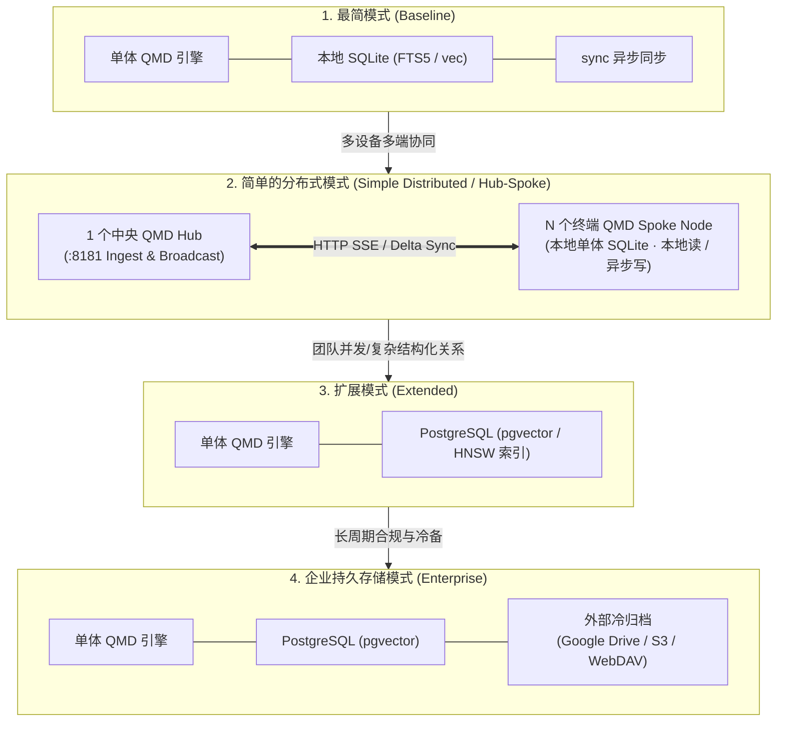
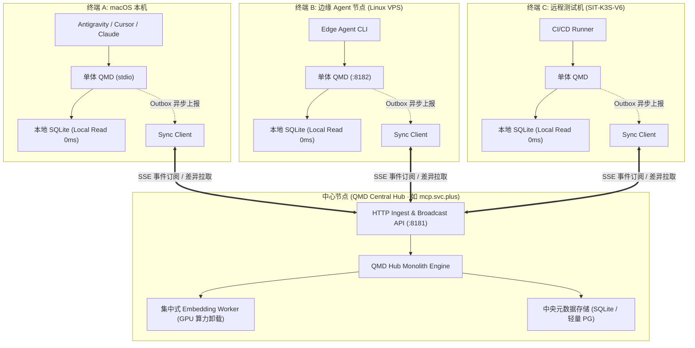

# QMD 单体运行与分布式异步同步架构规范

> **发布基线**：2026-11-14 · **架构域**：AI Workspace / 任务记忆中枢 (X-Memory-Hub) / QMD  
> **核心原则**：**单体轻量高内聚、检索就近零阻塞、异步解耦弱一致、四级阶梯按需进阶**

---

## 一、架构背景与战略决策

在 AI Workspace 与多智能体（Antigravity、Codex、Claude、OpenCode、XWorkmate）协同体系中，QMD（Query Markup Documents）坚决**保持单体运行（Monolithic Run-to-Completion Engine）**，拒绝引入重型的分布式一致性状态机（Raft/Paxos）、分布式事务与分片分区集群管理。

为了同时满足**本地开发者极速开箱即用**、**多机多端协同的轻量分布式**、**团队级高并发向量协同**以及**企业级长期持久冷归档**等不同规模的诉求，QMD 确立了高度正交、清晰纯粹的四级阶梯演进形态：



### 1. 四级形态定义

1. **最简模式（Baseline / Minimalist）**：
   - **`QMD + SQLite + sync`**
   - 本地单体，完全无外部数据库依赖；
   - 依赖本地 SQLite（FTS5 全文检索 + sqlite-vec 向量），极速开箱即用，零配置；
   - 独立 `sync` 模块/定时任务负责跨端异步对账同步。
2. **简单的分布式模式（Simple Distributed / Hub-Spoke）**：
   - **`QMD Hub-Spoke (1 个中央 Hub + N 个边缘/终端 Node + Delta Sync)`**
   - 读在本地：各终端本地维护 SQLite 副本，检索 0ms 网络开销；
   - 增量推流：通过轻量 HTTP SSE 事件推流或 Delta 差异包进行异步对齐；
   - 集中算力：由 Hub 统一完成高负载向量计算，边缘弱算力节点直接同步向量碎片；
   - 断网自治：各节点断网完全自闭环运行，联网自动断点续传。
3. **扩展模式（Extended / Hybrid Vector）**：
   - **`QMD + PG (vector)`**
   - 当需要团队协作、多 Agent 并发共享、跨多环境服务、权威结构化事实与海量向量检索时启用；
   - QMD 对接 PostgreSQL 17 + pgvector（支持 HNSW 索引、命名空间隔离、复杂元数据关系查询与 `fence` 乐观锁并发保护）。
4. **企业持久存储模式（Enterprise / Long-term Archival）**：
   - **`QMD + PG (vector) + 外部归档（Google Drive 或 对象存储 S3）`**
   - 全生命周期持久化与立体灾备；
   - L1（QMD 热检索）+ L2（PG vector 权威层）+ L3（Google Drive / S3 冷层大对象、完整会话日志、不可变历史证据归档）；
   - 任何时刻 L1/L2 均可通过 L3 快照与 GitOps 完全自愈重建。

---

## 二、模式 1：最简模式（QMD + SQLite + sync）

最简模式是 QMD 保持轻量、纯粹与开箱即用的基石。

```text
┌────────────────────────────────────────────────────────┐
│               Local Agent / IDE (Client)               │
└───────────────────────────┬────────────────────────────┘
                            │ (stdio / 127.0.0.1:8182)
                            ▼
┌────────────────────────────────────────────────────────┐
│                   单体 QMD 运行时引擎                   │
│  - BM25 词法分析器 (Lexical Analyzer)                   │
│  - 本地 Embedding 适配器 (Ollama / Llama.cpp)          │
│  - 上下文拼接与 Rerank                                 │
└───────────────────────────┬────────────────────────────┘
                            │ (Local In-Process Driver)
                            ▼
┌────────────────────────────────────────────────────────┐
│                   本地 SQLite 存储文件                  │
│  - ~/.local/share/qmd/index.sqlite                     │
│  - FTS5 全文倒排表 + sqlite-vec 向量虚拟表              │
│  - Local Outbox 变更日志表                              │
└───────────────────────────┬────────────────────────────┘
                            │ (后台非阻塞轮询)
                            ▼
┌────────────────────────────────────────────────────────┐
│                      sync 异步同步模块                  │
│  - 内容哈希 (SHA-256) 变更对账                          │
│  - 增量推流至远端对等节点或中央仓库                     │
│  - 断网静默积压，联网自动幂等对齐                       │
└────────────────────────────────────────────────────────┘
```

---

## 三、模式 2：简单的分布式模式（QMD Hub-Spoke 极简分布式）

为了解决多台工作机（例如本地 macOS 工作台、测试环境服务器、海外 8 个 Edge Agent 节点）之间的记忆共享问题，同时**彻底避开 Raft/Paxos/etcd 分布式集群的复杂性**，QMD 采用 **Hub-Spoke（中心辐射型）极简分布式架构**。



### 核心机制
1. **本地读（Local-First Read，零网络 RTT）**：每个 Spoke 节点本地都维护一份完整的 SQLite 镜像；Agent 检索 100% 走本地，响应 $< 5\text{ ms}$；
2. **异步增量写（Asynchronous Delta Sync）**：本地 Outbox 先写即返，后台推流至 Hub，Hub 分配全局单调递增 `fence` 并通过 SSE 向其他 Spoke 广播通知；
3. **算力卸载（Embedding As A Service）**：弱算力边缘节点跳过本地重型推理，Hub 计算向量后随增量包广播；
4. **断网隔离与自愈**：网络分区时本地自给自足；联网后按 `since_fence` 拉取差量，自动补齐。

---

## 四、模式 3：扩展模式（QMD + PG vector）

当系统由多端单机走向团队多执行器并发协同或部署在容器集群（如 SIT-K3S-V6）时，无缝切换至 **QMD + PG (vector)**。

- 通过 `QMD_BACKEND=pg` 切换底层存储适配器，API 与 CLI 完全保持一致；
- 原生 HNSW 向量索引与多维度命名空间（`knowledge-reference`、`platform-delivery`、`agent-threads`）；
- 利用 `thread_id` + `fence` 乐观锁保障多 Agent 并发写入安全。

---

## 五、模式 4：企业持久存储模式（QMD + PG vector + 外部归档）

面向生产级可观测性与合规治理的终极形态（**L1 热层 + L2 权威层 + L3 冷归档层**）。

- **Google Drive / 本地云盘客户端**：本地挂载目录增量不可变归档；
- **S3 兼容对象存储（Cloudflare R2 / AWS S3 / MinIO）**：全量 JSONL 会话日志与知识库 Git 快照脱敏压缩存储；
- **哈希防篡改**：伴生 SHA-256 校验和并记录至 `manifest.json`；
- **极端灾难重建**：从外部云盘拉取快照，一键秒级恢复 PG 与 QMD 索引。

---

## 六、四种模式的环境配置与快速切换指引

### 1. 模式 1：最简模式（macOS / 本地独立运行）
```bash
export QMD_BACKEND=sqlite
export QMD_LOCAL_NO_AUTH=1
export QMD_DATA_DIR="$HOME/.local/share/qmd"
export QMD_ASYNC_SYNC_ENABLE=1
export QMD_SYNC_TARGET_GIT="git@github.com:ai-workspace-services/knowledge.git"

qmd mcp --http --port 8182
```

### 2. 模式 2：简单的分布式模式（Hub-Spoke 模式）
```bash
# 【中心 Hub 节点】
export QMD_ROLE=hub
export QMD_LISTEN_PORT=8181
export QMD_EMBED_WORKER_ENABLE=1
export QMD_EMBED_MODEL="qwen3-embedding:0.6b"
qmd-hub --daemon

# 【边缘 / 终端 Spoke 节点】
export QMD_ROLE=spoke
export QMD_BACKEND=sqlite
export QMD_HUB_URL="https://mcp.svc.plus/api/v1/memory"
export QMD_HUB_TOKEN="<VAULT_INJECTED_TOKEN>"
export QMD_AUTO_SYNC_INTERVAL="60s"
qmd mcp --http --port 8182
```

### 3. 模式 3：扩展模式（PG vector）
```bash
export QMD_BACKEND=pg
export PGHOST="postgresql.svc.plus"
export PGPORT=15432
export PGDATABASE="qmd_memory"
export PGUSER="qmd_writer"
export PGPASSWORD="<VAULT_INJECTED_PASSWORD>"
export QMD_EMBED_MODEL="qwen3-embedding:0.6b"
export QMD_EMBED_API_BASE_URL="http://127.0.0.1:11434/v1"
```

### 4. 模式 4：企业持久存储模式（PG + 外部云盘归档）
```bash
export QMD_ARCHIVE_STORAGE_TYPE="s3"  # 或 "gdrive"
export QMD_ARCHIVE_S3_ENDPOINT="https://s3.us-west-004.backblazeb2.com"
export QMD_ARCHIVE_S3_BUCKET="ai-workspace-archive"
export QMD_ARCHIVE_RETENTION_DAYS=30
export QMD_ARCHIVE_CRON="0 3 * * *"  # 每日凌晨 03:00 归档
```

---

## 七、总结与落地检验

本规范确立了 QMD **「坚守单体运行、通过异步同步走向分布式、四级阶梯按需进阶」** 的终态路线：
1. 个人轻量开发：**`QMD + SQLite + sync`**，零依赖零负担；
2. 多设备/多端协同：**`QMD Hub-Spoke 简单分布式`**，本地读 0ms，增量异步推流；
3. 团队多 Agent 协作：**`QMD + PG (vector)`**，共享事务状态与统一 HNSW 向量；
4. 企业灾备与合规：扩充 **外部归档（Google Drive / S3）**，形成闭环自愈的三级立体记忆资产。

---

## 八、落地回执

- 2026-11-14：Grok Bot box（第 1 级 Spoke）↔ sit-k3s-v6（第 4 级企业模式 + Hub-Spoke 中心）双向异步同步已部署并验证，见 [QMD Hub-Spoke 部署回执（2026-11-14）](QMD-Hub-Spoke部署回执-20261114.md)。
- 2026-11-14：Spoke 侧 `qmd login`（复用 accounts.svc.plus，支持官方/自定义 Hub 域名、交互与非交互一次给全 MFA）见 [QMD Hub 登录：qmd login 统一认证使用说明](QMD-Hub-qmd-login统一认证使用说明.md)。
