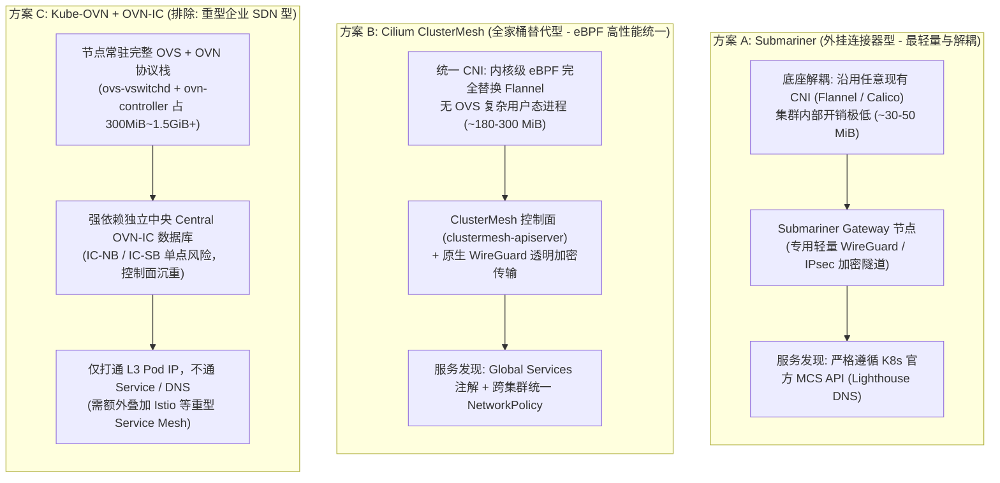

# 多集群网络互联与全局 CIDR 规划架构规范白皮书

> **文档状态**：已发布（2026-11-14）  
> **适用范围**：`ai-workspace-infra` 全量 K3s 集群环境（`PROD-K3S-V6`、`SIT-K3S-V6`、`UAT-K3S-V6`）及 Ansible Playbook `roles/vhosts/k3s-cluster-server` 与 GitOps 声明体系。  
> **关联规范**：[ADR-0001：GitOps 三类执行器与单一配置负责人](ADR-0001-GitOps三类执行器与单一配置负责人.md)、[K3s role 职责与依赖清单](K3s-role职责与依赖清单.md)、[PROD-K3S-V6 模块化交付与特性架构规划](../clusters/prod-k3s-v6/PROD-K3S-V6-模块化交付与特性规划.md)、[SIT-K3S-V6 模块化交付与特性泳道规划](../clusters/sit-k3s-v6/SIT-K3S-V6-模块化交付与特性泳道规划.md)

---

## 一、全局多集群 CIDR 顶层设计原则

在生产级多集群架构中，依赖 NAT 或二次地址转换（如 Globalnet）永远是妥协的下策，极易引入排障黑洞与性能损耗。**在 Day 0 阶段手动制定全局互不重叠的 CIDR 分配标准**，是无论是采用 **Cilium ClusterMesh** 还是 **Submariner** 实现纯内核级 Direct Routing / 无损隧道转发的前提基石。

统一在私网保留段 `10.0.0.0/8` 内进行层次化切分，确保 **Pod 容器段、Service 服务段、Node 主机段与跨集群隧道段** 四维完全正交、互不重叠：

```text
10.0.0.0/8 全局专用网络池
├── 10.40.0.0/12  ─────────────────► Pod 容器网络总池 (各集群分配独立 /16)
│   ├── 10.42.0.0/16  [V5 Legacy]
│   ├── 10.52.0.0/16  [PROD-K3S-V6] (现网实测对齐)
│   ├── 10.62.0.0/16  [SIT-K3S-V6]  (独立规划)
│   └── 10.72.0.0/16  [UAT-K3S-V6]  (备用演进)
│
├── 10.80.0.0/12  ─────────────────► Service 服务网络总池 (各集群分配独立 /16)
│   ├── 10.43.0.0/16  [V5 Legacy]
│   ├── 10.53.0.0/16  [PROD-K3S-V6] (现网实测对齐)
│   ├── 10.63.0.0/16  [SIT-K3S-V6]  (独立规划)
│   └── 10.73.0.0/16  [UAT-K3S-V6]  (备用演进)
│
└── 10.254.0.0/16 ─────────────────► 跨集群点对点隧道与互联专网 (Point-to-Point /30)
    ├── 10.254.250.0/30 (PROD-V6 ◄─► V5 跨代隧道)
    ├── 10.254.251.0/30 (PROD-V6 ◄─► SIT-V6 研发互联)
    └── 10.254.252.0/30 (PROD-V6 ◄─► UAT-V6 预发布互联)
```

---

## 二、多集群手动分配规范矩阵（Multi-Cluster CIDR Matrix）

| 环境与集群名称 | 集群唯一整数 ID (`cluster_id`) | 规划 Pod CIDR (容器网络) | 规划 Service CIDR (服务网络) | CoreDNS 服务 IP | 互联隧道 IP (Point-to-Point) | 适用多集群互联组件 |
| :--- | :--- | :--- | :--- | :--- | :--- | :--- |
| **PROD-K3S-V6 (生产)** | **`6`** | **`10.52.0.0/16`** | **`10.53.0.0/16`** | `10.53.0.10` | `10.254.250.2/30` | Cilium / Submariner |
| **SIT-K3S-V6 (测试)** | **`16`** | **`10.62.0.0/16`** | **`10.63.0.0/16`** | `10.63.0.10` | `10.254.251.2/30` | Cilium / Submariner |
| **UAT-K3S-V6 (预发)** | **`26`** | **`10.72.0.0/16`** | **`10.73.0.0/16`** | `10.73.0.10` | `10.254.252.2/30` | Cilium / Submariner |
| **V5-Legacy (历史)** | **`5`** | **`10.42.0.0/16`** | **`10.43.0.0/16`** | `10.43.0.10` | `10.254.250.1/30` | WireGuard (已归档) |

> [!IMPORTANT]
> **规避原则**：K3s 默认若不指定参数，会自动使用 `10.42.0.0/16`（Pod）与 `10.43.0.0/16`（Service）。**在多集群建设中，必须强制要求显式声明，严禁依赖默认缺省值。**

---

## 三、多集群打通的主流方案横向选型对比（“轻量级 + 多集群打通”）

围绕 **“轻量级 + 多集群打通”** 的核心诉求，针对业界三大主流技术方案 **`Submariner` VS `Cilium ClusterMesh` VS `Kube-OVN (OVN-IC)`** 进行全方位架构对比与深度评估。

> [!NOTE]
> **技术路线收敛边界**：
> * 将 **`Submariner`** 与 **`Cilium ClusterMesh`** 同时纳入 Playbook 标准化可选支持，以分别覆盖“极轻量零侵入”与“全栈 eBPF 统一治理”两类场景。
> * **不考虑** K3s 原生简易 WireGuard / Tailscale 方案：其仅提供主机或静态 L3 隧道互通，缺乏 Kubernetes 原生跨集群服务发现（MCS API）与集群级自动化网络策略治理能力。
> * **排除** 重型 `Kube-OVN (OVN-IC)`：与轻量级 K3s 及 2C4G 边缘节点资源水位冲突。

### 3.1 三大主流方案架构模型对比



### 3.2 Submariner VS Cilium ClusterMesh VS Kube-OVN (OVN-IC) 横向对比矩阵

| 评估维度 | Submariner (方案 A) | Cilium ClusterMesh (方案 B) | Kube-OVN (OVN-IC) (方案 C) | 架构影响与选型结论 |
| :--- | :--- | :--- | :--- | :--- |
| **设计定位** | **外挂式跨集群网络连接器（Network Interconnect）** | **全功能 eBPF CNI + 多集群 Service Mesh** | **重型企业级虚拟化 SDN（Open vSwitch + OVN）** | Submariner 适合存量与轻量集群无感打通；Cilium 适合全栈 eBPF 统一演进；Kube-OVN 适合超大规模私有云/OpenStack 混编。 |
| **是否轻量** | **极轻量** | **轻量 ~ 中等** | **重型（Heavyweight）** | 在 2C4G 边缘与单节点环境中，Kube-OVN 会直接导致内存耗尽。 |
| **底层 CNI 侵入性** | **零侵入**（继续保留 K3s 内置 Flannel） | **高**（需禁用 Flannel，由 Cilium 全面接管） | **极高**（需替换 CNI 并加载内核 `openvswitch` 模块） | Submariner 故障域隔离最佳，跨集群组件异常绝不影响单集群内部网络。 |
| **单节点内存开销** | **< 60 MiB**（Route Agent ~30MiB，Gateway ~60MiB） | **180 ~ 300 MiB**（`cilium-agent` + `clustermesh-apiserver`） | **300 MiB ~ 1.5 GiB+ / 节点**（随 OpenFlow 流表膨胀） | OVS 每条流表占用 1~2KB，Pod 频繁扩缩容时 Kube-OVN 极易触发 2C4G 节点 OOMKilled。 |
| **集群控制面依赖** | 轻量 Broker（仅几个 K8s CRD，可复用任一集群） | 每集群部署 `clustermesh-apiserver`（内嵌轻量 etcd） | **必须独立部署 `ovn-central` + 全局中央 `OVN-IC DB`** | Kube-OVN 的中央 OVN-IC DB（需 3 节点 Raft）是跨集群单点故障域（SPOF）。 |
| **转发性能与延迟** | **极高**（节点到本地 Gateway，走内核 WireGuard 隧道） | **极致**（内核 eBPF 旁路直转，跳过 iptables/conntrack） | **中等**（依赖 `ovs-vswitchd` 流表匹配与 Geneve 封装） | 跨公网/跨云场景下物理网络延迟是主因，Submariner 与 Cilium 性能表现均极为优异。 |
| **跨集群服务发现** | **原生支持 K8s 官方 MCS API**（Lighthouse DNS `*.svc.clusterset.local`） | **原生支持 Cilium Global Services**（`service.cilium.io/global: "true"`） | **不支持**（仅打通 L3 Pod IP，无跨集群 Service 与 DNS） | Kube-OVN 官方明确其不桥接跨集群 Service/DNS，若需服务发现必须额外叠加 Istio。 |
| **网段重叠处理** | **原生内置 Globalnet**（但生产仍强制手动无重叠规划） | 默认要求严格无重叠（手动规划 CIDR 后零损耗） | 自动互联要求严格无重叠 | 配合本文第一、二节的全局无重叠 CIDR 规划，Submariner 与 Cilium 均可跑在零 NAT 损耗模式。 |
| **跨集群安全策略** | 依赖各集群本地 NetworkPolicy | **支持跨集群统一 CiliumNetworkPolicy** + Hubble 观测 | 不支持跨集群全局 NetworkPolicy 同步 | Cilium 在跨集群零信任微隔离与 eBPF 流量可观测性上最完善。 |
| **网络加密通道** | **原生内置 WireGuard** / IPsec (Libreswan) | **原生 eBPF 驱动透明 WireGuard** / IPsec | 默认明文 Geneve 隧道（需自行外挂 IPsec） | Submariner 与 Cilium 均原生提供开箱即用的 WireGuard 加密。 |
| **2C4G 适配度** | **极佳** | **良好（需预留 eBPF 内存水位）** | **不适配（高概率 OOM 崩溃）** | 当前生产/测试 2C4G 单节点优先推荐 Submariner，或经评估后采用 Cilium。 |
| **平台选型决策** | ✅ **纳入 Playbook 标准可选支持（轻量首选）** | ✅ **纳入 Playbook 标准可选支持（高性能 eBPF 首选）** | ❌ **排除（不适配轻量 K3s 与 2C4G 节点）** | Playbook `k3s-cluster-server` 同时支持 Submariner 与 Cilium ClusterMesh 可选装配。 |

### 3.3 Kube-OVN (OVN-IC) 架构与特性深度调研剖析

为明确架构取舍依据，以下记录 Kube-OVN 基于 **OVN-IC (OVN Inter-Connection)** 的技术机制与排除原因：

```mermaid
flowchart TB
    subgraph ClusterA["集群 A (Local Kube-OVN)"]
        PA["Pod 业务容器"] --> SA["本地虚拟交换机 / 路由器"]
        SA --> GWA["集群 A Gateway 节点"]
        CTRL_A["ovn-ic-controller (A)"]
    end

    subgraph ClusterB["集群 B (Local Kube-OVN)"]
        PB["Pod 业务容器"] --> SB["本地虚拟交换机 / 路由器"]
        SB --> GWB["集群 B Gateway 节点"]
        CTRL_B["ovn-ic-controller (B)"]
    end

    subgraph Central_DB["全局中心控制数据库 (Central OVN-IC DB)"]
        IC_NB["IC-Northbound DB (拓扑与 Transit Switch 声明)"]
        IC_SB["IC-Southbound DB (动态下发全局逻辑流表)"]
    end

    CTRL_A <-->|同步本地路由 / 抓取全局端点| Central_DB
    CTRL_B <-->|同步本地路由 / 抓取全局端点| Central_DB
    GWA <===>|Geneve 跨网络封装隧道 (仅限 L3 Pod 直连)| GWB
```

1. **OVN-IC 的核心优势特性（面向大型数据中心）**：
   - **原生 Pod-to-Pod L3 直连穿透**：跨集群容器通过真实 Pod IP 在 Underlay 网络上进行 Geneve 隧道封装互访。
   - **ECMP（等价多路径路由）**：支持配置多个 Transit Switch（`TS_NUM`），在多个网关节点间实现多路径负载均衡与容灾。
   - **OpenStack 与 K8s 统一 SDN**：可将 OpenStack 虚拟机与 Kubernetes 容器纳入同一套全局虚拟交换网络，并继承固定 IP、QoS 限速与 EIP/NAT 网关能力。
2. **在轻量级 K3s 多集群场景下的四大致命瓶颈**：
   - **只打通 Pod IP，不打通 Service 与 DNS**：OVN-IC 仅解决 L3 Pod IP 路由，不提供跨集群 Service 桥接与内部 DNS 解析；若要实现跨集群服务调用，必须额外部署 Istio 等重型 Service Mesh。
   - **中心化单点依赖（SPOF）**：必须额外部署一套所有集群均可直连的全局独立 `Central OVN-IC DB`（`IC-NB` 与 `IC-SB`），高可用需 3 节点 Raft，破坏了边缘/独立集群的自治性。
   - **单节点资源消耗过高**：每个节点必须常驻 `ovs-vswitchd`、`ovsdb-server` 与 `ovn-controller`，静态内存 150~400 MiB，在流表重算或 Pod 频繁变动时内存飙升至 1 GiB 以上，与 2C4G 紧凑节点完全冲突。
   - **缺乏原生 WireGuard 透明加密**：默认使用明文 Geneve 隧道，跨公网互联需额外配置底层 IPsec。

---

## 四、在 Playbook (`roles/vhosts/k3s-cluster-server`) 中的工程化约束与双可选支持落地

为了防止新节点部署时疏忽引发网段撞车，并在基础设施引导层同时支持 **Submariner** 与 **Cilium ClusterMesh**，在 `playbooks/roles/vhosts/k3s-cluster-server` 中实施以下标准化工程设计。

### 4.1 在环境 Inventory 中显式绑定网段变量

在 `inventories/prod/group_vars/all.yml` 或 `host_vars/prod-k3s-v6.yml` 中：

```yaml
# 生产节点强制显式锁定
k3s_platform_cluster_cidr: "10.52.0.0/16"
k3s_platform_service_cidr: "10.53.0.0/16"
k3s_platform_cluster_dns: "10.53.0.10"

# 多集群标识
cilium_cluster_id: 6
submariner_cluster_id: "prod-k3s-v6"
```

在 `inventories/sit/host_vars/sit-k3s-v6.yml` 中：

```yaml
# SIT 节点强制显式锁定
k3s_platform_cluster_cidr: "10.62.0.0/16"
k3s_platform_service_cidr: "10.63.0.0/16"
k3s_platform_cluster_dns: "10.63.0.10"

# 多集群标识
cilium_cluster_id: 16
submariner_cluster_id: "sit-k3s-v6"
```

### 4.2 在 `k3s-cluster-server/tasks/preflight.yml` 注入网段互斥防御

在安装前进行严格语法与逻辑检查，杜绝使用重叠默认值：

```yaml
- name: Verify cluster CIDRs are explicitly and safely planned
  ansible.builtin.assert:
    that:
      - k3s_platform_cluster_cidr is defined
      - k3s_platform_service_cidr is defined
      - k3s_platform_cluster_dns is defined
      # 杜绝直接使用 K3s 默认 10.42.0.0/16（防止与旧环境冲突）
      - k3s_platform_cluster_cidr != '10.42.0.0/16' or inventory_hostname == 'legacy-v5'
      # 杜绝 Pod CIDR 与 Service CIDR 自相冲突
      - k3s_platform_cluster_cidr != k3s_platform_service_cidr
      # 校验 Cluster DNS IP 属于 Service CIDR 网段
      - k3s_platform_cluster_dns | ansible.utils.ipaddr(k3s_platform_service_cidr)
    fail_msg: >-
      [CRITICAL] Network CIDR planning failure! You must explicitly specify non-overlapping
      k3s_platform_cluster_cidr and k3s_platform_service_cidr. Do not rely on default 10.42.0.0/16.
```

### 4.3 变量参数统一抽象 (`defaults/main.yml`)

将 **基础 CNI 底座** 与 **多集群网络互联插件** 解耦为正交的可选开关：

```yaml
# ==============================================================================
# 1. 基础 CNI 选型：'flannel' (默认，轻量稳健) 或 'cilium' (内核 eBPF)
# ==============================================================================
k3s_platform_cni: "flannel"

# ==============================================================================
# 2. 多集群网络互联插件：'none' (默认) | 'submariner' | 'cilium-clustermesh'
# ==============================================================================
k3s_platform_multicluster_provider: "none"

# -------------------------------------------------------------
# 方案 A: Submariner 专属配置 (底层可搭配 Flannel)
# -------------------------------------------------------------
submariner_version: "v0.19.0"
submariner_cluster_id: "{{ k3s_platform_cluster_name | default('prod-k3s-v6') }}"
submariner_cable_driver: "wireguard"       # 隧道驱动: wireguard (推荐) 或 libreswan (ipsec)
submariner_nat_traversal: true             # 是否支持公网 NAT 穿透
submariner_enable_globalnet: false         # 已通过手动 CIDR 规划规避重叠，默认关闭 Globalnet 免除 NAT 开销
submariner_enable_lighthouse: true         # 启用 Kubernetes 官方 MCS API 跨集群 DNS 服务发现
submariner_broker_role: "member"           # 'broker' (本集群充当注册中枢) 或 'member' (接入远端 broker)
submariner_broker_info_path: "/opt/rancher/k3s/submariner-broker-info.subm"

# -------------------------------------------------------------
# 方案 B: Cilium & ClusterMesh 专属配置 (k3s_platform_cni 须设为 'cilium')
# -------------------------------------------------------------
cilium_version: "1.16.3"
cilium_cluster_id: 6                       # 各集群唯一整数 ID: 1~255
cilium_cluster_name: "{{ k3s_platform_cluster_name | default('prod-k3s-v6') }}"
cilium_encryption_type: "wireguard"        # 链路加密: wireguard / none
cilium_kube_proxy_replacement: true        # eBPF 替代 kube-proxy
cilium_clustermesh_enabled: false          # 是否开启 ClusterMesh API Server
cilium_clustermesh_apiserver_service_type: "NodePort" # 单节点使用 NodePort 暴露
```

### 4.4 K3s 初始化模版动态渲染 (`templates/k3s-config.yaml.j2`)

当启用 Cilium 时，K3s 必须在初始化前禁用自带的 Flannel 与默认网络策略：

```jinja2
write-kubeconfig-mode: "{{ k3s_platform_write_kubeconfig_mode }}"
node-name: "{{ k3s_platform_node_name }}"
cluster-cidr: "{{ k3s_platform_cluster_cidr }}"
service-cidr: "{{ k3s_platform_service_cidr }}"
cluster-dns: "{{ k3s_platform_cluster_dns }}"
data-dir: "{{ k3s_platform_install_dir }}"

default-local-storage-path: "{{ k3s_platform_local_storage_path }}"

cluster-init: true
disable:

  - "{{ component }}"


{# --- 针对 Cilium 深度接管 CNI 的条件分支 --- #}

flannel-backend: none
disable-network-policy: true



kube-apiserver-arg:

  - "{{ arg }}"



tls-san:

  - "{{ san }}"


```

### 4.5 Task 执行链路编排 (`tasks/main.yml`)

```yaml
- name: Validate control-plane prerequisites without changing the host
  ansible.builtin.import_tasks: preflight.yml

- name: Initialize the K3s control plane
  ansible.builtin.import_tasks: bootstrap.yml

# -------------------------------------------------------------
# 方案 B 支线：安装 Cilium CNI 并按需开启 ClusterMesh
# -------------------------------------------------------------
- name: Deploy and reconcile Cilium CNI (with optional ClusterMesh)
  ansible.builtin.import_tasks: cni_cilium.yml
  when: k3s_platform_cni == 'cilium'

# -------------------------------------------------------------
# 方案 A 支线：外挂安装 Submariner 跨集群互联组件
# -------------------------------------------------------------
- name: Deploy Submariner Multi-Cluster Connector
  ansible.builtin.import_tasks: multicluster_submariner.yml
  when: k3s_platform_multicluster_provider == 'submariner'
```

---

## 五、此规划给后续选型带来的核心收益

1. **无论是 Cilium 还是 Submariner，全部可以采用最轻量、零损耗的 Native Routing / Direct Encapsulation**：
   - 无需开启 Submariner 的 Globalnet 转换（省去每个集群维护复杂 `iptables` / `ipset` 地址映射规则的开销）。
   - Cilium ClusterMesh 可以直接依靠 eBPF 做跨集群路由与全局透明 WireGuard 加密，没有任何 NAT 转换损耗。
2. **审计与可观测性极佳**：
   - 看到 `10.52.x.x` 的源 IP，立刻确认为 **PROD 生产流量**；
   - 看到 `10.62.x.x` 的源 IP，立刻确认为 **SIT 测试流量**；
   - 看到 `10.72.x.x` 的源 IP，立刻确认为 **UAT 预发流量**；
   - 无论在 Grafana 监控面板、Hubble 流量拓扑图还是主机内核抓包中，跨集群请求流向与环境归属一目了然。
