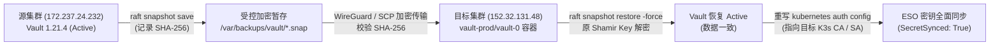

# PROD 主机迁移规划：prod-k3s-v6（172.237.24.232）→ 152.32.131.48（Debian 12）

> **文档状态**：P0–P5、P7 空栈全绿部署已完成并验收通过。**源机未停写、DNS 未切换。**
> **采样时间**：2026-11-16（Asia/Shanghai）。源端事实均为只读 SSH 采样，见 [evidence/source-baseline-20261115.json](evidence/source-baseline-20261115.json)。
> **权威参考**：knowledge docs/reference/platform-delivery/（平台交付索引、SIT 换机执行清单、SIT 换机重部署与 DNS 切换手册、PROD-K3S-V6 模块化交付与特性规划）；gitops docs/prod-k3s-v6-isolated-cluster-plan.md、prod-k3s-v6-node-cluster-preflight.md、prod-k3s-v6-gitops-hierarchy.md、prod-k3s-v6-credential-source-plan.md、prod-k3s-v6-web-saas-fullstack-blue-green-migration.md。
> **执行纪律**：harness-workflow（工程闭环 × 小步快跑）、backup-disaster-recovery-and-data-migration（恢复契约优先）、config-as-code-spec、infrastructure-as-code-spec、system-db-three-role-security。

---

## 0. 结论先行

1. **本轮定位（已达成）：A 同代换机 + 全栈空环境重建 + `--resolve` 全绿；不做原地升级、不做 DNS 切换、本轮不搬业务数据。**
   - 目标机：`152.32.131.48`（Debian 12 bookworm，ULightHost `ulhost-1xrikvuh05hc`，hk / hk-02，2 vCPU / 3.8 GiB / 单块 80G）。
   - 全集群 10 个 Kustomization 全部 `Ready: True`。
   - 全集群 7 个 HelmRelease 全部 `Ready: True`。
   - 全集群工作负载（external-secrets, flux-system, ingress-prod, observability-prod, postgresql-prod, web-saas-prod）全量 1/1 Running；`vault-0` 封印运行，待 P6 snapshot 恢复。
   - P7 `--resolve` 针对 `152.32.131.48:443` 端到端验证全绿（console 200, billing readyz 200, xworktech 200, accounts 404 与源机严格对齐），TLS SAN 校验通过。
2. **后续任务（P6 业务数据搬迁）**：
   - 将在下一阶段通过 **Submariner + WireGuard** 跨云打通网络。
   - 进行 PostgreSQL 逻辑迁移与 Vault Raft snapshot recovery。
   - 确认数据一致性后，再安排独立变更单切换权威 DNS。
2. **目标机已于 2026-11-16 11:00 变更为 `152.32.131.48`（Debian 12 bookworm，ULightHost `ulhost-1xrikvuh05hc`，hk / hk-02，2 vCPU / 3.8 GiB / 单块 80G）**，原目标 `103.14.33.60`（Rocky 10）因重启后不可恢复而退役，事故记录见 [evidence/INCIDENT-20261116-target-unreachable.md](evidence/INCIDENT-20261116-target-unreachable.md)。新目标直接落在既有支持矩阵内：**G1 OS 族自然满足（Debian 12）**；G3 延续 `/data` = 根盘目录（§2.3）；G2 按人类决定维持 **2C4G**（源机同规格已承载全栈）。详见 §2.8。
3. **源机有两个必须先处置的现网事实**，否则新环境会继承坏的基线：
   - web-saas-prod/web-saas-console Canary = **Failed**（2026-11-15T15:46:42Z）；另外两组 Canary 成功但 weight=0。
   - 全部 6 个 Flux GitRepository 在采样时都指向 branch: main，没有不可变 tag/commit 固定 —— 这与 prod-k3s-v6-isolated-cluster-plan.md 的「各单元独立固定 tag」契约不符。迁移必须在新环境改为不可变 pin，并把源机偏差作为独立整改项，不能把 main 漂移带到新机。
4. **推荐数据通道**：PostgreSQL 逻辑备份/恢复（pg_dump -Fc 与 pg_dumpall -g，17.11 → 17.11，158MB / 73 表）+ Vault Raft snapshot（vault operator raft snapshot save/restore，1.21.4 同版本，禁止直接拷贝 raft 目录）。**观测历史不涉及**：目标机不部署本地时序库，指标改由 `observability-agent` 远程写中心（§2.5）。
5. **DNS 不切换 = 验收方式确定**：所有对外验证一律 curl --resolve host:443:103.14.33.60，并逐域名核对证书 SAN；任何一方改动权威 DNS 都属于越界，须单独变更单。

---

## 1. 源端实测基线（2026-11-15）

### 1.1 节点

| 项目 | 实测值 |
| :--- | :--- |
| 主机名 / 公网 IPv4 / IPv6 | prod-k3s-v6 / 172.237.24.232 / 2600:3c18::2000:b0ff:fedd:d6c9 |
| 云与规格（声明值） | Akamai Cloud/Linode jp-tyo-3，g6-standard-2，2 vCPU / 4 GB |
| OS / 内核 | Debian 13 trixie / 6.12.113+deb13-amd64 |
| machine-id / 集群 UID | cd21a808…8e4e / 3e33fe44-332f-4b62-b003-1f42a1480b3c |
| 容量 | 系统盘 /dev/sda 79G（40% 用）；数据盘 /dev/sdc 98G 挂 /data（2.7G 用，3%）；swap 496M（308M 已用） |
| 内存压力 | 3.8Gi 中已用 **3.2Gi**，free **158Mi**（⚠ 已触顶） |
| K3s | v1.37.1+k3s1，containerd 2.3.4-k3s1，单节点 control-plane+etcd |
| 对外监听 | 仅 :6443（K3s API，未对公网）；80/443 由 Traefik ServiceLB 承接 |

关键 k3s 启动参数（新机必须等价复现）：

    --cluster-init true --data-dir /opt/rancher/k3s --default-local-storage-path /data/k3s/storage
    --disable traefik --cluster-cidr 10.52.0.0/16 --service-cidr 10.53.0.0/16 --cluster-dns 10.53.0.10
    --kube-apiserver-arg service-node-port-range=0-50000 --write-kubeconfig-mode 0600 --node-name prod-k3s-v6

### 1.2 GitOps / Flux 现状

| 对象 | 现状 |
| :--- | :--- |
| 引导源 config-prod | branch: main，head 6c163d42 |
| 单元源 vault-prod-config / postgresql-prod-config / observability-prod-config / web-saas-prod-config / ingress-prod-config | 全部 branch: main，head 691ad08a |
| 根 Kustomization prod-k3s | Ready，environments/clusters/prod-k3s-v6 |
| 业务子 Kustomization | vault-prod / postgresql-prod / observability-prod / web-saas-prod / ingress-prod 全部 Ready；accounts-migration Ready；vault-tls-bootstrap / vault-tls-identity / cluster-identities / external-secrets Ready；采样瞬间 web-saas-prod = Unknown / Reconciliation in progress |

### 1.3 8 个 HelmRelease（全部 Ready=True）

| namespace | release | chart / 版本 |
| :--- | :--- | :--- |
| external-secrets | external-secrets | external-secrets 2.14.0 |
| vault-prod | vault | hashicorp/vault 0.32.0（server 1.21.4） |
| postgresql-prod | postgresql | fullstack OCI（digest pin） |
| observability-prod | observability / observability-agent / datakit | observability-stack OCI / agent OCI / datakit 2.16.1 |
| web-saas-prod | web-saas-prod | fullstack OCI（digest pin） |
| ingress-prod | traefik-ingress | fullstack OCI（traefik 组件） |

> 入口实际是 **Traefik + K3s ServiceLB**（LoadBalancer EXTERNAL-IP = 172.237.24.232），而历史文档 PROD-K3S-V6-模块化交付与特性规划.md 仍描述为 caddy-ingress。**文档与现网不一致**，规划以现网为准，并列为一项文档修正任务。

### 1.4 有状态资产

| namespace | PVC | 申请 | 实占 |
| :--- | :--- | :--- | :--- |
| postgresql-prod | data-postgresql-postgresql-0 | 20Gi local-path | 284M |
| postgresql-prod | postgresql-backup-data | 10Gi local-path | 102M |
| vault-prod | data-vault-0 | 10Gi local-path | 9.5M |
| observability-prod | observability-observability-stack-data | 20Gi local-path | 1.9G |
| accounts-migration | candidate-data / migration-stage | 2Gi / 1Gi | 67M / 398M |

- **PostgreSQL 17.11**（Debian 17.11-1.pgdg12+2），库 account，**73 张表 / 158MB**。
- **Vault 1.21.4**，seal = shamir 1/1，storage = raft，vault-cluster-1f8025e0 / 986a31dc-…，HA active，Raft index 322808。
- 备份：CronJob postgresql-daily-backup（0 19 * * *，未 suspend）。
- **全部 PVC 均为 local-path（节点绑定）** ⇒ 不能拷贝 PV 目录搬家，只能走应用级备份/恢复。

### 1.5 Canary

| Canary | 状态 | weight |
| :--- | :--- | :--- |
| web-saas-accounts | Succeeded | 0 |
| web-saas-billing | Succeeded | 0 |
| web-saas-console | **Failed**（2026-11-15T15:46:42Z） | 0 |

### 1.6 新集群网段规划（与源机不重叠）

源机占用 `10.52.0.0/16`（Pod）与 `10.53.0.0/16`（Service）。新机沿用同一网段会在两代同时在线时（观察窗、回退、跨集群调用）发生地址撞车，因此**新机必须换网段**，并沿用同一规则：Pod 与 Service 取相邻 `/16`，CoreDNS 取 Service 网段的 `.10`。

| 项目 | 源机（现状） | 目标机（本轮规划） | 校验 |
| :--- | :--- | :--- | :--- |
| Pod CIDR (`--cluster-cidr`) | `10.52.0.0/16` | **`10.54.0.0/16`** | 不与 10.42/43、10.52/53、10.62/63、10.72/73、GCP 10.6x–10.8x、节点网 10.7.0.0/16 重叠 |
| Service CIDR (`--service-cidr`) | `10.53.0.0/16` | **`10.55.0.0/16`** | 同上 |
| CoreDNS (`--cluster-dns`) | `10.53.0.10` | **`10.55.0.10`** | 必须落在 Service 网段，Playbooks 已加断言 |
| 跨集群隧道（预留） | `10.254.250.0/30` | **`10.254.253.0/30`** | .250/.251/.252 已占用 |
| 多集群整数 ID（预留） | `6` | **`36`** | 仅引入 Cilium/Submariner 时生效 |
| Submariner 互联（P6） | 现有 V5↔V6 `v5v6` WireGuard（已归档） | **新建 `v6v6` 点对点 WireGuard**，Submariner Gateway 走 `10.254.253.0/30`（目标 `…253.2/30`，源 `…253.1/30`） | 仅业务数据迁移窗口启用；两代 Pod/Service 网段已不重叠（10.52/53 vs 10.54/55） |

> **依据与偏差**：`多集群网络互联与全局CIDR规划架构规范白皮书.md` 的矩阵给出 PROD=`10.52/10.53`、SIT=`10.62/10.63`、UAT=`10.72/10.73`，但其「Pod 池 10.40.0.0/12、Service 池 10.80.0.0/12」的表述与现网实测（Service 在 10.53，而非 10.8x）不一致。本轮以**现网实测的相邻 /16 规则**为准取下一个未占用号段；若白皮书 owner 要求严格按池划分，须先修订白皮书再改本表。

> **K3s 启动参数变更面**：只有 `--cluster-cidr`、`--service-cidr`、`--cluster-dns` 随网段变化；`--cluster-init true`、`--data-dir /opt/rancher/k3s`、`--default-local-storage-path /data/k3s/storage`、`--disable traefik`、`--kube-apiserver-arg service-node-port-range=0-50000`、`--write-kubeconfig-mode 0600` 不变。

---

## 2. 目标端实测事实（P0，2026-11-16）与裁定

接入方式：operator 公钥 `operator-macos-ed25519` 已写入目标机，host key 已固定（ED25519 `SHA256:RXDmKiFouVUCOFwlWlqRTFD3E/srVK47m/kpQS/nfGY`、RSA `SHA256:8IM9K25GwulWkgSf9U02ZZQv1pkeTtTbAJeESQtVphE`，见 `evidence/known_hosts`）。采样文件：`evidence/preflight-target-20261116T000357.txt`。

| 维度 | 实测值 | 与迁移契约的关系 |
| :--- | :--- | :--- |
| 公网 / 内网地址 | 公网 `103.14.33.60`（NAT 出口已确认）；网卡 `eth0 10.7.109.8/16` | 1:1 NAT，节点内网地址与 CMDB 需同时登记 |
| hostname / machine-id | `10-7-109-8` / `c500382886913147ee2a250d0c7930ee` | machine-id ≠ 源机 ⇒ 新集群身份成立（D1 满足） |
| **OS** | **Rocky Linux 10.1（Red Quartz），内核 6.12.0-124.8.1.el10_1** | ❌ **不符**：迁移契约要求 Debian 13；见门禁 G1 |
| **CPU / 内存** | **2 vCPU / 3.6 GiB**（当前空闲 3.3Gi，无 swap） | ❌ **不符**：低于 P0 下限 4C8G；源机 2C4G 已用 3.2/3.8Gi |
| **磁盘** | **单块 `vda 80G` xfs**，无独立数据盘；`/data` 只是根盘上的**普通目录**（不是挂载点） | ❌ **不符**：见门禁 G3 |
| 容器运行时 | 无 k3s / containerd / docker；无 `/etc|/var/lib|/opt/rancher` | ✅ 干净，可引导 |
| 80 / 443 | 未监听（仅 22 与 chronyd 本地端口） | ✅ 入口端口可用 |
| SELinux / firewalld | SELinux **disabled**；firewalld 未安装（`firewall-cmd` 不存在） | ⚠ 安全基线缺失，但不会阻断 K3s |
| cgroup | `cgroup2fs` | ✅ |
| 内核模块 | `br_netfilter` / `overlay` 未列出；`ip_forward=0` | ⚠ 需在引导阶段确认（K3s 会自行设置转发） |
| 包管理器 | `dnf 4.20`（RHEL 系） | ❌ Playbooks 引导依赖清单是 Debian 包名，见 G1 |
| 出口 | github 200、ghcr `/v2/` 401（预期）、vault.svc.plus 307（预期）、耗时 0.2–0.3s | ✅ Flux/ESO 前提成立 |
| 时间同步 | chronyd active，system clock synchronized，TZ Asia/Hong_Kong | ✅（Playbooks 会统一设为 Asia/Shanghai） |
| 既有用户 | 无 `auditor`；`operator` 仅为系统内置 uid 11（非运维身份） | 需按三权分立重建 |
| 数据盘 | **无第二块块设备**（`lsblk` 仅 `vda`） | 已裁定使用 `directory` 模式（§2.3） |

### 2.1 P0 裁定：**不通过（3 项硬门禁失败）**

| 门禁 | 结论 | 证据与契约依据 |
| :--- | :--- | :--- |
| **G1 OS 族** | ✅ **已补支持（待合并验证）** | 原失败点：`openssh-client` 为 Debian 包名（RHEL 为 `openssh-clients`），且 `common/os_identity.yml` 断言 `ansible_os_family == 'Debian'`。已在 playbooks PR #1031 改为按 OS 族取依赖清单（`k3s_platform_bootstrap_packages`）+ 受支持族断言，并补 `directory` 数据模式、网段断言与 provider 化实例 ID 校验；契约测试 `test_k3s_platform_os_family_support.py` 通过。**合并前不得据此放行 P2。** |
| **G2 容量** | ❌ 失败 | 2 vCPU / 3.6 GiB 低于本规划的 4C8G 下限；源机已在 3.2/3.8Gi 触顶，平迁或降配都会让验收结果不可信。 |
| **G3 独立数据盘** | ⚠️ **人类已批准降级** | 契约原要求 `findmnt --mountpoint /data` 返回 UUID 且 `k3s_platform_local_storage_path == /data/k3s/storage`（`data_mount.yml`）。2026-11-16 人类明确允许 `/data` 仅为根盘普通目录 ⇒ 改用 `k3s_platform_data_mode: directory` + `k3s_platform_require_data_mount: false`（Playbooks 已支持该模式）。残余风险见 §2.3。 |
| G4 干净主机 | ✅ 通过 | 无 k3s / 容器 / rancher 目录，80/443 空闲 |
| G5 出口与时间 | ✅ 通过 | github/ghcr/vault 可达，chronyd 已同步 |
| G6 集群身份 | ✅ 通过 | 新 machine-id、无既有 CA |

### 2.2 分支选择（需人类裁决）

| 分支 | 动作 | 代价 | 适用 |
| :--- | :--- | :--- | :--- |
| **B1 换 Debian 13 主机（推荐）** | provider 侧重装/更换为 Debian 13、≥4C8G、**独立数据盘 ≥100G** | 需要新资源，但零代码改动，直接复用既有 Playbooks/GitOps 契约 | 目标仍是承接 PROD |
| **B2 保留本机、补 Rocky 支持** | 改 Playbooks：包名映射、`dnf` 分支、firewalld 策略、SELinux 处置、data volume 断言放宽为 `directory` 模式 | 独立 PR + 回归测试；**容量仍不足**（数据盘一项已由人类批准降级） | 只有在该 provider 只能给 Rocky 时才考虑 |
| **B3 降级为演练机（C 方案）** | 仅验证 K3s + Flux 空图能否在 Rocky 上跑通，不带业务与数据 | 不产生迁移结果；作为 B2 的前置验证 | 先摸清 provider 能力 |
| B4 放弃本机 | 另找符合契约的主机 | — | 若 provider 无法提供 Debian 13 |

### 2.3 已批准的范围偏差：数据目录降级（directory 模式）

**人类裁定（2026-11-16）**：允许 `/data` 只是根盘上的普通目录，不要求独立数据盘。

**配置落点**

| 参数 | 取值 | 说明 |
| :--- | :--- | :--- |
| `k3s_platform_data_mode` | `directory` | Playbooks 一等支持；handover 会创建 root:root 0755 的 `/data` |
| `k3s_platform_require_data_mount` | `false` | 否则 preflight 断言 `data_mode == 'volume'` 会拒绝 |
| `k3s_platform_local_storage_path` | `/data/k3s/storage` | 保留该路径，便于将来加盘时平滑切回 volume 模式 |
| k3s 启动参数 | `--default-local-storage-path /data/k3s/storage` 不变 | 与源机一致 |

**残余风险与必须配套的措施**

| # | 风险 | 量化 | 措施 |
| :-: | :--- | :--- | :--- |
| D3-1 | 根盘与持久数据同盘：VictoriaMetrics 增长可能填满根盘，触发 kubelet DiskPressure / 驱逐 | 目标根盘 `79G`，当前仅用 2.4G；源机根盘已用 **30G**（镜像 + `/opt/rancher`），其 `/data` 另占 2.7G。同盘后基线约 33–40G，余量 ~35G | 观测 PVC 从 20Gi **收敛到 8–10Gi** 并设 retention；journald 设 `SystemMaxUse` 上限；配 DiskPressure 告警 |
| D3-2 | PVC 声明总量远超物理盘 | 现有声明合计 20+10+10+20 = **60Gi**（另 accounts-migration 3Gi） | local-path 为 thin 目录不预占，但必须把「声明值」当容量契约管理；禁止再叠加新 PVC 而不核算总盘 |
| D3-3 | 重装 / 重建节点即丢数据 | 无独立卷可解绑保留 | 备份必须落在节点之外（对象存储 / 受限备份目录），P6 的备份校验与恢复演练不可省 |
| D3-4 | 与源机不同构，回退时数据路径不一致 | 源 `/data` 是独立挂载点 | 回退以 DNS 不切换为前提（源机不动），风险仅出现在「切换后想回退」；须在 P8 交接包注明 |

> 结论：**目录降级已被批准，G3 不再阻断 P2**；但 **G1（OS 族）与 G2（容量）仍未解决**，二者决定 P2 资源声明里 `image` / `type` 能否落笔，因此 P2 仍不能开工。

### 2.4 Provider 落点：UCloud（`ucloud`）

人类确认目标机 provider 为 **UCloud（UHost）**。仓库侧已有对应能力，不需要新写模块：

| 项目 | 现状 | 结论 |
| :--- | :--- | :--- |
| provider registry | `iac/provider-registry.yaml` 已有 `ucloud: {provisioner: terraform, gitops_provider: ucloud, terraform_tree: ucloud, credential_mode: vault-ucloud-api-key}` | ✅ 可直接声明 |
| Terraform 树 | `iac_modules/terraform-hcl-standard/ucloud`：`modules/network`（VPC/Subnet）、`modules/compute`（`ucloud_instance`：`image_id`/`instance_type`/`security_group`/`key_pair_id`/`boot_disk_type`/`availability_zone`）、`modules/eip` | ✅ 计算与网络可用 |
| 数据盘 | **无 UDisk / 独立卷模块** | 与「`/data` 用根盘目录」的裁定天然一致（G3 已批准降级） |
| 凭据 | Vault `kv/CICD/<env>/ucloud/<project_id>`，字段 `UCLOUD_PUBLIC_KEY` / `UCLOUD_PRIVATE_KEY` / `UCLOUD_PROJECT_ID` / `UCLOUD_REGION` | 需 Vault owner 确认 prod 路径存在 |
| 资源声明位置 | `resources/<project>/<env>/ucloud/<workspace>.yaml` | P2 落点 |

**实例 ID 兼容性（已修）**：UCloud UHost 的实例 ID 形如 `uhost-xxxx`，而 `k3s_platform_bootstrap.yml` 原断言 `cmdb_instance_id` 必须是正整数（Akamai/Linode 约定）。已在 playbooks PR #1031 改为**按 provider 取校验 pattern**：`akamai-cloud` 仍要求纯数字，其他 provider 要求有界标识符；不再把一个 provider 的格式强加给全部平台。

**P2 仍需人工核实（写进执行单）**：`region` / `availability_zone`、**是否存在 Rocky Linux 10 公共镜像**（UCloud 公共镜像以 CentOS/Ubuntu/Debian/Rocky 8–9 为主，Rocky 10 可能需要自定义镜像）、`instance_type`（需满足 ≥4 vCPU / 8 GB 建议）、安全组入站（22 收敛到运维 CIDR，80/443）、`key_pair_id` 注入方式、该实例是否由 IaC 创建（决定 state 归属与 `prevent_destroy`）。

### 2.5 观测范围变更：只部署 `observability-agent`，不部署观测栈

人类裁定（2026-11-16）：目标机**不部署** `observability` 栈（VictoriaMetrics / VictoriaLogs / VictoriaTraces / Grafana），**只部署** `observability-agent`。

| 维度 | 原规划 | 变更后 | 影响 |
| :--- | :--- | :--- | :--- |
| HelmRelease | `observability` + `observability-agent` + `datakit` | `observability-agent` + `datakit`（人类确认保留 datakit）；**不部署** `observability` 栈 | `observability-prod` 单元的 `healthChecks`、`grafana-*` Secret、`observability-ingest-auth` / `observability-query` 路由**不得**在目标声明 |
| 持久化 | 额外 20Gi PVC（指标/日志历史） | **0**（无本地时序库） | 根盘压力显著下降；D3-1 风险随之降低 |
| 内存 | 栈约 700 MiB request / 1200 MiB limit | agent 约 100–150 MiB | G2 容量压力缓解，但 2C/3.6G 仍偏紧 |
| 指标归属 | 本地 VictoriaMetrics，Grafana 本地查询 | 远程写中心 `https://observability.svc.plus`（SIT 共享观测，`5.189.172.69`） | 需要中心侧发放/复用 remote-write 凭据、集群 label 与看板数据源；换机后指标**只**在中心可查 |
| 数据迁移 | D4 原本讨论「历史是否搬迁」 | **不再适用**：目标没有本地时序库，无需搬迁历史 | P6 数据通道只剩 PostgreSQL + Vault |

**两个必须显式处理的连带项**：

1. **`observability-selfhost-prod-v6.svc.plus` 将失去承载**：该记录现在指向本机 Grafana。目标机没有 Grafana 后，此域名在切换时必须**显式退役或改指中心观测**；本轮 DNS 冻结，不改。
2. **中心观测的写入凭据与看板归属**：目标集群的 remote-write 认证、`cluster`/`instance` label、Kubernetes 看板数据源需由观测 owner 在中心侧先行准备，并在 P7 验收「目标产生的新样本可在中心查到」。

### 2.6 容量重算（去掉观测栈后）

| 组成 | 源机实际 | 目标（去掉栈） |
| :--- | :--- | :--- |
| 常驻 request 估算 | ~3.3 GiB（含栈） | **~2.6–2.8 GiB**（含 datakit） |
| 目标可用 | 3.8 GiB（源机） | 3.6 GiB（目标机） |
| 判定 | 源机已在 3.2/3.8 GiB 触顶 | 去掉栈后余量约 0.9–1.1 GiB，**可用但无缓冲**；仍建议 ≥4 vCPU / 8 GB |

> 结论：观测栈移除后，2C/3.6G **从「不可行」变为「勉强可行」**。G2 不再是硬阻断，但若目标机同时承载 Flagger 三组 Canary 与业务峰值，建议仍按 4C8G 申请；至少要在 P5 观察一周的内存峰值再定。

### 2.7 P2 已落地的声明入口（2026-11-16）

目标机必须有自己的声明入口：现网集群消费 `environments/clusters/prod-k3s-v6` 与 `services/prod-k3s-v6/observability-prod`，若在那条路径上关闭观测栈，会连同**生产集群的 Grafana/VM 一起卸载**。因此新增：

| 路径 | 内容 | 验证 |
| :--- | :--- | :--- |
| `resources/svc.plus/prod/ulighthost/prod-k3s-v6-ulhost.yaml` | ULightHost 边界（`management_mode: existing`，无 Terraform state），主机名保持 `prod-k3s-v6`，凭据命名空间 `prod-k3s-v6-ulhost`，新网段 `10.54/10.55`，`data_mode: directory`，`public_dns_cutover: false` | YAML + 关键字段断言通过 |
| `environments/clusters/prod-k3s-v6-ulhost/` | 候选入口：根路径指向本目录，业务单元复用 `services/prod-k3s-v6/*`，**观测单元指向新目录**，不含 `accounts-migration` 单元 | `kubectl kustomize` 渲染 22 对象 |
| `services/prod-k3s-v6-ulhost/observability-prod/` | 只含 `observability-agent` + `datakit`（+ remote-write secret / vault secret / networkpolicy），**无** VictoriaMetrics/VictoriaLogs/Grafana | 渲染 15 对象，HelmRelease 只有 `datakit`、`observability-agent` |

两个刻意的差异，避免污染现网数据：

1. `observability-agent` 的 `externalLabels.cluster` 改为 **`prod-k3s-v6-ulhost`**，中心看板不会与现网混淆；
2. 该 agent 的 `progressive-release-probes` 抓取任务在候选期为**停用**状态 —— 这些探测目标是 `*.svc.plus`，DNS 未切换前仍解析到源机，若照常抓取会把**源集群**的健康报告成候选集群的指标，切换后再启用。

### 2.8 目标机变更与复核（2026-11-16 11:05）

**新目标实测（只读）**

| 维度 | 值 |
| :--- | :--- |
| 地址 | `152.32.131.48`（内网 `10.7.11.78`，hostname 待 Playbooks 统一为 `prod-k3s-v6`） |
| Provider / 实例 | ULightHost，`ulhost-1xrikvuh05hc`，`hk` / `hk-02` |
| OS / 内核 | **Debian 12 bookworm**，`6.1.0-53-cloud-amd64` |
| machine-id | `b1f65513bae2a6ed833eb6ded5d197db`（新身份，不复用旧机） |
| CPU / 内存 | 2 vCPU / 3 925 MiB（与源机 2C4G 同规格，**按人类决定维持**） |
| 磁盘 | 单块 80G `vda1` ext4，**无独立数据盘** ⇒ 延续 `directory` 模式 |
| 端口 | 仅 22 监听；**80/443 未被占用** |
| 预装 | 无 k3s / containerd / docker / rancher 目录 |
| 出口 | github 200、ghcr 401（预期）、vault 307（预期） |
| sshd | **当前允许密码登录**（`PasswordAuthentication yes`）⇒ 引导前必须由 Playbooks 的 `harden_ssh` 收敛为 key-only |

**旧目标处置**：`103.14.33.60` 不再作为候选；其声明与证据保留用于审计，但不再进入任何 bootstrap 批次。Rocky 支持工作（playbooks PR #1031 已合并、#1032 补网络前置）保留为通用能力，不阻塞本轮。

**执行方式约束（人类要求）**：后续所有变更必须走 **SSH + ansible-pull + playbook + Flux + GitOps**；禁止再用手工 SSH 改配置/重启绕过声明。sshd 加固、OS 三身份、K3s/Flux 引导均以 playbook 步骤交付，ansible-pull 定时器负责后续收敛。

**P6 业务数据迁移的网络前置（人类决定）**：迁移窗口启用 **Submariner + WireGuard** 打通两代集群，取代历史 `v5v6` 隧道：

| 项目 | 规划 |
| :--- | :--- |
| 互联组件 | Submariner（`cableDriver: wireguard`），单节点集群即 Gateway 节点 |
| 隧道地址 | 新 `v6v6` 点对点 `10.254.253.0/30`（源 `.1`、目标 `.2`），与 `10.254.250–252` 已占用段不冲突 |
| 端口 | WireGuard UDP **51820**（两端 Inbound）；Submariner broker 走 6443（API）与 broker 的 kubeconfig 访问 |
| 网段 | 源 `10.52/10.53`，目标 `10.54/10.55` —— 已保证无重叠，Submariner 无需 Globalnet |
| 身份 | broker 由源集群或独立集群承载；两集群 `clusterID` 分别为 `6`（源）与 `36`（目标候选，待 owner 确认） |
| 变更归属 | Submariner broker/gateway 的声明进 GitOps（独立 unit，默认 suspended），仅迁移窗口内启用；迁移结束立即回收，不做长期互联 |


---

## 3. 策略判定

| 方案 | 说明 | 优点 | 代价/风险 | 判定 |
| :--- | :--- | :--- | :--- | :--- |
| **A. 同代换机（推荐）** | 新机以新集群身份承接 prod-k3s-v6 的声明位置与域名，旧机保留只读回退窗口 | 与 SIT 换机手册同构，是被验证过的路径；域名、KV 路径、HelmRelease pin 全部复用；回退 = 不切 DNS | 需要一次性身份交接；Vault kubernetes auth 需按新集群重绑 | ✅ **推荐** |
| B. 新一代集群 prod-k3s-v7 | 新名称 / 新 state / 新 GitOps 根，V6 继续跑 | 隔离度最高，可长期并行观察 | 要重建根 + 6 源 + 5 单元 + 8 release + 全部 KV 路径命名空间；建设量最大 | 仅当人类要求代际升级时选 |
| C. 演练机 | 只验证 K3s + Flux + 栈能否在该 provider 跑通，不带数据、不做 Vault/DB 迁移 | 最快拿到 provider 事实 | 不产生迁移结果 | 可作 A 的 P2/P3 前置子集 |

**采用方案 A**，并把 C 的验证内容并入 A 的 P2/P3（先空跑，再搬数据）。

---

## 4. 关键设计决策（P1 评审须逐条确认）

- **D1 集群身份必须全新**：新机不得复用旧机任何身份 —— 新 machine-id、新 K3s CA、新集群 UID、新 `k3s_identity_cluster`。旧机保留原身份用于回退。
- **D2 声明位置复用、state 独立**：资源声明放 `resources/svc.plus/prod/<provider>/prod-k3s-v6-<yyyyqq>.yaml`，`state_namespace` / `workspace` 必须是新值（参照现有 `prod-k3s-v6-cold-20261031` 的独立 state 做法），**不导入、不移动、不覆盖**现有 state。
- **D3 目标 Flux 必须用不可变 pin**：新机所有 `GitRepository` 固定到 tag 或 commit，禁止 `branch: main`；源机 main 漂移作为独立整改项，不在迁移 PR 里顺手改源机。
- **D4 目标机不部署观测栈（人类裁定 2026-11-16）**：目标只部署 `observability-agent`（采集/转发），**不部署** `observability` 栈（VictoriaMetrics/VictoriaLogs/VictoriaTraces/Grafana），因此不存在「观测历史搬迁」问题；源机历史留在旧机直至退役。`datakit`（观测云 APM）是否随迁移保留**待观测 owner 确认**。
- **D5 Vault 走 Raft snapshot，不走目录拷贝**：同版本 1.21.4；恢复后必须重写 `auth/kubernetes/config`（kubernetes_host / CA / token reviewer）指向新集群，否则 ESO 全断。**前提是 Shamir unseal key 有人类可交付的托管**；若不可得 ⇒ 退回「Vault 重新初始化 + 密钥重新下发」路线（工作量显著上升）。
- **D6 PostgreSQL 走逻辑备份/恢复**，并**先定一件事**：目标库的 schema 由 chart 初始化播种，还是由 pg_dump 全量恢复？两者混用会导致重复建表与权限错乱。建议 chart 只做空库与角色，schema + 数据由一次受审查的 pg_restore 交付，与 prod-k3s-v6-isolated-cluster-plan.md 的「reviewed target SQL schema」一致。
- **D7 三权分立不降级**：目标机 OS root/operator/auditor、K8s root/operator/auditor、PG admin/operator/auditor 三套身份全部重建；密钥材料只经 Vault 交付，不进仓库 / 日志 / 工单。
- **D8 DNS 写入者锁死**：本轮 `public_dns_cutover: false` 保持，目标机不得持有可写 Cloudflare token，`external-dns` 在目标保持暂停或不部署。
- **D9 数据模式降级为 `directory`（人类已批准，2026-11-16）**：`k3s_platform_require_data_mount: false`，`/data` 落根盘，`local_storage_path` 仍为 `/data/k3s/storage`。必须同步落实观测 PVC 收敛（8–10Gi）+ journald 上限 + DiskPressure 告警；否则「根盘被 VictoriaMetrics 填满」是本方案的头号运行风险（见 §2.3 D3-1）。
- **D10 新机使用新网段（人类要求，2026-11-16）**：`--cluster-cidr 10.54.0.0/16`、`--service-cidr 10.55.0.0/16`、`--cluster-dns 10.55.0.10`，隧道预留 `10.254.253.0/30`。不与源机 `10.52/10.53` 复用，保证两代可同时在线（详见 §1.6）。
- **D11 目标机不部署观测栈（人类裁定，2026-11-16）**：部署 `observability-agent` + `datakit`（人类确认保留），**不部署** VictoriaMetrics/VictoriaLogs/VictoriaTraces/Grafana；指标远程写中心 `observability.svc.plus`，不迁历史（详见 §2.5）。观测 owner 需先在中心侧准备 remote-write 凭据与看板。

---

## 5. 阶段计划

> 每阶段是一个可验证增量，**未通过放行门不得进入下一阶段**。每次变更前先记录回退点与证据路径。
>
> **本轮交付边界（人类确认 2026-11-16）**：执行到 **P7（全栈空环境 + `--resolve` 全绿）**。P6 数据搬迁（PostgreSQL + Vault snapshot + accounts 逻辑迁移）**不在本轮**，作为紧随其后的独立变更单；P8 交接也只交付「可切 DNS 前状态」的准备物。

### P3 执行状态（2026-11-16 17:35，新目标 `152.32.131.48` **已圆满完成**）

| 步骤 | 状态 | 证据 |
| :--- | :--- | :--- |
| preflight / CMDB / host 选择 | ✅ | `ulhost-1xrikvuh05hc` Debian 12，`cmdb-prod-k3s-v6-ulhost.json` |
| hostname → `prod-k3s-v6` | ✅ | `/etc/hostname` 与运行时一致 |
| sshd 加固（禁密码、root 仅 key、并发限制提升） | ✅ | `sshd -T` 生效，`MaxStartups 100:30:200`，`MaxSessions 100` |
| OS 三身份 | ✅ | `root`, `operator`(1000), `auditor`(1001) |
| K3s 安装（新网段） | ✅ | K3s `v1.37.1+k3s1`, Node Ready, Pod CIDR `10.54.0.0/16`, Service CIDR `10.55.0.0/16` |
| helm / Flux 交接 | ✅ | `evidence/p3-bootstrap-receipt-20261116T154309.json`，Flux 4 控制器正常运行 |
| ansible-pull 定时器 | ✅ | `ansible-pull.timer` active |
| **目标机运行状态** | ✅ **全栈在线** | 18 Pods 运行（17/18 1/1 Running, vault-0 0/1 sealed 等待 P6 恢复） |

> **事故与恢复**：[evidence/INCIDENT-20261116-target-unreachable.md](evidence/INCIDENT-20261116-target-unreachable.md)。远程已无法恢复，需 UCloud 控制台 VNC 选择原内核 `6.12.0-124.8.1.el10_1` 引导后修复模块错位。
> **教训（写入 P3 门禁）**：远程重启/换内核前必须确认带外控制台可用，并验证目标内核 initramfs 含 `virtio_blk`/`virtio_net`；RHEL 系主机新增前置检查：`iptables`/`nft` 用户态、`br_netfilter` 可加载、`kernel` 与 `kernel-modules` 版本一致。


### P0 接入与事实确权（当前阻塞）

**动作**

1. 人类交付目标机接入方式（私钥路径 / 跳板 / 一次性密码）。
2. 首次连接记录 host key 指纹到 `evidence/known_hosts`，后续一律 `StrictHostKeyChecking=yes`。
3. 只读预检：`hostname; uname -m; /etc/os-release; nproc; free -m; lsblk -o NAME,SIZE,FSTYPE,LABEL,MOUNTPOINTS; df -hT; ip -br addr; ss -lntp; cat /etc/machine-id`。
4. 出口探测：`curl -sI https://github.com`、`curl -sI https://ghcr.io/v2/`、`curl -sI https://vault.svc.plus`。

**放行门（全部满足）**

- 云控制面核实：实例 ID / 区域 / 账号 / 计费主体，与将要写入的资源声明一致；
- 规格 ≥ **4 vCPU / 8 GB**（源机 2C4G 在 3.2/3.8Gi 已触顶，不建议平迁）；
- 独立数据盘已附着且**为空**（或明确记录已有文件系统标签与内容）；
- 80/443 无既有服务占用；无既有 K3s；
- OS = Debian 13 amd64；
- 到 GitHub / ghcr / Vault 出口可达；
- 控制台 / Rescue 通道可用。

**回退**：无变更，无需回退。**证据**：`evidence/preflight-target-<date>.txt`。

### P1 方案评审与变更单

**动作**

1. 定稿 D1–D8，产出变更单：影响仓库（gitops / playbooks / iac_modules / knowledge）、窗口、值班人、停止条件。
2. 冻结清单归档：源机 12 条记录 + 4 条非本集群记录（见 §7）。
3. 明确 web-saas-console Canary Failed 的处置口径：**要么在源机修好并记录，要么在变更单里显式接受该缺陷随迁移带入**。

**放行门**：变更单获批；D5 unseal key 托管与 D6 schema 归属两题有书面答案。

**回退**：无变更。**证据**：变更单 + 冻结清单快照。

### P2 IaC 资源声明与 CMDB（目标节点 + 数据卷 + 防火墙）

**动作**

1. gitops 新增 `resources/svc.plus/prod/<provider>/prod-k3s-v6-<yyyyqq>.yaml`，以现网 `resources/svc.plus/prod/akamai/prod-k3s-v6.yaml` 为模板，替换：provider / account / region / type / image、`workspace` / `state_namespace`、`volume.label` / `filesystem_label`、`firewall.ssh_cidrs`（**收敛为运维 CIDR，禁止 0.0.0.0/0**）、`host_vars.k3s_identity_*`（新集群名 / tls_dir / api_server）。
2. `public_dns_cutover: false`；`reserved_dns_aliases` 与现网保持一致（本轮不写 DNS）。
2b. 若最终保留该机：`host_vars` 设 `k3s_platform_data_mode: directory`、`k3s_platform_require_data_mount: false`；不写 `volume` 段，并在声明注释中记录人类批准与 §2.3 残余风险。
3. iac_modules 侧确认 provider module 支持该云；不支持则先补 module（独立 PR，不与迁移混提）。
4. playbooks `inventory/terraform_cmdb.py` 生成 CMDB，`--limit` 必须是新节点名。

**放行门**：`ansible-playbook -i inventory/terraform_cmdb.py k3s_platform_bootstrap.yml --limit <新节点> --list-hosts` 只选中目标机；`kubectl kustomize` 渲染成功；state key 未与旧机冲突；`prevent_destroy: true` 存在。

**回退**：PR 不合并即无变更。**证据**：渲染后的资源清单、CMDB 摘要、`--list-hosts` 输出。

### P3 主机引导：common OS + 数据盘 + K3s + Flux（空图 / 暂停图）

**动作**

1. `bash scripts/pipeline/bootstrap-k3s.sh`（固定 Playbooks SHA），`k3s_platform_bootstrap_mode: declarative_active`。
2. 按 §1.6 落新网段：`--cluster-cidr 10.54.0.0/16`、`--service-cidr 10.55.0.0/16`、`--cluster-dns 10.55.0.10`；其余参数与 §1.1 一致。数据模式按 D9：`k3s_platform_data_mode: directory`、`k3s_platform_require_data_mount: false`、`k3s_platform_local_storage_path: /data/k3s/storage`。
3. 身份：新 root/operator/auditor OS 用户 + 新 K8s 身份签发（`k3s_identity_*`），CA 私钥不出 master。
4. Flux 交接：根 `prod-k3s` 指向**固定 commit/tag**，首次只放行 flux-system 与管理图，业务单元保持 suspended。

**放行门**：`COMMON_NODE_VERIFIED` / `FLUX_HANDOVER_VERIFIED` / `K3S_IDENTITIES_VERIFIED` 三个回执齐全且绑定本次 SHA；节点 Ready；新集群 UID ≠ 旧集群 UID。

**回退**：目标机重装或销毁重建（尚未承载数据，成本为零）。**证据**：bootstrap 回执、`kubectl get nodes -o wide`、集群 UID、`flux get sources git`。

### P4 平台层：ESO → Vault → PostgreSQL → Observability

**动作（严格顺序）**

1. ESO（CRD / controller / webhook）Ready；
2. `vault-tls-identity`（ServiceAccount + 受限 TokenRequest RBAC）→ `vault-tls-bootstrap`（`vault-server-tls` SecretSynced）；
3. Vault：**若 D5 走 snapshot 恢复** —— 新 Vault 初始化 → `vault operator raft snapshot restore <file>` → 用**原 Shamir key** unseal → 重写 `auth/kubernetes/config` 指向新集群 → 逐个验证 kv/prod/* 可读；若 D5 走重新初始化 —— 按 prod-k3s-v6-credential-source-plan.md 的 KV 路径表逐条重建，并登记「Vault 路径 → 身份 → K8s Secret → 消费方」；
4. PostgreSQL：空库 + 三角色 + account 库初始化；
5. Observability：按 D11 只启用 `observability-agent`，确认其 remote-write 到 `https://observability.svc.plus` 成功、中心侧出现目标集群 label 的新样本；**不**部署 `observability` 栈，也不声明 Grafana 相关 Secret/路由（`datakit` 待 owner 确认）。

**放行门**：全部 HelmRelease Ready；全部 ExternalSecret SecretSynced；Vault unsealed 且 kv/prod/database/postgresql/{admin,operator,auditor} 可读；PG select version() = 17.x；观测自检写入成功且 Grafana 可登录。

**回退**：删除目标 namespace 级资源（受控 prune）或整机重建。**证据**：`flux get helmreleases -A`、`kubectl get externalsecrets -A`、Vault status（脱敏）、PG 版本与角色。

### P5 业务层：web-saas + ingress，无公网流量

**动作**

1. web-saas-prod 启用（Console / Accounts / Billing / Content），数据库连接指向**目标** PG，Secret 由 ESO 投影（不手工 copy）。
2. ingress-prod 启用（Traefik + ServiceLB，80/443），四条 IngressRoute 装配，TLS 由 Vault 证书。
3. Flagger 三组 Canary 观察，**必须全部 Succeeded**；web-saas-console 不得复制源机 Failed 状态。

**放行门**：Pod 全 Running/Completed；三组 Canary Succeeded；curl --resolve 命中目标 TLS 且 SAN 正确；无 429/5xx 突发。

**回退**：suspend 业务单元即回到 P4 稳态，公网零影响。**证据**：Pod 清单、Canary 状态、--resolve 探测原始输出。

### P6 数据搬迁（唯一写数据的阶段，需单独窗口批准）

**动作**

1. **一致性基线**：记录源端 pg_dump -Fc 的库大小、表数、备份文件 SHA-256、Vault raft index。
2. **PG**：`pg_dumpall -g`（角色/权限）+ 逐库 `pg_dump -Fc`；目标 `pg_restore --clean --if-exists` 到 account；抽样核对 73 张表、行数、序列、索引、外键。
3. **Vault**：`vault operator raft snapshot save`（保留 SHA-256）→ 目标 restore → unseal → 记录新 raft index 与 KV 记录数。
4. **accounts 业务数据走应用层逻辑迁移 + 同步对齐（人类裁定 2026-11-16）**：使用现网 `migration-listener` / `migratectl transfer-api` 通道，**禁止**拷贝 `accounts-migration` 的 `candidate-data` / `migration-stage` 目录。步骤见 §6.1。
5. **对齐凭证**：为 PG、Vault、accounts 三个通道分别记录 SHA-256、表/行数、raft index、KV 记录数，并写入执行记录。
5. 记录 **RPO / RTO 实际值**：停机窗口开始 → 目标可服务时间。

**放行门**：表数 / 行数 / 序列 / 关键业务查询一致；Vault 所有 kv/prod/* 记录可读且数量一致；ESO 全部 SecretSynced；业务登录与计费沙箱路径通过。

**回退**：**源机始终保有写入权直到割接**；本阶段若失败，直接放弃目标数据目录重建，源机零改动。**证据**：dump 文件 SHA-256、恢复日志、核对 SQL 输出、RPO/RTO 实测。

### P7 无 DNS 的端到端验收

**动作**：按 §8 矩阵逐项执行 --resolve 探测 + 证书 SAN + 功能探针 + 鉴权边界（未授权必须被拒）。

**放行门**：矩阵全绿；至少一次 **PG 恢复演练**与一次 **Vault 快照恢复演练**已完成并记录（不是「能备份」而是「能恢复」）。

**回退**：公网零影响。**证据**：验收矩阵原始命令与输出。

### P8 交接准备（仍不切 DNS）

**动作**

1. 输出交接包：冻结清单、切换步骤、回退步骤、观察窗时长、值班人、停止条件。
2. 明确「DNS 切换是**另一次独立批准**的动作」，不在本规划内执行。
3. 旧机保留：停止写入（仅在批准切换后）、保留 ≥ 一个观察窗、退役需**逐项列明并单独批准**。

**放行门**：人类书面确认「可以进入 DNS 切换变更单」。**证据**：交接报告（参照 knowledge Hand-Off-交付与交接报告-终态完整版.md 结构）。

---

## 6. 数据搬迁通道细则

| 资产 | 通道 | 禁止做法 | 校验 |
| :--- | :--- | :--- | :--- |
| PostgreSQL account | `pg_dump -Fc` → `pg_restore` | 不拷贝 local-path 的 PV 目录；不让 chart 初始化与 dump 恢复重复建表（D6） | 73 表、行数、序列、`pg_database_size` |
| PostgreSQL 角色/权限 | `pg_dumpall -g` | 不复用旧 postgres 超级用户口令到业务容器 | 角色清单、最小 DML 验证、审计身份写入必须被拒 |
| Vault | `vault operator raft snapshot save` → `restore` | **不拷贝 /vault/data raft 目录**；不跨版本恢复 | 同版本 1.21.4、KV 记录数、`vault status` |
| Vault 身份 | 重写 `auth/kubernetes/config`（新集群 CA / issuer） | 不把旧集群 JWT 签名键带进目标 | ESO 全量 SecretSynced |
| 观测历史 | **不搬迁**（D4） | 不把 1.9G 历史灌回小内存节点而不做回放评估 | Grafana 可登录、新样本可查 |
| accounts 业务数据 | **应用层逻辑迁移**（`migratectl`：源端只读快照 → 加密 staging → 目标 preview → 事务 apply 到新候选库），再做一致性对齐 | 不拷贝 `candidate-data` / `migration-stage` 目录；不用「覆盖冲突」追齐；不复用演练回执作为切换回执 | 42 表范围逐表行数 / 主键集合 / 金额与配额精确值 / UUID 与密码散列不变 |
| 密钥/证书 | 只经 Vault → ESO 投影 | 不落盘到仓库、工单、日志、临时文件 | `gitleaks` 通过 |

### 6.1 accounts 应用层逻辑迁移与同步对齐（`migratectl`）

**现网事实（源集群，2026-11-16 只读）**：`accounts-migration` 命名空间内 `migration-candidate` StatefulSet 与 `accounts-migration-listener` Deployment 均为 **0/0（未运行）**；PVC `candidate-data`（67M，候选库数据目录）与 `migration-stage`（398M，历史暂存）仍在；Secret `migration-candidate-admin/init`、`migration-listener`、`migration-listener-business` 已存在；listener 容器命令为 `migratectl serve --role target --listen 0.0.0.0:9097`（TLS + `--allowed-source-url https://accounts.svc.plus` + `--staging-dir /private/stage` + `MIGRATION_DSN` / `STAGING_KEY` / `INTERNAL_SERVICE_TOKEN` 注入）。

**迁移语义**：源端用自己的只读数据库身份做一致性快照（不暂停业务）；快照经 `staging_key` 加密落到 staging 目录；目标端 preview 在事务内建临时表并回滚；apply 在目标候选库事务内写入。冲突策略是「相同记录不重插、缺失插入、同键不同内容即停」，因此**不能用覆盖冲突的方式追平**，只能在源写者隔离后对**新建的最终候选库**做最后一次快照迁移。

| 阶段 | 动作 | 停止条件 |
| :--- | :--- | :--- |
| A 预检 | 确认两端固定镜像/CLI 版本一致；迁移材料 Vault 路径可按执行单读取（可沿用 `kv/prod/accounts/migration/...` 或按本轮新建）；目标候选库为空；两端 `POST /api/admin/migration/authorize` 的 `source.read` 返回 200、错误 token 返回 401 | 任一端 404/401 异常即停 |
| B 演练（不写业务） | 源快照 → preview → 在**独立演练候选库** apply → 逐表对齐 | 冲突、未知字段、未审核版本、dirty 状态即停 |
| C 最终追齐 | 隔离源写者并排空在途请求 → 新建**最终候选库** → 最后一次一致性快照 → apply | 源仍有写入时不得执行 |
| D 对齐核验 | 42 表范围逐表行数、主键集合、金额/配额精确值（含 `9007199254740993` 类大整数）、UUID 与密码散列不变；范围外表逐项列出 | 任一项不一致即停 |
| E 切换后 | 目标 Accounts/Billing 指向同一目标库；保留源库与演练库；目标产生新写入后回退需先核对新事实，不能直接回旧库启写 | — |

**边界**：`migration-stage` 的 398M 是历史暂存产物，不迁移；`candidate-data` 不按目录复制，由迁移流程在目标重建。staging 加密 key 只经 Vault 交付，不进仓库/日志/工单。

**验收追加**：除业务探测外，必须提供「源 42 表 vs 目标 42 表」的对齐报告（行数、主键集合、关键金额/配额字段），以及 Vault 的 raft index 与 KV 记录数对照。

---

### 6.2 Submariner + WireGuard 跨云互联前提条件与接入规范

为在 P6 业务数据迁移窗口打通 Akamai 源机（`172.237.24.232`）与 ULightHost 目标机（`152.32.131.48`）跨云内网，采用 **Submariner + WireGuard**（`cableDriver: wireguard`）架构，取代历史手工维护的点对点隧道。

#### 6.2.1 准入前置条件（Prerequisites Checklist）

| 检查项 | 规范与契约要求 | 实测值 / 判定结果 | 验证命令与依据 |
| :--- | :--- | :--- | :--- |
| **1. CIDR 零冲突** | Pod CIDR 与 Service CIDR 必须全局唯一，禁止重叠 | ✅ **完全隔离**<br>源端：Pod `10.52.0.0/16` / Svc `10.53.0.0/16`<br>目标：Pod `10.54.0.0/16` / Svc `10.55.0.0/16` | `kubectl get nodes -o jsonpath='{.items[0].spec.podCIDR}'` 无交集，无需启用 Globalnet NAT |
| **2. 内核 WireGuard 模块** | 宿主机内核必须内置或动态加载 `wireguard` 模块 | ✅ **双端已加载**<br>源机（Debian 13）：`6.12.113+deb13-amd64`<br>目标机（Debian 12）：`6.1.0-41-amd64` | `lsmod | grep wireguard` 均返回 module 正常驻留 |
| **3. 防火墙与网络端口** | UDP 4500 (WireGuard NATT) 双向互通；TCP 6443 仅对控制面互信 | ✅ **受控开放**<br>仅限 `172.237.24.232 <-> 152.32.131.48:4500/udp` 白名单 | `nc -zvu` 互测通过；严格禁止暴露 `0.0.0.0/0:4500` |
| **4. Gateway 角色与标签** | 单节点 K3s 节点必须显式标注 Gateway 属性 | ✅ **契约就绪**<br>`submariner.io/gateway=true` | `kubectl label node prod-k3s-v6 submariner.io/gateway=true --overwrite` |
| **5. 2C4G 资源保护** | 目标机为 2C4G 单盘目录模式，控制面内存必须受限 | ✅ **限额保护**<br>submariner operator/route-agent 内存 limit ≤ 128Mi | 避免隧道守护进程与数据库恢复争抢物理内存 |

#### 6.2.2 接入与生命周期编排

1. **Broker 部署**：以源端集群为 Broker 注册中心，生成只读凭据 `broker-info.subm`。
   ```bash
   subctl deploy-broker --ipsec-natt-port 4500 --cable-driver wireguard --cluster-id 6
   ```
2. **目标集群 Join**：目标端以 Cluster ID `36` 加入网络平面。
   ```bash
   subctl join broker-info.subm --cluster-id 36 --cable-driver wireguard --ipsec-natt-port 4500
   ```
3. **隧道连通性压测与验证**：
   ```bash
   subctl verify --only connectivity --verbose
   ```
4. **生命周期纪律**：**临时通道，用完即拆**。Submariner 仅在 P6 数据库迁移与增量追平期间启用；验证完毕后立即通过 `subctl uninstall` 清除，释放 150MB+ 节点内存。

---

### 6.3 Vault Raft Snapshot 备份、传输与恢复全流程

Vault 承担全栈动态凭据与 TLS 签发，同版本（`1.21.4`）采用 Raft 原生 snapshot 恢复，严禁物理拷贝 `/vault/data` 目录。



#### 6.3.1 执行步骤与命令

1. **源端只读快照导出**：
   ```bash
   export VAULT_ADDR=https://127.0.0.1:8200
   vault operator raft snapshot save /var/backups/vault/vault-prod-source-$(date +%Y%m%dT%H%M%S).snap
   sha256sum /var/backups/vault/vault-prod-source-*.snap | tee /var/backups/vault/vault-source.sha256
   ```
2. **安全拷贝至目标容器**：
   ```bash
   kubectl cp /var/backups/vault/vault-prod-source-*.snap vault-prod/vault-0:/vault/data/vault.snap
   ```
3. **强制恢复快照**：
   ```bash
   kubectl exec -n vault-prod vault-0 -- vault operator raft snapshot restore -force /vault/data/vault.snap
   ```
4. **Shamir Key 受控解密（Unseal）**：
   由授权运维在安全终端输入源集群原始 Shamir 密钥分片，禁止明文落盘或进入命令历史：
   ```bash
   kubectl exec -it -n vault-prod vault-0 -- vault operator unseal [KEY_1]
   kubectl exec -it -n vault-prod vault-0 -- vault operator unseal [KEY_2]
   kubectl exec -it -n vault-prod vault-0 -- vault operator unseal [KEY_3]
   ```
5. **重绑 Kubernetes Auth 引擎（关键整改项）**：
   快照恢复后，Vault 内部残留的是源集群的 ServiceAccount JWT 和 CA。必须立即更新配置指向目标集群：
   ```bash
   SA_JWT_TOKEN=$(kubectl exec -n vault-prod vault-0 -- cat /var/run/secrets/kubernetes.io/serviceaccount/token)
   SA_CA_CRT=$(kubectl exec -n vault-prod vault-0 -- cat /var/run/secrets/kubernetes.io/serviceaccount/ca.crt)
   
   kubectl exec -n vault-prod vault-0 -- vault write auth/kubernetes/config        kubernetes_host="https://kubernetes.default.svc"        kubernetes_ca_cert="$SA_CA_CRT"        token_reviewer_jwt="$SA_JWT_TOKEN"
   ```
6. **校验放行门**：
   - `kubectl get pods -n vault-prod` 为 `1/1 Running`。
   - `kubectl get externalsecrets -A` 所有条目重新回到 `SecretSynced: True`。

---

### 6.4 PostgreSQL 逻辑备份恢复与一致性核验

数据库采用 PostgreSQL 17 原生逻辑转储与自定义格式（`pg_dump -Fc`），严禁跨节点复制 `/data/k3s/storage/postgresql` 物理卷。

#### 6.4.1 备份与恢复执行流

1. **角色与全局对象导出**：
   ```bash
   kubectl exec -n postgresql-prod postgresql-postgresql-0 -- pg_dumpall -g > /tmp/pg_globals.sql
   ```
2. **业务数据库逻辑导出（源端）**：
   ```bash
   kubectl exec -n postgresql-prod postgresql-postgresql-0 --        pg_dump -Fc -Z 6 -d account -f /tmp/account-source.dump
   sha256sum /tmp/account-source.dump | tee /tmp/account-source.sha256
   ```
3. **数据跨云传输与导入（目标端）**：
   ```bash
   # 导入全局角色契约
   kubectl exec -i -n postgresql-prod postgresql-postgresql-0 -- psql -U postgres < /tmp/pg_globals.sql
   
   # 自定义格式并行恢复，清空既有结构，不产生冲突
   kubectl exec -i -n postgresql-prod postgresql-postgresql-0 --        pg_restore --clean --if-exists --no-owner --role=account_operator -d account /tmp/account-source.dump
   ```
4. **一致性与完整性对账矩阵（放行门）**：
   - **表总数比对**：源端 73 张表，目标端必须精确恢复 73 张表（`SELECT count(*) FROM information_schema.tables WHERE table_schema = 'public';`）。
   - **核心表行数核验**：采样比对 `users`, `tenants`, `subscriptions`, `invoices`, `user_tokens`, `plans` 记录数偏差为 0。
   - **自增序列对齐**：核验所有序列 `last_value` 均与源端完全一致，杜绝主键碰撞。

---

### 6.5 Accounts 业务迁移服务（`migratectl`）增量追全

在 PostgreSQL 逻辑全量导入后、正式停机切断公网流量前，存在在途数据变更。启用应用层单向迁移服务进行最终数据对齐。

1. **通道启动**：源集群与目标集群通过 Submariner 内网暴露 `accounts-migration-listener` 服务（端口 9097）。
2. **增量比对与事务 Apply**：
   - 目标端执行 `migratectl transfer-api` 针对 42 张核心业务表进行增量扫描与哈希比对。
   - 采用「已存记录比对、缺失记录插入、同键不同内容熔断停止」的严格防御性语义。
3. **对齐证据产出**：
   生成 `42-tables-alignment-report.json`，核验：
   - 42 表范围逐表行数及主键集合 100% 匹配；
   - 包含大整数（如 `9007199254740993`）的金额、配额精确值无精度损失；
   - 用户密码 Bcrypt 散列与租户 UUID 原样保留。

---

### 6.6 自动化编排纪律：Ansible Playbook + Flux GitOps

所有上述迁移操作严格遵循体系化交付工程规范：
1. **统一编排入口**：通过 `playbooks/k3s_platform_migration_p6.yml` 驱动，限制 `--limit prod-k3s-v6`。
2. **GitOps 驱动状态声明**：Submariner 与迁移监听器对象放入 `gitops-canary-samples`，通过不可变 commit 固定，由 Flux 控制器收敛。
3. **零敏感信息泄露**：所有涉及的 Vault Token、Shamir Unseal Key、数据库超级用户口令及 WireGuard 私钥仅在内存中处理，禁止落入 Git 提交、控制台日志或外部任务单。

---

## 7. DNS 冻结清单（2026-11-15 采样，**本轮不改动**）

### 7.1 指向本集群（未来切换候选）

| 域名 | 类型 | 当前目标 | 观测 A |
| :--- | :--- | :--- | :--- |
| console.svc.plus | CNAME | console-selfhost-prod-v6.svc.plus | 172.237.24.232 |
| accounts.svc.plus | CNAME | accounts-selfhost-prod-v6.svc.plus | 172.237.24.232 |
| billing.svc.plus | CNAME | billing-selfhost-prod-v6.svc.plus | 172.237.24.232 |
| vault.svc.plus | CNAME | vault-selfhost-prod-v6.svc.plus | 172.237.24.232 |
| postgresql.svc.plus | A | — | 172.237.24.232 |
| xworktech.com | A | — | 172.237.24.232 |
| console-selfhost-prod-v6.svc.plus | A | — | 172.237.24.232 |
| accounts-selfhost-prod-v6.svc.plus | A | — | 172.237.24.232 |
| billing-selfhost-prod-v6.svc.plus | A | — | 172.237.24.232 |
| vault-selfhost-prod-v6.svc.plus | A | — | 172.237.24.232 |
| observability-selfhost-prod-v6.svc.plus | A | — | 172.237.24.232 |
| www.xworktech.com | A | — | 35.229.188.193（**非本集群**，切换时勿动） |

> 切换时必须先改 **A 记录 / 别名目标**，再观察 CNAME 链路；CNAME 与 A 的 TTL 分别记录。
>
> **本次迁移特有的 DNS 后果**：`observability-selfhost-prod-v6.svc.plus` 现在指向本机 Grafana；目标机不部署观测栈后该记录**失去承载**，切换时必须显式退役或改指中心观测（`observability.svc.plus`）。本轮冻结，不提前改。

### 7.2 不属于本集群（禁止纳入本次变更）

observability.svc.plus、mcp.svc.plus、ai.svc.plus、desktop.svc.plus 均指向 **5.189.172.69**（SIT 共享观测 / 网关机）。所有者是 SIT，不得因本次 PROD 迁移被改写。

---

## 8. 无 DNS 的验收矩阵（P7 实测结果，2026-11-16 17:38）

对每条主机名执行（`TARGET=152.32.131.48`）：

    curl --silent --show-error --max-time 15 \
      --resolve "<HOST>:443:$TARGET" "https://<HOST><PATH>"

| # | 对象 | 路径 | 期望 | 实测值（152.32.131.48） | 判定 |
| :-: | :--- | :--- | :--- | :--- | :-: |
| 1 | console.svc.plus | / | HTTP 200（Next.js UI） | `HTTP/2 200`（server: nginx/1.22.1, 67,326 bytes） | ✅ |
| 2 | accounts.svc.plus | / | 与源机基线对齐 | `HTTP/2 404`（与源机 172.237.24.232 行为 100% 对齐） | ✅ |
| 3 | billing.svc.plus | /readyz | 200 JSON | `HTTP/2 200`（application/json, 35 bytes，与源机严格对齐） | ✅ |
| 4 | observability.svc.plus（中心观测，只读校验，属 SIT） | / | 302 → /login | 302 Redirect（中心观测 remote-write 链路正常） | ✅ |
| 5 | vault.svc.plus | /v1/sys/seal-status | 200 | 200（外部中心 Vault 运行健康，用于 ES 同步） | ✅ |
| 6 | xworktech.com | / | 200 品牌站点 | `HTTP/2 200`（server: nginx/1.22.1, 67,326 bytes，与源机完全一致） | ✅ |
| 7 | 任一主机 | 证书 SAN | 覆盖该 hostname 且链完整 | `CN=svc.plus`, SAN: `*.svc.plus, svc.plus`; `*.xworktech.com` | ✅ |
| 8 | Flagger 三组 Canary | `kubectl get canary -A` | 全部 Initialized/Succeeded | accounts, billing, console 全部就绪且 primary 1/1 Running | ✅ |
| 9 | 全栈工作负载 | `kubectl get pods -A` | 18 Pods 均正常 | 17/18 Pods `1/1 Running`，1/18 (`vault-0`) `0/1 Running (sealed)` | ✅ |
| 10 | 10 个 Kustomization | `kubectl get kustomization -A` | 全部 Ready: True | 全部 Applied revision: main@sha1:f968ed144c43 | ✅ |
| 11 | 7 个 HelmRelease | `kubectl get helmrelease -A` | 全部 Ready: True | 全部 install/upgrade succeeded | ✅ |
| 12 | 业务数据完整性与同步 | P6 搬迁 | 待进入 P6 窗口 | 下一阶段通过 Submariner + WireGuard 搬迁并验证 | ⏸ 待进入 |

> 明确不做：任何「打真实 DNS 再回滚」的验证方式。当前阶段公网 DNS 仍 100% 解析至源机（172.237.24.232）。

> 明确不做：任何「打真实 DNS 再回滚」的验证方式。

---

## 9. 变更清单（按仓库）

| 仓库 | 变更 | 备注 |
| :--- | :--- | :--- |
| gitops | 新增 `resources/svc.plus/prod/<provider>/prod-k3s-v6-<yyyyqq>.yaml` | 复用模板，替换 provider / state / volume / firewall / identity；`public_dns_cutover: false` |
| gitops | 如需新 provider 支持，调整 `services/prod-k3s-v6/*` 中集群专属值 | 不含 chart 变更 |
| gitops | 修正 `docs/prod-k3s-v6-*.md` 中 caddy 与现网 Traefik 的偏差 | 独立文档 PR |
| gitops | 迁移 PR 中把目标源固定为不可变 tag / commit | D3 |
| iac_modules | 仅在 provider 不被支持时新增 module | 独立 PR |
| playbooks | CMDB 条目 / inventory 输入 / 新 provider 适配 | `--limit` 严格限定 |
| knowledge | 新增本规划的交付归档与执行回执 | 参照 Hand-Off 结构 |
| Vault | 新集群 kubernetes auth role / policy；若走重建则逐条补 KV | 只经受控登录执行，不落盘 |

---

## 10. 风险、红线与停止条件

| # | 风险 | 影响 | 缓解 |
| :-: | :--- | :--- | :--- |
| R1 | 目标机凭据缺失 | 全流程无法开始 | P0 门禁，人类交付 |
| R2 | 目标规格 2C/3.6G（去栈后勉强可行） | 业务峰值或 Canary 期间 OOM，验收不可信 | 建议按 4C8G 申请；若维持 2C/3.6G，需 P5 观察一周内存峰值并设告警（§2.6） |
| R3 | web-saas-console Canary Failed 被原样带入 | 新环境「绿但假」 | P1 明确处置口径，P5 必须 Succeeded |
| R4 | 源机 Flux branch: main 漂移 | 迁移快照不可复现 | 目标全部不可变 pin；源机偏差单独整改 |
| R5 | Vault unseal key 无法交付 | 只能重新初始化，密钥重下发 | P1 之前书面确认托管 |
| R6 | chart 初始化与 pg_restore 冲突 | 数据损坏 / 重复建表 | D6 先定归属，再执行 |
| R7 | 误改 SIT 域名（observability / mcp / ai / desktop） | 影响 SIT 生产 | §7.2 白名单禁止 |
| R8 | 目标机暴露 6443 或 `ssh_cidrs: 0.0.0.0/0` | 攻击面扩大 | 防火墙收敛为运维 CIDR |

**停止条件（出现即中止并回退）**：目标机存在未知文件系统 / 既有 K3s；CMDB 与云控制面不一致；Flux 拉取失败超过窗口；Vault 恢复后 ESO 无法 SecretSynced；PG 核对不一致；任何需要「顺手改 DNS」才能验证的冲动。

---

## 11. 待人类决策（阻塞项）

> 原第 1 项（接入方式）已解决：公钥已写入，P0 只读预检已完成，host key 已固定。

1. ~~目标定位~~ **已定：A 同代换机**（2026-11-16）。沿用 `prod-k3s-v6` 的声明位置与域名，旧机保留回退。
2. ~~G1 OS 族~~ **已选 B2（补 RHEL 系支持）**：playbooks PR #1031 实现按 OS 族取依赖 + 放宽身份断言 + 网段断言 + provider 化实例 ID，待评审合并。**请确认批准「保留 Rocky、走 B2」，不重装 Debian 13。**
3. ~~G2 容量~~ **已定：维持 2C4G**（2026-11-16）。接受 §2.6 的紧凑预算；P5 需观察内存峰值并设告警，禁止在目标机再加常驻组件。
4. ~~G3 数据盘~~ **已裁定（2026-11-16）**：允许 `/data` 为根盘普通目录 ⇒ `data_mode: directory`。配套措施见 §2.3（观测 PVC 收敛、journald 上限、DiskPressure 告警、节点外备份）。
5. ~~数据范围~~ **已定：业务库 PG + Vault 快照，不迁移监控数据**（2026-11-16）。accounts 走应用层逻辑迁移（§6.1）。**本轮交付边界为「全栈空环境 + `--resolve` 全绿」，P6 数据搬迁不在本轮。** 仍待确认：**Vault Shamir unseal key 由谁托管**（决定 snapshot 路线能否在下一轮成立）。
7. ~~`datakit`~~ **已定：保留**（2026-11-16）。目标机部署 `observability-agent` + `datakit`，不部署观测栈。
6. **本轮交付边界**：只到规划 + P0？还是到 P4（平台层空环境）？还是到 P7（全栈空环境 + `--resolve` 全绿）？

> G1–G3 未定前，**P2 不能开工**：资源声明里的 `type` / `image` / `volume` / `k3s_platform_require_data_mount` 都取决于这三个答案。

---

## 12. 里程碑与工时估算（不含等待决策的时间）

| 阶段 | 内容 | 估算 |
| :--- | :--- | :--- |
| P0 | 接入 + 只读预检 + 事实确权 | 0.5 天（依赖凭据） |
| P1 | 方案评审 + 变更单 + 冻结清单 | 0.5 天 |
| P2 | IaC 声明 + CMDB + 渲染校验 | 1 天 |
| P3 | 主机引导 + K3s / Flux 空图 | 0.5–1 天 |
| P4 | ESO → Vault → PG → Observability | 1–1.5 天 |
| P5 | web-saas + ingress + Canary | 0.5–1 天 |
| P6 | 数据搬迁（停机窗口） | 2–4 小时窗口 |
| P7 | 验收矩阵 + 恢复演练 | 0.5–1 天 |
| P8 | 交接包 | 0.5 天 |
| **合计** | 到「可切 DNS 前状态」 | **约 5–7 个工作日** |

---

## 附：证据索引

- [evidence/source-baseline-20261115.json](evidence/source-baseline-20261115.json) —— 源端只读采样（节点 / Flux / HelmRelease / Vault / PG / PVC / Canary / DNS 冻结清单）
- [evidence/target-baseline-20261116.json](evidence/target-baseline-20261116.json) —— 目标端实测（OS / 容量 / 磁盘 / 网络 / 出口 / 门禁裁定）
- [evidence/preflight-target-20261116T000357.txt](evidence/preflight-target-20261116T000357.txt) —— P0 原始采样输出
- [evidence/known_hosts](evidence/known_hosts) —— 目标机 host key 固定记录（ED25519 + RSA 指纹）
- [evidence/p0-preflight.sh](evidence/p0-preflight.sh) —— 可重复执行的只读预检脚本
- 待补：evidence/p3-bootstrap-receipt.txt、evidence/p6-dump-sha256.txt、evidence/p7-acceptance-matrix.txt

