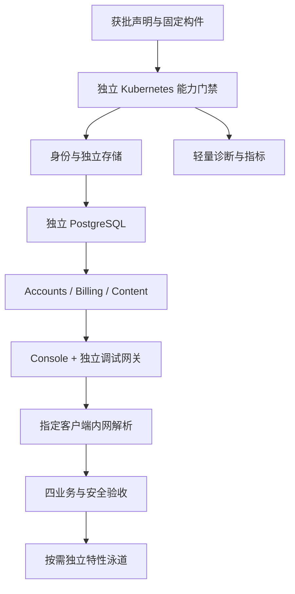

# Grok Bot 换机重部署与内网 DNS 切换手册

> 状态：规划与操作门禁，**不是部署成功或 DNS 已切换报告**。日期：2026-11-22，Asia/Shanghai。
> 需求单：`GROK-DEBUG-RUNBOOK-20261122`。本次范围仅为 knowledge 文档；部署、数据恢复、内网 DNS 切换、源机退役分别放行。
> 目标：在 Grok Bot 自有云主机上建立可重建、测试账户与脱敏数据隔离的 Accounts / Billing / Content / Console 调试环境；不把原 SIT 整机、生产身份或公网入口搬过来。

## 1. 需求、依据与边界

- 继承 [SIT 模块化交付与特性泳道规划](SIT-K3S-V6-模块化交付与特性泳道规划.md) 的分层、独立模块、身份与功能泳道思想，不照搬其主机规格、域名、凭据或“已验收”结论。
- 操作顺序参考 [SIT 换机重部署与 DNS 切换手册](SIT-K3S-V6-换机重部署与DNS切换手册.md)，历史执行事实仍归 [SIT 换机执行记录](SIT-K3S-V6-换机执行清单.md)，本环境必须产生自己的证据。
- 执行器所有权遵循 [ADR-0001](../../architecture/ADR-0001-GitOps三类执行器与单一配置负责人.md)。Helm 只是 Kubernetes 包管理器，**不能在没有 Kubernetes 的主机上直接运行 Chart**。
- 只读源机如需盘点，使用经授权的 `auditor@sit-k3s-v6.svc.plus`，核实主机指纹；此文发布不授权连接、提权或复制数据。
- 不改正式 SIT/PROD、全局解析器、现有浏览器/桌面、已有数据库、默认 kubeconfig 或共享入口；不启动 ExternalDNS 写入，不改公网 DNS。
- 不迁移 AI 桌面的生产单点登录会话、模型网关账号池、支付实钥或完整生产库。桌面/AI 网关/QMD 不在本次四业务部署范围。

### 文档验收契约

新增独立手册并在知识库索引登记；应覆盖能力门禁、单一配置归属、四业务与数据边界、逐步重部署、内网解析切换与回滚、可复查验收矩阵。所有现场结果必须分为 `PASS / FAIL / BLOCKED / NOT_RUN`，不得把模板、规划预算或原 SIT 历史 PASS 当成本环境成功。

## 2. 现场基线与已知限制

以下仅是本轮局部探测，不是云服务商容量承诺；换机后全部重测。

| 项目 | 已知事实 | 不能据此推导 |
| --- | --- | --- |
| 系统可见资源 | 8 CPU、约 16 GiB 内存、约 89 GiB 空闲盘 | 容器独享这些资源；可覆盖现有服务预算 |
| 运行环境 | 容器环境，PID 1 为 tini；Docker 29.1.4、API 1.52、cgroup v2 | 等同可管理内核、systemd 的独立 VPS |
| 受限容器探测 | 无网络、只读根目录、64 MiB、drop ALL 的 Alpine 探测退出成功 | 特权 K3s、PVC、跨容器网络均可工作 |
| 候选工具 | k3d 5.9.0 二进制已按官方 SHA256 校验；选取的 K3s 稳定通道候选为 v1.37.2+k3s1 | 二者兼容性或业务部署已通过验收 |
| 第一次引导 | `--servers-memory` 产生客户端 fake meminfo 文件，Docker 服务端路径不同，bind mount 失败；k3d 自动回滚 | 当前云主机绝对不能承载 K3s |
| 第二次引导 | 去除该内存选项、关闭 image volume 后，报 `failed to ensure tools node`，并自动回滚 | 已修复挂载；已施加 3 GiB 限制；已有 Ready 节点 |
| 当前结论 | **K3s 引导仍 FAIL；四业务、存储及内网 DNS 均 NOT_RUN** | 可开放共享入口或切换流量 |

第一次故障机制可复查 [k3d v5.9.0 node.go](https://github.com/k3d-io/k3d/blob/v5.9.0/pkg/client/node.go)：设置节点 Memory 时创建 fake meminfo 并追加挂载。第二次失败根因尚未确认，保留日志后再做单变量诊断，禁止写成容量不足或强行重试成功。

当前证据位于执行机 `/workspace/grok-debug-deployment/evidence/`：`runtime-probe.json`、`cluster-bootstrap.log`、`cluster-bootstrap-retry.log`。这些是本机路径，不是持久归档保证；换机前需脱敏归档，并在执行回执补填归档标识和校验和。

## 3. 配置归属与模块装配

| 唯一负责人 | 管什么 | 本次约束 |
| --- | --- | --- |
| IaC | 资源、DNS provider、State、CMDB | 只有获批的资源/DNS变更才生成 plan/apply；不把运行时地址抄成静态 inventory |
| GitOps | 独立 debug 环境期望状态、模块开关、依赖、镜像引用 | 新建独立候选路径，不复用正式 SIT 的根调谐路径；路径须经 PR 落地后才存在 |
| Artifacts | 镜像与 Helm/OCI Chart 构建发布 | 唯一 Chart 所有者；固定 Chart/镜像 digest，先核实当前 Chart 名称与 values，不照搬历史文档名称 |
| Playbooks | 主机/服务/数据库、备份恢复及迁移执行 | 识别 VPS 与容器边界，不在共享主机套用整机 OS 初始化；Doco-CD/Compose 另走其角色 |
| Platform-Orchestrator | 输入、授权、DAG、派发、等待、回执汇总 | 不承接数据库、DNS provider 或主机变更实现 |
| knowledge | 本手册、风险说明与脱敏执行记录 | 不成为第二套可执行配置或秘密存储 |

目标环境逻辑名建议为 `grok-debug`；这是规划标识，不冒充正式 `sit-k3s-v6`。每个值只在所属声明中定义一次，手册引用声明，不并行维护生产值。

最低组合是四业务、数据库、调试网关与必要身份。Flux/ESO 依赖目标身份与仓库访问准备程度启用；未接通时临时 Helm 手工交付必须声明唯一写入者，不能与 Flux 同时管理同一 Release。完整监控、MCP、Flagger 后置；没有适配的入口控制器、指标和回滚探针，不启用渐进发布。

### 资源门禁

- 原 3 GiB 只是能力探测目标，不是全业务容量验收结论；第二次脚本在资源更新前已失败，不能声称硬限制已生效。
- 业务候选可先评估 3 CPU / 6 GiB 上限，**只是预算建议，尚未分配**。先读取实际 cgroup 限额、现有服务峰值、磁盘与 inode 余量，再审批预算；资源不足时停在规划，不挤占桌面与其他服务。
- 执行前校验 Docker 容器硬限制、Pod requests/limits、命名空间 ResourceQuota 和 LimitRange；不要把 k3d fake meminfo 等同硬隔离。确认节点可分配资源与调度行为，不靠“看起来有 16 GiB”放行。
- 约束日志、临时卷、镜像缓存与测试数据库容量；配额、告警阈值、证据保留和回收期限写入本轮执行单，不从手册硬编码继承。

## 4. 换机前必须保存的重建清单

| 类别 | 必填输入与保护 |
| --- | --- |
| 目标身份 | 云资源标识/主机名、运行时边界、可用预算、SSH 指纹核验方式；实际地址来自 CMDB，Git 不记录地址字面量 |
| 构件 | GitOps / Playbooks / Artifacts resolved SHA、Chart 版本与 digest、四业务镜像 digest、CPU 架构、K3s/k3d/Helm/Flux版本；不得使用未固定 latest |
| 集群 | 独立 cluster UID、namespace/release 规划、CNI/存储类、独立 kubeconfig 和三角色 RBAC；凭据文件不入归档包 |
| 数据库 | 引擎大版本、schema/migration 版本、独立空目标、各库角色、测试 seed 版本、脱敏数据来源审批、备份标识与校验和 |
| 密钥 | 仅保存受控 Vault 引用与负责人，不保存值；目标专属运行身份、JWT issuer/audience、TLS 与密钥重新签发流程 |
| DNS/入口 | 指定客户端/解析器、私有视图或本地映射归属、前值与候选目标、TTL与负缓存、证书信任链、回退清单 |
| 灾备 | 可重建基线、加密备份归档位置、恢复验证结果、RPO/RTO目标及实测字段、旧环境保留条件 |

新云主机不保证拥有当前机器的持久盘、浏览器会话、命令行登录、后台任务或 Vault 身份。工具安装可脚本化，授权会话应按正式流程重新建立；不要把复制整个 home、Docker 数据目录或浏览器 profile 作为恢复步骤。不得为此备份 Grok Bot 托管桌面本身或平台运行目录。

## 5. 重部署顺序与停止条件

### 阶段 A：只读预检

记录目标身份与空闲资源、既有监听/容器/卷、Docker client/daemon 是否同机、daemon 文件系统与端口发布所在的网络命名空间；验证镜像和 Chart 可拉取。仅使用已有获准运行接口，不开放无认证 Docker 管理口。

已有现场不是裸 VPS：不执行全局防火墙重置、用户重建、主机名重置、全盘格式化或 Docker/K3s 清理命令。发现同名集群/卷/监听时先核对归属，不直接删除重建。

### 阶段 B：单节点能力验收

优先排查已保留的 k3d tools-node 失败，再决定修复 k3d 或使用独立 Kubernetes 目标。一次只改变一个假设，保留失败对象与日志供诊断，回收仅限本次明确创建且确认归属的对象。

- API 只绑定管理侧 loopback 或获准私网，**Docker 服务端的 loopback 不等于执行容器或远端客户端的 loopback**；从实际调用方验证可达性。
- 独立 kubeconfig 存放于执行工作区私有目录，权限 0600；不修改默认 context。核对 cluster UID 后才允许写入。
- 用最小测试负载验证 Ready、Pod DNS、Pod间网络、镜像拉取、PVC读写、删除并重建Pod后数据保留、端口映射和资源限额。用独立临时测试卷，不触碰既有卷。
- 若能力门禁仍失败，不进行四业务/DNS切换。降级选项为另一个获准 Kubernetes 目标，或经另立执行单的 Compose 适配；Chart render 只能静态验证，不能视为运行。不能声称“直接 Helm 无集群部署”。

### 阶段 C：身份与数据库

本环境使用独立 root/operator/auditor 治理边界，不在共享宿主机创建或重置账号；按可用运行时实现集群 RBAC 与数据库角色。auditor 无 Secret 明文、exec、port-forward 与写权限；业务账号不拥有管理/DDL权。

目标专属短期身份验证通过后，方可使用 ESO 同步已批准的测试秘密。无获准 Vault 集成时，将其标为 BLOCKED；临时测试密钥机制需另行审查，不把生产 Secret 或 admin kubeconfig 拷来兜底。

新建独立数据库和空卷，迁移工具/版本按业务仓当前契约核实。schema升级不在健康源库原地进行；先建新目标并验证迁移。Accounts、Billing、Content 各自受限运行账号，Console只访问获准API。

### 阶段 D：四业务安装

执行前读取当时 Chart 和业务仓规范，核实 Content 是独立服务还是该版本的内置组件；未确认其构件和接口前不虚构端口、Deployment名或健康URL。通过 `helm lint`、`helm template` 和实际 schema 检查，再应用到独立 namespace/release。按 Accounts → Billing/Content → Console 依赖推进，以实际应用依赖契约为准。

运行态与GitOps声明一致，四业务均固定 digest，接入独立调试网关；首轮不装 ExternalDNS、不复用共享 Ingress，不启用真实支付、邮件、短信、生产Webhook或后台扣费任务。

### 阶段 E：备份恢复与换机演练

测试 seed 可重新生成；选取脱敏数据时，保存获批数据集的版本、字段处理规则、校验结果和保留期限。加密备份由所属 Playbooks 流程处理，受控传输到全新目标；不复制在线 PGDATA 或 Docker volume 代替一致性备份。

在已填充测试数据的候选库完成备份→独立恢复→schema/代表性记录/权限/应用查询验证，记录实际耗时与数据时间点；不要用空库恢复证明业务可恢复。源端保持不变，目标不得承担生产写入。

### 阶段 F：仅在批准后切内网解析

按下一节逐客户端放行；验收失败立即回退该客户端或私有视图，不修改公网记录。未完成证据门禁时，维持直连调试入口，不宣布换机成功。

## 6. 测试账户与数据隔离

| 模块 | 最低测试集 | 禁止携入/触发 |
| --- | --- | --- |
| Accounts | 独立管理员、普通用户、停用用户；登录/登出/过期会话 | 生产用户密码散列、生产SSO Cookie、生产JWT签名密钥 |
| Billing | 合成订阅、试用/到期/取消订单、支付提供方沙箱事件与去重用例 | 真支付凭据、真实扣款、生产Webhook、真实账单与对账单 |
| Content | 合成草稿、已发布测试内容、无权限访问用例 | 真实私有正文/附件、用户隐私、未授权完整对象存储副本 |
| Console | 跨模块登录、权限提示、状态展示、错误态 | 浏览器缓存的生产会话、跨环境API fallback |

优先合成数据；确需脱敏时，清除令牌、Cookie、密码散列与密钥，替换姓名、邮箱、电话和标识，并验证跨表引用一致且无法直接关联真实主体。测试邮箱使用不可投递示例域，外发适配器关闭或接入本地sink；对所有支付、邮件、短信、对象存储和遥测上报目标设出站允许列表。测试角色本身也不得获得生产权限。

## 7. 内网 DNS 规划与切换手册

### 7.1 三种名字空间，不互相替代

| 层次 | 用途 | 负责人/限制 |
| --- | --- | --- |
| Pod内 Service DNS | 集群内服务发现 | Kubernetes/CoreDNS；使用实际Service FQDN，不覆盖整片生产域 |
| 指定调试客户端的解析 | 浏览器、CLI访问候选入口 | 指定私有DNS视图，或少量客户端临时hosts；仅调试客户端参与 |
| 公网权威DNS | 正式SIT/PROD入口 | **本次不变更**；不能把内网切换误作Cloudflare/ExternalDNS写入 |

建议先使用保留测试域 `grok-debug.test`，示例名为 `console.grok-debug.test`、`accounts.grok-debug.test`、`billing.grok-debug.test`、`content.grok-debug.test`。这些只是候选名，未创建、未签发证书、未配置解析；`.test` 需自行提供获准客户端解析，不能申请公开信任的ACME证书。

目标地址来自运行时CMDB/网关映射，在执行单保存，不提交Git。只有调用方与入口确处于同一网络命名空间时才考虑loopback；远端用户设备必须先有到私有入口的获准路由/隧道，不能把远端loopback误当云主机入口。容器宿主映射同样逐跳验证。

若必须模拟正式SIT业务域名，应另批**精确 FQDN 的 split-horizon**，仅指定测试客户端/私有解析视图生效，绝不覆盖整个 `onwalk.net` 或 `svc.plus`。证书SAN/信任、Cookie Domain、Secure/SameSite、OIDC issuer/redirect URI、CORS及前端构建时API地址均须匹配测试身份；禁止沿用生产 `.svc.plus` 会话。

### 7.2 切换前执行单

每个FQDN记录：客户端集合、解析器/视图、记录类型、当前值、候选值、CNAME链、A/AAAA、TTL、负缓存TTL、DoH/浏览器安全DNS、VPN split-DNS、写入负责人、TLS信任、预期应用标识、回退值。共享CNAME必须列出所有消费者，无法枚举则停止。

hosts仅支持精确条目，不支持通配符，且浏览器/容器可能不消费同一文件；它是客户端局部映射，不是假装已经配置了内网权威DNS。不得覆盖整个hosts文件、全局resolver或Docker daemon DNS来简化测试。

### 7.3 切换步骤

1. **入口先行**：确认候选网关从实际客户端可达。用受控临时解析（如 `curl --resolve`）验证目标虚拟主机、TLS SAN/证书链、业务环境标识和依赖就绪；禁止 `-k` 作为验收。对 `.test` 使用获准内部CA及明确的信任文件，不擅自安装系统根证书。
2. **保存基线**：导出获批客户端的精确旧映射或私有视图版本，保存校验和和回退步骤；分别查询公网与私有视图作为“公网不变”基线。TTL如需调整，必须先经同一授权范围修改并等待原TTL，而不是立即假设缓存清空。
3. **先单客户端**：由唯一写入者在已批准私有视图或客户端添加最小记录/映射。对前值做比较，发生并发变化就停止，不覆盖他人修改。
4. **多层核验**：检查私有解析器、系统resolver、浏览器/DoH与Pod CoreDNS各自结果；同时验证未参与客户端仍走原环境。A/AAAA/CNAME都要核实，清理范围仅限获批客户端缓存。
5. **四业务探针**：实际用户路径验证登录、权限、沙箱订单、内容读写和Console路由；确认响应环境/构件标识，避免旧网关缓存导致假成功。
6. **扩面与观察**：单客户端通过后再逐组加入获批调试客户端。记录开始/结束时间、观测时长、失败率/延迟目标与实际值；这些阈值需在执行前填定。未授权的客户端、原SIT和公网结果均不得变化。

### 7.4 回退与中止

- TLS不受信、解析漂移、错误环境/生产账户可用、跨环境API跳转、非沙箱外发、数据库错误或影响既有服务，立即停止扩面。
- 只恢复本次精确改动的客户端条目/私有视图，按前值与当前值比较执行；清除获批范围内缓存，检查旧入口、TLS、登录和依赖恢复。不要改公网记录来修复局部DNS故障。
- DNS回退不等于数据回退。若新目标已接收需要保留的测试写入，先保留备份/回执并决定丢弃还是受控重放；不得直接覆盖旧库或称双写已一致。
- 旧调试环境与备份保留至观察期结束；删除实例/卷、撤销旧身份和清理DNS属于独立枚举与授权，不包含在“切换完成”内。

## 8. 验收与执行回执

| 门禁 | 证据与判定 | 当前 |
| --- | --- | --- |
| G0 容器能力 | 受限容器退出码与日志 | PASS（仅最小探测） |
| G1 Kubernetes | Ready、UID、CNI、DNS、硬限额与配额 | FAIL（两次引导失败，根因分别记录） |
| G2 持久存储 | 临时PVC读写及重建Pod后数据仍可读 | NOT_RUN |
| G3 身份与秘密 | 独立身份，越权读取/exec被拒，测试Secret可消费 | NOT_RUN |
| G4 四业务 | 固定digest，依赖Ready，四模块正常与拒绝路径 | NOT_RUN |
| G5 数据与沙箱 | 脱敏扫描、完整性、无真实外发/扣费 | NOT_RUN |
| G6 重建恢复 | 带数据备份独立恢复、schema/权限/查询验证、RPO/RTO实测 | NOT_RUN |
| G7 内网解析 | 已批准客户端成功，未参与客户端/公网不变，TLS可信 | NOT_RUN |
| G8 回退与观察 | 局部回退演练、数据处理决定、观察期和资源无干扰 | NOT_RUN |

每轮回执填写：`task_id`、`run_id`、操作人、Asia/Shanghai时间、源/目标身份、cluster UID、各仓resolved SHA、Chart/镜像digest、数据集/备份ID、测试命令与退出码、DNS前后值的受控证据引用、各门禁结果、阻塞与回退结果。Git只放脱敏摘要与引用；地址、令牌、kubeconfig、完整数据库及凭据材料不入库。

### 后续工作队列（未授权为已执行）

1. 先诊断k3d tools-node失败，验证容器/宿主的路径、网络与能力边界；必要时重新选择获准Kubernetes目标。
2. 核实Artifacts当前四业务Chart与Content交付形态，提出独立GitOps声明/Playbooks入口的最小PR，不复制历史SIT配置。
3. 按门禁推进测试数据、独立恢复、入口与单客户端演练；完成前不切任何DNS。
4. 用户确认具体内网切换范围、前后目标与窗口后，另行执行；本手册合并不构成运行授权。
