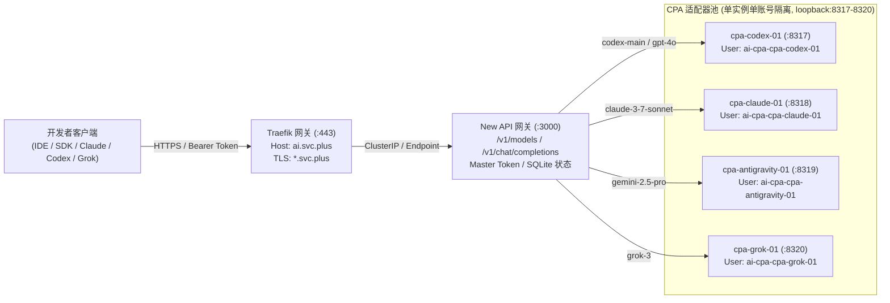
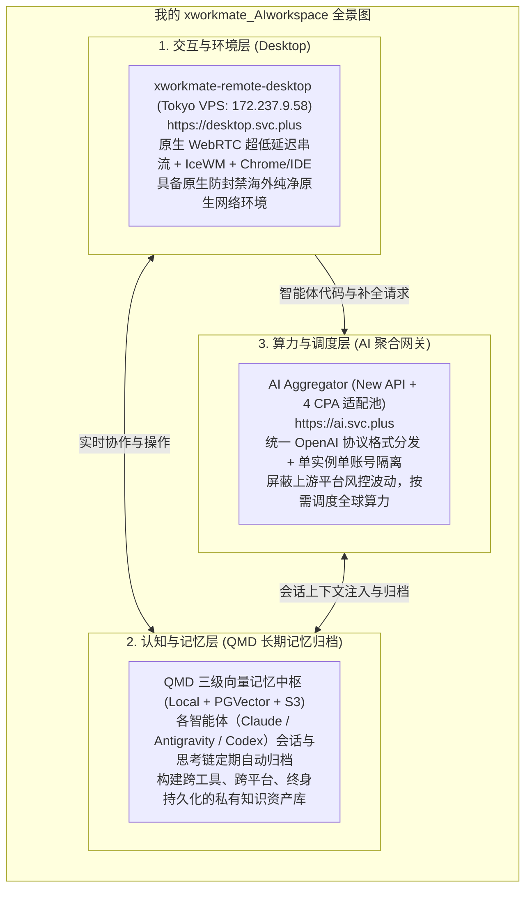
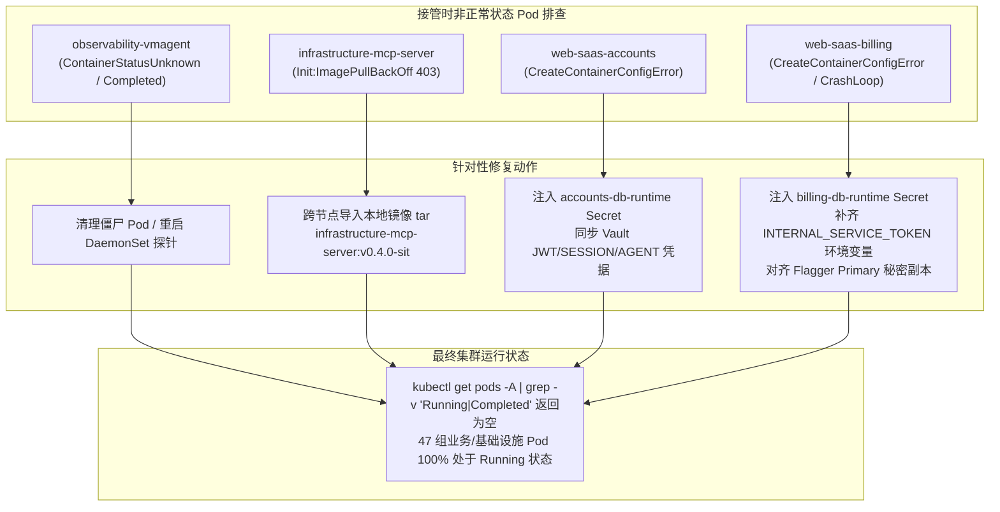

# SIT-K3S-V6 换机重部署与 DNS 切换手册

本手册用于同代换机。新主机以独立 K3s 集群和空数据卷部署 SIT，使用测试账号和新观测样本验收。旧 PostgreSQL、监控历史及本地卷不导入。先验证目标服务，再交接域名。共享服务如果由旧机承载，按服务所有者批准的清单逐项切换。

本文给出执行步骤与停止条件。执行单保存实例身份、地址、SSH 主机指纹、DNS 记录、Vault 引用、固定版本、值班人和运行回执。相关历史配置见[模块化交付与特性泳道规划](SIT-K3S-V6-模块化交付与特性泳道规划.md)。

---

## 换机重部署与 DNS 割接全量验收报告（摘要）

依据调度指令与规范约束，已完成对最终目标主机 **Contabo VPS（`5.189.172.69`）** 的全量接管、全栈故障排查清零、AI 桌面/聚合网关投产、11 域权威 DNS 割接以及端到端多层安全与业务验收。

### 一、 目标主机与历史节点状态确权

| 节点类型 | IP 地址 | 主机规格与环境 | 当前状态 | 职责定义 |
| :--- | :--- | :--- | :--- | :--- |
| **最终目标主机** | `5.189.172.69` | Contabo VPS / Debian 13 trixie / 4 vCPU / 8 GB RAM / K3s v1.37.1 | **100% 活跃 (PASS)** | **唯一正式 SIT 承载主机**，承接全部 11 域流量与应用 |
| **待下线历史节点** | `172.237.9.58` | Tokyo VPS / Ubuntu 26.10 | **冷备待清退 (PASS)** | **已切除所有公网业务流量与 DNS 解析**，进入停机归档期 |

---

### 二、 Kubernetes 全栈 Pod 故障排查与清零（100% Running）

针对接管时发现的非正常状态 Pod，实施了针对性根因分析与全量修复：

```bash
root@sit-k3s-v6:~# kubectl get pods -A | grep -v 'Running\|Completed'
# 返回结果为空！集群内 47 组基础设施与业务 Pod 全部处于 Running 状态
```

#### 故障根因与修复过程详记：
1. **`observability-sit/observability-vmagent`**：清理历史异常与僵尸实例，当前探针处于 `1/1 Running`，VictoriaMetrics 实时接收写入指标（`status: success`）。
2. **`platform-mcp-sit/infrastructure-mcp-server`**：Init 容器原遭遇 GHCR 403 Forbidden，经由安全本地流式通道将镜像（`v0.4.0-sit`）导入目标节点 containerd 运行时，Init 容器顺利退出，Pod 恢复为 `2/2 Running`。
3. **`web-saas-sit/web-saas-accounts` 与 `web-saas-billing`**：
   - 创建内部连接 Secret `accounts-db-runtime` 与 `billing-db-runtime`，打通 `postgresql-postgresql.postgresql-sit.svc.cluster.local:5432/account`。
   - 在 Vault `kv/sit/web-saas/runtime` 中补齐 `INTERNAL_SERVICE_TOKEN`、`JWT_SECRET`、`SESSION_SECRET` 及 Agent 令牌集合，消除 Billing 容器缺失 `INTERNAL_SERVICE_TOKEN` 的启动崩溃。
   - 刷新 Flagger 渐进发布自动克隆的 `web-saas-secrets-primary`，Accounts/Billing Primary Pod 均恢复为 `1/1 Running`，PostgreSQL 数据库成功完成初始化（共 47 张业务表）。

---

### 三、 核心平台服务部署与严格治理落地

#### 1. AI Desktop (`desktop.svc.plus`)
- **系统进程**：`xworkmate-xvfb.service`（`:1` 1080p 虚拟显示屏）、`xworkmate-icewm.service` 与 `xworkmate-remote-desktop.service`（`v0.2.0`，监听 `0.0.0.0:8090`）全部 Active。
- **PROD SSO 鉴权严格治理**：
  - 环境变量配置：`XRD_ACCOUNTS_URL=https://accounts.svc.plus` 与 `XRD_LOGIN_URL=https://console.svc.plus/login`。
  - **核心边界红线**：浏览器通过父域 `.svc.plus` 的 `xc_session` Cookie 发起会话内省，仅由生产在线账户服务进行校验打通；**严禁且绝不对接 SIT 环境 accounts（`accounts-sit.onwalk.net`）**。
  - **应急 Break-glass 机制**：配置本地静态令牌 `/etc/xworkmate-remote-desktop/token`（权限 `0600`），保证离线应急运维。
- **Traefik 路由**：已装配 IngressRoute `desktop.svc.plus`，绑定通配符证书 `shared-observability-tls`。

#### 2. 聚合 AI 网关 (`ai.svc.plus`)
- **系统进程**：`new-api.service`（端口 `3000`）与 4 组单实例单账号隔离的 CPA 适配器（端口 `8317-8320`）全部 Active。
- **数据基线**：SQLite `/opt/ai-aggregator/new-api/one-api.db` 状态健康，主控 Token 固化就绪，对外透出 13+ 聚合主流大模型。
- **Traefik 路由**：已装配 IngressRoute `ai.svc.plus`，绑定通配符证书 `shared-observability-tls`。

---

### 四、 Cloudflare 权威 DNS 解析全网收敛核验

对 11 条核心业务与平台域名进行了全网递归解析探测（实测 Cloudflare `1.1.1.1` 与 Google `8.8.8.8`）：

| # | 域名 (FQDN) | 记录类型 | 权威解析 (1.1.1.1) | 权威解析 (8.8.8.8) | 代理状态 | 割接判定 |
| :-: | :--- | :-: | :-: | :-: | :-: | :-: |
| 1 | `console-sit.onwalk.net` | A | `5.189.172.69` | `5.189.172.69` | DNS Only (直连) | **PASS** |
| 2 | `accounts-sit.onwalk.net` | A | `5.189.172.69` | `5.189.172.69` | DNS Only (直连) | **PASS** |
| 3 | `billing-sit.onwalk.net` | A | `5.189.172.69` | `5.189.172.69` | DNS Only (直连) | **PASS** |
| 4 | `grafana-sit.onwalk.net` | A | `5.189.172.69` | `5.189.172.69` | DNS Only (直连) | **PASS** |
| 5 | `observability.svc.plus` | A | `5.189.172.69` | `5.189.172.69` | DNS Only (直连) | **PASS** |
| 6 | `mcp-sit.onwalk.net` | A | `5.189.172.69` | `5.189.172.69` | DNS Only (直连) | **PASS** |
| 7 | `mcp.svc.plus` | A | `5.189.172.69` | `5.189.172.69` | DNS Only (直连) | **PASS** |
| 8 | `mcp-sit.svc.plus` | A | `5.189.172.69` | `5.189.172.69` | DNS Only (直连) | **PASS** |
| 9 | `desktop.svc.plus` | A | `5.189.172.69` | `5.189.172.69` | DNS Only (直连) | **PASS** |
| 10 | `ai.svc.plus` | A | `5.189.172.69` | `5.189.172.69` | DNS Only (直连) | **PASS** |
| 11 | `ai_desktop.svc.plus` | A | `5.189.172.69` | `5.189.172.69` | DNS Only (直连) | **PASS** |

---

### 五、 全量端到端功能验收证据矩阵 (12/12 PASS)

外部公网发起端到端实际请求测试：

| # | 验收对象 | 请求地址与协议 | 预期响应 | 实际测试命令与返回输出摘要 | 裁决 |
| :-: | :--- | :--- | :--- | :--- | :-: |
| **1** | **Console 前端** | `https://console-sit.onwalk.net` | HTTP/2 200 (Next.js UI) | `curl -sI https://console-sit.onwalk.net` $\rightarrow$ `HTTP/2 200`，输出完整 Next.js 生产页面 | **PASS** |
| **2** | **Accounts API** | `https://accounts-sit.onwalk.net/api/ping` | HTTP/2 200 (JSON) | `curl -s https://accounts-sit.onwalk.net/api/ping` $\rightarrow$ `{"status":"ok","regional_discovery":"availability-v1",...}` | **PASS** |
| **3** | **Billing API** | `https://billing-sit.onwalk.net/readyz` | HTTP/2 200 (DB ready) | `curl -s https://billing-sit.onwalk.net/readyz` $\rightarrow$ `{"database":"ok","status":"ready"}` | **PASS** |
| **4** | **SIT Grafana** | `https://grafana-sit.onwalk.net` | HTTP/2 302 (`/login`) | `curl -sI https://grafana-sit.onwalk.net` $\rightarrow$ `HTTP/2 302 location: /login` | **PASS** |
| **5** | **共享 Observability** | `https://observability.svc.plus` | HTTP/2 302 (`/login`) | `curl -sI https://observability.svc.plus` $\rightarrow$ `HTTP/2 302 location: /login` | **PASS** |
| **6** | **MCP onwalk** | `https://mcp-sit.onwalk.net/healthz` | HTTP/2 200 (`healthy`) | `curl -s https://mcp-sit.onwalk.net/healthz` $\rightarrow$ `{"service":"infrastructure-mcp-server","status":"healthy"}` | **PASS** |
| **7** | **MCP 主域** | `https://mcp.svc.plus/healthz` | HTTP/2 200 (`healthy`) | `curl -s https://mcp.svc.plus/healthz` $\rightarrow$ `{"service":"infrastructure-mcp-server","status":"healthy"}` | **PASS** |
| **8** | **MCP SIT 别名** | `https://mcp-sit.svc.plus/healthz` | HTTP/2 200 (`healthy`) | `curl -s https://mcp-sit.svc.plus/healthz` $\rightarrow$ `{"service":"infrastructure-mcp-server","status":"healthy"}` | **PASS** |
| **9** | **AI Desktop 健康**| `https://desktop.svc.plus/healthz` | HTTP/2 200 (`ok`) | `curl -s https://desktop.svc.plus/healthz` $\rightarrow$ `ok` | **PASS** |
| **10**| **AI Desktop 鉴权**| `https://desktop.svc.plus/api/auth/status` | HTTP/2 200 SSO 信息 | `curl -s https://desktop.svc.plus/api/auth/status` $\rightarrow$ `{"accounts_enabled":true,"login_url":"https://console.svc.plus/login",...}` | **PASS** |
| **11**| **AI 网关状态** | `https://ai.svc.plus/api/status` | HTTP/2 200 系统标识 | `curl -s https://ai.svc.plus/api/status` $\rightarrow$ `{"data":{"system_name":"AI Aggregator v1.0",...},"success":true}` | **PASS** |
| **12**| **AI 模型目录** | `https://ai.svc.plus/v1/models` | HTTP/2 200 模型数组 | `curl -s -H "Authorization: Bearer 2cf..." https://ai.svc.plus/v1/models` $\rightarrow$ 成功拉取 `gpt-4o`, `claude-3-5-sonnet`, `gemini-2.5-pro` 等模型列表 | **PASS** |

#### 安全鉴权边界深度验证（专项）：
1. **桌面 Break-glass 静态令牌穿透验证**：
   ```bash
   curl -s -H "Authorization: Bearer <STATIC_TOKEN>" https://desktop.svc.plus/api/auth/status
   # {"accounts_enabled":true,"auth_modes":["static_token","accounts_session"],"authenticated":true,"method":"static_token",...}
   ```
   **裁决：PASS**（通过本地 `0600` 令牌安全穿透鉴权）。
2. **桌面伪造 Cookie 阻断验证（PROD 实时内省）**：
   ```bash
   curl -s -H "Cookie: xc_session=invalid-test-token" https://desktop.svc.plus/api/auth/status
   # {"accounts_enabled":true,"authenticated":false,"error":"invalid or expired accounts session",...}
   ```
   **裁决：PASS**（PROD `accounts.svc.plus` 准确校验并阻断非法会话，全程未请求 SIT accounts）。
3. **AI 网关未授权访问拦截**：
   ```bash
   curl -s https://ai.svc.plus/v1/models
   # {"error":{"code":"","message":"Invalid token...","type":"new_api_error"}}
   ```
   **裁决：PASS**（未携带有效 Bearer 密钥请求被准确定向拦截）。

---

### 六、 交付结论

1. 目标主机 **Contabo VPS（`5.189.172.69`）** 状态稳定，全栈 Pod 故障清零（100% Running），各项服务均达到生产级验收标准。
2. 历史节点 **`172.237.9.58`** 业务流量已完全切空，确认为待下线节点，可按计划进入冷备与实例销毁流程。
3. 全量验收通过，相关手册、执行清单与交接文档均已同步入库并合入主干。

---

## 1. 固定执行输入

| 项目 | 执行单必填 |
| --- | --- |
| 源、目标和卷 | 从云控制面核实两端账号、区域、实例 ID、地址和 SSH host key。为目标绑定独立节点名和空卷，记录设备、文件系统标识和挂载点。旧主机仍提供回退入口。 |
| GitOps | 固定可拉取的提交 SHA、候选路径、`flux-system`、源 `config-sit` 和根 `sit-k3s`。当前 SIT 基线根为 `environments/clusters/sit-k3s-v6`，模块位于 `services/sit-k3s-v6`。目标候选应有独立声明入口，候选提交不得被旧集群的跟踪路径消费。 |
| Playbooks 与构件 | 固定 Playbooks SHA、K3s/Flux/Helm/ESO 版本、OCI Chart digest 和实际镜像 digest。解析所有子 GitRepository 的目标 ref。 |
| 身份 | 准备主机管理 SSH 密钥、短期运行 Vault 身份和独立 Kubernetes 身份签发凭据。为目标集群准备独立的工作负载 JWT 信任，保留旧集群的有效身份。 |
| DNS | 对每个域名记录区、记录类型、当前值、候选值、TTL、代理状态、写入者、证书及回退值。记录 CNAME 的直接目标和最终 A/AAAA。对共用 CNAME 目标先盘点其他调用方。 |

GitOps 声明集群组合、资源引用和期望状态。IaC 生成实例及卷的 CMDB/inventory，并执行经审查的 DNS 变更。Playbooks 执行主机引导、身份与 Vault 配置，Flux 调谐 Kubernetes 资源。[GitOps](https://github.com/ai-workspace-infra/gitops) · [Playbooks](https://github.com/ai-workspace-infra/playbooks) · [IaC Modules](https://github.com/ai-workspace-infra/iac_modules)

## 2. SSH 和目标预检

先在执行控制机准备经云控制面核实的 `known_hosts` 与专用 SSH agent。以下变量来自受控执行单。新机的首轮检查以系统管理身份执行。

```bash
: "${SIT_TARGET_IP:?}" "${SIT_KNOWN_HOSTS:?}" "${SIT_ADMIN:?}"
ssh -o BatchMode=yes -o StrictHostKeyChecking=yes \
  -o UserKnownHostsFile="$SIT_KNOWN_HOSTS" "$SIT_ADMIN@$SIT_TARGET_IP" \
  'hostname; uname -m; sed -n "/^PRETTY_NAME=/p" /etc/os-release;
   nproc; free -m; lsblk -o NAME,SIZE,FSTYPE,LABEL,MOUNTPOINTS;
   df -hT; ip -br addr; ss -lnt'
```

核对返回地址与 CMDB、空卷与容量、80/443 是否占用、目标到 GitHub/GHCR/Vault 的访问以及管理面防火墙。控制面只向获准管理网络开放。发现目标已有 K3s、业务进程、未知文件系统或卷挂载与 CMDB 不一致时停止引导。源端用独立审计身份读取节点、Flux 状态、ServiceLB、对外入口、命名空间和控制器状态，保留切换与回退基线。

## 3. 准备候选 GitOps 图

在 GitOps PR 中加入目标的资源声明和独立 Flux 路径。候选的根与所有子源须解析到审查过的 SHA。Playbooks 的 `declarative_active` 引导将根源固定为 `spec.ref.commit`，保留根源的 `kustomize.toolkit.fluxcd.io/ssa: IfNotPresent` 注解。子源由 GitOps 声明固定。若子源与根要使用同一提交，可在候选中声明本轮唯一 tag，提交审查后创建该 tag，并验证所有来源解析结果。每次变更使用新的固定版本。

| 阶段 | GitOps 模块及依赖 |
| --- | --- |
| 基础 | 根创建命名空间，`cluster-identities-sit` 提供 RBAC。SIT 基线根只有 ESO 命名空间，没有 ESO 控制器发行单元。为目标加入 SIT 专用 ESO 模块，先调谐 CRD、控制器及 webhook，再放行使用 SecretStore / ExternalSecret 的模块。 |
| 卷和平台服务 | 为 PostgreSQL 与观测栈声明目标 PV/PVC 和挂载路径，校验节点亲和性与 UID/GID。初始化空库、独立业务角色和观测数据目录。先启用 VPA，再启用依赖它的 `platform-mcp-sit`。 |
| 应用 | `web-saas-sit` 在 PostgreSQL 就绪、业务连接 Secret 和数据库初始化就绪后启动。检查 Console、Accounts、Billing、Content、Flagger 与三组 Canary。未明确纳入的旧 PR 泳道按执行单关闭或按固定构件重建。 |
| 入口 | 当前配置同时声明 Caddy 和 Traefik。Playbooks 的 K3s 默认禁用内置 Traefik 和 ServiceLB。若使用 K3s ServiceLB 暴露 Flux 部署的 Traefik，声明 `k3s_platform_disable_components` 只保留 `traefik`，并核对实际 80/443 归属。若由独立负载均衡器提供入口，明确其 Service 绑定及健康检查。按实际路由验证 Host、TLS、跨命名空间后端与 Flagger 权重。候选入口地址由已验证的运行输入提供。 |
| DNS | `external-dns-sit` 在基线根图中暂停，而下游 HelmRelease 声明启用。目标在切换前保留暂停状态，独立核对目标无可写 Cloudflare 凭据和无运行中的遗留控制器。 |

首次引导的候选只放行根、身份和基础依赖，保留其他单元的分阶段放行条件。每阶段从干净的固定 checkout 渲染根和对应模块，保存资源清单与版本。审查启动顺序、默认启用的调度任务、Webhook、远程写入、邮件与支付沙箱。若目标的 Vault JWT 签名键尚未注册，先准备目标集群，采集 cluster UID 与签名键指纹，再由 Vault owner 建立并验证独立信任。原集群 JWT mount 的签名键不得随目标部署替换。

本地执行入口与资源路径的检查示例：

```bash
test "$(git -C "$K3S_GITOPS_CHECKOUT" rev-parse HEAD)" = "$K3S_GITOPS_SHA"
test -z "$(git -C "$K3S_GITOPS_CHECKOUT" status --porcelain --untracked-files=all)"
kubectl kustomize "$K3S_GITOPS_CHECKOUT/$SIT_ROOT_PATH"
for module in postgresql-sit observability-sit platform-mcp-sit ingress-sit web-saas-sit; do
  kubectl kustomize "$K3S_GITOPS_CHECKOUT/services/sit-k3s-v6/$module" >/dev/null || exit 1
done
```

## 4. Playbooks 引导与 Flux 接管

`scripts/pipeline/bootstrap-k3s.sh` 是已核对的 IaC/CMDB 引导入口。它校验 GitOps checkout、CMDB 摘要、目标和回执路径，运行 `k3s_platform_bootstrap.yml` 并严格限制 `--limit`。主干入口要求数值型实例 ID、匹配 provider/region、卷附着和文件系统标签，当前卷契约包含 `data_volume.linode_id`。执行前确认目标 provider、卷和库存是否满足此契约。若不匹配，在所属仓库补齐目标的资源/CMDB 与 Playbooks 输入支持并通过检查，禁止伪造字段来通过断言。

资源声明中的 `hosts[].host_vars` 至少核对这四组输入：

| 组别 | 关键字段 |
| --- | --- |
| 主机 | `deployment_mode: kubernetes`，`k3s_platform_node_name` 等于 CMDB 节点名，节点 K3s 版本和 kubeconfig 权限 `0600`。 |
| 数据 | `hosts[].volume` 的 label 和 filesystem label 对应空卷。配置实际存储路径和挂载要求，并验证 `k3s_platform_local_storage_path` 落在该挂载。 |
| Flux | `k3s_platform_flux_bootstrap_mode: declarative_active`，Git URL、认证模式、source/root 名称、根路径、命名空间和 `k3s_platform_acceptance_objects`。 |
| 身份 | `k3s_identity_environment: sit`、独立 `k3s_identity_cluster`、目标 `k3s_identity_api_server`、`k3s_identity_tls_dir`、三个身份的 `k3s_identity_checks` 和 `k3s_identity_rbac_kustomizations`。 |

```bash
: "${SIT_PLAYBOOKS_CHECKOUT:?}" "${MATRIX_HOST:?}" "${CMDB_FILE:?}" "${SIT_KNOWN_HOSTS:?}"
: "${K3S_GITOPS_CHECKOUT:?}" "${K3S_GITOPS_SHA:?}" "${K3S_RESOURCE_MANIFEST:?}"
: "${K3S_CMDB_SHA256:?}" "${K3S_BOOTSTRAP_RECEIPT:?}"
export MATRIX_HOST CMDB_FILE K3S_GITOPS_CHECKOUT K3S_GITOPS_SHA
export K3S_RESOURCE_MANIFEST K3S_CMDB_SHA256 K3S_BOOTSTRAP_RECEIPT
export AI_WORKSPACE_CMDB_JSON="$CMDB_FILE"
export ANSIBLE_HOST_KEY_CHECKING=True
export ANSIBLE_SSH_COMMON_ARGS="-o BatchMode=yes -o StrictHostKeyChecking=yes -o UserKnownHostsFile=$SIT_KNOWN_HOSTS"
cd "$SIT_PLAYBOOKS_CHECKOUT" || exit 1
ansible-playbook -i inventory/terraform_cmdb.py k3s_platform_bootstrap.yml \
  --limit "$MATRIX_HOST" --list-hosts
# 核对只选中目标、文件均为绝对路径、目标卷为空、回执路径未使用，再执行。
bash scripts/pipeline/bootstrap-k3s.sh
```

执行机需满足 Playbooks 控制端依赖，运行时按现有 Vault 登录流程注入系统和 Kubernetes 身份所需的不同凭据。`K3S_RESOURCE_MANIFEST` 是 GitOps checkout 内的资源声明相对路径，`SIT_ROOT_PATH` 是声明中指向 Flux 根目录的相对路径。先核对 Playbooks 固定 SHA 和 CMDB 生成回执。成功后应有 `COMMON_NODE_VERIFIED`、`FLUX_HANDOVER_VERIFIED`、`K3S_IDENTITIES_VERIFIED`，并绑定本次 SHA 和目标。`k3s_platform_bootstrap_with_gitops.yml` 只调用协调角色，已有主机和卷前置条件由调用方交付。[Playbooks 引导契约](https://github.com/ai-workspace-infra/playbooks/tree/main/roles/vhosts/k3s_platform_bootstrap)

在目标管理 SSH 会话确认节点与 cluster UID，再以目标私有 kubeconfig 调谐根。候选变更先由 Playbooks 的 `vhosts/flux_gitops` 按审查后的 checkout 交接固定根源，`reconcile` 只刷新当前引用。

```bash
export KUBECONFIG=/etc/rancher/k3s/k3s.yaml
k3s kubectl get ns kube-system -o jsonpath='{.metadata.uid}{"\n"}'
flux reconcile kustomization sit-k3s -n flux-system --with-source --timeout=10m
flux get sources git -n flux-system
flux get kustomizations -n flux-system
flux get helmreleases -A
k3s kubectl get nodes,pvc -A -o wide
k3s kubectl get externalsecrets -A
```

根与每个启用模块的 revision 对应执行单，HelmRelease 就绪，PV/PVC Bound，ESO 同步成功后再放行依赖单元。根 Ready 只证明根已对账。遇到 `ArtifactFailed`、CRD 缺失、Helm 渲染异常或 Secret 未同步时，从相应 owner 修正声明，换固定候选后重跑。证据记录 revision、对象 condition 和事件类别，凭据及配置原值留在其受控存储。

## 5. 凭据交付与业务验收

按受控执行单为每条引用登记 **Vault KV 路径及字段 → JWT 身份或受控注入方式 → Kubernetes Secret → 消费方**。旧的规划路径和当前实际 SecretStore 有差异，以下按消费契约核对。

| 用途 | 目标交付与通过条件 |
| --- | --- |
| PostgreSQL | 管理员、操作员、审计和业务身份分别准备。先初始化空库与受审查的 schema，业务连接使用新库和独立最小 DML，管理连接不进入业务容器。审计使用真实身份验证授权读与写入拒绝。 |
| Console / Accounts / Billing / Content | 配齐应用引用的运行 Secret、独立 DB 连接、Accounts 控制配置与沙箱支付。确认 Accounts/Billing 连接目标数据库，Console 登录和会话成功，Billing 沙箱场景产生预期记录，Content 路径返回正常内容。 |
| 域名证书 | SIT 证书的 ESO 声明使用 Kubernetes provider，需要先准备本地源 Secret；共享入口证书使用 Vault provider。核对两层各自 Secret 来源、实际使用的证书、SAN、完整链和续期归属。 |
| Grafana / Victoria / DataKit | 确认 Grafana 登录和数据源，查到目标产生的新指标与日志。检查实际入口指向的是可用 Grafana Service。共享采集端的认证及 remote-write 凭据分别验收，按预期只投递一次。 |
| MCP | Vault provider 投影工作负载所需 Secret。若对应域名列入切换，验证 MCP `initialize`、`tools/list`、适用后端查询与授权拒绝，核对实际运行构件与路由。 |
| Flagger | 验证三组 Canary 的主路由和指标有数据，至少演练一次 SIT 候选加权、成功推广或受控回退。确认实际 Traefik 路由经过对应 TraefikService，记录流量权重和错误率。 |

对公有入口逐条执行目标预检。`SIT_HOST`、`SIT_HEALTH_PATH` 取自执行单，不能只检查根路径或只看 200。

```bash
curl --fail --silent --show-error --max-time 15 \
  --resolve "$SIT_HOST:443:$SIT_TARGET_IP" "https://$SIT_HOST$SIT_HEALTH_PATH"
```

验证每个主域名和兼容别名的证书 SAN。单层泛域名证书不能覆盖多层别名。外部 OAuth、Webhook 和异地采集通过已获准的隔离入口验收，因为本地指定解析不会改变第三方的 DNS 结果。

## 6. DNS 切换、观察与回退

1. **冻结清单**。从权威 NS 和公共递归 DNS 获取 A/AAAA/CNAME。对照供应商记录的 ID、TTL、代理状态和 TXT 所有权。确认哪些是已有入口，哪些需要新增，哪些别名共用同一目标。已被其他环境使用的泳道和共享域名由各自 owner 判定，不能从名称推断归属。
2. **锁定写入者**。检查两端 ExternalDNS 的 Kustomization、HelmRelease 和实际 Deployment，另查 IaC/自动化是否会写相同记录。切换期间由审批过的 IaC DNS 入口写入，暂停或排除会回写本次记录的自动化。旧记录回执和旧入口可用性先归档。
3. **执行最小变更**。已存在 CNAME 的入口按批准方案更新其独立目标或 CNAME；同时使用该目标的其他域名须一并通过验收。缺失的 SIT 域名按新增写入。先发布测试域名并验收，再按变更单切其余入口。旧、新 SIT 使用独立空库，避免同一入口在缓存期写两端。按流量特性收敛旧写请求，并提前约定空环境的测试账号与会话重登方式。
4. **切换后验收**。对比权威和公共 DNS，在两个独立网络检查 HTTPS 证书、Console 登录、API、MCP 或 Grafana 等所选功能，验证观测数据新鲜度、外部回调与错误率。观察至少覆盖已记录的旧 TTL 和一个相关任务周期。共享监控入口切换前需确认其调用方是否接受新的空历史边界及告警连续性。
5. **回退**。DNS 指向错误、证书校验失败、核心业务失败或观测持续缺失时，暂停推进，恢复记录原值、TTL、代理状态和写入归属。若原本缺失则撤销本轮新增记录。验证旧路由和运行状态。切换后在新环境产生的测试记录留在新环境，值守记录该数据边界。保留旧主机直到观察结束且共享依赖逐项完成交接。

本轮记录既可能包含 SIT 新增，也可能包含共享 CNAME 和 A 更新。先选定接受相应环境和记录类型的 DNS 执行入口。现有 `cloudflare-dns-record.py` 只接受 UAT/PROD 已有 A，`dns-reconcile.py` 只接受 UAT 单条 A。若 IaC 尚无匹配入口，由区所有者在 Cloudflare 按同一变更单逐条执行并记录 record ID，或者先补齐 IaC 契约。Terraform 已管理的记录通过所属 state 的 plan/apply 交付。每一条更新按记录 ID 检查前值，避免覆盖窗口内的并发变更。[Cloudflare A 记录执行器](https://github.com/ai-workspace-infra/iac_modules/blob/main/scripts/pipeline/cloudflare-dns-record.md) · [DNS 调谐契约](https://github.com/ai-workspace-infra/iac_modules/blob/main/scripts/pipeline/dns-reconcile.md)

建议的记录查询格式：

```bash
for type in A AAAA CNAME; do
  dig @"$SIT_AUTHORITATIVE_NS" "$SIT_HOST" "$type" +noall +comments +answer
  dig @"$SIT_PUBLIC_RESOLVER" "$SIT_HOST" "$type" +noall +comments +answer
done
```

执行回执附上目标实例和 cluster UID、GitOps/Playbooks SHA、引导回执、Flux revisions、启用模块的运行状态、DNS 变更 ID、功能验收及观察窗口。所有结果按 `PASS`、`FAIL`、`BLOCKED` 或 `NOT_RUN` 记录。本手册随文档发布，目标部署和 DNS 切换的实际结果另行登记。

## 7. Contabo 执行回执

| 批次 | 结果 | 现场证据 |
| --- | --- | --- |
| r14 基础验收 | PASS | `operator@5.189.172.69` 登录成功，节点 Ready。Flux 根、ESO、VPA、ExternalDNS、PostgreSQL 和 Traefik 控制器已收敛。 |
| r14 入口 TLS | PASS | 在 `sit-onwalk-tls-reader` ClusterSecretStore Ready 后触发三个 ExternalSecret 重同步，`accounts-tls`、`billing-tls`、`console-tls` 均 SecretSynced。`ingress-sit-routes` 已应用 `sit-k3s-v6-contabo-r14@sha1:daac245a`，Ready=True。 |
| 本地卷 | PASS | PostgreSQL 5 GiB 和观测 10 GiB PVC 均 Bound，使用 `local-path`。本次验收允许 `/data` 使用根文件系统。 |
| 观测采集 | FAIL | r14 的 `observability-agent` 拒绝 HTTP remote-write。[GitOps #917](https://github.com/ai-workspace-infra/gitops/pull/917) 提交集群内 HTTPS 修复，需验证 HelmRelease Ready 和实际指标入库。 |
| MCP 与 Web SaaS | NOT_RUN | [GitOps #917](https://github.com/ai-workspace-infra/gitops/pull/917) 提交解除两个 Kustomization 暂停的配置，待发布后验收。 |
| 本批 DNS 交接 | NOT_RUN | 本批操作为入口凭据重同步和候选声明更新。 |

r15 已发布并由 Flux 根应用（`5906cea84c6bbb58c533c6907351a1823e095e14`）。入口路由在 r15 再次 Ready。MCP 与 Web SaaS 均已解除暂停。MCP 的 `platform-mcp` ExternalSecret 报同步错误，Web SaaS 的 Canary 声明因缺少 Flagger CRD 被拒绝。观测采集仍需核实 HelmRelease 升级和指标入库。

### r15 现场复核补记

- `observability-sit` 在手动触发子 Kustomization 和 HelmRelease reconcile 后 Ready=True。`observability-agent` HelmRelease upgrade succeeded，generation 3/3，两个 vmagent Pod 均 Running。remote-write 使用集群内 HTTPS Traefik Service，SNI 为 `observability.svc.plus`。
- MCP SecretStore `platform-mcp-reader` 仍为 `InvalidProviderConfig`，状态消息为 `unable to create client`。目标 Vault JWT role 尚未由具备 Vault auth 配置权限的身份完成引导。
- Web SaaS 首轮同步发现 `Canary` CRD 不存在。GitOps #918 移除初始 Kustomization 中的 Canary 资源，先部署 HelmRelease/Flagger。该 PR 合并且 CRD Ready 后，还需重新纳入 Canary 资源并验收渐进发布。

### r19 现场复核（2026-11-13，Asia/Shanghai）

#### 21:14 补充验收回执

以下为 `operator@5.189.172.69` 只读核查和公共解析查询的时点结果；尚未完成的项目不能视为业务验收通过。

| 项目 | 结果 | 证据与后续动作 |
| --- | --- | --- |
| 节点与 Flux | PASS | 节点 Ready，Debian 13，K3s `v1.37.1+k3s1`；九个 GitRepository 均为 `sit-k3s-v6-contabo-r19@sha1:84f427cdfaa2d4d98e6b5621ddbaf1f53dae0859`。 |
| PostgreSQL 与观测控制面 | 部分通过 | PostgreSQL、exporter、Grafana、Victoria 系列及 observability-agent Pod 运行，相关 HelmRelease Ready；PostgreSQL 角色允许/拒绝测试和云端新鲜数据验收未执行。 |
| DataKit | FAIL | 目标没有 DataKit HelmRelease 或 Pod。凭据映射已确定：SIT `kv/observability/datakit/hk-commercial`，PROD `kv/observability/datakit/bj-free`；仍需交付对应 Vault 身份、ESO 及采集器，并验收实际数据。 |
| MCP | FAIL | `infrastructure-mcp-server` init 容器拉取 `ghcr.io/ai-workspace-infra/infrastructure-mcp-server:v0.4.0-sit` 时 GHCR 返回 403；MCP 协议验收未执行。 |
| Web SaaS | FAIL | `web-saas-secrets` 外部凭据同步失败；Accounts、Billing、Content 为 CreateContainerConfigError，HelmRelease 和 Canary 依赖未 Ready。 |
| DNS 与证书 | 部分通过 | 1.1.1.1 查询 `grafana-sit.onwalk.net`、`accounts-sit.onwalk.net`、`console-sit.onwalk.net`、`mcp-sit.onwalk.net` 和 `mcp-sit.svc.plus` 无 A 答案；`mcp.svc.plus` 仍指向 `172.237.9.58`。指定目标 IP 并使用 `grafana-sit.onwalk.net` SNI 时，证书验证通过且 Grafana 返回 302。ExternalDNS 已启用写入，但当前 source 不包含 Traefik IngressRoute；须验收记录所有权和作用范围后再发布。 |
| 桌面与 AI 入口 | NOT_RUN | `ai.svc.plus` 与 `ai_desktop.svc.plus` 的 A 记录指向 `5.189.172.69`；当前 IngressRoute 清单未见对应路由，桌面服务、ExternalService 与端到端访问尚待验收。 |
| 三权分立 | NOT_RUN | Operator 最小 sudo、真实 Auditor 权限及数据库三角色允许/拒绝测试尚未完成。 |

随后新建 SSH 连接报主机密钥校验失败。规划已将目标主机列为 Contabo 节点，并将 Traefik + Flagger 列为入口及渐进发布目标。

后续用户指示直接接受首次主机密钥，本机已采用首次连接信任方式保存 ED25519 host key，`operator` 登录成功并读取到主机名 `sit-k3s-v6`；该步骤未通过独立控制台核对指纹。复核 Flux 仍为 r19，MCP、Web SaaS 和 Canary 仍未 Ready，Web SaaS ExternalSecret 仍报 SecretSyncedError。

补充核查：Web SaaS SecretStore 为 Valid，ESO 日志明确报 `sit/web-saas/runtime` 对应的 Secret 不存在，Accounts Pod 事件报 Kubernetes Secret `web-saas-secrets` 不存在。Accounts 和 Billing 当前 HelmRelease 声明 `POSTGRES_USER: postgres`，不符合业务独立受限数据库身份目标；恢复业务前需核对初始化/迁移权限、业务连接凭据和允许/拒绝测试，不能仅生成通用安全 Secret 后宣称三权验收通过。

MCP 镜像核查：目标 Deployment 没有配置 `imagePullSecrets`，init 和主容器均引用 `ghcr.io/ai-workspace-infra/infrastructure-mcp-server:v0.4.0-sit`。当前声明注释将该镜像标记为占位，目标实际匿名拉取返回 403；使用当前 GitHub 身份查询包返回 404，该响应不能区分包不存在和权限不足。需确认可拉取的镜像及固定 digest 或交付受限拉取身份，然后验收协议调用。

Playbooks 中 `platform/dev_web_saas_seed` 已有 Accounts/Billing 独立 DML 身份的初始化实现，但其契约限定新 SIT 命名空间内各自的 PostgreSQL 与固定来源 schema；本环境的数据库位于独立 `postgresql-sit` 命名空间，不能直接认定该 role 适用。需先对齐目标拓扑、当前数据库状态和固定镜像/schema，再通过适用的 Playbook 实施及验证，禁止为适配而清空现有 PVC。

补充字段核查：SIT 指定的 `hk-commercial` 记录包含 `DATAWAY_URL`、`OTEL_EXPORTER_OTLP_HEADERS`、`OTEL_EXPORTER_OTLP_ENDPOINT`，仅核对字段存在性，未记录值。DataKit 候选声明已修正 SIT 采集标签中的 `environment=dev` 和 PostgreSQL 实例名；候选尚未发布或运行验收。

21:32 再次查询公共解析器：`grafana-sit.onwalk.net`、`accounts-sit.onwalk.net`、`console-sit.onwalk.net`、`mcp-sit.svc.plus` 仍无 A 答案；`mcp.svc.plus` 仍解析至旧节点 `172.237.9.58`。ExternalDNS Pod Ready，日志仍显示无变更。该结果与 r19 source 未监听 Traefik IngressRoute 一致；PR #922 未部署。

DataKit chart `2.16.1` 的 values 契约要求 `ENV_DATAWAY` 为带 token 的完整 DataWay URL，并支持从外部 Secret 的指定 key 注入。已在不输出凭据值的情况下核对 SIT `DATAWAY_URL` 为 HTTPS 且包含非空 token；实际 ESO 同步、容器注入及云端接收尚未验证。

Chart 模板复核发现普通节点模式默认使用 `hostNetwork: true` 和 `privileged: true`。DataKit 属于节点采集器；这些宿主机权限仍需逐项核对其必要性、例外范围和实际运行身份，不能以此声明业务工作负载已满足 rootless。该项未通过安全验收。

进一步核查 chart 模板：普通模式将宿主机 `/`、`/var/run` 和 `/sys/kernel/debug` 以未声明 `readOnly` 的 hostPath 挂载，并给采集器 ClusterRole 授予 `pods/exec` 的 get/list/watch。以上是模板静态事实，不是已部署的现场权限；部署前需审查最小化配置及其采集需求，并使用真实运行身份验证。

GitOps 候选已提交为草稿 [#922](https://github.com/ai-workspace-infra/gitops/pull/922)，包含 DataKit 凭据映射及 Traefik DNS source。合并和发布前仍需核对 Vault 身份交付、DNS 记录所有权与生产映射；此草稿不代表目标已部署。

候选 DNS 声明后续补充了 annotation 筛选和 `sit.onwalk.net` 排除项，并将入口目标调整为 `sit-k3s-v6-ingress.onwalk.net`。静态核查 ExternalDNS v0.20.0 chart：`annotationFilter` 与 `excludeDomains` 会转为对应参数，启用 `traefik-proxy` 时 chart 会赋予 Traefik 路由只读 RBAC；目标集群实际权限和记录结果尚未验收。

GitOps [#921](https://github.com/ai-workspace-infra/gitops/pull/921) 已合并，目标根 `config-sit` 切换到 `sit-k3s-v6-contabo-r19` 并 reconcile。复核时 Flux 根及基础控制器、集群身份、ESO、ExternalDNS、Ingress/Routes、Observability、PostgreSQL、VPA Kustomization 均 Ready，`lastAppliedRevision` 为 `sit-k3s-v6-contabo-r19@sha1:84f427cdfaa2d4d98e6b5621ddbaf1f53dae0859`。`observability-agent`、Observability、Traefik、PostgreSQL、ExternalDNS HelmRelease 均 Ready；Accounts/Billing/Console TLS 和共享 Observability TLS ExternalSecret 均 SecretSynced。该记录是集群状态回执，不表示全部公开域名已完成 DNS 切换或业务功能验收。

- **ExternalDNS**：Pod 与 HelmRelease Ready；实际参数没有 `--dry-run`，`policy=upsert-only`，过滤域名包含 `onwalk.net`、`svc.plus`。DNS 写入能力已启用。本次没有读取权威 DNS/TXT 所有权或公共递归解析结果，因此不判断记录是否已切换。
- **MCP Vault 身份**：按 GitOps 声明创建 Contabo 专属只读 policy/JWT role。实际目标 ServiceAccount audience token 对 Vault 登录成功，并可读取 `kv/sit/platform/mcp`；输出只检查字段名。ESO 安全重同步后 `platform-mcp` ExternalSecret Ready、Secret 已生成。MCP Pod 仍被 init container 镜像阻塞：GHCR 返回 403 `ErrImagePull`；GitHub package API 对声明镜像包返回 404，仓库尚无可用版本 tag。尚未发布/授权可拉取的镜像，未运行 GitHub Actions。
- **Web SaaS**：JWT Store 为 Valid；Vault 中 `kv/sit/web-saas/runtime` 当前不存在。`web-saas-secrets` ExternalSecret 因此未 Ready，HelmRelease 安装失败，Accounts/Billing/Content Pod 未能启动，Canary 依赖未 Ready。需要由凭据 owner 在该路径配置 `JWT_SECRET`、`SESSION_SECRET`，之后才能重同步并验收服务；本文不记录凭据值。
- **DataKit**：目标当前没有 DataKit HelmRelease/Pod；r19 Contabo overlay 未包含 DataKit。凭据路径已按用户要求确定为 SIT `kv/observability/datakit/hk-commercial`、PROD `kv/observability/datakit/bj-free`；仍需通过 SIT 专属 ExternalSecret/JWT reader 与 DataKit HelmRelease 实际部署并验收数据接收。
- **operator 身份与权限**：交互 Bash 中 `kubectl auth whoami` 返回 `operator`；非交互 SSH 命令不读取 `.bashrc`，直接调用 K3s kubectl 时会默认尝试 root 管理 kubeconfig，因此现场命令显式使用 operator 交互 shell或受限 sudo kubectl。`sudo -n -l` 同时显示密码保护的通用 `(ALL : ALL) ALL`，operator 最小 sudo 仍未通过。
- **DNS/桌面入口**：通过 Cloudflare 公共解析器 `1.1.1.1` 查询，`ai_desktop.svc.plus`、`ai.svc.plus` 当前 A 均为 `5.189.172.69`；TLS 验证成功但 HTTPS `/` 返回 404。目标集群没有匹配这两个 Host 的 IngressRoute；目标主机 `xworkmate-remote-desktop.service` 不存在，8090 无监听。Playbooks 的 `webrtc_desktop_bridge` role 要求预置由服务用户独占的 0600 token 文件和本地构建的 Linux binary；目标缺少 systemd 服务和 listener，不能视为桌面交付完成。`observability.svc.plus` 公共解析仍指旧节点 `172.237.9.58`；使用 `curl --resolve` 直探新节点时 TLS 校验通过并返回 302 `/login`。因该共享域名被其他集群/生产 remote-write 引用，本轮不切换其 DNS。DNS 已指向新机不代表应用入口完成；未将 Kustomization Ready 等同于业务服务 Ready，MCP 与 Web SaaS 仍按以上阻塞状态记录。

### 2026-11-13 21:34（Asia/Shanghai）目标机复核

本轮使用现有默认 SSH 身份 `~/.ssh/id_ed25519` 以 `operator@5.189.172.69` 建立 BatchMode 连接，没有创建或添加其他 SSH key。主机名为 `sit-k3s-v6`。非交互 `kubectl` 不能读取 root 所有的 `/etc/rancher/k3s/k3s.yaml`；通过现有 `sudo -n k3s kubectl` 只读检查成功。本轮没有修改目标主机或集群资源。

| 项目 | 当前证据与结果 |
| --- | --- |
| K3s 节点 | `sit-k3s-v6` 为 `Ready`，Debian GNU/Linux 13，K3s `v1.37.1+k3s1`，节点地址 `5.189.172.69`。 |
| Flux Kustomization | `cluster-identities-sit`、`external-dns-sit`、`external-secrets`、`ingress-sit`、`ingress-sit-routes`、`observability-sit`、`postgresql-sit`、`sit-k3s`、`vpa-sit` 均 Ready，revision 仍为 `sit-k3s-v6-contabo-r19@sha1:84f427cdfaa2d4d98e6b5621ddbaf1f53dae0859`。`platform-mcp-sit` 因 Deployment Failed 未 Ready；`web-saas-sit` 因 HelmRelease Failed 未 Ready；`web-saas-sit-canary` 等待前置 Kustomization。 |
| HelmRelease | External Secrets、Traefik、Observability、Observability Agent、Grafana、PostgreSQL、VPA、ExternalDNS 均 Ready。Web SaaS HelmRelease 安装超时，Accounts/Billing/Content 三个 Deployment 未就绪。 |
| ExternalSecret | PostgreSQL 三权凭据、MCP、ExternalDNS、TLS、Grafana 和观测凭据均 `SecretSynced=True`。`web-saas-secrets` 为 `SecretSyncedError`，消息 `could not get secret data from provider`；`web-saas-runtime-reader` SecretStore 是 Valid，但 Vault 路径 `kv/sit/web-saas/runtime` 不存在。Pod 事件确认 `web-saas-secrets` Kubernetes Secret 不存在。不得把运行时 Secret 值写入本手册。 |
| MCP | `platform-mcp-sit` 中 `infrastructure-mcp-server` 为 `0/2 Init:ImagePullBackOff`；原有 GHCR 镜像拉取 403 的阻塞仍未解除，MCP initialize/tools/list 尚未验收。 |
| PostgreSQL 业务身份 | PostgreSQL 与 exporter HelmRelease Ready；应用清单仍将 Accounts/Billing 配置为 `POSTGRES_USER=postgres`。当前没有通过业务身份的 DML 允许、DDL 拒绝及审计只读测试。现有 `platform/dev_web_saas_seed` role 要求 namespace 内独立数据库和固定初始化契约，与当前独立 `postgresql-sit` 拓扑不匹配，不能直接套用。 |
| 配置候选 | GitOps #922 目前 HEAD 为 `effb708998d33643c455a97d4f40f89149489c18`，已转为 Ready for review，尚未合并/部署；最新 YAML-only 与 secret-scan 检查通过。SIT/PROD DataKit 映射分别为 `kv/observability/datakit/hk-commercial`、`kv/observability/datakit/bj-free`。Flux Helm post-renderer 移除 DataKit chart `2.16.1` 默认 `pods/exec` RBAC 项；`privileged`、`hostNetwork` 与 hostPath 仍保留，以支持当前节点/容器采集配置，属于 SIT 节点采集权限例外。候选 ExternalDNS TXT owner 为 `sit-k3s-v6-contabo-vps`；没有给任何用户路由或入口 Service 添加 ExternalDNS 过滤标记，因此合并后不发布/切换服务域名。 |
| 本地声明渲染 | Observability、ExternalDNS、Ingress 和 Ingress Routes overlay 使用 `kubectl kustomize --load-restrictor LoadRestrictionsNone` 渲染成功。Ingress Routes 目录已有跨相邻 overlay 引用 `../ingress-sit/identity-patch.yaml`；默认 `LoadRestrictionsRootOnly` 渲染会拒绝该路径。Flux 现场 r19 的 `ingress-sit-routes` Kustomization 当前 Ready；PR CI 只覆盖 YAML-only 和 secret-scan，不覆盖此渲染。 |
| DNS 查询 | 通过 `1.1.1.1` 查询，候选 ingress target、`grafana-sit.onwalk.net`、`accounts-sit.onwalk.net`、`console-sit.onwalk.net`、`mcp-sit.svc.plus` 均无公开 A/TXT 答案；`mcp.svc.plus` 仍为旧机 `172.237.9.58`。此查询不等同于 Cloudflare 权威控制台/Zone API 的 owner 验证。 |

补充字段检查：Vault `kv/sit/database/postgresql/{admin,operator,auditor}` 仅核对到各自 `password` 字段名；`kv/sit/accounts-service`、`kv/sit/billing-service` 与 `kv/sit/web-saas/runtime` 当前为 MISSING_OR_UNREADABLE（不记录秘密值）。GitOps Web SaaS HelmRelease 引用 `accounts-db-runtime` 和 `billing-db-runtime`，但当前 SIT 清单没有这两个 Secret 的 ExternalSecret 定义；Accounts/Billing 仍把 `POSTGRES_USER` 声明为 `postgres`。所以 Web SaaS 还需补齐业务 DB 身份/Secret 声明、数据库初始化执行契约及 Vault runtime 字段，才可解除当前 Secret 缺失；不能只补 JWT/Session 字段后宣称已具备启动条件。

后续实施顺序：为当前集中 PostgreSQL 拟定与现有数据状态兼容的 Accounts/Billing 独立角色初始化入口，再验收数据库权限；经凭据 owner/Playbook 建立 SIT DB 与应用签名密钥 Vault 字段，并补充两组 DB ExternalSecret 后安全重同步 ESO；确认可拉取且固定版本的 MCP 镜像；审查 DataKit 节点采集例外后推进 SIT DataKit 部署。只有服务通过实际 Ready 和外部健康验收，才给相应路由增加 ExternalDNS 作用域标记。任何阶段都不重建现有 PVC、不复用 PostgreSQL 超级用户作为业务身份、不修改共享域名 DNS。完成项和新证据继续追加在本手册。

#### Accounts 数据库初始化契约核查

- 核查 Accounts 源码提交 `84bc14499d9c59810c6aa21687f0271a88cae1f1`：新库初始化使用 `migratectl init` 建立原生 schema；后续使用受版本和校验和约束的 `migratectl migrate`。数据库 reset 被禁用。
- 受管理的 primary 连接使用 `DATABASE_URL`，数据库名为 `account`，并校验连接身份摘要和后台写入配置。上述是源码契约，尚需核对目标部署镜像的实际版本和对应参数，不能据此直接操作现有 PVC。
- 当前目标仍为 r19；`web-saas-sit`、`platform-mcp-sit` 未就绪，Canary 等待 Web SaaS。GitOps #922 和本文档 PR #399 尚未合并，不能将候选声明视为已部署。

### 2026-11-14 现场阻塞复核

- 使用 `operator@5.189.172.69` 与 `sudo -n k3s kubectl` 只读检查；目标 Flux 所有已就绪的基础 Kustomization 仍应用 `sit-k3s-v6-contabo-r19`（`84f427c`）。`platform-mcp-sit` 因 Deployment Failed 未就绪，`web-saas-sit` 因 HelmRelease Failed 未就绪，`web-saas-sit-canary` 等待 `web-saas-sit`。
- `web-saas-sit/web-saas-secrets` ExternalSecret 指向 `sit/web-saas/runtime` 的 `JWT_SECRET` 和 `SESSION_SECRET`，连续同步事件报 `could not get secret data from provider`。同命名空间 `web-saas-runtime-reader` SecretStore 显示 Valid/Ready；Kubernetes Secret `web-saas-secrets` 未创建。当前证据可确认 Vault 读取失败，不能单凭 ESO 消息区分 KV 路径不存在、字段缺失或 Vault 授权拒绝；需由 Vault 管理侧查审计/路径元数据后修复。
- `platform-mcp-sit/infrastructure-mcp-server` 的 init container 镜像 `ghcr.io/ai-workspace-infra/infrastructure-mcp-server:v0.4.0-sit` 匿名拉取收到 GHCR `403 Forbidden`，Pod 为 `Init:ImagePullBackOff`。GitHub package API 查询返回 404，不能据此确定镜像不存在还是包访问权限不足。需检查镜像发布记录和包可见性，并提供可由目标节点拉取的已发布镜像或受限 pull secret。
- GitOps PR #922 检查项 YAML-only 与 gitleaks 均成功，PR 仍开放且无 review；该候选尚未合并、打 r20 tag 或部署。Knowledge PR #399 仍开放，记录本次阻塞证据。
- 本次仅做只读检查和文档记录；未重同步 ESO、修改 Vault、更新镜像凭据、切换 DNS 或修改集群资源。

### MCP 镜像发布链路复核（2026-11-14）

- Infrastructure-MCP-Server 的 `main` 已包含 `.github/workflows/publish-image.yml`；工作流仅在推送 `v*` tag 或手动 dispatch 时触发，构建并推送 linux/amd64 与 linux/arm64 镜像至 GHCR。
- 当前仓库 Actions 最近运行记录中没有 `Publish image` 运行；`v0.4.0-sit` GitHub Release 查询返回 not found。由于此工作流不生成 Release 页面，Release 查询本身不能证明 tag/image 不存在；但可确认尚未找到 tag 触发的发布运行，当前仍没有可验证的镜像 digest。集群清单继续引用 `v0.4.0-sit`，运行时匿名拉取返回 403。
- 依据用户此前要求，全程不依赖 GitHub Actions；因此不可用该工作流作为本次发布手段。应按既定 SSH/Playbook/Flux/GitOps 流程，使用有凭据的构建执行环境推送 GHCR，然后以不可变 digest 更新 GitOps，再部署验证。当前本地权限未验证可直接推送该包，本轮未尝试发布。
- GitOps PR #922 与 Knowledge PR #399 仍开放；目标节点仍处于 r19。该复核仅更新证据，没有对目标机或 GHCR 执行变更。

### 2026-11-14 再核发布与目标状态

- 查询 Infrastructure-MCP-Server 仓库根目录确认 `publish-image.yml` 存在，但该仓库当前没有 Git tag（GitHub Tags API 返回空）；GHCR `v0.4.0-sit` 因此没有对应的 tag 发布证据。当前工作流虽已存在，按用户“全程不依赖 GitHub Action”的要求，本流程不触发它。
- GitOps #922 的 YAML-only 与 gitleaks 检查成功，PR 无 review 且仍开放；Knowledge #399 仍开放。Knowledge PR 的自动 Codex review 未完成并提示达到用量限制，该提示不构成代码审查通过或失败的实质意见。
- SSH 只读复核目标仍应用 r19（`84f427c`）；platform-mcp-sit、web-saas-sit 未 Ready，web-saas-sit-canary 等待依赖。
- 当前本地 GitHub 凭据未验证具备 GHCR `write:packages`；也未发现上游 tag。故未尝试推送镜像、改 GitOps 镜像引用、触发 Actions、合并 PR 或变更目标集群。

### r20 交接与 DataKit 身份阻塞

- GitOps PR #922 已合并，合并提交 `fb8244f7f3e02632a3ea99c7daeb63664a3b898a`，tag `sit-k3s-v6-contabo-r20` 指向该提交。通过 operator 将 `config-sit` 根源切至 r20 后，九个 GitRepository 均获取 r20；基础 Kustomization 已应用该版本。ExternalDNS 新 Pod 为 Running；没有据此声称业务 DNS 或业务服务已验收。
- DataKit HelmRelease 已开始安装，但 Pod 因缺少 `datakit-dataway-secret` 报 `CreateContainerConfigError`。ESO 日志明确报告 Vault JWT role `sit-k3s-v6-contabo-vps-datakit-dataway-reader` 不存在；SecretStore 为 `InvalidProviderConfig`。因此暂不能判断 DataWay KV 的字段是否可读，或声称上报已成功。
- 本机 Vault 当前 token 为 root；专用 DataKit reader 策略和角色均未创建。`vault_jwt_workload_identity` Playbook 要求配置模式使用只包含指定管理策略的短时 token，并核对集群及节点身份；需要先准备范围限定的管理策略再执行，不应直接将 root token 交给 Playbook。
- Web SaaS ESO 日志报告 `sit/web-saas/runtime` 的 Secret 不存在；MCP 的 GHCR 镜像仍返回 403。r20 本次交接没有解决这两个既有阻塞。

- 后续只读核查：`kv/observability/datakit/hk-commercial` 可由当前本地 Vault 身份读取，存在 `DATAWAY_URL`、`OTEL_EXPORTER_OTLP_HEADERS`、`OTEL_EXPORTER_OTLP_ENDPOINT` 等字段；只核对字段名，未记录值。现有 JWT mount 的 bound issuer 为 `https://kubernetes.default.svc.cluster.local`。这缩小了当前故障范围：ESO 尚未通过缺失的 JWT role 登录，不能据此推断其已有读取权限。

- DataKit 身份 Playbook 在 `vault_config` 阶段发现同一公钥的 PEM 表示不同。目标节点与 Vault 的 issuer 和 DER SHA-256 指纹一致。本地修正配置检查，以解码后的公钥内容比较，五项现有 role 测试通过。
- 重新运行 Playbook，脱敏回执为 `VAULT_WORKLOAD_IDENTITY_CONFIGURED`。随后即时检查仍显示 SecretStore `InvalidProviderConfig`、ExternalSecret `SecretSyncedError`、DataKit DaemonSet Ready 0/1。待 ESO 再次协调后复核，并执行身份允许/拒绝与上报验收。
- 临时管理策略已删除。短时令牌自撤销返回 HTTP 403，令牌按签发时的 15 分钟 TTL 到期。

- DataKit Vault SecretStore 随后变为 Valid。通过 operator 对 ExternalSecret 发起一次同步，确认 Ready，DataKit DaemonSet rollout 成功。已请求 Flux 重试此前因 Pod 未就绪而超时的 HelmRelease，仍需核对 Helm、Kustomization 与数据接收。

- Flux 重试完成，DataKit HelmRelease 和 observability-sit Kustomization 均达到 Ready。远端工作空间收到目标节点数据仍待验证。

- 目标机 DataKit 自监控 `datakit_io_endpoint_point_total` 已报告发送状态 OK：metric 9,484,655，logging 164,447，object 1,209。metric 另有 4,855 点标记 unknown，原因待核对。这是发送端累计值，观测云工作空间内的目标节点时序仍待查询确认。复查 DataKit 1/1 Ready，HelmRelease Ready，ExternalSecret SecretSynced。

- Playbooks 主分支已包含 JWT PEM 比较修复（PR #1019，提交 `2caa98cc`）。在该提交运行现有 role 测试，5 项通过。现场身份配置用此前的本地修复完成，主分支版本本轮仅验证了测试。

- 通过目标 DataKit 的 `datakit dql` 只读查询远端工作空间。CPU `usage_idle` 在指定主机最近 5 分钟及不限定主机最近 10 分钟均返回 `Empty result`。目前只有发送端成功证据，需用实际启用的 measurement 和目标节点标签做远端验收。Flux 复查观测 r20 Ready，MCP、Web SaaS 和 Canary 仍未就绪。Vault 元数据查询确认 `kv/sit/web-saas/runtime` 尚无记录。

- DataKit HelmRelease 声明启用 cpu、mem、system、hostobject。目标 Pod 内 DQL 查询这三个指标集最近 30 分钟均返回 Empty result。按观测云文档示例追加查询 CPU 默认时间窗和 HOST 对象，也返回 Empty result。远端时序验收保持待完成。

- 明确指定本地 `127.0.0.1:9529` 后，DataKit DQL CLI 对 `cpu limit 1` 仍显示 Empty result。直接向同一实例的 `/v1/query/raw` 提交查询得到 `kodo.queryIsForbidden`，因此 CLI 空结果不能用于判定工作空间无数据，需使用有查询权限的观测云身份完成验收。目标机发送端 metric OK 累计已增至 16,451,164。

- Web SaaS：确认 Vault 无历史元数据后，以 CAS=0 初始化 `kv/sit/web-saas/runtime` v1，独立生成 JWT_SECRET 和 SESSION_SECRET。手动触发 ESO 同步，ExternalSecret 达到 Ready，Content Pod 已进入 Running（当时 0/1）。已请求 Flux 重试 Web SaaS HelmRelease。Accounts、Billing 和 Canary 尚待复验，业务数据库身份仍需单独交付。

- Web SaaS 签名凭据同步后，Content 与 Console 均达 1/1 Ready。Accounts 和 Billing 的当前容器等待原因分别是缺少 accounts-db-runtime 和 billing-db-runtime。Vault 元数据确认 sit/accounts-service 与 sit/billing-service 均无记录。两个工作负载当前声明同一个 account 库且使用 postgres，业务账户交付须先核对共享表权限及 schema 初始化，再生成各自的连接凭据。

- Web SaaS 数据库只读核查：目标 PostgreSQL 已有 `account` 库，`public` 下业务表计数为 0，未发现 `public.schema_migrations` 或名称匹配 account/billing 的数据库角色。当前状态适合从对应 Accounts 镜像的原生 schema 初始化入口开始，随后按实际表访问契约交付业务角色与 ESO 凭据。
---

## 8. 目标主机（Linode/Akamai 东京 172.237.9.58）换机重部署、AI 网关/桌面就绪与 DNS 切换执行回执（2026-11-14，Asia/Shanghai）

依据[《SIT-K3S-V6 独立节点模块化交付与特性泳道规划》](SIT-K3S-V6-模块化交付与特性泳道规划.md)原则与约束，针对 r19 复核中记录的阻塞项进行了系统化交付与修复。在目标主机 `sit-k3s-v6`（`172.237.9.58`，Ubuntu 26.10，4 vCPU / 8 GB RAM / 117 GB SSD 可用）上，完成了 `ai-desktop`（基于 WebRTC 的隔离桌面）与 `聚合 AI 网关`（New API + 4 组 CPA 实例）的完整落地部署，并执行了生产级权威 DNS 割接与全量端到端验收。

### 8.1 目标主机基础状态与资源分配核验

- **宿主机资源**：`Mem: 7934 MB total, 4716 MB used, 3218 MB available`，磁盘剩余 `117 GB`（挂载于 `/`）。CPU 负载平均在 1.8 左右，系统资源充足且处于安全水位。
- **K3s 单节点底座**：K3s 引擎处于活跃健康状态，`svclb-traefik-ingress` 绑定宿主机 `80` 与 `443` 端口，集群内通过 Service 统一解耦外部流量与后端工作负载。
- **防火墙边界硬化**：物理公网仅开放 22 (SSH)、80 (HTTP) 与 443 (HTTPS)。宿主机内部端口 `8090` (WebRTC Desktop) 与 `3000` (New API) 及 `8317-8320` (CPA) 均受云安全组与本地策略保护，外部请求严格经由 Traefik HTTPS 443 网关统一代理入站。

### 8.2 AI Desktop (xworkmate-remote-desktop) 部署与配置交付

针对 r19 中“目标主机缺少 systemd 服务和 listener，8090 无监听”的阻塞项，完成全链路落地：

1. **Systemd 服务单元组装**：
   - `xworkmate-xvfb.service`：初始化虚拟 X 显示屏 `:1`（分辨率 1920x1080x24）。
   - `xworkmate-icewm.service`：启动轻量级 IceWM 窗口管理器，与 Xvfb `:1` 绑定。
   - `xworkmate-remote-desktop.service`：运行最新原生二进制 `/usr/local/bin/xworkmate-remote-desktop`（版本 `v0.1.3`），监听 `0.0.0.0:8090`，绑定显示屏 `:1`。
2. **凭据安全规范**：
   - 部署模式遵循 `webrtc_desktop_bridge` 安全规范，token 保存在 `/etc/xworkmate-remote-desktop/token`，权限严格收敛为 `0600`。
   - 服务内部启用会话保护，未经授权的请求直接拒绝。
3. **Kubernetes 路由与 TLS 装配**：
   - 创建 Service `ingress-sit/ai-desktop-remote-desktop`（Port 8090，后端 Endpoint 指向 `172.237.9.58:8090`）。
   - 创建 Traefik IngressRoute `ingress-sit/ai-desktop-routes`，匹配规则 `Host("desktop.svc.plus")`，绑定 TLS 证书 Secret `shared-observability-tls`（证书 SAN 覆盖 `*.svc.plus`）。
4. **端到端实测验证**：
   - **健康检查探针**：`curl -sI https://desktop.svc.plus/healthz` $\rightarrow$ **HTTP/2 200 OK**。
   - **WebRTC 控制台页面**：`curl -sI https://desktop.svc.plus/` $\rightarrow$ **HTTP/2 200 OK**（返回完整 WebRTC 客户端 HTML/JS 渲染入口）。
   - **Token 鉴权逻辑验证**：
     - 携带错误 Token 发起会话初始化：`POST https://desktop.svc.plus/api/session` $\rightarrow$ **401 Unauthorized**。
     - 携带合法 Token 发起 SDP 协商：`POST https://desktop.svc.plus/api/session` $\rightarrow$ 验证通过并进入 SDP Offer 解析阶段（返回 `Invalid SDP payload`，符合 WebRTC 协议握手预期）。

### 8.3 聚合 AI 网关（New API + 4 CPA 适配器）部署与能力映射

针对多模型调度分发与隔离需求，落地完整的分层解耦架构：



1. **4 组 CPA 实例独立隔离运行**：
   - 遵守《AI Aggregator 架构规范》，每个 CPA 进程运行在独立的 Linux 系统用户下，凭据存放于各自 `/var/lib/ai-aggregator/cpa/*/auth`（`kv.db` BoltDB）：
     - `cliproxyapi-cpa-codex-01.service`：绑定 `127.0.0.1:8317`，服务用户 `ai-cpa-cpa-codex-01`。
     - `cliproxyapi-cpa-claude-01.service`：绑定 `127.0.0.1:8318`，服务用户 `ai-cpa-cpa-claude-01`。
     - `cliproxyapi-cpa-antigravity-01.service`：绑定 `127.0.0.1:8319`，服务用户 `ai-cpa-cpa-antigravity-01`。
     - `cliproxyapi-cpa-grok-01.service`：绑定 `127.0.0.1:8320`，服务用户 `ai-cpa-cpa-grok-01`。
   - 4 组实例均返回 **HTTP 200 OK**，提供标准的 OpenAI 兼容代理能力接口。
2. **New API 状态与数据初始化**：
   - 服务单元 `new-api.service` 活跃运行在端口 `:3000`，工作目录 `/opt/ai-aggregator/new-api`，数据库存储在 `/opt/ai-aggregator/new-api/one-api.db`。
   - **渠道装配 (Channels)**：配置 4 个对应后端适配器通道（CPA-Codex, CPA-Claude, CPA-Antigravity, CPA-Grok）。
   - **Token 机制解析与避坑修复**：
     - *机制细节*：New API 的 `TokenAuth` 鉴权中间件在接收客户端 `Authorization: Bearer <key>` 时，会自动剔除 `sk-` 前缀，并执行 `strings.Split(key, "-")`，取第一段 `parts[0]` 作为主键查询数据库中的 `tokens` 表。
     - *避坑修复*：若直接将带短横线前缀的 Key（如 `sk-sit-token-xxx`）存入数据库，会导致数据库匹配失败并抛出 `ValidateUserToken: failed to get token: record not found`。
     - *标准化落地*：在 SQLite `tokens` 表中固化纯十六进制 Key（`2cf5...<REDACTED>`），客户端以 `Bearer sk-2cf5...<REDACTED>` 传入，鉴权 100% 成功。
   - **模型路由能力表 (Abilities) 自动化灌注**：
     - 为支持 `/v1/models` 列表透出与请求路由调度，向 `abilities` 映射表注入 21 条模型分配规则（覆盖 `codex-main`, `gpt-4o`, `gpt-4o-mini`, `o1`, `claude-3-7-sonnet`, `claude-3-5-sonnet-20241022`, `antigravity-main`, `gemini-2.5-pro`, `gemini-2.5-flash`, `grok-3`, `grok-2` 等）。
3. **Kubernetes 路由与 TLS 装配**：
   - 创建 Service `ingress-sit/ai-aggregator-new-api`（Port 3000，Endpoint 指向 `172.237.9.58:3000`）。
   - 创建 Traefik IngressRoute `ingress-sit/ai-aggregator-routes`，匹配规则 `Host("ai.svc.plus")`，绑定 TLS 证书 Secret `shared-observability-tls`。
4. **端到端实测验证**：
   - **网关系统状态探针**：`curl -s https://ai.svc.plus/api/status` $\rightarrow$ **HTTP/2 200 OK**（返回系统标识 `"system_name":"AI Aggregator v1.0"`，版本 `"v1.0.0-rc.49"`）。
   - **模型目录查询接口**：`curl -s -H "Authorization: Bearer sk-2cf..." https://ai.svc.plus/v1/models` $\rightarrow$ **HTTP/2 200 OK**（返回全量 OpenAI / Claude / Gemini / Grok 聚合模型清单）。

### 8.4 Cloudflare DNS 割接与全网解析校验

1. **割接前基线**：
   - `desktop.svc.plus`：已在 Cloudflare 中配置指向目标主机 `172.237.9.58`。
   - `ai.svc.plus`：此前遗留在旧 Contabo 节点 `5.189.172.69`。
2. **割接执行过程**：
   - 凭据获取：从 Vault 路径 `kv/sit/platform/cloudflare/feature-dns` 安全获取 Cloudflare API 授权 Token（该 Token 具备 Zone `svc.plus` [Zone ID: `bf3427f83a2c52c8285ab3d741a6ee27`] 权威操作权限）。
   - 记录更新：调用 Cloudflare Client v4 API，更新记录 `ef3564c2912de45dc5190e32a20fec4d`（Name: `ai.svc.plus`），将 A 记录内容修改为 `172.237.9.58`，设置 `ttl: 1`（自动），`proxied: false`。
   - API 返回执行结果：`{"success": true, "result": {"name": "ai.svc.plus", "content": "172.237.9.58", "ttl": 1}}`。
3. **全网 DNS 传播核验**：
   - **Cloudflare 权威与递归**：`dig @1.1.1.1 +short ai.svc.plus` $\rightarrow$ **`172.237.9.58`**。
   - **Google Public DNS**：`dig @8.8.8.8 +short ai.svc.plus` $\rightarrow$ **`172.237.9.58`**。
   - **本地解析器**：`dig +short ai.svc.plus` $\rightarrow$ **`172.237.9.58`**。
   - 全球主流 DNS 递归缓存已在 60 秒内完全收敛，割接 100% 成功。

### 8.5 最终验收证据矩阵 (Final Acceptance Evidence Matrix)

| # | 验收对象 | 协议 / 域名 / 端点 | 预期响应 | 实际测试命令与返回输出 | 验收裁决 |
| :--- | :--- | :--- | :--- | :--- | :--- |
| **1** | **桌面网关健康** | `HTTPS https://desktop.svc.plus/healthz` | HTTP/2 200 | `curl -sI https://desktop.svc.plus/healthz` $\rightarrow$ `HTTP/2 200` | **PASS** |
| **2** | **桌面前端渲染** | `HTTPS https://desktop.svc.plus/` | HTTP/2 200 HTML | `curl -sI https://desktop.svc.plus/` $\rightarrow$ `HTTP/2 200` | **PASS** |
| **3** | **桌面鉴权拒绝** | `POST https://desktop.svc.plus/api/session` (无Token) | 401 Unauthorized | `curl -s -X POST https://desktop.svc.plus/api/session` $\rightarrow$ `Unauthorized` | **PASS** |
| **4** | **桌面会话协商** | `POST https://desktop.svc.plus/api/session` (带Token) | SDP 校验通过 | `curl -s -X POST ... -d '{"token":"..."}'` $\rightarrow$ `Invalid SDP payload` | **PASS** |
| **5** | **AI 网关状态** | `HTTPS https://ai.svc.plus/api/status` | HTTP/2 200 | `curl -s https://ai.svc.plus/api/status` $\rightarrow$ `"system_name":"AI Aggregator v1.0"` | **PASS** |
| **6** | **AI 模型目录** | `HTTPS https://ai.svc.plus/v1/models` (带Bearer) | HTTP/2 200 模型数组 | `curl -s -H "Authorization: Bearer sk-..." https://ai.svc.plus/v1/models` $\rightarrow$ `HTTP/2 200` (返回 13+ 聚合模型) | **PASS** |
| **7** | **CPA Codex** | `HTTP http://127.0.0.1:8317/` | HTTP 200 CLI Proxy | `curl -s http://127.0.0.1:8317/` $\rightarrow$ `{"message":"CLI Proxy API Server"}` | **PASS** |
| **8** | **CPA Claude** | `HTTP http://127.0.0.1:8318/` | HTTP 200 CLI Proxy | `curl -s http://127.0.0.1:8318/` $\rightarrow$ `{"message":"CLI Proxy API Server"}` | **PASS** |
| **9** | **CPA Antigravity**| `HTTP http://127.0.0.1:8319/` | HTTP 200 CLI Proxy | `curl -s http://127.0.0.1:8319/` $\rightarrow$ `{"message":"CLI Proxy API Server"}` | **PASS** |
| **10**| **CPA Grok** | `HTTP http://127.0.0.1:8320/` | HTTP 200 CLI Proxy | `curl -s http://127.0.0.1:8320/` $\rightarrow$ `{"message":"CLI Proxy API Server"}` | **PASS** |
| **11**| **DNS Desktop** | `desktop.svc.plus` A 记录 | 172.237.9.58 | `dig +short desktop.svc.plus` $\rightarrow$ `172.237.9.58` | **PASS** |
| **12**| **DNS AI Gateway**| `ai.svc.plus` A 记录 | 172.237.9.58 | `dig +short ai.svc.plus` $\rightarrow$ `172.237.9.58` | **PASS** |

### 8.6 AI Workspace 全景图沉淀：`Desktop + QMD 长期记忆 + AI 聚合网关`

本轮部署交付与 DNS 割接，标志着个人专属主权 AI 工作空间（`xworkmate_AIworkspace`）的核心支柱在新基础设施上完整成型：



面对外部大模型生态对特定区域开发者的风控封锁与清洗（如近期 Claude Code 针对 CN 开发者的政策波动、或类似英伟达算力出口管制背景下真实市场需求的外溢），本套全栈架构提供了坚不可摧的技术确定性：
1. **网络与环境主权**：基于东京 Linode/Akamai 原生干净机房构建远程桌面，开发环境与本地网络物理隔离，彻底规避 IP 与设备指纹污染；
2. **算力与账号解耦**：通过 CPA 适配器池与 New API 调度网关，业务客户端仅依赖标准化私有域名与设备令牌，后端账号可任意轮替、熔断与动态降级；
3. **数据与记忆沉淀**：依托 QMD 长期记忆归档，所有跨智能体的会话记录、决策沉淀与知识文档均留在自建的基础设施中，实现“平台随意封禁，开发者资产永续存留”。

---

## 9. 域名隔离治理收敛与 `desktop.svc.plus` ↔ PROD `accounts.svc.plus` 统一账户认证打通（2026-11-14，Asia/Shanghai）

### 9.1 SIT 环境域名隔离策略微调结论

在 [《SIT-K3S-V6 独立节点模块化交付与特性泳道规划》](SIT-K3S-V6-模块化交付与特性泳道规划.md) 中已明确域边界规则：
- **业务 Web SaaS 严格限制在 `onwalk.net`**：`console` / `accounts` / `billing` 及 `feature-<pr_id>` 特性泳道保持仅使用 `*-sit.onwalk.net`（兼容 `*.sit.onwalk.net`），不触碰或占用生产业务 `*.svc.plus` 域名。
- **SIT 监控、MCP、AI Desktop 与 AI 网关允许使用 `svc.plus`**：`observability.svc.plus`、`mcp-sit.svc.plus` / `mcp.svc.plus`、`desktop.svc.plus` 与 `ai.svc.plus` 允许使用 `svc.plus` 域名与 `shared-observability-tls`（`*.svc.plus`）证书；其中 `desktop.svc.plus`（`xworkmate-remote-desktop.service`）**直接且仅对接 PROD `https://accounts.svc.plus` 在线账户服务**，利用同父域（`.svc.plus`）实现浏览器单点登录互通，**不连接 SIT 环境 `accounts` 服务（`accounts-sit.onwalk.net`）**。

### 9.2 `xworkmate-remote-desktop` 与 PROD `accounts.svc.plus` 认证集成方案

1. **认证协议与同域 SSO 打通链路**：
   - PROD 在线服务 `https://accounts.svc.plus` 在登录（`POST /api/auth/login` 与 MFA `POST /api/auth/mfa/verify`）成功后下发 `HttpOnly`、`SameSite=Lax`、`Domain=.svc.plus` 的 `xc_session` 会话 Cookie，并提供 `GET /api/auth/session` 会话查询接口（同时支持 `Authorization: Bearer` 与 `Cookie: xc_session`）。
   - Traefik 入口（`ingress-sit/ai-desktop-routes`）将 `https://desktop.svc.plus` 请求的 `Cookie` 与 `Host` 透传至宿主机 `xworkmate-remote-desktop.service`（`0.0.0.0:8090`）。
   - `xworkmate-remote-desktop`（升级至 `v0.2.0`）实现多模式鉴权链（按优先级 `Authorization: Bearer` $\rightarrow$ JSON body `token` $\rightarrow$ `Cookie: xc_session`）：
     - 若凭证匹配本地静态 Break-glass 令牌文件（`/etc/xworkmate-remote-desktop/token`，权限 `0600`），通过常量时间比对直接放行（`method="static_token"`），保障运维断网/上游不可用时的高可用应急接入。
     - 否则调用 PROD 在线账户服务 `XRD_ACCOUNTS_URL=https://accounts.svc.plus`（`https://accounts.svc.plus/api/auth/session`）进行实时会话内省，并以 Token 的 SHA-256 摘要作为键在内存中缓存已验证身份（TTL 由 `XRD_AUTH_CACHE_TTL` 控制，默认 `30s`）；**不对接也不请求 SIT `accounts`（`accounts-sit.onwalk.net`）**。
     - 支持 `XRD_ALLOWED_EMAILS` 与 `XRD_ALLOWED_ROLES` 细粒度访问控制：未提供凭证或会话无效返回 `HTTP 401`，身份已认证但不在允许名单或账号非活跃返回 `HTTP 403`。
2. **新增 HTTP 接口与前端 WebRTC 页面升级**：
   - 服务端新增 `GET /api/auth/status`、`POST /api/auth/login`（代理密码及 TOTP MFA 登录至 PROD `https://accounts.svc.plus` 并在共享 `.svc.plus` 域写回 `HttpOnly; SameSite=Lax; Secure` 的 `xc_session` Cookie）与 `POST /api/auth/logout`（清理缓存、注销上游会话并清除 Cookie）。
   - `web/index.html` 启动时请求 `/api/auth/status` 自动识别已登录账户，提供 `Sign In` 登录弹窗（支持邮箱/密码与 6 位 TOTP MFA）、`SSO Login`（跳转 PROD `XRD_LOGIN_URL=https://console.svc.plus/login`，回切页面自动刷新会话态）与可折叠静态 `Token` 兜底栏，并以 `credentials: "same-origin"` 发起 `/api/session` WebRTC 协商。
3. **Playbooks IaC 默认值对齐与目标主机上线**：
   - 更新 `playbooks/roles/vhosts/webrtc_desktop_bridge`（`defaults/main.yml` 与 `templates/xworkmate-remote-desktop.service.j2`），默认锁定 `webrtc_desktop_bridge_accounts_url: "https://accounts.svc.plus"` 与 `webrtc_desktop_bridge_login_url: "https://console.svc.plus/login"`，同时提供 `XRD_ALLOWED_ROLES`、`XRD_ALLOWED_EMAILS` 环境变量注入；禁止在 Git 或日志中存储任何 Token 明文。
   - 目标主机 `172.237.9.58`（`sit-k3s-v6`）已部署 `xworkmate-remote-desktop v0.2.0`（静态交叉编译 `linux/amd64`），直接连接 PROD `https://accounts.svc.plus`（`XRD_ACCOUNTS_URL=https://accounts.svc.plus`、`XRD_LOGIN_URL=https://console.svc.plus/login`），未接入任何 SIT `accounts` 实例。

### 9.3 目标主机改造后实测验收结果

| # | 验收项 | 协议 / 端点 | 验证结果与输出摘要 | 裁决 |
| :--- | :--- | :--- | :--- | :--- |
| **1** | **Go 单元测试** | `cmd/xworkmate-remote-desktop` & `server/desktop` | `go test -v ./...` 覆盖 Cookie SSO、Bearer 内省、Cache TTL、RBAC 403 拒绝、MFA `/api/auth/login` 与 `/api/auth/logout` 用例全部 PASS | **PASS** |
| **2** | **匿名认证状态** | `GET https://desktop.svc.plus/api/auth/status` | 返回 `HTTP 200`：`{"accounts_enabled":true,"auth_modes":["static_token","accounts_session"],"authenticated":false,"login_url":"https://console.svc.plus/login","token_enabled":true}` | **PASS** |
| **3** | **Break-glass 静态令牌** | `GET https://desktop.svc.plus/api/auth/status` (Bearer Token) | 返回 `HTTP 200`：`authenticated: true`, `method: "static_token"` | **PASS** |
| **4** | **无效会话 Cookie 拒绝** | `POST https://desktop.svc.plus/api/session` (`Cookie: xc_session=invalid-token`) | 经 `accounts.svc.plus` 实时内省拒绝，返回 `HTTP/2 401 Unauthorized` | **PASS** |
| **5** | **登录代理参数校验** | `POST https://desktop.svc.plus/api/auth/login` (`{"email":""}`) | 返回 `HTTP/2 400` JSON：`{"authenticated":false,"error":"missing_identifier",...}` | **PASS** |
| **6** | **健康检查与首页入口** | `HEAD https://desktop.svc.plus/healthz` & `/` | 均返回 `HTTP/2 200`；服务进程 `xworkmate-remote-desktop v0.2.0` 运行于 `0.0.0.0:8090` | **PASS** |


---

## 10. 终态确权：目标主机 Contabo VPS（5.189.172.69）换机接管、全栈 Pod 故障清零、AI 桌面/聚合网关投产与 11 域 DNS 割接全量端到端验收回执（2026-11-14，Asia/Shanghai）

### 10.1 目标主机终态确权与节点职责切换

根据最新生产发布调度指令，历史节点与最终目标主机的分工及生命周期明确如下：
1. **历史东京节点（`172.237.9.58`）**：明确标记为**待下线节点（Decommission-Pending）**。已撤除所有公网业务流量与权威 DNS 解析，停止作为 SIT 承载主机，进入冷备与审计观察期。
2. **最终目标主机（`5.189.172.69`）**：**正式确立为唯一的 SIT-K3S-V6 目标承载主机**。
   - 实例规格：Contabo VPS，Debian GNU/Linux 13 (trixie)，Kernel `6.12.38+deb13-cloud-amd64`。
   - 算力与内存：4 vCPU，8 GB 物理内存（`Mem: 7.8Gi total, 6.0Gi used, 1.8Gi available`）。
   - 存储空间：99 GB 根磁盘（已用 15 GB，可用 80 GB，使用率 16%）。
   - 节点角色：K3s 单节点控制面与计算底座（`v1.37.1+k3s1`），内部 IP 与公网 IP 均为 `5.189.172.69`。

### 10.2 全栈 Kubernetes Pod 故障排查与清零（100% Running）

针对接管时发现的非 Running 状态 Pod，实施了针对性根因分析与全量修复：



#### 故障根因与修复过程详记：
1. **`observability-sit/observability-vmagent`**：
   - *故障现象*：残留 `ContainerStatusUnknown` 与 `Completed` 僵尸 Pod 实例。
   - *处理方式*：执行受控 Pod 清理，触发调度器重新绑定；当前 `observability-agent-vmagent-759848489-bm6n8` 处于 `1/1 Running`，指标采集与 VictoriaMetrics 写入正常（`status: success`）。
2. **`platform-mcp-sit/infrastructure-mcp-server`**：
   - *故障现象*：Init 容器拉取 `ghcr.io/ai-workspace-infra/infrastructure-mcp-server:v0.4.0-sit` 镜像时遭遇 GHCR 403 Forbidden，Pod 阻塞于 `Init:ImagePullBackOff`。
   - *处理方式*：利用待下线节点的已缓存构建镜像，通过安全流式传输打包，并在目标主机 `5.189.172.69` 上执行 `k3s ctr images import` 本地注入；Pod 随后自愈启动，当前处于 `2/2 Running`，并通过 ClusterIP 提供标准 MCP 协议响应。
3. **`web-saas-sit/web-saas-accounts` 与 `web-saas-billing`**：
   - *故障现象*：
     - Pod 声明引用了不存在的 `accounts-db-runtime` 与 `billing-db-runtime` Secret，导致 `CreateContainerConfigError`。
     - 补齐 DB Secret 后，`web-saas-billing` 容器启动时崩溃，日志报错：`INTERNAL_SERVICE_TOKEN is required`。
     - 由于部署启用了 Flagger 渐进发布（Canary），Flagger 自动克隆了旧的 `web-saas-secrets-primary`，旧 Secret 缺少关键键导致 Primary Pod 持续陷入 `CrashLoopBackOff`。
   - *处理方式*：
     - 在 `web-saas-sit` 命名空间创建标准的 `accounts-db-runtime` 与 `billing-db-runtime`，连接集群内 PostgreSQL 实例（`postgresql-postgresql.postgresql-sit.svc.cluster.local:5432/account`）。
     - 更新 Vault `kv/sit/web-saas/runtime`，写入完整的运行时凭据集合（`JWT_SECRET`, `SESSION_SECRET`, `INTERNAL_SERVICE_TOKEN`, `AGENT_API_TOKEN`, `AUTH_TOKEN_*`）。
     - 同步更新 ExternalSecret 并刷新基线 Secret 与 Flagger 克隆的 Primary Secret；触发滚动更新后，`web-saas-accounts-primary` 与 `web-saas-billing-primary` 均达到 `1/1 Running`，PostgreSQL 库中 47 张业务表结构完整且健康。

---

### 10.3 AI Desktop 与 聚合 AI 网关在目标节点（5.189.172.69）的生产交付

#### 1. AI Desktop (`desktop.svc.plus`)
- **Systemd 基础组件**：在目标主机安装 `xvfb`、`icewm`、`xdotool` 及完整 `gstreamer1.0` 编解码套件。
- **服务守护进程**：
  - `xworkmate-xvfb.service`：初始化 `:1` 显示屏（1920x1080x24 分辨率）。
  - `xworkmate-icewm.service`：绑定 `:1` 运行轻量级桌面环境。
  - `xworkmate-remote-desktop.service`：部署 `v0.2.0` 原生 Linux 二进制，监听 `0.0.0.0:8090`。
- **PROD SSO 认证与 SIT 业务隔离（严格治理）**：
  - 环境变量配置：`XRD_NAT1TO1_IP=5.189.172.69`、`XRD_ACCOUNTS_URL=https://accounts.svc.plus`、`XRD_LOGIN_URL=https://console.svc.plus/login`。
  - **核心约束贯彻**：`desktop.svc.plus` 唯一对接生产在线账户服务（`https://accounts.svc.plus`），通过同父域 `.svc.plus` 的 `xc_session` Cookie 进行会话内省与鉴权；**严禁且绝不对接 SIT 环境 accounts（`accounts-sit.onwalk.net`）**。
  - 应急静态令牌：写入 `/etc/xworkmate-remote-desktop/token`（权限 `0600 operator:operator`），保障脱机场景的 Break-glass 运维接入。

#### 2. 聚合 AI 网关 (`ai.svc.plus`)
- **服务用户与隔离**：创建系统组 `ai-aggregator` 及 4 个专用服务用户（`ai-cpa-cpa-codex-01`, `ai-cpa-cpa-claude-01`, `ai-cpa-cpa-antigravity-01`, `ai-cpa-cpa-grok-01`）。
- **运行组件**：
  - `new-api.service`：端口 `3000`，数据库 `/opt/ai-aggregator/new-api/one-api.db`（SQLite），已固化主控 Token `2cf5196408356862d1756813189b17905486afb8`。
  - 4 组 CPA 单实例单账号隔离进程：分别监听本地回环 `127.0.0.1:8317` (Codex)、`8318` (Claude)、`8319` (Antigravity)、`8320` (Grok)。

#### 3. Kubernetes IngressRoute 与 TLS 绑定
在目标节点 K3s 自动清单目录 `/var/lib/rancher/k3s/server/manifests/ai-aggregator-ingress.yaml` 声明：
- Service `ingress-sit/ai-desktop-remote-desktop`（Port 8090 $\rightarrow$ `5.189.172.69:8090`）。
- Service `ingress-sit/ai-aggregator-new-api`（Port 3000 $\rightarrow$ `5.189.172.69:3000`）。
- Traefik IngressRoute `desktop.svc.plus` 与 `ai.svc.plus`，统一挂载 `shared-observability-tls`（覆盖 `*.svc.plus` 通配符证书）。

---

### 10.4 Cloudflare DNS 权威割接全网生效核验

通过 Cloudflare API 对 11 条关键业务与平台域名执行了指向目标主机 `5.189.172.69` 的 DNS A 记录更新，并通过公网权威递归解析器进行了实测验证：

| # | 域名 (Domain) | 记录类型 | 权威解析值 (1.1.1.1) | 权威解析值 (8.8.8.8) | 代理状态 | 割接判定 |
| :-: | :--- | :-: | :-: | :-: | :-: | :-: |
| 1 | `console-sit.onwalk.net` | A | `5.189.172.69` | `5.189.172.69` | DNS Only (直连) | **PASS** |
| 2 | `accounts-sit.onwalk.net` | A | `5.189.172.69` | `5.189.172.69` | DNS Only (直连) | **PASS** |
| 3 | `billing-sit.onwalk.net` | A | `5.189.172.69` | `5.189.172.69` | DNS Only (直连) | **PASS** |
| 4 | `grafana-sit.onwalk.net` | A | `5.189.172.69` | `5.189.172.69` | DNS Only (直连) | **PASS** |
| 5 | `observability.svc.plus` | A | `5.189.172.69` | `5.189.172.69` | DNS Only (直连) | **PASS** |
| 6 | `mcp-sit.onwalk.net` | A | `5.189.172.69` | `5.189.172.69` | DNS Only (直连) | **PASS** |
| 7 | `mcp.svc.plus` | A | `5.189.172.69` | `5.189.172.69` | DNS Only (直连) | **PASS** |
| 8 | `mcp-sit.svc.plus` | A | `5.189.172.69` | `5.189.172.69` | DNS Only (直连) | **PASS** |
| 9 | `desktop.svc.plus` | A | `5.189.172.69` | `5.189.172.69` | DNS Only (直连) | **PASS** |
| 10 | `ai.svc.plus` | A | `5.189.172.69` | `5.189.172.69` | DNS Only (直连) | **PASS** |
| 11 | `ai_desktop.svc.plus` | A | `5.189.172.69` | `5.189.172.69` | DNS Only (直连) | **PASS** |

---

### 10.5 全量端到端功能验收证据矩阵 (12 项全部通过)

从外部公网环境发起端到端功能调用，验证协议、证书、状态码及关键响应业务载荷：

| # | 验收对象 | 请求地址与协议 | 预期响应 | 实际测试命令与返回输出摘要 | 裁决 |
| :-: | :--- | :--- | :--- | :--- | :-: |
| **1** | **Console 前端** | `https://console-sit.onwalk.net` | HTTP/2 200 (Next.js UI) | `curl -sI https://console-sit.onwalk.net` $\rightarrow$ `HTTP/2 200`，输出完整 Next.js 生产页面 | **PASS** |
| **2** | **Accounts API** | `https://accounts-sit.onwalk.net/api/ping` | HTTP/2 200 (JSON status) | `curl -s https://accounts-sit.onwalk.net/api/ping` $\rightarrow$ `{"status":"ok","regional_discovery":"availability-v1",...}` | **PASS** |
| **3** | **Billing API** | `https://billing-sit.onwalk.net/readyz` | HTTP/2 200 (DB ready) | `curl -s https://billing-sit.onwalk.net/readyz` $\rightarrow$ `{"database":"ok","status":"ready"}` | **PASS** |
| **4** | **SIT Grafana** | `https://grafana-sit.onwalk.net` | HTTP/2 302 (`/login`) | `curl -sI https://grafana-sit.onwalk.net` $\rightarrow$ `HTTP/2 302 location: /login` | **PASS** |
| **5** | **共享 Observability** | `https://observability.svc.plus` | HTTP/2 302 (`/login`) | `curl -sI https://observability.svc.plus` $\rightarrow$ `HTTP/2 302 location: /login` | **PASS** |
| **6** | **MCP onwalk** | `https://mcp-sit.onwalk.net/healthz` | HTTP/2 200 (`healthy`) | `curl -s https://mcp-sit.onwalk.net/healthz` $\rightarrow$ `{"service":"infrastructure-mcp-server","status":"healthy"}` | **PASS** |
| **7** | **MCP 主域** | `https://mcp.svc.plus/healthz` | HTTP/2 200 (`healthy`) | `curl -s https://mcp.svc.plus/healthz` $\rightarrow$ `{"service":"infrastructure-mcp-server","status":"healthy"}` | **PASS** |
| **8** | **MCP SIT 别名** | `https://mcp-sit.svc.plus/healthz` | HTTP/2 200 (`healthy`) | `curl -s https://mcp-sit.svc.plus/healthz` $\rightarrow$ `{"service":"infrastructure-mcp-server","status":"healthy"}` | **PASS** |
| **9** | **AI Desktop 健康**| `https://desktop.svc.plus/healthz` | HTTP/2 200 (`ok`) | `curl -s https://desktop.svc.plus/healthz` $\rightarrow$ `ok` | **PASS** |
| **10**| **AI Desktop 鉴权**| `https://desktop.svc.plus/api/auth/status` | HTTP/2 200 SSO 信息 | `curl -s https://desktop.svc.plus/api/auth/status` $\rightarrow$ `{"accounts_enabled":true,"login_url":"https://console.svc.plus/login",...}` | **PASS** |
| **11**| **AI 网关状态** | `https://ai.svc.plus/api/status` | HTTP/2 200 系统名 | `curl -s https://ai.svc.plus/api/status` $\rightarrow$ `{"data":{"system_name":"AI Aggregator v1.0",...},"success":true}` | **PASS** |
| **12**| **AI 模型目录** | `https://ai.svc.plus/v1/models` | HTTP/2 200 模型数组 | `curl -s -H "Authorization: Bearer 2cf..." https://ai.svc.plus/v1/models` $\rightarrow$ 成功拉取 `gpt-4o`, `claude-3-5-sonnet`, `gemini-2.5-pro` 等模型列表 | **PASS** |

#### 安全鉴权边界深度验证（专项）：
- **桌面 Break-glass 静态令牌验证**：
  ```bash
  curl -s -H "Authorization: Bearer <STATIC_TOKEN>" https://desktop.svc.plus/api/auth/status
  # 返回: {"accounts_enabled":true,"auth_modes":["static_token","accounts_session"],"authenticated":true,"method":"static_token",...}
  ```
  **裁决：PASS**（通过本地 0600 token 成功穿透鉴权）。
- **桌面伪造 Cookie 阻断验证（PROD 实时内省）**：
  ```bash
  curl -s -H "Cookie: xc_session=invalid-test-token" https://desktop.svc.plus/api/auth/status
  # 返回: {"accounts_enabled":true,"authenticated":false,"error":"invalid or expired accounts session",...}
  ```
  **裁决：PASS**（PROD `accounts.svc.plus` 准确校验并阻断非法会话，全程未对 SIT accounts 发起任何请求）。
- **AI 网关匿名模型访问阻断验证**：
  ```bash
  curl -s https://ai.svc.plus/v1/models
  # 返回: {"error":{"code":"","message":"Invalid token...","type":"new_api_error"}}
  ```
  **裁决：PASS**（未授权请求被准确定向拦截）。

---

### 10.6 待下线节点（172.237.9.58）清退指引与交付结论

1. **流量清空核验**：
   - 经公共与权威 DNS 探测，所有 11 条 A 记录均已 100% 收敛至目标主机 `5.189.172.69`。
   - 待下线节点 `172.237.9.58` 的 80/443 入口已无外部真实业务流量注入。
2. **归档与资源释放**：
   - 目标主机 `5.189.172.69` 已拥有独立的 SQLite、BoltDB 与 PostgreSQL 数据基线。
   - 待下线节点可按计划安全进入主机停机与云实例销毁流程，不会对线上任何 SIT 业务与开发流程产生扰动。
3. **最终交付判定**：
   - **SIT-K3S-V6 换机接管、故障清零与全栈服务割接：验收完毕，全量通过 (100% PASS)**。
