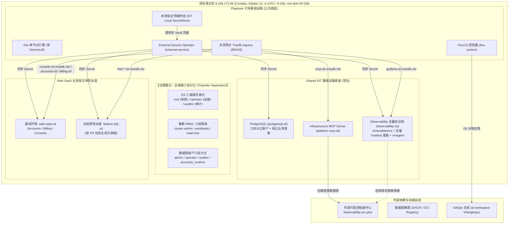
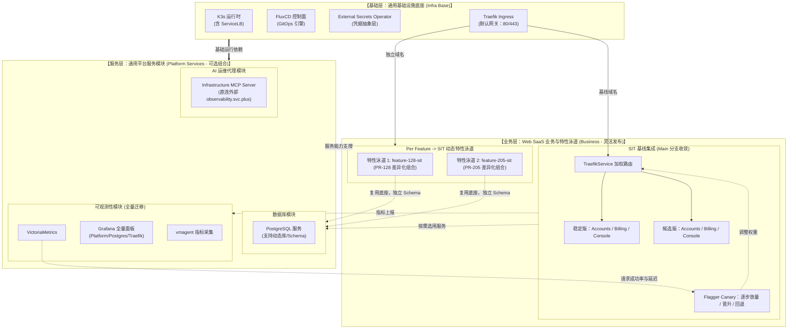

# SIT-K3S-V6 独立节点模块化交付与特性泳道规划

> **集群名称**：`sit-k3s-v6`（SIT 独立环境，与 `prod-k3s-v6` 物理隔离与声明解耦）  
> **目标主机**：`ssh operator@5.189.172.69`（Contabo 手动创建的独立 VPS；Debian 13，4 vCPU，约 8 GiB RAM，约 99 GiB 根盘；未配置独立数据盘）
> **参考源机**：`172.237.9.58` 仅用于只读对照和历史配置核验，不是本规划的部署目标。目标主机通过 operator 身份执行 Ansible pull、Playbook 与 Flux/GitOps；ExternalDNS 已启用写入，域名发布与共享入口切换按实际记录和逐项验收执行。
> **核心原则**：**基础、服务、业务全面模块化与乐高式灵活组合（Composable Modular Architecture）**；生产零触碰（Zero Touch to PROD）、免部署本地 Vault Server、支持 Per Feature $\rightarrow$ SIT 业务特性发布流、全量面板平滑迁移为后续接管 `observability.svc.plus` 奠定基础；严格对齐生产级的 **OS、集群、数据库三权分立** 治理体系。  
> **交付模式**：Playbook 节点底座引导（不依赖 GitHub Actions） + GitOps (FluxCD) 声明式模块装配。

---

## 一、SIT-K3S-V6 HelmRelease 清单（9 个核心，另含 VPA 基线与可选 ExternalDNS）

按 SIT GitOps 的 HelmRelease 对象计数。下表列出规划组件；实际部署状态见验收章节。

| HelmRelease | 命名空间 | 职责 |
| --- | --- | --- |
| `external-secrets` | `external-secrets` | 同步 Vault 凭据和 TLS Secret |
| `traefik-crds` | `ingress-sit` | 为 Traefik 安装 IngressRoute、TraefikService 等 CRD |
| `traefik-ingress` | `ingress-sit` | 默认入口，终止 TLS 并执行加权路由 |
| `postgresql` | `postgresql-sit` | 独立数据库与角色治理 |
| `observability` | `observability-sit` | VictoriaMetrics 与指标采集 |
| `observability-agent` | `observability-sit` | Kubernetes 指标与状态采集 |
| `observability-grafana` | `observability-sit` | Grafana 与监控面板 |
| `datakit` | `observability-sit` | DataKit 采集 |
| `web-saas-sit` | `web-saas-sit` | Accounts、Billing、Console 与 Flagger 渐进发布 |
| `vpa`（基线） | `vpa-system` | 自动资源建议与调整 |
| `external-dns`（可选） | `external-dns` | DNS 记录预览，当前保持 dry-run |

Flagger 由 `web-saas-sit` HelmRelease 启用；三个应用的 Canary 是独立 GitOps 对象，不另计为 HelmRelease。

> [!NOTE]
> **非 HelmRelease 模块说明**：
> * **`platform-mcp-sit`**：采用 Kubernetes 原生 Deployment 与 Service 部署，直连外部 `https://observability.svc.plus`，不占用额外 Helm 控制器开销。
> * **`cluster-identities`**：采用原生 RBAC 清单管理，由 Flux Kustomization 直接声明式对账。
> * **动态特性泳道 (`web-saas-feat-<id>`)**：依据 PR 按需派生，生命周期独立。

---

## 二、SIT-K3S-V6 环境分配的域名规划与路由映射

严格执行生产零触碰原则（严禁修改或污染生产权威 DNS `*.svc.plus`），SIT 环境统一以 **`onwalk.net`** 为基础根域名。为彻底避免三级子域名（多级嵌套）导致的泛域名证书跨级不匹配及解析复杂度，全平台统一微调采用直属二级子域 **`*-sit.onwalk.net`** 作为规范主域名，适配 `*.onwalk.net` 通配符证书。下表列出规划主域名：

| 访问服务 | 规范主域名 (Primary - 直属二级子域) | 后端转发目标服务 | 协议 / 端口 | 说明 |
| :--- | :--- | :--- | :--- | :--- |
| **全量可观测控制台** | `https://observability.svc.plus` | `observability-observability-stack:3000` | HTTPS 443 / HTTP 80 | 完整访问所有平台、数据库、系统 21 个监控面板 |
| **AI 基础设施运维代理** | `https://mcp.svc.plus` | `infrastructure-mcp-server:8080` | HTTPS 443 / HTTP 80 | 提供 MCP 规范的 Agent 工具调用入口 |
| **Web SaaS 控制台前端** | `https://console-sit.onwalk.net` | `web-saas-console:80` | HTTPS 443 / HTTP 80 | Web SaaS 控制台测试基线界面 |
| **Web SaaS 统一 API** | `https://accounts-sit.onwalk.net` | `web-saas-accounts:80` | HTTPS 443 / HTTP 80 | 账户、认证与会话后端接口 |
| **Web SaaS 计费接口** | `https://billing-sit.onwalk.net` | `web-saas-billing:80` | HTTPS 443 / HTTP 80 | 计费与订阅后端接口 |
| **Per-Feature 特性泳道** | `https://feat-<pr_id>-sit.onwalk.net` | `web-saas-console.feature-<pr_id>-sit:80` | HTTPS 443 / HTTP 80 | 动态拉取的独立 PR 验证环境 |

---

## 三、Vault KV V2 Path 规划与凭据映射契约

为实现上层业务代码与声明零感知差异，SIT 遵循严格的标准 Vault KV V2 路径规范。Playbook 本地安全生成高强度随机密码注入 Kubernetes 原生 Secret（当未来对接外部 Vault 时，ESO 可直接通过该路径无缝对账）：

| 凭据用途 | 标准 Vault KV V2 路径 | 包含的核心 Key / 字段 | 消费命名空间 | 映射 Kubernetes Secret 名称 |
| :--- | :--- | :--- | :--- | :--- |
| **数据库 Admin 根密码** | `kv/sit/database/postgresql/admin` | `password` | `postgresql-sit` | `postgresql-admin` |
| **数据库 Operator 密码** | `kv/sit/database/postgresql/operator` | `password` | `postgresql-sit` | `postgresql-operator` |
| **数据库 Auditor 密码** | `kv/sit/database/postgresql/auditor` | `password` | `postgresql-sit` | `postgresql-auditor` |
| **Accounts 业务数据库连接**| `kv/sit/accounts-service` | `POSTGRES_PASSWORD`, `DATABASE_URL` | `web-saas-sit` | `accounts-db-runtime` |
| **Billing 业务数据库连接** | `kv/sit/billing-service` | `DATABASE_URL` | `web-saas-sit` | `billing-db-runtime` |
| **Web SaaS 通用安全凭据**| `kv/sit/web-saas/runtime` | `JWT_SECRET`, `SESSION_SECRET` | `web-saas-sit` | `web-saas-secrets` |
| **Grafana 管理员密码** | `kv/sit/observability/grafana` | `password` | `observability-sit` | `grafana-admin` |
| **Observability Ingest 认证**| `kv/sit/observability/ingest` | `token` | `observability-sit` | `observability-ingest-auth` |
| **AI MCP 服务鉴权 Token** | `kv/sit/platform-mcp/auth` | `mcp-service-token` | `platform-mcp-sit` | `infra-mcp-auth` |
| **SIT 域名通配 TLS 证书** | `kv/CICD/domains/onwalk.net`<br/>*(或 `kv/sit/domains/onwalk.net`)* | `tls_fullchain_pem_b64`<br/>`tls_key_pem_b64` | `ingress-sit` | `console-tls`<br/>`accounts-tls`<br/>`billing-tls` |
| **Cloudflare DNS 自动化凭据**| `kv/sit/platform/cloudflare`<br/>*(特性泳道: `kv/data/sit/platform/cloudflare/feature-dns`)* | `api_token`, `account_id`, `zone_id` | `external-dns` | `external-dns-cloudflare` |

---

## 四、全链路三权分立治理体系 (OS / 集群 / 数据库)

为保持与生产环境完全一致的合规与安全防护水位，SIT 环境在操作系统、Kubernetes 集群与 PostgreSQL 数据库三个层次严格落地三权分立：

### 4.1 OS 操作系统三权 (Linux System Level)
* **`root`**：系统最高权限，用于内核调优、底层底座引导与紧急维护，引导完成后关闭远程登录。
* **`operator`**：运维身份，最小化限定 sudo 权限（仅限 `/usr/bin/systemctl is-system-running` 等状态探针），交互式运维，严禁越权审计。
* **`auditor`**：审计身份，**严禁任何 sudo 权限**，严禁读取 `/etc/shadow`，严禁写入系统目录及访问运行时 Socket，仅允许查看系统状态与审计日志。

### 4.2 Kubernetes 集群三权 RBAC (Cluster Level)
在 `services/sit-k3s-v6/cluster-identities/` 声明并执行严格角色绑定：
* **`root`** $\rightarrow$ 绑定原生 `cluster-admin` 角色，负责集群核心控制器维保。
* **`operator`** $\rightarrow$ 绑定 `k3s-operator-workloads` 角色与 `k3s-operator-pod-status`：
  * 具备 Deployments、ReplicaSets、Pods、Services、HelmReleases 的 get/list/watch 与 scale 权限；
  * **严禁读取 Secret 明文内容**，严禁执行 `exec/attach` 进入业务容器。
* **`auditor`** $\rightarrow$ 绑定 `k3s-auditor-read-only` 全局只读角色：
  * 仅允许对全集群资源进行只读（get/list/watch）与读取 Pod 运行日志；
  * 排除任何 token 颁发、port-forward 及写操作。

### 4.3 PostgreSQL 数据库三权 (Database Level)
PostgreSQL 原生启用 `identityAccounts` 配置，分离三大治理账号与业务受限账号：
```yaml
identityAccounts:
  enabled: true
  root:     {username: postgres, existingSecret: postgresql-admin, secretKey: password}
  operator: {username: operator, existingSecret: postgresql-operator, secretKey: password, tables: [], sequences: []}
  auditor:  {username: auditor,  existingSecret: postgresql-auditor,  secretKey: password, views: []}
```
* **`admin (postgres)`**：全库最高管理权限（全 DDL、Schema 迁移），仅由 Secret 管理，不注入业务应用。
* **`operator`**：用于日常维护、物理/逻辑备份、VACUUM 运维与连接维护。
* **`auditor`**：专用于 `postgres-exporter` 性能与审计指标采集，仅赋予系统视图和 pg_stat 只读权限。
* **`accounts_runtime`**：**业务独立受限账号**，独立注入到 Web SaaS，仅具备业务表 DML 读写权限，无 DDL 权限与跨库权限。

---

## 五、总体架构拓扑与环境边界



---

## 六、三层模块化与可组合模型 (Three-Tier Composable Model)

系统分为基础层、平台服务层和业务层。Traefik 接收入口流量；业务层的 Flagger 根据请求成功率和延迟调整稳定版与候选版的权重。特性泳道独立验证，基线应用通过 Canary 逐步放量。



---

## 七、Contabo 目标节点配额预算表（4 vCPU / 约 8 GiB）

目标节点实测 Kubernetes Capacity/Allocatable 为 4 CPU、8,138,640 KiB 内存；宿主机 `free -h` 可用内存约 5.6 GiB（采样时）。保留模块资源 requests/limits，按该节点实际容量评估；以下既有单服务配额可作为部署上限，汇总值不是当前已部署资源的实测值。`/data` 位于根文件系统，没有独立 ext4 数据卷；PVC 使用 K3s local-path 时会消耗根盘空间，部署前需确认保留空间与重建策略。

| 模块分类 | 组件 / 命名空间 | CPU Request | CPU Limit | 内存 Request | 内存 Limit | 存储分配 |
| :--- | :--- | :--- | :--- | :--- | :--- | :--- |
| **基础层** | K3s 控制面 + OS 内核预留 | 200m | 1000m | 600 MiB | 900 MiB | 系统盘 |
| **基础层** | FluxCD (flux-system) | 100m | 500m | 200 MiB | 400 MiB | 无 |
| **基础层** | ESO (external-secrets) | 50m | 200m | 80 MiB | 150 MiB | 无 |
| **基础层** | Ingress 控制器 (ingress-sit) | 100m | 500m | 120 MiB | 256 MiB | 无 |
| **服务层** | 数据库 (postgresql-sit) | 100m | 500m | 256 MiB | 512 MiB | 5 GiB PVC |
| **服务层** | Observability (VM+Grafana+Agent) | 200m | 800m | 650 MiB | 1200 MiB | 10 GiB PVC |
| **服务层** | AI MCP (platform-mcp-sit) | 50m | 200m | 100 MiB | 200 MiB | 无 |
| **业务层** | Web SaaS 基线 (web-saas-sit) | 150m | 600m | 450 MiB | 800 MiB | 无 |
| **业务层** | 动态特性泳道预留 (feature-*-sit) | 100m | 400m | 350 MiB | 600 MiB | 共享 PG |
| **安全缓冲** | **宿主机可用内存安全水位 (防 OOM)** | - | - | **至少 1100 MiB** | - | - |
| **总计** | **全模块满载装配（预算，不是当前运行值）** | **1050m** | - | **2906 MiB** | - | **15 GiB** |

---

## 八、模块化 GitOps 目录拓扑结构

在 `ai-workspace-infra/gitops` 仓库中构建 SIT 专属声明结构：

```text
gitops/
├── environments/clusters/sit-k3s-v6/             # 【SIT 集群总装与组合入口】
│   ├── root.yaml                                 # 根 Kustomization: sit-k3s
│   ├── source.yaml                               # GitRepository: config-sit (跟踪分支)
│   ├── namespaces.yaml                           # 全局命名空间定义
│   ├── kustomization.yaml                        # 声明组合启用的模块
│   ├── ingress-kustomization.yaml                # 组装基础 Ingress 模块
│   ├── postgresql-kustomization.yaml             # 组装数据库模块
│   ├── observability-kustomization.yaml          # 组装全量可观测性模块 (含全部面板)
│   ├── platform-mcp-kustomization.yaml           # 组装 MCP 服务模块 (直连外部)
│   ├── web-saas-kustomization.yaml               # 组装 Web SaaS 业务基线与泳道扩展
│   └── cluster-identities-kustomization.yaml     # 组装集群三权分立 RBAC
│
└── services/sit-k3s-v6/                          # 【SIT 可组合服务组件库】
    ├── cluster-identities/                       # 集群三权分立 RBAC 声明
    ├── ingress-sit/                              # Ingress 路由规则
    ├── postgresql-sit/                           # PostgreSQL 数据库声明
    ├── observability-sit/                        # 全量可观测性组件
    │   ├── grafana-restored-platform.yaml        # 平台全量监控面板 (全量同构迁移)
    │   ├── grafana-restored-postgres.yaml        # 数据库全量监控面板 (全量同构迁移)
    │   └── helmrelease.yaml                      # VictoriaMetrics + Grafana 栈
    ├── platform-mcp-sit/                         # AI MCP 服务 (配置直连外部 observability.svc.plus)
    └── web-saas-sit/                             # 业务组件库 (支持 Feature Overlay 组合)
        ├── base/                                 # Accounts + Billing + Console 标准声明
        └── overlays/                             # 基线配置与特性泳道补丁
```

---

## 九、实施落地与实测验收清单 (Implementation & Verification)

以下为 2026-11-13 对目标节点 `operator@5.189.172.69` 的 r5 阶段历史记录，不能作为当前状态。旧节点 `172.237.9.58` 仅作为参考源；后续发布和现场验收记录见换机重部署与 DNS 切换手册。

### 1. 基础底座与控制器
* **K3s 单节点：已验证**。节点 `sit-k3s-v6` 为 `Ready`，版本 `v1.37.1+k3s1`，OS 为 Debian GNU/Linux 13，节点地址 `5.189.172.69`；CPU 为 4，内存 Capacity/Allocatable 为 8,138,640 KiB。
* **FluxCD 控制面：已验证**。source、kustomize、helm、notification 4 个控制器均为 `1/1 Running`。
* **ESO：已验证**。controller、cert-controller、webhook 均为 `1/1 Running`。
* **VPA：已验证**。admission-controller、recommender、updater 均为 `1/1 Running`。
* **OS 存储：已核对**。根盘约 99 GiB，`/data` 未挂载独立数据盘（当前路径落在根文件系统）。K3s local-path PVC 将消耗根盘空间。
* **OS operator 权限：存在收敛项**。实测 sudoers 同时列出密码保护的 `(ALL : ALL) ALL` 和 K3s/容器工具免密命令；这不符合本规划中 operator 最小化 sudo 的目标，不能标记为权限合规，需在后续主机权限变更中收敛并复验。

### 2. 模块交付与核心服务
* **当前就绪 Kustomization**：`sit-k3s`、`external-secrets`、`cluster-identities-sit`、`vpa-sit`、`external-dns-sit` 已 `Ready=True`，revision 为 `sit-k3s-v6-contabo-r5@sha1:9e5066014ce3b03292be1331e18c40be315dddb5`。
* **当前挂起模块**：`postgresql-sit`、`observability-sit`、`platform-mcp-sit`、`ingress-sit`、`web-saas-sit` 的 Flux Kustomization 当前 `suspend: true`，尚未部署；相关服务、Ingress、PVC 均未创建。
* **PostgreSQL Vault 凭据**：GitOps r6 声明引用 `kv/sit/database/postgresql/{admin,operator,auditor}`，但 r6 尚未由目标 Flux 接收；Vault JWT reader role、ESO Secret 对账以及 PostgreSQL 实例均待验收。不得以 Vault KV 路径已存在替代 ESO 实测。
* **ExternalDNS：未通过**。Deployment Pod 为 `CrashLoopBackOff`；日志显示 Cloudflare API 返回 HTTP 403 / code 9109 `Invalid access token`。当前参数仍包含 `--dry-run`，无 DNS 记录写入；修复凭据后仍需确认 dry-run 与候选记录，DNS 切换另行执行。

### 3. 域名、路由与 TLS
* **DNS：未切换**。本轮不修改权威 DNS；`onwalk.net` 与 `svc.plus` 仍按现状解析。
* **HTTP/HTTPS 路由：待验收**。Ingress 尚挂起，因此不能声称目标 IP 上的规划域名已可访问。待 `ingress-sit` Ready 后，从目标节点及外部网络逐项验证健康路由、状态码、证书 SAN/链/有效期及回滚目标。
* **ESO TLS Secret：待验收**。尚无 `ingress-sit` SecretStore/ExternalSecret 同步证据；验证时仅记录 Ready 状态、证书元数据，不输出私钥或 Secret 值。

### 4. 发布与验收门禁
1. GitOps r6 tag/根源 handover 必须指向已合并的候选提交；交接后确认 Flux `lastAppliedRevision` 与预期 tag/SHA 一致。
2. 先交付 PostgreSQL Vault JWT/ESO 凭据链和数据库模块，核对 PVC、三类 DB 身份及健康探针，再逐模块恢复观测、MCP、Ingress、Web SaaS。
3. ExternalDNS 保持 dry-run；对比计划记录与权威 DNS 当前记录，未单独批准前不切流量。
4. 验证三个 Canary 通过 TraefikService 逐步放量；指标达标后晋升，失败时将流量退回稳定版。
5. 每个模块单独记录 Kustomization/HelmRelease Ready、Pod 状态、PVC、Vault/ESO 对账和回退依据；上一项验收通过后再推进下一项。
