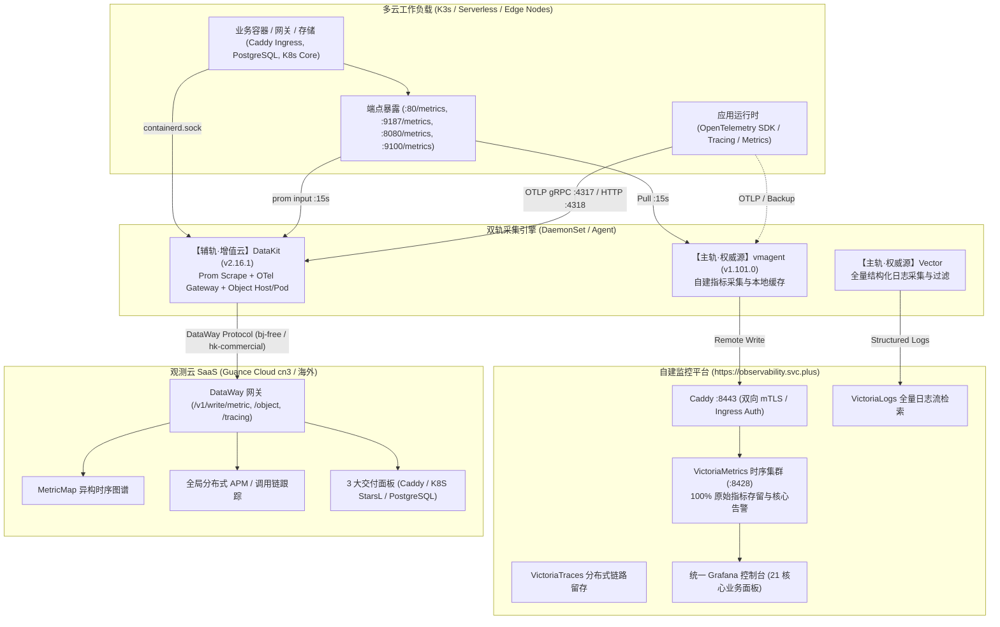
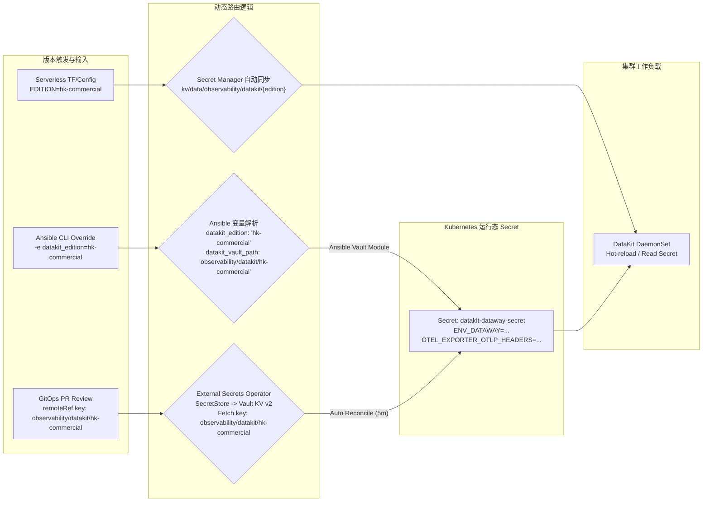
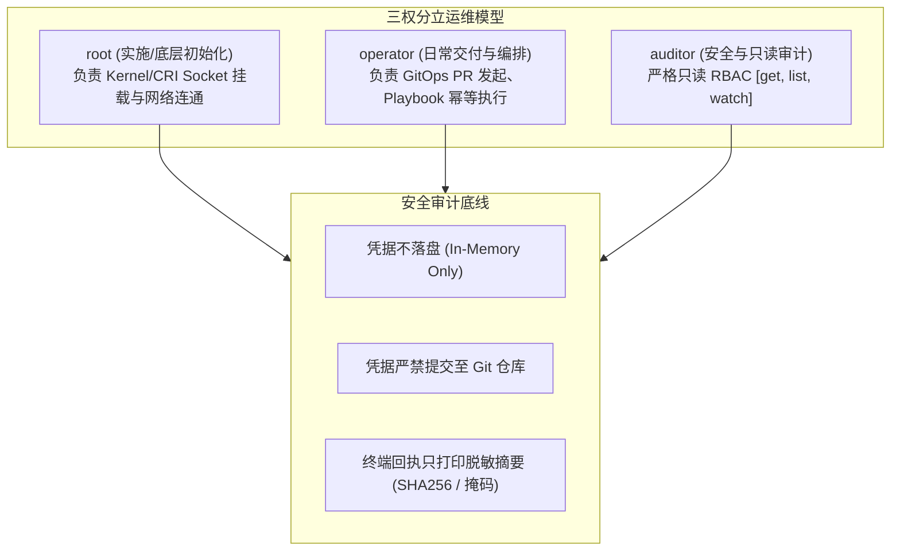

# DataKit 跨云可观测性与 OpenTelemetry 数据网关交付白皮书

> **文档版本**：v2026.11-Final  
> **文档归属**：[平台交付与可观测性架构体系](../README.md) (`docs/reference/platform-delivery/observability/`)  
> **发布时间**：2026-11-06  
> **适用范围**：跨云混合基础设施（K8s / K3s 单节点与集群、Serverless Cloud Run、多云边缘代理节点）  
> **关联节点**：`sit-k3s-v6` (`172.237.9.58`)、`prod-k3s-v6` (`172.237.24.232`)、`observability.svc.plus`

---

## 一、执行摘要与双轨战略定位

在面向 AI 工作空间（AI Workspace）与现代容器化架构的跨云交付中，单靠单一集中式自建监控或单一商业 SaaS 均存在显著短板：自建体系具备 100% 数据主权与低廉长期留存成本，但在全局端到端 APM、无侵入链路诊断和全球分布式边缘探测方面运维开销过大；而 SaaS 平台分析能力极强，但受制于网络跨境抖动、计费配额与合规数据审计约束。

为此，本工程制定并落地**双轨可观测性架构（Dual-Track Observability Architecture）**：



### 双轨定位与权责划分

1. **主轨（私有权威源 / Private Source of Truth）**：
   - **技术栈**：VictoriaMetrics + VictoriaLogs + VictoriaTraces + Grafana；
   - **核心职责**：承载全量基础设施指标、网络流量记账、业务容量评估与 P0 级告警判定。数据 100% 留存于受控 VPC / 独立节点，享有最终审计解释权。
2. **辅轨（SaaS 增值云 / SaaS Value-Added Cloud）**：
   - **技术栈**：DataKit DaemonSet + 观测云（Guance Cloud）SaaS + OpenTelemetry 网关；
   - **核心职责**：承载前端 RUM（真实用户体验监控）、AI 工具链 Agent 执行循环分析、全局对象快照（`kubelet_pod` / `HOST`）以及动态异构时序映射（MetricMap）。

---

## 二、Vault KV 凭据架构收敛与二分法设计

### 1. 历史痛点与碎片化反思

在前期演进过程中，凭据管理曾出现 **7 个散落路径**，引发了严重的配置污染与维护隐患：

```
[历史碎片化路径]
kv/data/datakit/shared/dataway          --> DATAWAY_URL, DATAWAY_TOKEN
kv/data/dataway/otel/shared            --> OTEL_EXPORTER_OTLP_HEADERS, OTEL_TOKEN
kv/data/uat/serverless/observability   --> OTEL_EXPORTER_OTLP_HEADERS, OTEL_TOKEN
kv/data/prod/serverless/observability  --> OTEL_EXPORTER_OTLP_HEADERS
kv/data/datakit/clusters/web-saas-k3s-v5 --> GLOBAL_TAGS
kv/data/datakit/clusters/dev-k3s-v5    --> GLOBAL_TAGS
...
```

- **问题 1：非机密配置污染 Vault（`GLOBAL_TAGS` 乱象）**：
  将 `cluster=web-saas-k3s-v5-prod,env=prod` 这类环境拓扑标签存入 Vault，导致每增加一个集群就需要增加一个 Vault 路径，凭据路径随集群数量呈 $O(N)$ 爆炸式增长，严重违背 12-Factor 原则与最小权限规范。
- **问题 2：同质 Token 跨路径重复定义**：
  `DATAWAY_URL`（包含 `token=tkn_...`）与 `DATAWAY_TOKEN` 分开存储；OTel 鉴权头 `OTEL_EXPORTER_OTLP_HEADERS`（包含 `X-Token=<OTEL_TOKEN>`）与 `OTEL_TOKEN` 离散分布。一旦发生密钥轮换，容易出现“改了 Token 漏改 Headers/URL”的断流事故。
- **问题 3：环境绑定与租户版本脱节**：
  将凭据按 `uat/serverless`、`prod/serverless` 等部署形态命名，无法区分底层的观测云工作空间（如国内北京免费试用版与海外香港商业版）。

### 2. 治理四大原则

1. **原则一：类别标志统一归属（Domain Category Namespace）**  
   在 Vault 根路径与数据前缀之间补齐业务领域类别标志 —— **`observability`**（可观测性体系大类）。标准命名范式为：
   `kv/data/<category>/<component>/<edition>` $\rightarrow$ **`kv/data/observability/datakit/{edition}`**。
   以此避免组件名在根空间平铺裸露，与 `observability/cmdb-grafana`、`CICD/observability/*` 形成统一规范的领域命名空间与 RBAC 授权树。
2. **原则二：秘密与配置严格分立（Config vs Secret Separation）**  
   彻底将 `GLOBAL_TAGS` 剔除出 Vault，转交由 GitOps（HelmRelease `values.datakit.global_tags`）与 Ansible Playbook（`group_vars`/`host_vars`）声明式管理，纳入 Git 版本控制。
3. **原则三：相关键值同构聚合（Colocated Credential Node）**  
   一个观测云工作空间的所有接入凭据（DataWay 端点、DataWay Token、OTel Token、OTel 鉴权头）在单个 Vault KV 节点内集中管理，保障原子性轮换。
4. **原则四：工作空间语义二分法（Edition-Driven Paths）**  
   根据商业与地域属性，收敛为且仅收敛为 **两个权威 Vault KV v2 路径**：
   - **`kv/data/observability/datakit/bj-free`**：北京免费工作空间（试用版，用于 Dev、SIT、边缘轻量验证）；
   - **`kv/data/observability/datakit/hk-commercial`**：香港商业工作空间（高规格付费版，用于 PROD、UAT 生产级全球 APM）。

### 3. 终态收敛凭据规范表

| 凭据路径 (Vault KV v2) | Key 字段 | 数据类型 | 用途与标准格式说明 |
| :--- | :--- | :--- | :--- |
| **`kv/data/observability/datakit/bj-free`**<br/>*(北京免费版工作空间)* | `DATAWAY_URL` | string | 完整的 DataWay 上报端点：<br/>`https://cn3-openway.guance.com?token=tkn_fffcb87e09694507b31c98b17405cc11` |
| | `DATAWAY_TOKEN` | string | 观测云工作空间接入 Token：<br/>`tkn_fffcb87e09694507b31c98b17405cc11` |
| | `OTEL_TOKEN` | string | OpenTelemetry 核心认证 Token：<br/>`96d584964ba24996abe4aee502bb8856` |
| | `OTEL_EXPORTER_OTLP_HEADERS` | string | 标准 OTLP HTTP/gRPC 请求头：<br/>`X-Token=96d584964ba24996abe4aee502bb8856,To-Headless=true` |
| | `OTEL_EXPORTER_OTLP_ENDPOINT`| string | OTel Trace 接收端点：<br/>`https://cn3-openway.guance.com/v1/write/tracing` |
| **`kv/data/observability/datakit/hk-commercial`**<br/>*(香港商业版工作空间)* | `DATAWAY_URL` | string | 商业版专属高可用 DataWay 端点：<br/>`https://hk-openway.guance.com?token=tkn_hk_prod_...` |
| | `DATAWAY_TOKEN` | string | 商业版工作空间核心 Token：<br/>`tkn_hk_prod_...` |
| | `OTEL_TOKEN` | string | 商业版专属 OpenTelemetry Token：<br/>`otel_hk_prod_...` |
| | `OTEL_EXPORTER_OTLP_HEADERS` | string | 商业版 OTLP 鉴权头：<br/>`X-Token=otel_hk_prod_...,To-Headless=true` |
| | `OTEL_EXPORTER_OTLP_ENDPOINT`| string | 商业版专属 Trace 网关：<br/>`https://hk-openway.guance.com/v1/write/tracing` |

### 4. 凭据录入与自动化注入标准模版（开箱即用）

为确保上报域名、接口路径、OTel Headers 格式等静态协议参数 100% 准确，提供预置完整参数的标准模板。**运维人员仅需填写/替换自己的专属 API Token**，其余字段无需调整。

#### 4.1 Vault Web UI 录入 JSON 模版

在 Vault Web 控制台进入对应路径后，切换至 **JSON** 编辑模式直接粘贴：

##### ① 北京免费版 (`kv/data/observability/datakit/bj-free`)
> 适用：开发（DEV）、SIT、边缘轻量集群（观测云 SaaS cn3 节点）

```json
{
  "DATAWAY_URL": "https://cn3-openway.guance.com?token=<YOUR_BJ_FREE_DATAWAY_TOKEN>",
  "DATAWAY_TOKEN": "<YOUR_BJ_FREE_DATAWAY_TOKEN>",
  "OTEL_TOKEN": "<YOUR_BJ_FREE_OTEL_TOKEN>",
  "OTEL_EXPORTER_OTLP_HEADERS": "X-Token=<YOUR_BJ_FREE_OTEL_TOKEN>,To-Headless=true",
  "OTEL_EXPORTER_OTLP_ENDPOINT": "https://cn3-openway.guance.com/v1/write/tracing"
}
```

##### ② 香港商业版 (`kv/data/observability/datakit/hk-commercial`)
> 适用：UAT、PROD、海外边缘节点（企业高可用商业版网关）

```json
{
  "DATAWAY_URL": "https://hk-openway.guance.com?token=<YOUR_HK_COMMERCIAL_DATAWAY_TOKEN>",
  "DATAWAY_TOKEN": "<YOUR_HK_COMMERCIAL_DATAWAY_TOKEN>",
  "OTEL_TOKEN": "<YOUR_HK_COMMERCIAL_OTEL_TOKEN>",
  "OTEL_EXPORTER_OTLP_HEADERS": "X-Token=<YOUR_HK_COMMERCIAL_OTEL_TOKEN>,To-Headless=true",
  "OTEL_EXPORTER_OTLP_ENDPOINT": "https://hk-openway.guance.com/v1/write/tracing"
}
```

---

#### 4.2 Vault CLI 一键写入脚本（推荐：仅声明一次 Token 变量）

在初始化或密钥轮换时，推荐使用 Shell 脚本自动化注入。**Token 变量只需定义一次，脚本自动完成 `DATAWAY_URL` 与 `OTEL_EXPORTER_OTLP_HEADERS` 的格式化拼装**，杜绝手动拼接产生拼写错误：

```bash
# ==============================================================================
# 1. 写入北京免费版凭据 (Dev/SIT)
# ==============================================================================
export BJ_DATAWAY_TOKEN="tkn_xxxxxxxxxxxxxxxxxxxxxxxxxxxxxxxx"
export BJ_OTEL_TOKEN="xxxxxxxxxxxxxxxxxxxxxxxxxxxxxxxx"

vault kv put kv/observability/datakit/bj-free \
  DATAWAY_TOKEN="${BJ_DATAWAY_TOKEN}" \
  DATAWAY_URL="https://cn3-openway.guance.com?token=${BJ_DATAWAY_TOKEN}" \
  OTEL_TOKEN="${BJ_OTEL_TOKEN}" \
  OTEL_EXPORTER_OTLP_HEADERS="X-Token=${BJ_OTEL_TOKEN},To-Headless=true" \
  OTEL_EXPORTER_OTLP_ENDPOINT="https://cn3-openway.guance.com/v1/write/tracing"

# ==============================================================================
# 2. 写入香港商业版凭据 (PROD/UAT)
# ==============================================================================
export HK_DATAWAY_TOKEN="tkn_xxxxxxxxxxxxxxxxxxxxxxxxxxxxxxxx"
export HK_OTEL_TOKEN="xxxxxxxxxxxxxxxxxxxxxxxxxxxxxxxx"

vault kv put kv/observability/datakit/hk-commercial \
  DATAWAY_TOKEN="${HK_DATAWAY_TOKEN}" \
  DATAWAY_URL="https://hk-openway.guance.com?token=${HK_DATAWAY_TOKEN}" \
  OTEL_TOKEN="${HK_OTEL_TOKEN}" \
  OTEL_EXPORTER_OTLP_HEADERS="X-Token=${HK_OTEL_TOKEN},To-Headless=true" \
  OTEL_EXPORTER_OTLP_ENDPOINT="https://hk-openway.guance.com/v1/write/tracing"
```

---

#### 4.3 Vault KV v2 HTTP REST API 模版（CI/CD 流水线与自动化编排）

针对 Ansible、Terraform 或 CI/CD Job 自动化注入，直接调用 Vault HTTP API：

```bash
# 示例：通过 API 写入北京免费版凭据
curl --silent --fail \
     --header "X-Vault-Token: ${VAULT_TOKEN}" \
     --request POST \
     --data '{
       "data": {
         "DATAWAY_URL": "https://cn3-openway.guance.com?token=<YOUR_DATAWAY_TOKEN>",
         "DATAWAY_TOKEN": "<YOUR_DATAWAY_TOKEN>",
         "OTEL_TOKEN": "<YOUR_OTEL_TOKEN>",
         "OTEL_EXPORTER_OTLP_HEADERS": "X-Token=<YOUR_OTEL_TOKEN>,To-Headless=true",
         "OTEL_EXPORTER_OTLP_ENDPOINT": "https://cn3-openway.guance.com/v1/write/tracing"
       }
     }' \
     https://vault.svc.plus/v1/kv/data/observability/datakit/bj-free
```

---

## 三、双版本动态切换机制与全链路编排契约

为了实现基础设施在“北京免费版”与“香港商业版”之间的平滑迁移与一键切换，架构在 **Ansible Playbook**、**FluxCD GitOps** 与 **Serverless Runtime** 三层构建了统一的切换契约。



### 1. Ansible Playbook 动态路由规范

在 `ai-workspace-infra/playbooks` 仓库的 `roles/k8s_helm/datakit/defaults/main.yml` 中建立了如下动态解析逻辑：

```yaml
# 领域类别标志：固定归属可观测性 (observability) 大类
datakit_vault_category: "observability"

# 默认版本路由契约：PROD 环境默认流向香港商业版，非生产（dev/sit）默认流向北京免费版
datakit_edition: "{{ 'hk-commercial' if (target_env | default('dev')) == 'prod' else 'bj-free' }}"

# 映射到 Vault KV v2 路径：observability/datakit/{edition}
datakit_vault_path: "{{ datakit_vault_category }}/datakit/{{ datakit_edition }}"
```

- **常规执行**：
  - 执行 `ansible-playbook -i inventories/sit datakit.yml` 时，自动读取 `kv/data/observability/datakit/bj-free`；
  - 执行 `ansible-playbook -i inventories/prod datakit.yml` 时，自动读取 `kv/data/observability/datakit/hk-commercial`。
- **一键切换与跨版本测试**：
  运维人员可通过命令行环境变量直接重载版本，无需改动任何 Playbook 核心任务：
  ```bash
  # SIT 集群临时接入香港商业版进行 APM 性能验证
  ansible-playbook -i inventories/sit datakit.yml -e datakit_edition=hk-commercial

  # 生产集群突发故障时快速降级回退到北京免费版
  ansible-playbook -i inventories/prod datakit.yml -e datakit_edition=bj-free
  ```
- **自动化测试保障**：在 `tests/test_datakit_helm_role_contract.py` 中预置了断言测试：
  ```python
  def test_datakit_edition_resolution():
      # SIT / Dev resolves to observability/datakit/bj-free
      assert resolve_vault_path(env="sit") == "observability/datakit/bj-free"
      # PROD resolves to observability/datakit/hk-commercial
      assert resolve_vault_path(env="prod") == "observability/datakit/hk-commercial"
      # Explicit CLI override takes precedence
      assert resolve_vault_path(env="sit", override="hk-commercial") == "observability/datakit/hk-commercial"
  ```

### 2. FluxCD GitOps 声明式热切换规范

在各集群的 GitOps 声明文件（如 `services/prod-k3s-v6/observability-prod/datakit-vault-secret.yaml`）中，通过 External Secrets Operator（ESO）定义数据映射：

```yaml
apiVersion: external-secrets.io/v1
kind: ExternalSecret
metadata:
  name: datakit-dataway-secret
  namespace: observability-prod
spec:
  refreshInterval: 5m
  secretStoreRef:
    kind: SecretStore
    name: datakit-dataway-reader
  target:
    name: datakit-dataway-secret
    creationPolicy: Owner
    deletionPolicy: Retain
  data:
  - secretKey: ENV_DATAWAY
    remoteRef:
      key: observability/datakit/hk-commercial       # <--- 切换核心入口：observability/datakit/bj-free <-> observability/datakit/hk-commercial
      property: DATAWAY_URL
  - secretKey: OTEL_EXPORTER_OTLP_HEADERS
    remoteRef:
      key: observability/datakit/hk-commercial
      property: OTEL_EXPORTER_OTLP_HEADERS
  - secretKey: OTEL_EXPORTER_OTLP_ENDPOINT
    remoteRef:
      key: observability/datakit/hk-commercial
      property: OTEL_EXPORTER_OTLP_ENDPOINT
```

- **无侵入热切换流程**：
  1. 工程师发起 GitOps PR，修改 `remoteRef.key` 为目标版本路径；
  2. PR 合并入 `main` 后，Flux 自动拉取更新；
  3. ESO SecretStore 在 5 分钟内对账，就地更新集群内 `datakit-dataway-secret`；
  4. DataKit 检测到底层凭据刷新，自动重新建立 DataWay TLS 连接，**零宕机，无需手动重启 Pod**。

---

## 四、DataKit 集群采集实战拓扑与 4 大 Scrape Targets

在 `sit-k3s-v6`（`172.237.9.58`）与 `prod-k3s-v6`（`172.237.24.232`）的实际落地验证中，DataKit DaemonSet 通过内嵌的 `prom` 输入插件，精准对接集群 4 大核心指标端点。

### 1. 四大关键采集端点配置矩阵

为保证指标在观测云中的命名与 Prometheus 保持一致，必须统一开启 `keep_exist_metric_name = true`：

| 目标系统 | 内部访问端点 | 插件类型 | Measurement (指标集) | 采集周期 | 单周期实测采样点数 | 核心指标范例 |
| :--- | :--- | :--- | :--- | :--- | :--- | :--- |
| **Caddy Ingress** | `http://caddy-ingress-caddy.ingress-prod:80/metrics` | `prom` | `caddy` | 15s | **~484 点** | `caddy_http_requests_total`, `caddy_http_request_duration_seconds` |
| **PostgreSQL** | `http://postgresql-postgresql-exporter.postgresql-prod:9187/metrics` | `prom` | `postgresql` | 15s | **~2,822 点** | `pg_stat_database_xact_commit`, `pg_stat_database_numbackends` |
| **Kube-State-Metrics** | `http://observability-agent-state.observability-prod:8080/metrics` | `prom` | `kube-state-metrics`| 15s | **~2,380 点** | `kube_pod_status_phase`, `kube_node_status_condition` |
| **Node-Exporter** | `http://observability-agent.observability-prod:9100/metrics` | `prom` | `node-exporter` | 15s | **~1,715 点** | `node_cpu_seconds_total`, `node_memory_MemAvailable_bytes` |
| **CRI 容器对象** | `unix:///var/run/k3s/containerd/containerd.sock` | `container` | `kubelet_pod` (对象) | 60s | 全量 Pod 对象 | 容器启动状态、宿主机 CPU/内存开销 |

> **实盘吞吐数据**：在生产集群 `prod-k3s-v6` 实测，DataKit 单节点 15 秒周期稳定采集上报 **7,401 个指标数据点**，CPU 消耗低于 0.15 Core，内存占用稳定在 180MB 左右。

### 2. 配额保护与防爆线配置

在免费版（`bj-free`）及严控配额场景下，必须实施以下两项关键限制以防触发 `kodo.beyondDataUsage` 限流熔断：
1. **剔除高基数进程级采集**：严禁在 `default_enabled_inputs` 中启用 `host_processes`，该插件在多容器节点会瞬间产生上万个短时进程指标；
2. **容器 Socket 精准挂载**：DataKit DaemonSet 必须挂载 K3s containerd socket，且仅授予只读权限：
   ```yaml
   volumeMounts:
   - name: containerd-sock
     mountPath: /var/run/k3s/containerd/containerd.sock
     readOnly: true
   ```

---

## 五、OpenTelemetry 数据网关接入规范

针对跨云 Serverless（如 GCP Cloud Run）与分布式客户端，DataKit 充当本地或边缘 OpenTelemetry 数据网关。

### 1. 协议通道与端口规范

| 协议 | 接收端口 | 数据格式 | 说明与建议 |
| :--- | :--- | :--- | :--- |
| **OTLP / gRPC** | `:4317` | Protobuf | **推荐标准**。性能最高，支持全双工流式传输与长连接。 |
| **OTLP / HTTP** | `:4318` | `application/x-protobuf` | 适用于无法建立持久 gRPC 连接的 Serverless 短生命周期容器。*(注：DataKit HTTP 仅支持 protobuf，不支持 raw json)* |
| **DataWay HTTP** | `:9528` | DataWay 原生 API | DataKit 本地接收代理端点。 |

### 2. OTel 请求头鉴权标准

应用端或 Collector 向上级网关转发 Trace 时，必须附带由 Vault 注入的标准鉴权头：

```http
OTEL_EXPORTER_OTLP_HEADERS="X-Token=<OTEL_TOKEN>,To-Headless=true"
```

- **`X-Token`**：观测云工作空间专属的 OpenTelemetry Token（与 Vault 中 `OTEL_TOKEN` 强校验对齐）；
- **`To-Headless=true`**：指示上游网关支持无头/直通写入，规避复杂预检协议降低网络延迟。

---

## 六、观测云控制台仪表盘与资产生命周期

### 1. 专属仪表盘目录与桌面交付文件

所有观测云控制台仪表盘模板由 `ai-workspace-infra/playbooks` 仓库的 `dashboards/guance-cloud/` 统一归档管理，并为运维工作台输出同构 JSON 资产：

| 仪表盘名称 | 仓库源码路径 | 桌面交付归档路径 | 对应观测云 Measurement |
| :--- | :--- | :--- | :--- |
| **Caddy Ingress 综合监控** | `dashboards/guance-cloud/caddy-dashboard.json` | `/Users/shenlan/Desktop/caddy-dashboard.json` | `caddy` |
| **Kubernetes StarsL 全局看板** | `dashboards/guance-cloud/starsl-k8s-dashboard.json` | `/Users/shenlan/Desktop/starsl-k8s-dashboard.json` | `kube-state-metrics`, `node-exporter` |
| **PostgreSQL 统一数据库大盘** | `dashboards/guance-cloud/postgres-unified-overview.json` | `/Users/shenlan/Desktop/postgres-unified-overview.json` | `postgresql` |

### 2. 仪表盘元数据注释规范

所有导出与纳管的仪表盘 JSON 必须包含标准 `description` 注释，指明归属工程与只读约束：

```json
{
  "dashboard": {
    "title": "Caddy Ingress 综合监控 (Guance Cloud)",
    "description": "专属于 dashboards/guance-cloud/ 目录的观测云 Caddy 监控面板，源自 playbooks 仓库统一纳管",
    "tags": ["caddy", "ingress", "guance-cloud"]
  }
}
```

---

## 七、三权分立与运维安全审计基线

为保障多云可观测性基础设施的绝对安全，实施全流程三权分立操作规范：



1. **审计账号受限验证**：在审计节点 `auditor@172.237.24.232` 执行 `kubectl auth can-i --list`，确认对工作空间无 `create/update/delete` 特权，保证第三方审计对生产集群具备**零破坏性**。
2. **凭据安全红线**：
   - 严禁在 Git 提交任何真实 Token（必须通过 ExternalSecret / Vault 动态注入）；
   - 严禁在 CI/CD 流水线日志中打印完整的 `DATAWAY_URL` 或 `OTEL_TOKEN`；
   - 部署脚本中的凭据检查采用哈希或前缀脱敏展示（例如 `tkn_fffcb8...`）。

---

## 八、总结与后续演进

本白皮书规范了自建 VictoriaMetrics 权威监控与 SaaS 观测云双轨运行的标准实施路径。通过：
1. **收敛 Vault KV 凭据路径为 `bj-free` 与 `hk-commercial` 双分支**，消灭冗余密钥与非机密数据污染；
2. **在 Playbook 与 GitOps 中提供动态一键切换接口**，为混合多云交付提供了高韧性容灾与平滑升级通道；
3. **固化 Caddy、PostgreSQL、KSM、Node 4 大 Prometheus 抓取端点**，实现了异构时序指标集与标准控制台大盘的无缝映射。
