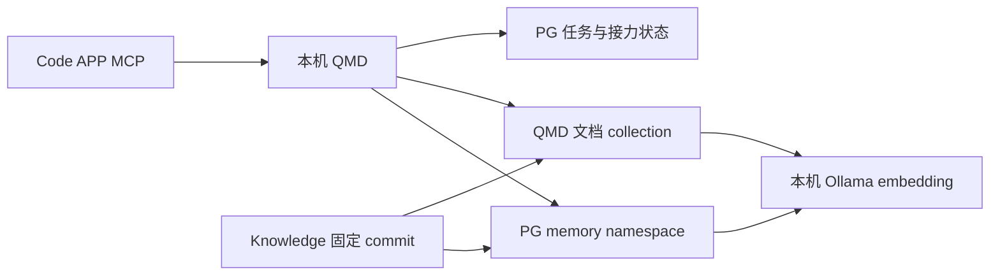

# 本机 QMD：跨 Code APP 接力与 Knowledge 向量归档

日期：2026-11-03。需求：Code APP 之间共享任务进度、决策和下一步，避免复制聊天；最终文档统一进入 [Knowledge](https://github.com/ai-workspace-services/knowledge)，归档后再更新 QMD 文档索引与向量。源码修复由 [QMD #11](https://github.com/ai-workspace-lab/qmd/issues/11) / [PR #12](https://github.com/ai-workspace-lab/qmd/pull/12) 跟踪，文档由 [Knowledge #355](https://github.com/ai-workspace-services/knowledge/issues/355) 跟踪。

## 数据归属与连接

| 内容 | 来源与职责 |
| --- | --- |
| 当前任务、driver、决策、阻塞、下一步 | 同一 PostgreSQL 中的 QMD 任务状态，跨 MCP 进程共享 |
| 最终规划、操作手册、事实摘要、交付结论 | Knowledge 的 Git commit / PR |
| 文档全文索引与 embedding | QMD，可从 Knowledge 固定版本重建 |
| 原始响应、敏感现场证据 | 受控 artifact，仅将脱敏摘要与引用归档 |

QMD 的文档 collection 向量索引与 PG memory 向量是两条独立路径：前者供 `query` / `vsearch` 检索，后者供 `memory_search` 检索。任务接力使用 PG 中的结构化线程，不依赖 embedding 是否就绪。



本机 Codex、Claude、Antigravity 的 QMD stdio 配置已核对使用同一数据库，并给 OpenCode 加入相同 QMD 启动入口。MCP 进程独立存在不影响共享状态，无须把任务内容互相复制。配置文件为 `~/.codex/config.toml`、`~/.claude.json`、`~/.gemini/config/mcp_config.json`、`~/.config/opencode/opencode.json`；不得把其中连接串提交到 Git。

原有 `127.0.0.1:8181` 是容器的桥接后端，要求 Token，直接访问任务 API 会返回 401。本次新增原生桌面服务，使用 `127.0.0.1:8182`；本机任务 API 和 `/mcp` 均可无 Token 读写。容器的远程桥接鉴权不变。两者不应混用地址；本机免密指向 8182 或直接使用 stdio。

原生服务以当前桌面用户运行，通过 LaunchAgent 自启。启用 `QMD_LOCAL_NO_AUTH=1` 且绑定回环地址；绑定 `0.0.0.0` 等非回环地址会拒绝启动，即使已有远程 Token 也不能绕过。Host/Origin 校验保留。不依赖转发头推断可信来源，不修改 PostgreSQL 自身认证，不把管理数据库凭据展示到回执。

## 接力步骤

1. 新客户端先调用 `task_catalog`，传相同的规范化仓库 scope，例如 `github.com/ai-workspace-services/knowledge`。修复后的文字与结构化结果均包含最近任务的 `thread_id`、branch 和状态。
2. 用已有 `thread_id` 调用 `task_resume`，填写真实 client。不同 worktree、分支或默认 main 下，都不要仅凭当前目录创建新的“同一任务”。默认分支本来不能唯一标识任务，应从目录发现后接续。
3. 保存返回的 `sessionId`；需要安排方向时获取 driver lease，并保存 `fence`。及时通过 `task_note` 写入脱敏决策、验证结果、阻塞和下一步；资料指向 Knowledge 相对路径及 commit/PR。
4. 交接用 `task_handoff` 写清一个可执行的下一步，提交当前 session 与 fence，释放 driver。下一客户端接续同一 thread，并在已交接后取得新的 fence。活跃 driver 尚未交接时先作为 peer 贡献，不强制抢占。

这些操作传递的是共享状态，不会自动向另一 APP 发送聊天消息，也不保证另一 APP 已启动。接力方通过任务目录取得上下文，无需重复粘贴完整提示词。

本轮实测采用两个独立 stdio MCP 协议客户端和一个 HTTP 客户端：HTTP 无认证写入 → stdio A 读取、写入、交接 → stdio B 接手、写入 → HTTP 读取，全部成功，driver fence 正常递增。隔离验收 thread 为 `3c27f23e-be1b-4b32-88a8-7a7135f1ed1d`。这是协议与存储实测，不等于真实 GUI APP 的完整操作已验收。已启动的旧 MCP 进程需要重连以加载新代码及工具 schema。

实际 Antigravity 面板检查任务已写入同一任务库，thread 为 `631f504e-e2d6-4530-974a-738a155058da`，scope 为 `github.com/ai-workspace-services/knowledge`，关联 Knowledge PR #356，状态为 `handed_off`。下一步已记录为读取专项提示词、核对 JP/US/SG 的当前 CMDB 身份、派发五组只读诊断 worker。

## Knowledge 归档后生成向量

本机选择 Ollama 的 `qwen3-embedding:0.6b`，通过 `http://127.0.0.1:11434/v1/embeddings` 接入 QMD。模型采用 [Apache 2.0 许可](https://huggingface.co/Qwen/Qwen3-Embedding-0.6B)，Ollama 分发约 [639 MB](https://ollama.com/library/qwen3-embedding:0.6b)，适合中文、多语言及代码资料检索。模型只负责 embedding，任务数据库、归档流程及全文索引仍由各自组件负责。

首次权重下载曾因 Go 解析权重存储域名失败而停滞；本机原生 DNS 与官方 registry Range 请求正常。Ollama 服务增加 `GODEBUG=netdns=cgo` 后重新下载，使用系统解析器；保留 TLS 验证及官方权重摘要校验，不修改全局 DNS 或 hosts。

QMD 使用 `models.embed: qwen3-embedding:0.6b` 与 `QMD_EMBED_API_BASE_URL=http://127.0.0.1:11434/v1`。本机回环 embedding API 不要求密钥，也不发送伪造的 Bearer 字段；远程 embedding 端点仍要求凭据。本次不改变生成模型和 reranker 的选择，向量验收使用纯 `vsearch`，避免其他模型依赖影响判断。

PG 记忆模块另需同步 `QMD_EMBED_MODEL=qwen3-embedding:0.6b`。本次修复了该模块覆盖回默认提供商的接线问题。现有 PostgreSQL 17.11、pgvector 0.8.1 正常；接入前向量表为空，已有任务和 4 条默认 namespace 的记忆保留，并已生成受保护的 QMD 数据库备份。新文档导入独立 namespace `knowledge-platform-delivery`，与任务状态和既有默认记忆分开。

统一本机 CLI 为 `~/.local/bin/qmd`，复用桌面服务的私有配置。QMD 原生服务与 Ollama 均作为当前桌面用户的服务自启，标签分别为 `plus.svc.qmd-local`、`plus.svc.ollama-local`；Ollama 监听 `127.0.0.1:11434`。Ollama 的自有 LaunchAgent 保留系统 DNS 设置，避免 Homebrew 重新生成服务文件时丢失修复。QMD 本地部署来自 PR #12 的修复版 `df20ec3`，不把尚未合并的修复宣称为上游正式发行。14 项针对性测试和 TypeScript 构建通过；真实索引验收见下文。

标准顺序：

1. 将最终文档提交 Knowledge 分支并推送，记录 commit 与 PR；尚未合并时明确标为 PR 归档版本，不能称为 main。
2. 从选定 commit 创建只读索引快照，collection 指向归档快照；不将其他 dirty checkout 的未提交文件当作已归档内容。
3. 更新 collection，并为该 collection 执行 `qmd embed -c knowledge-platform-delivery`。模型和维度改变时要重建该集合向量，不能混用不同模型的旧向量。
4. 用中文纯向量查询 `qmd vsearch 'Grafana 三个节点面板数据流排查' -c knowledge-platform-delivery --format json`，确认命中已归档提示词；用另一条跨 APP 接力查询命中本文。记录文档数、chunk 数、向量维度、模型摘要和来源 commit。
5. 将索引/检索回执记录到共享任务；需要固化的结论再补入 Knowledge，随后增量更新。合并到 main 后将 collection 切换到新的已合并快照。

不要把有文档条目、有全文检索结果或有任务记录称为“向量化完成”。必须有实际 embedding 写入和纯向量命中证据。模型下载或 embedding 未完成时明确标为进行中。

仅使用已部署 embedding 的 MCP 查询方式如下，不触发查询扩写或 reranker 模型依赖：

```json
{
  "searches": [{"type": "vec", "query": "Grafana 三个节点面板数据流排查"}],
  "collections": ["knowledge-platform-delivery"],
  "rerank": false,
  "limit": 5
}
```

PG 记忆检索使用 `memory_search`，传 `namespace: "knowledge-platform-delivery"` 和查询文本。调用 `task_catalog`、`task_resume` 接续任务不需要调用上述向量工具。

PG 导入可直接读取已归档快照文件，不需要人工复制正文。批量调用方式如下，`snapshot` 必须指向前文选定的 Git commit 快照，完成后把来源 commit 和导入回执记入共享任务：

```sh
for document in "$snapshot"/docs/reference/platform-delivery/*.md; do
  qmd memory add "docs/reference/platform-delivery/${document##*/}" \
    --namespace knowledge-platform-delivery < "$document"
done
```

## 2026-11-03 运行验收回执

首轮索引来源为 Knowledge commit `fc9bba78f049fa196c523a0b635e88331e274acf`（PR #356 的归档分支，不是 main）。模型权重已下载并通过官方 SHA-256 校验；Ollama 0.40.13 的 `/v1/embeddings` 无认证请求返回 1024 维、有限且非恒定的向量。

| 检查项 | 实际结果 |
| --- | --- |
| 模型 | `qwen3-embedding:0.6b`；manifest digest `ac6da0dfba84a81fdbfbaf330198c33cd77c4cdfc53e8bc50eb581914a15621d` |
| QMD 文档 collection | 19 份文档，127 个向量片段；纯 `vsearch` 命中提示词和接力说明，均为对应查询的第一结果 |
| PG memory | 独立 namespace 中 19 条文档记忆、98 个 1024 维片段，模型名正确，HNSW 索引存在 |
| PG 纯向量查询 | 中文 Grafana 问题、英文跨 APP 接力问题分别第一命中对应文档；直接使用 cosine distance，无全文检索代替 |
| MCP | `query` 的 vec + `rerank:false` 和 `memory_search` 均实际返回 Antigravity 提示词 |
| 已有记忆 | 默认 namespace 的原有 4 条仍在，没有清空任务或历史记忆 |
| 四个 Code APP 配置 | Codex、Claude、Antigravity、OpenCode 各自的真实 MCP 启动命令均经独立进程验证，读到同一实际接力任务并暴露记忆读写工具 |

此回执补入 Knowledge 后继续按新 commit 增量导入；最新索引来源与计数保存在共享任务回执。本次只向量化平台交付这 19 份文档，未宣称其他既有 collection 已全部重建。真实 GUI 中已启动的旧 MCP 进程仍需重连；协议客户端验证不冒充 GUI 操作验收。

## 回退与本次边界

源码修改使用独立 worktree；现有 QMD 主工作树的未跟踪部署文件未改动。桌面客户端配置有本机受保护备份，原生服务可停止，客户端可恢复旧 executable 路径；共享任务保存在原数据库，不靠删除数据库来回退。切回 embedding 模型时同步恢复模型配置及对应向量，不把不同模型向量混用。

本次仅修本机 QMD 任务发现、免密访问、接力及 Knowledge 向量检索。Grafana 21 面板的生产数据流修复由[Antigravity 专项提示词](Antigravity-21个Grafana面板数据流检查与修复提示词.md)接力执行。
