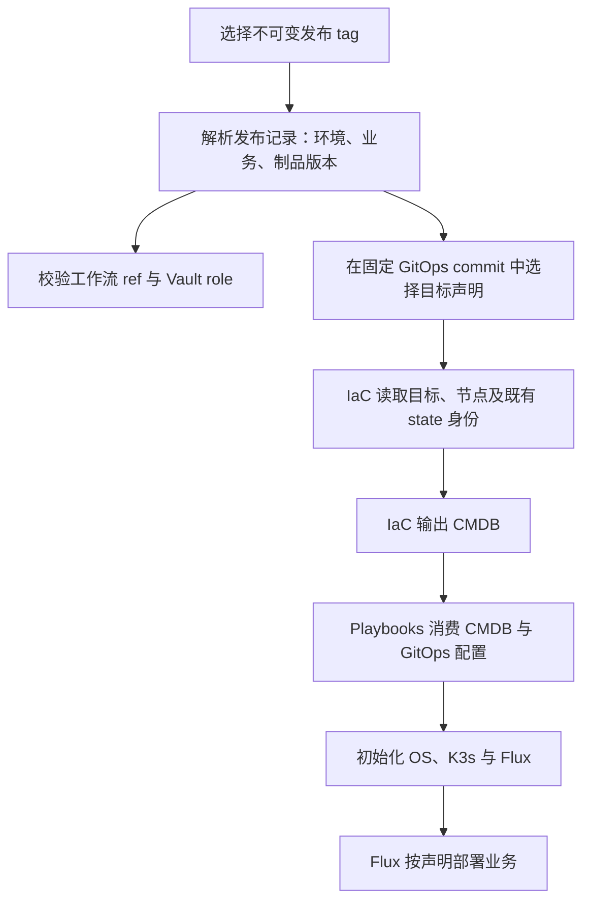

# 环境与业务发布解析：最小实施草案

> 状态：目标草案，2026-10-31。本文描述期望契约；现有工作流尚未全部实现，不作为部署或验收回执。

## 1. 目标与职责

基础仓库默认选择 `main`，运行时各自解析一次 commit SHA 并传递给下游；业务发布记录固定制品版本和 digest。业务发布 tag、工作流运行 ref、节点名和 state 身份是独立字段，不因相同字符串自动绑定。

| 仓库 | 职责 | tag / 版本引用 |
| --- | --- | --- |
| GitOps | 环境、业务目标、资源、身份目标和 Flux 声明；保存非敏感引用 | 默认 `main`，本次运行记录解析出的 commit SHA；可按需显式选择 tag |
| IaC | 云资源、DNS、state、云事实及 CMDB | 默认 `main`，本次运行记录解析出的 commit SHA；可按需显式选择 tag |
| Playbooks | 主机、K3s、身份、服务、数据库、备份恢复和迁移执行 | 默认 `main`，本次运行记录解析出的 commit SHA；可按需显式选择 tag |
| Platform-Orchestrator | 输入、授权、DAG、派发、等待及回执汇总 | 默认 `main`，记录本次工作流 commit SHA；运行 ref 的 Vault OIDC 授权单独校验 |
| Artifacts | 构建、镜像、Chart、制品打包与发布 | 构建配置默认 `main` 并记录 commit SHA；业务制品使用发布 tag 和核对后的不可变 digest |

## 2. 发布解析链

1. **发布 tag**：解析出环境、业务范围及 chart/镜像版本或 digest。现有 PROD Vault role 接受工作流 `v*` tag / `release/v*` 分支；优先使用不可变 tag。基础仓库默认 `main` 的授权差异见下方检查清单。
2. **环境与业务**：解析结果形成不可变运行记录；dispatch 输入若提供环境或业务，只用于一致性校验，冲突时停止。
3. **GitOps 目标声明**：使用环境、业务、provider、account 和声明中的目标标识查找唯一目标；未找到或匹配多个目标时停止。
4. **IaC**：消费声明中的资源路径、workspace 和 state key，输出节点名、地址及数据盘等 CMDB 事实；tag 不直接拼接 state key。
5. **Playbooks/K3s**：使用本次解析的 GitOps commit 和 IaC CMDB，从声明读取节点名、K3s 配置和 Flux root/path，不按 `prod-v6` 分支判断。
6. **Flux**：接管声明中的 source、Kustomization 和 HelmRelease，使用发布记录明确的业务制品版本。

`v*` tag 可表明 PROD 发布类别，但 tag 字符串本身不能唯一确定 `web-saas` 和 GitOps 目标。需补充可审阅的发布记录，将 tag 关联到环境、业务和制品，再由 GitOps 声明确定节点及 state。发布记录包含来源仓库/commit、镜像 digest、Chart 版本或 digest、配置版本及候选指纹；其 owner、schema 与消费方式仍待实现。基础仓库无需同步创建同名 tag。

## 3. SIT、UAT、PROD

| 环境 | 目标发布规则 | 当前 Vault role ref 声明（GitOps main `d9ddcf56`） | 待统一 |
| --- | --- | --- | --- |
| SIT | 仅接受 Feature ID 关联的 GitHub task/issue 和制品 tag；固定关联 PR head、基础分支 SHA、完整构件和数据基线，部署独立 SIT namespace；排除 `daily-build-*` | `refs/pull/*/merge`、`refs/heads/*` | 受信任编排器校验 task/issue、feature、制品 tag、仓库、workflow、候选、目标及 SIT 角色；ref 本身不代表部署授权 |
| UAT | 默认使用合并后的固定候选；明确选择合并前 UAT 时使用冻结候选。候选或配置变化按影响重验 | 现状：`refs/heads/main`、`refs/heads/release/*`、`refs/heads/bugfix/*`、`refs/heads/daily-build-*`、`refs/tags/daily-build-*` | 目标：排除 `refs/heads/release/*`；保留 `refs/heads/main`、`refs/heads/bugfix/*`、`refs/heads/daily-build-*`、`refs/tags/daily-build-*`。Vault role 与调用链尚待修改和验收 |
| PROD | 业务使用经审查的不可变版本或 digest，tag 关联明确业务与目标；状态变更按独立集群方案 | `refs/tags/v*`、`refs/heads/release/v*` | 基础工作流默认 `main` 与现有 PROD role ref 不一致；需在受审查的认证契约中解决并做允许/拒绝验收 |

默认流程为 **PR → SIT → 合并 → UAT → PROD 受控滚动升级**；用户明确选择时可采用合并前 UAT。UAT 验收通过后，核对发布记录、业务范围、不可变制品和生产目标，按已有授权与发布门禁进入 PROD；部署后验证实际运行版本和关键业务流程。候选、配置或数据基线变化时按影响重新验收。CI 成功不是运行验收；SIT/UAT 与生产凭据隔离，公共证书等共享来源须逐项审查授权。

PROD 滚动方式按变更类型选择：纯展示的无状态 UI 和向后兼容、无需 SQL schema 变更的小型 API 修复可在所属单元原地滚动，保留旧制品并验证回退路径。PostgreSQL、Vault Raft、监控存储及其他持久卷工作负载的版本验证，以及 SQL schema 版本变化或数据迁移，必须使用新集群和独立存储；数据库迁移使用空目标库并先验证备份恢复，写入切换另行评审。代码回退不等于数据回滚。

### 3.1 应用 tag 与 Vault OIDC 检查清单

以下勾选表示对应事实已从当前声明或代码核对；未勾选项仍需实施或取得真实验收证据。代码快照为 Orchestrator `main` `2e25af0f`、GitOps `main` `d9ddcf56`，后续运行须重新核对。

**应用制品与候选**

- [x] 当前 selfhost 函数在 SIT/UAT 拒绝 `v*` 和 `prod-v*`，提示使用 `daily-build-*` 或 `uat-daily-build-*`。
- [ ] 实现 SIT 正向候选校验：仅接受 Feature ID 关联的 GitHub task/issue 与制品 tag，拒绝 `daily-build-*`；tag 必须解析到已核对的不可变制品 digest。当前函数尚未实现此规则。
- [ ] 定义并实现 UAT 完整的正向 tag 白名单；当前函数没有完整白名单，其他未明确拒绝的格式可能通过。
- [x] 当前函数允许 PROD 使用 `v*` 及部分 `prod-v<数字>-*` 格式；基础设施专用操作可省略应用 tag。
- [ ] 按统一规范审查 PROD 格式，清理仅以批次名字驱动运行逻辑的专用规则；不得把现状当作最终规范。
- [ ] SIT 的 Feature ID、GitHub task/issue、制品 tag、PR/head SHA、目标分支基线、镜像 digest、Chart/配置和数据基线形成完整候选；受信任编排器核实关联、候选和目标，tag 不替代候选清单。
- [ ] UAT/PROD 核对发布记录与业务范围、制品版本/digest 一致；工作流输入与发布记录冲突时停止。

**工作流 ref 与 Vault 身份**

- [x] 区分 Vault OIDC 的 `ref`（实际工作流运行 ref）和应用 `deploy_tag`（应用制品版本）；输入的 `deploy_tag` 不会改变 OIDC `ref` claim。
- [x] 现有 PROD role 只允许 `refs/tags/v*` 和 `refs/heads/release/v*`；`release/v*` 是可变化分支，tag 的不可变性需由仓库保护和发布流程保障。
- [ ] 统一五仓默认 `main` 与环境授权契约。当前 prod role 不接受 `refs/heads/main`，不能仅靠选择 PROD 应用 tag 获得该身份。
- [ ] UAT role 排除 `refs/heads/release/*`，仅保留 `refs/heads/main`、`refs/heads/bugfix/*`、`refs/heads/daily-build-*` 和 `refs/tags/daily-build-*`；核对所有调用方并验证允许与拒绝。
- [ ] 明确 SIT/UAT ref 优先级，处理 SIT `refs/heads/*` 与其他环境分支范围的重叠；工作流 ref 不匹配时停止。
- [ ] Vault role 限定仓库、workflow、环境、audience 和有效期；分别验证目标身份允许访问、跨环境/相邻路径及不匹配 ref/workflow 被拒绝，记录脱敏证据。
- [ ] 检查应用 tag、发布记录、目标环境、GitHub Environment 和 Vault role 一致，且不存在静默跨环境回退。

**验收记录**

- [ ] 保存候选指纹、各基础仓库解析的 commit SHA、工作流 ref、应用 tag、目标声明及运行回执；只读配置核对不能代替真实身份或服务验收。

## 4. 目标、节点和 state

GitOps 目标声明提供环境、业务、provider、account、资源 manifest、节点名与 state 身份；IaC 只消费经核对的目标并产出云事实。Playbooks 根据本次 CMDB 和声明执行通用 role。节点名由声明决定；tag 选择发布内容，不能单靠名字判断资源所有权。

`prod-k3s-v6` 是当前节点实际名称，`PROD-K3S-V6` 是集群名称；它们不应成为通用代码中的条件分支。既有 state/workspace 与资源的一一对应必须保留，变更发布 tag 不自动生成新 state 或替换资源；新集群和独立存储须有各自明确声明。Flux 根名和 source path 分别声明，不能推断必须等于节点名。

## 5. 验证与交付边界

| 项目 | 状态 |
| --- | --- |
| 五仓职责与 main 默认规则 | ✅ 已确定；运行时 SHA 记录与 caller 链路需按实际运行验收 |
| SIT 功能泳道候选契约 | ✅ 规范已确定；与 selfhost tag 路由及 Vault 身份的端到端交接待实施验收 |
| 环境与业务发布记录 | ❌ schema、owner、tag 到业务的映射及消费链待交付 |
| 目标与 state 通用解析 | ❌ 现有代码仍含 `prod-v*` 特判；需 owner 实现、caller 切换与验证 |
| PROD `main` 工作流 Vault 授权 | ❌ 当前声明只允许 `v*` tag 和 `release/v*` 分支；修改需绑定受控身份并验证允许及跨环境拒绝 |

关联文档：[V6 冷启动规划与部署状态归档](PROD-K3S-V6-规划与部署状态归档.md)；[Linux OS 三类操作身份](Linux-OS三类操作身份-最小实施草案.md)；[K3s role 职责与依赖清单](K3s-role职责与依赖清单.md)。功能泳道遵循 `feature-lane-release-workflow`；现有状态以实际运行回执为准。
