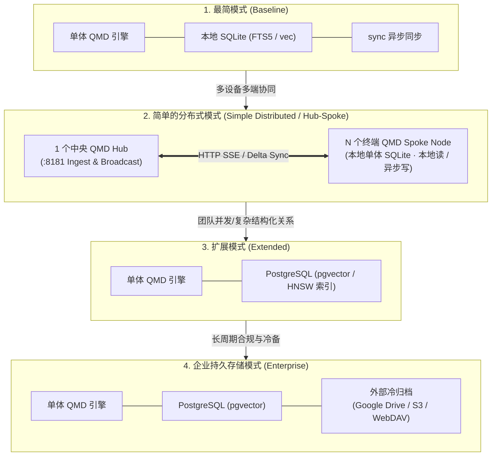
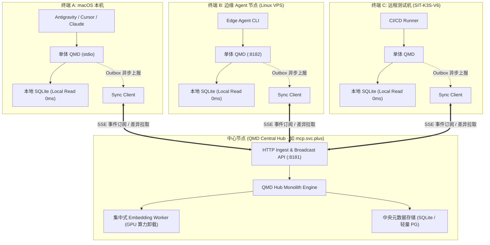
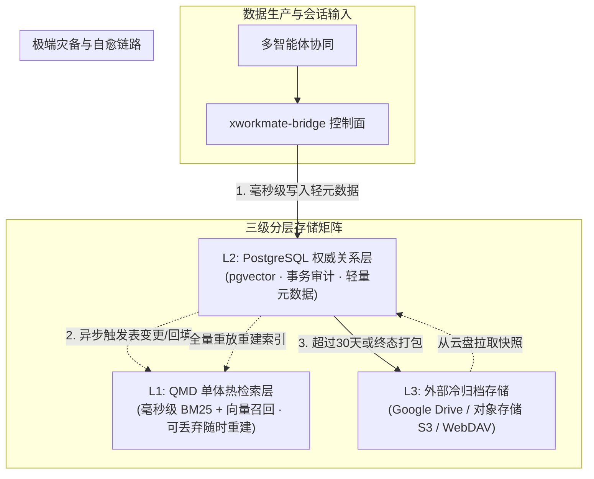

# QMD 单体运行引擎、分布式异步同步与渐进演进架构规范

> **发布基线**：2026-11-14 · **适用域**：AI Workspace / 任务记忆中枢 (X-Memory-Hub) / QMD  
> **核心原则**：**单体轻量高内聚、检索就近零阻塞、异步解耦弱一致、四级阶梯按需进阶**

---

## 一、核心架构哲学与四级阶梯演进

在 AI Workspace 与多智能体（Antigravity、Codex、Claude、OpenCode、XWorkmate）协同体系中，QMD（Query Markup Documents）坚决**保持单体运行（Monolithic Run-to-Completion Engine）**，拒绝引入重型的分布式一致性状态机（Raft/Paxos）、分布式事务与分片分区集群管理。

为了同时满足**本地开发者极速开箱即用**、**多机多端协同的轻量分布式**、**团队级高并发向量协同**以及**企业级长期持久冷归档**等不同规模的诉求，QMD 确立了高度正交、清晰纯粹的四级阶梯演进形态：



### 1. 四级形态对比矩阵

| 架构形态 | 核心组件栈 | 适用场景与定位 | 外部依赖 | 检索与同步机制 |
| :--- | :--- | :--- | :--- | :--- |
| **最简模式**<br>*(Minimalist)* | **`QMD + SQLite + sync`** | • 个人/本地开发者桌面（macOS / Linux）<br>• 单机独立离线开发 | **零外部依赖**<br>（单 SQLite 文件） | • 本地 SQLite FTS5 全文索引 + sqlite-vec 向量<br>• 本地亚毫秒级读写响应<br>• 独立 `sync` 定时器/脚本负责异步增量同步 |
| **简单的分布式模式**<br>*(Simple Distributed)* | **`QMD Hub-Spoke`**<br>*(1 个 Hub + N 个 Spoke Node)* | • 多台开发设备（Mac + Linux + 远程 VPS）<br>• 海外 8 台 Edge Agent 节点协同<br>• 无需重型集群的跨端记忆同步 | 公共 HTTP/HTTPS 端口<br>（无 etcd/Raft 开销） | • **读在本地**：各 Node 本地维护 SQLite 副本，检索 0ms 延迟<br>• **增量同步**：通过 HTTP SSE 或 Delta API 异步双向拉齐<br>• **断网自治**：节点断网继续工作，联网自动对账 |
| **扩展模式**<br>*(Extended)* | **`QMD + PG (vector)`** | • 团队多 Agent 并发写入与共享<br>• 生产集群集中式记忆中枢<br>• 跨微服务与任务线程检索 | PostgreSQL 17 + pgvector | • 原生 HNSW / IVFFlat 高维向量索引与命名空间隔离<br>• 结构化事务保障（ACID）<br>• 基于 `thread_id` + `fence` 乐观锁并发保护 |
| **持久存储模式**<br>*(Enterprise)* | **`QMD + PG (vector) + 外部归档`**<br>*(Google Drive / 对象存储 S3)* | • 企业级多云多环境立体灾备<br>• 30+ 天全量历史 Transcript 归档<br>• 大二进制制品、模型权重长期保存 | PostgreSQL + 云盘/S3/WebDAV | • **L1 检索热层**：单体 QMD 极速检索（可随时重建）<br>• **L2 权威关系层**：PG 仅存结构化轻元数据（$\le 16\text{ KiB}$）<br>• **L3 冷归档层**：外部云盘存脱敏原件，支持极端灾难重放自愈 |

---

## 二、模式 1：最简模式（QMD + SQLite + sync）

最简模式是 QMD 保持轻量、纯粹与开箱即用的基石。

```text
┌────────────────────────────────────────────────────────┐
│               Local Agent / IDE (Client)               │
└───────────────────────────┬────────────────────────────┘
                            │ (stdio / 127.0.0.1:8182)
                            ▼
┌────────────────────────────────────────────────────────┐
│                   单体 QMD 运行时引擎                   │
│  - BM25 词法分析器 (Lexical Analyzer)                   │
│  - 本地 Embedding 适配器 (Ollama / Llama.cpp)          │
│  - 上下文拼接与 Rerank                                 │
└───────────────────────────┬────────────────────────────┘
                            │ (Local In-Process Driver)
                            ▼
┌────────────────────────────────────────────────────────┐
│                   本地 SQLite 存储文件                  │
│  - ~/.local/share/qmd/index.sqlite                     │
│  - FTS5 全文倒排表 + sqlite-vec 向量虚拟表              │
│  - Local Outbox 变更日志表                              │
└───────────────────────────┬────────────────────────────┘
                            │ (后台非阻塞轮询)
                            ▼
┌────────────────────────────────────────────────────────┐
│                      sync 异步同步模块                  │
│  - 内容哈希 (SHA-256) 变更对账                          │
│  - 增量推流至远端对等节点或中央仓库                     │
│  - 断网静默积压，联网自动幂等对齐                       │
└────────────────────────────────────────────────────────┘
```

### 核心特性
1. **单文件存储**：所有索引元数据和向量均内嵌于单个 `.sqlite` 文件，无需安装任何数据库服务；
2. **极速启动**：冷启动耗时 $< 50\text{ ms}$，内存开销 $< 60\text{ MB}$；
3. **异步 Sync 解耦**：智能体只与本地 SQLite 交互；`sync` 模块作为非阻塞后台协程或轻量守护脚本运行，异步同步至 Git 知识库或对等端。

---

## 三、模式 2：简单的分布式模式（QMD Hub-Spoke 极简分布式）

为了解决多台工作机（例如本地 macOS 工作台、测试环境服务器、海外 8 个 Edge Agent 节点）之间的记忆共享问题，同时**彻底避开 Raft/Paxos/etcd 分布式集群的复杂性**，QMD 采用 **Hub-Spoke（中心辐射型）极简分布式架构**。



### 1. 核心设计原则：读在本地、写在中心、异步推流
1. **本地读（Local-First Read，零网络 RTT）**：
   - 每个 Spoke 节点本地都维护一份完整的 SQLite 镜像；
   - 智能体进行 `qmd query`、`qmd search`、`qmd vsearch` 时，**100% 走本地 SQLite**，完全无需走公网发起 HTTP 请求；
   - 响应时间 $< 5\text{ ms}$，彻底摆脱远程网络延迟、丢包或公网断连的影响。
2. **写转发或本地暂存（Asynchronous Delta Sync）**：
   - 产生新笔记或交接时，Spoke 节点先写入本地 Outbox 表，立即给 Agent 返回成功；
   - 随后由 Sync Client 通过单向 HTTPS 请求将变更推送到 Hub：`POST /api/v1/sync/push`；
   - Hub 接收并分配全局递增的版本序数（`fence`），并通过 SSE（Server-Sent Events）向其他在线 Spoke 节点广播变更通知。
3. **集中算力卸载（Embedding As A Service）**：
   - 边缘 VPS 节点（如 1C/1G 内存的小规格 Agent 节点）无需在本地运行高负载的 Ollama 或 Llama 模型；
   - 边缘节点仅负责文本同步，Hub 统一在后台异步完成 1024 维向量计算，并将计算好的向量片段（Vector Chunks）随增量包广播给各边缘节点直接存入 `sqlite-vec` 表。
4. **断网隔离与自愈（Partition Tolerance）**：
   - 当某台机器脱机（如笔记本合盖、出差飞行中、边缘网络抖动）：
     - 本地检索、阅读和本地写完全不受影响；
   - 重新连网后：
     - Sync Client 发起 `GET /api/v1/sync/pull?since_fence=<last_local_fence>`，仅拉取离线期间的差量包并本地回放，自动补齐最新记忆。

---

## 四、模式 3：扩展模式（QMD + PG vector）

当系统由多端单机走向团队多执行器并发协同或部署在容器集群（如 SIT-K3S-V6）时，无缝切换至 **QMD + PG (vector)**。

### 核心特性
1. **驱动协议切换，接口完全一致**：
   通过环境变量 `QMD_BACKEND=pg` 切换底层存储适配器，QMD 核心代码逻辑、MCP 工具接口与检索 API 完全保持不变；
2. **命名空间与多维隔离**：
   - `namespace: "knowledge-reference"`：官方交付参考文档向量；
   - `namespace: "knowledge-platform-delivery"`：平台运维与 Hand-off 交付白皮书；
   - `namespace: "agent-threads"`：多智能体接力任务上下文；
3. **并发安全与分布式租约（Fence）**：
   利用 `thread_id` + `fence` 乐观锁保障多 Agent 并发写入时状态机单调递增，杜绝覆写冲突。

---

## 五、模式 4：企业持久存储模式（QMD + PG vector + 外部归档）

这是面向生产级可观测性与合规治理的终极形态（**L1 热层 + L2 权威层 + L3 冷归档层**）。



### 1. 外部归档介质选型与对接契约
- **Google Drive / 本地云盘客户端**：
  适用于桌面/个人工作台环境，利用本地挂载目录（如 `~/Google Drive/AI-Workspace-Archive/`）执行增量不可变归档；
- **S3 兼容对象存储（Cloudflare R2 / AWS S3 / MinIO）**：
  适用于生产容器集群环境，通过统一 S3 客户端定期归档压缩包：
  - 会话日志归档路径：`s3://xworkmate-archive/{env}/transcripts/{year}/{month}/{conversation_id}.jsonl.gz`
  - 知识库快照路径：`s3://xworkmate-archive/knowledge-snapshots/{git_commit_sha}.tar.gz`

---

## 六、四种模式的环境配置与快速切换指引

### 1. 模式 1：最简模式（macOS / 本地独立运行）
```bash
export QMD_BACKEND=sqlite
export QMD_LOCAL_NO_AUTH=1
export QMD_DATA_DIR="$HOME/.local/share/qmd"
export QMD_ASYNC_SYNC_ENABLE=1
export QMD_SYNC_TARGET_GIT="git@github.com:ai-workspace-services/knowledge.git"

qmd mcp --http --port 8182
```

### 2. 模式 2：简单的分布式模式（Hub-Spoke 模式）
```bash
# 【中心 Hub 节点启动】
export QMD_ROLE=hub
export QMD_LISTEN_PORT=8181
export QMD_EMBED_WORKER_ENABLE=1
export QMD_EMBED_MODEL="qwen3-embedding:0.6b"
qmd-hub --daemon

# 【边缘 / 终端 Spoke 节点启动】
export QMD_ROLE=spoke
export QMD_BACKEND=sqlite
export QMD_HUB_URL="https://mcp.svc.plus/api/v1/memory"
export QMD_HUB_TOKEN="<VAULT_INJECTED_TOKEN>"
export QMD_AUTO_SYNC_INTERVAL="60s"
qmd mcp --http --port 8182
```

### 3. 模式 3：扩展模式（PG vector）
```bash
export QMD_BACKEND=pg
export PGHOST="postgresql.svc.plus"
export PGPORT=15432
export PGDATABASE="qmd_memory"
export PGUSER="qmd_writer"
export PGPASSWORD="<VAULT_INJECTED_PASSWORD>"
export QMD_EMBED_MODEL="qwen3-embedding:0.6b"
export QMD_EMBED_API_BASE_URL="http://127.0.0.1:11434/v1"
```

### 4. 模式 4：企业持久存储模式（PG + 外部云盘归档）
```bash
export QMD_ARCHIVE_STORAGE_TYPE="s3"  # 或 "gdrive"
export QMD_ARCHIVE_S3_ENDPOINT="https://s3.us-west-004.backblazeb2.com"
export QMD_ARCHIVE_S3_BUCKET="ai-workspace-archive"
export QMD_ARCHIVE_RETENTION_DAYS=30
export QMD_ARCHIVE_CRON="0 3 * * *"  # 每日凌晨 03:00 归档
```

---

## 七、总结与落地检验

本规范明确了 QMD **「坚守单体运行、通过异步同步走向分布式、按需四阶梯进阶」** 的终态演进路线：
1. 个人轻量开发：**`QMD + SQLite + sync`**，零依赖零负担；
2. 多设备/多端协同：**`QMD Hub-Spoke 简单分布式`**，本地读 0ms，增量异步推流；
3. 团队多 Agent 协作：**`QMD + PG (vector)`**，共享事务状态与统一 HNSW 向量；
4. 企业灾备与合规：扩充 **外部归档（Google Drive / S3）**，形成闭环自愈的三级立体记忆资产。
