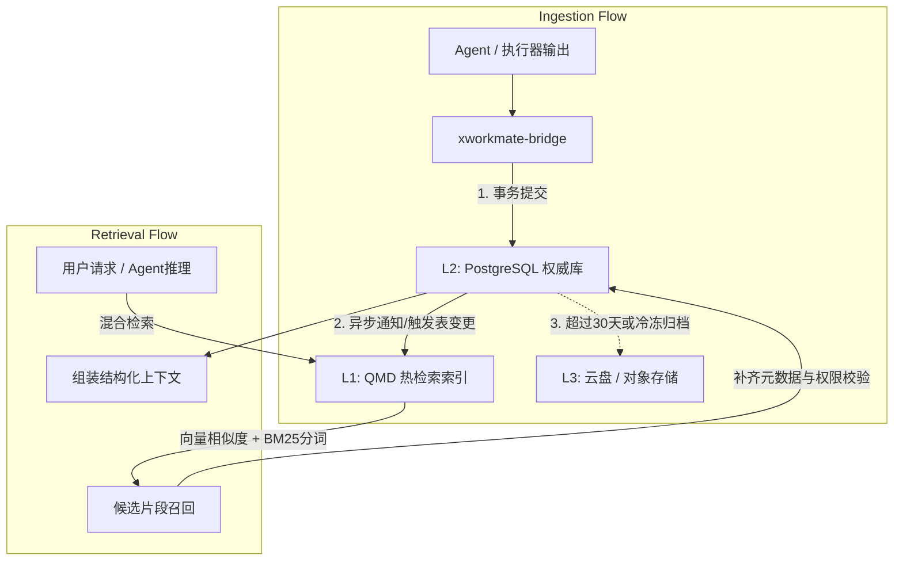

# QMD + PG + 云盘三级任务聚合与记忆系统落地规范

**版本：1.0-release · 状态：已批准归档 · 适用域：AI Workspace / XWorkmate / 存储体系**

本文档规定了 AI Workspace 体系中 **「QMD + PG + 云盘三级任务聚合与记忆系统」** 与 **「完整的 xworkmate-bridge + AI Workspace」** 的端到端落地架构、数据分层模型、接口契约、安全红线以及生产部署验收标准。

---

## 一、系统总体拓扑与职责划分

整体架构由 **轻客户端交互层**、**共享控制面桥接层**、**L1 检索热层**、**L2 权威存储层** 以及 **L3 云盘冷归档层** 五级闭环组成：

```text
       ┌─────────────────────────────────────────────────────────┐
       │                XWorkmate App (Flutter 客户端)           │
       │  (只读侧栏任务列表聚合、会话展示、人工审批、任务来源标签区分)  │
       └────────────────────────────┬────────────────────────────┘
                                    │ (ACP / HTTP REST :8787)
                                    ▼
       ┌─────────────────────────────────────────────────────────┐
       │          xworkmate-bridge + AI Workspace Core           │
       │  (薄控制面：Agent Catalog、会话映射、权限校验、多执行器路由)  │
       └────────────────────────────┬────────────────────────────┘
                                    │ (HTTP Ingest & MCP API :8181)
                                    ▼
       ┌─────────────────────────────────────────────────────────┐
       │           L1 热层: QMD Server (QMD_BACKEND=pg)          │
       │  (高性能 BM25 全文分词 + 向量混合检索，随时可从 L2 权威重建) │
       └────────────────────────────┬────────────────────────────┘
                                    │ (SQL TCP :15432 / :5432)
                                    ▼
       ┌─────────────────────────────────────────────────────────┐
       │    L2 权威层: PostgreSQL 17 + pgvector + jieba/trgm/pgmq │
       │  (结构化事实、任务线程、权威嵌入向量、事务审计、状态持久化) │
       └────────────────────────────┬────────────────────────────┘
                                    │ (冷归档 / 定时快照 / S3/WebDAV)
                                    ▼
       ┌─────────────────────────────────────────────────────────┐
       │             L3 冷层: 云盘 / 对象存储 (Drive / S3)       │
       │  (大二进制制品、LLM 缓存权重、多模态附件、30+ 天全量历史)     │
       └─────────────────────────────────────────────────────────┘
```

### 1. 组件职责矩阵

| 组件层级 | 代表服务 | 核心职责 | 数据权威性 | 容灾/恢复策略 |
| :--- | :--- | :--- | :--- | :--- |
| **UI 交互** | XWorkmate App | 极简操作界面、审批拦截、任务侧栏聚合展示 | 无状态（只读缓存） | 随时重启，从 Bridge 重新拉取 |
| **共享控制面** | `xworkmate-bridge` | 多执行器接入、ACP 协议映射、Token 鉴权、任务聚合网关 | 无状态（元数据路由） | 随时重启，无本地数据残留 |
| **L1 热检索** | `qmd` (`pg` 后端) | 毫秒级上下文检索、分块分词、Prompt 注入、MCP 协议暴露 | 可丢弃 / 可重建 | 当机即刻拉起，从 L2 权威全量重放重建 |
| **L2 权威存储** | `postgresql.svc.plus` | 任务主记录、状态机流转、结构化三元组知识、pgvector 向量 | **唯一事实源 (SSOT)** | WAL 归档、本地 pgdata 卷挂载、主备备份 |
| **L3 云归档** | 云盘 / S3 / WebDAV | 历史会话归档快照、大模型 GGUF 缓存、多模态附件、证据包 | 不可变长期归档 | 多 AZ 冗余、哈希防篡改校验 |

---

## 二、QMD + PG + 云盘三级任务聚合与记忆系统规范

### 1. 数据分级模型与生命周期 (L1 / L2 / L3)



#### (1) L1: QMD 热检索与索引层
* **存储引擎**：内建内存与高频分块热索引，运行时通过 `QMD_BACKEND=pg` 直连后端向量库。
* **特性约束**：
  * **完全可重建**：L1 严禁保存独占数据。当节点损坏或容器重建时，执行 `qmd index` 即可自 L2 完整回填。
  * **高并发支持**：作为 MCP 协议服务端，对外提供 `mcp://` 与 HTTP REST 端点，隔离核心数据库并发开销。

#### (2) L2: PostgreSQL + pgvector 权威层
* **扩展清单**：PostgreSQL 17 镜像内置 `pgvector`（向量距离运算）、`pg_jieba`（中文语义分词）、`pg_trgm`（三元切词模糊查询）与 `pgmq`（事件消息队列）。
* **核心表结构规范**：
  ```sql
  -- 1. 任务主表与状态机
  CREATE TABLE IF NOT EXISTS agent_tasks (
      task_id UUID PRIMARY KEY DEFAULT gen_random_uuid(),
      workspace_id VARCHAR(64) NOT NULL,
      title VARCHAR(255) NOT NULL,
      status VARCHAR(32) NOT NULL DEFAULT 'open', -- open, running, completed, archived
      priority VARCHAR(16) NOT NULL DEFAULT 'medium',
      executor_type VARCHAR(32) NOT NULL,        -- dsh, opencode, codex, claude
      created_at TIMESTAMPTZ NOT NULL DEFAULT NOW(),
      updated_at TIMESTAMPTZ NOT NULL DEFAULT NOW()
  );

  -- 2. 线程与会话表
  CREATE TABLE IF NOT EXISTS agent_task_threads (
      thread_id UUID PRIMARY KEY DEFAULT gen_random_uuid(),
      task_id UUID NOT NULL REFERENCES agent_tasks(task_id) ON DELETE CASCADE,
      role VARCHAR(32) NOT NULL,                 -- user, assistant, system, tool
      content TEXT NOT NULL,
      metadata JSONB DEFAULT '{}',
      created_at TIMESTAMPTZ NOT NULL DEFAULT NOW()
  );

  -- 3. 记忆与事实三元组表
  CREATE TABLE IF NOT EXISTS agent_task_facts (
      fact_id UUID PRIMARY KEY DEFAULT gen_random_uuid(),
      task_id UUID REFERENCES agent_tasks(task_id) ON DELETE SET NULL,
      subject VARCHAR(128) NOT NULL,
      predicate VARCHAR(64) NOT NULL,
      object TEXT NOT NULL,
      confidence REAL DEFAULT 1.0,
      extracted_at TIMESTAMPTZ NOT NULL DEFAULT NOW()
  );

  -- 4. 向量嵌入索引表 (适配 768 / 1536 维模型)
  CREATE TABLE IF NOT EXISTS agent_task_embeddings (
      embedding_id UUID PRIMARY KEY DEFAULT gen_random_uuid(),
      source_id UUID NOT NULL,                   -- 关联 thread_id 或 fact_id
      source_type VARCHAR(32) NOT NULL,
      embedding vector(1536),                    -- pgvector 扩展类型
      chunk_text TEXT NOT NULL,
      created_at TIMESTAMPTZ NOT NULL DEFAULT NOW()
  );
  CREATE INDEX IF NOT EXISTS idx_embeddings_cosine ON agent_task_embeddings USING hnsw (embedding vector_cosine_ops);
  ```

#### (3) L3: 云盘 / S3 冷归档层
* **归档触发条件**：
  * 任务处于 `completed` 或 `archived` 状态且最后更新时间 $\ge 30$ 天。
  * 单一附件大小 $\ge 10\text{ MB}$（如音频、长执行录屏、构建镜像 tarball）。
* **组织结构规范**：
  ```text
  /cloud-drive/xworkmate/
  ├── models-cache/                # 共享本地 GGUF / embedding 缓存
  │   └── bge-m3-q8_0.gguf
  ├── task-archives/               # 冷任务归档包 (不可变 JSONL + sha256)
  │   └── 2026/10/
  │       └── task-9d94951b.archive.jsonl.gz
  └── artifacts/                   # 构建产物与执行证据包
      └── snapshots/
  ```

---

## 三、完整的 xworkmate-bridge + AI Workspace 协同规约

### 1. Bridge 薄控制面契约
Bridge 作为多执行器与记忆中心的中枢转换器，执行三大标准 API：
* `GET /api/v1/agent/catalog`：广播当前工作区可调用的执行器（DSH, OpenCode, Codex 等）及其能力与状态。
* `POST /api/v1/agent/ingest`：接收外部执行器提交的上下文快照、执行结果及事实片段，写入 L2 并通知 L1。
* `GET /api/v1/agent/threads`：提供统一的任务线程查询，用于 App 侧栏多源汇聚。

### 2. XWorkmate App 侧栏任务聚合约束
* **来源标签标识 (Source Tag)**：混在现存任务列表中展示，必须明确携带 `[Bridge/QMD]` 来源徽标。
* **零侵入与只读原则**：第一期仅实现只读查询与详情展示，不允许由 App 破坏或越权回写 L2 权威状态。
* **零 UI 破坏标准**：严禁变动 `lib/widgets` 或破坏既有移动端/桌面端响应式栅格布局。

---

## 四、生产交付与自动化部署标准

为了支持开发调试与不同规模的生产要求，系统提供两套完全解耦的一键部署脚本，严格遵循 **「不落地、不写入日志、终端打印一次」** 的安全红线。

### 1. 脚本目录与职责

| 脚本文件 | 脚本定位 | 默认运行行为 (零参数) | 高级配置能力 |
| :--- | :--- | :--- | :--- |
| [`setup-ai-memory-hub.sh`](file:///Users/shenlan/workspaces/ai-workspace-infra/platform-ops-toolkit/scripts/setup-ai-memory-hub.sh)<br>*(别名/兼容 `setup-qmd-storage.sh`)* | AI-Memory-Hub<br>(存储与检索底座) | **All-in-One 一键全栈**：直接拉起 QMD Server + PostgreSQL (pgvector + jieba/trgm) + 扩展存储 (`pgdata` + `models` + `storage`)，绑定 `127.0.0.1` | `--mode https --domain <domain>` 启用 Caddy 生产 TLS；`--mode intranet` 绑定内网网卡；`--pg-only` 仅部署权威数据库底座；支持 Vault 环境变量注入 |
| [`setup-xworkmate-workspace.sh`](file:///Users/shenlan/workspaces/ai-workspace-infra/platform-ops-toolkit/scripts/setup-xworkmate-workspace.sh) | AI Workspace<br>(业务与控制面协同中枢) | **All-in-One 一键全栈**：直接拉起完整的 Bridge + QMD + PostgreSQL 协同套件，提供完整的 Agent 目录、任务聚合与客户端接入 | `--mode https --domain <domain>` 生产 TLS 收敛；`--standalone` / `--bridge-only` 仅部署 Bridge 节点级联外部已有的 AI-Memory-Hub；支持 Vault 环境变量注入 |

### 2. 部署模式矩阵

```text
┌───────────────┬─────────────────────────────┬─────────────────────────────┐
│    部署模式   │         网络暴露面          │           安全约束          │
├───────────────┼─────────────────────────────┼─────────────────────────────┤
│ 1. dev/本地   │ 127.0.0.1:8787 / 8181/15432 │ 纯单机开发，无外部安全暴露  │
│ 2. intranet   │ 局域网网卡 IP / 0.0.0.0     │ 仅限内网互通，全靠 Token 鉴权│
│ 3. https      │ 80/443 (Caddy 自动申请 TLS) │ 数据库仅挂内部网络，公网收敛 │
└───────────────┴─────────────────────────────┴─────────────────────────────┘
```

### 3. 三大安全红线实现机理
1. **不落地 (Zero Disk Persistence)**：
   * 严禁在磁盘生成 `.env` 或向脚本文件写入明文密钥。
   * 口令与 Token 纯内存生成，通过父进程环境直接传给 Docker Compose 运行时：
     ```bash
     AI_WORKSPACE_AUTH_TOKEN="$AI_WORKSPACE_AUTH_TOKEN" docker compose up -d
     ```
2. **不写入日志 (Zero Log Leakage)**：
   * 脚本强制包含 `set +x`，禁止任何形式的 shell trace 打印变量赋值命令。
   * 自动健康自检均使用静默重定向（`curl -s ... >/dev/null`）。
3. **终端一次性打印与即时销毁**：
   * 全栈健康探针收敛后，终端以统一 ANSI 规范卡片打印服务端点与认证 Token。
   * 脚本退出前通过 `trap cleanup_secrets EXIT` 立即执行 `unset` 销毁内存机密。

---

## 五、验收基线与自检清单

在执行正式交付与生产上线前，必须逐项通过以下四项健康自检：

1. **L2 数据库扩展检查**：
   ```bash
   docker exec -i agent-postgresql psql -U postgres -d postgres -c \
     "SELECT extname, extversion FROM pg_extension WHERE extname IN ('vector', 'pg_trgm', 'pg_jieba');"
   ```
   *预期*：返回 3 项扩展名称且状态正常。

2. **L1 QMD 混合检索连通性**：
   ```bash
   curl -s -f -H "Authorization: Bearer <QMD_INGEST_TOKEN>" \
     http://127.0.0.1:8181/api/v1/agent/ingest/health | jq .
   ```
   *预期*：HTTP 200，返回 `status: ok`。

3. **Bridge Agent 目录可访问性**：
   ```bash
   curl -s -f -H "Authorization: Bearer <AI_WORKSPACE_AUTH_TOKEN>" \
     http://127.0.0.1:8787/api/v1/agent/catalog | jq .
   ```
   *预期*：HTTP 200，正确列出当前接入的 Agent 角色与端点。

4. **端到端完整链路冒烟测试**：
   * 在 XWorkmate App「设置 -> 账户与同步」中配置 Bridge URL 与 Token。
   * 观察客户端侧栏任务列表，确认远端 QMD 任务能够混排展示且来源标记为 `[Bridge]`。
