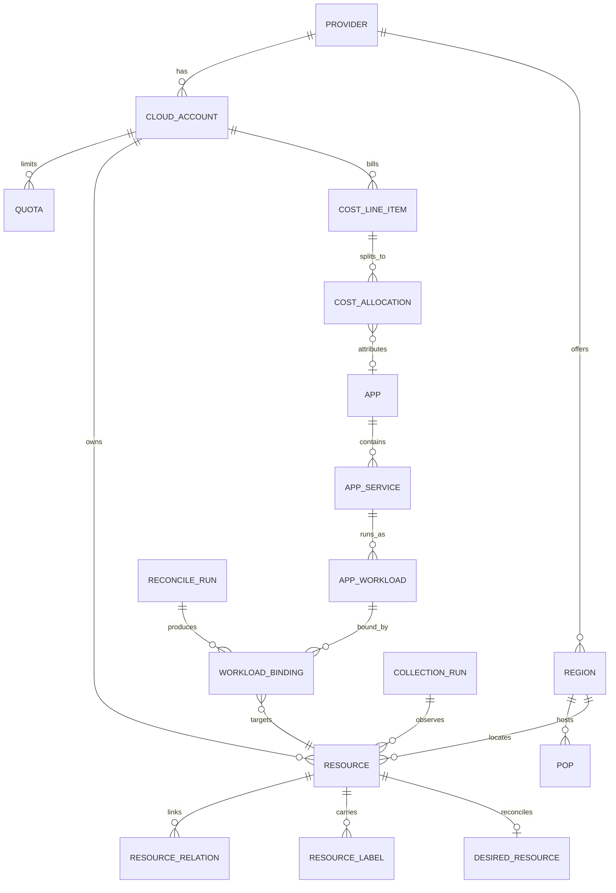
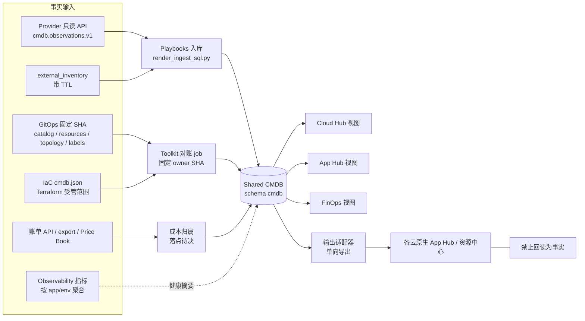
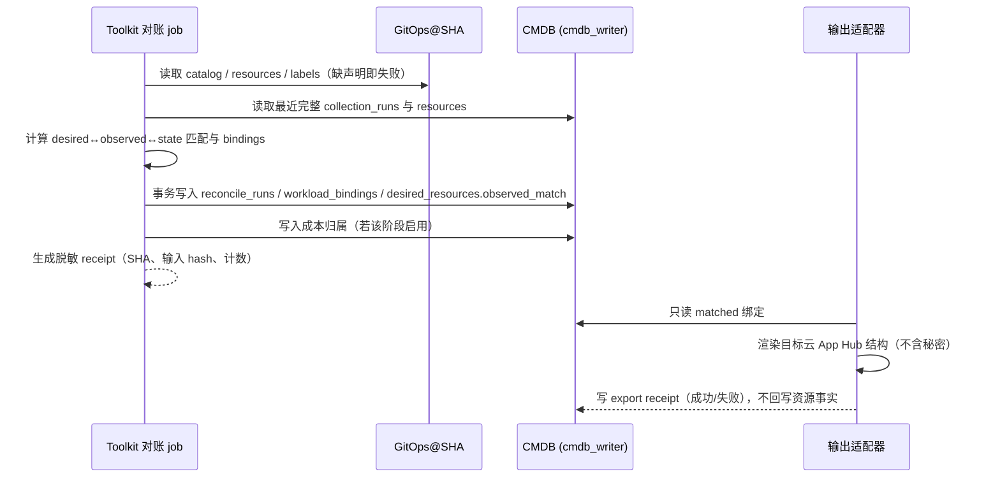

# App Hub、Cloud Hub、FinOps 统一数据模型

**版本：0.1 草稿 · 日期：2026-10-18 · 状态：待用户评审，不代表已实现。**

## 0. 结论

三个视图共用**一套事实**：GitOps 声明（期望状态）、Terraform state（受管范围）和 Shared CMDB 观察（运行事实）三方对账后，形成同一个资源主键 `canonical_id` 和同一组标签 `app / env / owner / tier`。Cloud Hub 沿 `provider → account/project → region → network → resource` 往下钻取，App Hub 沿 `app → service → workload → environment` 往上聚合，FinOps 把按 account 进来的账单经同一主键和标签分摊到 app/env。各云原生的 App Hub 或资源中心只做**单向输出适配器**，不回读成事实。

现有基础比预想的多：CMDB PostgreSQL v1 schema（`resources`、`desired_resources`、`resource_relations`、`collection_runs` 等）已在 Playbooks 仓库落地，并有 UAT 按需入库证据；GitOps 有 `CMDBCollectionScope`，并把无只读身份的 provider 显式列为 pending。缺的部分：统一标签（现在只有 GCP 资源带 `owner/workload/environment` labels，而且 `owner` 的语义与本方案不同）、应用实体、PoP/配额实体、成本归属，以及定时对账 job。产品页 `/products/cloud-hub` 的数字目前看是静态数据，接入本模型之前不能当作实测状态。

## 1. 范围与证据边界

### 1.1 范围

| 在范围内 | 不在范围内 / 未看到 |
| --- | --- |
| 公开页 `console.svc.plus/products/cloud-hub` 的四个视图与厂商矩阵；GitOps/IaC/Playbooks/Toolkit/Observability 的公开源码；知识库 7 份白皮书 | Home-Lab；需要登录的 `/panel/cloud-hub`、`/panel/finops`（**未看到内容，本文不推测其现状**）；任何真实云 API、Vault、数据库的 live 状态 |

本文只是设计稿：不创建 Vault 记录、policy、云 IAM、数据库对象或 workflow；文中 YAML/SQL 都是**草案**，路径与字段都要经评审后才能进入 owner 仓库。

### 1.2 证据来源与固定版本

| 来源 | 版本 / 时间（UTC+8） | 用途 |
| --- | --- | --- |
| 知识库白皮书（本仓库 `docs/reference/` 等目录，下文缩写） | 平台白皮书 v1.4（基线 2026-10-05）记为 **[PE]**；三档权限 v1.2 记为 **[IAM]**；CMDB 规划 v0.1 记为 **[CMDB]**；CMDB Vault 路径记为 **[VP]**；编排架构记为 **[ORC]**；统一 IaC Pipeline v0.7 记为 **[PIPE]**；Global Mesh 产品白皮书记为 **[GM]** | 命名、职责、路径、状态 |
| `ai-workspace-infra/gitops` | `50f9f74e`（2026-10-18 16:08） | `resources/`、`topology/`、`schemas/`、`iac/`、`releases/`、`AGENTS.md`、声明规范 |
| `ai-workspace-infra/playbooks` | `068dd2a2`（2026-10-18 15:09） | `contracts/cmdb-postgresql-v1/migrations/001、002`，`cmdb-monitoring` Vector 模板 |
| `ai-workspace-infra/iac_modules` | `4b49911f`（2026-10-18 13:52） | `terraform-hcl-standard/docs/cmdb-observations-contract.md`、`cmdb-inventory-contract.md`、`AGENTS.md` |
| `ai-workspace-infra/platform-ops-toolkit` | `7f6cfff`（2026-10-17 19:40） | `docs/resource-aggregation-model.md`、workflow 目录 |
| `ai-workspace-infra/observability` | `a69c1024`（2026-10-15 22:48） | README、`docs/zh/architecture.md` |
| `ai-workspace-infra/global-mesh` | `3a9bfae2`（2026-09-14 02:06） | `database/schema.sql`、`scripts/sync_vps_regions.py` |
| `ai-workspace-services/billing-service`（不在原清单内，但 [PE] 11.11 引用了其 `cloud_vendor_costs` 与 FinOps 后台任务） | `3ec0955b`（2026-10-18 01:20） | `sql/migrations/2026100701_cloud_vendor_costs.up.sql`、`docs/open-platform-finops-control-plane.md`、`docs/unified-billing-finops-architecture.md` |

### 1.3 标注约定

- **分类**：`已有`＝白皮书或仓库里有同名、同义的定义，并能引用出处；`扩展`＝已有定义，但需要增加字段或范围；`新增`＝源文件和仓库里都找不到。
- **实现状态**：沿用 [PE] 1.3 的证据等级。`已实现(UAT)`＝有白皮书记载的真实运行证据；`源码/CI`＝代码或合同存在，没有 live 验收；`规划`＝只在文档中；`待验收`＝已落地但缺验收；`待核验`＝本文无法判断。
- 有出处的说法写成“[来源] 章节”；仓库文件写成相对路径。

### 1.4 本次核对得到的关键现状

1. **CMDB PG v1 已有表结构**：`playbooks/contracts/cmdb-postgresql-v1/migrations/001_initial_schema.sql` 定义了 `collection_runs`、`resources`、`raw_snapshots`、`resource_observations`、`desired_resources`、`resource_relations`、`monitoring_status` 和 6 个视图，与 [CMDB] 4.1 一致。[CMDB] 12 记录 2026-10-09 Shared 主机上的 UAT `cmdb` 已完成迁移、GCP 入库和 Grafana 只读验证；定时采集**未启用**。
2. **pending 已有声明先例**：`gitops/topology/shared/cmdb/observability-uat.yaml`（`kind: CMDBCollectionScope`）启用了 GCP 的 compute/cloudrun collector；`pending_providers` 列出 aws、linode、ucloud、cloudflare、supabase。**vultr、hetzner、contabo 不在列表内。**
3. **标签现状**：只有 GCP 资源声明带 `labels`，键为 `owner`（值是 `platform-ops-toolkit`，即管理工具）、`workload`、`environment`、`lifecycle`。Vultr/Akamai 声明用的是无键的 `tags: [web-saas, prod, ...]` 列表。`tier` 只在 `GlobalMeshPools.metadata.labels` 出现过，取值 `out-of-band-network`。监控 Vector 模板打的标签是 `instance/job/provider/project_id/logical_project/environment/env/service_domain`，**没有 `app`**。
4. **已有一套 FinOps 标签与分摊规划**：billing-service 的 `open-platform-finops-control-plane.md` 中，FINOPS-003 定义了 `managed_by/repository/service/product/team/environment/cost_center/owner`，FINOPS-603 定义了 `Unallocated/Untagged/Unknown Resource/Shared Platform`。该文档自己把分摊引擎标为 🔴 Phase 2。
5. **产品页数据像是静态的**：global-mesh 仓库 `telemetry_snapshots` 表的字符串默认值（如 `'225.58k'`、`'↗ 26.1%'`）与页面显示一致；`sync_vps_regions.py` 里 `sync_time` 是硬编码的，hetzner/ucloud/contabo 的数量也是常量。GitOps PROD `GlobalMeshPools` 声明了 41 个 provider-region，页面写的是 48 个 PoP。
6. **Observability 栈**：仓库 README 写的是 VictoriaMetrics/VictoriaLogs/VictoriaTraces + OpenTelemetry Collector + Grafana，并非 Prometheus + Loki。产品页上 Hetzner 节点文案写着 “Telemetry Hub (Loki/Prom)”，与仓库不一致（见 §6 Q09）。

## 2. 统一实体模型

### 2.1 实体关系总览



### 2.2 实体清单

| 实体 | 视图 | 关键字段 | 主键 / 关联 | 来源分类 |
| --- | --- | --- | --- | --- |
| Provider | Cloud Hub | `provider`、`provider_class`、`terraform_tree`、`auth_mode`、`coverage_status` | PK `provider`（规范化小写，见 §6 Q05） | 扩展：[PIPE] 1.2 六 provider 表 + `iac/capabilities.yaml` |
| CloudAccount | 三视图共用 | `provider`、`account_ref`、`project_ref`、`scope`、`identity_ref`、`identity_status`、`cost_source` | PK `(provider, account_ref, project_ref)`，与 CMDB `resources` 唯一键的前三列一致 | 扩展：[IAM] 3 `account_ref/project_ref`；[PE] 4.2 |
| Region | Cloud Hub | `provider`、`region_ref`、`country_code` | PK `(provider, region_ref)` | 扩展：`collection_runs.region_ref`、`resources.region` |
| PoP | Cloud Hub | `pop_id`、`provider`、`region_ref`、`role`、`source` | PK `pop_id`；FK Region | 扩展：`GlobalMeshPools.spec.providers[].regions[]` |
| Network | Cloud Hub | 作为 `resource_kind='network'` 的 Resource | 复用 `resources` + `resource_relations(contains)` | 新增（kind 取值） |
| Resource | 三视图 | `canonical_id`、`native_resource_id`、`resource_kind`、`scope`、`provider_state`、`lifecycle`、`attributes` | 唯一键 `(provider, account_ref, project_ref, resource_kind, native_resource_id)` | 已有：`001_initial_schema.sql`；[IAM] 10 |
| DesiredResource | 对账 | `gitops_ref`、`resource_key`、`observed_match` | `UNIQUE (gitops_ref, resource_key)` | 已有：同上 |
| Quota | Cloud Hub | `quota_kind`、`limit_value`、`used_value`、`observed_at` | PK `(account, region_ref, quota_kind, run_id)` | 新增 |
| ResourceLabel | 三视图 | `label_key ∈ {app,env,owner,tier}`、`label_value`、`source` | PK `(canonical_id, label_key, source)` | 新增 |
| App | App Hub | `app_key`、`project`、`owner`、`lifecycle` | PK `app_key = <project>/<app>` | 新增 |
| AppService | App Hub | `service_key`、`tier` | PK `<app_key>/<service>` | 新增 |
| AppWorkload | App Hub | `workload_key`、`env`、`runtime_mode`、`gitops_path` | PK `<service_key>@<env>/<workload>` | 新增；`runtime_mode` 复用 [PE] 5.1 mode |
| Environment | App Hub | `shared / sit / uat / prod`（+ CMDB 的 `unknown`） | 枚举 | 已有：[PE] 4.1；CMDB `scope` CHECK |
| WorkloadBinding | App Hub | `binding_source`、`match_state` | PK `(workload_key, canonical_id)` | 新增；`match_state` 复用 [CMDB] 6 declaration 维度 |
| CostLineItem | FinOps | `billed_cost`、`currency`、`charge_period`、`cost_role`、`source` | FK CloudAccount；可选 FK Resource | 扩展：`cloud_vendor_costs`；FINOPS-501 FOCUS（规划） |
| CostAllocation | FinOps | `bucket`、`app_key`、`env`、`allocated_cost`、`rule_ref` | FK CostLineItem | 扩展：FINOPS-601/603（规划） |
| ReconcileRun | 对账 | `kind`、`gitops_sha`、`iac_sha`、`toolkit_sha`、`outcome`、`receipt` | PK `run_id` | 扩展：[IAM] 10 采集回执与 ingestion receipt 分开 |
| ExportTarget | 输出 | `adapter`、`target_ref`、`last_export_run` | PK `(adapter, target_ref)` | 新增 |

### 2.3 主键与标识规则

1. 资源身份**只认** CMDB 的 `canonical_id`。它由 `cmdb_observations_v1.py` 根据 provider/account/project/kind/native ID 派生，名称和 IP 都不是身份（[CMDB] 4.1、[IAM] 10）。
2. GitOps 侧的 `resource_key` 沿用 Toolkit `resource-aggregation-model.md` 的写法 `<project>/<env>/<provider>/<declaration>`（例：`svc.plus/uat/akamai/open-platform`）。
3. App 侧的键全部用小写加连字符（遵循 [PE] 8.5.2 第 6 条）。`app` 的值优先沿用现有的 `labels.workload` 和 `ResourceMatrix.resources[].target_domain`（如 `web-saas`、`ai-workspace`、`agent-proxy-jp`，见 §6 Q02 中关于区域后缀的问题）。
4. `scope` 记录资源实际归属；采集运行在 Shared 上执行，并不把资源改记为 shared（[IAM] 3）。
5. 跨环境共用的资源用 `resource_relations` 表示，不复制成多条资源（[IAM] 3）。

### 2.4 统一标签规范（新增，需评审）

| 标签 | 含义 | 取值规则 | 与现有字段的映射 |
| --- | --- | --- | --- |
| `app` | 业务应用（App Hub 顶层） | `^[a-z0-9-]+$`；必须在 App 目录中登记 | 现有 GCP `labels.workload`；VPS `tags[0]`（待核验是否稳定） |
| `env` | 生命周期范围 | `shared / sit / uat / prod`；无法确认的资源由 CMDB 记为 `unknown`，不能由人打标签 | GCP `labels.environment`；Vector `env`/`environment`；CMDB `scope` |
| `owner` | 责任团队 / 负责人组（**不写个人邮箱**） | 团队标识，如 `platform`、`billing` | **冲突**：现有 `owner: platform-ops-toolkit` 表示管理工具，建议改为 `managed_by`（FINOPS-003 已有该键）；见 §6 Q01 |
| `tier` | 应用架构层 | `client / edge / control / compute / data / platform` | 对应产品页“端-边-控-算-数”五层（[GM] 第四章）加 Shared 平台层；与 `GlobalMeshPools` 的 `tier: out-of-band-network` 冲突，见 §6 Q03 |

规则：

- 标签写在 GitOps 声明的 `labels`（GCP）或 provider 适配后的等价字段上，由 IaC renderer 下发到云资源。provider 不支持键值标签时，IaC adapter 负责编码，具体方式**待核验**。
- CMDB 观察到的标签以 `source=provider_api` 写入 `resource_labels`，声明中的标签以 `source=gitops_declared` 写入；两者不一致时记为 `drifted`。
- 缺少 `app` 或 `env` 的资源进入“未归属”（§3.3），**不按名称猜测**。按规则推断的结果必须标 `source=inferred_rule` 并单独展示。
- 本表只是标签规范的草案，不替代 FINOPS-003。两套键如何合并，见 §6 Q01。

### 2.5 GitOps 侧示例 YAML（草案）

格式遵循 `gitops/docs/gitops-declaration-standard.md`：单文档、`apiVersion/kind/metadata{name,project,environment}/spec`，只用 YAML，不含秘密。拟放在 `topology/shared/hub/`，先例是 `topology/shared/cmdb/`；路径待决，见 §6 Q12。

```yaml
# topology/shared/hub/app-catalog.yaml（草案，新增 kind）
apiVersion: gitops.svc.plus/v1alpha1
kind: ApplicationCatalog
metadata:
  name: svc-plus-apps
  project: svc.plus
  environment: shared
spec:
  label_keys: [app, env, owner, tier]
  apps:
    - app: web-saas
      owner: platform            # 团队标识，非个人
      lifecycle: persistent
      services:
        - service: console
          tier: edge
        - service: accounts
          tier: control
        - service: billing
          tier: control
        - service: postgresql
          tier: data
      workloads:
        - env: uat
          runtime_mode: selfhost
          resource_refs:
            - resources/<project>/uat/gcp/web-saas.yaml
          compose_ref: compose/web-saas/docker-compose.yml
        - env: prod
          runtime_mode: serverless
          topology_ref: topology/prod/serverless/runtime-topology.yaml
    - app: observability
      owner: platform
      lifecycle: persistent
      services:
        - service: observability-server
          tier: platform
      workloads:
        - env: shared
          runtime_mode: selfhost
          resource_refs:
            - resources/<project>/shared/gcp/<observability-declaration>.yaml
```

```yaml
# topology/shared/hub/provider-accounts.yaml（草案，新增 kind；ID 一律用占位符）
apiVersion: gitops.svc.plus/v1alpha1
kind: ProviderAccountCatalog
metadata:
  name: svc-plus-provider-accounts
  project: svc.plus
  environment: shared
spec:
  providers:
    - provider: gcp
      provider_class: iaas
      terraform_tree: gcp-cloud
      accounts:
        - account_ref: "<gcp-account-ref>"
          project_ref: "<gcp-project-id>"
          scope: prod
          identity_ref: kv/prod/svc.plus/cloud/gcp/<gcp-project-id>/federation/cmdb-readonly
          identity_status: pending_verification
          cost_source: pending
    - provider: hetzner
      provider_class: vps
      terraform_tree: null       # 当前无 Terraform tree / 无身份合同
      accounts: []
      coverage_status: pending
      reason: account-and-readonly-identity-pending
```

```yaml
# 现有 resources/<project>/<env>/gcp/*.yaml 的 labels 扩展（片段）
labels:
  app: web-saas            # 由现有 workload 迁移
  env: prod                # 由现有 environment 迁移
  owner: platform          # 语义改为责任团队
  tier: data
  managed_by: platform-ops-toolkit   # 承接原 owner 的语义（待决）
  lifecycle: persistent
```

`CMDBCollectionScope` 的扩展点：在 `pending_providers` 中补上 `vultr`、`hetzner`、`contabo`；给每个 collector 增加 `quota` 与 `labels` 两个采集产品。这两项为新增 kind 能力，需要 IaC collector 支持后才能启用。

### 2.6 CMDB 侧 PG 表结构草案（`003_hub_model.sql`）

本草案只做追加（additive），沿用 `001` 的约定：`SET LOCAL ROLE cmdb_owner`、CHECK 枚举、writer 只拿指定表的 SELECT/INSERT/UPDATE、reader 只读视图、没有 down 迁移。未经评审不能放进 `contracts/cmdb-postgresql-v1/migrations/`。

```sql
BEGIN;
SET LOCAL ROLE cmdb_owner;
SET LOCAL search_path = cmdb, pg_catalog;

CREATE TABLE IF NOT EXISTS provider_catalog (
    provider text PRIMARY KEY CHECK (provider ~ '^[a-z0-9-]+$'),
    provider_class text NOT NULL CHECK (provider_class IN
        ('iaas','vps','edge','serverless','managed_database','existing_inventory')),
    terraform_tree text,
    coverage_status text NOT NULL DEFAULT 'pending' CHECK (coverage_status IN
        ('enabled','pending','unsupported','pending_verification')),
    gitops_ref text NOT NULL,
    updated_at timestamptz NOT NULL DEFAULT now()
);

CREATE TABLE IF NOT EXISTS cloud_accounts (
    provider text NOT NULL REFERENCES provider_catalog(provider),
    account_ref text NOT NULL,
    project_ref text NOT NULL DEFAULT '',
    scope text NOT NULL CHECK (scope IN ('shared','sit','uat','prod','unknown')),
    identity_ref text,                  -- 逻辑 KV 路径引用，非秘密
    identity_status text NOT NULL DEFAULT 'pending' CHECK (identity_status IN
        ('verified','pending','unsupported','pending_verification')),
    cost_source text NOT NULL DEFAULT 'pending' CHECK (cost_source IN
        ('billing_api','billing_export','price_book','none','pending')),
    gitops_ref text NOT NULL,
    PRIMARY KEY (provider, account_ref, project_ref)
);

CREATE TABLE IF NOT EXISTS regions (
    provider text NOT NULL REFERENCES provider_catalog(provider),
    region_ref text NOT NULL,
    country_code text,
    source text NOT NULL CHECK (source IN ('provider_api','gitops_declared','external_inventory')),
    PRIMARY KEY (provider, region_ref)
);

CREATE TABLE IF NOT EXISTS pops (
    pop_id text PRIMARY KEY,
    provider text NOT NULL,
    region_ref text NOT NULL,
    role text,
    source text NOT NULL CHECK (source IN ('gitops_declared','provider_api','external_inventory')),
    gitops_ref text,
    FOREIGN KEY (provider, region_ref) REFERENCES regions(provider, region_ref)
);

CREATE TABLE IF NOT EXISTS quotas (
    provider text NOT NULL,
    account_ref text NOT NULL,
    project_ref text NOT NULL DEFAULT '',
    region_ref text NOT NULL DEFAULT '',
    quota_kind text NOT NULL,
    limit_value numeric,
    used_value numeric,
    run_id text NOT NULL REFERENCES collection_runs(run_id),
    observed_at timestamptz NOT NULL,
    PRIMARY KEY (provider, account_ref, project_ref, region_ref, quota_kind, run_id),
    FOREIGN KEY (provider, account_ref, project_ref)
        REFERENCES cloud_accounts(provider, account_ref, project_ref)
);

CREATE TABLE IF NOT EXISTS resource_labels (
    canonical_id text NOT NULL REFERENCES resources(canonical_id),
    label_key text NOT NULL CHECK (label_key IN ('app','env','owner','tier')),
    label_value text NOT NULL CHECK (label_value ~ '^[a-z0-9-]+$'),
    source text NOT NULL CHECK (source IN ('provider_api','gitops_declared','inferred_rule')),
    run_id text NOT NULL,
    observed_at timestamptz NOT NULL,
    PRIMARY KEY (canonical_id, label_key, source)
);

CREATE TABLE IF NOT EXISTS apps (
    app_key text PRIMARY KEY,           -- <project>/<app>
    project text NOT NULL,
    app text NOT NULL,
    owner text NOT NULL,
    lifecycle text NOT NULL,
    gitops_ref text NOT NULL
);

CREATE TABLE IF NOT EXISTS app_services (
    service_key text PRIMARY KEY,       -- <app_key>/<service>
    app_key text NOT NULL REFERENCES apps(app_key),
    service text NOT NULL,
    tier text NOT NULL CHECK (tier IN ('client','edge','control','compute','data','platform'))
);

CREATE TABLE IF NOT EXISTS app_workloads (
    workload_key text PRIMARY KEY,      -- <service_key>@<env>/<workload>
    service_key text NOT NULL REFERENCES app_services(service_key),
    env text NOT NULL CHECK (env IN ('shared','sit','uat','prod')),
    runtime_mode text NOT NULL CHECK (runtime_mode IN ('selfhost','serverless','hybrid','existing')),
    gitops_path text NOT NULL
);

CREATE TABLE IF NOT EXISTS reconcile_runs (
    run_id text PRIMARY KEY,
    kind text NOT NULL CHECK (kind IN ('cloud_hub','app_hub','finops','export')),
    gitops_sha text NOT NULL,
    iac_sha text,
    toolkit_sha text NOT NULL,
    inputs_sha256 text NOT NULL,
    started_at timestamptz NOT NULL,
    completed_at timestamptz,
    outcome text NOT NULL CHECK (outcome IN ('running','success','partial','failed')),
    receipt jsonb NOT NULL DEFAULT '{}'::jsonb
);

CREATE TABLE IF NOT EXISTS workload_bindings (
    workload_key text NOT NULL REFERENCES app_workloads(workload_key),
    canonical_id text NOT NULL REFERENCES resources(canonical_id),
    binding_source text NOT NULL CHECK (binding_source IN ('label_match','gitops_declared','relation')),
    match_state text NOT NULL CHECK (match_state IN ('matched','drifted','declared_only','observed_only')),
    reconcile_run_id text NOT NULL REFERENCES reconcile_runs(run_id),
    PRIMARY KEY (workload_key, canonical_id)
);

-- 覆盖状态：无身份 provider 显示 pending，不显示为成功零资源
CREATE OR REPLACE VIEW v_cloud_hub_coverage AS
SELECT a.provider, a.account_ref, a.project_ref, a.scope,
       CASE WHEN p.coverage_status <> 'enabled' OR a.identity_status <> 'verified' THEN 'pending'
            WHEN lr.outcome IS NULL THEN 'never_observed'
            WHEN lr.outcome = 'failed' THEN 'failed'
            WHEN lr.outcome = 'partial' OR NOT lr.scope_complete THEN 'partial'
            WHEN lr.completed_at < now() - interval '15 minutes' THEN 'stale'
            ELSE 'complete' END AS coverage,
       lr.completed_at AS last_complete_at
FROM cloud_accounts a
JOIN provider_catalog p USING (provider)
LEFT JOIN LATERAL (
    SELECT outcome, scope_complete, completed_at FROM collection_runs c
    WHERE c.account_ref = a.account_ref AND c.project_ref = a.project_ref
    ORDER BY started_at DESC LIMIT 1) lr ON true;

CREATE OR REPLACE VIEW v_unattributed_resources AS
SELECT r.canonical_id, r.provider, r.account_ref, r.project_ref, r.scope, r.resource_kind,
       CASE WHEN NOT EXISTS (SELECT 1 FROM resource_labels l
                             WHERE l.canonical_id = r.canonical_id AND l.label_key = 'app'
                               AND l.source <> 'inferred_rule') THEN 'untagged'
            ELSE 'unknown_app' END AS reason
FROM resources r
WHERE r.lifecycle = 'present'
  AND NOT EXISTS (SELECT 1 FROM workload_bindings b
                  WHERE b.canonical_id = r.canonical_id AND b.match_state = 'matched');

INSERT INTO schema_migrations (version, description)
VALUES ('003', 'Hub model: providers, accounts, regions, PoPs, quotas, labels, apps, bindings')
ON CONFLICT (version) DO NOTHING;
COMMIT;
```

授权沿用 `001`：`cmdb_writer` 对新表有 SELECT/INSERT/UPDATE；`cmdb_reader` 只读 `v_cloud_hub_coverage`、`v_unattributed_resources` 以及后续的 App/FinOps 视图；`cmdb_auditor` 读 `reconcile_runs` 的脱敏视图（[IAM] 9.4）。

FinOps 表（`cost_line_items`、`cost_allocations`）放在哪个数据库是待决项（§6 Q07），这里只列字段要点：

- `cost_line_items`：`provider, account_ref, project_ref, charge_period_start/end, service_name, sku, native_resource_id NULL, region, billed_cost numeric(20,6), effective_cost numeric(20,6), currency, cost_role ∈ {authoritative, adjustment, estimated}, source ∈ {billing_api, billing_export, price_book}, source_run_id, tags jsonb`。成本角色引用 FINOPS-601；金额用 numeric，不用现有 `cloud_vendor_costs.cost_amount` 的 `DOUBLE PRECISION`（见 Q08）。
- `cost_allocations`：`line_id, bucket ∈ {attributed, untagged, unknown_resource, shared_platform, unallocated, pending_provider}, app_key NULL, env NULL, allocated_cost, rule_ref, reconcile_run_id`。bucket 前五类对齐 FINOPS-603；`pending_provider` 是新增，用来表示“无身份/无账单来源”，与“已知为 0”区分。

## 3. 三个视图

### 3.1 Cloud Hub

**要回答的问题**：我们在哪些 provider/account/region 有资源？每个范围的采集是否完整、新鲜？配额还剩多少？PoP 的实测状态如何？哪些 provider 仍是 pending？

**数据来源**：

| 层 | 来源 | 状态 |
| --- | --- | --- |
| provider/account 目录 | GitOps `ProviderAccountCatalog`（新增）+ `iac/capabilities.yaml` + `CMDBCollectionScope` | 前者新增；后两者已有 |
| region/network/resource | CMDB `resources`，由 IaC collector 经 `cmdb.observations.v1` 产生，Playbooks `render_ingest_sql.py` 入库 | GCP compute/cloudrun 已实现(UAT 按需)；其余 provider 规划 |
| Terraform 受管范围 | IaC `cmdb.json`（`cmdb.v1`）+ state key（[PE] 5.3） | 已有；不直接读 tfstate |
| existing 节点 | `external_inventory`（[CMDB] 5，ULightHost） | 已有合同 |
| 配额 | provider 配额 API | 新增，collector 未实现 |
| PoP 声明 | `topology/<env>/selfhost/global-mesh-pools.yaml` | 已有声明（PROD 41 / UAT 17 个 region） |
| PoP 实测 | Observability：Blackbox Exporter 探测指标进 VictoriaMetrics | 探针组件已有；PoP 探测目标与 app 标签为新增 |

**计算/对账逻辑**：

1. 覆盖状态按 `v_cloud_hub_coverage` 计算：provider 未启用或身份未 verified → `pending`；最近一次 run 为 failed/partial → 照实展示；完整成功但超过 freshness（[CMDB] 6：15 分钟）→ `stale`。
2. 资源计数只统计 `lifecycle='present'` 的资源（`002` 已在 `v_provider_summary` 中这样做）。Compute 计实例数，Serverless 计服务数，revision 不计入（[CMDB] 5）。
3. 删除只能走 `missing_candidate → deletion_confirmed`（[CMDB] 6），对账 job 不能直接删除。
4. 三方差异：同时在 GitOps 声明、`cmdb.json`/state、provider 观察中出现 → `matched`；只在声明中 → `declared_only`；只在观察中 → `observed_only`；属性不一致 → `drifted`（[CMDB] 6，写回 `desired_resources.observed_match`）。
5. “上次同步”显示 `max(collection_runs.completed_at)`，按 provider 分别展示，不能用一个全局时间戳。

**与产品页现有模块的对应**：

| 产品页模块 | 映射 | 差距 |
| --- | --- | --- |
| VPS 能力与可用区交叉矩阵（Linode/Hetzner/UCloud/Contabo/Vultr × 7 维） | `provider_catalog` + 能力声明（静态、desired 层） | 能力分值目前来自 global-mesh `node_capabilities` 默认值，不是观察值；需要标成“声明/营销数据” |
| VPS 算力 PoP 地图 | `pops` + 探测指标 | 48 vs 41 待核验；Hetzner/Contabo/Vultr 无身份 → 应显示 pending |
| SaaS 零信任网格 | `resource_relations`（mesh peer）+ `vpn-overlay/` 声明 | 关系采集为新增 |
| “上次同步 2026-09-14 16:30” | 改为按 provider 显示的 `last_complete_at` | 当前值来自静态数据（§1.4 第 5 条） |

### 3.2 App Hub

**要回答的问题**：某个 app 由哪些 service/workload 组成？每个环境跑在哪些云资源上？声明与实际是否一致？健康状况如何？哪些资源不属于任何 app？

**数据来源**：GitOps `ApplicationCatalog`（新增）、`resources/` 中的 labels、`topology/<env>/<mode>/runtime-topology.yaml`（EdgeRoutingConfig）、`compose/` + `.doco-cd.*.yml`（当前实际部署路径；`services/` 是未启用的 K8s/Flux 路线，见 `services/README.md`）、`releases/`（SelfhostRelease）、CMDB `resources`/`resource_labels`/`resource_relations`、Observability 指标。

**计算/对账逻辑**：

1. 绑定优先级：`gitops_declared`（catalog 中的 `resource_refs` 解析出 `resource_key → desired_resources.canonical_id`）> `label_match`（观察到的 `app`+`env` 标签对应唯一 workload）> `relation`（经 `resource_relations` 继承，例如数据盘 → VM）。
2. 声明绑定与标签绑定指向不同 workload 时记为 `drifted`，不自动改写任何一方。
3. 健康状态不在 CMDB 内计算。Observability 按 `app`/`env` 标签聚合（需要先在 Vector 模板中加入 `app` 标签，属新增），CMDB 只保存 `monitoring_status`（已有表）。容器 running 不算健康（[PE] 6.1）。
4. Serverless workload 用产品指标和健康检查回执，不报“缺少主机探针”告警（[CMDB] 8）。
5. 环境混用的情况照实展示，不以声明为准做“修正”。例如 [PE] 11.9（2026-10-14）记录 `web-saas-uat` 主机读取 `.env.prod`：App Hub 应把这类 workload 标为 `drifted`。

**与产品页现有模块的对应**：“应用架构拓扑”的五层（端-边-控-算-数）对应 `tier`，节点是 `app_services`，连线来自 `resource_relations` 和 EdgeRoutingConfig 的 upstream。“工程生命周期”对应 `releases/` + Toolkit 回执，本模型只给出关联键（`app_key`、tag/digest、run ID），不重建发布证据链（[PE] 10.1）。

### 3.3 FinOps

**要回答的问题**：每个 account 本期花了多少？其中多少能归到 app/env？未归属的有多少、为什么？哪些 provider 没有账单来源（pending）？

**数据来源**：

| 来源 | 适用 provider | 状态 |
| --- | --- | --- |
| billing-service `cloud_vendor_costs` + FinOpsSyncer（AWS CostExplorer / GCP BigQuery / Azure Consumption） | AWS/GCP/Azure | 源码/CI（该文档注明三云凭据接线待核实，“可能尚未拉到真实数据”）；SQL 已通过 PG17 资格检查（[PE] 11.11），PROD 尚未执行 |
| Price Book（月租/带宽/IPv4） | Contabo/Vultr 等无账单 API 的 VPS | 规划（FINOPS-304 🔴） |
| 云账单 export（资源级明细） | AWS/GCP | 规划（FINOPS-401~403 演进） |
| Cloudflare / Supabase 用量 | Workers/Pages、Supabase 组织 | 新增；额度口径见 [PE] 7.2.2 |

**计算/对账逻辑**：

1. 账单先落到 CloudAccount 下（`provider, account_ref, project_ref`），对不上账号的行进入 `unknown_resource`，不丢弃。
2. 有 `native_resource_id` 的行，经 `resources` 找到 `canonical_id`，再经 `workload_bindings(matched)` 或 `resource_labels(app, env)` 归到 app/env → `attributed`。
3. 资源存在但没有 `app` 标签 → `untagged`；资源属于 Shared 平台（如 observability、vault）→ `shared_platform`，二次分摊规则留待后续决定（FINOPS-602）；账单只有账号/服务级、没有资源 ID → `unallocated`。
4. provider 没有身份或没有账单来源 → `pending_provider`，金额显示“未知”，**不显示 0**。
5. 总成本只计 `authoritative + adjustment`；`allocated` 不重复求和；`estimated` 只用于对比（FINOPS-601）。
6. Free tier 抵扣、共享额度按 billing account / organization 计（[PE] 7.2.2），不能按环境重复计算。

**与产品页现有模块的对应**：公开页没有 FinOps 模块；[GM] 3.2 的“FinOps 混合多云成本对账”表是方案对比的估算，不是账单数据，不能作为本视图的数据。`/panel/finops` 未看到，暂不映射。

### 3.4 三档权限在三个视图中的落地

沿用 [IAM] 2.1/2.4 的 reader/operator/admin，三层分别授权、不继承：

| 能力 | reader | operator | admin |
| --- | --- | --- | --- |
| 三个视图只读（含 PROD 明细的脱敏字段） | ✅ 经 `cmdb_reader` 视图 | ✅ | ✅ |
| 修改 GitOps catalog / 标签 | ❌ | 走 PR 评审，不直接写 CMDB | 走 PR 评审 |
| 触发对账 / 导出 job | ❌ | ✅ 仅 allowlist 中的 Toolkit 入口 | ✅ |
| 维护分摊规则 / Price Book | ❌ | ❌ | ✅ 版本化，需审批（FINOPS-1203 审计） |
| 查看原始账单明细 | ❌（默认只看聚合） | 按 account 授权 | ✅ |

collector 是云账号层 reader + CMDB 服务层 operator 特化（`cmdb_writer`），不是 OS operator（[IAM] 2.4）。输出适配器需要写入目标云的 App Hub，必须单独设置写身份，**不能复用** collector 的只读身份（见 Q10）。

### 3.5 统一状态语义（三视图一致）

| 状态 | 含义 | 展示 |
| --- | --- | --- |
| `pending` | 没有已核验的只读身份或数据来源 | 灰色，带 `reason`；计数和金额显示“未知”，不显示 0 |
| `failed` / `partial` | 最近一次采集或对账失败、不完整 | 保留最近一次成功的观察，并标记 |
| `stale` | 超过 freshness TTL | 照常展示，标记过期 |
| `complete` | 范围完整，数据新鲜 | 正常展示 |
| 已实现 / 规划 / 待验收 | 功能本身的交付状态（源自 [PE] 1.3） | 在视图页脚或功能清单中单独标注，不与资源状态混在一起 |

## 4. 对账与同步流程





对账规则：

1. **输入固定**：GitOps/IaC/Playbooks/Toolkit 都使用固定 SHA；缺少声明、SHA 不匹配、目标被 inputs 覆盖时直接失败（[PIPE] 4.1、[PE] 2 原则 6）。
2. **只用完整范围**：对账只消费 `scope_complete = true` 的 run；partial 或 failed 范围保留旧绑定，并标记 `stale`（[CMDB] 4.2）。
3. **幂等**：同一 `inputs_sha256` 重放结果不变；旧 run 不能覆盖新 run（[CMDB] 4.2、[IAM] 10）。
4. **单向**：输出适配器只读 CMDB；目标云 App Hub 里的人工改动不回流，下次导出会被覆盖或报告冲突（导出语义待决）。
5. **禁止副作用**：对账 job 不执行 Terraform apply、DNS、SSH、探针安装，也不加载 backend 凭据（[IAM] 4.2）。
6. **回执分离**：采集 receipt、入库 receipt、对账 receipt、导出 receipt 各自独立，用 correlation ID 关联（[IAM] 10）。
7. **调度**：在 Toolkit 中新增一个 workflow，或复用 [CMDB] 9 拟议的 DAG `validate-scope → collect → normalize-and-commit → verify-receipt → publish`，在其后追加 `reconcile → export`；Toolkit 现有 workflow 目录中**没有**对账或采集入口（新增）。

## 5. 总对照表

| # | 项 | 分类 | 出处 | 实现状态 |
| --- | --- | --- | --- | --- |
| 1 | 四仓职责与“GitOps 声明 / IaC state / CMDB 事实”分离 | 已有 | [PE] 3.1、3.3 | 已有合同 |
| 2 | desired vs observed 分层，`declared_only` 不得显示 running | 已有 | [CMDB] 6；Toolkit `docs/resource-aggregation-model.md` | 源码/文档 |
| 3 | CMDB PG schema `cmdb`（resources、observations、runs、relations、desired、monitoring） | 已有 | [CMDB] 4.1；`playbooks/contracts/cmdb-postgresql-v1/001、002` | 已实现(UAT 按需，[CMDB] 12)；定时采集未启用 |
| 4 | 资源唯一键 `(provider, account_ref, project_ref, resource_kind, native_resource_id)` | 已有 | [CMDB] 4.1；[IAM] 10 | 已实现(schema) |
| 5 | `cmdb.observations.v1` 信封与 GCP collector | 已有 | [IAM] 5、13.1；`iac_modules/.../cmdb-observations-contract.md` | 源码；GCP 已实现(UAT 按需) |
| 6 | 六状态维度（provider_state / freshness / health / declaration / monitoring / lifecycle） | 已有 | [CMDB] 6 | 部分进入 schema；health 维度待实现 |
| 7 | 无身份 provider 保持 pending，不当成功零资源 | 已有 | [VP] 末段；[IAM] 10；`CMDBCollectionScope.pending_providers` | 已在声明中；视图未实现 |
| 8 | 三档权限 reader/operator/admin 与三层授权 | 已有 | [IAM] 2.1、2.4 | 规划（proposed-not-applied） |
| 9 | CMDB DB principal（reader/writer/migrator/auditor/backup） | 已有 | [IAM] 9.4；[CMDB] 4；`001` GRANT | 已实现(schema 授权)；Vault live 待验收 |
| 10 | CMDB Vault 路径 `kv/<scope>/svc.plus/services/observability/database/cmdb/<principal>` | 已有 | [VP]；[IAM] 7.3 | 规划；scope 存在冲突（Q04） |
| 11 | 云只读身份路径 `kv/<scope>/svc.plus/cloud/<provider>/<account>/{federation,api}/cmdb-readonly` | 已有 | [VP]；[IAM] 7.2 | 规划 |
| 12 | Terraform state key 维度 | 已有 | [PE] 5.3；[PIPE] 7.1 | 已有合同 |
| 13 | `cmdb.json`（`cmdb.v1`）作为 IaC → Playbooks 资源事实 | 已有 | [PE] 5.2；`iac_modules/.../cmdb-inventory-contract.md` | 已实现（[PE] 11.11 PROD 资源 CMDB 已发布） |
| 14 | existing / external_inventory 带 TTL | 已有 | [PE] 5.4；[CMDB] 5 | 已有合同 |
| 15 | Grafana `cmdb_postgres` datasource 与只读视图 | 已有 | [CMDB] 7；Playbooks README | 已实现(UAT 6 面板)；PROD 待验收 |
| 16 | Provider 目录（provider_catalog） | 扩展 | [PIPE] 1.2；`gitops/iac/capabilities.yaml` | 规划 |
| 17 | CloudAccount 目录 + identity_status + cost_source | 扩展 | [PE] 4.2；[IAM] 3 | 规划 |
| 18 | Region 实体 | 扩展 | `collection_runs.region_ref`、`resources.region` | 规划 |
| 19 | PoP 实体（来自 GlobalMeshPools 声明） | 扩展 | `topology/*/selfhost/global-mesh-pools.yaml`；[GM] 第一、二章 | 声明已有；实测待核验 |
| 20 | Network 作为 resource_kind + contains 关系 | 新增 | — | 规划 |
| 21 | 配额（quotas）实体与采集 | 新增 | — | 规划 |
| 22 | 统一标签 app/env/owner/tier | 新增 | 部分键已存在：GCP `labels.workload/environment/owner`；FINOPS-003（billing-service） | 规划；与现有键冲突（Q01–Q03） |
| 23 | resource_labels 表（观察 vs 声明标签） | 新增 | — | 规划 |
| 24 | App / Service / Workload 实体与 ApplicationCatalog kind | 新增 | 候选名来自 `ResourceMatrix.target_domain`、[PE] 7.2.1（accounts/billing/console） | 规划 |
| 25 | WorkloadBinding 与 match_state | 扩展 | [CMDB] 6 declaration 维度；`desired_resources.observed_match` | 规划 |
| 26 | `resource_relations` 承载拓扑/网格连线 | 扩展 | [CMDB] 4.1 | schema 已有；关系采集待实现 |
| 27 | 对账 job（Toolkit 调度）与 reconcile_runs | 扩展 | [CMDB] 9 拟议 DAG；[IAM] 4.2、10 | 规划；Toolkit 无现成入口 |
| 28 | 输出适配器（单向导出到各云 App Hub / 资源中心） | 新增 | — | 规划 |
| 29 | Observability 按 app 标签聚合健康 | 扩展 | [CMDB] 7 exporter 低基数指标；Vector 模板已有 env/provider 等标签 | 规划（`app` 标签未下发） |
| 30 | 成本事实表 | 扩展 | billing-service `cloud_vendor_costs`；[PE] 11.11 Billing #44；FINOPS-501 | 源码/CI；PROD 未执行 |
| 31 | 成本分摊到 app/env 与归属桶 | 扩展 | FINOPS-601/602/603（billing-service 文档） | 规划（🔴 Phase 2） |
| 32 | `pending_provider` 成本桶（与 0 区分） | 新增 | 由 [VP] pending 原则推出 | 规划 |
| 33 | Price Book 作为 VPS 成本来源 | 扩展 | FINOPS-304 | 规划（🔴） |
| 34 | 免费额度与共享计量口径 | 已有 | [PE] 7.2.2 | 文档基线（2026-10-06 核对） |
| 35 | Hybrid/Selfhost/Serverless mode 作为 workload runtime_mode | 已有 | [PE] 5.1；[ORC] 1 | 已有合同 |
| 36 | Hetzner/Contabo/Vultr 纳入 Cloud Hub 覆盖（pending） | 新增 | 产品页列出；`CMDBCollectionScope` 未列 | 待核验 |
| 37 | 产品页“上次同步”替换为按 provider 的 last_complete_at | 新增 | — | 规划 |

**计数**：共 37 项，其中已有 17 项、扩展 11 项、新增 9 项。“已有”只表示有出处，不等于已实现，实现状态见最后一列。

## 6. 与白皮书冲突或待决问题

| 编号 | 问题 | 冲突来源 | 建议 / 需要谁决定 |
| --- | --- | --- | --- |
| Q01 | **`owner` 语义与标签键集合冲突**：GitOps 现有 `owner: platform-ops-toolkit` 表示管理工具；FINOPS-003 定义了 8 个键（含 `team/product/service/cost_center/managed_by`）；群里对齐的是 4 个键 | `resources/**/gcp/*.yaml`；billing-service FINOPS-003 | 用户决定：`owner` 改为责任团队，原值迁到 `managed_by`；FINOPS-003 是否收敛为 `app/env/owner/tier` + 可选 `cost_center` |
| Q02 | `app` 粒度：`agent-proxy-jp/us/sg` 应该是一个 app 的不同 workload，还是三个 app | `ResourceMatrix`、labels.workload | 建议 `app=agent-proxy`，区域放在 workload；需用户确认 |
| Q03 | `tier` 值域与现有 `tier: out-of-band-network` 冲突 | `GlobalMeshPools.metadata.labels` | 建议原值改为 `network_role` 或另一个键 |
| Q04 | **CMDB 存储 scope**：`CMDBCollectionScope` 和 [VP] 用 `environment: uat`、`kv/uat/...`；[IAM] 1.3/7.3 的目标是 `storage_scope: shared`、`kv/shared/...` | [VP] vs [IAM] | 按 [IAM] 1.3 以 shared 为目标；迁移步骤遵循 [IAM] 11.1；本模型新增的表跟随同一个库 |
| Q05 | provider 命名未规范化：`gcp`/`gcp-cloud`、`akamai`/`akamai-cloud`/`linode`、`ucloud`/`ucloud-global`/`ulighthost`/`surfercloud`、`vultr`/`vultr-vps` 同时存在 | GitOps 路径、registry、CMDB、IAM schema | 需要一份 provider 别名映射表（registry owner：Toolkit/IaC） |
| Q06 | 环境枚举不一致：Toolkit 聚合合同只允许 sit/uat/prod；CMDB 有 shared/unknown；IAM schema 的 environment 只有 sit/uat/prod；GitOps 有 `dev` 路径 | `resource-aggregation-model.md`、`001`、`schemas/iam-integration.schema.yaml`、`resources/*/dev/` | 按 [CMDB] 4.1 显式扩展 shared；`dev` 是否纳入待决 |
| Q07 | **成本事实放在哪里**：billing-service 的 `cloud_vendor_costs` 位于业务库（PROD 数据面，53 表合同的一部分）；本方案要求 Shared CMDB 统一对账 | [PE] 11.11；billing-service NATIVE_FINOPS | 选项 A：成本事实留在 Billing，CMDB 只同步归属所需的聚合；选项 B：成本库独立放在 Shared。需用户与 Billing owner 决定 |
| Q08 | `cloud_vendor_costs.cost_amount` 是 `DOUBLE PRECISION`，`account_id` 混装 AWS account/GCP project/Azure subscription；凭据路径 `kv/billing-service` 不符合 [PE] 8.5 的 `kv/<scope>/<project>/<category>` | billing-service SQL、FINOPS-1201 | 新表用 numeric 和分列；Vault 路径按 8.5 迁移，需另行评审 |
| Q09 | Observability 栈描述不一致：任务背景写 OTel + Prometheus + Loki；仓库是 Victoria* + OTel Collector；产品页写 “Loki/Prom” | observability README；产品页 | 以仓库为准；产品页文案需要更正（待用户确认） |
| Q10 | 输出适配器需要目标云的写权限，与 collector“只读、发现资源不产生管理授权”的原则冲突 | [IAM] 4.2、7.4 | 单独设 export operator 身份和 Vault 记录，逐云评审；是否首期就做导出待决 |
| Q11 | 产品页的 48 PoP、5 厂商、流量数字来自静态默认值；GitOps PROD 声明 41 个 region；global-mesh 仓库另有一套 Supabase schema（`vps_providers/mesh_nodes`），构成第二事实源 | global-mesh `database/schema.sql`、`sync_vps_regions.py` | 产品页改为读 CMDB 视图；global-mesh 表降级为展示缓存或退役，需用户决定 |
| Q12 | 新增 kind 的目录：`topology/shared/hub/` 还是其他位置；`services/` 是未启用的 K8s/Flux 路线，App Hub 的 service 来源应以 `compose/` + Doco-CD 为准 | `gitops/services/README.md`；[PE] 5.1 把 `services/` 描述为服务配置 | GitOps owner 决定；[PE] 5.1 的描述需要对齐 |
| Q13 | [PE] 7.1 和 [ORC] 引用 `resource-matrix.json`，仓库已改为 `topology/uat/hybrid/resource-matrix.yaml`，且 `AGENTS.md` 禁止 JSON | [PE] 7.1 vs `gitops/AGENTS.md` | 白皮书下一版需要更正 |
| Q14 | Hetzner/Contabo 不在六个 Terraform provider 之内，`CMDBCollectionScope` 也没有它们和 Vultr 的 pending 条目 | [PIPE] 1.2；`CMDBCollectionScope` | 先作为 pending 登记；是否走 external_inventory 或 Price Book 待决 |
| Q15 | Shared 平台成本（observability/vault/CI）的二次分摊规则 | FINOPS-602 | 首期只展示 `shared_platform` 桶，不做分摊 |
| Q16 | `/panel/cloud-hub`、`/panel/finops` 现有功能未知 | 需要登录 | 需要用户提供截图或说明后再做映射 |

## 7. 分阶段实施建议

| 阶段 | 交付 | 放行条件 | owner |
| --- | --- | --- | --- |
| H0 规范评审 | 本文 + Q01–Q06、Q12 的决议；标签规范 v1；provider 别名表；环境枚举 | 用户签字确认；无账号 ID 或秘密进入文档 | 用户、GitOps |
| H1 Schema 与标签 | GitOps：`ApplicationCatalog`/`ProviderAccountCatalog` 的 YAML schema（同时补 schema 校验）；现有 GCP labels 迁移（`workload → app`、`environment → env`、`owner → managed_by` + 新 `owner`）；`CMDBCollectionScope` 补 vultr/hetzner/contabo 的 pending 条目 | YAML 解析与合同检查通过；渲染无资源替换（label 变更需 plan 确认 0 destroy/replace，[PE] 12.3 停止条件） | GitOps → IaC renderer |
| H2 CMDB 003 迁移 | `003_hub_model.sql` + 视图 + 授权；在 UAT/隔离库演练 | reader 写入被拒、writer DDL 被拒、重放幂等（[CMDB] 9.1）；备份可恢复 | Playbooks |
| H3 Cloud Hub 闭环 | GCP 标签与配额采集；`v_cloud_hub_coverage`；产品页改为读视图（只读 API）；pending 照实展示 | 同一 run 的 API 计数与视图一致；pending provider 不显示 0 | IaC、Playbooks、Console owner |
| H4 App Hub 闭环 | Toolkit 对账 job；`workload_bindings`；Vector 模板加 `app` 标签；拓扑视图 | 声明与观察的差异都有对应状态；健康数据来自 Observability，不由 CMDB 推断 | Toolkit、Playbooks、Observability |
| H5 FinOps 闭环 | 先定 Q07 落点；GCP/AWS 账单行进入 `cost_line_items`；归属桶；Price Book | 总额与账单一致；`pending_provider` 单独展示；分摊不重复求和 | Billing owner、Toolkit |
| H6 输出适配器（可选） | 单向导出到一个目标云的 App Hub | 独立写身份；导出 receipt；不回读 | IaC（云写入）、Toolkit（编排） |
| H7 多云覆盖 | AWS/Linode/UCloud/Cloudflare/Supabase/Vultr adapters（[IAM] 11 P4） | 每个 provider 身份逐项核验；不支持的项目照实报告 | IaC |

推进顺序遵循 [PE] 12.2：owner 先落地 → caller 切换 → UAT 验证 → 清理旧路径 → 归并文档。任何一步缺少 receipt 都不进入下一步。H1 之前不改任何云资源；H3 之前，产品页上的静态数字应标注“演示数据”（需用户确认）。
