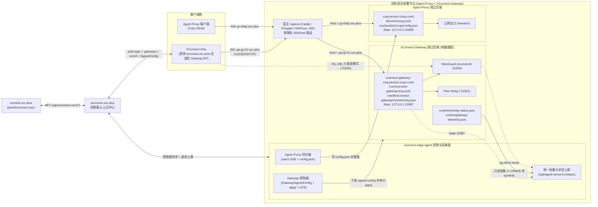

# 目标架构、控制/数据面边界与 Agent Proxy 混合部署规范

## 一、五端职责矩阵（控制面 vs 数据面）

> 设计准则：**数据面与认证只留最小必要闭环；所有长期控制面治理、配置收敛与可观测性采集均收口至 `xconnect-edge-agent` 与 `accounts.svc.plus`**。

| 组件 | 归属平面 | 承担职责 | 明确不承担（剥离） |
| :--- | :--- | :--- | :--- |
| **`XConnect-Gateway`** | **纯网络数据面** | 1. 执行本地 WireGuard（`wg-quick` / `wg syncconf` + 路由调和）<br>2. 运行独立的 `xray` 后端处理 VLESS/XHTTP 入站到 WireGuard/Relay 转发<br>3. 运行 Peer Relay（`127.0.0.1:51821`）<br>4. 暴露本地非敏感状态与流量遥测（供 `xconnect-edge-agent` 采集）<br>5. 提供本地 `init`（生成密钥）与 `apply`（应用由 Agent 交付的已签名配置） | 不再运行独立的长期控制面轮询循环（`serveContainer` / 定时器）；不直接向 `accounts.svc.plus` 上报遥测；不写入或覆盖 Agent Proxy 的 Xray 配置 |
| **`xconnect-edge-agent`** | **边缘控制面 & 采集代理** | 1. **Gateway 控制面**：对接 `accounts.svc.plus`，拉取并校验 `GatewaySignedConfig`（Ed25519），驱动本地 `XConnect-Gateway` 执行 `apply`，回传配置 ACK<br>2. **数据面采集上报**：采集 Gateway（WireGuard / Xray / Relay）与 One（`overlay-status.json`）运行态及非敏感流量指标，上报至 `accounts.svc.plus` 与可选 OTLP<br>3. **Agent Proxy 同步（混部时）**：独立维护 `agent-proxy` 的用户白名单与公共 Xray 配置 | 不触碰 WireGuard 私钥或用户设备私钥；不直接参与隧道数据包转发；不篡改客户端路径选择权威 |
| **`XConnect-One`** | **客户端数据面 + 统一登录** | 1. **统一登录选点**：通过 `xconnect login` 对接 `accounts.svc.plus` 认证系统，拉取并选择可用 Gateway Endpoint，换取 `DeviceCredential` + `EnrollmentToken`<br>2. **隧道数据面**：拉取并校验 `SignedConfig v2`，运行本地 Xray 客户端、WireGuard 与 `path-manager`（`direct-lan` / `relay` 切换）<br>3. 输出本机非敏感 `overlay-status.json` | 废弃未签名的 `ConfigContractLegacy`；不将账户密码或临时邀请码写入持久明文状态或日志 |
| **`accounts.svc.plus`** | **权威控制面 & 身份中心** | 1. 统一用户认证（`/api/auth/login`、MFA、OAuth）<br>2. Overlay v1 签名配置签发、密钥轮换、设备凭证生命周期、互联模式持久化<br>3. 接收 `xconnect-edge-agent` 上报并持久化遥测，向 Portal 提供聚合查询 | 不参与数据面数据包转发；不保存设备 WireGuard 私钥 |
| **`console.svc.plus`** | **管理控制台（BFF + UI）** | 1. 通过 `/api/xconnect-zero/[...segments]` BFF 透传会话请求至 `accounts.svc.plus`<br>2. 保持现有 UI 布局展示概览、SASE 流量分析、已连接用户、节点与互联模式控制 | 不直连数据库；不绕过 `accounts.svc.plus` 鉴权；不在浏览器侧持有设备凭据或私钥 |

---

## 二、`XConnect-Gateway` 与 `Agent Proxy` 混合部署架构

为充分利用现有边缘节点资源并复用成熟的入口与代理引擎，`XConnect-Gateway` 支持两种部署形态：
- **独立部署（Standalone Gateway）**：专用主机或容器仅运行 `XConnect-Gateway` + `xconnect-edge-agent (role: gateway)`。
- **混合部署（Co-located with Agent Proxy）**：在现有 `Agent Proxy` 节点上同机共驻部署一个 `XConnect-Gateway` 服务。

### 2.1 混合部署三大刚性约束

1. **每个 Agent Proxy 节点可部署一个拥有唯一 `Gateway ID` 与独立域名的 `XConnect-Gateway` 服务**：
   - 例如某日本节点原有 Agent Proxy 入口域名为 `jp-xhttp.svc.plus`，同机共驻的 `XConnect-Gateway` 拥有全局唯一的 `gateway_id`（如 `gw-jp-01`）与独立的 Gateway 入口域名（如 `gw-jp-01.svc.plus`，写入 `network.transport_server_name` 与 `network.gateway_endpoint_host`）。
2. **使用相同的代理引擎，但不同域名入口、各自独立的 Xray 后端**：
   - **复用同一宿主代理引擎**：直接复用主机上已安装的 `xray`（`xray-core`）可执行文件与宿主 Ingress（`Caddy` / `Fluxgate` / `HAProxy`）。
   - **不同域名入口**：宿主 Ingress 在公网 `443` 端口按 SNI / HTTP Host 路由分流：
     - `jp-xhttp.svc.plus`（Agent Proxy 域名） → 转发至 Agent Proxy 的 Xray 后端；
     - `gw-jp-01.svc.plus`（Gateway 唯一域名） → 转发至 `XConnect-Gateway` 的 Xray 后端。
   - **各自独立的 Xray 后端进程与配置**：**严禁**将 `XConnect-Gateway` 的 VLESS/XHTTP 入站或 WireGuard 出站合并写入 Agent Proxy 的 `/usr/local/etc/xray/config.json`。两个后端必须保持进程、配置文件、监听 Socket、Stats 端口与重启边界完全隔离：

| 维度 | Agent Proxy 后端（原有） | `XConnect-Gateway` 后端（混部新增） |
| :--- | :--- | :--- |
| **入口域名** | 节点公共代理域名（如 `jp-xhttp.svc.plus`） | 唯一 Gateway 域名（如 `gw-jp-01.svc.plus`） |
| **宿主 Ingress 分流** | `Caddy` / `Fluxgate` / `HAProxy` (`:443`) 按 Host/SNI 转发 | 同一宿主 Ingress (`:443`) 按 Gateway 专属 Host/SNI 转发 |
| **Xray 引擎二进制** | 宿主 `/usr/local/bin/xray`（共享同一引擎版本） | 同一 `/usr/local/bin/xray` 二进制（独立 systemd/子进程） |
| **Systemd 服务名** | `xray.service` / `xray-tcp.service` | `xconnect-gateway-xray.service` |
| **配置文件路径** | `/usr/local/etc/xray/config.json`（及 `tcp.json`） | `/var/lib/xconnect-gateway/runtime/xray.json` |
| **监听 Socket / 端口** | `/dev/shm/xray.sock`（XHTTP）及/或 TCP 端口 | `/run/xconnect-gateway/xray.sock`（`caddy-unix-h2c` 模式）或独立端口 |
| **Xray Stats API** | `127.0.0.1:10086`（仅 Agent Proxy 用户统计） | 独立本地地址如 `127.0.0.1:10087`（仅 Gateway 流量统计，避免端口冲突） |
| **出站流量去向** | 公网 `freedom` / `blackhole` | `127.0.0.1:51820`（WireGuard `xconzero0`）与 `127.0.0.1:51821`（Peer Relay） |
| **配置控制权** | `xconnect-edge-agent`（`agent-proxy` 同步器） | `xconnect-edge-agent`（`gateway` 控制器）→ `xconnect-gateway apply` |

### 2.2 混合部署流量与控制拓扑图



### 2.3 混合部署下 `xconnect-edge-agent` 运行方式

当前 `xconnect-edge-agent/internal/agentmode/runner.go` 依据单个 `agent.role` 决定是否跳过 Xray 同步（`agentOwnsXraySync` 仅对 `agent-proxy` 为 true）。为了支持混合部署且不耦合两个后端，规划提供以下两种兼容运行模式（均保持内部逻辑彻底解耦）：

1. **进程隔离模式（推荐基线）**：同机运行两个独立的 `xconnect-edge-agent` 单元：
   - `xconnect-edge-agent.service`（`role: agent-proxy`，管理节点公共 Proxy Xray 后端）；
   - `xconnect-edge-agent-gateway.service`（`role: gateway`，使用独立配置 `/etc/xconnect-edge-agent/gateway.yaml` 与 Gateway 专属 `id`/`nodeId`/`gateway_id`，专门对接本地 `XConnect-Gateway` 控制面与采集上报）。
2. **单进程多 Profile 模式（可选增强）**：在 `xconnect-edge-agent` 配置中允许同时声明 `agent`（`agent-proxy`）与可选 `gateway` 子区块（或 `profiles[]`），在同一个 Go 进程内启动两个互不共享状态文件的独立 `runner` 协程，进一步降低边缘节点常驻进程数与内存占用。

> 无论采用单进程多 Profile 还是双 systemd 单元，**Agent Proxy 与 `XConnect-Gateway` 在 `accounts.svc.plus` 中必须拥有各自独立认证与作用域**：Agent Proxy 使用代理节点凭据同步订阅用户；`XConnect-Gateway` 使用其唯一的 `gateway_id` 对应网络与签名配置契约，二者权限永不混用。

---

## 三、`XConnect-One` 统一认证与 Gateway 选点模型

### 3.1 统一认证入口（Clean Cut 废除 Legacy 双轨）

- **用户态认证**：`XConnect-One` 新增 `xconnect login`，直接对接 `accounts.svc.plus` 既有认证基础设施：
  - 终端凭据登录（`POST /api/auth/login`）：支持邮箱/用户名 + 密码（通过 `--password-stdin` 或交互隐藏输入）及 MFA TOTP；
  - 浏览器 OAuth 登录（`GET /api/auth/oauth/login/:provider` + 本地 loopback 回调 + `POST /api/auth/token/exchange`）。
- **设备态凭证**：登录选定 Gateway Endpoint 后，通过 `POST /api/overlay/v1/devices/enroll`（或保留无账号自动化场景的邀请码 `join-tokens/exchange`）获取 `DeviceCredential`（`xdc_...`）与短期 `EnrollmentToken`（`xenr_...`）。
- **彻底下线 Legacy**：移除 `XConnect-One/overlay/controlplane/client.go` 中未签名的 `RegisterDevice`（`/devices/register`）与 `GetConfig`（`/config`），移除 `ConfigContractLegacy` 枚举，全部设备配置均由 `accounts.svc.plus` Ed25519 签名下发并验证（`SignedConfig v2`）。

### 3.2 选择 Gateway Endpoint 的用户旅程

```text
用户执行 xconnect login
  │
  ├─► 1. 认证 accounts.svc.plus（密码+MFA 或 --web OAuth）
  │      └─► 持久化 User Access Token（Keychain / 0600 文件）
  │
  ├─► 2. 调用 GET /api/overlay/v1/gateways
  │      └─► 展示可选 Gateway 列表：
  │          [1] gw-jp-01 · net_prod_jp · gw-jp-01.svc.plus:443 · wg_vless_l3 · online (RTT 28ms)
  │          [2] gw-tw-01 · net_uat    · tw-xconnect.svc.plus:443 · wg_vless_l3 · online (RTT 42ms)
  │
  ├─► 3. 用户交互选择（或通过 --gateway-id / --endpoint / --network-id 指定）
  │      └─► 本地生成 WireGuard 密钥对，调用 POST /api/overlay/v1/devices/enroll
  │      └─► 获取 DeviceCredential + EnrollmentToken + SigningKeys
  │
  └─► 4. xconnect up / sync --watch
         └─► 拉取 SignedConfig v2 + PolicyArtifact
         └─► 启动本地 Xray 客户端 + WireGuard + path-manager（连接选定 Gateway）
```
