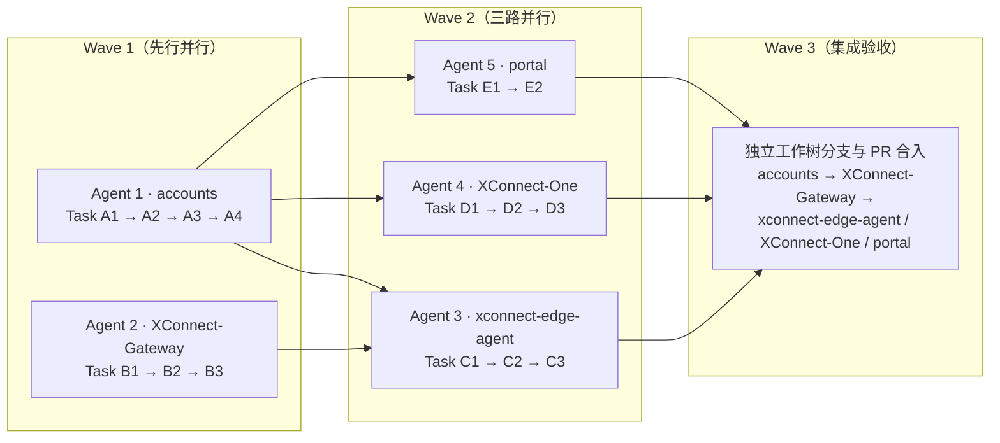

# 后续任务拆解与跨仓并行调度矩阵

> [!NOTE]
> 本文档将 XConnect Zero 控制面/数据面解耦、Agent Proxy 混合部署与控制台点亮目标拆解为**可直接派发执行的 5 大模块、16 个具体开发任务**，每个任务均包含建议分支、目标、修改文件、函数/结构体/路由签名及**可机器判定的验收标准**。

---

## 一、具体开发任务拆解（按仓库与执行编号）

### 模块 A：`accounts.svc.plus`（仓库：`ai-workspace-services/accounts`）

#### Task A1：Overlay 网络模式扩展与遥测持久化 Schema

- **建议分支**：`feature/zero-telemetry-and-mode-schema`
- **目标**：为网络表增加互联模式字段，并新建边缘遥测与流量抽样持久化表。
- **修改文件**：
  - `repository.go`：
    - `NetworkRecord` 增加 `ConnectionMode string`（列 `connection_mode`，默认 `'wg_vless_l3'`，枚举 `wg_vless_l3 | wg_udp_l3 | wg_vless_l2`）；
    - 新增 `DeviceTelemetryRecord`（表 `overlay_device_telemetry`：`device_id, network_id, role, healthy, applied_config_id, applied_generation, connection_mode, active_path, endpoint, rtt_ms, rx_bytes, tx_bytes, internet_rx_bytes, internet_tx_bytes, private_rx_bytes, private_tx_bytes, latest_handshake_at, peers_json, top_apps_json, sampled_at, updated_at`）；
    - `AutoMigrate` 注册新模型。
  - `domain.go`：
    - `Network`、`GatewaySignedConfig`、`SignedConfig` 增加 `ConnectionMode string`（纳入 `signingBytes` 与 `gatewaySigningBytes` Ed25519 签名域）。
  - `sql/migrations/`：新增对应 `.up.sql` 迁移并同步 `sql/init/` 清单。
- **验收标准**：
  - `go test ./internal/overlay/... ./internal/migrate/...` 全部通过；
  - `GatewaySignedConfig` 与 `SignedConfig` 包含 `connection_mode` 且签名验签单测通过。

#### Task A2：Edge-Agent 状态与 Gateway 遥测入库闭环

- **建议分支**：`feature/zero-edge-agent-telemetry-ingest`
- **目标**：扩展 `/api/agent-server/v1/status` 接收 `xconnect-edge-agent` 采集的 Gateway/One 运行态与流量数据并落库。
- **修改文件**：
  - `types.go`：
    - `StatusReport` 新增 `GatewayTelemetry *GatewayTelemetry`；
    - 定义 `GatewayTelemetry`、`GatewayTrafficSummary`、`GatewayPeerTelemetry`、`GatewayAppTraffic` 结构体。
  - `agent_server.go`：
    - `reportAgentStatus` 校验 `report.GatewayTelemetry` 与 `report.Overlay` 归属（`DeviceID/GatewayID == identity.NodeID`）、切片长度上限（`Peers <= 512, TopApps <= 64`）；
    - 将观测数据传入 `h.overlayService.RecordRuntimeObservation`。
  - `service.go`：
    - 升级 `RecordRuntimeObservation`：在事务中更新 `overlay_devices.last_seen_at` 并 upsert `overlay_device_telemetry`，同时将 Gateway 报告中的活跃 One Peer 握手/流量映射更新到对应 One 设备观测记录。
- **验收标准**：
  - `go test ./api/... ./internal/overlay/... -run "Test.*RuntimeObservation|Test.*AgentStatus"` 通过；
  - 已撤销（`revoked`）设备或跨网络伪造 `nodeId` 的上报返回 `403`/`ErrNotFound`，不污染数据库。

#### Task A3：XConnect-One 登录选点与直接入网 API（含下线 Legacy）

- **建议分支**：`feature/zero-user-gateways-and-enroll`
- **目标**：为已登录 `accounts.svc.plus` 的 `XConnect-One` 客户端提供可用 Gateway Endpoint 列表查询与一键设备凭证签发接口，并移除未签名旧版接口。
- **修改文件**：
  - `overlay_v1.go` & `http.go`：
    - 在 `userGroup`（`AuthMiddleware` + `RequireActiveUser`）下新增：
      - `GET /api/overlay/v1/gateways` → `overlayHTTP.UserGateways`
      - `POST /api/overlay/v1/devices/enroll` → `overlayHTTP.UserEnrollDevice`
  - `service.go`：
    - `UserGateways(ctx, userID)`：查询用户有权限的 `overlay_networks` 及关联 Gateway 的 `overlay_device_telemetry`，返回 `gateway_id`、`network_id`、`display_name`、`gateway_endpoint_host`、`gateway_endpoint_port`、`transport_server_name`、`transport_port`、`connection_mode`、`runtime_healthy`、`last_seen_at`；
    - `UserEnrollDevice(ctx, userID, req)`：校验用户对目标 `network_id + gateway_id` 的权限，幂等创建/更新 `DeviceRecord`（分配 Overlay IP）并签发 `DeviceCredential`（`xdc_...`）+ `EnrollmentToken`（`xenr_...`）+ `SigningKeys`（响应格式与 `ExchangeResponse` 一致）。
  - `overlay.go` & `api.go`：
    - 移除旧版 `registerOverlayRoutes`（`/api/overlay/networks`, `/devices/register`, `/config`, `/config/ack`）。
- **验收标准**：
  - `go test ./api/... -run "TestOverlay"` 与契约测试 `overlay_routes_inventory_test.go` 更新并通过；
  - 携带有效用户 Bearer Token 调用 `GET /api/overlay/v1/gateways` 与 `POST /api/overlay/v1/devices/enroll` 可直接完成设备注册并拉取 `SignedConfig v2`。

#### Task A4：Admin 概览增强、SASE 遥测聚合与互联模式切换 API

- **建议分支**：`feature/zero-admin-telemetry-and-mode`
- **目标**：为 `console.svc.plus/panel/xconnect-zero` 提供遥测聚合查询与互联网络模式切换接口。
- **修改文件**：
  - `overlay_admin.go`：
    - 新增 `GET /api/overlay/v1/admin/telemetry`（权限 `xconnect.zero.read`）；
    - 新增 `PUT /api/overlay/v1/admin/networks/:networkID/mode`（权限 `xconnect.zero.manage`）。
  - `service.go` & `domain.go`：
    - `toAdminDevice` 与 `AdminOverview`：融合 `AckRecord` 与 `DeviceTelemetryRecord`，在 `AdminDevice` 输出 `runtime_healthy`, `active_path`, `rtt_ms`, `rx_bytes`, `tx_bytes`, `applied_generation`, `connection_mode`；
    - `AdminTelemetry(ctx, ownerUserID, window)`：聚合返回 `sase_traffic`（Internet vs 专用网络 RX/TX）、`connected_users`、`top_private_apps`、`top_users`；
    - `AdminUpdateNetworkMode(ctx, ownerUserID, networkID, mode)`：校验模式合法性（`wg_vless_l2` 校验 Linux Gateway），更新 `overlay_networks.connection_mode` 并令 `config_generation = config_generation + 1`。
- **验收标准**：
  - `go test ./internal/overlay/... ./api/... -run "TestAdmin"` 通过；
  - 调用 `PUT /api/overlay/v1/admin/networks/:id/mode` 后，`GatewayConfig` 与 `EnrollmentConfig` 的 `generation` 递增且 `connection_mode` 同步变更。

---

### 模块 B：`XConnect-Gateway`（仓库：`ai-workspace-xstream/XConnect-Gateway`）

#### Task B1：纯数据面收敛（剥离内嵌控制面长轮询，新增 `apply` 命令）

- **建议分支**：`feature/pure-dataplane-apply`
- **目标**：将 `XConnect-Gateway` 收敛为纯数据面执行器，移除对 `accounts.svc.plus` 的独立轮询，改由 `xconnect-edge-agent` 驱动配置应用。
- **修改文件**：
  - `main.go` & `container.go`：
    - 新增 `xconnect-gateway apply --state-dir <dir> --config <signed-config.json>` 命令：校验签名配置结构、渲染 `<state-dir>/runtime/xray.json` 与 `<iface>.conf`、执行 `wg syncconf` / `wg-quick up`、路由调和、按需重启 `xconnect-gateway-xray.service` 与 `xconnect-gateway-relay.service`，输出 JSON 结果 `{ "config_id", "generation", "applied": true }`；
    - `serveContainer` 移除向 `accounts` 发起 HTTP 请求的定时器，改为纯数据面守护（监听本地配置变更信号或等待 `xconnect-edge-agent` 调用 `apply` 并守护 `xray` + `relay` 子进程）。
- **验收标准**：
  - `go test ./...` 全部通过；
  - 在无外网控制面连接条件下，给定合法本地 `signed-config.json` 与 `state.json`，`xconnect-gateway apply` 可完成校验与渲染。

#### Task B2：独立 Xray 后端隔离与多连接模式（`wg_vless_l3` / `wg_udp_l3` / `wg_vless_l2`）支持

- **建议分支**：`feature/independent-xray-and-connection-modes`
- **目标**：支持与 Agent Proxy 同机混部时的独立 Xray 后端（独立配置、独立 Socket、独立 Stats API 端口），并支持三种连接模式渲染。
- **修改文件**：
  - `contract.go`：
    - `Config` 增加 `ConnectionMode string`（`json:"connection_mode,omitempty"`，默认 `wg_vless_l3`）并纳入 `signingBytes()`；
    - `Xray()` 渲染独立 Xray 配置时默认注入本地独立 Stats API（`127.0.0.1:10087`，可通过 `--stats-listen` 或环境变量覆盖，避免与同机 Agent Proxy 的 `127.0.0.1:10086` 冲突）及 `policy.levels.0` 流量统计开关；
    - 当 `ConnectionMode == "wg_udp_l3"` 时，允许 WireGuard 直接在 `ListenPort` 接收公网 peer 握手，Xray 仅按需保留或旁路。
- **验收标准**：
  - `go test ./internal/gateway/...` 通过，包括 `xray_local_validation_test.go` 使用 `xray run -test` 验证生成的配置合法且不与 `10086` 冲突。

#### Task B3：本地非敏感状态与 SASE 遥测导出（`overlay-status.json` & `gateway-telemetry.json`）

- **建议分支**：`feature/local-telemetry-export`
- **目标**：采集本机 WireGuard、独立 Xray Stats 与 Relay 会话指标，输出供 `xconnect-edge-agent` 读取的标准化非敏感 JSON 文件。
- **修改文件**：
  - 新建 `internal/gateway/telemetry.go`：
    - 解析 `wg show <iface> dump` 获取各 Peer 的 `public_key` → `device_id`（对照 `signed-config.json` 中的 `Peers`）、`endpoint`、`latest_handshake`、`rx_bytes`、`tx_bytes`；
    - 查询独立 Xray Stats（`127.0.0.1:10087`）与 `internal/relay/server.go` 活跃会话统计，计算 `internet_rx/tx_bytes` 与 `private_rx/tx_bytes` 及 `top_apps`；
    - 原子写入 `<state-dir>/runtime/overlay-status.json` 与 `<state-dir>/runtime/gateway-telemetry.json`（TTL `60s`，权限 `0640`，绝不写入 `PrivateKey` 或 `Credential`）。
  - `main.go`：
    - `xconnect-gateway status [--json] [--write-runtime]` 支持即时采集并写出上述两个文件。
- **验收标准**：
  - 单测验证生成的 `overlay-status.json` 与 `gateway-telemetry.json` 不含任何私钥/凭据字符串，且能被 `xconnect-edge-agent` 直接反序列化。

---

### 模块 C：`xconnect-edge-agent`（仓库：`ai-workspace-xstream/xconnect-edge-agent`）

#### Task C1：新增 Gateway 配置控制面协调器（`internal/gatewayctrl`）

- **建议分支**：`feature/gateway-control-plane-syncer`
- **目标**：当 `xconnect-edge-agent` 运行于 Gateway 控制模式时，自动与 `accounts.svc.plus` 同步 `GatewaySignedConfig`、调用本地 `xconnect-gateway apply` 并回传 ACK。
- **修改文件**：
  - `config.go`：
    - `Config` 新增 `Gateway GatewayConfig`（或扩展 `Agent`）：包含 `StateDir`（默认 `/var/lib/xconnect-gateway`）、`TelemetryPath`、`ApplyCommand`（默认 `["xconnect-gateway", "apply", "--state-dir", "/var/lib/xconnect-gateway"]`）、`Frontend`、`ListenSocket`。
  - 新建 `internal/gatewayctrl/syncer.go`：
    - 读取 `<state-dir>/state.json` 中的 `GatewayID, NetworkID, Credential, SigningKeys`；
    - 自动续期 `POST /api/overlay/v1/device/session` 获取 `EnrollmentToken`；
    - 轮询 `GET /api/overlay/v1/gateway/signed-config`（支持 ETag 缓存命中跳过），校验 Ed25519 签名与 `generation`；
    - 原子写入 `<state-dir>/runtime/signed-config.json`，执行 `ApplyCommand`，成功后调用 `POST /api/overlay/v1/enrollment/signed-config/:generation/ack` 并更新 tracker 状态。
  - `runner.go`：
    - 当 `opts.Agent.EffectiveRole() == config.RoleGateway`（或同时启用了 `opts.Gateway.Enabled`）时启动 `gatewayctrl.Syncer`。
- **验收标准**：
  - `go test ./internal/gatewayctrl/... ./internal/agentmode/...` 通过，覆盖签名校验失败拒绝应用、`generation` 变更触发 `apply` + ACK 全流程。

#### Task C2：采集 `XConnect-Gateway` 遥测并上报 `accounts.svc.plus`

- **建议分支**：`feature/gateway-telemetry-collector`
- **目标**：采集 `overlay-status.json` 与 `gateway-telemetry.json`，随心跳上报 `accounts.svc.plus` 并导出 OTel 指标。
- **修改文件**：
  - `types.go`：
    - 与 `accounts` 同步新增 `GatewayTelemetry` 结构体并挂载到 `StatusReport.GatewayTelemetry`。
  - `overlay_status.go`：
    - `readOverlayStatus` 允许 `path.Path` 为 `"direct-lan"`, `"relay"`, `"vless-xhttp"`, `"wg-udp"`；
    - 新增 `readGatewayTelemetry(agent config.Agent, path string) *agentproto.GatewayTelemetry`（同样强制绝对路径、非 symlink、大小 `<= 256 KiB`、校验 `GatewayID == NodeID`、`NetworkID` 及 `ExpiresAt`）。
  - `runner.go` & `telemetry.go`：
    - `buildStatusReport` 在 `RoleGateway` 下填充 `report.Overlay`、`report.GatewayTelemetry`、`report.Users = len(connectedPeers)`、`report.SyncRevision = fmt.Sprint(appliedGeneration)`。
- **验收标准**：
  - `go test -race ./internal/agentmode/...` 通过，验证 symlink、超大文件、跨设备 ID、过期遥测均被安全拒绝。

#### Task C3：支持 Agent Proxy + `XConnect-Gateway` 同机混合部署

- **建议分支**：`feature/hybrid-agent-proxy-gateway-deploy`
- **目标**：支持在任意 Agent Proxy 节点上同机混合部署一个拥有唯一 `Gateway ID` 与独立域名的 `XConnect-Gateway`（共享宿主 `xray-core` 与 Ingress，各自独立 Xray 后端）。
- **修改文件**：
  - `scripts/setup-proxy.sh` & `deploy/ansible/roles/xconnect_edge_agent/`：
    - 支持可选参数 `--gateway-domain <gw-domain>` 与 `--gateway-socket /run/xconnect-gateway/xray.sock`；
    - 在宿主 Ingress（`Caddyfile` / `Fluxgate` / `HAProxy`）中除原有的 Agent Proxy 域名块（转发 `/dev/shm/xray.sock`）外，按需生成独立的 Gateway 域名虚拟主机块（转发 `/run/xconnect-gateway/xray.sock`）；
    - 提供独立的 `xconnect-edge-agent-gateway.service`（或双 Profile 配置）模板，使其与管理 `/usr/local/etc/xray/config.json` 的 `xconnect-edge-agent.service` 彻底隔离。
- **验收标准**：
  - `go test ./internal/config/... -run "TestSetupProxy"` 与 `pytest tests/` 全部通过；
  - 同一主机上重启 Gateway Xray 后端不影响 Agent Proxy 的 `xray.service`，反之亦然。

---

### 模块 D：`XConnect-One`（仓库：`ai-workspace-xstream/XConnect-One`）

#### Task D1：新增 `xconnect login` / `logout` 统一对接 `accounts.svc.plus` 认证

- **建议分支**：`feature/cli-accounts-login`
- **目标**：提供 `xconnect login` 子命令，支持账号密码+MFA 及浏览器 OAuth 登录 `accounts.svc.plus`，安全保存用户会话。
- **修改文件**：
  - 新建 `overlay/controlplane/auth.go`：
    - 实现 `LoginPassword(ctx, LoginRequest)`（调用 `POST /api/auth/login`，支持 `mfaRequired` 挑战续交 TOTP）；
    - 实现 `LoginOAuthWeb(ctx, OAuthLoginRequest)`（启动 `127.0.0.1:0` 临时回调服务，打开 `/api/auth/oauth/login/:provider`，捕获 `exchange_code` 后调用 `POST /api/auth/token/exchange`）。
  - `overlay/credential/`：
    - 新增用户态 `AccountSessionRecord` 存储接口（复用 Keychain / `0600` 保护文件，与设备态 `DeviceCredential` 隔离键名）。
  - `main.go`：
    - `runWithFactories` 新增 `case "login":` 与 `case "logout":`；
    - 支持参数：`--server`（默认 `https://accounts.svc.plus`）、`--email`/`--identifier`、`--password-stdin`、`--totp`、`--web`、`--provider`、`--status`。
- **验收标准**：
  - `go test ./overlay/controlplane/... ./cmd/xconnect/... -run "TestLogin"` 通过；
  - 命令行传入明文 `--password` 直接报错拒绝，仅允许 `--password-stdin`、交互隐藏输入或 `--web`。

#### Task D2：Gateway Endpoint 列表发现、选点接入与移除 `ConfigContractLegacy`

- **建议分支**：`feature/select-gateway-endpoint-and-drop-legacy`
- **目标**：支持在 `xconnect login` 或 `xconnect join` 时列出并选择 `xconnect-gateway` endpoint，直接通过用户会话完成签名设备入网，并删除旧版未签名配置代码。
- **修改文件**：
  - `enrollment.go` & `routes.go`：
    - 新增 `RouteUserGateways`（`GET /api/overlay/v1/gateways`）与 `RouteUserDeviceEnroll`（`POST /api/overlay/v1/devices/enroll`）及对应客户端方法 `ListGateways`、`EnrollDevice`。
  - `client.go` & `join.go`：
    - 删除 `RegisterDevice`（`/devices/register`）、`GetConfig`（`/config`）与 `ConfigContractLegacy` 分支，全量统一为 `SignedConfig v2` + `DeviceCredential`；
    - `Joiner.Join` 支持传入已选定的 `GatewayID` / `Endpoint` / `NetworkID`，当不存在邀请码但存在已登录的用户会话 Token 时，自动调用 `EnrollDevice` 完成入网与本地运行时应用。
  - `main.go`：
    - `xconnect login`（及 `xconnect join`）新增 `--gateway-id`、`--endpoint`、`--network-id`、`--list-gateways` 选项；若未指定且处于交互终端，列出可用 Gateway Endpoint 供用户选择。
- **验收标准**：
  - `go test ./...` 全绿，`routes_contract_test.go` 与 `signed_join_test.go` 更新通过；
  - 执行 `xconnect login --gateway-id <id>` 可一站式完成认证、选定 Gateway、换取 `DeviceCredential` 并拉取应用 `SignedConfig v2`。

#### Task D3：扩展 `app-bridge` 支持桌面客户端登录与选点

- **建议分支**：`feature/app-bridge-login-and-gateways`
- **目标**：将新增的登录与 Gateway Endpoint 选择能力暴露给 `xconnect app-bridge`。
- **修改文件**：
  - `app_bridge.go` & `app_bridge_test.go`：
    - `appBridgeMethods` 增加 `"login", "logout", "gateways"`；
    - `appBridgeJoinParams` 支持可选 `"gateway_id"` 与 `"endpoint"`（允许在已登录状态下免 invite 直接入网）。
- **验收标准**：
  - `go test ./cmd/xconnect/... -run "TestAppBridge"` 通过。

---

### 模块 E：`console.svc.plus/panel/xconnect-zero`（仓库：`ai-workspace-services/portal`）

#### Task E1：BFF 代理路由与前端类型契约扩展

- **建议分支**：`feature/xconnect-zero-telemetry-and-mode-bff`
- **目标**：在不改动 UI 布局的前提下，打通 Portal 到 `accounts` 的遥测查询与互联模式切换 BFF 路由。
- **修改文件**：
  - `route.ts`：
    - `ALLOWED_ROUTES` 新增 `["GET telemetry", "/admin/telemetry"]`（保留安全 query 参数 `window`）；
    - `resolveRoute` 新增 `method === "PUT" && segments.length === 3 && segments[0] === "networks" && segments[2] === "mode"` 映射到 `/admin/networks/${encodeURIComponent(segments[1])}/mode`。
  - `xconnectZero.ts`：
    - 扩展 `XConnectZeroAdminOverview`、`XConnectZeroNetwork`（增加 `connection_mode`）、`XConnectZeroDevice`（增加 `runtime_healthy, active_path, rtt_ms, rx_bytes, tx_bytes, applied_generation`）；
    - 新增 `XConnectZeroTelemetry` 类型与校验守卫 `isXConnectZeroTelemetry`。
- **验收标准**：
  - `pnpm test src/app/api/xconnect-zero/[...segments]/route.test.ts` 通过。

#### Task E2：点亮 `Zero 概览`、`节点管理` 与 `配置管理`（保持现有 UI 结构不变）

- **建议分支**：`feature/xconnect-zero-console-live-data`
- **目标**：保持 `xconnect-zero-node-management.tsx` 现有三栏 Tab 与卡片骨架不变，点亮全部动态数据与互联模式切换。
- **修改文件**：
  - `xconnect-zero-node-management.tsx`：
    - **`Zero 概览` Tab**：
      - `refresh()` 并行请求 `/api/xconnect-zero/telemetry`；
      - `Telemetry` 组件保持原有卡片外框、标题与描述，传入真实数据时渲染：
        - **SASE 流量分析**：Internet vs 专用网络上下行流量对比条与汇总；
        - **已连接用户**：当前在线用户/设备、所连 Gateway、路径（`vless-xhttp` / `direct-lan` / `relay`）与 RTT 列表；
        - **热门专用应用程序**：Top 应用/端口流量列表；
        - **热门用户**：Top 用户流量列表（无数据时仍优雅显示 `暂无数据`）。
    - **`节点管理` Tab**：
      - `已加入节点` 每行副标题追加展示 `在线/离线`、`active_path`、`RTT`、`RX/TX` 与 `gen`；
      - 一键接入脚本区为 One 角色补充 `xconnect login --server https://accounts.svc.plus --gateway-id <gateway_id>` 快捷接入命令。
    - **`配置管理` Tab**：
      - 解除 `Gateway / One 互联网络模式` 3 张模式卡片的 `disabled`，绑定当前选中网络的 `connection_mode`，点击切换时调用 `PUT /api/xconnect-zero/networks/:id/mode` 并刷新 `config_generation`；
      - `IP 分配` 与 `WG 与签名证书` 卡片展示真实的已分配节点 IP 数 / 网段容量、以及 `overview.signingKeyId` 与当前网络 `config_generation`。
- **验收标准**：
  - `pnpm test src/modules/extensions/builtin/xconnect-zero/` 全部单测与快照测试通过。

---

## 二、跨仓执行顺序与并行调度矩阵

| 执行波次 | 并行工作流（可分别交由独立 Sub-Agent 推进） | 依赖关系 |
| :--- | :--- | :--- |
| **Wave 1（先行并行）** | - **Agent 1 (`accounts`)**：执行 `Task A1` → `A2` → `A3` → `A4` - **Agent 2 (`XConnect-Gateway`)**：执行 `Task B1` → `B2` → `B3` | 两仓无编译依赖，对齐好 JSON 字段名即可同时开发 |
| **Wave 2（三路并行）** | - **Agent 3 (`xconnect-edge-agent`)**：执行 `Task C1` → `C2` → `C3` - **Agent 4 (`XConnect-One`)**：执行 `Task D1` → `D2` → `D3` - **Agent 5 (`portal`)**：执行 `Task E1` → `E2` | 对齐 Wave 1 的 API 契约即可三端并行编码与单测验证 |
| **Wave 3（集成验收）** | 各仓提交独立工作树分支与 PR，按 `accounts` → `XConnect-Gateway` → `xconnect-edge-agent` / `XConnect-One` / `portal` 顺序合入验证 | 端到端闭环验收 |
